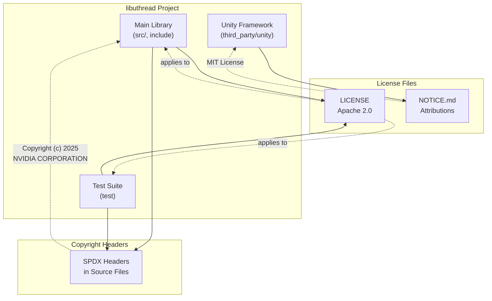
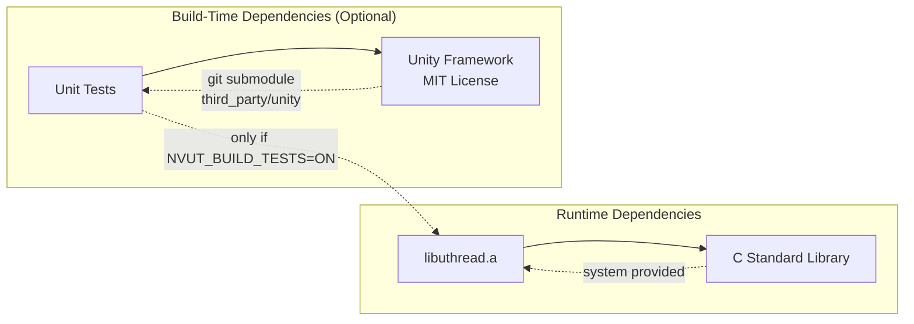
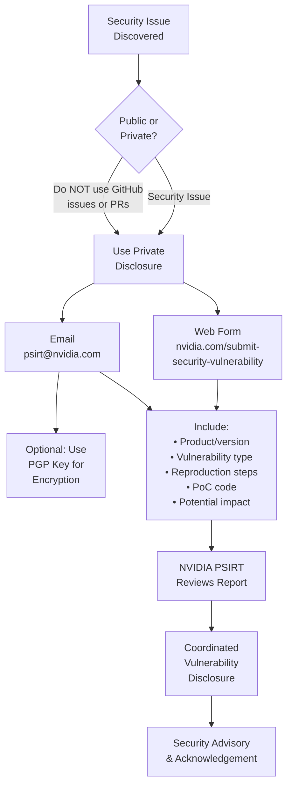
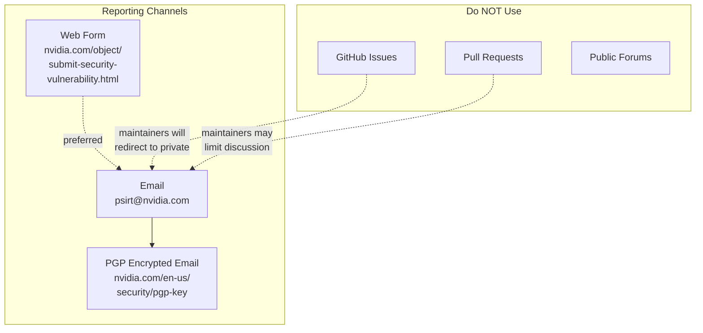

<!-- source: DeepWiki mcp.deepwiki.com · repo NVIDIA/libuthread · page 8 Legal and Security · fetched 2026-10-26 -->

# Legal and Security

<details>
<summary>Relevant source files</summary>

The following files were used as context for generating this wiki page:

- [LICENSE](LICENSE)
- [NOTICE.md](NOTICE.md)
- [SECURITY.md](SECURITY.md)

</details>


This page provides an overview of the legal framework and security policies governing the libuthread project. It covers the licensing terms under which the library is distributed, copyright attribution requirements, and procedures for reporting security vulnerabilities.

For detailed information about specific licensing terms and obligations, see [License](#8.1). For security vulnerability reporting procedures and contact information, see [Security Policy](#8.2).

## Licensing Structure

The libuthread project uses a dual-licensing approach depending on the component. The main library code is distributed under the Apache License 2.0, while test dependencies use the MIT License.

### License Component Architecture



**Licensing Component Structure**: The main library components (`src/uthread.c`, `src/uthread.x86_64.S`, `src/uthread.aarch64.S`, `include/uthread.h`) and test suite (`test/basic_tests.c`) are licensed under Apache License 2.0. The Unity test framework in `third_party/unity` is distributed under the MIT License and is only required for building tests, not for using the library itself.

Sources: [LICENSE:1-203](), [NOTICE.md:1-55]()

### Copyright Attribution

All source files in the libuthread project include standardized SPDX copyright headers:

| Component | Copyright Holder | License Identifier |
|-----------|-----------------|-------------------|
| Main library code | NVIDIA CORPORATION & AFFILIATES | Apache-2.0 |
| Test code | NVIDIA CORPORATION & AFFILIATES | Apache-2.0 |
| Documentation | NVIDIA CORPORATION & AFFILIATES | Apache-2.0 |
| Unity framework | Mike Karlesky, Mark VanderVoord, Greg Williams | MIT |

The SPDX header format used throughout the codebase follows this pattern:

```
SPDX-FileCopyrightText: Copyright (c) 2025 NVIDIA CORPORATION & AFFILIATES. All rights reserved.
SPDX-License-Identifier: Apache-2.0
```

This standardized format appears in [NOTICE.md:2-3]() and is replicated in all project source files.

Sources: [NOTICE.md:1-16]()

### Dependency Licensing

The library has minimal dependencies, which simplifies compliance:



**Dependency Structure**: The compiled `libuthread.a` static library depends only on the C standard library at runtime. The Unity test framework is an optional build-time dependency linked as a git submodule, used exclusively for running `test/basic_tests.c`. Unity's MIT License permits unrestricted use, modification, and distribution.

Sources: [NOTICE.md:23-54]()

## Apache License 2.0 Key Terms

The Apache License 2.0 provides the following permissions and conditions:

### Permissions Granted

| Permission | Description | Reference |
|-----------|-------------|-----------|
| **Copyright License** | Perpetual, worldwide, non-exclusive, royalty-free right to reproduce, prepare derivative works, display, perform, sublicense, and distribute | [LICENSE:67-72]() |
| **Patent License** | Royalty-free patent license for claims necessarily infringed by contributions | [LICENSE:74-88]() |
| **Redistribution** | May distribute in source or binary form with or without modifications | [LICENSE:90-93]() |

### Obligations for Redistribution

When redistributing the work or derivative works, users must:

1. **Include License Copy**: Provide recipients with a copy of the Apache License 2.0 ([LICENSE:95-96]())
2. **Mark Modifications**: Add prominent notices in modified files stating the changes ([LICENSE:98-99]())
3. **Preserve Notices**: Retain copyright, patent, trademark, and attribution notices from the source ([LICENSE:101-106]())
4. **Include NOTICE File**: If present, distribute attribution notices from the NOTICE file ([LICENSE:107-122]())

Sources: [LICENSE:1-203]()

## Security Reporting

NVIDIA maintains a Product Security Incident Response Team (PSIRT) that handles security vulnerability reports for all NVIDIA products, including libuthread.

### Security Vulnerability Reporting Flow



**Security Reporting Process**: Security vulnerabilities must not be reported through public GitHub issues or pull requests. Instead, use NVIDIA's web-based submission form at `nvidia.com/object/submit-security-vulnerability.html` or email `psirt@nvidia.com`. For sensitive information, NVIDIA provides a PGP key for encrypted email communication. Reports should include product version, vulnerability type, reproduction steps, proof-of-concept code, and potential impact analysis.

Sources: [SECURITY.md:1-25]()

### Required Information for Security Reports

When reporting a security vulnerability, include the following details:

| Field | Description | Example |
|-------|-------------|---------|
| **Product/Driver Name** | Specific component affected | "libuthread" |
| **Version/Branch** | Exact version or git branch | "v1.0.0" or "main branch commit abc123" |
| **Vulnerability Type** | Classification of the issue | "buffer overflow", "use-after-free", "race condition" |
| **Reproduction Steps** | Detailed instructions to trigger | Step-by-step procedure with environment details |
| **Proof-of-Concept** | Exploit code or test case | Minimal code demonstrating the vulnerability |
| **Potential Impact** | Security implications | "Remote code execution", "denial of service" |

Sources: [SECURITY.md:13-18]()

### Contact Methods



**Communication Channels**: The primary contact methods are the NVIDIA security vulnerability submission form and the `psirt@nvidia.com` email address. For sensitive communications, use NVIDIA's PGP public key available at `nvidia.com/en-us/security/pgp-key`. Public disclosure through GitHub issues or pull requests is prohibited. If a vulnerability is inadvertently reported publicly, NVIDIA maintainers will limit discussion and redirect the reporter to private channels.

Sources: [SECURITY.md:5-12]()

### Coordinated Vulnerability Disclosure Policy

NVIDIA follows a coordinated vulnerability disclosure (CVD) policy:

- **No Bug Bounty Program**: NVIDIA does not currently offer monetary rewards for vulnerability reports ([SECURITY.md:20]())
- **Acknowledgement**: Externally reported security issues receive public acknowledgement when addressed ([SECURITY.md:20]())
- **PSIRT Policies**: Full policy details available at `nvidia.com/en-us/security/psirt-policies/` ([SECURITY.md:20]())
- **Product Security Portal**: General security information at `nvidia.com/en-us/security` ([SECURITY.md:24]())

Sources: [SECURITY.md:20-24]()

## Compliance Checklist

When using or distributing libuthread, ensure compliance with these requirements:

### For Users of the Library

| Requirement | Applicable | Action Required |
|-------------|-----------|-----------------|
| Include LICENSE file | ✓ Always | Distribute [LICENSE:1-203]() with any binary distribution |
| Preserve copyright notices | ✓ Always | Keep SPDX headers in source files if distributing source |
| Include NOTICE.md | ✓ Recommended | Distribute [NOTICE.md:1-55]() for attribution clarity |
| No trademark usage | ✓ Always | Do not use NVIDIA trademarks without permission ([LICENSE:139-142]()) |

### For Contributors

| Requirement | Applicable | Action Required |
|-------------|-----------|-----------------|
| Sign-off commits | ✓ Always | Use `git commit -s` for Developer Certificate of Origin (see [Contributing Guidelines](#7.1)) |
| Apache 2.0 licensing | ✓ Always | All contributions automatically licensed under Apache 2.0 ([LICENSE:131-137]()) |
| Security disclosure | ✓ If applicable | Report vulnerabilities via PSIRT, not GitHub issues |
| Maintain SPDX headers | ✓ Always | Include copyright headers in new source files |

Sources: [LICENSE:1-203](), [NOTICE.md:1-55](), [SECURITY.md:1-25]()

## File Location Reference

The following table maps legal and security documentation to their repository locations:

| Document | File Path | Purpose |
|----------|-----------|---------|
| Main License | [LICENSE:1-203]() | Full Apache License 2.0 text |
| Attribution Notice | [NOTICE.md:1-55]() | Copyright, dependency licenses, and credits |
| Security Policy | [SECURITY.md:1-25]() | Vulnerability reporting procedures |
| Contributing Guide | [CONTRIBUTING.md]() | Includes DCO requirements (see [Contributing Guidelines](#7.1)) |

Sources: [LICENSE:1-203](), [NOTICE.md:1-55](), [SECURITY.md:1-25]()

---

