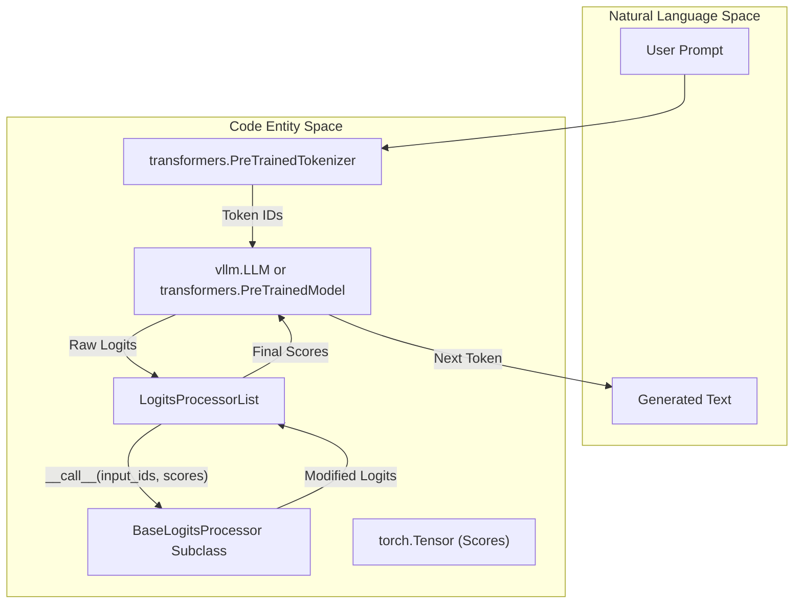
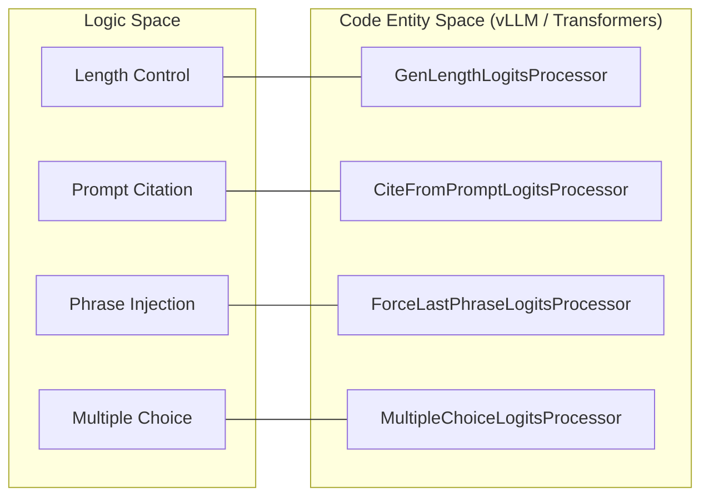

<!-- source: DeepWiki mcp.deepwiki.com · repo NVIDIA/logits-processor-zoo · page 1.1 Getting Started · fetched 2026-10-26 -->

# Getting Started

<details>
<summary>Relevant source files</summary>

The following files were used as context for generating this wiki page:

- [.github/workflows/python-app.yml](.github/workflows/python-app.yml)
- [README.md](README.md)
- [pyproject.toml](pyproject.toml)

</details>


This page provides a technical guide for installing `logits-processor-zoo` and integrating its components into Large Language Model (LLM) generation pipelines. The library offers a collection of specialized `LogitsProcessor` implementations designed to control model behavior through direct logit manipulation across multiple inference frameworks.

## Installation

The library is managed using [Poetry](https://python-poetry.org) and is available on PyPI. It requires Python version 3.10 or higher [pyproject.toml:10-10]().

### Standard Installation
For basic usage with Hugging Face `transformers`, install via `pip`:
```bash
pip install logits-processor-zoo
```
[README.md:15-15]()

### Optional Extras
The library supports multiple backends. To use the `vLLM` integration, you must install the optional dependency [pyproject.toml:14-17]():
```bash
pip install logits-processor-zoo[vllm]
```

### Dependency Overview
The core functionality relies on the following primary dependencies [pyproject.toml:11-13]():
*   `torch`: Tensor operations and logit manipulation.
*   `transformers`: Base classes and tokenizer utilities (>= 4.41.2).
*   `accelerate`: Model loading and optimization (>= 0.26.1).

**Sources:** [pyproject.toml:9-17](), [README.md:12-16]()

## Integration Patterns

Integrating a processor involves instantiating the desired class from the framework-specific module (e.g., `logits_processor_zoo.vllm` or `logits_processor_zoo.transformers`) and passing it to the model's generation call.

### Data Flow Architecture
The following diagram illustrates how the `LogitsProcessor` entities interact with the generation loop in a typical inference pipeline.

**LLM Generation Loop with LogitsProcessor**

**Sources:** [README.md:25-56](), [logits_processor_zoo/transformers/base.py:1-40]() (referenced for lifecycle logic)

### Usage with vLLM
In `vLLM`, processors are passed via the `SamplingParams` object [README.md:44-55]().

```python
import vllm
from logits_processor_zoo.vllm import GenLengthLogitsProcessor

# Initialize model
model = vllm.LLM(model_name="...", trust_remote_code=True)
tokenizer = model.get_tokenizer()

# Instantiate processor
lp = GenLengthLogitsProcessor(tokenizer, boost_factor=-0.2)

# Generate with processors
output = model.generate(
    "Once upon a time",
    vllm.SamplingParams(
        logits_processors=[lp],
        max_tokens=64
    )
)
```
[README.md:25-56]()

### Usage with Transformers
For Hugging Face `transformers`, processors are passed as a `LogitsProcessorList` to the `.generate()` method.

```python
from transformers import AutoModelForCausalLM, AutoTokenizer, LogitsProcessorList
from logits_processor_zoo.transformers import CiteFromPromptLogitsProcessor

tokenizer = AutoTokenizer.from_pretrained(model_id)
model = AutoModelForCausalLM.from_pretrained(model_id)

lp_list = LogitsProcessorList([
    CiteFromPromptLogitsProcessor(tokenizer, boost_factor=2.0)
])

output = model.generate(
    **inputs,
    logits_processor=lp_list,
    max_new_tokens=50
)
```
**Sources:** [README.md:19-21](), [logits_processor_zoo/transformers/base.py:1-40]()

## Core Framework Entities

The library mirrors its structure across frameworks to ensure a consistent API while respecting the specific requirements of each backend (e.g., `vLLM` requires a `clone()` method for stateful processors during batching).

**System Mapping: Logic to Code**

**Sources:** [README.md:61-94]()

### Key Processor Functions
| Processor | Purpose | Key Parameters |
| :--- | :--- | :--- |
| `GenLengthLogitsProcessor` | Adjusts EOS likelihood based on current length | `boost_factor`, `p` [README.md:63-65]() |
| `CiteFromPromptLogitsProcessor` | Boosts/suppresses tokens found in the prompt | `boost_factor` [README.md:66-68]() |
| `ForceLastPhraseLogitsProcessor` | Injects a specific phrase before generation ends | `phrase`, `tokenizer` [README.md:69-71]() |
| `MultipleChoiceLogitsProcessor` | Restricts output to a set of choices | `tokenizer` [README.md:72-82]() |
| `TriggerPhraseLogitsProcessor` | Inserts phrases at specific token triggers | `phrase`, `trigger_token_phrase` [README.md:83-89]() |
| `PreventHallucinationLogitsProcessor` | Falls back to a phrase if confidence is low | `threshold`, `fallback_phrase` [README.md:90-92]() |
| `MaxTimeLogitsProcessor` | Forces EOS after a wall-clock time limit | `max_time` [README.md:93-94]() |

## Development and Testing
The project uses `flake8` for linting with a configured `max-line-length` of 120 [.github/workflows/python-app.yml:31-33](), [pyproject.toml:24-25]().

Tests are executed using `pytest` and include coverage reporting [.github/workflows/python-app.yml:34-36]().
```bash
python -m pytest tests/ --cov --cov-config=.coveragerc
```

**Sources:** [.github/workflows/python-app.yml:27-36](), [pyproject.toml:24-25]()

---

