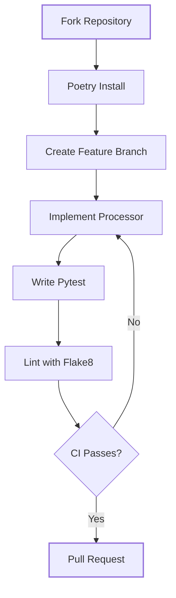
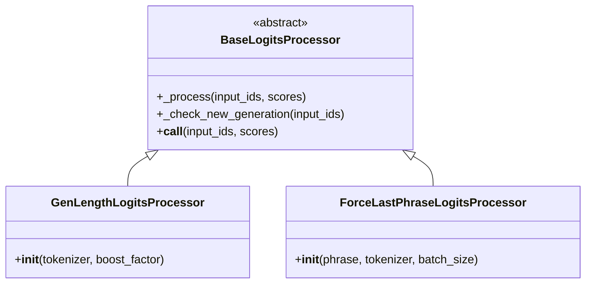
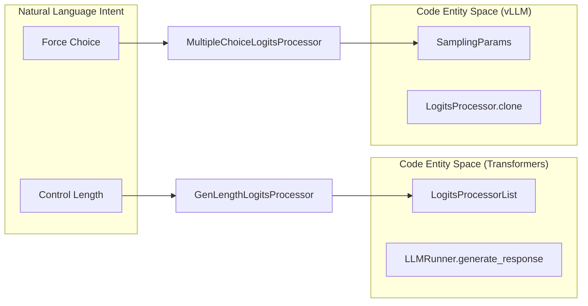
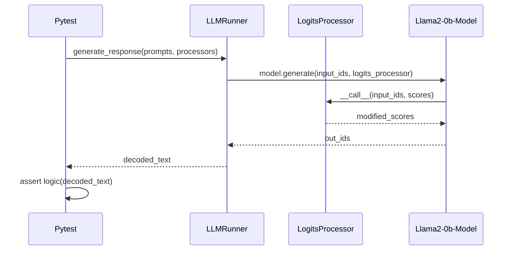

<!-- source: DeepWiki mcp.deepwiki.com · repo NVIDIA/logits-processor-zoo · page 5 Development Guide · fetched 2026-10-26 -->

# Development Guide

<details>
<summary>Relevant source files</summary>

The following files were used as context for generating this wiki page:

- [.coveragerc](.coveragerc)
- [.github/workflows/python-app.yml](.github/workflows/python-app.yml)
- [CONTRIBUTING.md](CONTRIBUTING.md)
- [pyproject.toml](pyproject.toml)
- [tests/conftest.py](tests/conftest.py)
- [tests/transformers/test_generation_length.py](tests/transformers/test_generation_length.py)
- [tests/transformers/test_last_phrase.py](tests/transformers/test_last_phrase.py)
- [tests/transformers/test_max_time.py](tests/transformers/test_max_time.py)
- [tests/transformers/test_multiple_choice.py](tests/transformers/test_multiple_choice.py)
- [tests/transformers/test_prevent_hallucination.py](tests/transformers/test_prevent_hallucination.py)
- [tests/transformers/test_trigger_phrase.py](tests/transformers/test_trigger_phrase.py)

</details>


This guide provides information for developers who want to contribute to or extend the `logits-processor-zoo` library. It covers the development environment setup, repository organization, implementation patterns, and best practices for creating and testing new logits processors.

## Table of Contents

- [Development Environment Setup](#development-environment-setup)
- [Repository Structure](#repository-structure)
- [Development Workflow](#development-workflow)
- [Creating New Logits Processors](#creating-new-logits-processors)
- [Framework Integration](#framework-integration)
- [Testing Guidelines](#testing-guidelines)
- [Contribution Guidelines](#contribution-guidelines)

## Development Environment Setup

### Prerequisites

- Python 3.10 or later [pyproject.toml:10-10]()
- [Poetry](https://python-poetry.org) for dependency management [pyproject.toml:1-3]()
- Knowledge of PyTorch and at least one supported framework (Transformers, vLLM, or TensorRT-LLM)

### Installation for Development

The project uses Poetry to manage dependencies and build processes.

```bash
# Clone the repository
git clone https://github.com/NVIDIA/logits-processor-zoo.git
cd logits-processor-zoo

# Install dependencies including optional vLLM support
poetry install --all-extras

# Install in editable mode for development
pip install -e .
```

Sources: [pyproject.toml:1-22](), [.github/workflows/python-app.yml:26-30]()

## Repository Structure

The repository follows a modular structure where processors are implemented across parallel framework directories.

**Repository Directory Structure**

```mermaid
graph TD
    Root["logits-processor-zoo/"]
    Core["logits_processor_zoo/"]
    Tests["tests/"]
    
    Root --> Core
    Root --> Tests
    Root --> ".github/workflows/"
    
    CoreTransformers["transformers/"]
    CoreVLLM["vllm/"]
    CoreTRT["tensorrt_llm/"]
    CoreUtils["utils.py"]
    
    Core --> CoreTransformers
    Core --> CoreVLLM
    Core --> CoreTRT
    Core --> CoreUtils
    
    TestsTransformers["tests/transformers/"]
    
    Tests --> TestsTransformers
    Tests --> "conftest.py"
```

Sources: [pyproject.toml:1-15](), [.github/workflows/python-app.yml:36-36](), [tests/conftest.py:23-56]()

## Development Workflow

The development process is supported by a CI/CD pipeline and standardized linting.

**Development Process**



### CI/CD and Linting
The project uses `flake8` for code style enforcement with a `max-line-length` of 120 [pyproject.toml:24-25](). The GitHub Actions pipeline automatically runs linting and the `pytest` suite upon pushes to `main` or pull requests [.github/workflows/python-app.yml:6-11]().

For details, see [Contributing and CI/CD](#5.2).

## Creating New Logits Processors

When adding a new processor, it should be implemented for all supported backends. Each framework-specific implementation typically inherits from a base class that defines the generation lifecycle.

**Processor Class Hierarchy**



Sources: [tests/transformers/test_generation_length.py:18-29](), [tests/transformers/test_last_phrase.py:18-30]()

## Framework Integration

The library bridges "Natural Language Space" (the desired LLM behavior) to "Code Entity Space" (the specific framework implementation).

**Framework Execution Mapping**



Sources: [tests/conftest.py:36-45](), [tests/transformers/test_multiple_choice.py:44-46]()

## Testing Guidelines

The test suite uses `pytest` and a specialized `LLMRunner` fixture to perform integration tests with a tiny model (`MaxJeblick/llama2-0b-unit-test`) to ensure fast execution during development [tests/conftest.py:53-56]().

**Testing Workflow**



For details, see [Testing Infrastructure](#5.1).

Sources: [tests/conftest.py:23-51](), [tests/transformers/test_generation_length.py:21-35]()

## Contribution Guidelines

### Code Contributions
1. Find or report an issue [CONTRIBUTING.md:5-11]().
2. Fork and create a branch [CONTRIBUTING.md:24-24]().
3. **Sign-off your commits**: Use `git commit -s` to certify the Developer Certificate of Origin (DCO) [CONTRIBUTING.md:41-54]().
4. Verify CI status checks in your Pull Request [.github/workflows/python-app.yml:15-36]().

### Adding a New Processor
To add a new processor to the "zoo":
1. Implement the logic in `logits_processor_zoo/transformers/`.
2. Implement the logic in `logits_processor_zoo/vllm/` (ensuring state isolation via `clone()`).
3. Add a corresponding test file in `tests/transformers/`.
4. Update the main `__init__.py` to export the new class.

Sources: [CONTRIBUTING.md:17-54](), [tests/transformers/test_trigger_phrase.py:21-38]()

# Conclusion

This development guide provides the foundation for contributing to the `logits-processor-zoo`. By following the modular framework patterns and utilizing the `LLMRunner` for testing, developers can rapidly expand the library's capabilities.

For information about specific processors, refer to the [Logits Processors](#3) section. For details on framework integrations, see [Framework Integrations](#4).

---

