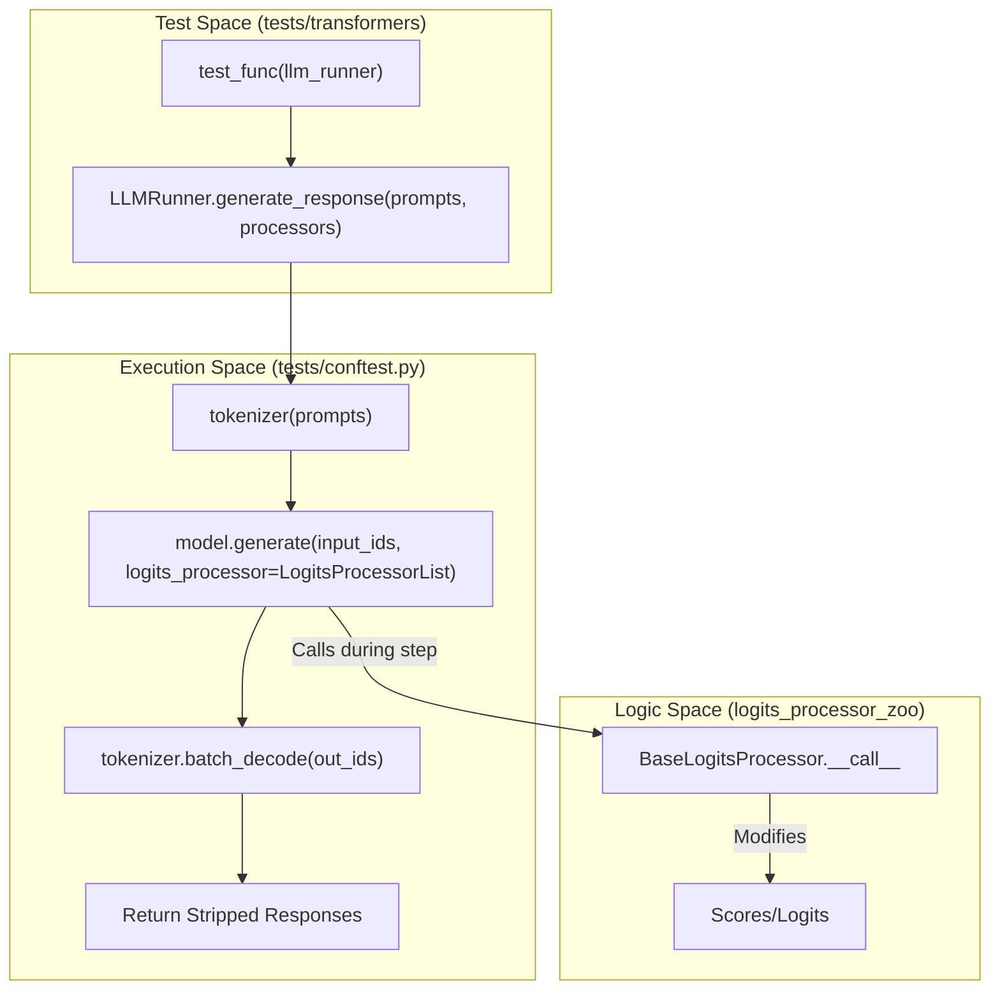
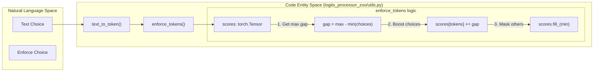

<!-- source: DeepWiki mcp.deepwiki.com · repo NVIDIA/logits-processor-zoo · page 5.1 Testing Infrastructure · fetched 2026-10-26 -->

# Testing Infrastructure

<details>
<summary>Relevant source files</summary>

The following files were used as context for generating this wiki page:

- [.coveragerc](.coveragerc)
- [logits_processor_zoo/utils.py](logits_processor_zoo/utils.py)
- [tests/conftest.py](tests/conftest.py)
- [tests/test_utils.py](tests/test_utils.py)
- [tests/transformers/test_generation_length.py](tests/transformers/test_generation_length.py)
- [tests/transformers/test_last_phrase.py](tests/transformers/test_last_phrase.py)
- [tests/transformers/test_max_time.py](tests/transformers/test_max_time.py)
- [tests/transformers/test_multiple_choice.py](tests/transformers/test_multiple_choice.py)
- [tests/transformers/test_prevent_hallucination.py](tests/transformers/test_prevent_hallucination.py)
- [tests/transformers/test_trigger_phrase.py](tests/transformers/test_trigger_phrase.py)

</details>


The `logits-processor-zoo` test suite is designed to ensure the functional correctness of logits manipulation across different LLM frameworks. It utilizes a lightweight integration testing approach, employing a specialized unit-test model to verify that processors correctly influence text generation without the computational overhead of a full-scale LLM.

## Test Suite Structure

The testing infrastructure is primarily organized under the `tests/` directory, with a specific focus on the `transformers` backend as the baseline for processor logic validation.

| Directory/File | Description |
| :--- | :--- |
| `tests/transformers/` | Integration tests for all logits processors using the Hugging Face Transformers backend. |
| `tests/test_utils.py` | Unit tests for core utility functions in `logits_processor_zoo/utils.py`. |
| `tests/conftest.py` | Shared pytest fixtures, including the `LLMRunner` for model execution. |
| `.coveragerc` | Configuration for code coverage, omitting temporary files and the test suite itself. |

**Sources:**
- `tests/transformers/`
- `tests/test_utils.py` [1-29]()
- `tests/conftest.py` [1-56]()
- `.coveragerc` [1-4]()

## The LLMRunner Fixture

The core of the integration testing framework is the `LLMRunner` class defined in `tests/conftest.py`. It provides a standardized interface for loading a model and generating responses with specific logits processors.

### Implementation Details
The `LLMRunner` initializes a `transformers` model and tokenizer with specific configurations:
- **Model**: Defaults to `MaxJeblick/llama2-0b-unit-test` via the `llm_runner` fixture [tests/conftest.py:53-56]().
- **Padding**: Sets `pad_token` to `eos_token` and configures `padding_side="left"` to support batched inference [tests/conftest.py:26-27]().
- **Generation**: The `generate_response` method wraps `model.generate`, converting a list of `logits_processor` instances into a `LogitsProcessorList` [tests/conftest.py:36-50]().

### Data Flow: Integration Test Execution

The following diagram illustrates how a test case interacts with the `LLMRunner` to validate a processor.

**Test Execution Flow**


**Sources:**
- `tests/conftest.py` [23-51]()
- `logits_processor_zoo/transformers/base.py` (referenced for lifecycle)

## Integration Testing with llama2-0b-unit-test

To ensure tests are fast and runnable in CI environments without high-end GPUs, the suite uses `MaxJeblick/llama2-0b-unit-test` [tests/conftest.py:55](). This is a tiny, functional model that follows the Llama architecture, allowing the test suite to verify:
1. **Token Identification**: Whether the processor correctly identifies tokens like EOS or newlines in a real vocabulary.
2. **Logit Modification**: Whether applying a `boost_factor` or `enforce_tokens` actually changes the output of `model.generate`.
3. **State Management**: Whether processors correctly handle batching and reset their internal state between generation steps.

### Example: Processor Validation
In `tests/transformers/test_generation_length.py`, the test compares a `default_gen_output` against a `processed_gen_output` to ensure that `GenLengthLogitsProcessor` effectively shortens the generation [tests/transformers/test_generation_length.py:21-36]().

**Sources:**
- `tests/conftest.py` [53-56]()
- `tests/transformers/test_generation_length.py` [21-36]()

## Utility Unit Tests

The file `tests/test_utils.py` contains isolated tests for the helper functions that processors rely on for token manipulation.

| Function | Test Case | Purpose |
| :--- | :--- | :--- |
| `text_to_token` | `test_text_to_token` | Verifies correct mapping of strings to vocabulary IDs, including handling of prefixes and multi-token errors [tests/test_utils.py:5-16](). |
| `get_new_line_tokens` | `test_get_new_line_tokens` | Ensures all tokens ending in `\n` are identified [tests/test_utils.py:18-19](). |
| `enforce_tokens` | `test_enforce_tokens` | Validates that specified tokens are given the highest probability in the score tensor [tests/test_utils.py:22-29](). |

**Sources:**
- `logits_processor_zoo/utils.py` [23-52]()
- `tests/test_utils.py` [1-29]()

## Coverage and Local Execution

### Running Tests Locally
Tests are managed via `pytest`. To run the suite:
```bash
pytest tests/
```

### Coverage Configuration
The `.coveragerc` file is configured to omit the `tests/` directory and temporary files from the final report to ensure that coverage metrics reflect the library's logic rather than the test code itself [/.coveragerc:1-4]().

### Mapping Utility Logic to Code
The following diagram bridges the natural language concepts of token enforcement to the specific implementation in `utils.py`.

**Token Enforcement Logic**


**Sources:**
- `logits_processor_zoo/utils.py` [23-52]()
- `tests/test_utils.py` [22-29]()
- `.coveragerc` [1-4]()

---

