# Page: Overview

# Overview

<details>
<summary>Relevant source files</summary>

The following files were used as context for generating this wiki page:

- [README.md](README.md)
- [docs/logo.jpg](docs/logo.jpg)
- [logits_processor_zoo/transformers/__init__.py](logits_processor_zoo/transformers/__init__.py)
- [logits_processor_zoo/vllm/__init__.py](logits_processor_zoo/vllm/__init__.py)
- [pyproject.toml](pyproject.toml)

</details>


The Logits Processor Zoo is a specialized toolkit designed to provide precise control over Large Language Model (LLM) generation behavior. This library offers a collection of logits processors that modify token probabilities during text generation to achieve specific output patterns, enforce constraints, and enhance LLM capabilities for targeted tasks.

## Purpose and Scope

This document introduces the key components, architecture, and usage patterns of the `logits-processor-zoo`. It provides a high-level understanding of how logits processors can be used to influence LLM outputs beyond traditional generation techniques.

For detailed installation instructions and basic usage, see [Getting Started](#1.1). For practical demonstrations, see [Examples and Notebooks](#1.2).

Sources: [pyproject.toml:2-5](), [README.md:8-10]()

## What Are Logits Processors?

Logits processors are specialized components that intercept and modify the raw token probabilities (logits) produced by an LLM during text generation. By strategically adjusting these probabilities, the processors can:

- Encourage or discourage certain tokens or sequences.
- Enforce structural constraints on generated text.
- Implement custom logic for specific generation requirements (e.g., time limits or hallucination prevention).

This approach provides more granular control than prompt engineering or traditional decoding strategies alone.

### Logits Manipulation Flow

The following diagram bridges the conceptual "Natural Language Space" with the "Code Entity Space" by showing how raw model output is transformed by the `LogitsProcessor` classes.

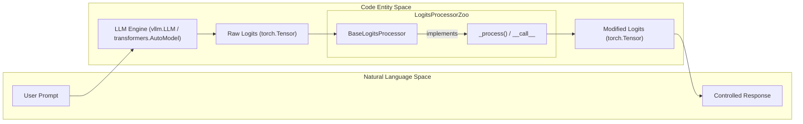

Sources: [README.md:25-56](), [logits_processor_zoo/transformers/__init__.py:18-28]()

## Key Components

The library is organized by framework integration, providing parallel implementations of processors for different backends.

### Available Processors

The zoo provides several specialized processors, each addressing different generation control needs:

| Processor Class | Purpose | Key Parameters |
|:---|:---|:---|
| `GenLengthLogitsProcessor` | Adjusts EOS likelihood based on length | `boost_factor`, `p` |
| `CiteFromPromptLogitsProcessor` | Boosts tokens found in the prompt | `boost_factor`, `boost_eos` |
| `ForceLastPhraseLogitsProcessor` | Injects a phrase before final EOS | `phrase`, `tokenizer` |
| `MultipleChoiceLogitsProcessor` | Constrains output to specific choices | `choices`, `boost_first_words` |
| `TriggerPhraseLogitsProcessor` | Inserts phrases at specific triggers | `trigger_token_phrase`, `phrase` |
| `PreventHallucinationLogitsProcessor` | Fallback phrase on low confidence | `threshold`, `fallback_phrase` |
| `MaxTimeLogitsProcessor` | Enforces EOS after a time limit | `max_time`, `complete_sentences` |

Sources: [README.md:61-94](), [logits_processor_zoo/transformers/__init__.py:18-24](), [logits_processor_zoo/vllm/__init__.py:18-24]()

## Framework Integrations

The Logits Processor Zoo supports three major LLM inference frameworks. The codebase maintains a parallel structure to ensure consistent behavior across these backends.

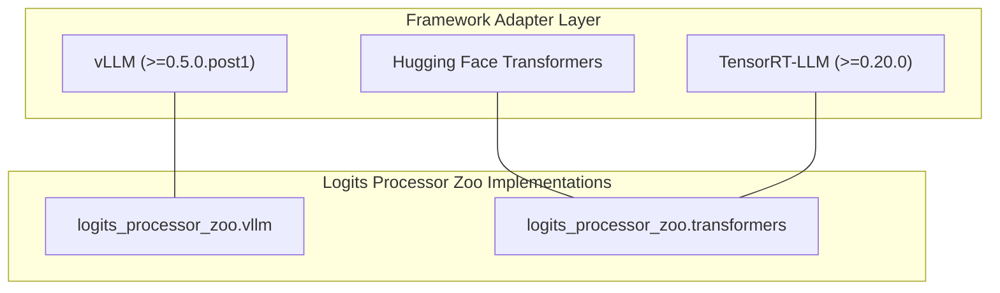

Sources: [README.md:18-21](), [pyproject.toml:12-14]()

## Basic Usage Pattern

While specific implementation details vary by framework, the general usage pattern involves passing a list of processor instances to the generation call.

**Example: vLLM Integration**
The library allows passing multiple processors to `vllm.SamplingParams`.

```python
from logits_processor_zoo.vllm import GenLengthLogitsProcessor
# ... model initialization ...
logits_processors = [GenLengthLogitsProcessor(tokenizer, boost_factor=-0.2, p=1)]
model.generate(prompts, vllm.SamplingParams(logits_processors=logits_processors))
```

Sources: [README.md:25-56]()

## Installation and Dependencies

The package is managed using Poetry and can be installed via pip.

| Dependency | Version | Note |
|:---|:---|:---|
| **Python** | `>=3.10` | Core Requirement |
| **transformers** | `>=4.41.2` | Core Requirement |
| **vllm** | `>=0.5.0.post1` | Optional Extra (`[vllm]`) |
| **accelerate** | `>=0.26.1` | Support Library |

Sources: [pyproject.toml:9-17](), [README.md:14-16]()

---

# Page: Getting Started

# Getting Started

<details>
<summary>Relevant source files</summary>

The following files were used as context for generating this wiki page:

- [.github/workflows/python-app.yml](.github/workflows/python-app.yml)
- [README.md](README.md)
- [pyproject.toml](pyproject.toml)

</details>


This page provides a technical guide for installing `logits-processor-zoo` and integrating its components into Large Language Model (LLM) generation pipelines. The library offers a collection of specialized `LogitsProcessor` implementations designed to control model behavior through direct logit manipulation across multiple inference frameworks.

## Installation

The library is managed using [Poetry](https://python-poetry.org) and is available on PyPI. It requires Python version 3.10 or higher [pyproject.toml:10-10]().

### Standard Installation
For basic usage with Hugging Face `transformers`, install via `pip`:
```bash
pip install logits-processor-zoo
```
[README.md:15-15]()

### Optional Extras
The library supports multiple backends. To use the `vLLM` integration, you must install the optional dependency [pyproject.toml:14-17]():
```bash
pip install logits-processor-zoo[vllm]
```

### Dependency Overview
The core functionality relies on the following primary dependencies [pyproject.toml:11-13]():
*   `torch`: Tensor operations and logit manipulation.
*   `transformers`: Base classes and tokenizer utilities (>= 4.41.2).
*   `accelerate`: Model loading and optimization (>= 0.26.1).

**Sources:** [pyproject.toml:9-17](), [README.md:12-16]()

## Integration Patterns

Integrating a processor involves instantiating the desired class from the framework-specific module (e.g., `logits_processor_zoo.vllm` or `logits_processor_zoo.transformers`) and passing it to the model's generation call.

### Data Flow Architecture
The following diagram illustrates how the `LogitsProcessor` entities interact with the generation loop in a typical inference pipeline.

**LLM Generation Loop with LogitsProcessor**
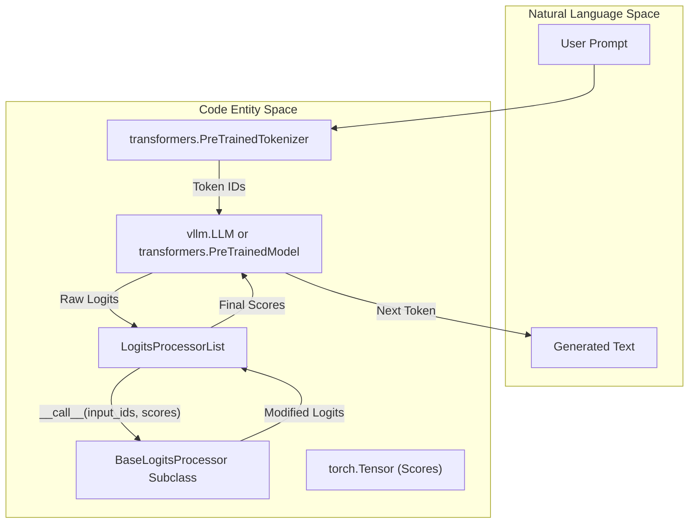
**Sources:** [README.md:25-56](), [logits_processor_zoo/transformers/base.py:1-40]() (referenced for lifecycle logic)

### Usage with vLLM
In `vLLM`, processors are passed via the `SamplingParams` object [README.md:44-55]().

```python
import vllm
from logits_processor_zoo.vllm import GenLengthLogitsProcessor

# Initialize model
model = vllm.LLM(model_name="...", trust_remote_code=True)
tokenizer = model.get_tokenizer()

# Instantiate processor
lp = GenLengthLogitsProcessor(tokenizer, boost_factor=-0.2)

# Generate with processors
output = model.generate(
    "Once upon a time",
    vllm.SamplingParams(
        logits_processors=[lp],
        max_tokens=64
    )
)
```
[README.md:25-56]()

### Usage with Transformers
For Hugging Face `transformers`, processors are passed as a `LogitsProcessorList` to the `.generate()` method.

```python
from transformers import AutoModelForCausalLM, AutoTokenizer, LogitsProcessorList
from logits_processor_zoo.transformers import CiteFromPromptLogitsProcessor

tokenizer = AutoTokenizer.from_pretrained(model_id)
model = AutoModelForCausalLM.from_pretrained(model_id)

lp_list = LogitsProcessorList([
    CiteFromPromptLogitsProcessor(tokenizer, boost_factor=2.0)
])

output = model.generate(
    **inputs,
    logits_processor=lp_list,
    max_new_tokens=50
)
```
**Sources:** [README.md:19-21](), [logits_processor_zoo/transformers/base.py:1-40]()

## Core Framework Entities

The library mirrors its structure across frameworks to ensure a consistent API while respecting the specific requirements of each backend (e.g., `vLLM` requires a `clone()` method for stateful processors during batching).

**System Mapping: Logic to Code**
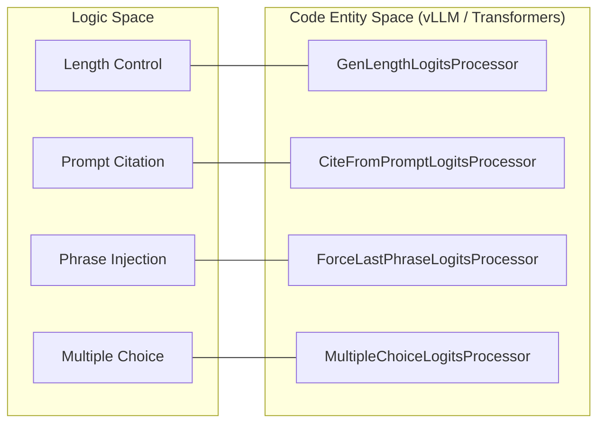
**Sources:** [README.md:61-94]()

### Key Processor Functions
| Processor | Purpose | Key Parameters |
| :--- | :--- | :--- |
| `GenLengthLogitsProcessor` | Adjusts EOS likelihood based on current length | `boost_factor`, `p` [README.md:63-65]() |
| `CiteFromPromptLogitsProcessor` | Boosts/suppresses tokens found in the prompt | `boost_factor` [README.md:66-68]() |
| `ForceLastPhraseLogitsProcessor` | Injects a specific phrase before generation ends | `phrase`, `tokenizer` [README.md:69-71]() |
| `MultipleChoiceLogitsProcessor` | Restricts output to a set of choices | `tokenizer` [README.md:72-82]() |
| `TriggerPhraseLogitsProcessor` | Inserts phrases at specific token triggers | `phrase`, `trigger_token_phrase` [README.md:83-89]() |
| `PreventHallucinationLogitsProcessor` | Falls back to a phrase if confidence is low | `threshold`, `fallback_phrase` [README.md:90-92]() |
| `MaxTimeLogitsProcessor` | Forces EOS after a wall-clock time limit | `max_time` [README.md:93-94]() |

## Development and Testing
The project uses `flake8` for linting with a configured `max-line-length` of 120 [.github/workflows/python-app.yml:31-33](), [pyproject.toml:24-25]().

Tests are executed using `pytest` and include coverage reporting [.github/workflows/python-app.yml:34-36]().
```bash
python -m pytest tests/ --cov --cov-config=.coveragerc
```

**Sources:** [.github/workflows/python-app.yml:27-36](), [pyproject.toml:24-25]()

---

# Page: Examples and Notebooks

# Examples and Notebooks

<details>
<summary>Relevant source files</summary>

The following files were used as context for generating this wiki page:

- [lpz_examples/transformers/cite_prompt_logits_processor.ipynb](lpz_examples/transformers/cite_prompt_logits_processor.ipynb)
- [lpz_examples/transformers/force_last_phrase_logits_processor.ipynb](lpz_examples/transformers/force_last_phrase_logits_processor.ipynb)
- [lpz_examples/transformers/gen_length_logits_processor.ipynb](lpz_examples/transformers/gen_length_logits_processor.ipynb)
- [lpz_examples/transformers/max_time_logits_processor.ipynb](lpz_examples/transformers/max_time_logits_processor.ipynb)
- [lpz_examples/transformers/multiple_choice_logits_processor.ipynb](lpz_examples/transformers/multiple_choice_logits_processor.ipynb)
- [lpz_examples/transformers/prevent_hallucination_logits_processor.ipynb](lpz_examples/transformers/prevent_hallucination_logits_processor.ipynb)
- [lpz_examples/transformers/trigger_phrase_logits_processor.ipynb](lpz_examples/transformers/trigger_phrase_logits_processor.ipynb)
- [lpz_examples/transformers/utils.py](lpz_examples/transformers/utils.py)
- [lpz_examples/trtllm/README.md](lpz_examples/trtllm/README.md)
- [lpz_examples/trtllm/cite_prompt_logits_processor.py](lpz_examples/trtllm/cite_prompt_logits_processor.py)
- [lpz_examples/trtllm/gen_length_logits_processor.py](lpz_examples/trtllm/gen_length_logits_processor.py)
- [lpz_examples/trtllm/last_phrase_logits_processor.py](lpz_examples/trtllm/last_phrase_logits_processor.py)
- [lpz_examples/trtllm/max_time_logits_processor.py](lpz_examples/trtllm/max_time_logits_processor.py)
- [lpz_examples/trtllm/multiple_choice_logits_processor.py](lpz_examples/trtllm/multiple_choice_logits_processor.py)
- [lpz_examples/trtllm/prevent_hallucination_logits_processor.py](lpz_examples/trtllm/prevent_hallucination_logits_processor.py)
- [lpz_examples/trtllm/trigger_phrase_logits_processor.py](lpz_examples/trtllm/trigger_phrase_logits_processor.py)
- [lpz_examples/trtllm/utils.py](lpz_examples/trtllm/utils.py)
- [lpz_examples/vllm/cite_prompt_logits_processor.ipynb](lpz_examples/vllm/cite_prompt_logits_processor.ipynb)
- [lpz_examples/vllm/force_last_phrase_logits_processor.ipynb](lpz_examples/vllm/force_last_phrase_logits_processor.ipynb)
- [lpz_examples/vllm/gen_length_logits_processor.ipynb](lpz_examples/vllm/gen_length_logits_processor.ipynb)
- [lpz_examples/vllm/max_time_logits_processor.ipynb](lpz_examples/vllm/max_time_logits_processor.ipynb)
- [lpz_examples/vllm/multiple_choice_logits_processor.ipynb](lpz_examples/vllm/multiple_choice_logits_processor.ipynb)
- [lpz_examples/vllm/performance_profiling.ipynb](lpz_examples/vllm/performance_profiling.ipynb)
- [lpz_examples/vllm/prevent_hallucination_logits_processor.ipynb](lpz_examples/vllm/prevent_hallucination_logits_processor.ipynb)
- [lpz_examples/vllm/trigger_phrase_logits_processor.ipynb](lpz_examples/vllm/trigger_phrase_logits_processor.ipynb)
- [lpz_examples/vllm/utils.py](lpz_examples/vllm/utils.py)
- [lpz_examples/vllm/vllm_serve.ipynb](lpz_examples/vllm/vllm_serve.ipynb)

</details>


The `lpz_examples/` directory provides a comprehensive suite of demonstrations for the `logits-processor-zoo` library. These examples are organized by framework—`transformers`, `vLLM`, and `TensorRT-LLM`—and showcase how to implement specific logit manipulation behaviors such as length control, citation enforcement, and hallucination mitigation.

## Overview of Example Structure

The repository maintains a parallel structure for examples across different backends. Each framework directory contains a `utils.py` file that abstracts the model loading and generation logic, allowing the example scripts/notebooks to focus on the configuration of the processors.

| Directory | Format | Primary Tooling |
| :--- | :--- | :--- |
| `lpz_examples/transformers/` | Jupyter Notebooks (`.ipynb`) | `AutoModelForCausalLM`, `LogitsProcessorList` |
| `lpz_examples/vllm/` | Jupyter Notebooks (`.ipynb`) | `vLLM.LLM`, `SamplingParams` |
| `lpz_examples/trtllm/` | Python Scripts (`.py`) | `tensorrt_llm`, `TRTLLMTester` |

**Sources:** [lpz_examples/transformers/utils.py:1-43](), [lpz_examples/trtllm/README.md:1-60]()

---

## Transformers Examples

The Transformers examples utilize the `LLMRunner` class to manage generation. This helper class applies chat templates and handles the `LogitsProcessorList` integration.

### Implementation Flow
The following diagram illustrates how the examples bridge high-level user prompts to the `transformers` generation loop using the library's processors.

**Diagram: Transformers Example Data Flow**
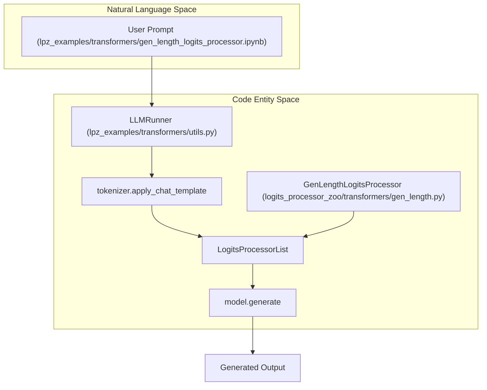
**Sources:** [lpz_examples/transformers/utils.py:5-34](), [lpz_examples/transformers/gen_length_logits_processor.ipynb:36-45]()

### Key Notebooks
*   **`cite_prompt_logits_processor.ipynb`**: Demonstrates boosting tokens found in the input prompt to encourage grounding. It uses `CiteFromPromptLogitsProcessor` with a `conditional_boost_factor` to ensure the model stays on topic [lpz_examples/transformers/cite_prompt_logits_processor.ipynb:36-57]().
*   **`prevent_hallucination_logits_processor.ipynb`**: Shows how to monitor token confidence. When the model's confidence drops below a threshold, the `PreventHallucinationLogitsProcessor` injects a fallback phrase like "I don't know actually" [lpz_examples/transformers/prevent_hallucination_logits_processor.ipynb:122-156]().
*   **`max_time_logits_processor.ipynb`**: Demonstrates interrupting long-running generations (e.g., DeepSeek reasoning chains) after a specific wall-clock time limit using `MaxTimeLogitsProcessor` [lpz_examples/transformers/max_time_logits_processor.ipynb:217-221]().

---

## vLLM Examples

The vLLM examples focus on the integration with `SamplingParams`. Because vLLM handles requests asynchronously, these notebooks emphasize the need for the `logits_processors` argument in the sampling configuration.

### Key Demonstrations
*   **`multiple_choice_logits_processor.ipynb`**: Constrains the model to specific options (e.g., "0, 1, 2, 3" or "a, b, c, d") by masking all other tokens.
*   **`trigger_phrase_logits_processor.ipynb`**: Shows how to insert specific text (like a "Thinking..." prefix) when a trigger condition is met during the generation stream.
*   **`performance_profiling.ipynb`**: Provides benchmarks for the overhead introduced by various processors when running in a high-throughput vLLM environment.

---

## TensorRT-LLM Examples

The TensorRT-LLM examples are provided as Python scripts and require a compiled engine. These examples use a custom `TRTLLMTester` utility to interface with the `tensorrt_llm` runtime.

**Diagram: TensorRT-LLM Integration Architecture**
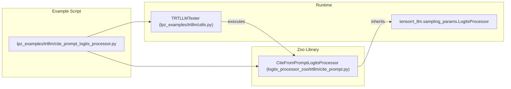
**Sources:** [lpz_examples/trtllm/cite_prompt_logits_processor.py:1-17](), [lpz_examples/trtllm/README.md:16-25]()

### Running the Scripts
To run the TensorRT-LLM examples, you must be inside a container with `tensorrt_llm` installed (version >= 0.20.0).

1.  **Length Control**: 
    `python lpz_examples/trtllm/gen_length_logits_processor.py` [lpz_examples/trtllm/README.md:10-14]()
2.  **Citation Enforcement**:
    `python lpz_examples/trtllm/cite_prompt_logits_processor.py -p "Your Prompt Here"` [lpz_examples/trtllm/README.md:16-25]()
3.  **Phrase Injection**:
    `python lpz_examples/trtllm/last_phrase_logits_processor.py` [lpz_examples/trtllm/README.md:27-31]()

### Configuration Details
The scripts use a common `get_parser()` to accept model names and prompts via the CLI [lpz_examples/trtllm/cite_prompt_logits_processor.py:7-10]().
*   **`ForceLastPhraseLogitsProcessor`**: In the TRT-LLM example, this is configured to inject a signature phrase: `"\n\nThanks for trying our application!..."` before the EOS token is allowed [lpz_examples/trtllm/last_phrase_logits_processor.py:12-13]().
*   **`GenLengthLogitsProcessor`**: Demonstrates both encouraging brevity (`boost_factor=1.0`) and forcing longer responses (`boost_factor=-1.0`) [lpz_examples/trtllm/gen_length_logits_processor.py:12-16]().

**Sources:** [lpz_examples/trtllm/last_phrase_logits_processor.py:1-16](), [lpz_examples/trtllm/gen_length_logits_processor.py:1-17](), [lpz_examples/trtllm/README.md:1-60]()

---

# Page: Architecture and Design Principles

# Architecture and Design Principles

<details>
<summary>Relevant source files</summary>

The following files were used as context for generating this wiki page:

- [logits_processor_zoo/transformers/__init__.py](logits_processor_zoo/transformers/__init__.py)
- [logits_processor_zoo/transformers/base.py](logits_processor_zoo/transformers/base.py)
- [logits_processor_zoo/utils.py](logits_processor_zoo/utils.py)
- [logits_processor_zoo/vllm/__init__.py](logits_processor_zoo/vllm/__init__.py)
- [pyproject.toml](pyproject.toml)
- [tests/test_utils.py](tests/test_utils.py)

</details>


This document describes the core architecture and design principles of the Logits Processor Zoo. It explains how the library components are organized, how they interact with each other, and the design patterns used throughout the codebase.

## Core Architecture

The Logits Processor Zoo follows a modular design with clear separation of concerns. The library is organized around these key components:

1.  **Base Logits Processor**: A core base class in `logits_processor_zoo/transformers/base.py` that manages state and the generation lifecycle for the Transformers backend [logits_processor_zoo/transformers/base.py:21-52]().
2.  **Specialized Processors**: Implementations that extend the base class or follow framework-specific protocols to modify logits [logits_processor_zoo/transformers/__init__.py:18-24]().
3.  **Framework Integrations**: Parallel implementations for Transformers, vLLM, and TensorRT-LLM [logits_processor_zoo/transformers/__init__.py:1-28](), [logits_processor_zoo/vllm/__init__.py:1-28]().
4.  **Utility Functions**: Shared helper functions in `logits_processor_zoo/utils.py` used for token manipulation and boundary detection [logits_processor_zoo/utils.py:23-65]().

### Component Relationship

The following diagram maps high-level system components to their specific code entities.

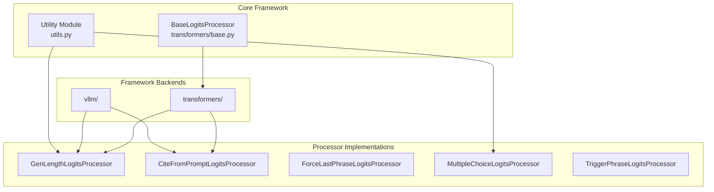
Sources: [logits_processor_zoo/transformers/base.py:21-22](), [logits_processor_zoo/utils.py:1-65](), [logits_processor_zoo/transformers/__init__.py:18-24](), [logits_processor_zoo/vllm/__init__.py:18-24]()

## Logit Manipulation Lifecycle

For the Transformers backend, the lifecycle is managed by `BaseLogitsProcessor`. It handles the transition between different generation calls by tracking `prompt_token_ids` and `prev_token_ids` [logits_processor_zoo/transformers/base.py:23-24]().

1.  **Generation Check**: `_check_new_generation` determines if a new sequence has started [logits_processor_zoo/transformers/base.py:29-43]().
2.  **Reset**: If a new sequence is detected, `_reset()` is called to clear internal processor state [logits_processor_zoo/transformers/base.py:26-27]().
3.  **Processing**: The `_process()` hook is where subclasses implement their specific logit modification logic [logits_processor_zoo/transformers/base.py:45-46]().

For details, see [BaseLogitsProcessor and Lifecycle](#2.1).

## Design Patterns

### Parallel Framework Implementation
The library implements a "Parallel Backend" pattern. Instead of a single complex adapter, each framework (Transformers, vLLM) has its own directory with optimized implementations of the processors. This ensures that framework-specific requirements, such as the `clone()` method for vLLM or the specific `__call__` signature for Transformers, are handled natively [logits_processor_zoo/transformers/__init__.py:18-24](), [logits_processor_zoo/vllm/__init__.py:18-24]().

### Shared Utility Strategy
Common logic that is agnostic of the inference engine is centralized in `utils.py`. This includes:
*   **Tokenization Helpers**: `text_to_token` for safe string-to-ID conversion [logits_processor_zoo/utils.py:23-37]().
*   **Logit Masking**: `enforce_tokens` for boosting specific token IDs while suppressing others [logits_processor_zoo/utils.py:46-52]().
*   **Boundary Detection**: `SentenceChecker` for identifying sentence endings across different input formats [logits_processor_zoo/utils.py:55-65]().

For details, see [Utilities and Helper Functions](#2.2).

## Token Generation Workflow

This diagram illustrates how code entities interact during a single forward pass of an LLM.

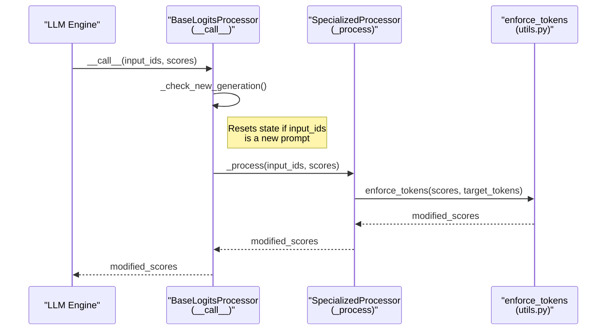
Sources: [logits_processor_zoo/transformers/base.py:48-51](), [logits_processor_zoo/utils.py:46-52]()

## Code Organization

The repository structure reflects the separation between core utilities and framework-specific implementations:

| Path | Purpose |
| :--- | :--- |
| `logits_processor_zoo/transformers/` | Processors following the Hugging Face `LogitsProcessor` interface [logits_processor_zoo/transformers/__init__.py:1-28](). |
| `logits_processor_zoo/vllm/` | Processors optimized for vLLM's sampling parameters [logits_processor_zoo/vllm/__init__.py:1-28](). |
| `logits_processor_zoo/utils.py` | Cross-framework helper functions and classes [logits_processor_zoo/utils.py:1-65](). |
| `pyproject.toml` | Dependency management (e.g., optional `vllm` support) [pyproject.toml:14-17](). |

Sources: [pyproject.toml:1-25](), [logits_processor_zoo/utils.py:1-65]()

---

# Page: BaseLogitsProcessor and Lifecycle

# BaseLogitsProcessor and Lifecycle

<details>
<summary>Relevant source files</summary>

The following files were used as context for generating this wiki page:

- [logits_processor_zoo/transformers/__init__.py](logits_processor_zoo/transformers/__init__.py)
- [logits_processor_zoo/transformers/base.py](logits_processor_zoo/transformers/base.py)
- [logits_processor_zoo/vllm/__init__.py](logits_processor_zoo/vllm/__init__.py)

</details>


The `BaseLogitsProcessor` serves as the foundational class for all logits processors within the `transformers` backend of the `logits-processor-zoo`. It provides a standardized interface for state management and logit manipulation, ensuring that processors can distinguish between the start of a new generation sequence and the continuation of an existing one.

### Purpose and Scope

In the Hugging Face `transformers` library, a `LogitsProcessor` is called at every step of the decoding process. However, the library does not natively provide a mechanism to reset internal state (like counters or timers) when a new generation starts. `BaseLogitsProcessor` implements this lifecycle management, allowing developers to focus on the `_process` logic while the base class handles state tracking via `_check_new_generation`.

---

### The BaseLogitsProcessor Class

Defined in `logits_processor_zoo/transformers/base.py`, this class establishes the internal state variables and the execution flow for subclasses.

| Attribute | Type | Description |
| :--- | :--- | :--- |
| `prompt_token_ids` | `torch.LongTensor` | Stores the initial prompt IDs to detect when a new sequence begins. [logits_processor_zoo/transformers/base.py:23-23]() |
| `prev_token_ids` | `torch.LongTensor` | Stores the `input_ids` from the previous step to validate sequence continuity. [logits_processor_zoo/transformers/base.py:24-24]() |

#### Methods and Hooks

*   **`_reset()`**: A hook intended to be overridden by subclasses. It is called whenever a new generation is detected. [logits_processor_zoo/transformers/base.py:26-27]()
*   **`_process(input_ids, scores)`**: The core logic hook. Subclasses implement their specific logit manipulation here. [logits_processor_zoo/transformers/base.py:45-46]()
*   **`__call__(input_ids, scores)`**: The entry point used by the `transformers` generation loop. [logits_processor_zoo/transformers/base.py:48-51]()

**Sources:**
* [logits_processor_zoo/transformers/base.py:21-52]()

---

### The Lifecycle Flow

The lifecycle is governed by the `__call__` method, which orchestrates sequence validation before applying logit transformations.

#### Sequence Detection Logic (`_check_new_generation`)
This method determines if the current `input_ids` belong to a new generation request or a continuation of the previous one. It triggers `_reset()` if:
1.  `prompt_token_ids` is `None` (the very first call). [logits_processor_zoo/transformers/base.py:30-33]()
2.  The current `input_ids` (excluding the last token) do not match the `prev_token_ids` from the last step. [logits_processor_zoo/transformers/base.py:35-41]()

#### Data Flow Diagram: Transformer Lifecycle
The following diagram illustrates how the `transformers` backend interacts with the `BaseLogitsProcessor` entities.

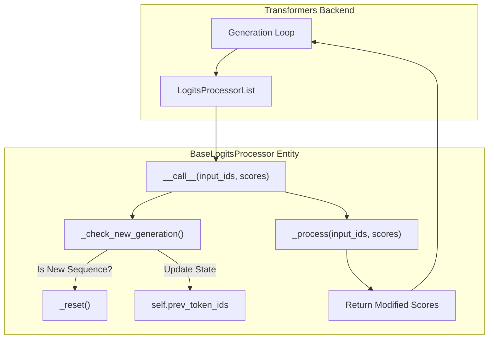

**Sources:**
* [logits_processor_zoo/transformers/base.py:29-51]()

---

### Implementation Details

The implementation relies on `torch.equal` to compare tensors across generation steps. This is critical for batch processing and ensuring that processors like `MaxTimeLogitsProcessor` or `TriggerPhraseLogitsProcessor` correctly reset their internal clocks or indices when the model starts a fresh prompt.

#### Lifecycle Execution Trace
The following sequence diagram maps the Natural Language generation steps to the Code Entity Space.

```mermaid
sequenceDiagram
    participant T as "transformers.GenerationMixin"
    participant B as "BaseLogitsProcessor"
    participant S as "Subclass (e.g., GenLengthLogitsProcessor)"

    Note over T, S: Step 1: First Token Generation
    T->>B: __call__(input_ids, scores)
    activate B
    B->>B: _check_new_generation()
    B->>S: _reset()
    B->>S: _process(input_ids, scores)
    S-->>B: scores
    B-->>T: scores
    deactivate B

    Note over T, S: Step 2: Subsequent Token Generation
    T->>B: __call__(input_ids, scores)
    activate B
    B->>B: _check_new_generation()
    Note right of B: same_gen == True; No _reset()
    B->>S: _process(input_ids, scores)
    S-->>B: scores
    B-->>T: scores
    deactivate B
```

**Sources:**
* [logits_processor_zoo/transformers/base.py:29-51]()
* [logits_processor_zoo/transformers/__init__.py:18-28]()

### Subclass Integration
All processors in the `transformers` directory (e.g., `GenLengthLogitsProcessor`, `CiteFromPromptLogitsProcessor`) inherit from this base class to ensure consistent behavior across the zoo.

**Sources:**
* [logits_processor_zoo/transformers/__init__.py:18-24]()

---

# Page: Utilities and Helper Functions

# Utilities and Helper Functions

<details>
<summary>Relevant source files</summary>

The following files were used as context for generating this wiki page:

- [logits_processor_zoo/utils.py](logits_processor_zoo/utils.py)
- [tests/test_utils.py](tests/test_utils.py)

</details>


This page documents the utility functions and helper classes in `logits_processor_zoo/utils.py` that support all processors across the library. These utilities provide essential token validation, logit manipulation, and boundary detection capabilities used to bridge the gap between natural language strings and the model's logit space.

## Overview of Utility Functions

The `utils.py` module contains stateless functions for token conversion and logit masking, as well as the `SentenceChecker` class for stateful or structural boundary detection.

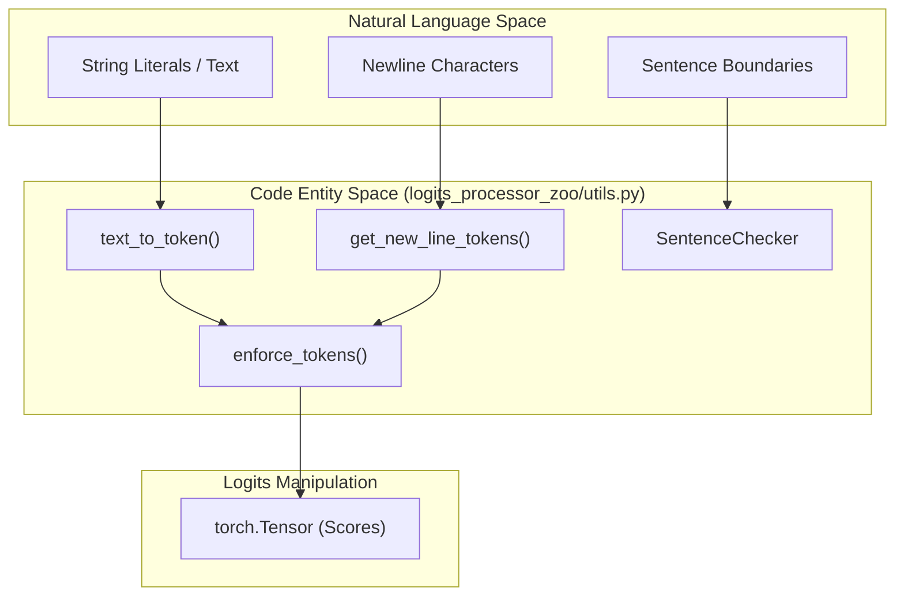
Sources: [logits_processor_zoo/utils.py:1-65]()

## Token Conversion and Validation

### Function: text_to_token
This function converts a text string into a single token ID. It includes safety checks to ensure that the provided text does not decompose into multiple tokens unless explicitly permitted.

**Implementation Details:**
- It uses `tokenizer.encode(text, add_special_tokens=False)` [logits_processor_zoo/utils.py:24]().
- It accounts for tokenizers that automatically prepend a BOS (Beginning of Sentence) token or a prefix space [logits_processor_zoo/utils.py:28-31]().
- If `last=False`, the function raises an exception if the text results in more tokens than the allowed `max_token_count` (usually 1 or 2) [logits_processor_zoo/utils.py:33-34]().
- If `last=True`, it simply returns the final token ID in the sequence [logits_processor_zoo/utils.py:36]().

Sources: [logits_processor_zoo/utils.py:23-37]()

### Function: get_new_line_tokens
This function scans the entire tokenizer vocabulary to identify all tokens that represent or end with a newline character (`\n`). This is critical for processors like `GenLengthLogitsProcessor` that need to detect paragraph ends.

**Implementation Details:**
- Iterates through `tokenizer.get_vocab().values()` [logits_processor_zoo/utils.py:40]().
- Decodes each token and checks if it `endswith("\n")` [logits_processor_zoo/utils.py:41]().
- Returns a `set` for O(1) lookup during the logit processing loop [logits_processor_zoo/utils.py:43]().

Sources: [logits_processor_zoo/utils.py:39-43]()

## Logit Manipulation

### Function: enforce_tokens
This function modifies the `scores` tensor to ensure that only a specific subset of tokens can be sampled. It is used extensively by the `MultipleChoiceLogitsProcessor`.

**Logic Flow:**
1. Clones the scores of the allowed tokens [logits_processor_zoo/utils.py:47]().
2. Calculates a `gap` between the global maximum and the minimum allowed score to ensure allowed tokens remain competitive after shifting [logits_processor_zoo/utils.py:48-49]().
3. Fills the entire `scores` tensor with the minimum possible value [logits_processor_zoo/utils.py:50]().
4. Restores the allowed tokens with their boosted scores [logits_processor_zoo/utils.py:51]().

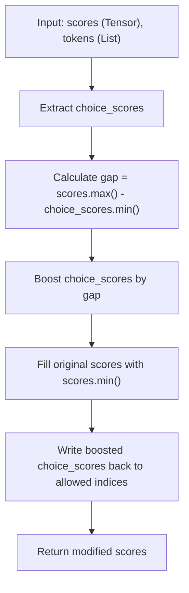
Sources: [logits_processor_zoo/utils.py:46-52](), [tests/test_utils.py:22-29]()

## Boundary Detection

### Class: SentenceChecker
The `SentenceChecker` class provides a standardized way to determine if the current generation has reached a sentence or line boundary.

**Initialization:**
Upon instantiation, it identifies the specific token IDs for a full stop (`.`) and a newline (`\n`) by encoding sample sentences [logits_processor_zoo/utils.py:57-58]().

**Method: _check_sentence_end:**
- Supports both `vLLM` (list/tuple of IDs) and `transformers` (torch.Tensor) input formats [logits_processor_zoo/utils.py:61-64]().
- Checks if the last generated token (`input_ids[-1]`) matches the stored `full_stop_token` or `new_line_token` [logits_processor_zoo/utils.py:62-64]().

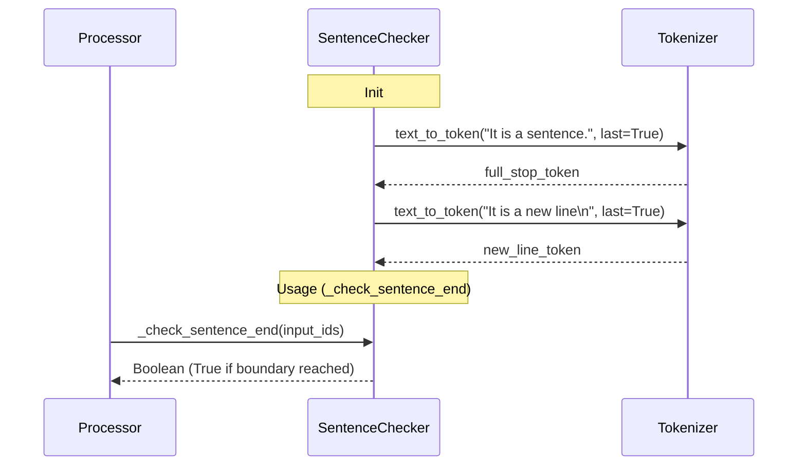
Sources: [logits_processor_zoo/utils.py:55-65]()

## Summary Table of Utilities

| Entity | Type | Purpose | Key Dependency |
| :--- | :--- | :--- | :--- |
| `text_to_token` | Function | Safe string-to-ID conversion | `PreTrainedTokenizer` |
| `get_new_line_tokens` | Function | Vocabulary-wide newline search | `tokenizer.get_vocab()` |
| `enforce_tokens` | Function | Hard-masking logits for specific tokens | `torch.Tensor` |
| `SentenceChecker` | Class | Detecting sentence/paragraph endings | `text_to_token` |

Sources: [logits_processor_zoo/utils.py:1-65]()

---

# Page: Logits Processors

# Logits Processors

<details>
<summary>Relevant source files</summary>

The following files were used as context for generating this wiki page:

- [README.md](README.md)
- [logits_processor_zoo/transformers/__init__.py](logits_processor_zoo/transformers/__init__.py)
- [logits_processor_zoo/vllm/__init__.py](logits_processor_zoo/vllm/__init__.py)

</details>


## Purpose and Scope

Logits processors are specialized components that modify token probabilities (logits) during LLM text generation to control model outputs in precise ways. This page documents the core concept of logits processors and provides an overview of the available processors in the `logits-processor-zoo`. For information about framework-specific integrations, see [Framework Integrations](#4).

## What Are Logits Processors?

Logits processors intercept and modify the probability distribution over the vocabulary that an LLM produces at each generation step. By strategically adjusting these probabilities, processors can guide the model toward producing specific outputs—such as enforcing a specific length, citing a prompt, or choosing from a list—without requiring model retraining [README.md:8-10]().

### Logits Processing Pipeline
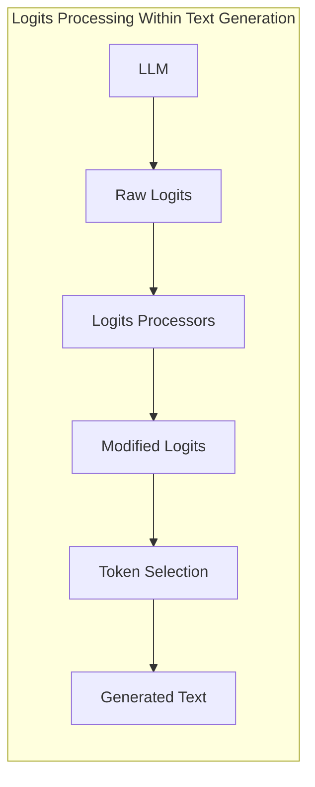
Sources: [README.md:8-10]()

## Code Entity Mapping

The following diagram bridges the conceptual "Natural Language Space" to the "Code Entity Space" by mapping processor types to their specific class implementations in the `transformers` and `vLLM` sub-packages.

### Processor Class Mapping
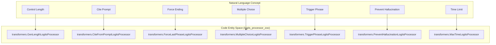
Sources: [logits_processor_zoo/transformers/__init__.py:18-28](), [logits_processor_zoo/vllm/__init__.py:18-28]()

## Available Logits Processors

The library provides several specialized logits processors. Detailed technical documentation for each can be found in their respective child pages.

### [GenLengthLogitsProcessor](#3.1)
Adjusts the likelihood of the end-of-sequence (EOS) token based on the current sequence length [README.md:63-64](). It uses a `boost_factor` and a power parameter `p` to encourage or discourage shorter answers.

### [CiteFromPromptLogitsProcessor](#3.2)
Boosts or diminishes the likelihood of tokens present in the prompt [README.md:66-67](). This encourages the model to generate tokens similar to those seen in the input or vice versa.

### [ForceLastPhraseLogitsProcessor](#3.3)
Forces the LLM to use a specific phrase before finalizing the answer with an EOS token [README.md:69-70](). This is commonly used for adding mandatory references or specific closing formatting.

### [MultipleChoiceLogitsProcessor](#3.4)
Constrains the model to answer multiple-choice questions with exactly one of the provided choices [README.md:72-81](). It identifies valid tokens from a prompt's options list.

### [TriggerPhraseLogitsProcessor](#3.5)
Triggers the injection of a specific phrase when a certain token is encountered or after a specified time [README.md:83-84](). For example, it can force a `python` code block immediately after a `</think>` tag [README.md:87-89]().

### [PreventHallucinationLogitsProcessor](#3.6)
Mitigates hallucinated outputs by enforcing a predefined fallback phrase when token confidence (min-p) falls below a threshold for a set number of tokens [README.md:90-91]().

### [MaxTimeLogitsProcessor](#3.7)
Enforces the EOS token after a specified wall-clock time limit has passed [README.md:93-94](). It can optionally wait for a full sentence completion before stopping.

Sources: [README.md:61-94](), [logits_processor_zoo/transformers/__init__.py:18-24]()

## Logits Processor Integration Flow

The following sequence diagram illustrates how multiple processors are integrated into the generation loop, specifically showing how they are passed via `logits_processors` lists in frameworks like vLLM.

### Generation Loop with LogitsProcessors
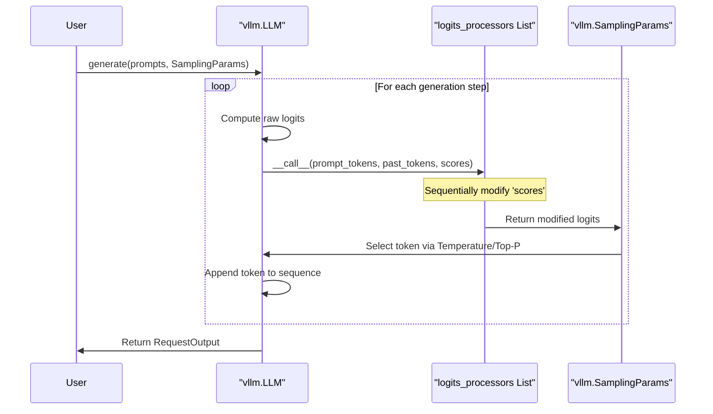
Sources: [README.md:25-56]()

## Framework Implementation Overview

The library maintains a parallel structure across supported frameworks. While the logic remains consistent, the interfaces are adapted for `transformers`, `vLLM`, and `TensorRT-LLM`.

| Processor | Transformers | vLLM | TensorRT-LLM |
| :--- | :---: | :---: | :---: |
| **GenLength** | Yes | Yes | Yes |
| **CiteFromPrompt** | Yes | Yes | Yes |
| **ForceLastPhrase** | Yes | Yes | Yes |
| **MultipleChoice** | Yes | Yes | Yes |
| **TriggerPhrase** | Yes | Yes | Yes |
| **PreventHallucination** | Yes | Yes | Yes |
| **MaxTime** | Yes | Yes | Yes |

Sources: [logits_processor_zoo/transformers/__init__.py:26-28](), [logits_processor_zoo/vllm/__init__.py:26-28](), [README.md:18-21]()

For detailed information about each processor, see:
- [GenLengthLogitsProcessor](#3.1)
- [CiteFromPromptLogitsProcessor](#3.2)
- [ForceLastPhraseLogitsProcessor](#3.3)
- [MultipleChoiceLogitsProcessor](#3.4)
- [TriggerPhraseLogitsProcessor](#3.5)
- [PreventHallucinationLogitsProcessor](#3.6)
- [MaxTimeLogitsProcessor](#3.7)

---

# Page: GenLengthLogitsProcessor

# GenLengthLogitsProcessor

<details>
<summary>Relevant source files</summary>

The following files were used as context for generating this wiki page:

- [logits_processor_zoo/transformers/generation_length.py](logits_processor_zoo/transformers/generation_length.py)
- [logits_processor_zoo/trtllm/generation_length.py](logits_processor_zoo/trtllm/generation_length.py)
- [logits_processor_zoo/vllm/generation_length.py](logits_processor_zoo/vllm/generation_length.py)
- [tests/transformers/test_generation_length.py](tests/transformers/test_generation_length.py)

</details>


## Purpose and Overview

The `GenLengthLogitsProcessor` is a specialized logits processor that controls the length of text generated by Large Language Models (LLMs). It achieves this by dynamically adjusting the probability of the end-of-sequence (EOS) token (or a custom boost token) based on the current length of the generated text. This processor can be configured to either encourage shorter responses (by making the EOS token more likely as generation progresses) or longer responses (by suppressing the EOS token).

Sources: [logits_processor_zoo/transformers/generation_length.py:24-29](), [logits_processor_zoo/vllm/generation_length.py:24-28]()

## How It Works

The `GenLengthLogitsProcessor` modifies token probabilities during text generation by:

1. Tracking the number of tokens generated so far.
2. Calculating a non-linear boost value based on the token count and the power parameter `p`.
3. Applying this boost to the specified token (usually the EOS token).
4. Optionally enforcing complete sentences by only applying the boost when the last token is a sentence terminator (period or newline).

### Non-Linear Boost Formula
The boost value applied to the logits is calculated as follows:
`boost_val = boost_factor * (token_count ** p) / (10 ** p)`

Sources: [logits_processor_zoo/transformers/generation_length.py:52-63](), [logits_processor_zoo/vllm/generation_length.py:60-62]()

### Operation Flow Diagram

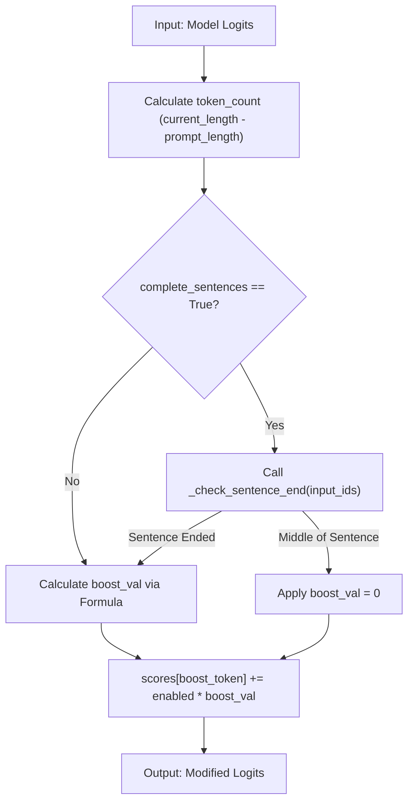

Sources: [logits_processor_zoo/transformers/generation_length.py:52-63](), [logits_processor_zoo/vllm/generation_length.py:58-69]()

## Parameters and Configuration

The `GenLengthLogitsProcessor` accepts the following parameters:

| Parameter | Type | Description | Default |
|-----------|------|-------------|---------|
| `tokenizer` | `PreTrainedTokenizer` | The tokenizer used by the LLM. | Required |
| `boost_factor` | `float` | Factor to adjust EOS token likelihood (-1.0 to 1.0 suggested). | Required |
| `p` | `int` | Power for scaling with token count. | 2 |
| `complete_sentences` | `bool` | If True, only boost EOS at full stops or new lines. | False |
| `boost_token_str` | `str` | Custom string to tokenize and boost (e.g., `"</think>"`). | None |

Sources: [logits_processor_zoo/transformers/generation_length.py:40-50](), [logits_processor_zoo/vllm/generation_length.py:39-52]()

### Parameter Effects Diagram

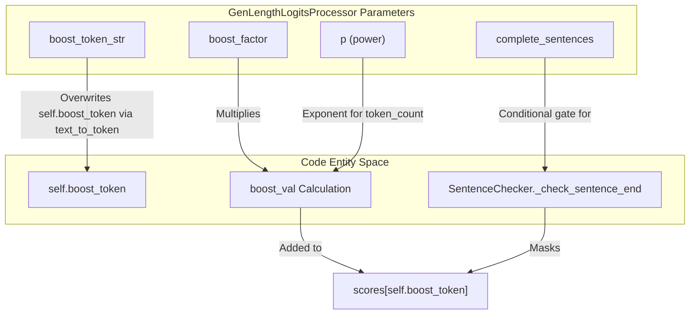

Sources: [logits_processor_zoo/transformers/generation_length.py:41-60](), [logits_processor_zoo/vllm/generation_length.py:46-68]()

## Implementation Details

The processor inherits from `SentenceChecker` to access boundary detection logic and, in the Transformers implementation, from `BaseLogitsProcessor` to manage prompt/generation lifecycle.

### Technical Architecture

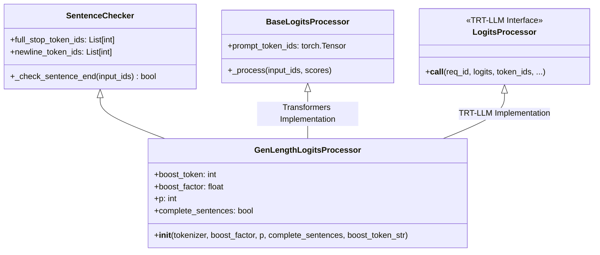

Sources: [logits_processor_zoo/transformers/generation_length.py:24](), [logits_processor_zoo/vllm/generation_length.py:24](), [logits_processor_zoo/trtllm/generation_length.py:25]()

### Framework Specifics

- **Transformers**: Calculates `token_count` by subtracting `self.prompt_token_ids.shape[1]` from current `input_ids.shape[1]`. [logits_processor_zoo/transformers/generation_length.py:52]()
- **vLLM**: Uses `len(past_token_ids)` directly as the generation length. It also includes a safety check to avoid boosting if the `boost_token` is already present in `past_token_ids`. [logits_processor_zoo/vllm/generation_length.py:54-58]()
- **TensorRT-LLM**: Manages an internal `self.token_count` state which is incremented manually at the end of each `__call__`. [logits_processor_zoo/trtllm/generation_length.py:51-70]()

## Usage Examples

### Example: Transformers Integration
To encourage shorter responses while ensuring natural endings:

```python
from logits_processor_zoo.transformers import GenLengthLogitsProcessor

processor = GenLengthLogitsProcessor(
    tokenizer=tokenizer,
    boost_factor=0.5,
    p=2,
    complete_sentences=True
)
# Use in model.generate(..., logits_processor=[processor])
```

Sources: [tests/transformers/test_generation_length.py:21-30]()

## Best Practices and Considerations

1. **Lifecycle Management**: In the Transformers implementation, create a new object before every `model.generate` call because `token_count` is derived from the initial prompt set during the first call. [logits_processor_zoo/transformers/generation_length.py:28-29]()
2. **Boost Factor Tuning**:
   - Positive values (e.g., `0.1` to `1.0`) make EOS more likely (shorter text).
   - Negative values make EOS less likely (longer text).
3. **Custom Stop Tokens**: Use `boost_token_str` for specialized models (e.g., reasoning models using `</think>`) to force transitions out of specific blocks rather than ending the entire sequence. [logits_processor_zoo/transformers/generation_length.py:38]()

Sources: [logits_processor_zoo/transformers/generation_length.py:28-41](), [logits_processor_zoo/vllm/generation_length.py:32-37]()

---

# Page: CiteFromPromptLogitsProcessor

# CiteFromPromptLogitsProcessor

<details>
<summary>Relevant source files</summary>

The following files were used as context for generating this wiki page:

- [logits_processor_zoo/transformers/cite_prompt.py](logits_processor_zoo/transformers/cite_prompt.py)
- [logits_processor_zoo/trtllm/cite_prompt.py](logits_processor_zoo/trtllm/cite_prompt.py)
- [logits_processor_zoo/trtllm/last_phrase.py](logits_processor_zoo/trtllm/last_phrase.py)
- [logits_processor_zoo/vllm/cite_prompt.py](logits_processor_zoo/vllm/cite_prompt.py)
- [tests/transformers/test_cite_prompt.py](tests/transformers/test_cite_prompt.py)

</details>


## Overview

The `CiteFromPromptLogitsProcessor` is a specialized logits processor that influences the likelihood of tokens from the input prompt appearing in the model's generated output. By adjusting a boost factor, this processor can either encourage the model to cite/reuse content from the prompt (positive boost) or discourage prompt token reuse (negative boost). It supports simple unigram boosting as well as a conditional bigram lookup mechanism to influence generation based on the previous token.

Sources: [logits_processor_zoo/transformers/cite_prompt.py:23-36](), [logits_processor_zoo/vllm/cite_prompt.py:23-35]()

## How It Works

The processor modifies the probability distribution of tokens during text generation by applying two types of boosts:

1.  **Global Boost**: Applies `boost_factor` to any token present in the prompt.
2.  **Conditional (Bigram) Boost**: Applies `conditional_boost_factor` to a token if it followed the current "last token" in the original prompt.

### Data Flow and Code Entity Mapping

The following diagram bridges the logical generation flow with the specific code entities across different frameworks.

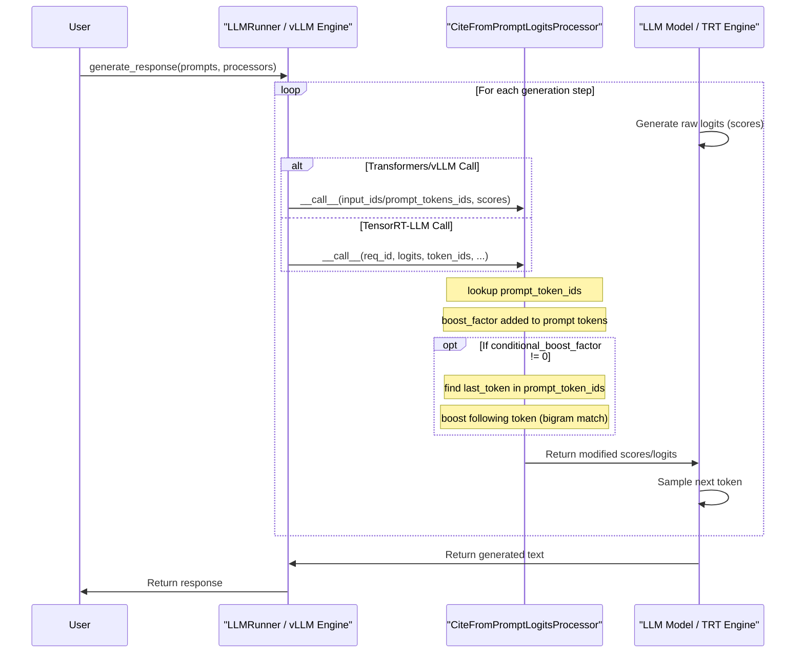

Sources: [logits_processor_zoo/transformers/cite_prompt.py:45-63](), [logits_processor_zoo/vllm/cite_prompt.py:47-63](), [logits_processor_zoo/trtllm/cite_prompt.py:49-75]()

## Implementation Details

The implementation varies slightly across frameworks to accommodate batching and memory layout requirements.

### Bigram Lookup Mechanism
If `conditional_boost_factor` is non-zero, the processor scans the prompt for occurrences of the most recently generated token (`last_token`). If `prompt[i] == last_token`, then `prompt[i+1]` receives the conditional boost. This encourages the model to follow the same sequences found in the source text.

### Vocabulary Safety Checks
All implementations include safety checks to ensure token IDs do not exceed the logit tensor dimensions (vocabulary size), preventing index-out-of-bounds errors.
- **Transformers**: `t < voc_size` [logits_processor_zoo/transformers/cite_prompt.py:52]()
- **vLLM**: `t < scores.shape[0]` [logits_processor_zoo/vllm/cite_prompt.py:52]()
- **TRT-LLM**: `t < logits.shape[-1]` [logits_processor_zoo/trtllm/cite_prompt.py:59]()

### Class Structure

```mermaid
classDiagram
    class CiteFromPromptLogitsProcessor {
        +float boost_factor
        +float conditional_boost_factor
        +bool boost_eos
        +int eos_token_id
        +__init__(tokenizer, boost_factor, boost_eos, conditional_boost_factor)
        +__call__(...)
    }

    class Transformers_CiteProcessor {
        +_process(input_ids, scores)
    }

    class vLLM_CiteProcessor {
        +__call__(prompt_tokens_ids, past_token_ids, scores)
    }

    class TRTLLM_CiteProcessor {
        +prompt_token_ids: List
        +_init_before_gen(token_ids)
        +__call__(req_id, logits, token_ids, stream_ptr, client_id)
    }

    CiteFromPromptLogitsProcessor <|-- Transformers_CiteProcessor
    CiteFromPromptLogitsProcessor <|-- vLLM_CiteProcessor
    CiteFromPromptLogitsProcessor <|-- TRTLLM_CiteProcessor
```

Sources: [logits_processor_zoo/transformers/cite_prompt.py:23-43](), [logits_processor_zoo/vllm/cite_prompt.py:23-45](), [logits_processor_zoo/trtllm/cite_prompt.py:24-44]()

## Parameters

| Parameter | Type | Default | Description |
|-----------|------|---------|-------------|
| `tokenizer` | `PreTrainedTokenizer` | Required | The tokenizer used by the LLM. vLLM also accepts a string path. |
| `boost_factor` | `float` | `1.0` | Factor to adjust token scores from the prompt. |
| `boost_eos` | `bool` | `True` | Whether to boost the EOS token score alongside prompt tokens. |
| `conditional_boost_factor` | `float` | `0.0` | Factor to boost tokens based on the previous token (bigram matching). |

**Warning**: In the Transformers implementation, you must create a new object before every `model.generate` call because `prompt_token_ids` are captured from the batch during the first step of generation.

Sources: [logits_processor_zoo/transformers/cite_prompt.py:27-38](), [logits_processor_zoo/vllm/cite_prompt.py:36-37]()

## Framework Specifics

### TensorRT-LLM Integration
The TRT-LLM implementation uses an `_init_before_gen` helper to capture the prompt tokens from the first beam of the request. It also handles CUDA streams via `torch.cuda.ExternalStream(stream_ptr)` to ensure the logit modifications are synchronized with the engine's execution.

Sources: [logits_processor_zoo/trtllm/cite_prompt.py:46-63]()

### vLLM Integration
The vLLM implementation is stateless regarding the prompt; it receives `prompt_tokens_ids` and `past_token_ids` directly in every `__call__`, making it natively compatible with vLLM's batched scheduling.

Sources: [logits_processor_zoo/vllm/cite_prompt.py:47-55]()

## Testing and Validation

The processor is validated by checking the intersection of tokens between the prompt and the output. A successful test confirms that applying the processor results in a higher token overlap compared to default generation.

```python
# From tests/transformers/test_cite_prompt.py
logits_processors = [CiteFromPromptLogitsProcessor(llm_runner.tokenizer, boost_factor=50.0, 
                                                   conditional_boost_factor=50.0)]
processed_gen_output = llm_runner.generate_response(example_prompts, logits_processors, max_new_tokens=10)

# Validation logic
assert len(processed_shared_tokens) > len(default_shared_tokens)
```

Sources: [tests/transformers/test_cite_prompt.py:21-41]()

---

# Page: ForceLastPhraseLogitsProcessor

# ForceLastPhraseLogitsProcessor

<details>
<summary>Relevant source files</summary>

The following files were used as context for generating this wiki page:

- [logits_processor_zoo/transformers/last_phrase.py](logits_processor_zoo/transformers/last_phrase.py)
- [logits_processor_zoo/transformers/multiple_choice.py](logits_processor_zoo/transformers/multiple_choice.py)
- [logits_processor_zoo/trtllm/cite_prompt.py](logits_processor_zoo/trtllm/cite_prompt.py)
- [logits_processor_zoo/trtllm/last_phrase.py](logits_processor_zoo/trtllm/last_phrase.py)
- [logits_processor_zoo/vllm/last_phrase.py](logits_processor_zoo/vllm/last_phrase.py)
- [tests/transformers/test_last_phrase.py](tests/transformers/test_last_phrase.py)

</details>


## Purpose and Overview

The `ForceLastPhraseLogitsProcessor` is a specialized logits processor that forces Language Models (LLMs) to insert a specific phrase before concluding their generation. This processor is particularly useful for applications that require consistent output formats, such as automatically appending references, adding thank you messages, or ensuring specific closing statements are included in the generated text. It functions by intercepting the End-of-Sequence (EOS) token and injecting the target phrase tokens into the generation stream.

Sources: [logits_processor_zoo/transformers/last_phrase.py:24-35](), [logits_processor_zoo/vllm/last_phrase.py:24-33](), [logits_processor_zoo/trtllm/last_phrase.py:25-29]()

## How It Works

The processor operates as a state machine that monitors the model's output. It remains idle until the model's highest-scoring token is the EOS token. At that point, it "hijacks" the generation to inject the phrase.

### Phrase Injection State Machine

```mermaid
stateDiagram-v2
    [*] --> Idle: Initialize index/iterator = 0
    Idle --> Injecting: Model predicts EOS AND index == 0
    Injecting --> Injecting: index < len(phrase_tokens)
    Injecting --> Completed: index == len(phrase_tokens)
    Completed --> [*]: Allow EOS
    
    state Injecting {
        direction L
        ForceToken: Call enforce_tokens() with phrase_tokens[index]
        Increment: Increment index
    }
```

Title: State Machine for Phrase Injection

Sources: [logits_processor_zoo/vllm/last_phrase.py:56-61](), [logits_processor_zoo/transformers/last_phrase.py:46-53](), [logits_processor_zoo/trtllm/last_phrase.py:54-60]()

### Key Mechanism

1.  **EOS Interception**: The processor checks if the `argmax()` of the current `scores` (logits) matches the `self.eos_token_id` [logits_processor_zoo/vllm/last_phrase.py:56]().
2.  **Token Enforcement**: If EOS is predicted and the phrase hasn't started (`index == 0`), it uses `enforce_tokens` to mask all logits except for the first token of the target phrase [logits_processor_zoo/vllm/last_phrase.py:57]().
3.  **Sequential Injection**: Once the phrase has started, the processor continues to force the next token in `self.phrase_tokens` regardless of what the model predicts, until the entire phrase is exhausted [logits_processor_zoo/transformers/last_phrase.py:51-53]().
4.  **Completion**: After the last token of the phrase is injected, the processor stops interfering, allowing the model to naturally generate the EOS token [logits_processor_zoo/vllm/last_phrase.py:59-61]().

Sources: [logits_processor_zoo/vllm/last_phrase.py:52-63](), [logits_processor_zoo/transformers/last_phrase.py:45-55]()

## Implementation Details

The library provides parallel implementations for Transformers, vLLM, and TensorRT-LLM to handle their respective batching and state requirements.

### Code Entity Mapping

```mermaid
graph TD
    subgraph "Natural Language Space"
        phrase["Target Phrase (str)"]
        eos["EOS Token"]
    end

    subgraph "Code Entity Space (Transformers/vLLM/TRT-LLM)"
        ProcessorClass["ForceLastPhraseLogitsProcessor"]
        TokenIdx["self.index / self.iterators"]
        PhraseTokens["self.phrase_tokens"]
        EnforceFn["enforce_tokens()"]
    end

    phrase -->|tokenizer.encode| PhraseTokens
    eos -->|tokenizer.eos_token_id| ProcessorClass
    TokenIdx -->|tracks progress in| PhraseTokens
    ProcessorClass -->|calls| EnforceFn
```

Title: Mapping Concepts to Code Entities

Sources: [logits_processor_zoo/transformers/last_phrase.py:36-40](), [logits_processor_zoo/vllm/last_phrase.py:34-42](), [logits_processor_zoo/utils.py:61-68]()

### Framework-Specific Behaviors

#### Transformers Implementation
The Transformers version inherits from `BaseLogitsProcessor` [logits_processor_zoo/transformers/last_phrase.py:24](). It manages state for a batch using a `torch.Tensor` of `iterators` [logits_processor_zoo/transformers/last_phrase.py:43]().
*   **Warning**: Users must create a new object before every `model.generate` call to reset the iterators, or ensure the internal `_reset()` is called [logits_processor_zoo/transformers/last_phrase.py:28-29]().

#### vLLM Implementation
The vLLM version includes a `clone()` method [logits_processor_zoo/vllm/last_phrase.py:46-47]().
*   **Clone Requirement**: vLLM requires mutable processors to be cloneable to prevent state leakage between different prompts in a batch [logits_processor_zoo/vllm/last_phrase.py:44-45]().
*   **State**: Uses a simple integer `self.index` as it is cloned per-sequence [logits_processor_zoo/vllm/last_phrase.py:50]().

#### TensorRT-LLM Implementation
Inherits from `tensorrt_llm.sampling_params.LogitsProcessor` [logits_processor_zoo/trtllm/last_phrase.py:25]().
*   **Beam Support**: It initializes iterators based on the `beam_width` during the `_init_before_gen` hook [logits_processor_zoo/trtllm/last_phrase.py:40-41]().
*   **CUDA Streams**: Wraps logit manipulation in `torch.cuda.stream(stream)` to ensure compatibility with the TRT-LLM runtime [logits_processor_zoo/trtllm/last_phrase.py:52-53]().

## Technical Specifications

### Parameters

| Parameter | Type | Framework | Description |
| :--- | :--- | :--- | :--- |
| `phrase` | `str` | All | The text to be injected before EOS. |
| `tokenizer` | `PreTrainedTokenizer` | All | Used to encode the phrase and identify EOS. |
| `batch_size` | `int` | Transformers | Required to initialize the iterator tensor for batched inference. |

Sources: [logits_processor_zoo/transformers/last_phrase.py:36](), [logits_processor_zoo/vllm/last_phrase.py:34](), [logits_processor_zoo/trtllm/last_phrase.py:35]()

### Data Flow

```mermaid
flowchart LR
    Scores["scores (Logits)"] --> ArgMax{"argmax == EOS?"}
    ArgMax -- "Yes & index=0" --> Enforce["enforce_tokens(phrase_tokens[0])"]
    ArgMax -- "No & index>0" --> Continue["enforce_tokens(phrase_tokens[index])"]
    ArgMax -- "No & index=0" --> Pass["Return Original Scores"]
    
    Enforce --> Inc["Increment Index"]
    Continue --> Inc
    Inc --> Output["Modified Scores"]
    Pass --> Output
```

Title: Logit Manipulation Logic

Sources: [logits_processor_zoo/vllm/last_phrase.py:52-63](), [logits_processor_zoo/transformers/last_phrase.py:45-55]()

## Technical Considerations

1.  **Tokenization Consistency**: The phrase is encoded using `add_special_tokens=False` [logits_processor_zoo/vllm/last_phrase.py:40](). Ensure the tokenizer provided matches the one used by the LLM to avoid "broken" phrases due to differing vocabularies.
2.  **Batching State**: In the Transformers implementation, `self.iterators` is a tensor of size `batch_size` [logits_processor_zoo/transformers/last_phrase.py:43](). If the generation involves sequences finishing at different times, the processor correctly tracks each sequence's progress through the phrase independently [logits_processor_zoo/transformers/last_phrase.py:46-53]().
3.  **Enforce Mechanism**: The `enforce_tokens` utility is used to set the logit of the target token to a very high value while suppressing others, ensuring the sampler picks the correct phrase token [logits_processor_zoo/utils.py:61-68]().

Sources: [logits_processor_zoo/transformers/last_phrase.py:43-53](), [logits_processor_zoo/vllm/last_phrase.py:40](), [logits_processor_zoo/utils.py:61-68]()

---

# Page: MultipleChoiceLogitsProcessor

# MultipleChoiceLogitsProcessor

<details>
<summary>Relevant source files</summary>

The following files were used as context for generating this wiki page:

- [logits_processor_zoo/transformers/last_phrase.py](logits_processor_zoo/transformers/last_phrase.py)
- [logits_processor_zoo/transformers/multiple_choice.py](logits_processor_zoo/transformers/multiple_choice.py)
- [logits_processor_zoo/trtllm/multiple_choice.py](logits_processor_zoo/trtllm/multiple_choice.py)
- [logits_processor_zoo/vllm/multiple_choice.py](logits_processor_zoo/vllm/multiple_choice.py)
- [tests/transformers/test_multiple_choice.py](tests/transformers/test_multiple_choice.py)

</details>


## Purpose and Overview

The `MultipleChoiceLogitsProcessor` is a specialized logits processor designed to constrain a language model's output to a specific set of multiple-choice options (e.g., "A", "B", "C", "D" or "1", "2", "3"). It identifies the relevant choice tokens and manipulates the logit distribution to ensure the model selects one of the valid options as its next token.

This processor is particularly useful for:
- Creating robust question-answering systems with fixed answer schemas.
- Implementing multiple-choice assessments where the model must output exactly one identifier.
- Improving model performance on complex choices using the `boost_first_words` heuristic.

Sources: [logits_processor_zoo/transformers/multiple_choice.py:25-34](), [logits_processor_zoo/vllm/multiple_choice.py:24-33]()

## Implementation Details

The library provides parallel implementations for **Transformers**, **vLLM**, and **TensorRT-LLM**. While the core logic remains consistent, the internal handling of batching and prompt access varies by framework.

### Choice Token Identification
During initialization, the processor converts the provided text choices and delimiters into their respective token IDs using the provided tokenizer. It specifically uses `text_to_token(..., last=False)` to ensure it captures the token representation as it would appear at the start or middle of a sequence.

Sources: [logits_processor_zoo/transformers/multiple_choice.py:45-53](), [logits_processor_zoo/vllm/multiple_choice.py:44-57](), [logits_processor_zoo/trtllm/multiple_choice.py:45-52]()

### Logic Flow and Data Transformation
The following diagram illustrates how the processor moves from natural language choices to code-level logit manipulation.

```mermaid
graph TD
    subgraph "Natural Language Space"
        P["Prompt Text: '1. Apple\n2. Banana'"]
        C["Choices: ['1', '2']"]
        D["Delimiter: '.'"]
    end

    subgraph "Code Entity Space (MultipleChoiceLogitsProcessor)"
        Init["__init__"]
        Util1["get_new_line_tokens()"]
        Util2["text_to_token()"]
        
        Proc["_process (Transformers) / __call__ (vLLM/TRT-LLM)"]
        Boost["boost_first_words logic"]
        Mask["enforce_tokens()"]
    end

    P --> Init
    C --> Util2
    D --> Util2
    Util2 --> Init
    
    Init --> Proc
    Proc --> Boost
    Boost --> Mask
    Mask --> Output["Filtered Logits"]
```
Sources: [logits_processor_zoo/transformers/multiple_choice.py:45-84](), [logits_processor_zoo/utils.py:21-21]()

## Key Parameters

| Parameter | Type | Default | Description |
|-----------|------|---------|-------------|
| `tokenizer` | `PreTrainedTokenizer` | Required | The tokenizer used by the LLM to map strings to IDs. |
| `choices` | `List[str]` | `["1", "2", "3", "4"]` | The allowed single-character answer identifiers. |
| `delimiter` | `str` | `"."` | The character following the choice in the prompt (e.g., `.` in `1.` or `)` in `A)`). |
| `boost_first_words` | `float` | `0.0` | Heuristic factor to boost choice IDs based on the likelihood of the content following them. |

Sources: [logits_processor_zoo/transformers/multiple_choice.py:37-44](), [logits_processor_zoo/vllm/multiple_choice.py:36-43]()

## Advanced Features

### Delimiter-Based Prompt Parsing
The processor scans the `prompt_token_ids` to find patterns matching `\n` + `choice` + `delimiter`. This allows it to locate exactly where the options are described in the input text.

Sources: [logits_processor_zoo/transformers/multiple_choice.py:63-71](), [logits_processor_zoo/vllm/multiple_choice.py:66-74]()

### Boost First Words Heuristic
If `boost_first_words` is non-zero, the processor identifies the "first word" (the token at index `i + 3` relative to the newline) for each choice. It then adds a portion of that first word's logit score back to the choice identifier's score. This helps models that struggle to link a choice label (like "A") with its descriptive text (like "Operating System").

```mermaid
sequenceDiagram
    participant LLM as "LLM Logits"
    participant MCLP as "MultipleChoiceLogitsProcessor"
    participant Utils as "utils.enforce_tokens"

    MCLP->>MCLP: Scan prompt for '\n' + choice + delimiter
    MCLP->>MCLP: Identify 'First Word' tokens (e.g., 'Battery')
    
    Note over MCLP, LLM: boost_first_words > 0
    MCLP->>LLM: scores[choice_token] += boost * scores[first_word_token]
    
    MCLP->>Utils: Pass scores and choice_tokens
    Utils->>LLM: Set all non-choice logits to -inf
    LLM-->>MCLP: Return constrained scores
```
Sources: [logits_processor_zoo/transformers/multiple_choice.py:59-82](), [logits_processor_zoo/vllm/multiple_choice.py:62-83]()

### Masking Step
Regardless of boosting, the final step always calls `enforce_tokens`. This utility function ensures that only the `choice_tokens` have non-negative infinity values in the logits tensor, effectively forcing the model to pick from the allowed list.

Sources: [logits_processor_zoo/utils.py:82-89](), [logits_processor_zoo/transformers/multiple_choice.py:81-82]()

## Framework Specifics

### Transformers
Inherits from `BaseLogitsProcessor`. It accesses the prompt via `self.prompt_token_ids` which is automatically captured by the base class during the first call. It iterates through the batch dimension to apply logic to each sequence.
Sources: [logits_processor_zoo/transformers/multiple_choice.py:25-58]()

### vLLM
The `__call__` method receives `prompt_tokens_ids` directly as an argument. Since vLLM handles sequences individually or in managed batches, the processor applies the logic directly to the provided `scores` tensor.
Sources: [logits_processor_zoo/vllm/multiple_choice.py:60-84]()

### TensorRT-LLM
Implements the `tensorrt_llm.sampling_params.LogitsProcessor` interface. It uses `_init_choice_first_words` to cache the identified first tokens to avoid re-scanning the prompt during every step of generation. It also handles CUDA streams via `torch.cuda.ExternalStream(stream_ptr)`.
Sources: [logits_processor_zoo/trtllm/multiple_choice.py:25-93]()

## Usage Example

The following test case demonstrates using a custom delimiter `)` and alphanumeric choices.

```python
# From tests/transformers/test_multiple_choice.py
choices = ["a", "b", "c", "d"]
# delimiter=")" matches "a) Camera", "b) Screen", etc.
mclp = MultipleChoiceLogitsProcessor(tokenizer, choices=choices, delimiter=")")
processed_gen_output = llm_runner.generate_response(prompts, [mclp], max_new_tokens=1)
```
Sources: [tests/transformers/test_multiple_choice.py:44-46]()

---

# Page: TriggerPhraseLogitsProcessor

# TriggerPhraseLogitsProcessor

<details>
<summary>Relevant source files</summary>

The following files were used as context for generating this wiki page:

- [logits_processor_zoo/transformers/trigger_phrase.py](logits_processor_zoo/transformers/trigger_phrase.py)
- [logits_processor_zoo/trtllm/__init__.py](logits_processor_zoo/trtllm/__init__.py)
- [logits_processor_zoo/trtllm/trigger_phrase.py](logits_processor_zoo/trtllm/trigger_phrase.py)
- [logits_processor_zoo/vllm/trigger_phrase.py](logits_processor_zoo/vllm/trigger_phrase.py)
- [tests/transformers/test_trigger_phrase.py](tests/transformers/test_trigger_phrase.py)

</details>


## Purpose and Scope

The `TriggerPhraseLogitsProcessor` is a specialized logits processor that forces an LLM to generate a specified phrase when it encounters a designated trigger point. Unlike simpler processors, it supports both **content-based triggers** (specific tokens) and **temporal triggers** (wall-clock time). This processor provides precise control over text generation by allowing you to inject specific content at predetermined points, useful for enforcing specific formats, injecting standard phrases, or guiding the model's thought process.

This document covers the implementation, configuration, and usage across the Transformers, vLLM, and TensorRT-LLM backends.

Sources: [logits_processor_zoo/vllm/trigger_phrase.py:25-37](), [logits_processor_zoo/transformers/trigger_phrase.py:26-39](), [logits_processor_zoo/trtllm/trigger_phrase.py:26-38]()

## Core Concepts

The `TriggerPhraseLogitsProcessor` works by monitoring the generation stream for a trigger condition. Once met, it intercepts the logit distribution and forces the model to generate a predefined phrase by applying `enforce_tokens` to the logits of the phrase's constituent tokens.

Key features include:
- **Token-based Triggering**: Activates when a specific `trigger_token` is predicted as the most likely next token.
- **Temporal Triggering**: Activates if the generation has exceeded a specified `trigger_time` (wall-clock seconds).
- **Placement Control**: The `trigger_after` toggle determines if the phrase follows the trigger token or overwrites it.
- **Stateful Management**: Tracks phrase progress (`index`), remaining triggers (`trigger_count`), and timing (`start_time`).

### Logic Flow and State Transition

```mermaid
flowchart TD
    subgraph "TriggerPhraseLogitsProcessor::call"
        A["Input Logits"] --> B{"Is trigger_count > 0?"}
        B -- "No" --> END["Return Scores"]
        B -- "Yes" --> C{"Is index == -1?"}
        
        C -- "Yes (Monitoring)" --> D{"Trigger Condition Met?"}
        D -- "Token == trigger_token OR time > trigger_time" --> E["Set index = 0"]
        D -- "No" --> END
        
        E --> F{"trigger_after == True?"}
        F -- "No (Replace)" --> G["enforce_tokens(phrase[0])"]
        F -- "Yes (Follow)" --> END
        
        C -- "No (Injecting)" --> H{"index < len(phrase)?"}
        H -- "Yes" --> I["enforce_tokens(phrase[index])"]
        H -- "No" --> J["Reset: index = -1, trigger_count -= 1"]
        
        G --> K["index += 1"]
        I --> K
        K --> END
    end
```

Sources: [logits_processor_zoo/vllm/trigger_phrase.py:75-97](), [logits_processor_zoo/transformers/trigger_phrase.py:66-88](), [logits_processor_zoo/trtllm/trigger_phrase.py:62-91]()

## Implementation Details

### Parameters

The processor accepts the following configuration:

| Parameter | Type | Description |
|-----------|------|-------------|
| `tokenizer` | `PreTrainedTokenizer` | Used to encode the `phrase` and identify the `trigger_token`. |
| `phrase` | `str` | The text to be forced into the output. |
| `trigger_token_phrase` | `Optional[str]` | A string representing a single token that acts as a content trigger. |
| `trigger_time` | `Optional[float]` | Wall-clock time (seconds) after which the phrase is triggered regardless of content. |
| `trigger_count` | `int` | Maximum number of times the phrase can be triggered per sequence. |
| `trigger_after` | `bool` | If `True`, the phrase follows the trigger; if `False`, the phrase replaces the trigger token. |

Sources: [logits_processor_zoo/vllm/trigger_phrase.py:39-41](), [logits_processor_zoo/transformers/trigger_phrase.py:41-43](), [logits_processor_zoo/trtllm/trigger_phrase.py:40-43]()

### Code Entity Space Mapping

The following diagram maps the logical components of the processor to the actual class attributes and utility functions used in the codebase.

```mermaid
graph LR
    subgraph "Natural Language Space"
        P["Target Phrase"]
        T["Trigger Word"]
        TM["Time Limit"]
    end

    subgraph "Code Entity Space (TriggerPhraseLogitsProcessor)"
        direction TB
        subgraph "Initialization"
            U1["utils.text_to_token"]
            U2["tokenizer.encode"]
        end
        
        subgraph "State Management"
            S1["self.index"]
            S2["self.trigger_count"]
            S3["self.start_time"]
        end
        
        subgraph "Logit Manipulation"
            M1["utils.enforce_tokens"]
            M2["scores.argmax()"]
        end
    end

    P --> U2
    T --> U1
    TM --> S3
    U2 --> S1
    S1 --> M1
    M2 --> D["Trigger Detection"]
```

Sources: [logits_processor_zoo/vllm/trigger_phrase.py:51-62](), [logits_processor_zoo/transformers/trigger_phrase.py:51-59](), [logits_processor_zoo/utils.py:23-55]()

## Framework-Specific Implementations

### Transformers Implementation
The Transformers version inherits from `BaseLogitsProcessor` [logits_processor_zoo/transformers/trigger_phrase.py:26](). It manages state across a batch using tensors for `iterators` and `trigger_count` [logits_processor_zoo/transformers/trigger_phrase.py:62-63](). It implements the `_process` hook which iterates through the batch dimension of the `scores` tensor [logits_processor_zoo/transformers/trigger_phrase.py:66-67]().

### vLLM Implementation
The vLLM implementation requires a `clone()` method [logits_processor_zoo/vllm/trigger_phrase.py:66-68](). Because vLLM can share sampling parameters across sequences, mutable processors must be cloned to ensure each sequence maintains its own `index`, `trigger_count`, and `start_time` [logits_processor_zoo/vllm/trigger_phrase.py:64-65]().

### TensorRT-LLM Implementation
Inherits from `tensorrt_llm.sampling_params.LogitsProcessor` [logits_processor_zoo/trtllm/trigger_phrase.py:26](). It features an `_init_before_gen` method to set up `iterators` and `trigger_counts` based on the `beam_width` [logits_processor_zoo/trtllm/trigger_phrase.py:58-60](). It also handles `torch.cuda.ExternalStream` to ensure synchronization with the TRT-LLM runtime [logits_processor_zoo/trtllm/trigger_phrase.py:69-71]().

## State Management and Reset Lifecycle

The processor must reset its internal counters and timers at the start of every new generation request.

- **vLLM**: Checks if `past_token_ids` is empty to trigger `_reset()` [logits_processor_zoo/vllm/trigger_phrase.py:76-77]().
- **Transformers**: Relies on the `BaseLogitsProcessor` lifecycle which calls `_reset()` when a change in `input_ids` length indicates a new sequence [logits_processor_zoo/transformers/base.py:42-45]().
- **TRT-LLM**: Uses the `_init_before_gen` call inside the first `__call__` execution [logits_processor_zoo/trtllm/trigger_phrase.py:66-67]().

| State Variable | Initial Value | Reset Trigger |
|----------------|---------------|---------------|
| `index` / `iterators` | `-1` | New Request Start |
| `trigger_count` | `initial_trigger_count` | New Request Start |
| `start_time` | `time.time()` | New Request OR Phrase Completion |

Sources: [logits_processor_zoo/vllm/trigger_phrase.py:70-73](), [logits_processor_zoo/transformers/trigger_phrase.py:61-64](), [logits_processor_zoo/trtllm/trigger_phrase.py:88-91]()

## Usage Example

### Token-Based Triggering (Transformers)
```python
from logits_processor_zoo.transformers import TriggerPhraseLogitsProcessor

# Trigger " (Reflecting...)" immediately after the model predicts "thought"
lp = TriggerPhraseLogitsProcessor(
    tokenizer=tokenizer,
    batch_size=1,
    phrase=" (Reflecting...)",
    trigger_token_phrase="thought",
    trigger_after=True,
    trigger_count=1
)
```
Sources: [tests/transformers/test_trigger_phrase.py:21-36]()

### Temporal Triggering (vLLM)
```python
from logits_processor_zoo.vllm import TriggerPhraseLogitsProcessor

# Force the phrase " [TIMEOUT WARNING] " if generation takes longer than 5 seconds
lp = TriggerPhraseLogitsProcessor(
    tokenizer=tokenizer,
    phrase=" [TIMEOUT WARNING] ",
    trigger_time=5.0,
    trigger_after=False,
    trigger_count=1
)
```
Sources: [tests/transformers/test_trigger_phrase.py:42-60](), [logits_processor_zoo/vllm/trigger_phrase.py:39-41]()

---

# Page: PreventHallucinationLogitsProcessor

# PreventHallucinationLogitsProcessor

<details>
<summary>Relevant source files</summary>

The following files were used as context for generating this wiki page:

- [logits_processor_zoo/transformers/prevent_hallucination.py](logits_processor_zoo/transformers/prevent_hallucination.py)
- [logits_processor_zoo/trtllm/prevent_hallucination.py](logits_processor_zoo/trtllm/prevent_hallucination.py)
- [logits_processor_zoo/vllm/prevent_hallucination.py](logits_processor_zoo/vllm/prevent_hallucination.py)
- [tests/transformers/test_prevent_hallucination.py](tests/transformers/test_prevent_hallucination.py)

</details>


The `PreventHallucinationLogitsProcessor` is designed to mitigate hallucinated model outputs by monitoring token confidence during the generation process. It uses a minimum probability threshold (`minp`) to identify low-confidence tokens. If the model produces more than a specified number of consecutive low-confidence tokens (`tolerate`), the processor intercepts the generation and injects a predefined fallback phrase (e.g., "...I don't know actually.\n") to gracefully indicate uncertainty [logits_processor_zoo/transformers/prevent_hallucination.py:25-31]().

## Implementation Overview

The processor maintains internal state to track consecutive low-confidence tokens and the progress of phrase injection. It is implemented across three frameworks: `transformers`, `vLLM`, and `TensorRT-LLM`.

### Core Parameters
| Parameter | Type | Description |
| :--- | :--- | :--- |
| `tokenizer` | `PreTrainedTokenizer` | Used to encode the fallback phrase into token IDs [logits_processor_zoo/transformers/prevent_hallucination.py:52-53](). |
| `minp` | `float` | The probability threshold. Tokens with a maximum softmax probability below this are flagged [logits_processor_zoo/transformers/prevent_hallucination.py:54](). |
| `tolerate` | `int` | The number of consecutive low-confidence tokens allowed before triggering the fallback [logits_processor_zoo/transformers/prevent_hallucination.py:55](). |
| `phrase` | `str` | The string to inject when hallucination is detected [logits_processor_zoo/transformers/prevent_hallucination.py:50](). |

**Sources:** [logits_processor_zoo/transformers/prevent_hallucination.py:33-56](), [logits_processor_zoo/vllm/prevent_hallucination.py:33-53]()

---

## Code Entity Space Mapping

The following diagram maps the logical components of the hallucination prevention system to their specific implementations in the codebase.

**Hallucination Prevention Entity Map**
```mermaid
graph TD
    subgraph "Natural Language Space"
        A["Confidence Monitoring"]
        B["Hallucination Detection"]
        C["Fallback Injection"]
    end

    subgraph "Code Entity Space"
        direction TB
        D["minp threshold"] --> E["softmax().amax()"]
        F["tolerate count"] --> G["minp_count / minp_counts"]
        H["Fallback Phrase"] --> I["phrase_tokens"]
        
        subgraph "Processors"
            J["PreventHallucinationLogitsProcessor (Transformers)"]
            K["PreventHallucinationLogitsProcessor (vLLM)"]
            L["PreventHallucinationLogitsProcessor (TRT-LLM)"]
        end
    end

    A --- E
    B --- G
    C --- I
    
    J -- "uses" --> E
    J -- "updates" --> G
    K -- "calls" --> M["enforce_tokens()"]
    L -- "calls" --> M
```
**Sources:** [logits_processor_zoo/transformers/prevent_hallucination.py:24-48](), [logits_processor_zoo/vllm/prevent_hallucination.py:24-46](), [logits_processor_zoo/trtllm/prevent_hallucination.py:25-47](), [logits_processor_zoo/utils.py:21-21]()

---

## Generation Lifecycle and Data Flow

The processor operates by checking the maximum probability of the next token in the `scores` (logits) tensor. If the confidence is too low, it increments a counter. Once the counter exceeds the `tolerate` limit, it uses `enforce_tokens` to force the model to output the next token from the `phrase_tokens` list.

**Token Confidence and Injection Flow**
```mermaid
sequenceDiagram
    participant LLM as "LLM Engine"
    participant PHLP as "PreventHallucinationLogitsProcessor"
    participant UT as "enforce_tokens (utils.py)"

    LLM->>PHLP: __call__(scores)
    Note over PHLP: Calculate softmax().amax()
    alt max_prob < minp
        PHLP->>PHLP: increment minp_count
    else max_prob >= minp
        PHLP->>PHLP: minp_count remains/resets (impl dependent)
    end

    alt minp_count > tolerate OR injection_in_progress
        PHLP->>UT: enforce_tokens(scores, phrase_tokens[index])
        UT-->>PHLP: modified_scores
        PHLP->>PHLP: increment index
    end

    PHLP-->>LLM: scores
```
**Sources:** [logits_processor_zoo/transformers/prevent_hallucination.py:62-78](), [logits_processor_zoo/vllm/prevent_hallucination.py:62-78](), [logits_processor_zoo/trtllm/prevent_hallucination.py:61-87]()

---

## Framework-Specific Details

### Transformers Integration
The Transformers version inherits from `BaseLogitsProcessor` [logits_processor_zoo/transformers/prevent_hallucination.py:24](). It manages state for a batch of sequences using `torch.Tensor` trackers:
* `self.iterators`: Tracks the current position within the fallback phrase for each sequence in the batch [logits_processor_zoo/transformers/prevent_hallucination.py:59]().
* `self.minp_count`: Tracks consecutive low-confidence tokens per sequence [logits_processor_zoo/transformers/prevent_hallucination.py:60]().

### vLLM Integration
In vLLM, the processor is intended for single-sequence execution or cloned for batching.
* **State Management**: Uses simple integer counters (`self.index` and `self.minp_count`) [logits_processor_zoo/vllm/prevent_hallucination.py:59-60]().
* **Clone Method**: Implements `clone()` to ensure that when vLLM forks a request, the processor state is safely replicated [logits_processor_zoo/vllm/prevent_hallucination.py:55-56]().

### TensorRT-LLM Integration
The TRT-LLM implementation inherits from `tensorrt_llm.sampling_params.LogitsProcessor` [logits_processor_zoo/trtllm/prevent_hallucination.py:25]().
* **CUDA Streams**: Explicitly handles CUDA external streams using `torch.cuda.ExternalStream(stream_ptr)` to ensure logit manipulation happens on the correct device stream [logits_processor_zoo/trtllm/prevent_hallucination.py:69-71]().
* **Beam Search**: Iterates over the `beam_width` dimension of the logits tensor to apply the hallucination check to every active beam [logits_processor_zoo/trtllm/prevent_hallucination.py:72-87]().

**Sources:** [logits_processor_zoo/transformers/prevent_hallucination.py:58-78](), [logits_processor_zoo/vllm/prevent_hallucination.py:55-78](), [logits_processor_zoo/trtllm/prevent_hallucination.py:57-87]()

---

# Page: MaxTimeLogitsProcessor

# MaxTimeLogitsProcessor

<details>
<summary>Relevant source files</summary>

The following files were used as context for generating this wiki page:

- [logits_processor_zoo/transformers/max_time.py](logits_processor_zoo/transformers/max_time.py)
- [logits_processor_zoo/trtllm/max_time.py](logits_processor_zoo/trtllm/max_time.py)
- [logits_processor_zoo/vllm/max_time.py](logits_processor_zoo/vllm/max_time.py)
- [tests/transformers/test_max_time.py](tests/transformers/test_max_time.py)

</details>


The `MaxTimeLogitsProcessor` is a temporal control mechanism designed to enforce the termination of text generation based on wall-clock time rather than token count. This is particularly useful for real-time applications, Service Level Agreement (SLA) enforcement, or preventing infinite generation loops in models that fail to produce an EOS token naturally.

## Overview

Unlike length-based processors (e.g., `GenLengthLogitsProcessor`) which operate on discrete token counts, `MaxTimeLogitsProcessor` monitors the elapsed time since the start of the generation process. Once the `max_time` threshold is crossed, the processor manipulates the logits to force the selection of an End-of-Sentence (EOS) token or a custom termination token.

### Key Capabilities
*   **Temporal Enforcement**: Guarantees generation halts after a specific number of seconds [logits_processor_zoo/transformers/max_time.py:33]().
*   **Sentence Integrity**: Optionally waits for a natural sentence boundary (full stop or newline) before enforcing termination [logits_processor_zoo/transformers/max_time.py:34-35]().
*   **Custom Termination**: Allows overriding the default EOS token with a custom string [logits_processor_zoo/transformers/max_time.py:36]().
*   **Multi-Framework Support**: Implementations are available for Hugging Face `transformers`, `vLLM`, and `TensorRT-LLM`.

Sources: [logits_processor_zoo/transformers/max_time.py:25-38](), [logits_processor_zoo/vllm/max_time.py:25-38](), [logits_processor_zoo/trtllm/max_time.py:26-38]()

---

## Implementation Details

The processor inherits from `SentenceChecker` to support the `complete_sentences` logic and framework-specific base classes to integrate into the respective generation loops.

### Data Flow and State Management
The processor initializes a `start_time` using `time.time()` when generation begins. For every forward pass, it calculates the `elapsed_time`. If `elapsed_time > max_time`, it triggers the logit masking logic via `enforce_tokens`.

#### Diagram: Temporal Control Logic
This diagram illustrates how the `MaxTimeLogitsProcessor` interacts with the LLM generation loop across different frameworks.

```mermaid
graph TD
    subgraph "Initialization"
        A["__init__"] --> B["_reset() / start_time = time.time()"]
        A --> C["text_to_token() for boost_token"]
    end

    subgraph "Generation Loop"
        D["LLM Forward Pass"] --> E["__call__ / _process"]
        E --> F{"elapsed_time > max_time?"}
        F -- "No" --> G["Return Original Scores"]
        F -- "Yes" --> H{"complete_sentences == True?"}
        
        H -- "Yes" --> I["_check_sentence_end()"]
        H -- "No" --> J["enforce_tokens(boost_token)"]
        
        I -- "Boundary Found" --> J
        I -- "Mid-sentence" --> G
        
        J --> K["Modified Logits (EOS forced)"]
    end
```
Sources: [logits_processor_zoo/transformers/max_time.py:55-70](), [logits_processor_zoo/utils.py:22-22](), [logits_processor_zoo/vllm/max_time.py:82-91]()

### Class Structure and Framework Mapping
The implementation varies slightly across frameworks to accommodate their specific batching and state handling requirements.

| Feature | Transformers | vLLM | TensorRT-LLM |
| :--- | :--- | :--- | :--- |
| **Base Class** | `BaseLogitsProcessor` | `SentenceChecker` | `LogitsProcessor` |
| **State Reset** | `_reset()` hook | `_reset()` in `__init__` | `__init__` timestamp |
| **Batching** | Handled in `_process` loop | Requires `clone()` | Handled via `req_id` |
| **Sentence Check** | `self._check_sentence_end(input_ids)` | `self._check_sentence_end(past_token_ids)` | `self._check_sentence_end(ids)` |

#### Diagram: Code Entity Space Association
This diagram maps the logical components of the time-based control to specific code entities within the repository.

```mermaid
classDiagram
    class MaxTimeLogitsProcessor {
        +float max_time
        +int boost_token
        +bool complete_sentences
        +_process(input_ids, scores)
        +_reset()
    }
    class SentenceChecker {
        +_check_sentence_end(ids)
    }
    class BaseLogitsProcessor {
        +__call__(input_ids, scores)
    }
    class Utils {
        +enforce_tokens(scores, tokens)
        +text_to_token(tokenizer, text)
    }

    MaxTimeLogitsProcessor --|> SentenceChecker : Inherits boundary logic
    MaxTimeLogitsProcessor --|> BaseLogitsProcessor : Inherits lifecycle (Transformers)
    MaxTimeLogitsProcessor ..> Utils : Uses for logit manipulation
```
Sources: [logits_processor_zoo/transformers/max_time.py:25-25](), [logits_processor_zoo/vllm/max_time.py:25-25](), [logits_processor_zoo/trtllm/max_time.py:26-26](), [logits_processor_zoo/utils.py:1-23]()

---

## Configuration Parameters

| Parameter | Type | Description |
| :--- | :--- | :--- |
| `tokenizer` | `PreTrainedTokenizer` | Used for decoding tokens to check sentence boundaries and encoding the `boost_token_str`. |
| `max_time` | `float` | The hard limit in seconds. [logits_processor_zoo/transformers/max_time.py:33]() |
| `complete_sentences` | `bool` | If `True`, the processor will wait for a punctuation mark (`.`, `?`, `!`) or a newline before forcing EOS, even if `max_time` is exceeded. [logits_processor_zoo/transformers/max_time.py:34-35]() |
| `boost_token_str` | `str` | Optional override for the EOS token. If provided, `text_to_token` converts this to an ID. [logits_processor_zoo/transformers/max_time.py:50-51]() |

Sources: [logits_processor_zoo/transformers/max_time.py:40-53](), [logits_processor_zoo/vllm/max_time.py:40-57]()

---

## Framework-Specific Considerations

### vLLM Cloning
In `vLLM`, logits processors are often shared across requests in a batch. Since `MaxTimeLogitsProcessor` maintains internal state (`start_time`), it implements the `clone()` method. This ensures that every individual request in a vLLM batch has its own independent timer.
*   **Implementation**: [logits_processor_zoo/vllm/max_time.py:62-68]()

### TensorRT-LLM Stream Handling
The TRT-LLM implementation accounts for CUDA streams. It uses `torch.cuda.ExternalStream(stream_ptr)` to ensure that logit manipulation happens on the correct device stream used by the engine.
*   **Implementation**: [logits_processor_zoo/trtllm/max_time.py:70-72]()

### Sentence Boundary Detection
The `complete_sentences` mode leverages `SentenceChecker._check_sentence_end`. This function inspects the most recently generated tokens to determine if they constitute a natural stopping point. If the time limit is reached but the model is mid-sentence, the processor will defer enforcement until the `SentenceChecker` returns `True`.
*   **Logic**: [logits_processor_zoo/transformers/max_time.py:63-64]()

---

## Comparison with Length-based Control

| Feature | `MaxTimeLogitsProcessor` | `GenLengthLogitsProcessor` |
| :--- | :--- | :--- |
| **Control Variable** | Seconds (Wall-clock) | Token Count |
| **Primary Use Case** | Latency/SLA management | Output size constraints |
| **Determinism** | Non-deterministic (hardware dependent) | Deterministic |
| **Sentence Handling** | Optional boundary wait | Optional boundary wait |

Sources: [logits_processor_zoo/transformers/max_time.py:26-38](), [logits_processor_zoo/transformers/gen_length.py:25-45]()

---

# Page: Framework Integrations

# Framework Integrations

<details>
<summary>Relevant source files</summary>

The following files were used as context for generating this wiki page:

- [README.md](README.md)
- [logits_processor_zoo/transformers/__init__.py](logits_processor_zoo/transformers/__init__.py)
- [logits_processor_zoo/trtllm/__init__.py](logits_processor_zoo/trtllm/__init__.py)
- [logits_processor_zoo/trtllm/trigger_phrase.py](logits_processor_zoo/trtllm/trigger_phrase.py)
- [logits_processor_zoo/vllm/__init__.py](logits_processor_zoo/vllm/__init__.py)

</details>


This document provides an overview of how the `logits-processor-zoo` integrates with different LLM frameworks. The library is designed to work with multiple popular LLM frameworks through consistent interfaces while respecting the unique architecture and call signatures of each system.

For detailed information about specific framework integrations, see:
- [Transformers Integration](#4.1)
- [vLLM Integration](#4.2)
- [TensorRT-LLM Integration](#4.3)

## Supported Frameworks

The Logits Processor Zoo currently integrates with three major LLM inference frameworks:

| Framework | Description | Integration Path |
|-----------|-------------|-----------------|
| **Transformers** | Hugging Face's framework for transformer models | `logits_processor_zoo/transformers/` |
| **vLLM** | High-throughput inference engine with PagedAttention | `logits_processor_zoo/vllm/` |
| **TensorRT-LLM** | NVIDIA's optimized framework for LLM inference (>=0.20.0) | `logits_processor_zoo/trtllm/` |

Sources: [README.md:18-21](), [logits_processor_zoo/transformers/__init__.py:18-24](), [logits_processor_zoo/vllm/__init__.py:18-24](), [logits_processor_zoo/trtllm/__init__.py:18-24]()

## Integration Architecture

The library employs a parallel implementation pattern. While the logic for a specific processor (e.g., `GenLengthLogitsProcessor`) remains conceptually similar across frameworks, the class definitions are replicated within framework-specific subdirectories to match the expected base classes and call signatures of the target engine.

### Framework Implementation Map

The following diagram bridges the high-level framework concepts to the specific code entities in the zoo.

```mermaid
graph TD
    subgraph "Framework_Interfaces"
        T_Base["transformers.LogitsProcessor"]
        V_Base["vllm.SamplingParams"]
        TRT_Base["tensorrt_llm.sampling_params.LogitsProcessor"]
    end

    subgraph "Logits_Processor_Zoo_Entities"
        subgraph "Transformers_Package"
            T_Impl["logits_processor_zoo.transformers.BaseLogitsProcessor"]
            T_Gen["GenLengthLogitsProcessor"]
        end
        
        subgraph "vLLM_Package"
            V_Gen["GenLengthLogitsProcessor"]
            V_Clone["clone() method"]
        end

        subgraph "TRTLLM_Package"
            TRT_Gen["GenLengthLogitsProcessor"]
            TRT_Call["__call__(req_id, logits, ...)"]
        end
    end

    T_Base --- T_Impl
    T_Impl --> T_Gen
    V_Base --- V_Gen
    V_Gen --> V_Clone
    TRT_Base --- TRT_Gen
    TRT_Gen --> TRT_Call
```

Sources: [logits_processor_zoo/transformers/base.py:23-25](), [logits_processor_zoo/vllm/generation_length.py:22-24](), [logits_processor_zoo/trtllm/trigger_phrase.py:23-26]()

## Interface Differences

The primary difference between integrations lies in the `__call__` signature and state management required by the underlying engine.

### Call Signature Comparison

```mermaid
graph LR
    subgraph "Transformers_Signature"
        TS["(input_ids, scores)"]
    end
    subgraph "vLLM_Signature"
        VS["(prompt_tokens_ids, past_token_ids, scores)"]
    end
    subgraph "TRTLLM_Signature"
        TRTS["(req_id, logits, token_ids, stream_ptr, client_id)"]
    end

    TS --- T_Call["logits_processor_zoo/transformers/base.py"]
    VS --- V_Call["logits_processor_zoo/vllm/generation_length.py"]
    TRTS --- TRT_Call["logits_processor_zoo/trtllm/trigger_phrase.py"]
```

*   **Transformers**: Uses a simple `(input_ids, scores)` signature. The zoo uses a `BaseLogitsProcessor` to handle internal state resets via `_check_new_generation`. For details, see [Transformers Integration](#4.1).
*   **vLLM**: Requires a `(prompt_tokens_ids, past_token_ids, scores)` signature. Because vLLM can share processor instances across sequences in a batch, mutable processors must implement a `clone()` method. For details, see [vLLM Integration](#4.2).
*   **TensorRT-LLM**: Uses a complex signature including `req_id` and `stream_ptr`. It supports beam search and requires handling CUDA streams via `torch.cuda.ExternalStream(stream_ptr)`. For details, see [TensorRT-LLM Integration](#4.3).

Sources: [logits_processor_zoo/transformers/base.py:53-54](), [logits_processor_zoo/vllm/generation_length.py:52-53](), [logits_processor_zoo/trtllm/trigger_phrase.py:62-64]()

## Common Usage Pattern

Regardless of the backend, the user experience follows a consistent "Initialize -> Configure -> Generate" flow.

```python
# 1. Import from the relevant framework subpackage
from logits_processor_zoo.vllm import GenLengthLogitsProcessor

# 2. Configure the processor
lp = GenLengthLogitsProcessor(tokenizer, boost_factor=-0.2)

# 3. Pass to the framework's generation method
model.generate(prompts, vllm.SamplingParams(logits_processors=[lp]))
```

Sources: [README.md:25-56]()

## Summary of Child Pages

- **[Transformers Integration](#4.1)**: Deep dive into the `LogitsProcessorList` usage and the `_check_new_generation` mechanism used to reset state between sequences in Hugging Face.
- **[vLLM Integration](#4.2)**: Details on per-sequence state isolation and the mandatory `clone()` pattern for processors like `TriggerPhraseLogitsProcessor`.
- **[TensorRT-LLM Integration](#4.3)**: Technical requirements for the `LogitsProcessor` base class, handling beam width, and managing CUDA streams for high-performance inference.

---

# Page: Transformers Integration

# Transformers Integration

<details>
<summary>Relevant source files</summary>

The following files were used as context for generating this wiki page:

- [logits_processor_zoo/transformers/__init__.py](logits_processor_zoo/transformers/__init__.py)
- [logits_processor_zoo/transformers/base.py](logits_processor_zoo/transformers/base.py)
- [logits_processor_zoo/transformers/cite_prompt.py](logits_processor_zoo/transformers/cite_prompt.py)
- [logits_processor_zoo/transformers/generation_length.py](logits_processor_zoo/transformers/generation_length.py)
- [logits_processor_zoo/transformers/last_phrase.py](logits_processor_zoo/transformers/last_phrase.py)
- [logits_processor_zoo/transformers/max_time.py](logits_processor_zoo/transformers/max_time.py)
- [logits_processor_zoo/transformers/multiple_choice.py](logits_processor_zoo/transformers/multiple_choice.py)
- [logits_processor_zoo/transformers/trigger_phrase.py](logits_processor_zoo/transformers/trigger_phrase.py)
- [logits_processor_zoo/vllm/__init__.py](logits_processor_zoo/vllm/__init__.py)
- [tests/transformers/test_cite_prompt.py](tests/transformers/test_cite_prompt.py)

</details>


This document explains how to use the logits processors from the `logits-processor-zoo` with the Hugging Face Transformers library. The integration enables controlling text generation behavior by modifying token probabilities (logits) during inference.

## Architecture Overview

The Transformers integration provides implementations of logits processors compatible with Hugging Face's `LogitsProcessor` interface. All processors in the zoo inherit from `BaseLogitsProcessor` [logits_processor_zoo/transformers/base.py:21](), which implements the standard `(input_ids, scores)` call signature required by Transformers [logits_processor_zoo/transformers/base.py:48-51]().

```mermaid
graph TD
    subgraph "Hugging Face Transformers"
        HFModel["AutoModelForCausalLM"] 
        HFGenerate["model.generate()"]
        HFLogitsList["LogitsProcessorList"]
    end
    
    subgraph "logits_processor_zoo.transformers"
        Base["BaseLogitsProcessor"]
        LP1["GenLengthLogitsProcessor"]
        LP2["CiteFromPromptLogitsProcessor"]
        LP3["ForceLastPhraseLogitsProcessor"]
        LP4["MultipleChoiceLogitsProcessor"]
        LP5["TriggerPhraseLogitsProcessor"]
        LP6["PreventHallucinationLogitsProcessor"]
        LP7["MaxTimeLogitsProcessor"]
    end
    
    Base -- "Inheritance" --> LP1
    Base -- "Inheritance" --> LP2
    Base -- "Inheritance" --> LP3
    Base -- "Inheritance" --> LP4
    Base -- "Inheritance" --> LP5
    Base -- "Inheritance" --> LP6
    Base -- "Inheritance" --> LP7

    LP1 & LP2 & LP3 & LP4 & LP5 & LP6 & LP7 --> HFLogitsList
    HFLogitsList --> HFGenerate
    HFModel --> HFGenerate
```

Sources: [logits_processor_zoo/transformers/base.py:21-52](), [logits_processor_zoo/transformers/__init__.py:18-28]()

## BaseLogitsProcessor and Lifecycle

The `BaseLogitsProcessor` class manages the state transition between different generation calls and batch handling. 

### The `__call__` Lifecycle
When `model.generate()` is executed, the `LogitsProcessorList` invokes the `__call__` method of each processor at every step. The lifecycle follows these stages:
1. **New Generation Check**: `_check_new_generation(input_ids)` is called to determine if this is a fresh prompt or a continuation of the current generation [logits_processor_zoo/transformers/base.py:49]().
2. **Reset**: If a new generation is detected (i.e., `input_ids` no longer matches `prev_token_ids`), the `_reset()` hook is triggered to clear internal state like counters or timers [logits_processor_zoo/transformers/base.py:32,39]().
3. **Processing**: The `_process(input_ids, scores)` method is called to perform the actual logit manipulation [logits_processor_zoo/transformers/base.py:50]().

### Batch Handling
The processors are designed to handle batched `input_ids` and `scores`. For instance, `CiteFromPromptLogitsProcessor` iterates over the batch dimension of the scores tensor to apply boosts based on per-prompt token sets [logits_processor_zoo/transformers/cite_prompt.py:47-53]().

```mermaid
sequenceDiagram
    participant HF as "Transformers model.generate()"
    participant Base as "BaseLogitsProcessor.__call__"
    participant State as "BaseLogitsProcessor._check_new_generation"
    participant Impl as "SpecificProcessor._process"

    HF->>Base: __call__(input_ids, scores)
    Base->>State: _check_new_generation(input_ids)
    alt is new generation
        State->>Impl: _reset()
    end
    Base->>Impl: _process(input_ids, scores)
    Impl-->>Base: modified scores
    Base-->>HF: return scores
```

Sources: [logits_processor_zoo/transformers/base.py:21-52](), [logits_processor_zoo/transformers/cite_prompt.py:45-63]()

## Available Processors

The following processors are available for the Transformers framework:

| Processor | Purpose | Key Implementation Details |
|-----------|---------|----------------------------|
| `GenLengthLogitsProcessor` | Controls generation length | Uses `_check_sentence_end` and non-linear boosting [logits_processor_zoo/transformers/generation_length.py:54-60]() |
| `CiteFromPromptLogitsProcessor` | Encourages prompt citations | Implements bigram lookup with `conditional_boost_factor` [logits_processor_zoo/transformers/cite_prompt.py:55-61]() |
| `ForceLastPhraseLogitsProcessor` | Forces a specific suffix | Intercepts `eos_token_id` and uses an internal iterator [logits_processor_zoo/transformers/last_phrase.py:46-53]() |
| `MultipleChoiceLogitsProcessor` | Constrains to specific options | Parses prompts for delimiters and enforces `choice_tokens` [logits_processor_zoo/transformers/multiple_choice.py:57-82]() |
| `TriggerPhraseLogitsProcessor` | Inserts phrases on triggers | Monitors `trigger_token` or `trigger_time` to inject tokens [logits_processor_zoo/transformers/trigger_phrase.py:66-85]() |
| `MaxTimeLogitsProcessor` | Enforces wall-clock limits | Uses `time.time()` and `enforce_tokens` on the boost token [logits_processor_zoo/transformers/max_time.py:58-70]() |
| `PreventHallucinationLogitsProcessor` | Mitigates low-confidence tokens | Monitors min-p thresholds to trigger fallback phrases [logits_processor_zoo/transformers/__init__.py:23]() |

Sources: [logits_processor_zoo/transformers/__init__.py:18-28]()

## Implementation Examples

### Constraining to Multiple Choice
The `MultipleChoiceLogitsProcessor` uses `enforce_tokens` from the utility module to mask all logits except those corresponding to the allowed choices [logits_processor_zoo/transformers/multiple_choice.py:82](). It can also boost the likelihood of choices based on their appearance in the prompt [logits_processor_zoo/transformers/multiple_choice.py:59-79]().

### Temporal Control
The `MaxTimeLogitsProcessor` records a `start_time` during the `_reset()` call [logits_processor_zoo/transformers/max_time.py:56](). During `_process`, it calculates `elapsed_time` and, if the limit is exceeded, uses `enforce_tokens` to force the `boost_token` (usually EOS) [logits_processor_zoo/transformers/max_time.py:59-69]().

## Integration Steps

1. **Initialize Components**:
   ```python
   from transformers import AutoModelForCausalLM, AutoTokenizer, LogitsProcessorList
   from logits_processor_zoo.transformers import CiteFromPromptLogitsProcessor

   tokenizer = AutoTokenizer.from_pretrained("model_path")
   model = AutoModelForCausalLM.from_pretrained("model_path")
   ```

2. **Configure Processor**:
   Note that some processors require the `tokenizer` to identify special tokens like `eos_token_id` [logits_processor_zoo/transformers/cite_prompt.py:41]().
   ```python
   # Encourage the model to use words from the prompt
   cite_processor = CiteFromPromptLogitsProcessor(tokenizer, boost_factor=2.0)
   ```

3. **Generate**:
   Pass the processor inside a `LogitsProcessorList`.
   ```python
   output = model.generate(
       **inputs,
       logits_processor=LogitsProcessorList([cite_processor]),
       max_new_tokens=50
   )
   ```

## State Management Warning
Many processors in the Transformers integration (e.g., `GenLengthLogitsProcessor`, `ForceLastPhraseLogitsProcessor`) maintain internal state such as `token_count` or `iterators`. Because these are updated during the generation loop, you must **create a new processor instance** for every `model.generate()` call to ensure the state is correctly initialized for the new batch [logits_processor_zoo/transformers/generation_length.py:28](), [logits_processor_zoo/transformers/last_phrase.py:28]().

Sources: [logits_processor_zoo/transformers/base.py:21-52](), [logits_processor_zoo/transformers/generation_length.py:24-63](), [logits_processor_zoo/transformers/last_phrase.py:24-55]()

---

# Page: vLLM Integration

# vLLM Integration

<details>
<summary>Relevant source files</summary>

The following files were used as context for generating this wiki page:

- [logits_processor_zoo/transformers/prevent_hallucination.py](logits_processor_zoo/transformers/prevent_hallucination.py)
- [logits_processor_zoo/vllm/cite_prompt.py](logits_processor_zoo/vllm/cite_prompt.py)
- [logits_processor_zoo/vllm/generation_length.py](logits_processor_zoo/vllm/generation_length.py)
- [logits_processor_zoo/vllm/last_phrase.py](logits_processor_zoo/vllm/last_phrase.py)
- [logits_processor_zoo/vllm/max_time.py](logits_processor_zoo/vllm/max_time.py)
- [logits_processor_zoo/vllm/multiple_choice.py](logits_processor_zoo/vllm/multiple_choice.py)
- [logits_processor_zoo/vllm/prevent_hallucination.py](logits_processor_zoo/vllm/prevent_hallucination.py)
- [logits_processor_zoo/vllm/trigger_phrase.py](logits_processor_zoo/vllm/trigger_phrase.py)
- [lpz_examples/vllm/performance_profiling.ipynb](lpz_examples/vllm/performance_profiling.ipynb)
- [lpz_examples/vllm/vllm_serve.ipynb](lpz_examples/vllm/vllm_serve.ipynb)

</details>


This page documents the integration of the `logits-processor-zoo` with vLLM, a high-throughput and memory-efficient library for LLM inference. This integration enables users to apply custom logits processors to control and modify the output generation of LLMs running on the vLLM framework.

## Overview

The vLLM integration provides implementations of logits processors specifically designed to work with vLLM's model serving architecture. Unlike the Transformers implementation which often handles batching within a single processor instance, vLLM's architecture expects processors to be applied per-sequence, necessitating specific state management and cloning behaviors.

```mermaid
flowchart TB
    subgraph "Application Layer"
        App["User Application / OpenAI API"]
    end

    subgraph "logits-processor-zoo (vLLM)"
        MCLP["MultipleChoiceLogitsProcessor"]
        GLLP["GenLengthLogitsProcessor"]
        PHLP["PreventHallucinationLogitsProcessor"]
        Clone["clone() method"]
    end

    subgraph "vLLM Engine"
        SamplingParams["SamplingParams"]
        LLMEngine["LLMEngine / AsyncLLMEngine"]
        SequenceGroup["SequenceGroup State Management"]
    end

    App -- "1. Instantiates" --> MCLP
    MCLP -- "2. Attached to" --> SamplingParams
    SamplingParams -- "3. Passed to" --> LLMEngine
    LLMEngine -- "4. Calls clone() for batching" --> Clone
    Clone -- "5. Isolated state per seq" --> SequenceGroup
    SequenceGroup -- "6. Executes __call__" --> MCLP
```

Sources: [logits_processor_zoo/vllm/trigger_phrase.py:64-68](), [logits_processor_zoo/vllm/multiple_choice.py:24-45](), [lpz_examples/vllm/vllm_serve.ipynb:135-141]()

## Call Signature and Data Flow

The vLLM framework uses a specific call signature for logits processors. Every processor in the `logits_processor_zoo/vllm/` directory implements this interface.

### The `__call__` Interface
The `__call__` method receives the following arguments:
- `prompt_tokens_ids` (List[int]): The original input prompt tokens.
- `past_token_ids` (List[int]): The tokens generated in the current decoding session so far.
- `scores` (torch.Tensor): The raw logits for the current step, typically of shape `(vocab_size,)`.

```python
def __call__(self, prompt_tokens_ids: List[int], past_token_ids: List[int], scores: torch.Tensor) -> torch.Tensor:
    if not past_token_ids:  # Logic for first token of new generation
        self._reset()
    # ... manipulation logic ...
    return scores
```

Sources: [logits_processor_zoo/vllm/trigger_phrase.py:75-78](), [logits_processor_zoo/vllm/last_phrase.py:52-54](), [logits_processor_zoo/vllm/cite_prompt.py:47-48]()

## State Management and the `clone()` Requirement

In vLLM, when a request is batched, the framework clones the provided logits processors to ensure that stateful processors (those tracking indices or counters) do not leak state between different sequences in the same batch.

### Mutable Processors
Processors that maintain internal counters (like `self.index` or `self.start_time`) must implement a `clone()` method. This method returns a fresh instance of the processor with the same initial configuration but reset state.

| Processor | Mutable State | Purpose of State |
|-----------|---------------|------------------|
| `ForceLastPhraseLogitsProcessor` | `self.index` | Tracks position in the forced ending phrase [logits_processor_zoo/vllm/last_phrase.py:50-61](). |
| `TriggerPhraseLogitsProcessor` | `self.index`, `self.trigger_count`, `self.start_time` | Manages phrase injection after specific triggers or time [logits_processor_zoo/vllm/trigger_phrase.py:70-73](). |
| `MaxTimeLogitsProcessor` | `self.start_time` | Tracks wall-clock time elapsed for the specific sequence [logits_processor_zoo/vllm/max_time.py:70-71](). |
| `PreventHallucinationLogitsProcessor` | `self.index`, `self.minp_count` | Monitors consecutive low-confidence tokens per sequence [logits_processor_zoo/vllm/prevent_hallucination.py:58-60](). |

```mermaid
classDiagram
    class LogitsProcessor {
        +__call__(prompt_tokens_ids, past_token_ids, scores)
        +clone()
    }
    class ForceLastPhraseLogitsProcessor {
        -index: int
        +clone() ForceLastPhraseLogitsProcessor
    }
    class MaxTimeLogitsProcessor {
        -start_time: float
        +clone() MaxTimeLogitsProcessor
    }
    LogitsProcessor <|-- ForceLastPhraseLogitsProcessor
    LogitsProcessor <|-- MaxTimeLogitsProcessor
```

Sources: [logits_processor_zoo/vllm/last_phrase.py:46-47](), [logits_processor_zoo/vllm/max_time.py:62-68](), [logits_processor_zoo/vllm/trigger_phrase.py:66-68]()

## Integration with SamplingParams

To use these processors in vLLM, they are passed into the `logits_processors` argument of `SamplingParams`. This can be done via the Python API or via the OpenAI-compatible server using `extra_body`.

### Programmatic Usage
```python
from vllm import SamplingParams
from logits_processor_zoo.vllm import MultipleChoiceLogitsProcessor

mclp = MultipleChoiceLogitsProcessor(tokenizer, choices=["a", "b", "c", "d"])
sampling_params = SamplingParams(logits_processors=[mclp])
```

### Server Usage (OpenAI API)
When running `vllm serve`, processors can be requested dynamically by providing the `qualname` and `kwargs`.

```json
{
    "model": "model_name",
    "messages": [{"role": "user", "content": "..."}],
    "extra_body": {
        "logits_processors": [{
            "qualname": "logits_processor_zoo.vllm.GenLengthLogitsProcessor",
            "kwargs": {"tokenizer": "model_name", "boost_factor": 0.2, "complete_sentences": true}
        }]
    }
}
```

Sources: [lpz_examples/vllm/performance_profiling.ipynb:121-125](), [lpz_examples/vllm/vllm_serve.ipynb:29-30](), [lpz_examples/vllm/vllm_serve.ipynb:135-141]()

## Implementation Details

### Per-Sequence State Isolation
Unlike the Transformers backend where the processor often manages a tensor of states for the whole batch (e.g., `self.iterators = torch.zeros(self.batch_size)` in [logits_processor_zoo/transformers/prevent_hallucination.py:59]()), the vLLM processors handle a single sequence at a time. 

For example, in `CiteFromPromptLogitsProcessor`, the `prompt_tokens_ids` are converted to a set and used to directly index the `scores` tensor for the specific sequence being processed:
- `tokens = set(prompt_tokens_ids)` [logits_processor_zoo/vllm/cite_prompt.py:48]()
- `scores[tokens] += self.boost_factor` [logits_processor_zoo/vllm/cite_prompt.py:53]()

### Handling New Generations
Because vLLM might reuse processor objects or handle preemption, processors check if `past_token_ids` is empty to trigger a `_reset()` of internal state variables.
- `if not past_token_ids: self._reset()` [logits_processor_zoo/vllm/trigger_phrase.py:76-77]()

Sources: [logits_processor_zoo/vllm/cite_prompt.py:47-53](), [logits_processor_zoo/vllm/trigger_phrase.py:75-77](), [logits_processor_zoo/vllm/prevent_hallucination.py:62-64]()

---

# Page: TensorRT-LLM Integration

# TensorRT-LLM Integration

<details>
<summary>Relevant source files</summary>

The following files were used as context for generating this wiki page:

- [logits_processor_zoo/trtllm/__init__.py](logits_processor_zoo/trtllm/__init__.py)
- [logits_processor_zoo/trtllm/cite_prompt.py](logits_processor_zoo/trtllm/cite_prompt.py)
- [logits_processor_zoo/trtllm/generation_length.py](logits_processor_zoo/trtllm/generation_length.py)
- [logits_processor_zoo/trtllm/last_phrase.py](logits_processor_zoo/trtllm/last_phrase.py)
- [logits_processor_zoo/trtllm/max_time.py](logits_processor_zoo/trtllm/max_time.py)
- [logits_processor_zoo/trtllm/multiple_choice.py](logits_processor_zoo/trtllm/multiple_choice.py)
- [logits_processor_zoo/trtllm/prevent_hallucination.py](logits_processor_zoo/trtllm/prevent_hallucination.py)
- [logits_processor_zoo/trtllm/trigger_phrase.py](logits_processor_zoo/trtllm/trigger_phrase.py)
- [lpz_examples/trtllm/README.md](lpz_examples/trtllm/README.md)

</details>


## Purpose and Scope

This document details the integration between the Logits Processor Zoo and NVIDIA's TensorRT-LLM framework (versions >= 0.20.0). It explains how to utilize the library to control LLM outputs during high-performance inference. The integration adheres to the `tensorrt_llm.sampling_params.LogitsProcessor` base class and supports advanced features like beam search and CUDA stream synchronization.

Sources: [logits_processor_zoo/trtllm/generation_length.py:21-25](), [lpz_examples/trtllm/README.md:5-6]()

## Overview

The TensorRT-LLM integration provides a suite of processors optimized for the TensorRT-LLM runtime. These processors manipulate `torch.Tensor` logits directly within the engine's sampling loop.

```mermaid
graph TD
    subgraph "logits-processor-zoo (trtllm module)"
        TRT_BASE["LogitsProcessor (tensorrt_llm.sampling_params)"]
        UTIL_SC["SentenceChecker (utils.py)"]
        
        TRT_BASE --> GEN_LEN["GenLengthLogitsProcessor"]
        TRT_BASE --> MULTI_C["MultipleChoiceLogitsProcessor"]
        TRT_BASE --> MAX_T["MaxTimeLogitsProcessor"]
        TRT_BASE --> HALLU["PreventHallucinationLogitsProcessor"]
        
        UTIL_SC --> GEN_LEN
        UTIL_SC --> MAX_T
    end
    
    ENGINE["TensorRT-LLM Engine"] <--> TRT_BASE
```

Title: TensorRT-LLM Integration Hierarchy

Sources: [logits_processor_zoo/trtllm/generation_length.py:21-25](), [logits_processor_zoo/trtllm/max_time.py:22-26](), [logits_processor_zoo/trtllm/multiple_choice.py:21-25]()

## Implementation Details

### Call Signature and Data Flow

Unlike the Transformers or vLLM backends, TensorRT-LLM processors implement a specific `__call__` signature designed for integration with the C++ runtime via PyBind11.

| Argument | Type | Description |
| :--- | :--- | :--- |
| `req_id` | `int` | The unique identifier for the request. |
| `logits` | `torch.Tensor` | The raw logits tensor from the model. |
| `token_ids` | `List[List[int]]` | A list of sequences (beams) containing historical token IDs. |
| `stream_ptr` | `Optional[int]` | A pointer to the CUDA stream used by the engine. |
| `client_id` | `Optional[int]` | Identifier for the client making the request. |

Sources: [logits_processor_zoo/trtllm/max_time.py:58-65](), [logits_processor_zoo/trtllm/generation_length.py:53-55]()

### CUDA Stream Handling

To maintain high performance and prevent synchronization bottlenecks, all TensorRT-LLM processors in the zoo wrap their tensor operations in an external CUDA stream provided by the engine.

```mermaid
sequenceDiagram
    participant Engine as TensorRT-LLM Engine
    participant LP as LogitsProcessor
    participant GPU as CUDA Stream

    Engine->>LP: __call__(..., stream_ptr, ...)
    Note over LP: stream = torch.cuda.ExternalStream(stream_ptr)
    LP->>GPU: with torch.cuda.stream(stream):
    LP->>GPU: Modify logits (in-place)
    LP->>Engine: Return None
```

Title: CUDA Stream Synchronization Flow

Sources: [logits_processor_zoo/trtllm/max_time.py:70-72](), [logits_processor_zoo/trtllm/multiple_choice.py:85-87]()

## Available Processors

The `logits_processor_zoo.trtllm` module includes several specialized processors:

| Processor | File Path | Key Logic |
| :--- | :--- | :--- |
| `GenLengthLogitsProcessor` | [logits_processor_zoo/trtllm/generation_length.py]() | Boosts EOS based on `token_count ** p`. |
| `MaxTimeLogitsProcessor` | [logits_processor_zoo/trtllm/max_time.py]() | Forces EOS after `max_time` elapsed. |
| `MultipleChoiceLogitsProcessor` | [logits_processor_zoo/trtllm/multiple_choice.py]() | Masks all tokens except specific choices. |
| `TriggerPhraseLogitsProcessor` | [logits_processor_zoo/trtllm/trigger_phrase.py]() | Injects phrases upon seeing a trigger token. |
| `PreventHallucinationLogitsProcessor` | [logits_processor_zoo/trtllm/prevent_hallucination.py]() | Monitors `minp` and injects fallback phrase. |
| `CiteFromPromptLogitsProcessor` | [logits_processor_zoo/trtllm/cite_prompt.py]() | Boosts tokens found in the input prompt. |
| `ForceLastPhraseLogitsProcessor` | [logits_processor_zoo/trtllm/last_phrase.py]() | Intercepts EOS to inject a mandatory closing. |

Sources: [logits_processor_zoo/trtllm/__init__.py:18-28]()

## Technical Deep Dive: Beam Search Support

The processors are designed to handle beam search by iterating over the `token_ids` list of lists. The `logits` tensor typically has a shape representing the beams.

*   **Prompt Access**: Processors like `CiteFromPromptLogitsProcessor` and `MultipleChoiceLogitsProcessor` access the prompt by taking the first beam (`token_ids[0]`) during the first call, as all beams share the same prompt. [logits_processor_zoo/trtllm/cite_prompt.py:46-53](), [logits_processor_zoo/trtllm/multiple_choice.py:80-82]()
*   **State Tracking**: Processors maintain internal state (like `iterators` or `token_count`) per beam to ensure consistency across the beam search tree. [logits_processor_zoo/trtllm/trigger_phrase.py:58-60](), [logits_processor_zoo/trtllm/prevent_hallucination.py:57-59]()

```mermaid
flowchart TD
    subgraph "Logits Manipulation (Beam Search)"
        START["__call__ received"] --> GET_BEAMS["beam_width = len(token_ids)"]
        GET_BEAMS --> STREAM["Enter External CUDA Stream"]
        STREAM --> LOOP["For i in range(beam_width)"]
        LOOP --> LOGIC["Apply Processor Logic to logits[0, i]"]
        LOGIC --> NEXT{"More beams?"}
        NEXT -- Yes --> LOOP
        NEXT -- No --> END["Exit Stream"]
    end
```

Title: Beam-Aware Logits Processing

Sources: [logits_processor_zoo/trtllm/multiple_choice.py:84-93](), [logits_processor_zoo/trtllm/last_phrase.py:53-60]()

## Setup Requirements

1.  **Environment**: It is recommended to use TensorRT-LLM release containers (>= 0.20.0). [lpz_examples/trtllm/README.md:3-6]()
2.  **Dependencies**: The integration requires `tensorrt_llm` and `torch` to be available in the environment. [logits_processor_zoo/trtllm/max_time.py:21-22]()
3.  **Initialization**: Processors are initialized with a `transformers.PreTrainedTokenizer` to handle token-to-text mapping before the generation loop starts. [logits_processor_zoo/trtllm/generation_length.py:40-41]()

## Usage Example

To use a processor with the TensorRT-LLM `LLM` API:

```python
from tensorrt_llm import LLM, SamplingParams
from logits_processor_zoo.trtllm import MultipleChoiceLogitsProcessor

# Initialize model and tokenizer
llm = LLM(model="path/to/engine")
tokenizer = llm.get_tokenizer()

# Create processor
mc_processor = MultipleChoiceLogitsProcessor(
    tokenizer=tokenizer, 
    choices=["A", "B", "C"], 
    delimiter="."
)

# Add to sampling params
sampling_params = SamplingParams(logits_processor=mc_processor)

# Generate
outputs = llm.generate(["Question... 0. A 1. B 2. C"], sampling_params=sampling_params)
```

Sources: [lpz_examples/trtllm/README.md:33-41](), [logits_processor_zoo/trtllm/multiple_choice.py:25-46]()

---

# Page: Development Guide

# Development Guide

<details>
<summary>Relevant source files</summary>

The following files were used as context for generating this wiki page:

- [.coveragerc](.coveragerc)
- [.github/workflows/python-app.yml](.github/workflows/python-app.yml)
- [CONTRIBUTING.md](CONTRIBUTING.md)
- [pyproject.toml](pyproject.toml)
- [tests/conftest.py](tests/conftest.py)
- [tests/transformers/test_generation_length.py](tests/transformers/test_generation_length.py)
- [tests/transformers/test_last_phrase.py](tests/transformers/test_last_phrase.py)
- [tests/transformers/test_max_time.py](tests/transformers/test_max_time.py)
- [tests/transformers/test_multiple_choice.py](tests/transformers/test_multiple_choice.py)
- [tests/transformers/test_prevent_hallucination.py](tests/transformers/test_prevent_hallucination.py)
- [tests/transformers/test_trigger_phrase.py](tests/transformers/test_trigger_phrase.py)

</details>


This guide provides information for developers who want to contribute to or extend the `logits-processor-zoo` library. It covers the development environment setup, repository organization, implementation patterns, and best practices for creating and testing new logits processors.

## Table of Contents

- [Development Environment Setup](#development-environment-setup)
- [Repository Structure](#repository-structure)
- [Development Workflow](#development-workflow)
- [Creating New Logits Processors](#creating-new-logits-processors)
- [Framework Integration](#framework-integration)
- [Testing Guidelines](#testing-guidelines)
- [Contribution Guidelines](#contribution-guidelines)

## Development Environment Setup

### Prerequisites

- Python 3.10 or later [pyproject.toml:10-10]()
- [Poetry](https://python-poetry.org) for dependency management [pyproject.toml:1-3]()
- Knowledge of PyTorch and at least one supported framework (Transformers, vLLM, or TensorRT-LLM)

### Installation for Development

The project uses Poetry to manage dependencies and build processes.

```bash
# Clone the repository
git clone https://github.com/NVIDIA/logits-processor-zoo.git
cd logits-processor-zoo

# Install dependencies including optional vLLM support
poetry install --all-extras

# Install in editable mode for development
pip install -e .
```

Sources: [pyproject.toml:1-22](), [.github/workflows/python-app.yml:26-30]()

## Repository Structure

The repository follows a modular structure where processors are implemented across parallel framework directories.

**Repository Directory Structure**

```mermaid
graph TD
    Root["logits-processor-zoo/"]
    Core["logits_processor_zoo/"]
    Tests["tests/"]
    
    Root --> Core
    Root --> Tests
    Root --> ".github/workflows/"
    
    CoreTransformers["transformers/"]
    CoreVLLM["vllm/"]
    CoreTRT["tensorrt_llm/"]
    CoreUtils["utils.py"]
    
    Core --> CoreTransformers
    Core --> CoreVLLM
    Core --> CoreTRT
    Core --> CoreUtils
    
    TestsTransformers["tests/transformers/"]
    
    Tests --> TestsTransformers
    Tests --> "conftest.py"
```

Sources: [pyproject.toml:1-15](), [.github/workflows/python-app.yml:36-36](), [tests/conftest.py:23-56]()

## Development Workflow

The development process is supported by a CI/CD pipeline and standardized linting.

**Development Process**

```mermaid
flowchart TD
    A["Fork Repository"] --> B["Poetry Install"]
    B --> C["Create Feature Branch"]
    C --> D["Implement Processor"]
    D --> E["Write Pytest"]
    E --> F["Lint with Flake8"]
    F --> G{CI Passes?}
    G -- No --> D
    G -- Yes --> H["Pull Request"]
    
    style A stroke-width:2px
    style H stroke-width:2px
```

### CI/CD and Linting
The project uses `flake8` for code style enforcement with a `max-line-length` of 120 [pyproject.toml:24-25](). The GitHub Actions pipeline automatically runs linting and the `pytest` suite upon pushes to `main` or pull requests [.github/workflows/python-app.yml:6-11]().

For details, see [Contributing and CI/CD](#5.2).

## Creating New Logits Processors

When adding a new processor, it should be implemented for all supported backends. Each framework-specific implementation typically inherits from a base class that defines the generation lifecycle.

**Processor Class Hierarchy**

```mermaid
classDiagram
    class BaseLogitsProcessor {
        <<abstract>>
        +_process(input_ids, scores)
        +_check_new_generation(input_ids)
        +__call__(input_ids, scores)
    }
    
    class GenLengthLogitsProcessor {
        +__init__(tokenizer, boost_factor)
    }
    
    class ForceLastPhraseLogitsProcessor {
        +__init__(phrase, tokenizer, batch_size)
    }
    
    BaseLogitsProcessor <|-- GenLengthLogitsProcessor
    BaseLogitsProcessor <|-- ForceLastPhraseLogitsProcessor
```

Sources: [tests/transformers/test_generation_length.py:18-29](), [tests/transformers/test_last_phrase.py:18-30]()

## Framework Integration

The library bridges "Natural Language Space" (the desired LLM behavior) to "Code Entity Space" (the specific framework implementation).

**Framework Execution Mapping**

```mermaid
graph LR
    subgraph "Natural Language Intent"
        Length["Control Length"]
        Choice["Force Choice"]
    end

    subgraph "Code Entity Space (Transformers)"
        TLP["LogitsProcessorList"]
        TRunner["LLMRunner.generate_response"]
    end

    subgraph "Code Entity Space (vLLM)"
        VParams["SamplingParams"]
        VClone["LogitsProcessor.clone"]
    end

    Length --> GenLengthLogitsProcessor
    Choice --> MultipleChoiceLogitsProcessor
    
    GenLengthLogitsProcessor --> TLP
    MultipleChoiceLogitsProcessor --> VParams
```

Sources: [tests/conftest.py:36-45](), [tests/transformers/test_multiple_choice.py:44-46]()

## Testing Guidelines

The test suite uses `pytest` and a specialized `LLMRunner` fixture to perform integration tests with a tiny model (`MaxJeblick/llama2-0b-unit-test`) to ensure fast execution during development [tests/conftest.py:53-56]().

**Testing Workflow**

```mermaid
sequenceDiagram
    participant T as Pytest
    participant R as LLMRunner
    participant P as LogitsProcessor
    participant M as Llama2-0b-Model

    T->>R: generate_response(prompts, processors)
    R->>M: model.generate(input_ids, logits_processor)
    M->>P: __call__(input_ids, scores)
    P-->>M: modified_scores
    M-->>R: out_ids
    R-->>T: decoded_text
    T->>T: assert logic(decoded_text)
```

For details, see [Testing Infrastructure](#5.1).

Sources: [tests/conftest.py:23-51](), [tests/transformers/test_generation_length.py:21-35]()

## Contribution Guidelines

### Code Contributions
1. Find or report an issue [CONTRIBUTING.md:5-11]().
2. Fork and create a branch [CONTRIBUTING.md:24-24]().
3. **Sign-off your commits**: Use `git commit -s` to certify the Developer Certificate of Origin (DCO) [CONTRIBUTING.md:41-54]().
4. Verify CI status checks in your Pull Request [.github/workflows/python-app.yml:15-36]().

### Adding a New Processor
To add a new processor to the "zoo":
1. Implement the logic in `logits_processor_zoo/transformers/`.
2. Implement the logic in `logits_processor_zoo/vllm/` (ensuring state isolation via `clone()`).
3. Add a corresponding test file in `tests/transformers/`.
4. Update the main `__init__.py` to export the new class.

Sources: [CONTRIBUTING.md:17-54](), [tests/transformers/test_trigger_phrase.py:21-38]()

# Conclusion

This development guide provides the foundation for contributing to the `logits-processor-zoo`. By following the modular framework patterns and utilizing the `LLMRunner` for testing, developers can rapidly expand the library's capabilities.

For information about specific processors, refer to the [Logits Processors](#3) section. For details on framework integrations, see [Framework Integrations](#4).

---

# Page: Testing Infrastructure

# Testing Infrastructure

<details>
<summary>Relevant source files</summary>

The following files were used as context for generating this wiki page:

- [.coveragerc](.coveragerc)
- [logits_processor_zoo/utils.py](logits_processor_zoo/utils.py)
- [tests/conftest.py](tests/conftest.py)
- [tests/test_utils.py](tests/test_utils.py)
- [tests/transformers/test_generation_length.py](tests/transformers/test_generation_length.py)
- [tests/transformers/test_last_phrase.py](tests/transformers/test_last_phrase.py)
- [tests/transformers/test_max_time.py](tests/transformers/test_max_time.py)
- [tests/transformers/test_multiple_choice.py](tests/transformers/test_multiple_choice.py)
- [tests/transformers/test_prevent_hallucination.py](tests/transformers/test_prevent_hallucination.py)
- [tests/transformers/test_trigger_phrase.py](tests/transformers/test_trigger_phrase.py)

</details>


The `logits-processor-zoo` test suite is designed to ensure the functional correctness of logits manipulation across different LLM frameworks. It utilizes a lightweight integration testing approach, employing a specialized unit-test model to verify that processors correctly influence text generation without the computational overhead of a full-scale LLM.

## Test Suite Structure

The testing infrastructure is primarily organized under the `tests/` directory, with a specific focus on the `transformers` backend as the baseline for processor logic validation.

| Directory/File | Description |
| :--- | :--- |
| `tests/transformers/` | Integration tests for all logits processors using the Hugging Face Transformers backend. |
| `tests/test_utils.py` | Unit tests for core utility functions in `logits_processor_zoo/utils.py`. |
| `tests/conftest.py` | Shared pytest fixtures, including the `LLMRunner` for model execution. |
| `.coveragerc` | Configuration for code coverage, omitting temporary files and the test suite itself. |

**Sources:**
- `tests/transformers/`
- `tests/test_utils.py` [1-29]()
- `tests/conftest.py` [1-56]()
- `.coveragerc` [1-4]()

## The LLMRunner Fixture

The core of the integration testing framework is the `LLMRunner` class defined in `tests/conftest.py`. It provides a standardized interface for loading a model and generating responses with specific logits processors.

### Implementation Details
The `LLMRunner` initializes a `transformers` model and tokenizer with specific configurations:
- **Model**: Defaults to `MaxJeblick/llama2-0b-unit-test` via the `llm_runner` fixture [tests/conftest.py:53-56]().
- **Padding**: Sets `pad_token` to `eos_token` and configures `padding_side="left"` to support batched inference [tests/conftest.py:26-27]().
- **Generation**: The `generate_response` method wraps `model.generate`, converting a list of `logits_processor` instances into a `LogitsProcessorList` [tests/conftest.py:36-50]().

### Data Flow: Integration Test Execution

The following diagram illustrates how a test case interacts with the `LLMRunner` to validate a processor.

**Test Execution Flow**
```mermaid
graph TD
    subgraph "Test Space (tests/transformers)"
        A["test_func(llm_runner)"] --> B["LLMRunner.generate_response(prompts, processors)"]
    end

    subgraph "Execution Space (tests/conftest.py)"
        B --> C["tokenizer(prompts)"]
        C --> D["model.generate(input_ids, logits_processor=LogitsProcessorList)"]
        D --> E["tokenizer.batch_decode(out_ids)"]
        E --> F["Return Stripped Responses"]
    end

    subgraph "Logic Space (logits_processor_zoo)"
        D -- "Calls during step" --> G["BaseLogitsProcessor.__call__"]
        G -- "Modifies" --> H["Scores/Logits"]
    end
```

**Sources:**
- `tests/conftest.py` [23-51]()
- `logits_processor_zoo/transformers/base.py` (referenced for lifecycle)

## Integration Testing with llama2-0b-unit-test

To ensure tests are fast and runnable in CI environments without high-end GPUs, the suite uses `MaxJeblick/llama2-0b-unit-test` [tests/conftest.py:55](). This is a tiny, functional model that follows the Llama architecture, allowing the test suite to verify:
1. **Token Identification**: Whether the processor correctly identifies tokens like EOS or newlines in a real vocabulary.
2. **Logit Modification**: Whether applying a `boost_factor` or `enforce_tokens` actually changes the output of `model.generate`.
3. **State Management**: Whether processors correctly handle batching and reset their internal state between generation steps.

### Example: Processor Validation
In `tests/transformers/test_generation_length.py`, the test compares a `default_gen_output` against a `processed_gen_output` to ensure that `GenLengthLogitsProcessor` effectively shortens the generation [tests/transformers/test_generation_length.py:21-36]().

**Sources:**
- `tests/conftest.py` [53-56]()
- `tests/transformers/test_generation_length.py` [21-36]()

## Utility Unit Tests

The file `tests/test_utils.py` contains isolated tests for the helper functions that processors rely on for token manipulation.

| Function | Test Case | Purpose |
| :--- | :--- | :--- |
| `text_to_token` | `test_text_to_token` | Verifies correct mapping of strings to vocabulary IDs, including handling of prefixes and multi-token errors [tests/test_utils.py:5-16](). |
| `get_new_line_tokens` | `test_get_new_line_tokens` | Ensures all tokens ending in `\n` are identified [tests/test_utils.py:18-19](). |
| `enforce_tokens` | `test_enforce_tokens` | Validates that specified tokens are given the highest probability in the score tensor [tests/test_utils.py:22-29](). |

**Sources:**
- `logits_processor_zoo/utils.py` [23-52]()
- `tests/test_utils.py` [1-29]()

## Coverage and Local Execution

### Running Tests Locally
Tests are managed via `pytest`. To run the suite:
```bash
pytest tests/
```

### Coverage Configuration
The `.coveragerc` file is configured to omit the `tests/` directory and temporary files from the final report to ensure that coverage metrics reflect the library's logic rather than the test code itself [/.coveragerc:1-4]().

### Mapping Utility Logic to Code
The following diagram bridges the natural language concepts of token enforcement to the specific implementation in `utils.py`.

**Token Enforcement Logic**
```mermaid
graph LR
    subgraph "Natural Language Space"
        Input["Text Choice"]
        Constraint["Enforce Choice"]
    end

    subgraph "Code Entity Space (logits_processor_zoo/utils.py)"
        Input --> F1["text_to_token()"]
        F1 --> F2["enforce_tokens()"]
        F2 --> S["scores: torch.Tensor"]
        
        subgraph "enforce_tokens logic"
            S -- "1. Get max gap" --> G["gap = max - min(choices)"]
            G -- "2. Boost choices" --> S1["scores[tokens] += gap"]
            S1 -- "3. Mask others" --> S2["scores.fill_(min)"]
        end
    end
```

**Sources:**
- `logits_processor_zoo/utils.py` [23-52]()
- `tests/test_utils.py` [22-29]()
- `.coveragerc` [1-4]()

---

# Page: Contributing and CI/CD

# Contributing and CI/CD

<details>
<summary>Relevant source files</summary>

The following files were used as context for generating this wiki page:

- [.gitattributes](.gitattributes)
- [.github/workflows/python-app.yml](.github/workflows/python-app.yml)
- [.gitignore](.gitignore)
- [CONTRIBUTING.md](CONTRIBUTING.md)
- [LICENSE](LICENSE)
- [pyproject.toml](pyproject.toml)

</details>


This page documents the development lifecycle for the `logits-processor-zoo` repository. It covers the contribution workflow, coding standards, the automated CI/CD pipeline powered by GitHub Actions, and the process for extending the library with new processors.

## Contribution Process

The project follows a standard open-source contribution model focused on issue tracking and Pull Requests (PRs). All contributors are required to "sign-off" on their commits using the `-s` or `--signoff` flag to certify compliance with the Developer Certificate of Origin (DCO) [CONTRIBUTING.md:41-54]().

### Workflow Steps
1.  **Issue Identification**: Find an existing issue or file a new feature request/bug report [CONTRIBUTING.md:3-15]().
2.  **Fork and Branch**: Create a fork and a descriptive branch (e.g., `fix-documentation`) [CONTRIBUTING.md:24-25]().
3.  **Implementation**: Write code and include corresponding unit tests and benchmarks [CONTRIBUTING.md:26-27]().
4.  **Verification**: Run local tests and linting. Open a draft PR to trigger CI without requesting immediate review [CONTRIBUTING.md:28-29]().
5.  **Review and Merge**: Address reviewer feedback until approval is granted for merging [CONTRIBUTING.md:30-31]().

**Sources:** [CONTRIBUTING.md:1-54]()

---

## Code Style and Linting

The project enforces strict code style guidelines to ensure maintainability across the zoo's various framework implementations.

*   **Linter**: `flake8` is used for static analysis [pyproject.toml:24-26]().
*   **Max Line Length**: Set to **120** characters [pyproject.toml:25-25]().
*   **Formatting**: The project uses `Flake8-pyproject` to respect configurations defined within `pyproject.toml` during CI runs [.github/workflows/python-app.yml:29-29]().

### Contribution Space to Code Entity Mapping
The following diagram maps the logical contribution requirements to the specific configuration files that enforce them.

**Contribution Requirement Mapping**
```mermaid
graph TD
    subgraph "Natural Language Requirements"
        R1["Max Line Length 120"]
        R2["Python 3.10+ Compatibility"]
        R3["Static Analysis/Linting"]
        R4["Unit Testing"]
    end

    subgraph "Code Entity Space"
        E1["pyproject.toml [tool.flake8]"]
        E2["pyproject.toml [tool.poetry.dependencies]"]
        E3[".github/workflows/python-app.yml"]
        E4["tests/ directory"]
    end

    R1 --> E1
    R2 --> E2
    R3 --> E3
    R4 --> E4
```
**Sources:** [pyproject.toml:9-26](), [.github/workflows/python-app.yml:22-36]()

---

## CI/CD Pipeline

The project utilizes GitHub Actions to automate testing and linting for every push and pull request targeting the `main` branch [.github/workflows/python-app.yml:6-11]().

### Pipeline Stages
The `build` job runs on `ubuntu-latest` and performs the following steps [.github/workflows/python-app.yml:16-20]():

1.  **Environment Setup**: Initializes Python 3.10 [.github/workflows/python-app.yml:22-25]().
2.  **Dependency Installation**: 
    *   Upgrades `pip`.
    *   Installs `poetry`, `flake8`, `Flake8-pyproject`, `pytest`, and `pytest-cov`.
    *   Installs the local package in editable mode (`pip install -e .`) [.github/workflows/python-app.yml:26-30]().
3.  **Linting**: Executes `poetry run flake8` to verify style compliance [.github/workflows/python-app.yml:31-33]().
4.  **Testing**: Runs `pytest` on the `tests/` directory with coverage reporting enabled via `--cov` [.github/workflows/python-app.yml:34-36]().

**Sources:** [.github/workflows/python-app.yml:1-36]()

---

## Adding a New Processor

To add a new processor to the zoo, a developer must typically implement it across the supported backends to maintain parity.

### Implementation Checklist
1.  **Core Logic**: Define the processor in `logits_processor_zoo/transformers/` by inheriting from `BaseLogitsProcessor`.
2.  **vLLM Support**: Create a corresponding implementation in `logits_processor_zoo/vllm/`. If the processor maintains state (e.g., counters or timers), ensure a `clone()` method is implemented for batched inference.
3.  **TensorRT-LLM Support**: Implement the interface in `logits_processor_zoo/tensorrt_llm/` following the `tensorrt_llm.sampling_params.LogitsProcessor` signature.
4.  **Utilities**: Leverage existing helpers in `logits_processor_zoo/utils.py` for tasks like token masking or sentence boundary detection.

### Data Flow: Adding a Processor
The following diagram illustrates how a new processor idea moves through the codebase structure.

**Processor Integration Flow**
```mermaid
graph LR
    subgraph "Design Phase"
        Idea["New Processor Logic"]
    end

    subgraph "Implementation (Code Entities)"
        T["transformers/base.py"]
        V["vllm/ (clone support)"]
        TRT["tensorrt_llm/"]
        U["utils.py (helpers)"]
    end

    subgraph "Validation"
        Tests["tests/transformers/"]
        CI["GitHub Actions"]
    end

    Idea --> T
    T --> V
    T --> TRT
    V --> U
    T --> Tests
    Tests --> CI
```
**Sources:** [CONTRIBUTING.md:17-32](), [pyproject.toml:1-15]()

---

## Build and Release Workflow

The project uses **Poetry** as its primary build system and dependency manager [pyproject.toml:1-22]().

*   **Dependency Management**: Dependencies are defined in `[tool.poetry.dependencies]`. `vllm` is marked as an optional extra [pyproject.toml:9-17]().
*   **Build Backend**: Uses `poetry.core.masonry.api` [pyproject.toml:20-22]().
*   **Version Control**: The version is tracked in `pyproject.toml` (currently `0.2.1`) [pyproject.toml:3-3]().
*   **Artifacts**: Distribution files (wheels/sdist) are ignored by git via `.gitignore` [.gitignore:11-26]().

**Sources:** [pyproject.toml:1-26](), [.gitignore:104-104]()

---

# Page: Glossary

# Glossary

<details>
<summary>Relevant source files</summary>

The following files were used as context for generating this wiki page:

- [README.md](README.md)
- [logits_processor_zoo/transformers/__init__.py](logits_processor_zoo/transformers/__init__.py)
- [logits_processor_zoo/transformers/prevent_hallucination.py](logits_processor_zoo/transformers/prevent_hallucination.py)
- [logits_processor_zoo/trtllm/__init__.py](logits_processor_zoo/trtllm/__init__.py)
- [logits_processor_zoo/trtllm/trigger_phrase.py](logits_processor_zoo/trtllm/trigger_phrase.py)
- [logits_processor_zoo/utils.py](logits_processor_zoo/utils.py)
- [logits_processor_zoo/vllm/__init__.py](logits_processor_zoo/vllm/__init__.py)
- [logits_processor_zoo/vllm/generation_length.py](logits_processor_zoo/vllm/generation_length.py)
- [logits_processor_zoo/vllm/prevent_hallucination.py](logits_processor_zoo/vllm/prevent_hallucination.py)
- [logits_processor_zoo/vllm/trigger_phrase.py](logits_processor_zoo/vllm/trigger_phrase.py)
- [pyproject.toml](pyproject.toml)
- [tests/test_utils.py](tests/test_utils.py)

</details>


This glossary defines technical terms, domain-specific concepts, and architectural components used throughout the `logits-processor-zoo` codebase. It serves as a reference for onboarding engineers to understand how natural language constraints are translated into logit manipulations across different inference frameworks.

## Core Concepts

### Logits Processor
A component that intercepts and modifies the raw prediction scores (logits) generated by a Large Language Model (LLM) before the sampling or greedy decoding step. In this library, processors are implemented across three primary backends: `transformers`, `vLLM`, and `TensorRT-LLM` [README.md:18-21]().

### Logit Manipulation (Enforcement)
The process of forcing specific tokens to be selected by the model. The utility function `enforce_tokens` achieves this by calculating the gap between the current maximum logit and the target tokens' logits, then boosting the target tokens while suppressing all others [logits_processor_zoo/utils.py:46-52]().

### Framework-Specific Call Signatures
Each integration requires a specific method signature to match the backend's internal generation loop:
*   **Transformers**: `__call__(self, input_ids: torch.LongTensor, scores: torch.FloatTensor)` [logits_processor_zoo/transformers/prevent_hallucination.py:62]().
*   **vLLM**: `__call__(self, prompt_tokens_ids: List[int], past_token_ids: List[int], scores: torch.Tensor)` [logits_processor_zoo/vllm/trigger_phrase.py:75]().
*   **TensorRT-LLM**: `__call__(self, req_id: int, logits: torch.Tensor, token_ids: List[List[int]], stream_ptr: Optional[int], client_id: Optional[int])` [logits_processor_zoo/trtllm/trigger_phrase.py:62-64]().

---

## Architectural Mapping

The following diagram illustrates how high-level generation goals are mapped to specific code entities and data structures within the zoo.

**Natural Language to Code Entity Mapping**
```mermaid
graph TD
    subgraph "Natural Language Intent"
        A["'Stop after 2 sentences'"]
        B["'Don't hallucinate'"]
        C["'Force a reference section'"]
    end

    subgraph "Code Entity Space (Processors)"
        A --> GP["GenLengthLogitsProcessor"]
        B --> PH["PreventHallucinationLogitsProcessor"]
        C --> FL["ForceLastPhraseLogitsProcessor"]
    end

    subgraph "Implementation Details"
        GP -.-> SC["SentenceChecker._check_sentence_end"]
        PH -.-> MP["minp threshold logic"]
        FL -.-> ET["utils.enforce_tokens"]
    end

    SC --> U["logits_processor_zoo/utils.py"]
    ET --> U
```
**Sources:** [logits_processor_zoo/vllm/generation_length.py:24-38](), [logits_processor_zoo/vllm/prevent_hallucination.py:24-44](), [logits_processor_zoo/utils.py:55-65]().

---

## Terminology

### `boost_factor`
A scalar value used to modify the logit of a specific token (often the EOS token).
*   In `GenLengthLogitsProcessor`, it scales the length-based penalty/reward: $boost\_val = \frac{boost\_factor \cdot gen\_length^p}{10^p}$ [logits_processor_zoo/vllm/generation_length.py:60-62]().
*   In `CiteFromPromptLogitsProcessor`, it directly increases the likelihood of tokens found in the input prompt [README.md:66-68]().

### `clone()`
A mandatory method for mutable processors in the **vLLM** backend. Because vLLM processes requests in batches, mutable state (like counters or timers) must be isolated per sequence. The `clone()` method returns a fresh instance of the processor for each sequence in a batch [logits_processor_zoo/vllm/trigger_phrase.py:64-68]().

### `minp` (Minimum Probability)
A confidence threshold used primarily in `PreventHallucinationLogitsProcessor`. If the maximum softmax probability of the next token falls below this value, the model is considered "uncertain" [logits_processor_zoo/vllm/prevent_hallucination.py:37-38]().

### `SentenceChecker`
A utility class that identifies if the generation has reached a logical conclusion (full stop or newline) by comparing the last generated token ID against known punctuation/newline tokens [logits_processor_zoo/utils.py:55-65]().

---

## Data Flow: Token Enforcement

The following diagram shows the lifecycle of a logit modification when a processor decides to "force" a specific phrase (e.g., in `TriggerPhraseLogitsProcessor`).

**Token Enforcement Data Flow**
```mermaid
sequenceDiagram
    participant LLM as "Inference Engine (vLLM/TRT-LLM)"
    participant LP as "TriggerPhraseLogitsProcessor"
    participant UT as "utils.enforce_tokens"
    
    LLM->>LP: __call__(scores, past_token_ids)
    Note over LP: Check if trigger_token or<br/>trigger_time is reached
    LP->>LP: index = 0 (Start Phrase Injection)
    LP->>UT: enforce_tokens(scores, phrase_tokens[index])
    UT->>UT: Calculate gap = max(scores) - min(target_scores)
    UT->>UT: scores.fill_(min_val)
    UT->>LP: Return modified scores
    LP->>LLM: Return scores
    Note over LLM: Model samples the forced token
```
**Sources:** [logits_processor_zoo/vllm/trigger_phrase.py:75-97](), [logits_processor_zoo/utils.py:46-52](), [logits_processor_zoo/trtllm/trigger_phrase.py:79-86]().

---

## Technical Abbreviations

| Abbreviation | Full Term | Context in Codebase |
| :--- | :--- | :--- |
| **EOS** | End of Sequence | The token ID used to terminate generation, targeted by `GenLengthLogitsProcessor` [logits_processor_zoo/vllm/generation_length.py:46](). |
| **TRT-LLM** | TensorRT-LLM | NVIDIA's high-performance inference framework supported in `logits_processor_zoo/trtllm/` [logits_processor_zoo/trtllm/__init__.py:1-29](). |
| **BOS** | Beginning of Sequence | Handled in `text_to_token` to ensure correct token mapping when prefixes are present [logits_processor_zoo/utils.py:28-31](). |
| **LPZ** | Logits Processor Zoo | Short-hand for the library itself, often used in example directory names (`lpz_examples`) [README.md:59](). |

**Sources:** [README.md:1-94](), [logits_processor_zoo/utils.py:18-65](), [logits_processor_zoo/vllm/generation_length.py:1-71]().