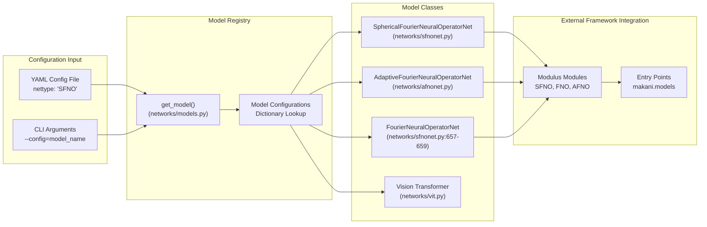
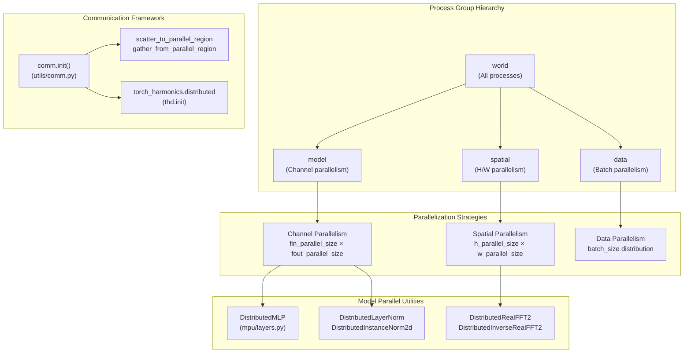
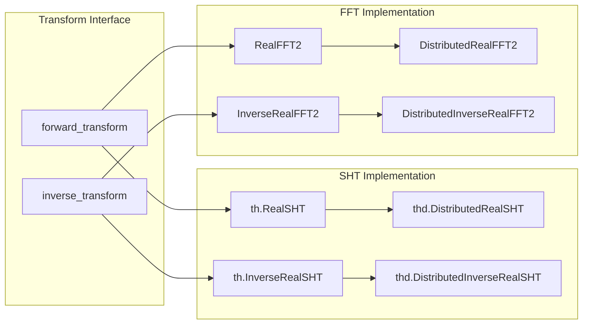
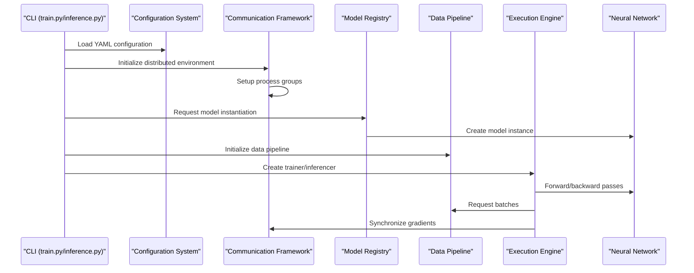

<!-- source: DeepWiki mcp.deepwiki.com · repo NVIDIA/makani · page 3 Core Architecture · fetched 2026-10-26 -->

# Core Architecture

<details>
<summary>Relevant source files</summary>

The following files were used as context for generating this wiki page:

- [.github/workflows/tests.yml](.github/workflows/tests.yml)
- [README.md](README.md)
- [makani/__init__.py](makani/__init__.py)
- [makani/models/networks/sfnonet.py](makani/models/networks/sfnonet.py)

</details>


This document explains the fundamental architecture of the Makani system, including its main execution engines, distributed computing framework, and key design patterns. It provides a high-level overview of how the major components work together to enable massively parallel training and inference of ML weather and climate models.

For detailed information about specific execution workflows, see [Training and Inference Engines](#3.1). For the model registration and loading system, see [Model Registry System](#3.2). For distributed computing implementation details, see [Distributed Computing Framework](#3.3).

## Overall System Architecture

The Makani system is built around four primary architectural pillars that work together to enable scalable ML model training and inference:

```mermaid
graph TB
    subgraph "CLI_LAYER" ["Command Line Interface Layer"]
        TRAIN_CLI["makani.train<br/>(makani/train.py)"]
        INFER_CLI["makani.inference<br/>(makani/inference.py)"]
    end
    
    subgraph "EXECUTION_ENGINES" ["Core Execution Engines"]
        TRAINER["Trainer<br/>(utils/trainer.py)"]
        INFERENCER["Inferencer<br/>(utils/inferencer.py)"]
    end
    
    subgraph "MODEL_SYSTEM" ["Model Management System"]
        MODEL_REG["get_model<br/>(networks/models.py)"]
        SFNO_NET["SphericalFourierNeuralOperatorNet"]
        AFNO_NET["AdaptiveFourierNeuralOperatorNet"]
        VIT_NET["Vision Transformer Models"]
    end
    
    subgraph "DATA_SYSTEM" ["Data Pipeline System"]  
        DATALOADER_FACTORY["get_dataloader<br/>(utils/dataloader.py)"]
        DALI_LOADER["DALI DataLoader"]
        MULTIFILES_LOADER["Multifiles DataLoader"]
        ZARR_LOADER["Zarr DataLoader"]
    end
    
    subgraph "DISTRIBUTED_SYSTEM" ["Distributed Computing Framework"]
        COMM_INIT["comm.init<br/>(utils/comm.py)"]
        PROCESS_GROUPS["Process Groups<br/>(world/model/data/spatial)"]
        MPU_LAYERS["Model Parallel Utils<br/>(mpu)"]
    end
    
    subgraph "CONFIG_SYSTEM" ["Configuration System"]
        YAML_CONFIGS["YAML Configurations<br/>(config)"]
        MODEL_PARAMS["Model Parameters"]
        TRAINING_PARAMS["Training Parameters"]
    end
    
    TRAIN_CLI --> TRAINER
    INFER_CLI --> INFERENCER
    
    TRAINER --> MODEL_REG
    INFERENCER --> MODEL_REG
    
    MODEL_REG --> SFNO_NET
    MODEL_REG --> AFNO_NET  
    MODEL_REG --> VIT_NET
    
    TRAINER --> DATALOADER_FACTORY
    INFERENCER --> DATALOADER_FACTORY
    
    DATALOADER_FACTORY --> DALI_LOADER
    DATALOADER_FACTORY --> MULTIFILES_LOADER
    DATALOADER_FACTORY --> ZARR_LOADER
    
    TRAINER --> COMM_INIT
    INFERENCER --> COMM_INIT
    
    COMM_INIT --> PROCESS_GROUPS
    PROCESS_GROUPS --> MPU_LAYERS
    
    YAML_CONFIGS --> MODEL_PARAMS
    YAML_CONFIGS --> TRAINING_PARAMS
    
    MODEL_PARAMS --> MODEL_REG
    TRAINING_PARAMS --> TRAINER
    TRAINING_PARAMS --> INFERENCER
```

**Sources:** [README.md:73-102](), [makani/__init__.py:18-19](), [makani/models/networks/sfnonet.py:270-314]()

## Core Components Overview

Makani's architecture is organized into six primary components, each responsible for specific aspects of the system:

| Component | Primary Module | Key Responsibilities |
|-----------|----------------|---------------------|
| **CLI Layer** | `makani.train`, `makani.inference` | Command-line entry points, argument parsing |
| **Execution Engines** | `Trainer`, `Inferencer` | Training loops, inference execution, checkpointing |
| **Model System** | `networks/models.py`, model implementations | Dynamic model loading, neural network architectures |
| **Data Pipeline** | `utils/dataloaders/` | Multi-format data loading, distributed I/O |
| **Distributed Framework** | `utils/comm.py`, `mpu/` | Process groups, model parallelism, communication |
| **Configuration** | `config/` YAML files | Model parameters, training hyperparameters |

**Sources:** [README.md:76-97](), [makani/__init__.py:18-19]()

## Model Registration and Loading System

The model system uses a registry pattern to enable dynamic model instantiation based on configuration parameters:



**Sources:** [README.md:105-123](), [makani/models/networks/sfnonet.py:652-656](), [makani/models/networks/sfnonet.py:670-673]()

## Distributed Computing Architecture

Makani implements a sophisticated multi-dimensional parallelization strategy that enables scaling to hundreds of GPUs:



**Sources:** [README.md:42-50](), [makani/models/networks/sfnonet.py:40-44](), [makani/models/networks/sfnonet.py:528-533]()

## Key Architectural Patterns

### 1. Spectral Transform Abstraction

The system abstracts spectral transforms through a unified interface that supports both Spherical Harmonics Transform (SHT) and Fast Fourier Transform (FFT):



**Sources:** [makani/models/networks/sfnonet.py:503-558]()

### 2. Configuration-Driven Model Instantiation

The system uses YAML configurations to drive model instantiation, allowing for flexible experimentation:

| Configuration Key | Purpose | Example Values |
|-------------------|---------|----------------|
| `nettype` | Model architecture selection | `SFNO`, `AFNO`, `FNO`, `ViT` |
| `filter_type` | Spectral filter type | `linear`, `non-linear` |
| `operator_type` | Spectral operator type | `diagonal`, `dhconv` |
| `embed_dim` | Model embedding dimension | `384`, `512`, `768` |
| `num_layers` | Number of model layers | `8`, `12`, `16` |

**Sources:** [README.md:107-123]()

### 3. Multi-Scale Spectral Processing

Models process data at multiple scales using downsampling and upsampling transforms:

- `trans_down`: Transforms from input resolution to processing resolution
- `trans`: Transforms at processing resolution  
- `itrans`: Inverse transforms at processing resolution
- `itrans_up`: Transforms from processing resolution to output resolution

**Sources:** [makani/models/networks/sfnonet.py:392-393](), [makani/models/networks/sfnonet.py:536-540]()

### 4. Memory Optimization Strategies

The system provides multiple memory optimization techniques that can be combined:

- **Automatic Mixed Precision**: `--amp_mode=bf16` reduces memory footprint
- **Activation Checkpointing**: `--checkpointing_level` trades compute for memory
- **CUDA Graphs**: `--cuda_graph_mode` reduces kernel launch overhead
- **JIT Compilation**: `--jit_mode=inductor` optimizes execution

**Sources:** [README.md:39-50]()

## Execution Flow

The typical execution flow demonstrates how all components work together:



**Sources:** [README.md:29-64](), [makani/__init__.py:18-19]()

This architecture enables Makani to scale efficiently across hundreds of GPUs while maintaining flexibility for research and experimentation through its configuration-driven design and modular component structure.

---

