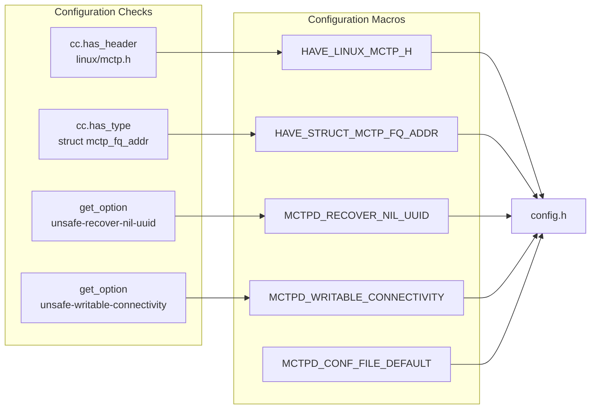
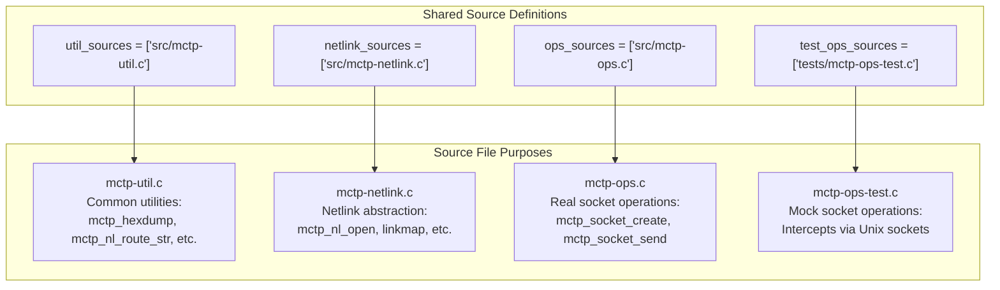
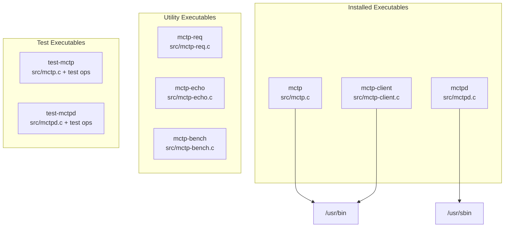
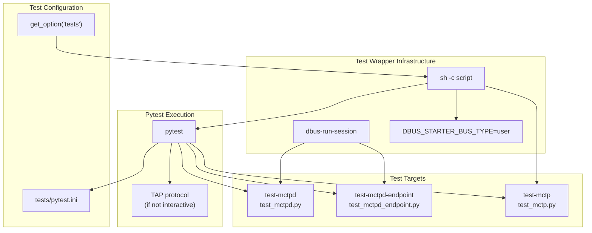

<!-- source: DeepWiki mcp.deepwiki.com · repo NVIDIA/mctp · page 5.1 Build System · fetched 2026-10-26 -->

# Build System

<details>
<summary>Relevant source files</summary>

The following files were used as context for generating this wiki page:

- [meson.build](meson.build)
- [meson_options.txt](meson_options.txt)
- [tests/pytest.ini](tests/pytest.ini)

</details>


## Purpose and Scope

This page documents the Meson build system configuration for the MCTP repository, including project structure, executable compilation, shared source file management, and dependency handling. For information about build-time configuration options, see [Build Options and Configuration](#5.2). For details on project dependencies, see [Dependencies](#5.3).

## Build System Overview

The MCTP project uses [Meson](https://mesonbuild.com) as its build system, configured in [meson.build:1-174](). Meson was chosen for its modern design, fast build times, and excellent cross-compilation support. The build system compiles multiple executables from shared source files, handles conditional compilation based on available dependencies, and integrates with the pytest-based test framework.

```mermaid
graph TB
    subgraph "Build Configuration"
        MESON["meson.build"]
        OPTIONS["meson_options.txt"]
        PYTEST_INI["tests/pytest.ini"]
    end
    
    subgraph "Shared Sources"
        UTIL["util_sources<br/>mctp-util.c"]
        NETLINK["netlink_sources<br/>mctp-netlink.c"]
        OPS["ops_sources<br/>mctp-ops.c"]
        TEST_OPS["test_ops_sources<br/>mctp-ops-test.c"]
    end
    
    subgraph "Dependencies"
        LIBSYSTEMD["libsystemd<br/>(optional)"]
        TOML["toml_dep<br/>lib/tomlc99"]
    end
    
    subgraph "Generated Files"
        CONFIG_H["config.h<br/>Configuration macros"]
    end
    
    subgraph "Executables"
        MCTP_BIN["mctp<br/>(installed)"]
        MCTPD_BIN["mctpd<br/>(installed, requires libsystemd)"]
        MCTP_REQ["mctp-req"]
        MCTP_ECHO["mctp-echo"]
        MCTP_BENCH["mctp-bench"]
        MCTP_CLIENT["mctp-client<br/>(installed)"]
    end
    
    subgraph "Test Executables"
        TEST_MCTP["test-mctp"]
        TEST_MCTPD["test-mctpd<br/>(requires libsystemd)"]
    end
    
    MESON --> CONFIG_H
    MESON --> MCTP_BIN
    MESON --> MCTPD_BIN
    MESON --> MCTP_REQ
    MESON --> MCTP_ECHO
    MESON --> MCTP_BENCH
    MESON --> MCTP_CLIENT
    MESON --> TEST_MCTP
    MESON --> TEST_MCTPD
    
    OPTIONS --> CONFIG_H
    
    UTIL --> MCTP_BIN
    UTIL --> MCTPD_BIN
    UTIL --> MCTP_REQ
    UTIL --> MCTP_ECHO
    UTIL --> MCTP_BENCH
    UTIL --> MCTP_CLIENT
    UTIL --> TEST_MCTP
    UTIL --> TEST_MCTPD
    
    NETLINK --> MCTP_BIN
    NETLINK --> MCTPD_BIN
    NETLINK --> TEST_MCTP
    NETLINK --> TEST_MCTPD
    
    OPS --> MCTP_BIN
    OPS --> MCTPD_BIN
    
    TEST_OPS --> TEST_MCTP
    TEST_OPS --> TEST_MCTPD
    
    LIBSYSTEMD --> MCTPD_BIN
    LIBSYSTEMD --> TEST_MCTPD
    
    TOML --> MCTPD_BIN
    TOML --> TEST_MCTPD
```



**Diagram: Build System Architecture**

Sources: [meson.build:1-174]()

## Project Declaration

The project is declared with basic metadata at [meson.build:3-11]():

| Property | Value | Description |
|----------|-------|-------------|
| Name | `mctp` | Project name |
| Language | `c` | C language project |
| Version | `v2.2` | Current version |
| License | `GPLv2` | GPL version 2 license |
| Meson version | `>= 0.59.0` | Minimum Meson version required |
| Warning level | `2` | Enable moderate warning level |

The compiler is obtained via `meson.get_compiler('c')` [meson.build:13]() and configured to suppress unused parameter warnings [meson.build:15]().

Sources: [meson.build:3-15]()

## Configuration Header Generation

The build system generates a `config.h` header file containing compile-time configuration macros. This is done through a `configuration_data()` object [meson.build:19]() that is populated with feature detection results and build options:



**Diagram: Configuration Header Generation Process**

### Configuration Macros

| Macro | Source | Purpose |
|-------|--------|---------|
| `HAVE_LINUX_MCTP_H` | Header check [meson.build:20-23]() | Indicates if kernel MCTP header is available |
| `HAVE_STRUCT_MCTP_FQ_ADDR` | Type check [meson.build:24-27]() | Indicates if flow queue address structure is available |
| `MCTPD_RECOVER_NIL_UUID` | Build option [meson.build:28-31]() | Controls whether nil UUIDs are valid for recovery |
| `MCTPD_WRITABLE_CONNECTIVITY` | Build option [meson.build:32-34]() | Controls writability of Connectivity D-Bus property |
| `MCTPD_CONF_FILE_DEFAULT` | Path construction [meson.build:36-39]() | Default path to mctpd configuration file |

The configuration header is generated via `configure_file()` [meson.build:41-44]().

Sources: [meson.build:19-44]()

## Shared Source Files

The build system defines several source file lists that are shared across multiple executables:



**Diagram: Shared Source File Organization**

| Source List | File | Purpose |
|-------------|------|---------|
| `util_sources` | `src/mctp-util.c` | Common utility functions used across all executables |
| `netlink_sources` | `src/mctp-netlink.c` | Netlink abstraction layer for kernel communication |
| `ops_sources` | `src/mctp-ops.c` | Real socket operations for production builds |
| `test_ops_sources` | `tests/mctp-ops-test.c` | Mock socket operations for test builds |

This design allows executables to be built in two variants:
- **Production**: Uses `ops_sources` for real kernel interaction
- **Test**: Uses `test_ops_sources` for simulated environment

Sources: [meson.build:46-49]()

## Dependency Management

### libsystemd (Optional)

The `libsystemd` dependency is declared as optional [meson.build:17]():

```c
libsystemd = dependency('libsystemd', version: '>=247', required: false)
```

- **Version requirement**: >= 247
- **Required**: No (optional dependency)
- **Used by**: `mctpd` and `test-mctpd` executables only
- **Detection**: Build system checks if available via `libsystemd.found()`

When `libsystemd` is not found, the daemon executables are skipped [meson.build:83-100]().

### TOML Parser (Embedded)

The TOML configuration parser is embedded in the repository at `lib/tomlc99/` and declared as a dependency [meson.build:51-54]():

```c
toml_dep = declare_dependency(
    sources: ['lib/tomlc99/toml.c'],
    include_directories: include_directories('lib/tomlc99'),
)
```

This creates a dependency object that includes both the source file and include directory, used by `mctpd` and `test-mctpd`.

Sources: [meson.build:17](), [meson.build:51-54]()

## Executable Targets

The build system produces eight executable targets, three of which are installed system-wide:



**Diagram: Executable Target Organization**

### Production Executables

| Executable | Source | Dependencies | Install Location | Lines |
|------------|--------|--------------|------------------|-------|
| `mctp` | `src/mctp.c` | `netlink_sources`, `util_sources`, `ops_sources` | `/usr/bin` | [56-59]() |
| `mctpd` | `src/mctpd.c` | `netlink_sources`, `util_sources`, `ops_sources`, `libsystemd`, `toml_dep` | `/usr/sbin` | [84-91]() |
| `mctp-req` | `src/mctp-req.c` | `util_sources` | Not installed | [66-68]() |
| `mctp-echo` | `src/mctp-echo.c` | `util_sources` | Not installed | [70-72]() |
| `mctp-bench` | `src/mctp-bench.c` | `util_sources` | Not installed | [74-76]() |
| `mctp-client` | `src/mctp-client.c` | `util_sources` | `/usr/bin` | [78-81]() |

#### mctp CLI Utility

The `mctp` utility [meson.build:56-59]() is built from:
- Main source: `src/mctp.c`
- Shared sources: `netlink_sources`, `util_sources`, `ops_sources`
- Installation: System-wide in default `bin` directory

#### mctpd Daemon

The `mctpd` daemon [meson.build:84-91]() is conditionally compiled only when `libsystemd` is found:

```python
if libsystemd.found():
    executable('mctpd',
        sources: ['src/mctpd.c'] + netlink_sources + util_sources + ops_sources,
        dependencies: [libsystemd, toml_dep],
        install: true,
        install_dir: get_option('sbindir'),
    )
```

Installation directory is `sbindir` (typically `/usr/sbin`) as this is a system daemon.

#### Supporting Tools

The `mctp-req`, `mctp-echo`, and `mctp-bench` executables [meson.build:66-76]() are simple utilities that only require `util_sources` and are not installed system-wide.

### Test Executables

Test executables are built with the same source files as their production counterparts, but link against `test_ops_sources` instead of `ops_sources`:

| Executable | Base Source | Difference | Lines |
|------------|-------------|------------|-------|
| `test-mctp` | `src/mctp.c` | Uses `test_ops_sources` | [61-64]() |
| `test-mctpd` | `src/mctpd.c` | Uses `test_ops_sources`, requires `libsystemd` | [93-99]() |

The test executables are not installed and are used only by the test framework. They intercept socket operations through Unix domain sockets, allowing tests to simulate kernel and device behavior without requiring actual MCTP hardware or kernel support.

Sources: [meson.build:56-100]()

## Test Infrastructure Integration

The build system integrates with the pytest-based test framework when the `tests` build option is enabled [meson.build:102-173]().



**Diagram: Test Infrastructure Build Integration**

### D-Bus Session Isolation

Tests that involve `mctpd` require D-Bus session isolation to prevent test behaviors from impacting system services [meson.build:104-134](). The isolation is achieved through `dbus-run-session` with environment variable manipulation:

1. `sd_bus_default()` in mctpd selects system bus when not in a systemd user slice
2. `dbus-run-session` creates an isolated session bus
3. Environment variable `DBUS_STARTER_BUS_TYPE=user` forces mctpd to use session bus
4. A shell wrapper preserves this variable through `dbus-run-session`'s sanitization

### Test Execution Script

A shell script is constructed [meson.build:144-149]() that:
- Detects if output is to a terminal (using `[ ! -t 1 ]`)
- Enables TAP protocol for non-interactive runs
- Sets `DBUS_STARTER_BUS_TYPE=user` environment variable
- Invokes pytest with appropriate configuration

```bash
if [ ! -t 1 ]; then PFL="--tap"; fi; 
DBUS_STARTER_BUS_TYPE=user pytest $PFL --config-file pytest.ini $@
```

### Test Targets

Three test targets are registered with Meson:

| Test Name | Wrapper | Test File | Dependencies | Lines |
|-----------|---------|-----------|--------------|-------|
| `test-mctpd` | `dbus-run-session` | `tests/test_mctpd.py` | `test-mctpd` executable, libsystemd | [154-158]() |
| `test-mctpd-endpoint` | `dbus-run-session` | `tests/test_mctpd_endpoint.py` | `test-mctpd` executable, libsystemd | [160-164]() |
| `test-mctp` | `sh` | `tests/test_mctp.py` | `test-mctp` executable | [167-171]() |

The mctpd tests are only registered when `libsystemd` is found [meson.build:151](), while the mctp test always runs.

### Pytest Configuration

Test behavior is configured in [tests/pytest.ini:1-6]():

```ini
[pytest]
trio_mode = true
filterwarnings =
    ignore:.*wait_readable:DeprecationWarning:asyncdbus
    ignore:.*wait_writable:DeprecationWarning:asyncdbus
```

- **trio_mode**: Enables Trio async framework support for pytest
- **filterwarnings**: Suppresses known deprecation warnings from asyncdbus library

Sources: [meson.build:102-173](), [tests/pytest.ini:1-6]()

## Build Commands

### Standard Build Workflow

```bash
# Configure build
meson setup build

# Compile
meson compile -C build

# Install (optional)
meson install -C build

# Run tests
meson test -C build
```

### Build Options

Build options can be specified during configuration:

```bash
# Enable unsafe recovery with nil UUID
meson setup build -Dunsafe-recover-nil-uuid=true

# Disable tests
meson setup build -Dtests=false

# Enable writable connectivity property
meson setup build -Dunsafe-writable-connectivity=true
```

For detailed information on build options, see [Build Options and Configuration](#5.2).

### Interactive Test Execution

For interactive debugging, pytest can print output directly to terminal:

```bash
# Using Meson (newer versions)
meson test -C build --interactive

# Using pytest directly
cd build
dbus-run-session -- sh -c 'DBUS_STARTER_BUS_TYPE=user pytest ../tests/'
```

Sources: [meson.build:136-139]()

---

