# Page: Overview

# Overview

<details>
<summary>Relevant source files</summary>

The following files were used as context for generating this wiki page:

- [CHANGELOG.md](CHANGELOG.md)
- [README.md](README.md)
- [src/mctpd-util.h](src/mctpd-util.h)
- [src/mctpd.c](src/mctpd.c)
- [tests/requirements.txt](tests/requirements.txt)

</details>


## Purpose and Scope

This document provides a high-level introduction to the MCTP repository, which implements userspace tooling for the Management Component Transport Protocol (MCTP) on Linux. The repository contains two primary executables—`mctpd` (daemon) and `mctp` (CLI utility)—along with supporting tools and a comprehensive test framework.

For detailed information on specific subsystems:
- For `mctpd` daemon architecture and functionality, see [mctpd Daemon](#2.1)
- For the `mctp` command-line utility, see [mctp CLI Utility](#2.2)
- For build and installation procedures, see [Building and Installation](#5)
- For the D-Bus API specification, see [D-Bus Interface](#4)

## What is MCTP

MCTP (Management Component Transport Protocol) is a standardized protocol defined by DMTF specification DSP0236 for communication between management components in a system. MCTP provides:

- **Addressing**: Endpoint IDs (EIDs) in the range 8-254, with 0 reserved for null and 255 for broadcast
- **Transport Abstraction**: Works over multiple physical layers (I2C/SMBus, USB, Serial, PCIe VDM)
- **Message Typing**: Support for various message types including control protocol, PLDM, SPDM, and vendor-defined
- **Network Segmentation**: Multiple isolated MCTP networks, each identified by a network ID

This repository implements the MCTP control protocol and provides management tools for Linux-based systems using the kernel's AF_MCTP socket family.

## Repository Components

The repository is organized around three main component categories:

| Component | File Path | Purpose |
|-----------|-----------|---------|
| **mctpd** | [src/mctpd.c]() | Daemon implementing MCTP control protocol, acting as bus owner or endpoint |
| **mctp** | [src/mctp.c]() | CLI utility for configuring kernel MCTP stack (links, routes, addresses, neighbors) |
| **mctp-bench** | [src/mctp-bench.c]() | Benchmarking tool for measuring MCTP message throughput |
| **Supporting Tools** | [src/mctp-{echo,req,client}.c]() | Debug utilities for testing MCTP communication |
| **Test Framework** | [tests/]() | Python-based pytest framework with simulated MCTP environment |

### Component Relationships

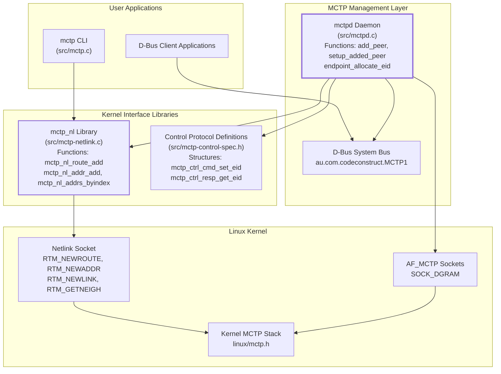

**Sources**: [src/mctpd.c:1-100](), [src/mctp.c](), [src/mctp-netlink.c](), [README.md:1-150]()

## System Architecture Overview

### Layer Structure

The MCTP system follows a layered architecture with clear separation between userspace and kernel space:

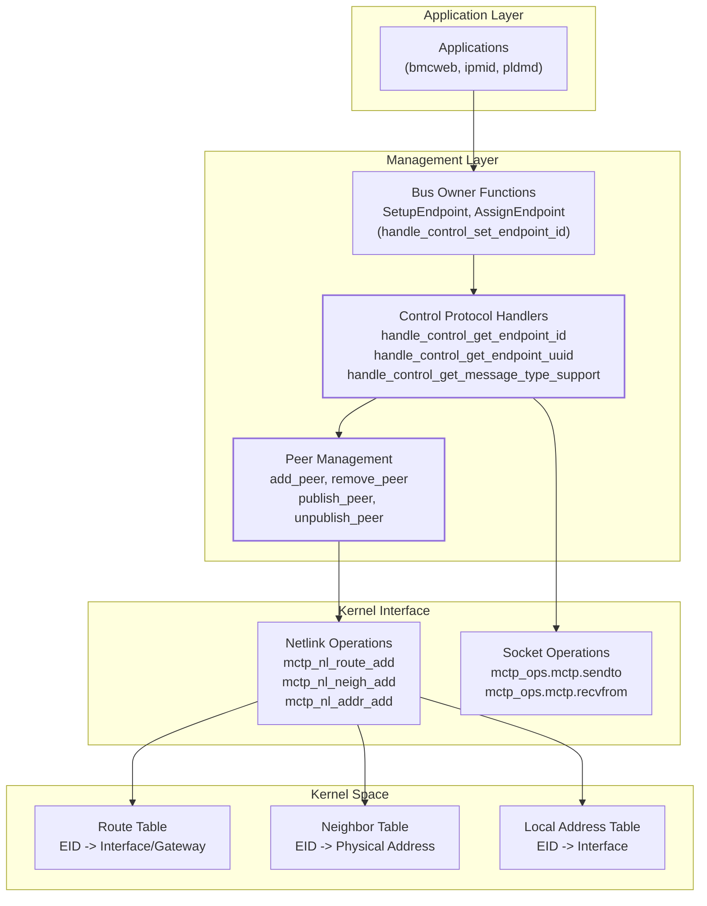

**Sources**: [src/mctpd.c:224-271](), [src/mctp-netlink.c](), [src/mctp-control-spec.h]()

### Core Data Structures

The `mctpd` daemon maintains several key data structures defined in [src/mctpd.c:79-271]():

| Structure | Location | Purpose |
|-----------|----------|---------|
| `struct ctx` | [src/mctpd.c:224-271]() | Global daemon context containing configuration, peer list, network list |
| `struct peer` | [src/mctpd.c:152-222]() | Represents an MCTP endpoint with EID, physical address, UUID, and message types |
| `struct net` | [src/mctpd.c:87-96]() | Represents a network with EID-to-peer mappings |
| `struct link` | [src/mctpd.c:133-150]() | Represents a local MCTP interface with role (bus owner or endpoint) |
| `dest_phys` | [src/mctpd.c:79-84]() | Physical addressing information (interface index and hardware address) |

## Operational Modes

The `mctpd` daemon can operate in two distinct roles, configured via [/etc/mctpd.conf]():

### Bus Owner Mode

In bus owner mode, `mctpd`:
- Discovers endpoints via the **Get Endpoint ID** control command
- Assigns EIDs dynamically from a configurable range (`dynamic_eid_range`)
- Creates kernel routes and neighbor entries for discovered endpoints
- Exposes D-Bus methods: `SetupEndpoint`, `AssignEndpoint`, `AssignEndpointStatic`, `LearnEndpoint`
- Publishes endpoint objects at `/au/com/codeconstruct/mctp1/networks/<net>/endpoints/<eid>`

**Key Functions**: [src/mctpd.c:754-943]() (`handle_control_set_endpoint_id`), [src/mctpd.c:2350-2560]() (`method_setup_endpoint`)

### Endpoint Mode

In endpoint mode, `mctpd`:
- Responds to **Set Endpoint ID** requests from a bus owner
- Accepts assigned EIDs on local interfaces
- May function as a bridge endpoint with EID pool allocation
- Does not actively enumerate other endpoints

**Key Functions**: [src/mctpd.c:810-843]() (Set EID handling for endpoints), [src/mctpd.c:3997-4100]() (configuration parsing)

## Key Interfaces

### D-Bus Interface

The daemon exposes its functionality via D-Bus under the bus name `au.com.codeconstruct.MCTP1`:

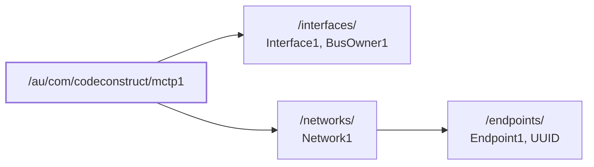

For complete D-Bus API details, see [D-Bus Interface](#4).

**Sources**: [src/mctpd.c:44-57](), [docs/mctpd.md](), [CHANGELOG.md:156-165]()

### Netlink Interface

The `mctp-netlink.c` module provides an abstraction layer over Linux netlink for MCTP stack configuration:

| Operation | Netlink Message | Function |
|-----------|-----------------|----------|
| Add Route | `RTM_NEWROUTE` | `mctp_nl_route_add()` |
| Add Neighbor | `RTM_NEWNEIGH` | `mctp_nl_neigh_add()` |
| Add Address | `RTM_NEWADDR` | `mctp_nl_addr_add()` |
| Query Links | `RTM_GETLINK` | `mctp_nl_if_byindex()` |
| Monitor Changes | `RTNLGRP_MCTP_IFADDR` | `cb_listen_monitor()` |

**Sources**: [src/mctp-netlink.c](), [src/mctp-netlink.h]()

## Control Protocol Flow

A typical endpoint discovery and configuration sequence:

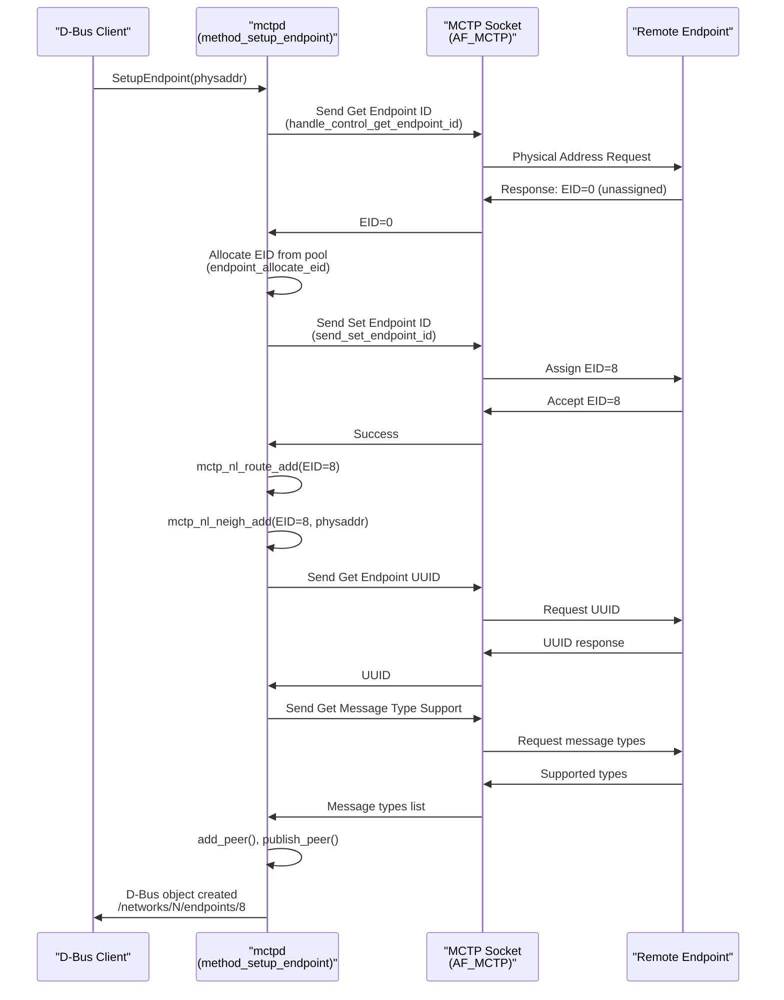

**Sources**: [src/mctpd.c:2350-2560](), [src/mctpd.c:1850-2050](), [src/mctp-control-spec.h]()

## Physical Transport Support

MCTP in this implementation supports multiple physical layer bindings:

| Transport | Kernel Module | Interface Prefix | Hardware Address |
|-----------|---------------|------------------|------------------|
| I2C/SMBus | `mctp-i2c` | `mctpi2c*` | 7-bit I2C address |
| USB | `mctp-usb` | `mctpusb*` | None (USB enumeration) |
| Serial | `mctp-serial` | `mctpserial*` | None |
| PCIe VDM | `mctp-pcie` | Variable | BDF (Bus:Device.Function) |

The physical binding type is determined via interface naming conventions in [src/mctpd-util.h:52-68]() (`get_binding_from_ifname`).

**Sources**: [src/mctpd-util.h:24-98](), [README.md:1-150]()

## Configuration

The daemon reads configuration from `/etc/mctpd.conf` (default) or a file specified with `-c` option. Key configuration parameters:

```toml
[bus-owner]
mode = "bus-owner"  # or "endpoint"
dynamic_eid_range = "8-30"
message_timeout_ms = 1000

[endpoint]
# Endpoint-specific configuration
```

Configuration parsing is handled in [src/mctpd.c:3997-4100]().

For detailed configuration reference, see [Configuration](#2.1.3).

**Sources**: [src/mctpd.c:3997-4100](), [conf/mctpd.conf](), [CHANGELOG.md:22-24]()

## Testing Infrastructure

The repository includes a comprehensive Python-based test framework that simulates MCTP environments without requiring kernel MCTP support:

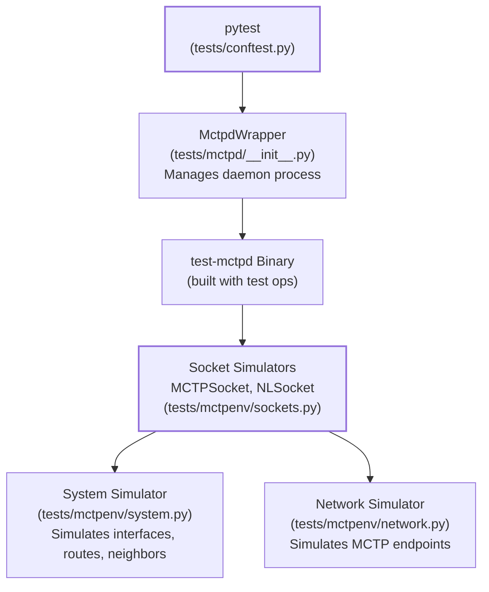

Tests intercept socket operations via Unix domain sockets, redirecting them to Python-based simulators. This allows testing control protocol flows, D-Bus interactions, and error conditions without physical hardware.

For details on writing tests, see [Testing](#6).

**Sources**: [tests/conftest.py](), [tests/mctpenv/__init__.py](), [tests/requirements.txt:1-7](), [README.md:113-149]()

## Build System

The project uses Meson as its build system with the following key outputs:

| Target | Source | Purpose |
|--------|--------|---------|
| `mctpd` | [src/mctpd.c]() | Production daemon binary |
| `mctp` | [src/mctp.c]() | CLI utility |
| `test-mctpd` | [src/mctpd.c]() with test ops | Daemon for testing |
| `mctp-bench` | [src/mctp-bench.c]() | Benchmarking tool |

Build configuration is defined in [meson.build]() with optional dependencies on `libsystemd` for D-Bus and event loop functionality.

For build instructions, see [Building and Installation](#5).

**Sources**: [meson.build](), [README.md:16-36](), [CHANGELOG.md:146-154]()

## Use Cases

### As a Bus Owner (BMC)

Typical deployment on a Baseboard Management Controller:
1. System boots and kernel loads MCTP modules
2. `mctpd` starts in bus-owner mode via systemd
3. Local interfaces configured with `mctp link` and `mctp address` commands
4. Applications (bmcweb, pldmd) call `SetupEndpoint()` via D-Bus to discover devices
5. `mctpd` assigns EIDs, creates routes, publishes endpoint objects
6. Applications communicate with endpoints via AF_MCTP sockets

### As an Endpoint Device

Typical deployment on a managed device:
1. Device boots with `mctpd` in endpoint mode
2. Bus owner sends Set Endpoint ID request
3. `mctpd` accepts EID assignment on local interface
4. Device responds to control protocol requests (Get UUID, Get Message Type Support)
5. Higher-layer protocols (PLDM, SPDM) handle application-level communication

### For Development and Testing

Use the test framework or standalone simulation:
```bash
# Run full test suite
meson test -C obj

# Run daemon with simulated environment
cd obj
python3 ../tests/mctpd/__init__.py
```

**Sources**: [README.md:65-112](), [tests/mctpd/__init__.py](), [CHANGELOG.md:57-59]()

---

# Page: Core Components

# Core Components

<details>
<summary>Relevant source files</summary>

The following files were used as context for generating this wiki page:

- [CHANGELOG.md](CHANGELOG.md)
- [README.md](README.md)
- [tests/requirements.txt](tests/requirements.txt)

</details>


This page provides an overview of the main executable components in the MCTP repository and their roles in the system. These components form the userspace interface to the Linux kernel's MCTP stack, providing both daemon-based endpoint management and command-line utilities for manual configuration and testing.

The MCTP repository contains three categories of executable components:
- **mctpd**: A system daemon that implements MCTP control protocol and manages endpoint discovery
- **mctp**: A command-line utility for direct kernel MCTP stack configuration
- **Supporting tools**: Utilities for testing, benchmarking, and debugging MCTP communication

For detailed documentation on the daemon's internal architecture and endpoint management, see [Daemon Architecture](#2.1.1) and [Endpoint Management](#2.1.2). For protocol-level details, see [MCTP Control Protocol](#3.2) and [Netlink Interface](#3.3).

---

## Component Overview

The repository builds several executables with distinct purposes in the MCTP ecosystem.

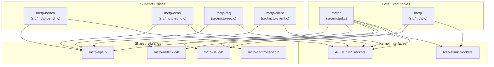

**Sources**: [README.md:1-14](), [meson.build]()

---

## Component Comparison

The following table summarizes the role and characteristics of each executable component:

| Component | Source File | Primary Role | Key Dependencies | Output Type |
|-----------|------------|--------------|------------------|-------------|
| `mctpd` | `src/mctpd.c` | MCTP control protocol daemon, bus owner, endpoint management | libsystemd (optional), D-Bus | System daemon |
| `mctp` | `src/mctp.c` | Direct kernel stack configuration utility | Netlink only | CLI utility |
| `mctp-bench` | `src/mctp-bench.c` | Performance testing and benchmarking | MCTP sockets | CLI utility |
| `mctp-echo` | `src/mctp-echo.c` | Simple echo server for testing | MCTP sockets | CLI utility |
| `mctp-req` | `src/mctp-req.c` | Request/response testing | MCTP sockets | CLI utility |
| `mctp-client` | `src/mctp-client.c` | Generic MCTP client | MCTP sockets | CLI utility |

**Sources**: [meson.build](), [README.md:1-14](), [CHANGELOG.md:49-50](), [CHANGELOG.md:69-70]()

---

## mctpd Daemon

### Overview

`mctpd` is a system daemon that implements the MCTP control protocol (DSP0236) and acts as a bus owner to manage MCTP endpoints. The daemon discovers remote devices, assigns endpoint IDs (EIDs), maintains routing tables, and exposes endpoint information via D-Bus.

### Binary Output

- **Executable**: `mctpd` (production), `test-mctpd` (test variant with mock socket operations)
- **Source**: [src/mctpd.c]()
- **Installation Path**: Typically `/usr/local/bin/mctpd` or `/usr/bin/mctpd`

### Core Responsibilities

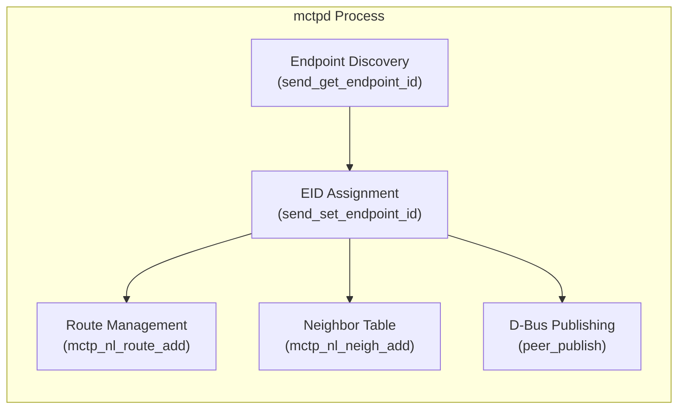

### Operational Modes

`mctpd` supports two operational modes configured via `/etc/mctpd.conf`:

| Mode | Behavior | Configuration |
|------|----------|---------------|
| `bus-owner` | Actively discovers and assigns EIDs to remote endpoints | `mode = "bus-owner"` in config file |
| `endpoint` | Responds to EID assignment requests from remote bus owners | `mode = "endpoint"` in config file |

**Sources**: [README.md:10-13](), [CHANGELOG.md:22-28](), [CHANGELOG.md:139]()

For comprehensive documentation of the daemon's architecture, see [mctpd Daemon](#2.1). For configuration details, see [Configuration](#2.1.3).

---

## mctp CLI Utility

### Overview

The `mctp` utility provides direct command-line access to the kernel MCTP stack configuration. It operates similarly to the `ip` utility from iproute2, allowing manual management of MCTP links, addresses, routes, and neighbor entries.

### Binary Output

- **Executable**: `mctp` (production), `test-mctp` (test variant)
- **Source**: [src/mctp.c]()
- **Installation Path**: Typically `/usr/local/bin/mctp` or `/usr/bin/mctp`

### Command Structure

The utility exposes four primary command categories, each managing a different aspect of the kernel MCTP stack:

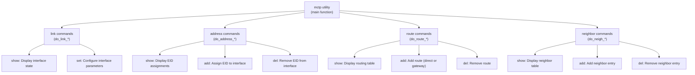

### Command Reference

| Command Category | Subcommands | Description | Example |
|-----------------|-------------|-------------|---------|
| `link` | `show`, `set` | Manage MCTP network interfaces | `mctp link set mctpi2c1 up mtu 68` |
| `address` | `show`, `add`, `del` | Manage local EID assignments | `mctp address add 8 dev mctpi2c1` |
| `route` | `show`, `add`, `del` | Manage routing table entries | `mctp route add 10-20 via mctpi2c1` |
| `neigh` | `show`, `add`, `del` | Manage neighbor table (EID to physical address mapping) | `mctp neigh add 9 dev mctpi2c1 lladdr 0x1d` |

### Netlink Communication

All `mctp` commands interact with the kernel through RTNetlink messages, using the abstraction layer in `mctp-netlink.c`:

| Operation | Netlink Message Type | Handler Function |
|-----------|---------------------|------------------|
| Link show/set | `RTM_GETLINK`, `RTM_SETLINK` | `mctp_nl_query()`, `mctp_nl_link_set()` |
| Address add/del | `RTM_NEWADDR`, `RTM_DELADDR` | `mctp_nl_addr_add()`, `mctp_nl_addr_del()` |
| Route add/del | `RTM_NEWROUTE`, `RTM_DELROUTE` | `mctp_nl_route_add()`, `mctp_nl_route_del()` |
| Neighbor add/del | `RTM_NEWNEIGH`, `RTM_DELNEIGH` | `mctp_nl_neigh_add()`, `mctp_nl_neigh_del()` |

**Sources**: [README.md:7-8](), [README.md:38-63](), [CHANGELOG.md:72-77]()

For detailed usage examples and troubleshooting, see [mctp CLI Utility](#2.2).

---

## Supporting Tools

The repository includes several utility programs for testing, debugging, and benchmarking MCTP communication. Unlike `mctpd` and `mctp`, these tools directly use MCTP sockets for application-level communication.

### mctp-bench

Performance testing tool for measuring MCTP message throughput and latency.


**Modes**:
- **Send mode**: Continuously transmits messages to a target EID
- **Receive mode**: Accepts messages and reports statistics
- **Request-receive mode**: Sends initial command to start benchmark session

**Source**: [src/mctp-bench.c]()

**Usage Example**:
```
# On receiver
mctp-bench recv

# On sender
mctp-bench send 8 100
```

**Sources**: [CHANGELOG.md:49-50](), [CHANGELOG.md:69-70](), [CHANGELOG.md:18-19](), [CHANGELOG.md:87]()

### mctp-echo

Simple echo server that receives MCTP messages and sends them back to the originator.

**Source**: [src/mctp-echo.c]()

**Purpose**: Basic connectivity testing and loopback verification.

### mctp-req

Request/response utility for sending arbitrary MCTP messages and receiving responses.

**Source**: [src/mctp-req.c]()

**Purpose**: Manual MCTP message construction and debugging.

### mctp-client

Generic MCTP client for custom protocol implementations.

**Source**: [src/mctp-client.c]()

**Purpose**: Template for building application-specific MCTP communication tools.

### Message Type

All supporting tools use vendor-defined message type (0x7E) rather than MCTP control protocol (0x00). This change was made to avoid interference with control protocol operations managed by `mctpd`.

**Sources**: [CHANGELOG.md:98-99]()

For detailed information on these utilities, see [Supporting Tools](#2.3).

---

## Component Interaction Pattern

The following diagram shows how the core components interact with each other and the kernel during typical operations:

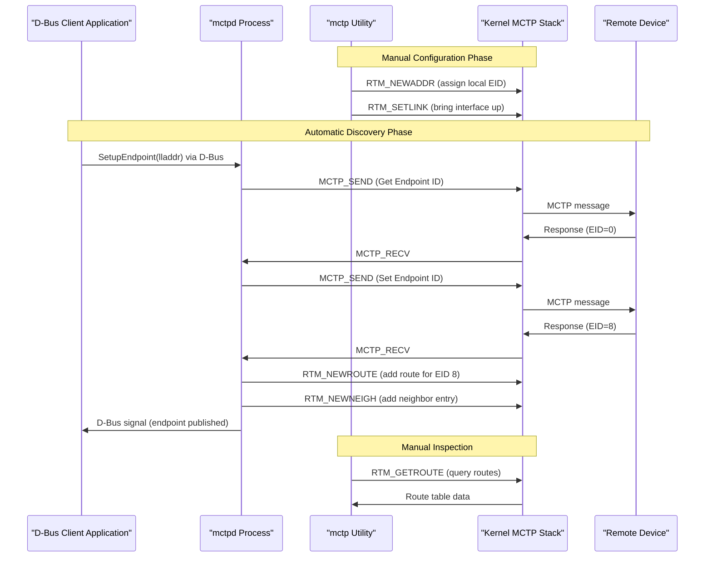

### Interaction Characteristics

| Interaction Type | Components | Communication Method | Use Case |
|-----------------|------------|---------------------|----------|
| Configuration | `mctp` ↔ Kernel | RTNetlink sockets | Manual interface and routing setup |
| Discovery | `mctpd` ↔ Kernel ↔ Device | MCTP control protocol over AF_MCTP | Automatic endpoint enumeration |
| Monitoring | `mctp monitor` → Kernel | Netlink multicast | Real-time stack state changes |
| Management | Application ↔ `mctpd` | D-Bus method calls | High-level endpoint control |
| Testing | Utilities ↔ Device | AF_MCTP sockets | Direct message exchange |

**Sources**: [README.md:1-14](), [CHANGELOG.md:55-56]()

---

## Build Outputs

The meson build system generates the following executables:

### Production Binaries

| Binary | Source Files | Dependencies | Install Location |
|--------|-------------|--------------|------------------|
| `mctpd` | `mctpd.c`, `mctp-netlink.c`, `mctp-util.c` | libsystemd (optional) | `${prefix}/bin/` |
| `mctp` | `mctp.c`, `mctp-netlink.c`, `mctp-util.c` | None | `${prefix}/bin/` |
| `mctp-bench` | `mctp-bench.c`, `mctp-util.c` | None | `${prefix}/bin/` |
| `mctp-echo` | `mctp-echo.c` | None | `${prefix}/bin/` |
| `mctp-req` | `mctp-req.c` | None | `${prefix}/bin/` |
| `mctp-client` | `mctp-client.c` | None | `${prefix}/bin/` |

### Test Binaries

When tests are enabled (`-Dtests=true`, default), additional test-specific binaries are built:

| Binary | Purpose | Socket Operations |
|--------|---------|-------------------|
| `test-mctpd` | Test variant of mctpd | Uses `mctp_ops_test` (Unix domain sockets) |
| `test-mctp` | Test variant of mctp | Uses `mctp_ops_test` (Unix domain sockets) |

The test binaries use mock socket operations defined in [tests/mctpopstest.c](), allowing tests to run without kernel MCTP support by intercepting socket calls and routing them through Unix domain sockets to test infrastructure.

**Sources**: [meson.build](), [CHANGELOG.md:91-96]()

---

## Shared Code Components

Several source files provide functionality shared across multiple executables:

### mctp-netlink.c/h

Netlink abstraction layer providing functions for kernel MCTP stack configuration.

**Key Functions**:
- `mctp_nl_new()`: Create netlink context
- `mctp_nl_query()`: Query kernel state
- `mctp_nl_route_add()`, `mctp_nl_route_del()`: Route management
- `mctp_nl_neigh_add()`, `mctp_nl_neigh_del()`: Neighbor management
- `mctp_nl_addr_add()`, `mctp_nl_addr_del()`: Address management

**Used By**: `mctpd`, `mctp`

### mctp-util.c/h

Common utility functions for MCTP operations.

**Key Functions**:
- `parse_eid()`: Parse EID from string
- `parse_physaddr()`: Parse physical address from string
- `format_physaddr()`: Format physical address for display

**Used By**: All executables

### mctp-ops.h

Socket operations interface defining `mctp_ops` structure with function pointers for socket creation and configuration.

**Implementations**:
- `mctp_ops_std`: Standard kernel AF_MCTP sockets (production)
- `mctp_ops_test`: Mock sockets for testing (test binaries)

**Used By**: `mctpd`, `mctp-bench`, `mctp-echo`, `mctp-req`, `mctp-client`

### mctp-control-spec.h

MCTP control protocol message structures and definitions from DSP0236 specification.

**Key Structures**:
- `mctp_ctrl_msg_hdr`: Control message header
- Request/response structures for each control command (Get EID, Set EID, Get UUID, etc.)

**Used By**: `mctpd`

**Sources**: [meson.build](), [src/mctp-netlink.c](), [src/mctp-ops.h](), [src/mctp-control-spec.h]()

---

# Page: mctpd Daemon

# mctpd Daemon

<details>
<summary>Relevant source files</summary>

The following files were used as context for generating this wiki page:

- [CHANGELOG.md](CHANGELOG.md)
- [conf/mctpd.conf](conf/mctpd.conf)
- [docs/mctpd.md](docs/mctpd.md)
- [src/mctpd-util.h](src/mctpd-util.h)
- [src/mctpd.c](src/mctpd.c)

</details>


## Purpose and Scope

This document describes the `mctpd` daemon, the central management component of the MCTP system. It covers the daemon's role, architecture, core components, and operational modes. For detailed information on specific aspects:
- Internal architecture and data structures: see [Daemon Architecture](#2.1.1)
- Endpoint discovery and management: see [Endpoint Management](#2.1.2)
- Configuration file format: see [Configuration](#2.1.3)
- D-Bus API details: see [D-Bus Interface](#4)

## Overview

The `mctpd` daemon serves as the MCTP bus owner and endpoint manager for Linux systems. It implements the MCTP control protocol (DSP0236), manages endpoint discovery and EID assignment, and provides a D-Bus interface for applications to interact with MCTP endpoints.

**Key Responsibilities:**
- Assign MCTP Endpoint IDs (EIDs) to devices
- Discover and enumerate MCTP endpoints
- Manage kernel routing and neighbor tables via Netlink
- Expose discovered endpoints through D-Bus
- Implement MCTP control protocol message handling
- Handle bridge endpoints and downstream EID allocation
- Provide endpoint recovery mechanisms

Sources: [src/mctpd.c:1-40](), [docs/mctpd.md:1-25]()

## Main Components

The daemon is organized into several interconnected subsystems that handle different aspects of MCTP management:

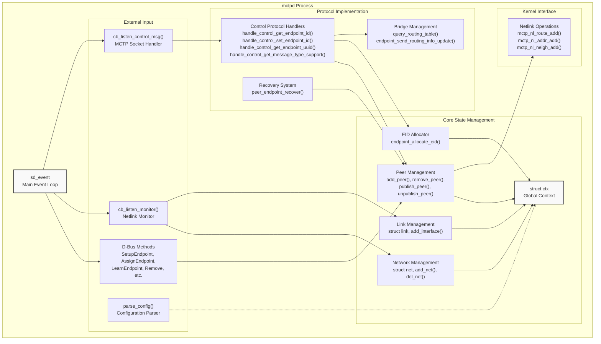

**Component Descriptions:**

| Component | Code Location | Purpose |
|-----------|---------------|---------|
| Event Loop | [src/mctpd.c:224-225]() | Coordinates all asynchronous operations using systemd's `sd_event` |
| Peer Manager | [src/mctpd.c:279-289]() | Manages lifecycle of MCTP endpoints (add, remove, publish, unpublish) |
| Network Manager | [src/mctpd.c:86-96](), [src/mctpd.c:299-300]() | Maintains per-network state and EID mappings |
| Link Manager | [src/mctpd.c:133-150]() | Manages MCTP interfaces and their roles |
| EID Allocator | [src/mctpd.c:302]() | Allocates dynamic EIDs from configured range |
| Control Protocol | [src/mctpd.c:754-1293]() | Implements MCTP control protocol message handlers |
| Netlink Monitor | [src/mctpd.c:1950-2066]() | Receives kernel state change notifications |
| Bridge Logic | [src/mctpd.c:302-309]() | Handles MCTP bridges and routing table queries |

Sources: [src/mctpd.c:224-310](), [src/mctpd.c:754-1293](), [src/mctpd.c:1950-2066]()

## Core Data Structures

The daemon uses three primary data structures to maintain state. These are described briefly here; for detailed information see [Daemon Architecture](#2.1.1).

### `struct ctx` - Global Context

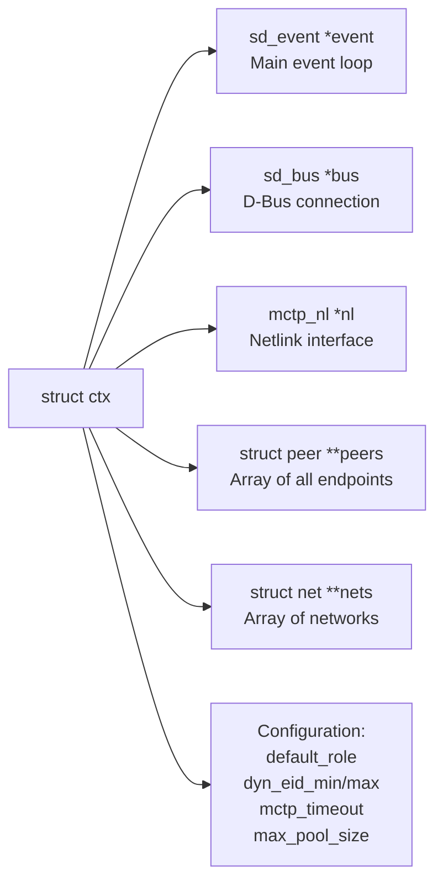

The global context structure ([src/mctpd.c:224-271]()) holds all daemon state including references to event loop, D-Bus connection, Netlink interface, and arrays of peers and networks.

**Key Fields:**
- `sd_event *event` - Main event loop
- `sd_bus *bus` - D-Bus system bus connection
- `mctp_nl *nl` - Netlink abstraction for kernel communication
- `struct peer **peers` - Dynamic array of all known endpoints
- `struct net **nets` - Array of MCTP networks
- `dyn_eid_min`, `dyn_eid_max` - Dynamic EID allocation range
- `mctp_timeout` - Timeout for MCTP control protocol responses
- `default_role` - Bus owner or endpoint mode

Sources: [src/mctpd.c:224-271]()

### `struct peer` - Endpoint Representation

Each discovered MCTP endpoint is represented by a `peer` structure ([src/mctpd.c:152-222]()):

**Key Fields:**
- `mctp_eid_t eid` - Assigned endpoint ID
- `uint32_t net` - Network ID
- `dest_phys phys` - Physical address (interface index + hardware address)
- `state` - LOCAL or REMOTE endpoint
- `published` - Whether visible on D-Bus
- `message_types` - Supported message types from Get Message Type Support
- `uuid` - Endpoint UUID (16 bytes)
- `pool_size`, `pool_start` - For bridge endpoints, downstream EID pool

Sources: [src/mctpd.c:152-222]()

### `struct net` - Network State

Each MCTP network ([src/mctpd.c:86-96]()) maintains:

**Key Fields:**
- `uint32_t net` - Network ID
- `struct peer *peers[256]` - EID-indexed array of endpoints on this network
- `sd_bus_slot *slot` - D-Bus object slot
- `char *path` - D-Bus object path

Sources: [src/mctpd.c:86-96]()

## Operation Modes

The daemon operates in one of two modes, configured via `/etc/mctpd.conf`:

### Bus Owner Mode

**Configuration:** `mode = "bus-owner"`

In this mode, `mctpd` takes responsibility for:
- Assigning EIDs to newly discovered endpoints
- Managing the EID allocation pool
- Handling bridge endpoint pool allocation
- Responding to Get Endpoint ID requests
- **Rejecting** Set Endpoint ID requests

The daemon monitors physical addresses on configured interfaces and assigns EIDs when new devices are discovered through D-Bus methods like `SetupEndpoint()`.

Sources: [src/mctpd.c:103-131](), [src/mctpd.c:794-800](), [conf/mctpd.conf:1-2]()

### Endpoint Mode

**Configuration:** `mode = "endpoint"`

In this mode, `mctpd` acts as a passive endpoint:
- **Accepts** Set Endpoint ID requests from external bus owners
- Does not assign EIDs to other devices
- Responds to Get Endpoint ID with locally assigned EID
- May have multiple local EIDs on different interfaces

When receiving a Set Endpoint ID with operation FORCE ([src/mctpd.c:901-931]()), the daemon:
1. Clears existing interface addresses and peers
2. Adds the assigned EID to the local interface
3. Creates a peer entry for the bus owner
4. Accepts the assignment

Sources: [src/mctpd.c:754-943](), [docs/mctpd.md:298-307]()

## Main Event Loop

The daemon's operation is driven by an `sd_event` loop that handles multiple event sources:

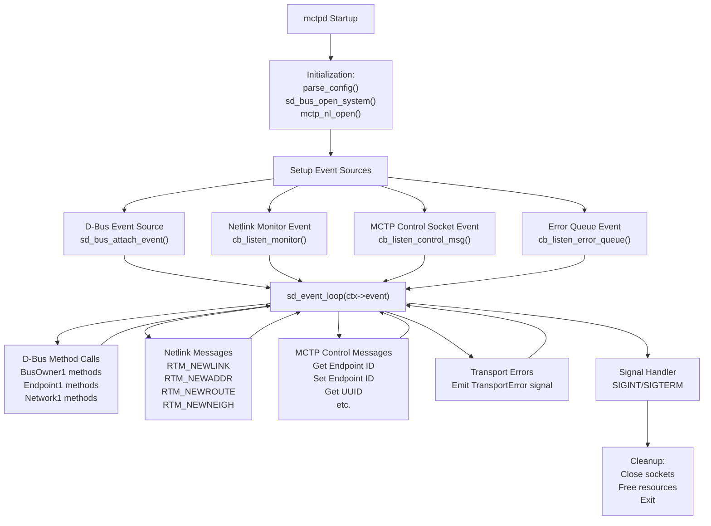

**Event Source Registration:**

| Event Source | File Descriptor | Callback Function | Purpose |
|--------------|-----------------|-------------------|---------|
| D-Bus | Internal to `sd_bus` | D-Bus vtable methods | Handle method calls from applications |
| Netlink Monitor | `mctp_nl_get_fd()` | `cb_listen_monitor()` | Receive kernel state changes |
| MCTP Control Socket | `mctp_ops.mctp.socket()` | `cb_listen_control_msg()` | Receive MCTP control protocol messages |
| MCTP Error Queue | Same socket with MSG_ERRQUEUE | `cb_listen_error_queue()` | Receive transport error notifications |

Sources: [src/mctpd.c:2857-2985](), [src/mctpd.c:1950-2066](), [src/mctpd.c:1661-1739]()

## Control Protocol Message Flow

The daemon implements the MCTP control protocol to communicate with endpoints. Here's how a typical endpoint setup flows through the code:

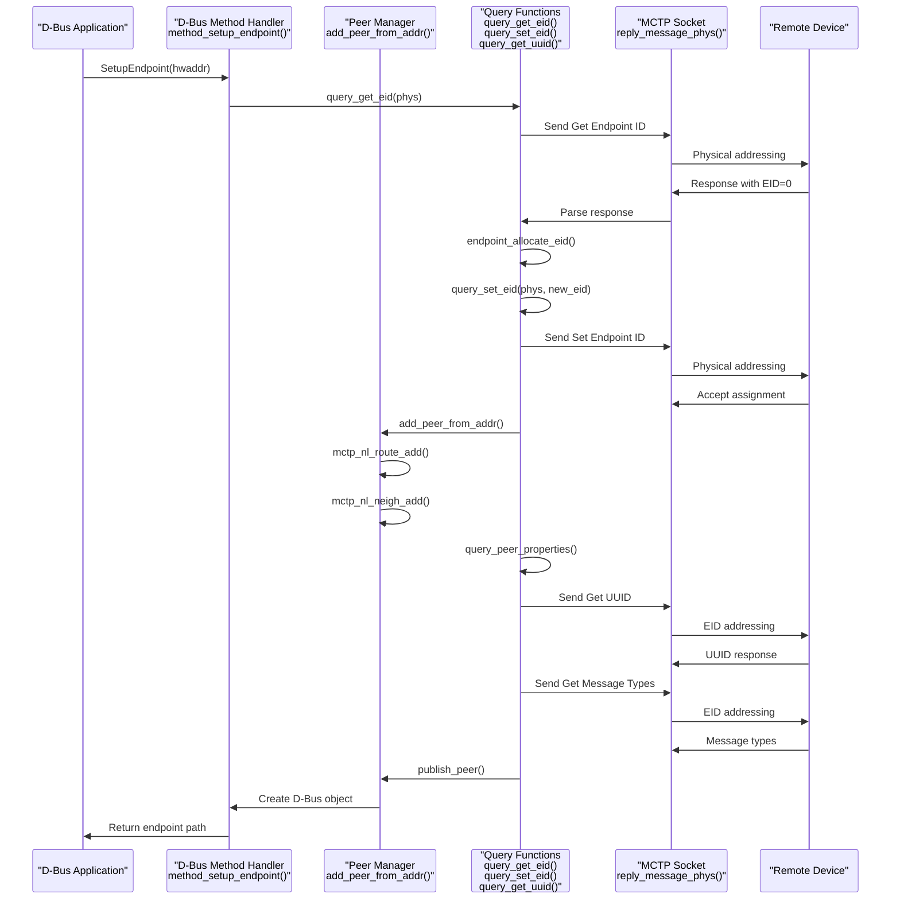

**Control Protocol Handlers:**

| Command Code | Handler Function | Request Type | Response Type |
|--------------|------------------|--------------|---------------|
| 0x01 | `handle_control_set_endpoint_id()` | `mctp_ctrl_cmd_set_eid` | `mctp_ctrl_resp_set_eid` |
| 0x02 | `handle_control_get_endpoint_id()` | `mctp_ctrl_cmd_get_eid` | `mctp_ctrl_resp_get_eid` |
| 0x03 | `handle_control_get_endpoint_uuid()` | `mctp_ctrl_cmd_get_uuid` | `mctp_ctrl_resp_get_uuid` |
| 0x04 | `handle_control_get_version_support()` | `mctp_ctrl_cmd_get_mctp_ver_support` | `mctp_ctrl_resp_get_mctp_ver_support` |
| 0x05 | `handle_control_get_message_type_support()` | `mctp_ctrl_cmd_get_msg_type_support` | `mctp_ctrl_resp_get_msg_type_support` |
| 0x09 | `handle_control_resolve_endpoint_id()` | `mctp_ctrl_cmd_resolve_endpoint_id` | `mctp_ctrl_resp_resolve_endpoint_id` |
| 0x0B | `handle_control_discovery_notify()` | `mctp_ctrl_cmd_discovery_notify` | `mctp_ctrl_resp_discovery_notify` |
| 0x0D | `handle_control_routing_info_update()` | `mctp_ctrl_cmd_routing_info_update` | `mctp_ctrl_resp` |

Sources: [src/mctpd.c:1661-1739](), [src/mctpd.c:754-1293](), [src/mctp-control-spec.h:1-200]()

## D-Bus Interface Hierarchy

The daemon exposes MCTP management through D-Bus. The object hierarchy maps to MCTP concepts:

```
/au/com/codeconstruct/mctp1
├── interfaces/
│   ├── mctpi2c1                    [au.com.codeconstruct.MCTP.Interface1]
│   │                               [au.com.codeconstruct.MCTP.BusOwner1] (if bus owner)
│   └── mctpi2c2                    [au.com.codeconstruct.MCTP.Interface1]
│                                   [au.com.codeconstruct.MCTP.BusOwner1] (if bus owner)
└── networks/
    └── 1/                          [au.com.codeconstruct.MCTP.Network1]
        └── endpoints/
            ├── 8                   [xyz.openbmc_project.MCTP.Endpoint]
            │                       [au.com.codeconstruct.MCTP.Endpoint1]
            │                       [xyz.openbmc_project.Common.UUID]
            └── 10                  [xyz.openbmc_project.MCTP.Endpoint]
                                    [au.com.codeconstruct.MCTP.Endpoint1]
                                    [au.com.codeconstruct.MCTP.Bridge1] (if bridge)
                                    [xyz.openbmc_project.Common.UUID]
```

**Key Interfaces:**
- `au.com.codeconstruct.MCTP.Interface1` - Interface properties and role
- `au.com.codeconstruct.MCTP.BusOwner1` - Endpoint setup/assignment (bus owner only)
- `au.com.codeconstruct.MCTP.Network1` - Network-level operations
- `au.com.codeconstruct.MCTP.Endpoint1` - Endpoint management (SetMTU, Remove, Recover)
- `au.com.codeconstruct.MCTP.Bridge1` - Bridge pool allocation info
- `xyz.openbmc_project.MCTP.Endpoint` - OpenBMC compatibility

See [D-Bus Interface](#4) for detailed API documentation.

Sources: [src/mctpd.c:44-57](), [docs/mctpd.md:9-23]()

## Configuration Loading

Configuration is loaded at startup from `/etc/mctpd.conf` (or path specified with `--config`):

**Configuration Flow:**

1. `parse_config()` ([src/mctpd.c:2619-2782]()) parses TOML file
2. Global `mode` setting determines operation mode
3. `[mctp]` section configures protocol parameters
4. `[bus-owner]` section configures EID allocation (if applicable)
5. Configuration stored in `struct ctx`

**Key Configuration Parameters:**

| Parameter | Field in `struct ctx` | Default | Description |
|-----------|----------------------|---------|-------------|
| `mode` | `default_role` | `bus-owner` | Operation mode |
| `message_timeout_ms` | `mctp_timeout` | 250 ms | Control protocol timeout |
| `dynamic_eid_range` | `dyn_eid_min`, `dyn_eid_max` | [8, 254] | EID allocation range |
| `max_pool_size` | `max_pool_size` | 15 | Max bridge pool size |
| `uuid` | `uuid[16]` | System UUID | Endpoint UUID |

For detailed configuration reference, see [Configuration](#2.1.3).

Sources: [src/mctpd.c:2619-2782](), [conf/mctpd.conf:1-20](), [docs/mctpd.md:286-369]()

## Lifecycle

### Startup Sequence

1. **Parse command-line arguments** ([src/mctpd.c:2857-2911]())
   - Configuration file path (`--config`)
   - Verbose mode (`-v`)

2. **Load configuration** ([src/mctpd.c:2619-2782]())
   - Read TOML file
   - Set operation mode and parameters

3. **Initialize context** ([src/mctpd.c:2913-2925]())
   - Allocate `struct ctx`
   - Open D-Bus system bus
   - Open Netlink socket
   - Generate or load UUID

4. **Setup event sources** ([src/mctpd.c:2927-2973]())
   - Attach D-Bus to event loop
   - Add Netlink monitor callback
   - Create MCTP control socket
   - Setup error queue monitoring

5. **Enumerate existing state** ([src/mctpd.c:2974-2982]())
   - Query kernel for existing interfaces
   - Query for existing addresses
   - Create network and peer objects

6. **Enter event loop** ([src/mctpd.c:2983]())
   - `sd_event_loop(ctx->event)`

Sources: [src/mctpd.c:2857-2985]()

### Runtime Operation

During normal operation, the daemon responds to events:

- **D-Bus method calls** trigger endpoint setup/management operations
- **Netlink events** update internal state when kernel state changes
- **MCTP control messages** from remote endpoints are processed
- **Transport errors** are logged and may trigger recovery

### Shutdown

On receiving SIGINT or SIGTERM:

1. Exit event loop
2. Unpublish all D-Bus objects
3. Close sockets and file descriptors
4. Free allocated memory
5. Exit process

Sources: [src/mctpd.c:2985-3000]()

## Netlink Integration

The daemon maintains kernel MCTP state through Netlink operations:

**Operations Performed:**

| Operation | Function | When Used |
|-----------|----------|-----------|
| Add route | `mctp_nl_route_add()` | After assigning EID to endpoint |
| Add neighbor | `mctp_nl_neigh_add()` | After assigning EID to endpoint |
| Add address | `mctp_nl_addr_add()` | When accepting EID assignment (endpoint mode) |
| Delete route | `mctp_nl_route_del()` | When removing peer |
| Delete neighbor | `mctp_nl_neigh_del()` | When removing peer |
| Delete address | `mctp_nl_addr_del()` | When clearing interface |

**Monitoring:**

The `cb_listen_monitor()` callback ([src/mctpd.c:1950-2066]()) receives and processes:
- `RTM_NEWLINK` / `RTM_DELLINK` - Interface creation/deletion
- `RTM_NEWADDR` / `RTM_DELADDR` - Address assignment/removal  
- `RTM_NEWROUTE` / `RTM_DELROUTE` - Route changes
- `RTM_NEWNEIGH` / `RTM_DELNEIGH` - Neighbor entry changes

This ensures the daemon's internal state remains synchronized with kernel state.

Sources: [src/mctpd.c:1950-2066](), [src/mctp-netlink.c:1-500]()

## Error Handling and Recovery

The daemon includes comprehensive error handling:

### Transport Error Queue

The error queue ([src/mctpd.c:2426-2612]()) captures transport-level failures:
- Reads from socket error queue with `MSG_ERRQUEUE`
- Extracts `struct mctp_error` with error details
- Emits D-Bus `TransportError` signal
- May trigger endpoint recovery

### Endpoint Recovery

When endpoints become unresponsive ([src/mctpd.c:2166-2344]()):
1. Detect failure (timeout or transport error)
2. Mark endpoint as degraded
3. Schedule recovery attempts with exponential backoff
4. Query endpoint state periodically
5. If successful, restore endpoint to healthy state
6. If failures persist, may remove endpoint

For details on recovery mechanisms, see [Endpoint Management](#2.1.2) and [Error Handling and Recovery](#7.2).

Sources: [src/mctpd.c:2166-2344](), [src/mctpd.c:2426-2612]()

## Bridge Endpoint Support

MCTP bridges require special handling:

1. **Detection**: Bridges report `pool_size > 0` in Set Endpoint ID response
2. **Pool Allocation**: Daemon allocates contiguous EID range for downstream devices
3. **Routing Table Query**: `query_routing_table()` retrieves bridge's routing information
4. **D-Bus Exposure**: Bridge endpoints expose `au.com.codeconstruct.MCTP.Bridge1` interface
5. **Routing Info Updates**: Daemon sends routing updates to bridges when topology changes

**Bridge-Specific Fields:**
- `pool_size` - Number of EIDs allocated to bridge
- `pool_start` - First EID in allocated range
- `routing_table_entry` - Cached routing table from bridge
- `ignore_eids` - EIDs to skip when processing routing table

Sources: [src/mctpd.c:1294-1598](), [src/mctpd.c:1866-1949](), [docs/mctpd.md:270-285]()

## Summary

The `mctpd` daemon is a sophisticated service that bridges MCTP hardware and application layers. It combines:
- Event-driven architecture using `sd_event`
- D-Bus interface for high-level control
- Netlink integration for kernel state management
- MCTP control protocol implementation
- Robust error handling and recovery mechanisms

The daemon's modular design separates concerns clearly, with distinct components for peer management, network state, protocol handling, and external interfaces. This architecture enables reliable MCTP management across diverse hardware transports and configurations.

Sources: [src/mctpd.c:1-3000](), [docs/mctpd.md:1-369]()

---

# Page: Daemon Architecture

# Daemon Architecture

<details>
<summary>Relevant source files</summary>

The following files were used as context for generating this wiki page:

- [src/mctpd-util.h](src/mctpd-util.h)
- [src/mctpd.c](src/mctpd.c)

</details>


## Purpose and Scope

This page documents the internal architecture of the `mctpd` daemon, including its event-driven design, core data structures, and component interactions. This covers the fundamental building blocks and design patterns used throughout the daemon implementation.

For information about endpoint discovery and EID assignment workflows, see [Endpoint Management](#2.1.2). For configuration file options, see [Configuration](#2.1.3). For details on the D-Bus interfaces exposed by the daemon, see [D-Bus Interface](#4).

---

## Event-Driven Architecture

The daemon is built on a centralized event loop provided by systemd's `sd_event` library. All asynchronous operations—including D-Bus method calls, Netlink monitoring, and MCTP socket I/O—are coordinated through this event loop using callback-based handlers.

### Event Loop Structure

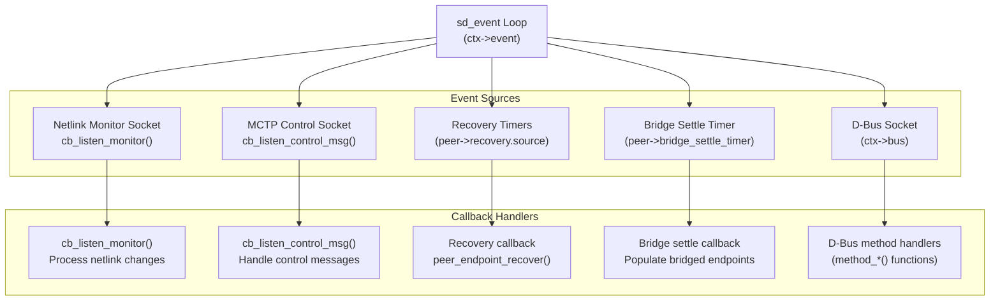

The event loop is created during daemon initialization and runs indefinitely until shutdown. Event sources register file descriptors and timers, and the loop dispatches callbacks when events occur.

**Sources:** [src/mctpd.c:224-226](), [src/mctpd.c:1422-1482](), [src/mctpd.c:1595-1704]()

---

## Core Data Structures

The daemon maintains four primary data structures that represent the state of the MCTP network:

### Context Structure (`struct ctx`)

The global context structure holds all daemon-wide state, including configuration, event loop handles, and collections of networks, peers, and interfaces.

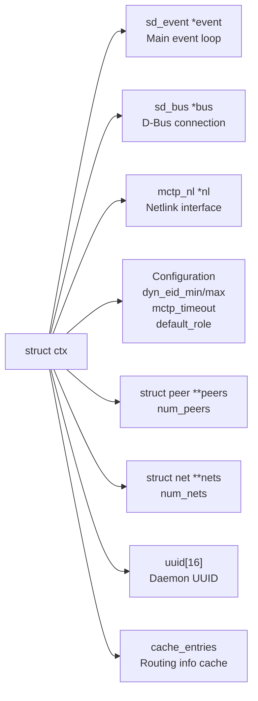

Key fields in `struct ctx`:

| Field | Type | Purpose |
|-------|------|---------|
| `event` | `sd_event *` | Main event loop handle |
| `bus` | `sd_bus *` | D-Bus system bus connection |
| `nl` | `mctp_nl *` | Netlink abstraction for kernel interface |
| `peers` | `struct peer **` | Dynamic array of all known endpoints |
| `num_peers` | `size_t` | Current number of peers |
| `nets` | `struct net **` | Array of network structures |
| `num_nets` | `size_t` | Number of networks |
| `dyn_eid_min/max` | `mctp_eid_t` | EID allocation range |
| `mctp_timeout` | `uint64_t` | Timeout in microseconds for MCTP responses |
| `iid` | `uint8_t` | Next Instance ID for control messages |
| `default_role` | `enum endpoint_role` | Default operational mode |

**Sources:** [src/mctpd.c:224-271]()

### Network Structure (`struct net`)

Each network structure represents an MCTP network domain and maintains an EID-to-peer mapping table.

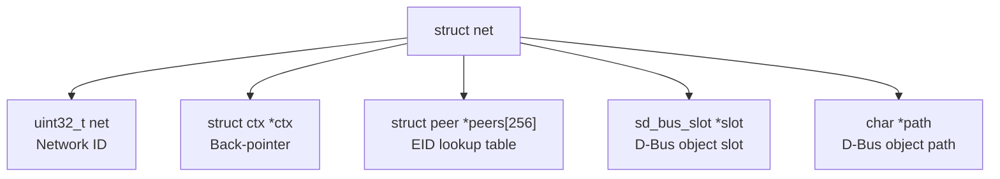

The `peers` array provides O(1) lookup of endpoints by EID within a network. Array indices correspond to EID values (0-255), with `NULL` entries indicating unused EIDs.

**Sources:** [src/mctpd.c:87-96](), [src/mctpd.c:349-356](), [src/mctpd.c:377-385]()

### Link Structure (`struct link`)

Link structures represent physical MCTP interfaces (e.g., `mctpi2c1`, `mctpusb0`) with their operational state and D-Bus registration.

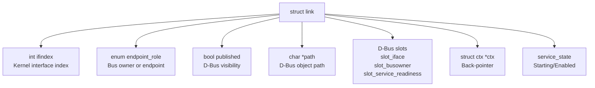

Each link has an associated operational role:
- **Bus Owner**: Actively assigns EIDs to discovered endpoints
- **Endpoint**: Passively accepts EID assignments from a remote bus owner

**Sources:** [src/mctpd.c:133-150](), [src/mctpd.c:103-131]()

### Peer Structure (`struct peer`)

Peer structures represent individual MCTP endpoints, both local and remote, with their routing information, properties, and recovery state.

```mermaid
graph TB
    PEER["struct peer"]
    
    subgraph "Identification"
        EID["mctp_eid_t eid"]
        NET["uint32_t net"]
        UUID["uint8_t *uuid<br/>(16 bytes)"]
    end
    
    subgraph "Routing"
        Phys["dest_phys phys<br/>Physical address"]
        State["enum state<br/>REMOTE or LOCAL"]
        HaveNeigh["bool have_neigh"]
        HaveRoute["bool have_route"]
        MTU["uint32_t mtu"]
    end
    
    subgraph "Properties"
        Types["uint8_t *message_types<br/>num_message_types"]
        EPType["uint8_t endpoint_type"]
        MedSpec["uint8_t medium_spec"]
    end
    
    subgraph "Bridge Support"
        PoolSize["uint8_t pool_size"]
        PoolStart["uint8_t pool_start"]
        IgnoreEIDs["mctp_eid_t *ignore_eids<br/>num_ignore_eids"]
        RoutingTable["struct get_routing_table_entry"]
    end
    
    subgraph "Recovery"
        Degraded["bool degraded"]
        Recovery["struct recovery<br/>Timer and retry state"]
    end
    
    subgraph "D-Bus"
        Published["bool published"]
        Slots["Multiple sd_bus_slot*"]
        Path["char *path"]
    end
    
    PEER --> EID
    PEER --> NET
    PEER --> UUID
    PEER --> Phys
    PEER --> State
    PEER --> Types
    PEER --> PoolSize
    PEER --> Degraded
    PEER --> Published
```

Key peer states:
- **REMOTE**: Regular endpoint reachable via physical addressing
- **LOCAL**: Represents a local interface's own EID

**Sources:** [src/mctpd.c:152-222]()

---

## Data Structure Relationships

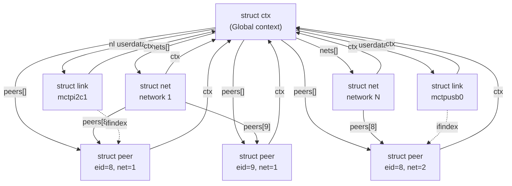

**Key relationships:**
- `ctx` contains arrays of all `peer` and `net` structures
- Each `net` has an EID lookup table pointing to `peer` structures
- `link` structures are stored as userdata in the `mctp_nl` (netlink) context
- All structures maintain back-pointers to `ctx` for accessing global state
- Peers reference their network by ID, not by pointer

**Sources:** [src/mctpd.c:87-96](), [src/mctpd.c:152-222](), [src/mctpd.c:224-271]()

---

## Component Interaction Patterns

### Callback Registration Pattern

The daemon extensively uses callback-based event handling. Components register callbacks with appropriate event sources:

```mermaid
graph LR
    subgraph "Registration Functions"
        ListenMon["listen_monitor()"]
        ListenCtrl["listen_control_msg()"]
        AddDBus["sd_bus_add_object_vtable()"]
    end
    
    subgraph "Event Sources"
        NetlinkFD["Netlink FD"]
        MctpFD["MCTP Socket FD"]
        DBusBus["D-Bus Connection"]
    end
    
    subgraph "Callbacks"
        CBMon["cb_listen_monitor()"]
        CBCtrl["cb_listen_control_msg()"]
        MethodCB["method_*()"]
    end
    
    ListenMon -->|"sd_event_add_io()"| NetlinkFD
    NetlinkFD --> CBMon
    
    ListenCtrl -->|"sd_event_add_io()"| MctpFD
    MctpFD --> CBCtrl
    
    AddDBus --> DBusBus
    DBusBus --> MethodCB
```

**Netlink Monitoring:** [src/mctpd.c:1692-1704]()
- `listen_monitor()` registers `cb_listen_monitor()` with the netlink socket
- Callback processes interface, address, and route changes

**MCTP Control Socket:** [src/mctpd.c:1422-1482]()
- `listen_control_msg()` registers `cb_listen_control_msg()` with MCTP socket
- Callback dispatches to specific control message handlers

**D-Bus Methods:** Various method handlers throughout [src/mctpd.c]()
- vtable arrays define method signatures and handlers
- Methods registered per object path (endpoints, networks, links)

**Sources:** [src/mctpd.c:1422-1482](), [src/mctpd.c:1595-1690](), [src/mctpd.c:1692-1704]()

### Peer Lifecycle Management

```mermaid
graph TB
    Start["Endpoint Discovered"]
    
    AddPeer["add_peer()<br/>Create peer structure<br/>Add to ctx->peers[]<br/>Add to net->peers[eid]"]
    
    SetupPeer["setup_added_peer()<br/>Add routes/neighbors<br/>Query properties"]
    
    QueryProps["query_peer_properties()<br/>Get message types<br/>Get UUID"]
    
    PublishPeer["publish_peer()<br/>Create D-Bus objects<br/>Emit signals"]
    
    Active["Active Peer"]
    
    Degrade["Peer Degraded<br/>(Communication failure)"]
    
    Recovery["peer_endpoint_recover()<br/>Periodic retry"]
    
    Remove["remove_peer()<br/>Unpublish D-Bus<br/>Delete routes<br/>Free memory"]
    
    End["Peer Removed"]
    
    Start --> AddPeer
    AddPeer --> SetupPeer
    SetupPeer --> QueryProps
    QueryProps --> PublishPeer
    PublishPeer --> Active
    
    Active -->|"Transport error"| Degrade
    Degrade -->|"Retry timer"| Recovery
    Recovery -->|"Success"| Active
    Recovery -->|"Permanent failure"| Remove
    Active -->|"Remove request"| Remove
    Remove --> End
```

**Key functions:**
- `add_peer()` [src/mctpd.c:2174-2223](): Allocates and initializes peer structure
- `setup_added_peer()` [src/mctpd.c:3368-3398](): Configures routing and queries properties
- `publish_peer()` [src/mctpd.c:3526-3633](): Exposes peer to D-Bus
- `remove_peer()` [src/mctpd.c:2285-2374](): Cleanup and deallocation
- `peer_endpoint_recover()` [src/mctpd.c:3951-4036](): Recovery state machine

**Sources:** [src/mctpd.c:2174-2223](), [src/mctpd.c:2285-2374](), [src/mctpd.c:3266-3398](), [src/mctpd.c:3526-3633](), [src/mctpd.c:3951-4036]()

### Control Message Dispatch

```mermaid
graph TB
    Recv["cb_listen_control_msg()<br/>EPOLLIN event on control socket"]
    
    ReadMsg["read_message()<br/>Receive from socket"]
    
    Dispatch{{"Switch on<br/>ctrl_msg->command_code"}}
    
    GetEID["handle_control_get_endpoint_id()"]
    SetEID["handle_control_set_endpoint_id()"]
    GetUUID["handle_control_get_endpoint_uuid()"]
    GetTypes["handle_control_get_message_type_support()"]
    GetVer["handle_control_get_version_support()"]
    Resolve["handle_control_resolve_endpoint_id()"]
    Notify["handle_control_discovery_notify()"]
    Routing["handle_control_routing_info_update()"]
    Unsup["handle_control_unsupported()"]
    
    Reply["reply_message()<br/>Send response"]
    
    Recv --> ReadMsg
    ReadMsg --> Dispatch
    
    Dispatch -->|"GET_ENDPOINT_ID"| GetEID
    Dispatch -->|"SET_ENDPOINT_ID"| SetEID
    Dispatch -->|"GET_ENDPOINT_UUID"| GetUUID
    Dispatch -->|"GET_MESSAGE_TYPE_SUPPORT"| GetTypes
    Dispatch -->|"GET_VERSION_SUPPORT"| GetVer
    Dispatch -->|"RESOLVE_ENDPOINT_ID"| Resolve
    Dispatch -->|"DISCOVERY_NOTIFY"| Notify
    Dispatch -->|"ROUTING_INFO_UPDATE"| Routing
    Dispatch -->|"Unknown"| Unsup
    
    GetEID --> Reply
    SetEID --> Reply
    GetUUID --> Reply
    GetTypes --> Reply
    GetVer --> Reply
    Resolve --> Reply
    Notify --> Reply
    Routing --> Reply
    Unsup --> Reply
```

The control message callback [src/mctpd.c:1323-1420]() implements a dispatch table for all MCTP control protocol commands. Each handler processes the request and calls `reply_message()` or `reply_message_phys()` to send the response.

**Sources:** [src/mctpd.c:1323-1420](), [src/mctpd.c:666-694](), [src/mctpd.c:641-663]()

---

## Memory Management Patterns

### Dynamic Arrays

The daemon uses dynamically-sized arrays for peers and networks that grow and shrink as endpoints are discovered or removed:

**Peer array growth** [src/mctpd.c:2203-2209]():
```c
tmp = realloc(ctx->peers, (ctx->num_peers + 1) * sizeof(*ctx->peers));
ctx->peers = tmp;
ctx->peers[ctx->num_peers] = peer;
ctx->num_peers++;
```

**Peer array shrinkage** [src/mctpd.c:2352-2369]():
```c
ctx->num_peers--;
memmove(ctx->peers + idx, ctx->peers + idx + 1,
        (ctx->num_peers - idx) * sizeof(struct peer *));
tmp = realloc(ctx->peers, ctx->num_peers * sizeof(struct peer *));
```

### Deferred Free Pattern

The `dfree()` function [src/mctpd.c:479-501]() provides automatic memory cleanup using the event loop:

```mermaid
graph LR
    Alloc["malloc() buffer"]
    Return["Return pointer<br/>wrapped in dfree()"]
    Use["Function uses pointer<br/>for logging, etc."]
    Defer["Event loop defer callback"]
    Free["free() buffer"]
    
    Alloc --> Return
    Return --> Use
    Use --> Defer
    Defer --> Free
```

This pattern is used for temporary string buffers in logging functions like `dest_phys_tostr()` [src/mctpd.c:409-422]() and `peer_tostr()` [src/mctpd.c:444-456](). The buffer remains valid until the next event loop iteration, avoiding manual memory management in callers.

**Sources:** [src/mctpd.c:479-501](), [src/mctpd.c:409-422](), [src/mctpd.c:444-456]()

---

## Socket and Network I/O Patterns

### Request-Response Pattern with Timeout

The daemon implements synchronous request-response communication with endpoints using a temporary event loop:

```mermaid
graph TB
    Create["endpoint_query_addr()<br/>Create temporary socket"]
    
    Send["sendto()<br/>Send control request"]
    
    Wait["wait_fd_timeout()<br/>Create temporary event loop<br/>Register socket + timer"]
    
    Loop["sd_event_loop()<br/>Wait for response or timeout"]
    
    Events{{"Event"}}
    
    Data["EPOLLIN<br/>Receive response"]
    Error["EPOLLERR<br/>Read error queue"]
    Timeout["Timer expires"]
    
    Close["close(socket)<br/>Return result"]
    
    Create --> Send
    Send --> Wait
    Wait --> Loop
    Loop --> Events
    
    Events -->|"Data"| Data
    Events -->|"Error"| Error
    Events -->|"Timeout"| Timeout
    
    Data --> Close
    Error --> Close
    Timeout --> Close
```

**Key functions:**
- `endpoint_query_addr()` [src/mctpd.c:1916-2033](): Base query function
- `endpoint_query_peer()` [src/mctpd.c:2037-2058](): Query by EID
- `endpoint_query_phys()` [src/mctpd.c:2062-2088](): Query by physical address
- `wait_fd_timeout()` [src/mctpd.c:522-548](): Synchronous wait with timeout

This pattern allows the daemon to make synchronous control protocol requests without blocking the main event loop.

**Sources:** [src/mctpd.c:1916-2033](), [src/mctpd.c:522-548](), [src/mctpd.c:2037-2058](), [src/mctpd.c:2062-2088]()

### Error Queue Processing

The daemon processes MCTP transport errors through the kernel's error queue mechanism:

```mermaid
graph TB
    Enable["setsockopt(MCTP_OPT_ENABLE_ERRQUEUE)"]
    
    Event["EPOLLERR event on socket"]
    
    Read["read_mctp_error_queue()<br/>recvmsg(MSG_ERRQUEUE)"]
    
    Extract["Extract mctp_error structure<br/>from control message"]
    
    Log["log_mctp_error()<br/>Emit TransportError D-Bus signal"]
    
    Enable --> Event
    Event --> Read
    Read --> Extract
    Extract --> Log
```

The error queue is enabled on control sockets [src/mctpd.c:1456-1467]() and query sockets [src/mctpd.c:1949-1955](). When errors occur, the `read_mctp_error_queue()` function [src/mctpd.c:1516-1592]() processes them and emits D-Bus signals for monitoring.

**Sources:** [src/mctpd.c:1456-1467](), [src/mctpd.c:1516-1592](), [src/mctpd.c:1484-1514]()

---

## Initialization and Shutdown

### Daemon Startup Sequence

```mermaid
graph TB
    Main["main()"]
    
    ParseArgs["Parse command line<br/>arguments"]
    
    ParseConf["parse_conf()<br/>Load /etc/mctpd.conf"]
    
    InitEvent["sd_event_default()<br/>Create event loop"]
    
    InitBus["sd_bus_default_system()<br/>Connect to D-Bus"]
    
    InitNL["mctp_nl_new()<br/>Create netlink context"]
    
    SetupNets["setup_nets()<br/>Discover interfaces<br/>Create link structures"]
    
    ListenMon["listen_monitor()<br/>Register netlink callback"]
    
    ListenCtrl["listen_control_msg()<br/>Register control socket"]
    
    ClaimName["sd_bus_request_name()<br/>au.com.codeconstruct.MCTP1"]
    
    EventLoop["sd_event_loop()<br/>Run until termination"]
    
    Main --> ParseArgs
    ParseArgs --> ParseConf
    ParseConf --> InitEvent
    InitEvent --> InitBus
    InitBus --> InitNL
    InitNL --> SetupNets
    SetupNets --> ListenMon
    ListenMon --> ListenCtrl
    ListenCtrl --> ClaimName
    ClaimName --> EventLoop
```

During initialization, the daemon:
1. Parses configuration to determine operational mode and EID ranges
2. Creates the event loop and connects to D-Bus
3. Initializes netlink monitoring for kernel MCTP state
4. Discovers existing interfaces and creates link objects
5. Registers event sources (netlink, control socket)
6. Claims the D-Bus service name
7. Enters the main event loop

**Sources:** [src/mctpd.c:4605-4950]()

---

## Design Principles

### Separation of Concerns

The architecture cleanly separates:
- **Transport Layer**: Netlink and MCTP socket operations ([src/mctp-netlink.c]())
- **Protocol Layer**: Control message encoding/decoding ([src/mctp-control-spec.h]())
- **Management Layer**: Peer lifecycle and state management ([src/mctpd.c]())
- **Interface Layer**: D-Bus API exposure ([src/mctpd.c]() vtables)

### Asynchronous-First Design

All I/O operations integrate with the event loop, preventing blocking:
- D-Bus method calls return immediately and use D-Bus's async reply mechanism
- Netlink monitoring uses non-blocking sockets with callbacks
- Long-running operations (discovery, recovery) use timers

### State Machine Approach

Complex workflows are implemented as state machines:
- **Peer recovery** [src/mctpd.c:3951-4036](): Tracks retry count and exponential backoff
- **Bridge endpoint discovery** [src/mctpd.c:3685-3793](): Polls bridged endpoints with settle timer
- **Link service readiness** [src/mctpd.c:146-149](): Starting → Enabled state transition

**Sources:** [src/mctpd.c:3951-4036](), [src/mctpd.c:3685-3793](), [src/mctpd.c:146-149]()

---

# Page: Endpoint Management

# Endpoint Management

<details>
<summary>Relevant source files</summary>

The following files were used as context for generating this wiki page:

- [conf/mctpd.conf](conf/mctpd.conf)
- [docs/mctpd.md](docs/mctpd.md)
- [src/mctpd-util.h](src/mctpd-util.h)
- [src/mctpd.c](src/mctpd.c)

</details>


## Purpose and Scope

This page documents how `mctpd` discovers, configures, and manages MCTP endpoints throughout their lifecycle. It covers the endpoint discovery process, EID (Endpoint ID) assignment mechanisms, property queries, bridge endpoint handling, and recovery procedures.

For information about the overall daemon architecture and event loop, see [Daemon Architecture](#2.1.1). For D-Bus interface details for endpoint management, see [BusOwner1 Interface](#4.1) and [Endpoint1 Interface](#4.2). For bridge-specific D-Bus operations, see [Bridge Management](#4.4).

---

## Endpoint Representation

### Peer Structure

Endpoints are represented internally by the `struct peer` data structure, which tracks all state for both local and remote endpoints.

**Key Fields:**

| Field | Type | Purpose |
|-------|------|---------|
| `eid` | `mctp_eid_t` | Endpoint ID (8-254) |
| `net` | `uint32_t` | MCTP network identifier |
| `state` | enum | `LOCAL` or `REMOTE` |
| `phys` | `dest_phys` | Physical address (interface, hardware address) |
| `published` | `bool` | Whether visible on D-Bus |
| `have_neigh` | `bool` | Whether neighbor table entry exists |
| `have_route` | `bool` | Whether route exists in kernel |
| `uuid` | `uint8_t*` | 16-byte endpoint UUID |
| `message_types` | `uint8_t*` | Supported MCTP message types |
| `pool_size` | `uint8_t` | For bridges: downstream EID pool size |
| `pool_start` | `mctp_eid_t` | For bridges: first EID in pool |
| `degraded` | `bool` | Endpoint in degraded/error state |

**Network Peer Array:**

Each network maintains a 256-element array mapping EIDs to peer structures:

```
struct net {
    struct peer *peers[256];  // Indexed by EID
    uint32_t net;
    // ...
}
```

Sources: [src/mctpd.c:152-222](), [src/mctpd.c:86-96]()

---

## Endpoint Discovery Flow

### SetupEndpoint Operation

The `SetupEndpoint` D-Bus method is the primary mechanism for discovering and configuring endpoints. It performs a complete discovery and configuration sequence.

```mermaid
flowchart TD
    Start["D-Bus: SetupEndpoint(hwaddr)"]
    CheckExist["Check if peer exists<br/>find_peer_by_phys()"]
    GetEID["Send Get Endpoint ID<br/>to hwaddr"]
    CheckEIDResp["Check EID response"]
    AllocEID["Allocate new EID<br/>endpoint_allocate_eid()"]
    SetEID["Send Set Endpoint ID"]
    AddRoute["Add kernel route<br/>mctp_nl_route_add()"]
    AddNeigh["Add kernel neighbor<br/>mctp_nl_neigh_add()"]
    QueryProps["Query properties:<br/>- Get UUID<br/>- Get Message Types"]
    PublishDBus["Publish to D-Bus<br/>publish_peer()"]
    Return["Return (eid, net, path, new)"]
    
    Start --> CheckExist
    CheckExist -->|"Exists"| Return
    CheckExist -->|"New"| GetEID
    GetEID --> CheckEIDResp
    CheckEIDResp -->|"EID=0"| AllocEID
    CheckEIDResp -->|"Has EID"| AddRoute
    AllocEID --> SetEID
    SetEID --> AddRoute
    AddRoute --> AddNeigh
    AddNeigh --> QueryProps
    QueryProps --> PublishDBus
    PublishDBus --> Return
```

**Diagram: SetupEndpoint Discovery Flow**

Sources: [src/mctpd.c:3080-3270]()

### Discovery Methods

The daemon provides multiple methods for endpoint discovery with different behaviors:

| Method | EID Query | EID Assignment | Use Case |
|--------|-----------|----------------|----------|
| `SetupEndpoint` | Yes | If EID=0 | Standard discovery |
| `AssignEndpoint` | No | Always | Force assignment with pool allocation |
| `AssignEndpointStatic` | No | Static EID | Pre-determined EID assignment |
| `LearnEndpoint` | Yes | No | Discover bridged endpoints |

**D-Bus Method Implementations:**

- `SetupEndpoint`: [src/mctpd.c:3080-3270]()
- `AssignEndpoint`: [src/mctpd.c:3272-3419]()
- `AssignEndpointStatic`: [src/mctpd.c:3421-3609]()
- `LearnEndpoint`: [src/mctpd.c:4009-4127]()

Sources: [docs/mctpd.md:90-160]()

---

## EID Assignment

### Dynamic EID Allocation

The daemon maintains a pool of available EIDs for dynamic allocation. The range is configurable via `dynamic_eid_range` in the configuration file.

```mermaid
flowchart TD
    Start["endpoint_allocate_eid(peer)"]
    GetRange["Get allocation range:<br/>ctx->dyn_eid_min to dyn_eid_max"]
    ScanNet["Scan network peer array<br/>net->peers[eid]"]
    CheckFree["Check if EID free"]
    CheckIgnore["Check ignore list<br/>should_ignore_eid()"]
    Allocate["Assign EID to peer"]
    SendSet["Send Set Endpoint ID<br/>MCTP_CTRL_CMD_SET_ENDPOINT_ID"]
    CheckBridge["Check response<br/>pool_size > 0?"]
    AllocPool["Allocate downstream pool<br/>for bridge"]
    Return["Return success"]
    Error["Return -ENOSPC"]
    
    Start --> GetRange
    GetRange --> ScanNet
    ScanNet --> CheckFree
    CheckFree -->|"In use"| ScanNet
    CheckFree -->|"Free"| CheckIgnore
    CheckIgnore -->|"Ignore"| ScanNet
    CheckIgnore -->|"OK"| Allocate
    Allocate --> SendSet
    SendSet --> CheckBridge
    CheckBridge -->|"Yes"| AllocPool
    CheckBridge -->|"No"| Return
    AllocPool --> Return
    ScanNet -->|"No free EIDs"| Error
```

**Diagram: Dynamic EID Allocation Process**

**EID Allocation Logic:**

The `endpoint_allocate_eid()` function implements a sequential scan through the configured EID range:

1. Start at `ctx->dyn_eid_min`
2. Skip EIDs already in use (`net->peers[eid] != NULL`)
3. Skip EIDs in ignore list (for bridges)
4. Allocate first available EID
5. Send Set Endpoint ID command
6. If endpoint is a bridge, allocate downstream pool

Sources: [src/mctpd.c:2769-2909]()

### Bridge Pool Allocation

When an endpoint responds to Set Endpoint ID with a non-zero `eid_pool_size`, the daemon allocates a contiguous range of EIDs for the bridge's downstream endpoints.

**Pool Allocation Algorithm:**

```
requested_size = min(response.pool_size, ctx->max_pool_size)
pool_start = peer.eid + 1
pool_end = pool_start + requested_size - 1

Store in peer:
    peer->pool_size = requested_size
    peer->pool_start = pool_start
```

**Bridge Pool Properties:**

The allocated pool is exposed via D-Bus on the endpoint object:

- Interface: `au.com.codeconstruct.MCTP.Bridge1`
- Properties: `PoolStart` (byte), `PoolEnd` (byte)

Sources: [src/mctpd.c:2861-2907](), [src/mctpd.c:1922-1965]()

### Static EID Assignment

The `AssignEndpointStatic` method assigns a specific EID to an endpoint. It validates that:

1. The static EID is not already in use by a different endpoint
2. If the endpoint already has an EID, it matches the static EID
3. The static EID is within valid range (8-254)

Sources: [src/mctpd.c:3421-3609]()

---

## Endpoint Lifecycle

### Peer State Machine

```mermaid
stateDiagram-v2
    [*] --> Discovered: find_peer_by_phys()
    Discovered --> EID_Assigned: Set Endpoint ID
    EID_Assigned --> Properties_Queried: Get UUID, Get Message Types
    Properties_Queried --> Route_Added: mctp_nl_route_add()
    Route_Added --> Neigh_Added: mctp_nl_neigh_add()
    Neigh_Added --> Published: publish_peer()
    Published --> Degraded: Transport error
    Degraded --> Recovering: peer_endpoint_recover()
    Recovering --> Published: Recovery successful
    Recovering --> Removed: Recovery timeout
    Published --> Removed: Remove method / interface down
    Removed --> [*]
```

**Diagram: Endpoint State Machine**

### Peer Setup Sequence

The `setup_added_peer()` function orchestrates the complete endpoint setup:

```mermaid
sequenceDiagram
    participant mctpd
    participant Endpoint
    participant Kernel
    participant DBus
    
    mctpd->>Endpoint: Get Endpoint ID
    Endpoint->>mctpd: EID response
    
    alt EID is 0 (unassigned)
        mctpd->>mctpd: Allocate EID
        mctpd->>Endpoint: Set Endpoint ID
        Endpoint->>mctpd: Accept/pool_size
        alt Bridge (pool_size > 0)
            mctpd->>mctpd: Allocate downstream pool
            mctpd->>Endpoint: Get Routing Table
            Endpoint->>mctpd: Routing entries
        end
    end
    
    mctpd->>Kernel: Add route
    Kernel->>mctpd: OK
    mctpd->>Kernel: Add neighbor
    Kernel->>mctpd: OK
    
    mctpd->>Endpoint: Get Endpoint UUID
    Endpoint->>mctpd: UUID
    mctpd->>Endpoint: Get Message Type Support
    Endpoint->>mctpd: Message types
    
    mctpd->>DBus: publish_peer()
    DBus->>mctpd: Object path
```

**Diagram: Endpoint Setup Sequence**

**Key Functions:**

- `setup_added_peer()`: [src/mctpd.c:2484-2522]()
- `add_peer()`: [src/mctpd.c:2524-2622]()
- `add_peer_route()`: [src/mctpd.c:2306-2339]()
- `query_peer_properties()`: [src/mctpd.c:2912-3078]()

Sources: [src/mctpd.c:2484-2622]()

### Endpoint Publication to D-Bus

The `publish_peer()` function creates D-Bus objects and interfaces for discovered endpoints:

**Interfaces Added:**

1. `xyz.openbmc_project.MCTP.Endpoint` - OpenBMC standard interface
2. `au.com.codeconstruct.MCTP.Endpoint1` - CodeConstruct management interface
3. `xyz.openbmc_project.Common.UUID` - UUID property interface
4. `xyz.openbmc_project.MCTP.Binding` - Binding type information
5. `au.com.codeconstruct.MCTP.Bridge1` - Added if `pool_size > 0`

**Object Path Format:**

```
/au/com/codeconstruct/mctp1/networks/<net>/endpoints/<eid>
```

Sources: [src/mctpd.c:2158-2304](), [src/mctpd.c:1922-1965]()

---

## Property Queries

### Queried Properties

After EID assignment, the daemon queries endpoint capabilities using MCTP control protocol commands:

**Query Sequence:**

```mermaid
flowchart LR
    Start["query_peer_properties()"]
    UUID["Get Endpoint UUID<br/>MCTP_CTRL_CMD_GET_ENDPOINT_UUID"]
    Types["Get Message Type Support<br/>MCTP_CTRL_CMD_GET_MESSAGE_TYPE_SUPPORT"]
    Store["Store in peer structure"]
    
    Start --> UUID
    UUID --> Types
    Types --> Store
```

**Diagram: Property Query Flow**

**Retrieved Data:**

| Property | Control Command | Stored In |
|----------|----------------|-----------|
| UUID | `Get Endpoint UUID` (0x03) | `peer->uuid` (16 bytes) |
| Message Types | `Get Message Type Support` (0x05) | `peer->message_types` (array) |
| Endpoint Type | From Get EID response | `peer->endpoint_type` |
| Medium Specific | From Get EID response | `peer->medium_spec` |

**Control Protocol Implementation:**

The daemon uses `send_control_message_and_wait()` to send queries and wait for responses:

```c
// Send control message with timeout
rc = send_control_message_and_wait(ctx, peer, 
                                   req_buf, req_len,
                                   &resp_buf, &resp_len,
                                   ctx->mctp_timeout);
```

Sources: [src/mctpd.c:2912-3078](), [src/mctpd.c:2624-2767]()

---

## Bridge Endpoint Management

### Bridge Detection and Pool Allocation

Bridges are identified by a non-zero `eid_pool_size` in the Set Endpoint ID response. The daemon allocates a contiguous EID pool for the bridge's downstream devices.

```mermaid
flowchart TD
    SetEID["Send Set Endpoint ID"]
    Response["Receive response"]
    CheckPool["pool_size > 0?"]
    IsBridge["Identify as bridge"]
    Truncate["Truncate if > max_pool_size"]
    AllocRange["Allocate EID range:<br/>pool_start = peer.eid + 1<br/>pool_end = start + size - 1"]
    QueryRT["Query Routing Table<br/>query_routing_table()"]
    SetupBridged["Setup bridged endpoints"]
    PublishPool["Publish Bridge1 interface<br/>with PoolStart/PoolEnd"]
    
    SetEID --> Response
    Response --> CheckPool
    CheckPool -->|"Yes"| IsBridge
    CheckPool -->|"No"| PublishPool
    IsBridge --> Truncate
    Truncate --> AllocRange
    AllocRange --> QueryRT
    QueryRT --> SetupBridged
    SetupBridged --> PublishPool
```

**Diagram: Bridge Pool Allocation Flow**

### Routing Table Queries

For bridge endpoints, the daemon queries the routing table to discover downstream endpoints:

**Query Message:**

```
Command: Get Routing Table Entries (0x0A)
Parameters: Entry handle = 0xFF (start)
```

**Response Processing:**

The routing table response contains entries with:
- `first_eid`: Starting EID of range
- `eid_range`: Number of EIDs in range
- `entry_type`: Type of entry (0x00 = endpoint, 0x01 = bridge)
- Physical address (variable length)

**Bridged Endpoint Setup:**

For each routing table entry:
1. Create peer structure with bridged EID
2. Mark as indirect endpoint (`is_direct_endpoint = false`)
3. Add route through bridge interface
4. Skip neighbor table entry (no direct physical address)
5. Query properties if accessible

Sources: [src/mctpd.c:3611-3906](), [src/mctpd.c:3908-4007]()

### Bridge Settle Timer

After querying the routing table, a settle timer delays final publication to allow transient states to resolve:

```c
#define BRIDGE_SETTLE_DELAY_SEC 4

// Start timer after routing table query
rc = sd_event_add_time_relative(ctx->event,
                                &peer->bridge_settle_timer,
                                CLOCK_MONOTONIC,
                                BRIDGE_SETTLE_DELAY_SEC * USEC_PER_SEC,
                                0,
                                cb_bridge_settle_timeout,
                                peer);
```

Sources: [src/mctpd.c:59](), [src/mctpd.c:3793-3810]()

---

## Recovery Mechanisms

### Transport Error Detection

The daemon monitors transport errors via the MCTP error queue. When errors are detected, affected endpoints may be marked as degraded.

```mermaid
flowchart TD
    Error["Transport error on peer"]
    Signal["Emit TransportError D-Bus signal"]
    CheckCritical["Critical error?"]
    MarkDegraded["Set peer->degraded = true"]
    StartRecovery["Start recovery timer<br/>peer_endpoint_recover()"]
    Wait["Wait exponentially:<br/>delay = 2^npolls * 1sec"]
    Retry["Send Get Endpoint ID"]
    CheckResp["Response received?"]
    Restore["Clear degraded state"]
    IncPoll["npolls++"]
    CheckMax["npolls > max?"]
    Remove["remove_peer()"]
    
    Error --> Signal
    Signal --> CheckCritical
    CheckCritical -->|"Yes"| MarkDegraded
    CheckCritical -->|"No"| Error
    MarkDegraded --> StartRecovery
    StartRecovery --> Wait
    Wait --> Retry
    Retry --> CheckResp
    CheckResp -->|"Success"| Restore
    CheckResp -->|"Failure"| IncPoll
    IncPoll --> CheckMax
    CheckMax -->|"< max"| Wait
    CheckMax -->|">= max"| Remove
```

**Diagram: Endpoint Recovery Flow**

### Recovery State

The `peer->recovery` structure tracks recovery attempts:

```c
struct {
    uint64_t delay;            // Exponential backoff delay
    sd_event_source *source;   // Timer event source
    int npolls;                // Number of recovery attempts
    mctp_eid_t eid;           // Original EID
    uint8_t endpoint_type;     // Cached for verification
    uint8_t medium_spec;       // Cached for verification
} recovery;
```

**Recovery Process:**

1. Mark endpoint as degraded (`peer->degraded = true`)
2. Start recovery timer with exponential backoff: `delay = 2^npolls * 1 second`
3. Send Get Endpoint ID to check if endpoint responds
4. If response matches cached properties, restore endpoint
5. If maximum attempts exceeded, remove endpoint

**Configuration Option:**

Recovery for endpoints with null UUID can be disabled with the build option `unsafe-recover-nil-uuid`.

Sources: [src/mctpd.c:2341-2482](), [src/mctpd.c:214-221]()

### Error Queue Processing

The daemon registers an error queue callback on control message sockets:

```c
// Enable error queue
val = 1;
setsockopt(sd, SOL_MCTP, MCTP_OPT_ENABLE_ERRQUEUE, &val, sizeof(val));

// Register for EPOLLERR events
sd_event_add_io(ctx->event, NULL, sd, EPOLLIN | EPOLLERR,
                cb_listen_control_msg, ctx);
```

When `EPOLLERR` occurs, `read_mctp_error_queue()` retrieves error details and emits D-Bus signals.

Sources: [src/mctpd.c:1456-1474](), [src/mctpd.c:1516-1592]()

---

## Endpoint Removal

### Removal Triggers

Endpoints can be removed through several mechanisms:

1. **D-Bus `.Remove` method** - Explicit removal request
2. **Interface down** - Network interface goes down
3. **Recovery timeout** - Endpoint fails recovery attempts
4. **Netlink route/neighbor deletion** - Kernel state changes

### Removal Process

```mermaid
flowchart TD
    Start["remove_peer(peer)"]
    Unpublish["unpublish_peer()<br/>Remove D-Bus objects"]
    DelRoute["Delete kernel route<br/>peer_route_update(RTM_DELROUTE)"]
    DelNeigh["Delete kernel neighbor<br/>peer_neigh_update(RTM_DELNEIGH)"]
    ClearArray["Clear net->peers[eid]"]
    FreeMem["Free allocated memory:<br/>- uuid<br/>- message_types<br/>- routing_table_entry"]
    RemoveList["Remove from ctx->peers"]
    FreeStruct["Free peer structure"]
    
    Start --> Unpublish
    Unpublish --> DelRoute
    DelRoute --> DelNeigh
    DelNeigh --> ClearArray
    ClearArray --> FreeMem
    FreeMem --> RemoveList
    RemoveList --> FreeStruct
```

**Diagram: Endpoint Removal Process**

**Key Functions:**

- `remove_peer()`: [src/mctpd.c:2093-2156]()
- `unpublish_peer()`: [src/mctpd.c:2052-2091]()
- `peer_route_update()`: [src/mctpd.c:1967-2020]()
- `peer_neigh_update()`: [src/mctpd.c:2022-2050]()

### Bridged Endpoint Cleanup

When a bridge endpoint is removed, all downstream bridged endpoints must also be removed:

```c
// Called before removing bridge peer
remove_bridged_peers(bridge);

// Iterates through all peers, removing those using bridge as gateway
for (i = 0; i < ctx->num_peers; i++) {
    if (peer->phys.ifindex == bridge->phys.ifindex &&
        !peer->is_direct_endpoint) {
        remove_peer(peer);
    }
}
```

Sources: [src/mctpd.c:1845-1866]()

---

## Endpoint Lookup Functions

The daemon provides several lookup functions for finding endpoints:

| Function | Search By | Returns |
|----------|-----------|---------|
| `find_peer_by_addr()` | EID + Network ID | `struct peer*` |
| `find_peer_by_phys()` | Physical address (ifindex + hwaddr) | `struct peer*` |
| `find_local_eids_by_net()` | Network ID | Array of local EIDs |

**Usage Example:**

```c
// Find peer by EID
struct peer *peer = find_peer_by_addr(ctx, eid, net_id);

// Find peer by physical address
dest_phys phys = {
    .ifindex = 3,
    .hwaddr = {0x1d},
    .hwaddr_len = 1
};
struct peer *peer = find_peer_by_phys(ctx, &phys);
```

Sources: [src/mctpd.c:377-406](), [src/mctpd.c:365-375]()

---

## Key Data Flows

### Add Peer from D-Bus to Kernel

```mermaid
flowchart LR
    DBus["D-Bus Client"]
    Method["SetupEndpoint()"]
    Handler["D-Bus method handler"]
    AddPeer["add_peer()"]
    SetupPeer["setup_added_peer()"]
    Route["mctp_nl_route_add()"]
    Neigh["mctp_nl_neigh_add()"]
    Kernel["Linux Kernel"]
    Publish["publish_peer()"]
    Return["Return to client"]
    
    DBus --> Method
    Method --> Handler
    Handler --> AddPeer
    AddPeer --> SetupPeer
    SetupPeer --> Route
    SetupPeer --> Neigh
    Route --> Kernel
    Neigh --> Kernel
    SetupPeer --> Publish
    Publish --> Return
    Return --> DBus
```

**Diagram: Add Peer Data Flow**

### Netlink Event to D-Bus

```mermaid
flowchart LR
    Kernel["Kernel Netlink Event"]
    Monitor["cb_listen_monitor()"]
    Change["mctp_nl_change enum"]
    RouteAdd["MCTP_NL_ROUTE_ADD"]
    NeighAdd["MCTP_NL_NEIGH_ADD"]
    AddPeerAddr["add_peer_from_addr()"]
    Setup["setup_added_peer()"]
    Publish["publish_peer()"]
    Signal["D-Bus signals:<br/>InterfacesAdded"]
    
    Kernel --> Monitor
    Monitor --> Change
    Change --> RouteAdd
    Change --> NeighAdd
    RouteAdd --> AddPeerAddr
    NeighAdd --> AddPeerAddr
    AddPeerAddr --> Setup
    Setup --> Publish
    Publish --> Signal
```

**Diagram: Netlink to D-Bus Event Flow**

Sources: [src/mctpd.c:1595-1843]()

---

## Configuration Impact

### EID Allocation Range

The `dynamic_eid_range` configuration controls which EIDs are available for allocation:

```toml
[bus-owner]
dynamic_eid_range = [8, 254]  # Default: entire range
```

The daemon will only allocate EIDs within this range. Static EIDs and local interface EIDs may fall outside this range.

### Maximum Pool Size

The `max_pool_size` configuration limits bridge pool allocations:

```toml
[bus-owner]
max_pool_size = 15  # Default: 15 EIDs
```

If a bridge requests a larger pool, it will be truncated to this maximum.

### Message Timeout

The `message_timeout_ms` affects control protocol timeouts during endpoint queries:

```toml
[mctp]
message_timeout_ms = 250  # Default: 250ms
```

Longer timeouts increase discovery time but improve reliability on slow transports.

Sources: [conf/mctpd.conf:1-20](), [docs/mctpd.md:286-369]()

---

# Page: Configuration

# Configuration

<details>
<summary>Relevant source files</summary>

The following files were used as context for generating this wiki page:

- [CHANGELOG.md](CHANGELOG.md)
- [conf/mctpd.conf](conf/mctpd.conf)
- [docs/mctpd.md](docs/mctpd.md)

</details>


## Purpose and Scope

This page documents the configuration file format and settings for the `mctpd` daemon. It covers how to configure operational modes, protocol parameters, and bus owner behavior through `/etc/mctpd.conf`. 

For information about build-time configuration options, see [Build Options and Configuration](#5.2). For details on how configuration affects daemon architecture and runtime behavior, see [Daemon Architecture](#2.1.1) and [Endpoint Management](#2.1.2).

**Sources:** [docs/mctpd.md:286-369](), [conf/mctpd.conf:1-20]()

## Configuration File Overview

The `mctpd` daemon reads configuration from a TOML-formatted file, located by default at `/etc/mctpd.conf`. An alternative path can be specified using the `--config` command-line option when starting the daemon.

The configuration file consists of:
- Global settings (at the top level)
- `[mctp]` section for protocol-level configuration
- `[bus-owner]` section for bus owner-specific settings

**Sources:** [docs/mctpd.md:288-292]()

### Configuration File Structure

```mermaid
graph TB
    CONFFILE["Configuration File<br/>/etc/mctpd.conf"]
    GLOBAL["Global Settings<br/>mode"]
    MCTP["[mctp] Section<br/>message_timeout_ms<br/>uuid"]
    BUSOWNER["[bus-owner] Section<br/>dynamic_eid_range<br/>max_pool_size"]
    
    CONFFILE --> GLOBAL
    CONFFILE --> MCTP
    CONFFILE --> BUSOWNER
    
    GLOBAL --> MODE_BUSOWNER["mode = 'bus-owner'"]
    GLOBAL --> MODE_ENDPOINT["mode = 'endpoint'"]
    
    MCTP --> TIMEOUT["Timeout for requests"]
    MCTP --> UUID["Endpoint identification"]
    
    BUSOWNER --> EIDRANGE["EID allocation range"]
    BUSOWNER --> POOLSIZE["Bridge pool limits"]
```

**Sources:** [docs/mctpd.md:286-369](), [conf/mctpd.conf:1-20]()

## Global Settings

### `mode` - Operational Mode

| Property | Value |
|----------|-------|
| **Type** | String enum: `"bus-owner"` or `"endpoint"` |
| **Default** | `"bus-owner"` |
| **Location** | Top-level setting |

The `mode` setting determines the overall operational mode of `mctpd`:

- **`bus-owner`**: The daemon assumes responsibility for allocating EIDs to other endpoints on the network. It actively manages endpoint discovery and configuration through the MCTP control protocol.
- **`endpoint`**: The daemon operates as a managed endpoint, accepting EID assignments from an external bus owner rather than allocating them itself.

**Example:**
```toml
mode = "bus-owner"
```

When operating in endpoint mode, `mctpd` handles incoming Set Endpoint ID messages and assigns EIDs to local interfaces accordingly.

**Sources:** [docs/mctpd.md:298-308](), [conf/mctpd.conf:1-2](), [CHANGELOG.md:27-28]()

## MCTP Protocol Section

The `[mctp]` section contains settings that affect MCTP protocol behavior and are applicable to both bus-owner and endpoint modes.

### `message_timeout_ms` - Message Timeout

| Property | Value |
|----------|-------|
| **Type** | Integer (milliseconds) |
| **Default** | 250 |
| **Range** | Typically 30-1000 ms |

This setting specifies the timeout duration for outgoing MCTP request messages. If no response is received within this timeout, the message is considered lost and the operation fails.

**Performance Consideration:** Long timeouts can degrade `mctpd` performance since most control protocol operations execute synchronously. The default value of 250ms provides a balance between reliability and responsiveness.

**Example:**
```toml
[mctp]
message_timeout_ms = 30
```

**Sources:** [docs/mctpd.md:314-323](), [conf/mctpd.conf:4-6]()

### `uuid` - Endpoint UUID

| Property | Value |
|----------|-------|
| **Type** | String (RFC 4122 UUID format) |
| **Default** | Queried from system |
| **Optional** | Yes |

This setting specifies the UUID used to identify this endpoint to peers, returned in response to the MCTP "Get Endpoint UUID" control protocol command.

**Default Behavior:** If not specified, `mctpd` queries the system-wide UUID, which typically has correct semantics for MCTP endpoint identification.

**Format:** RFC 4122 UUID string with hyphens:
```toml
[mctp]
uuid = "21f0f554-7f7c-4211-9ca1-6d0f000ea9e7"
```

**Sources:** [docs/mctpd.md:325-341](), [conf/mctpd.conf:8-10]()

## Bus Owner Section

The `[bus-owner]` section contains settings that only apply when `mctpd` is running in bus owner mode (`mode = "bus-owner"`).

### `dynamic_eid_range` - Dynamic EID Allocation Range

| Property | Value |
|----------|-------|
| **Type** | Array of 2 integers `[min, max]` |
| **Default** | `[8, 254]` |
| **Range** | Values are inclusive, within 8-254 |

This setting specifies the range of EIDs available for dynamic allocation to newly discovered peers. The daemon allocates EIDs sequentially from this range when assigning addresses to endpoints.

**Scope:** This range only applies to dynamic allocations. Local interface EIDs and statically-allocated EIDs (via `AssignEndpointStatic`) may fall outside this range.

**Example:**
```toml
[bus-owner]
dynamic_eid_range = [8, 254]
```

The default value makes the entire usable MCTP EID address space (excluding broadcast EID 0 and reserved values 1-7) available for dynamic allocations.

**Sources:** [docs/mctpd.md:347-359](), [conf/mctpd.conf:13-16]()

### `max_pool_size` - Maximum Bridge Pool Size

| Property | Value |
|----------|-------|
| **Type** | Integer |
| **Default** | 15 |
| **Purpose** | Limits bridge endpoint pool allocations |

This setting determines the maximum EID pool size that a bridge endpoint may request in its Set Endpoint ID response. If a bridge requests a pool larger than this value, the allocation is truncated to this maximum.

**Example:**
```toml
[bus-owner]
max_pool_size = 15
```

This setting prevents a single bridge from consuming excessive EID space, ensuring that EIDs remain available for other endpoints and bridges on the network.

**Sources:** [docs/mctpd.md:361-368](), [conf/mctpd.conf:18]()

## Configuration Processing Flow

The following diagram illustrates how configuration settings flow from the file to runtime daemon behavior:

```mermaid
graph TB
    CMDLINE["Command Line<br/>mctpd --config /path/to/conf"]
    CONFFILE["/etc/mctpd.conf<br/>(default)"]
    PARSE["Configuration Parser<br/>TOML format"]
    
    subgraph "Configuration Processing"
        MODE_CHECK{"mode setting"}
        BUSOWNER_PATH["Bus Owner Mode"]
        ENDPOINT_PATH["Endpoint Mode"]
    end
    
    subgraph "Runtime Components"
        EIDALLOC["EID Allocator<br/>dynamic_eid_range"]
        CTRLPROTO["Control Protocol Handler<br/>message_timeout_ms"]
        BRIDGEMGR["Bridge Manager<br/>max_pool_size"]
        UUID_RESP["UUID Response Handler<br/>uuid"]
    end
    
    CMDLINE -->|"--config override"| PARSE
    CONFFILE -->|"default path"| PARSE
    
    PARSE --> MODE_CHECK
    MODE_CHECK -->|"bus-owner"| BUSOWNER_PATH
    MODE_CHECK -->|"endpoint"| ENDPOINT_PATH
    
    BUSOWNER_PATH --> EIDALLOC
    BUSOWNER_PATH --> BRIDGEMGR
    
    PARSE --> CTRLPROTO
    PARSE --> UUID_RESP
```

**Sources:** [docs/mctpd.md:288-292](), [conf/mctpd.conf:1-20]()

### Configuration-to-Code Mapping

The following table shows how configuration settings map to code components:

| Configuration Setting | Code Component | File Reference |
|-----------------------|----------------|----------------|
| `mode` | Operational mode check, D-Bus interface setup | [src/mctpd.c]() |
| `message_timeout_ms` | Control protocol timeout handling | [src/mctpd.c]() |
| `uuid` | Get Endpoint UUID command response | [src/mctpd.c]() |
| `dynamic_eid_range` | EID allocation logic | [src/mctpd.c]() |
| `max_pool_size` | Bridge pool allocation | [src/mctpd.c]() |

**Sources:** [docs/mctpd.md:286-369]()

## Configuration Examples

### Bus Owner Configuration

Complete configuration for a system acting as an MCTP bus owner with conservative EID allocation:

```toml
# Bus owner mode with restricted EID range
mode = "bus-owner"

[mctp]
message_timeout_ms = 250
# Optional: override system UUID
# uuid = "21f0f554-7f7c-4211-9ca1-6d0f000ea9e7"

[bus-owner]
# Reserve EIDs 8-63 for dynamic allocation
dynamic_eid_range = [8, 63]
# Limit bridge pools to 10 EIDs
max_pool_size = 10
```

**Sources:** [conf/mctpd.conf:1-20](), [docs/mctpd.md:298-368]()

### Endpoint Configuration

Configuration for a system operating as a managed endpoint:

```toml
# Endpoint mode - accept EID assignments from bus owner
mode = "endpoint"

[mctp]
message_timeout_ms = 250
```

Note that the `[bus-owner]` section is not needed when operating in endpoint mode.

**Sources:** [docs/mctpd.md:298-308]()

### High-Reliability Configuration

Configuration optimized for slow or unreliable networks:

```toml
mode = "bus-owner"

[mctp]
# Longer timeout for slow devices
message_timeout_ms = 1000

[bus-owner]
dynamic_eid_range = [8, 254]
max_pool_size = 15
```

**Sources:** [docs/mctpd.md:314-323]()

## Configuration Settings Reference Table

| Section | Setting | Type | Default | Description |
|---------|---------|------|---------|-------------|
| (global) | `mode` | string enum | `"bus-owner"` | Operational mode: `"bus-owner"` or `"endpoint"` |
| `[mctp]` | `message_timeout_ms` | integer | 250 | Timeout for request messages (ms) |
| `[mctp]` | `uuid` | string | system UUID | RFC 4122 UUID for endpoint identification |
| `[bus-owner]` | `dynamic_eid_range` | integer[2] | `[8, 254]` | Min/max EIDs for dynamic allocation |
| `[bus-owner]` | `max_pool_size` | integer | 15 | Maximum bridge pool size |

**Sources:** [docs/mctpd.md:286-369](), [conf/mctpd.conf:1-20]()

## Configuration Validation

```mermaid
graph TB
    START["Configuration File Load"]
    PARSE_CHECK{"TOML Parse<br/>Success?"}
    MODE_CHECK{"Valid mode?"}
    TIMEOUT_CHECK{"message_timeout_ms<br/>> 0?"}
    EID_RANGE_CHECK{"dynamic_eid_range<br/>valid?"}
    POOL_CHECK{"max_pool_size<br/>> 0?"}
    
    SUCCESS["Configuration Applied"]
    FAIL["Daemon Exit with Error"]
    
    START --> PARSE_CHECK
    PARSE_CHECK -->|"No"| FAIL
    PARSE_CHECK -->|"Yes"| MODE_CHECK
    
    MODE_CHECK -->|"Invalid"| FAIL
    MODE_CHECK -->|"Valid"| TIMEOUT_CHECK
    
    TIMEOUT_CHECK -->|"No"| FAIL
    TIMEOUT_CHECK -->|"Yes"| EID_RANGE_CHECK
    
    EID_RANGE_CHECK -->|"No<br/>(range invalid or<br/>out of bounds)"| FAIL
    EID_RANGE_CHECK -->|"Yes"| POOL_CHECK
    
    POOL_CHECK -->|"No"| FAIL
    POOL_CHECK -->|"Yes"| SUCCESS
```

**Sources:** [docs/mctpd.md:286-369]()

## Runtime Configuration Changes

Configuration is read once at daemon startup. Changes to `/etc/mctpd.conf` require restarting the `mctpd` daemon to take effect:

```bash
systemctl restart mctpd
```

There is no support for runtime configuration reload through signals or D-Bus methods.

**Sources:** [docs/mctpd.md:288-292]()

---

# Page: mctp CLI Utility

# mctp CLI Utility

<details>
<summary>Relevant source files</summary>

The following files were used as context for generating this wiki page:

- [CHANGELOG.md](CHANGELOG.md)
- [README.md](README.md)
- [src/mctp.c](src/mctp.c)
- [tests/requirements.txt](tests/requirements.txt)

</details>


## Purpose and Scope

The `mctp` CLI utility is a command-line tool for directly managing the kernel MCTP stack. It provides low-level configuration and inspection capabilities for MCTP network interfaces, addresses, routes, and neighbor entries. This utility operates at the kernel interface layer, using Netlink to communicate with the Linux kernel's MCTP implementation.

For high-level endpoint management and automatic EID assignment, see [mctpd Daemon](#2.1). For information about the underlying Netlink abstraction library, see [Netlink Interface](#3.3).

**Sources:** [src/mctp.c:1-1447](), [README.md:38-64]()

---

## Overview

The `mctp` utility is similar in design and usage to iproute2's `ip` command. It provides a hierarchical command structure where users specify an object type (link, address, route, neighbour) followed by an action (show, add, del) and relevant parameters. The utility translates these commands into Netlink messages that are sent to the kernel's MCTP stack.

### Key Responsibilities

- **Interface Management**: Configure MCTP network interfaces (up/down state, MTU, network ID)
- **Address Management**: Assign and remove local endpoint IDs (EIDs) on interfaces
- **Route Management**: Configure routing table entries for remote EIDs, supporting both direct and gateway routes
- **Neighbor Management**: Manage EID-to-physical-address mappings
- **Monitoring**: Subscribe to kernel MCTP stack notifications for real-time state changes
- **Serial Line Discipline**: Setup MCTP over serial devices

Unlike `mctpd`, which implements MCTP control protocol and manages endpoint discovery, `mctp` provides direct access to kernel state without any protocol-level intelligence.

**Sources:** [src/mctp.c:1-43](), [README.md:7-8](), [CHANGELOG.md:72-76]()

---

## Architecture

### Component Structure

```mermaid
graph TB
    subgraph "mctp CLI Process"
        MAIN["main()<br/>[mctp.c:1380]"]
        CTX["struct ctx<br/>nl: mctp_nl*<br/>verbose: bool<br/>top_cmd: char*"]
        CMDTABLE["Command Table<br/>struct command[]<br/>[mctp.c:1331-1344]"]
        
        subgraph "Command Handlers"
            CMD_LINK["cmd_link()<br/>[mctp.c:702]"]
            CMD_ADDR["cmd_addr()<br/>[mctp.c:824]"]
            CMD_ROUTE["cmd_route()<br/>[mctp.c:1052]"]
            CMD_NEIGH["cmd_neigh()<br/>[mctp.c:1262]"]
            CMD_MONITOR["cmd_monitor()<br/>[mctp.c:1297]"]
        end
        
        subgraph "Subcommand Handlers"
            LINK_SHOW["cmd_link_show()"]
            LINK_SET["cmd_link_set()"]
            LINK_SERIAL["cmd_link_serial()"]
            ADDR_SHOW["cmd_addr_show()"]
            ADDR_ADD["cmd_addr_add()"]
            ROUTE_ADD["cmd_route_add()"]
            ROUTE_DEL["cmd_route_del()"]
            NEIGH_ADD["cmd_neigh_add()"]
        end
        
        subgraph "Display Functions"
            DISPLAY_IFINFO["display_ifinfo()<br/>[mctp.c:171]"]
            DISPLAY_IFADDR["display_ifaddr()<br/>[mctp.c:252]"]
            DISPLAY_ROUTE["display_route()<br/>[mctp.c:348]"]
            DISPLAY_NEIGH["display_neighbour()<br/>[mctp.c:295]"]
        end
    end
    
    subgraph "Netlink Abstraction Layer"
        MCTP_NL["mctp_nl<br/>Opaque handle"]
        NL_QUERY["mctp_nl_query()"]
        NL_SEND["mctp_nl_send()"]
        NL_MONITOR["mctp_nl_monitor()"]
        NL_RECV["mctp_nl_recv_all()"]
    end
    
    subgraph "Kernel Interface"
        NETLINK_SOCKET["Netlink Socket<br/>AF_NETLINK"]
        RTM_GETLINK["RTM_GETLINK"]
        RTM_NEWLINK["RTM_NEWLINK"]
        RTM_GETADDR["RTM_GETADDR"]
        RTM_NEWADDR["RTM_NEWADDR"]
        RTM_GETROUTE["RTM_GETROUTE"]
        RTM_NEWROUTE["RTM_NEWROUTE"]
        RTM_GETNEIGH["RTM_GETNEIGH"]
        RTM_NEWNEIGH["RTM_NEWNEIGH"]
    end
    
    MAIN --> CTX
    MAIN --> CMDTABLE
    CMDTABLE --> CMD_LINK
    CMDTABLE --> CMD_ADDR
    CMDTABLE --> CMD_ROUTE
    CMDTABLE --> CMD_NEIGH
    CMDTABLE --> CMD_MONITOR
    
    CMD_LINK --> LINK_SHOW
    CMD_LINK --> LINK_SET
    CMD_LINK --> LINK_SERIAL
    CMD_ADDR --> ADDR_SHOW
    CMD_ADDR --> ADDR_ADD
    CMD_ROUTE --> ROUTE_ADD
    CMD_ROUTE --> ROUTE_DEL
    CMD_NEIGH --> NEIGH_ADD
    
    LINK_SHOW --> DISPLAY_IFINFO
    ADDR_SHOW --> DISPLAY_IFADDR
    ROUTE_ADD --> DISPLAY_ROUTE
    NEIGH_ADD --> DISPLAY_NEIGH
    
    LINK_SHOW --> NL_QUERY
    LINK_SET --> NL_SEND
    ADDR_ADD --> NL_SEND
    ROUTE_ADD --> NL_SEND
    CMD_MONITOR --> NL_MONITOR
    CMD_MONITOR --> NL_RECV
    
    NL_QUERY --> NETLINK_SOCKET
    NL_SEND --> NETLINK_SOCKET
    NL_MONITOR --> NETLINK_SOCKET
    
    NETLINK_SOCKET --> RTM_GETLINK
    NETLINK_SOCKET --> RTM_NEWLINK
    NETLINK_SOCKET --> RTM_GETADDR
    NETLINK_SOCKET --> RTM_NEWADDR
    NETLINK_SOCKET --> RTM_GETROUTE
    NETLINK_SOCKET --> RTM_NEWROUTE
    NETLINK_SOCKET --> RTM_GETNEIGH
    NETLINK_SOCKET --> RTM_NEWNEIGH
    
    CTX -.-> MCTP_NL
```

### Execution Flow

```mermaid
sequenceDiagram
    participant User
    participant main
    participant Command Handler
    participant Netlink Abstraction
    participant Kernel

    User->>main: mctp route add 10 via mctpi2c1
    main->>main: Parse options (verbose, help)
    main->>main: mctp_ops_init()
    main->>main: mctp_nl_new(verbose)
    main->>main: Lookup command in table
    main->>Command Handler: cmd_route(ctx, argc, argv)
    Command Handler->>Command Handler: Parse subcommand "add"
    Command Handler->>Command Handler: cmd_route_add()
    Command Handler->>Command Handler: parse_route_args()
    Command Handler->>Command Handler: Validate EID, interface
    Command Handler->>Netlink Abstraction: mctp_nl_route_add(nl, eid, extent, ifindex, gw, mtu)
    Netlink Abstraction->>Netlink Abstraction: Build RTM_NEWROUTE message
    Netlink Abstraction->>Kernel: send(netlink_socket, msg)
    Kernel-->>Netlink Abstraction: ACK/ERROR
    Netlink Abstraction-->>Command Handler: Return status
    Command Handler-->>main: Return status
    main->>main: mctp_nl_close()
    main-->>User: Exit with status
```

**Sources:** [src/mctp.c:1380-1446](), [src/mctp.c:38-43](), [src/mctp.c:1331-1344]()

---

## Command Reference

### Common Options

| Option | Short | Description |
|--------|-------|-------------|
| `--verbose` | `-v` | Enable verbose output, showing detailed Netlink message dumps |
| `--help` | `-h` | Display help information |

Options must appear before the command name.

**Sources:** [src/mctp.c:1374-1408]()

---

### link Command

Manage MCTP network interface configuration.

#### Syntax

```
mctp link
mctp link show [ifname]
mctp link set <ifname> [up|down] [mtu <mtu>] [network <net>]
mctp link serial <device>
```

#### link show

Display information about MCTP interfaces.

**Parameters:**
- `ifname` (optional): Specific interface name to query

**Output Format:**
```
dev <ifname> index <idx> address <hwaddr> net <netid> mtu <mtu> <up|down>
```

**Example:**
```bash
$ mctp link show
dev mctpi2c1 index 3 address 0x1d net 1 mtu 68 up
dev mctpi2c2 index 4 address 0x50 net 1 mtu 68 down
```

**Implementation:** [src/mctp.c:502-545]()

#### link set

Modify interface configuration.

**Parameters:**
- `<ifname>`: Interface name (required)
- `up|down`: Set interface operational state
- `mtu <mtu>`: Set maximum transmission unit
- `network <net>` or `net <net>`: Set network ID

**Example:**
```bash
$ mctp link set mctpi2c1 up mtu 64 network 1
```

**Implementation:** [src/mctp.c:608-672](), [src/mctp.c:547-606]()

**Note:** The network ID is sent as a nested Netlink attribute under `IFLA_AF_SPEC` -> `AF_MCTP` -> `IFLA_MCTP_NET` [src/mctp.c:578-603]().

#### link serial

Attach MCTP line discipline to a serial device.

**Parameters:**
- `<device>`: TTY device path (e.g., `/dev/ttyS0`)

**Example:**
```bash
$ mctp link serial /dev/ttyS0
```

This command opens the TTY device and sets the line discipline to `N_MCTP` using `TIOCSETD` ioctl, then blocks to keep the line discipline active.

**Implementation:** [src/mctp.c:674-700]()

**Sources:** [src/mctp.c:702-735](), [README.md:44-46]()

---

### address Command

Manage local endpoint ID (EID) assignments on interfaces.

#### Syntax

```
mctp address
mctp address show [IFNAME]
mctp address add <eid> dev <IFNAME>
mctp address del <eid> dev <IFNAME>
```

#### address show

Display assigned EIDs on interfaces.

**Parameters:**
- `IFNAME` (optional): Specific interface name to filter

**Output Format:**
```
eid <eid> net <netid> dev <ifname>
```

**Example:**
```bash
$ mctp address show
eid 8 net 1 dev mctpi2c1
eid 9 net 1 dev mctpi2c2
```

**Implementation:** [src/mctp.c:737-774](), [src/mctp.c:252-273]()

#### address add

Assign a local EID to an interface.

**Parameters:**
- `<eid>`: Endpoint ID (0-255, typically 8-254 for dynamic range)
- `dev <IFNAME>`: Target interface name

**Example:**
```bash
$ mctp address add 8 dev mctpi2c1
```

**Implementation:** [src/mctp.c:814-817](), [src/mctp.c:778-812]()

#### address del

Remove a local EID assignment from an interface.

**Parameters:**
- `<eid>`: Endpoint ID to remove
- `dev <IFNAME>`: Target interface name

**Example:**
```bash
$ mctp address del 8 dev mctpi2c1
```

**Implementation:** [src/mctp.c:819-822](), [src/mctp.c:778-812]()

**Sources:** [src/mctp.c:824-853](), [README.md:48-51]()

---

### route Command

Manage MCTP routing table entries.

#### Syntax

```
mctp route
mctp route show [net <network>]
mctp route add <eid>[-<eid>] via <dev> [mtu <mtu>]
mctp route add <eid>[-<eid>] gw <eid> [net <net>] [mtu <mtu>]
mctp route del <eid>[-<eid>] via <dev>
mctp route del <eid>[-<eid>] gw <eid> [net <net>]
```

#### route show

Display routing table entries.

**Output Format:**
```
eid min <min> max <max> net <net> dev <ifname> mtu <mtu>
eid min <min> max <max> net <net> gw <gweid> mtu <mtu>
```

**Example:**
```bash
$ mctp route show
eid min 10 max 10 net 1 dev mctpi2c1 mtu 68
eid min 20 max 30 net 1 gw 15 mtu 64
```

**Implementation:** [src/mctp.c:855-880](), [src/mctp.c:348-392]()

#### route add

Add a routing table entry. Supports both direct routes (via interface) and gateway routes.

**Direct Route Parameters:**
- `<eid>[-<eid>]`: Destination EID or range (e.g., `10` or `20-30`)
- `via <dev>`: Outgoing interface name
- `mtu <mtu>` (optional): Route MTU

**Gateway Route Parameters:**
- `<eid>[-<eid>]`: Destination EID or range
- `gw <eid>`: Gateway EID
- `net <net>` (optional): Network ID for gateway (defaults to gateway's network)
- `mtu <mtu>` (optional): Route MTU

**Examples:**
```bash
# Direct route for single EID
$ mctp route add 10 via mctpi2c1 mtu 68

# Direct route for EID range
$ mctp route add 20-30 via mctpi2c1

# Gateway route
$ mctp route add 50 gw 15 net 1 mtu 64
```

**Range Handling:** The range format `min-max` is parsed into a base EID and extent (max - min). The kernel uses the `rtm_dst_len` field to represent the extent [src/mctp.c:882-927]().

**Implementation:** [src/mctp.c:1016-1032](), [src/mctp.c:929-1014]()

#### route del

Remove a routing table entry.

**Parameters:** Same as `route add` (MTU is ignored for deletion)

**Example:**
```bash
$ mctp route del 10 via mctpi2c1
$ mctp route del 50 gw 15 net 1
```

**Implementation:** [src/mctp.c:1034-1050](), [src/mctp.c:929-1014]()

**Sources:** [src/mctp.c:1052-1089](), [README.md:53-58](), [CHANGELOG.md:72-74]()

---

### neighbour Command

Manage MCTP neighbor table entries (EID-to-physical-address mappings).

#### Syntax

```
mctp neigh
mctp neigh show [dev <device>]
mctp neigh add <eid> dev <device> lladdr <physaddr>
mctp neigh del <eid> dev <device>
```

#### neigh show

Display neighbor table entries.

**Parameters:**
- `dev <device>` (optional): Filter by specific interface

**Output Format:**
```
eid <eid> net <net> dev <ifname> lladdr <physaddr>
```

**Example:**
```bash
$ mctp neigh show
eid 10 net 1 dev mctpi2c1 lladdr 0x1d
eid 11 net 1 dev mctpi2c1 lladdr 0x50
```

**Hardware Address Formatting:** Physical addresses are displayed with `0x` prefix for single-byte addresses, or colon-separated hex for multi-byte addresses [src/mctp.c:317-323]().

**Implementation:** [src/mctp.c:1091-1136](), [src/mctp.c:295-326]()

#### neigh add

Add a neighbor table entry.

**Parameters:**
- `<eid>`: Endpoint ID
- `dev <device>`: Interface name
- `lladdr <physaddr>`: Physical/link-layer address (hex format)

**Physical Address Format:**
- Single byte: `1d` (no separators)
- Multi-byte: `aa:bb:cc:11:22:33` (colon-separated)

**Example:**
```bash
# I2C 7-bit address
$ mctp neigh add 10 dev mctpi2c1 lladdr 1d

# Multi-byte address
$ mctp neigh add 11 dev mctpi2c1 lladdr aa:bb:cc:11:22:33
```

**Implementation:** [src/mctp.c:1184-1229](), [src/mctp.c:1138-1182]()

#### neigh del

Remove a neighbor table entry.

**Parameters:**
- `<eid>`: Endpoint ID
- `dev <device>`: Interface name

**Example:**
```bash
$ mctp neigh del 10 dev mctpi2c1
```

**Implementation:** [src/mctp.c:1231-1260](), [src/mctp.c:1138-1182]()

**Sources:** [src/mctp.c:1262-1295](), [README.md:60-63](), [CHANGELOG.md:85]()

---

### monitor Command

Subscribe to real-time kernel MCTP stack notifications.

#### Syntax

```
mctp monitor
```

This command establishes a Netlink monitor socket and continuously displays received Netlink messages, including link state changes, address assignments, route updates, and neighbor modifications.

**Output:** Raw dumps of Netlink messages in verbose format, showing message types like `RTM_NEWLINK`, `RTM_NEWADDR`, `RTM_NEWROUTE`, `RTM_NEWNEIGH`, etc.

**Example:**
```bash
$ mctp monitor
header:
  len:   1084
  type:  16 (RTM_NEWLINK)
  flags: 0
  seq:   1234
  pid:   0
ifinfo:
  dev mctpi2c1 index 3 address 0x1d net 1 mtu 68 up
  ...
```

The monitor runs indefinitely until interrupted (Ctrl+C).

**Implementation:** [src/mctp.c:1297-1327]()

**Sources:** [src/mctp.c:1297-1327]()

---

## Internal Implementation

### Data Structures

#### struct ctx

The main context structure passed to all command handlers.

```c
struct ctx {
    mctp_nl *nl;           // Netlink abstraction handle
    bool verbose;          // Verbose output flag
    const char *top_cmd;   // Program name for error messages
};
```

**Location:** [src/mctp.c:38-43]()

#### struct command

Command table entry defining available commands.

```c
struct command {
    const char *name;       // Command name
    int (*fn)(struct ctx *, int, const char **);  // Handler function
    bool hidden;           // Hide from help output
};
```

The global `commands` array defines all available commands [src/mctp.c:1331-1344]().

**Location:** [src/mctp.c:1331-1344]()

### Netlink Message Processing

```mermaid
flowchart TD
    START["Command Handler"]
    BUILD["Build Netlink Message"]
    POPULATE["Populate nlmsghdr"]
    ADD_ATTRS["Add rtattr attributes"]
    
    subgraph "Query Path"
        SEND_Q["mctp_nl_query()"]
        RECV_Q["Receive response"]
        PARSE_Q["Parse response messages"]
        DISPLAY["Display formatted output"]
    end
    
    subgraph "Send Path"
        SEND_S["mctp_nl_send()"]
        WAIT["Wait for ACK/ERROR"]
    end
    
    START --> BUILD
    BUILD --> POPULATE
    POPULATE --> ADD_ATTRS
    
    ADD_ATTRS -->|Query operation| SEND_Q
    SEND_Q --> RECV_Q
    RECV_Q --> PARSE_Q
    PARSE_Q --> DISPLAY
    
    ADD_ATTRS -->|Modify operation| SEND_S
    SEND_S --> WAIT
    
    DISPLAY --> RETURN["Return to user"]
    WAIT --> RETURN
```

#### Query Operations

Commands like `show` use `mctp_nl_query()` to send a request and receive responses:

1. Build request message (e.g., `RTM_GETLINK`, `RTM_GETADDR`)
2. Set `NLM_F_REQUEST` and `NLM_F_DUMP` flags
3. Send via `mctp_nl_query()` [src/mctp.c:538]()
4. Parse response messages with `NLMSG_OK()` / `NLMSG_NEXT()` macros
5. Call display function for each matching message type

**Example:** [src/mctp.c:527-544]()

#### Modify Operations

Commands like `add`, `del`, `set` use `mctp_nl_send()` to send a request and wait for acknowledgment:

1. Build request message (e.g., `RTM_NEWADDR`, `RTM_NEWROUTE`)
2. Set `NLM_F_REQUEST` and `NLM_F_ACK` flags
3. Populate message-specific structure and attributes
4. Send via `mctp_nl_send()` [src/mctp.c:605]()
5. Netlink abstraction waits for `NLMSG_ERROR` with errno=0 (success) or error code

**Example:** [src/mctp.c:547-606]()

### Attribute Handling

Netlink messages use `rtattr` (routing attributes) for structured data. The utility uses helper functions from `mctp-netlink.h`:

| Function | Purpose |
|----------|---------|
| `mctp_put_rtnlmsg_attr()` | Add an attribute to a message |
| `mctp_get_rtnlmsg_attr()` | Extract an attribute from a message |
| `mctp_get_rtnlmsg_attr_u8()` | Extract a uint8_t attribute |
| `mctp_get_rtnlmsg_attr_u32()` | Extract a uint32_t attribute |
| `mctp_get_rtnlmsg_fq_addr()` | Extract a fully-qualified MCTP address |

**Nested Attributes:** Some operations require nested attributes. For example, setting network ID requires nesting: `IFLA_AF_SPEC` → `AF_MCTP | NLA_F_NESTED` → `IFLA_MCTP_NET` [src/mctp.c:578-603]().

**Sources:** [src/mctp.c:161-169](), [src/mctp.c:471-500](), [src/mctp.c:547-606]()

### Display Functions

Each object type has a dedicated display function that formats Netlink response data:

| Function | Message Type | Output Format |
|----------|--------------|---------------|
| `display_ifinfo()` | `RTM_NEWLINK` | Interface summary line |
| `display_ifaddr()` | `RTM_NEWADDR` | Address assignment line |
| `display_route()` | `RTM_NEWROUTE` | Route entry line |
| `display_neighbour()` | `RTM_NEWNEIGH` | Neighbor entry line |

These functions are called via the generic `display_rtnlmsgs()` helper [src/mctp.c:472-500](), which:
1. Optionally dumps verbose message details
2. Iterates through Netlink messages
3. Calls the specific display function for matching message types
4. Handles `NLMSG_ERROR` messages

**Sources:** [src/mctp.c:171-231](), [src/mctp.c:252-273](), [src/mctp.c:348-392](), [src/mctp.c:295-326]()

### Verbose Output

When invoked with `--verbose`, the utility dumps detailed Netlink message information:

```
/---------- 1084 bytes total from kernel
header:
  len:   1084
  type:  16
  flags: 2
  seq:   1733234567
  pid:   12345
ifinfo:
  family: 45 (AF_MCTP)
  type:   1
  index:  3
  flags:  0x00001003
  attribute dump:
    00000000  08 00 03 00 1d 00 00 00  14 00 04 00 6d 63 74 70  |............mctp|
    ...
\----------------------------
```

This shows:
- Total response size
- Each message's header fields
- Message-specific structures (e.g., `ifinfomsg`, `ifaddrmsg`)
- Raw attribute data in hexdump format

**Implementation:** [src/mctp.c:476-480](), [src/mctp.c:429-463]()

**Sources:** [src/mctp.c:420-500](), [src/mctp.c:1392-1400]()

---

## Usage Patterns

### Basic Interface Setup

```bash
# Configure interface
mctp link set mctpi2c1 up mtu 68 network 1

# Assign local EID
mctp address add 8 dev mctpi2c1

# Verify configuration
mctp link show mctpi2c1
mctp address show
```

### Static Endpoint Configuration

```bash
# Add neighbor mapping
mctp neigh add 10 dev mctpi2c1 lladdr 1d

# Add route to endpoint
mctp route add 10 via mctpi2c1 mtu 68

# Verify
mctp neigh show dev mctpi2c1
mctp route show
```

### Multi-Network Gateway Setup

```bash
# Setup local interface on network 1
mctp link set mctpi2c1 up network 1
mctp address add 8 dev mctpi2c1

# Add route to network 2 via gateway EID 15
mctp route add 50 gw 15 net 2 mtu 64

# This requires that EID 15 is already routable on network 1
```

### EID Range Routes

```bash
# Route entire EID range 20-30 via single interface
mctp route add 20-30 via mctpi2c1

# Or via gateway
mctp route add 40-50 gw 15 net 1
```

This is useful for bridged endpoints where a gateway manages a range of downstream EIDs.

**Sources:** [src/mctp.c:882-927](), [CHANGELOG.md:72-74]()

### Monitoring Real-Time Changes

```bash
# Start monitoring in one terminal
mctp monitor

# Make changes in another terminal
mctp address add 9 dev mctpi2c1
# Monitor output shows RTM_NEWADDR message

mctp link set mctpi2c1 down
# Monitor output shows RTM_NEWLINK message with IFF_UP cleared
```

### Debugging with Verbose Mode

```bash
# Show detailed Netlink message dumps
mctp --verbose link show

# Useful for understanding kernel responses
mctp -v route show
```

**Sources:** [src/mctp.c:1297-1327](), [src/mctp.c:1392-1400]()

---

## Relationship to mctpd

The `mctp` utility and `mctpd` daemon serve complementary roles:

| Aspect | mctp Utility | mctpd Daemon |
|--------|--------------|--------------|
| **Purpose** | Low-level kernel stack management | High-level endpoint management |
| **Interface** | Command-line (one-shot) | D-Bus API (persistent service) |
| **Protocol** | None (direct Netlink) | MCTP Control Protocol (DSP0236) |
| **EID Assignment** | Manual (user specifies EID) | Automatic (assigns from pool) |
| **Route Management** | Manual (user creates routes) | Automatic (creates routes during discovery) |
| **Neighbor Management** | Manual (user specifies lladdr) | Automatic (learns from protocol) |
| **Typical User** | System administrator, debugging | Applications via D-Bus |

**Common Workflow:**

1. System administrator uses `mctp` to configure interfaces and assign local EIDs
2. `mctpd` starts and uses existing interface configuration
3. `mctpd` discovers remote endpoints and automatically manages their routes/neighbors
4. Administrator may use `mctp` to inspect state or make manual adjustments
5. `mctpd` can detect and adapt to manual changes made via `mctp`

**Example Coordination:**
```bash
# Admin: Setup local interface
mctp link set mctpi2c1 up network 1
mctp address add 8 dev mctpi2c1

# System: Start mctpd
systemctl start mctpd

# mctpd: Automatically discovers endpoint at physical address 0x1d
# mctpd: Assigns EID 10, creates route and neighbor entry

# Admin: Inspect mctpd's work
mctp route show    # Shows route to EID 10
mctp neigh show    # Shows neighbor 10 -> lladdr 0x1d

# Admin: Manual override if needed
mctp route add 11 via mctpi2c1  # Manual static route
```

**Sources:** [README.md:7-13](), [CHANGELOG.md:27-28]()

---

## Implementation Notes

### Initialization Sequence

The `main()` function follows this sequence [src/mctp.c:1380-1446]():

1. Parse global options (`--verbose`, `--help`)
2. Extract command name from arguments
3. Lookup command in `commands[]` table
4. Call `mctp_ops_init()` - initializes socket operations
5. Create Netlink handle with `mctp_nl_new(verbose)`
6. Optionally dump linkmap if verbose
7. Dispatch to command handler function
8. Close Netlink handle with `mctp_nl_close()`
9. Return exit status

### Error Handling

The utility uses standard C error handling:

- `err()` / `errx()`: Print error and exit
- `warn()` / `warnx()`: Print warning and continue
- Return `-1` or `-errno` for errors from functions
- Main returns `EXIT_SUCCESS` (0) or `EXIT_FAILURE` (1)

Netlink errors are handled by the abstraction layer, which converts `NLMSG_ERROR` messages to return codes.

**Sources:** [src/mctp.c:1380-1446]()

### Address Parsing

Physical addresses support flexible formats via `parse_hex_addr()`:

- **Single byte**: `1d` → `{0x1d}`
- **Colon-separated**: `aa:bb:cc` → `{0xaa, 0xbb, 0xcc}`
- **Continuous hex**: `aabbcc` → `{0xaa, 0xbb, 0xcc}`

EID parsing via `parse_eid()` accepts:
- **Decimal**: `10` → 10
- **Hex**: `0xa` → 10

**Sources:** [src/mctp.c:1213-1218](), defined in mctp-util.h

### Interface Name Resolution

The utility maintains an internal linkmap (interface index ↔ name mapping) via the Netlink abstraction:

- `mctp_nl_ifindex_byname()`: Convert interface name to index
- `mctp_nl_if_byindex()`: Convert index to interface name
- `mctp_nl_net_byindex()`: Get network ID for interface index

This linkmap is populated at initialization and updated when interfaces are added/removed.

**Sources:** [src/mctp.c:520-525](), [src/mctp.c:268-270]()

---

## Sources Summary

This page documented the `mctp` CLI utility based on the following primary sources:

- **Main Implementation:** [src/mctp.c:1-1447]()
- **User Documentation:** [README.md:38-64]()
- **Changelog:** [CHANGELOG.md:72-76](), [CHANGELOG.md:85]()
- **Command Handlers:**
  - Link: [src/mctp.c:702-735]()
  - Address: [src/mctp.c:824-853]()
  - Route: [src/mctp.c:1052-1089]()
  - Neighbour: [src/mctp.c:1262-1295]()
  - Monitor: [src/mctp.c:1297-1327]()

---

# Page: Supporting Tools

# Supporting Tools

<details>
<summary>Relevant source files</summary>

The following files were used as context for generating this wiki page:

- [CHANGELOG.md](CHANGELOG.md)
- [meson.build](meson.build)
- [tests/pytest.ini](tests/pytest.ini)

</details>


## Purpose and Scope

This page documents auxiliary command-line utilities included in the MCTP repository that complement the main `mctpd` daemon and `mctp` CLI utility. These tools provide debugging, testing, and benchmarking capabilities for MCTP network operations. For information about the main daemon, see [mctpd Daemon](#2.1). For the primary configuration utility, see [mctp CLI Utility](#2.2).

The supporting tools covered in this document include:
- **mctp-bench**: Benchmarking tool for measuring MCTP message throughput
- **mctp-req**: Simple request/response testing utility
- **mctp-echo**: Echo responder for testing MCTP connectivity
- **mctp-client**: General-purpose MCTP client utility

---

## Overview

The supporting tools provide low-level access to the MCTP protocol stack for testing and performance measurement. Unlike `mctpd`, which manages endpoint configuration and EID assignment, these tools directly interact with MCTP sockets to send and receive application-layer messages.

### Tool Summary

| Tool | Purpose | Installed | Source File |
|------|---------|-----------|-------------|
| `mctp-bench` | Performance benchmarking and throughput testing | No | [src/mctp-bench.c]() |
| `mctp-req` | Send request messages and receive responses | No | [src/mctp-req.c]() |
| `mctp-echo` | Echo responder for connectivity testing | No | [src/mctp-echo.c]() |
| `mctp-client` | General-purpose MCTP client operations | Yes | [src/mctp-client.c]() |

### Tool Architecture

```mermaid
graph TB
    subgraph "Supporting Tools"
        BENCH["mctp-bench<br/>(src/mctp-bench.c)"]
        REQ["mctp-req<br/>(src/mctp-req.c)"]
        ECHO["mctp-echo<br/>(src/mctp-echo.c)"]
        CLIENT["mctp-client<br/>(src/mctp-client.c)"]
    end
    
    subgraph "Shared Utilities"
        UTIL["mctp-util.c<br/>socket helpers, address parsing"]
    end
    
    subgraph "Kernel MCTP Stack"
        SOCK["AF_MCTP Sockets<br/>SOCK_DGRAM"]
        STACK["Kernel MCTP Protocol"]
    end
    
    BENCH --> UTIL
    REQ --> UTIL
    ECHO --> UTIL
    CLIENT --> UTIL
    
    BENCH --> SOCK
    REQ --> SOCK
    ECHO --> SOCK
    CLIENT --> SOCK
    
    SOCK --> STACK
    
    style BENCH fill:#e1f5ff
    style REQ fill:#e1f5ff
    style ECHO fill:#e1f5ff
    style CLIENT fill:#e1f5ff
    style UTIL fill:#ffe1e1
```

**Sources**: [meson.build:66-81](), [src/mctp-util.c]()

---

## mctp-bench

The `mctp-bench` utility provides performance benchmarking capabilities for MCTP networks, measuring message throughput and latency between endpoints.

### Purpose

`mctp-bench` operates in two modes:
1. **Send mode**: Continuously sends messages to a target endpoint and measures throughput
2. **Receive mode**: Listens for incoming messages and reports statistics

This tool is useful for:
- Measuring maximum throughput of MCTP links
- Testing message delivery reliability
- Identifying performance bottlenecks in MCTP implementations
- Validating kernel MCTP stack performance

### Message Format

`mctp-bench` uses vendor-defined message type (not MCTP control protocol type 0x00) to avoid interfering with control protocol operations. The message format was changed from MCTP type 1 to vendor-defined type in version 2.2.

### Usage Modes

#### Send Mode

In send mode, `mctp-bench` continuously sends messages to a target EID and reports throughput statistics:

```bash
mctp-bench send <dest-eid> [options]
```

The tool reports statistics at 2-second intervals, providing metrics on:
- Messages sent per interval
- Bytes transmitted
- Effective throughput (messages/sec, bytes/sec)

#### Request Receive Mode

Added in version 2.2, this mode allows a sender to command a remote endpoint to start receiving:

```bash
mctp-bench recv eid <dest-eid>
```

This sends a command message to the destination, which should be running `mctp-bench` in a listening mode, instructing it to begin the benchmark session.

### Architecture

```mermaid
graph LR
    subgraph "mctp-bench Process"
        MAIN["main()<br/>argument parsing"]
        SENDLOOP["send_loop()<br/>message transmission"]
        RECVLOOP["recv_loop()<br/>message reception"]
        STATS["stats_reporter()<br/>interval reporting"]
    end
    
    subgraph "Utilities"
        SOCKOPEN["mctp_open()<br/>from mctp-util.c"]
        ADDRPARSE["mctp_parse_address()"]
    end
    
    subgraph "Kernel"
        MCTPSOCK["AF_MCTP socket<br/>SOCK_DGRAM"]
    end
    
    MAIN --> SENDLOOP
    MAIN --> RECVLOOP
    MAIN --> SOCKOPEN
    MAIN --> ADDRPARSE
    
    SOCKOPEN --> MCTPSOCK
    SENDLOOP --> MCTPSOCK
    RECVLOOP --> MCTPSOCK
    
    STATS --> SENDLOOP
    STATS --> RECVLOOP
    
    style SENDLOOP fill:#e1f5ff
    style RECVLOOP fill:#e1f5ff
    style STATS fill:#ffe1e1
```

### Implementation Details

The `mctp-bench` implementation creates an MCTP socket using the utility functions from [src/mctp-util.c]() and performs continuous send or receive operations. Statistics are collected and reported at regular intervals to provide real-time performance feedback.

**Sources**: [CHANGELOG.md:18-19](), [CHANGELOG.md:49-50](), [CHANGELOG.md:87](), [CHANGELOG.md:98-99](), [meson.build:74-76]()

---

## mctp-req

The `mctp-req` utility provides a simple request/response testing mechanism for MCTP endpoints. It sends a single request message to a destination endpoint and waits for a response.

### Purpose

`mctp-req` is designed for:
- Basic connectivity testing between MCTP endpoints
- Debugging MCTP message delivery
- Testing application-layer protocol implementations
- Verifying endpoint responsiveness

### Message Format

Like `mctp-bench`, `mctp-req` uses a vendor-defined message type rather than MCTP control protocol messages. This allows it to test application-layer communication without interfering with control protocol operations.

### Usage

```bash
mctp-req <dest-eid> [message-data]
```

The tool:
1. Creates an MCTP socket using `AF_MCTP` and `SOCK_DGRAM`
2. Sends a request message to the specified destination EID
3. Waits for a response with a timeout
4. Reports the response or timeout error

### Architecture

```mermaid
graph TB
    subgraph "mctp-req"
        MAIN_REQ["main()<br/>parse args, dest EID"]
        SEND_REQ["send_request()<br/>transmit message"]
        RECV_RESP["wait_response()<br/>receive reply"]
    end
    
    subgraph "Utilities"
        UTIL_SOCK["mctp_open()"]
        UTIL_ADDR["mctp_parse_address()"]
    end
    
    subgraph "Kernel"
        SOCK_REQ["AF_MCTP Socket"]
    end
    
    MAIN_REQ --> UTIL_SOCK
    MAIN_REQ --> UTIL_ADDR
    MAIN_REQ --> SEND_REQ
    SEND_REQ --> RECV_RESP
    
    UTIL_SOCK --> SOCK_REQ
    SEND_REQ --> SOCK_REQ
    RECV_RESP --> SOCK_REQ
    
    style MAIN_REQ fill:#e1f5ff
    style SEND_REQ fill:#ffe1e1
```

**Sources**: [meson.build:66-68](), [CHANGELOG.md:98-99]()

---

## mctp-echo

The `mctp-echo` utility implements an echo responder that receives MCTP messages and sends them back to the sender. This provides a simple target for testing MCTP connectivity and message delivery.

### Purpose

`mctp-echo` is useful for:
- Testing bidirectional MCTP communication
- Verifying message integrity (data sent equals data received)
- Providing a simple test endpoint without complex protocol logic
- Round-trip latency measurement when combined with `mctp-req`

### Operation

The echo responder:
1. Creates and binds an MCTP socket
2. Enters a receive loop waiting for incoming messages
3. For each received message, sends an identical response back to the source EID
4. Continues until interrupted

### Message Format

`mctp-echo` uses the same vendor-defined message type as `mctp-req` and `mctp-bench`, ensuring consistency across the testing tools.

### Architecture

```mermaid
graph TB
    subgraph "mctp-echo"
        MAIN_ECHO["main()<br/>setup socket"]
        LOOP["echo_loop()<br/>receive & respond"]
        RECV["recv_message()"]
        SEND["send_response()"]
    end
    
    subgraph "Message Flow"
        INCOMING["Incoming Message<br/>from remote EID"]
        OUTGOING["Echo Response<br/>to source EID"]
    end
    
    subgraph "Utilities"
        SOCK_UTIL["mctp_open()"]
    end
    
    MAIN_ECHO --> SOCK_UTIL
    MAIN_ECHO --> LOOP
    LOOP --> RECV
    RECV --> SEND
    SEND --> LOOP
    
    INCOMING --> RECV
    SEND --> OUTGOING
    
    style LOOP fill:#e1f5ff
    style RECV fill:#ffe1e1
    style SEND fill:#ffe1e1
```

**Sources**: [meson.build:70-72](), [CHANGELOG.md:98-99]()

---

## mctp-client

The `mctp-client` utility provides a general-purpose MCTP client interface. Unlike the other supporting tools, `mctp-client` is installed by default as part of the MCTP package.

### Purpose

`mctp-client` serves as:
- A template for developing MCTP client applications
- A utility for custom MCTP message transmission
- A reference implementation for MCTP socket usage

### Installation

`mctp-client` is built and installed to the system, making it available for use in production environments:

```bash
# Installed location (typically /usr/bin/mctp-client)
mctp-client [options]
```

### Implementation

The utility leverages the same shared utility functions as other tools but is designed to be more versatile for various MCTP client operations.

**Sources**: [meson.build:78-81]()

---

## Shared Utilities

All supporting tools depend on the `mctp-util.c` utility library, which provides common functionality for MCTP socket operations.

### mctp-util.c Functions

The utility library provides standardized functions used across all tools:

| Function | Purpose |
|----------|---------|
| `mctp_open()` | Create and configure an MCTP socket |
| `mctp_parse_address()` | Parse EID addresses from command-line arguments |
| Socket helper functions | Common socket operations and error handling |

### Dependency Chain

```mermaid
graph TB
    subgraph "Tool Executables"
        BENCH_EXE["mctp-bench binary"]
        REQ_EXE["mctp-req binary"]
        ECHO_EXE["mctp-echo binary"]
        CLIENT_EXE["mctp-client binary"]
    end
    
    subgraph "Source Files"
        BENCH_SRC["src/mctp-bench.c"]
        REQ_SRC["src/mctp-req.c"]
        ECHO_SRC["src/mctp-echo.c"]
        CLIENT_SRC["src/mctp-client.c"]
        UTIL_SRC["src/mctp-util.c"]
    end
    
    subgraph "Build System"
        UTIL_VAR["util_sources<br/>variable in meson.build"]
    end
    
    BENCH_SRC --> BENCH_EXE
    REQ_SRC --> REQ_EXE
    ECHO_SRC --> ECHO_EXE
    CLIENT_SRC --> CLIENT_EXE
    
    UTIL_SRC --> UTIL_VAR
    
    UTIL_VAR --> BENCH_EXE
    UTIL_VAR --> REQ_EXE
    UTIL_VAR --> ECHO_EXE
    UTIL_VAR --> CLIENT_EXE
    
    style UTIL_SRC fill:#e1f5ff
    style UTIL_VAR fill:#ffe1e1
```

**Sources**: [meson.build:46](), [meson.build:66-81]()

---

## Build Configuration

The supporting tools are built as standalone executables using the Meson build system. The build configuration defines dependencies on shared utility sources.

### Build Definitions

From [meson.build:46-81]():

```
util_sources = ['src/mctp-util.c']

executable('mctp-req',
    sources: ['src/mctp-req.c'] + util_sources,
)

executable('mctp-echo',
    sources: ['src/mctp-echo.c'] + util_sources,
)

executable('mctp-bench',
    sources: ['src/mctp-bench.c'] + util_sources,
)

executable('mctp-client',
    sources: ['src/mctp-client.c'] + util_sources,
    install: true
)
```

### Build Output Location

After building with Meson, the tool binaries are located in the build output directory:

```
build/
  ├── mctp-bench
  ├── mctp-req
  ├── mctp-echo
  └── mctp-client  (also installed to system)
```

### Installation Status

| Tool | Installed | Reason |
|------|-----------|--------|
| `mctp-bench` | No | Debug/testing tool only |
| `mctp-req` | No | Debug/testing tool only |
| `mctp-echo` | No | Debug/testing tool only |
| `mctp-client` | Yes | General-purpose utility |

Only `mctp-client` has `install: true` specified in the build configuration, making it available system-wide after installation.

**Sources**: [meson.build:66-81]()

---

## Usage Considerations

### When to Use Each Tool

The supporting tools serve different purposes in MCTP system development and testing:

**Development Phase:**
- Use `mctp-echo` and `mctp-req` for basic connectivity testing
- Use `mctp-bench` to establish performance baselines

**Integration Testing:**
- Use `mctp-req` to verify endpoint responsiveness
- Use `mctp-bench` to measure actual vs expected throughput
- Use `mctp-echo` as a simple test endpoint

**Production:**
- Use `mctp-client` for operational MCTP client tasks
- Avoid using debug tools (`mctp-bench`, `mctp-req`, `mctp-echo`) in production

### Relationship to mctpd

These tools operate independently of the `mctpd` daemon:
- They do not interact with D-Bus
- They do not perform EID assignment or endpoint management
- They directly use MCTP sockets for application-layer communication
- They assume endpoints are already configured with valid EIDs

For endpoint configuration and management, use `mctpd` (see [mctpd Daemon](#2.1)) or the `mctp` utility (see [mctp CLI Utility](#2.2)).

**Sources**: [meson.build:66-81]()

---

# Page: Architecture and Protocols

# Architecture and Protocols

<details>
<summary>Relevant source files</summary>

The following files were used as context for generating this wiki page:

- [src/mctp.c](src/mctp.c)
- [src/mctpd-util.h](src/mctpd-util.h)
- [src/mctpd.c](src/mctpd.c)

</details>


## Purpose and Scope

This page provides an overview of the MCTP system architecture and the protocols used for communication between components. It introduces the layered design, key interfaces, and data flow patterns that enable MCTP endpoint management and message routing.

For detailed information about specific components, see:
- System architecture deep-dive: [System Architecture](#3.1)
- MCTP control protocol specifications: [MCTP Control Protocol](#3.2)
- Netlink interface details: [Netlink Interface](#3.3)
- Kernel socket API: [Kernel Interface](#3.4)
- D-Bus API reference: [D-Bus Interface](#4)

---

## Layered Architecture

The MCTP system implements a clean layered architecture separating concerns across userspace management, kernel protocol implementation, and physical transport layers.

### Architecture Layers

```mermaid
graph TB
    subgraph "Application Layer"
        BMCWEB["bmcweb<br/>Web Interface"]
        PLDMD["pldmd<br/>PLDM Daemon"]
        CUSTOM["Custom Apps"]
    end
    
    subgraph "Management Layer - mctpd"
        DBUS["D-Bus Interface<br/>au.com.codeconstruct.MCTP1"]
        PEERMGR["Peer Management<br/>add_peer(), remove_peer()"]
        CTRLPROTO["Control Protocol Handler<br/>handle_control_*()"]
        EIDALLOC["EID Allocator<br/>endpoint_allocate_eid()"]
    end
    
    subgraph "Abstraction Layer"
        NETLINKLIB["mctp-netlink.c<br/>mctp_nl_*() functions"]
        CTRLSPEC["mctp-control-spec.h<br/>Message structures"]
        MCTPOPS["mctp-ops.h<br/>Socket operations"]
    end
    
    subgraph "Kernel Layer"
        NETLINKSK["Netlink Socket<br/>RTM_NEWLINK, RTM_NEWADDR<br/>RTM_NEWROUTE, RTM_NEWNEIGH"]
        MCTPSTACK["MCTP Stack<br/>AF_MCTP, SOCK_DGRAM<br/>SOL_MCTP"]
    end
    
    subgraph "Physical Layer"
        I2C["mctpi2c*<br/>I2C/SMBus"]
        USB["mctpusb*<br/>USB"]
        SERIAL["mctpserial*<br/>Serial"]
    end
    
    BMCWEB --> DBUS
    PLDMD --> DBUS
    CUSTOM --> DBUS
    
    DBUS --> PEERMGR
    DBUS --> CTRLPROTO
    PEERMGR --> EIDALLOC
    
    PEERMGR --> NETLINKLIB
    CTRLPROTO --> MCTPOPS
    
    NETLINKLIB --> NETLINKSK
    MCTPOPS --> MCTPSTACK
    
    NETLINKSK --> MCTPSTACK
    
    MCTPSTACK --> I2C
    MCTPSTACK --> USB
    MCTPSTACK --> SERIAL
```

**Sources:** [src/mctpd.c:1-300](), [src/mctp.c:1-50](), [src/mctp-netlink.h:1-100]()

### Layer Responsibilities

| Layer | Components | Responsibilities |
|-------|-----------|-----------------|
| **Application** | `bmcweb`, `pldmd`, custom apps | Device management, PLDM message exchange, monitoring |
| **Management** | `mctpd` daemon | Endpoint discovery, EID assignment, route management, bridge coordination |
| **Abstraction** | `mctp-netlink.c`, `mctp-control-spec.h`, `mctp-ops.h` | Netlink communication, control protocol structures, socket operations |
| **Kernel** | Linux MCTP stack | Protocol implementation, packet routing, address resolution |
| **Physical** | `mctpi2c`, `mctpusb`, `mctpserial` drivers | Hardware-specific framing and transmission |

**Sources:** [src/mctpd.c:224-272](), [src/mctp-netlink.c:1-100]()

---

## MCTP Protocol Fundamentals

### Addressing Model

MCTP uses a hierarchical addressing scheme with three key concepts:

```mermaid
graph LR
    subgraph "MCTP Addressing"
        NET["Network ID<br/>(uint32_t net)"]
        EID["Endpoint ID<br/>(mctp_eid_t)<br/>8-bit: 0x08-0xFE"]
        PHYS["Physical Address<br/>(hwaddr)<br/>Bus-specific"]
    end
    
    NET --> |"Groups interfaces"| EID
    EID --> |"Resolves to"| PHYS
```

- **Network ID**: Groups interfaces that can directly communicate (typically set per interface)
- **Endpoint ID (EID)**: Logical address (8-254), unique within a network
- **Physical Address**: Bus-specific hardware address (e.g., I2C slave address)

**Sources:** [src/mctpd.c:86-96](), [src/mctp.h:1-50]()

### Control Protocol Overview

The MCTP Control Protocol (message type `0x00`) provides standard commands for endpoint management:

```mermaid
graph TB
    subgraph "Control Protocol Commands"
        GETEID["Get Endpoint ID<br/>MCTP_CTRL_CMD_GET_ENDPOINT_ID<br/>0x02"]
        SETEID["Set Endpoint ID<br/>MCTP_CTRL_CMD_SET_ENDPOINT_ID<br/>0x01"]
        GETUUID["Get Endpoint UUID<br/>MCTP_CTRL_CMD_GET_ENDPOINT_UUID<br/>0x03"]
        GETTYPES["Get Message Type Support<br/>MCTP_CTRL_CMD_GET_MESSAGE_TYPE_SUPPORT<br/>0x05"]
        ROUTEINFO["Routing Info Update<br/>MCTP_CTRL_CMD_ROUTING_INFO_UPDATE<br/>0x09"]
    end
```

Each command follows a request/response pattern with:
- **Request Header**: Instance ID (IID), command code, flags
- **Response Header**: IID (echoed), command code, completion code
- **Payload**: Command-specific data

**Sources:** [src/mctp-control-spec.h:1-200](), [src/mctpd.c:1369-1410]()

### Message Type and Tag Owner Bit

MCTP messages are differentiated by:
- **Message Type**: 8-bit field identifying protocol (0x00 = Control, 0x01 = PLDM, etc.)
- **Tag Owner (TO) bit**: Indicates which endpoint owns the message tag
- **Tag**: 3-bit field for matching requests to responses

**Sources:** [src/mctp.h:1-100]()

---

## Communication Paths

### D-Bus to Kernel Flow

This diagram shows how a D-Bus method call results in kernel state changes:

```mermaid
sequenceDiagram
    participant APP as Application
    participant DBUS as D-Bus
    participant MCTPD as mctpd<br/>method_setup_endpoint()
    participant CTRL as Control Protocol<br/>endpoint_query_phys()
    participant SOCK as MCTP Socket<br/>AF_MCTP
    participant NL as Netlink<br/>mctp_nl_route_add()
    participant KERN as Kernel
    
    APP->>DBUS: SetupEndpoint(lladdr)
    DBUS->>MCTPD: D-Bus method invocation
    MCTPD->>CTRL: Send Get Endpoint ID
    CTRL->>SOCK: sendto() phys addr
    SOCK->>KERN: MCTP packet
    KERN-->>SOCK: Response (EID=0)
    SOCK-->>CTRL: recvfrom()
    CTRL->>MCTPD: Device needs EID
    MCTPD->>CTRL: Send Set Endpoint ID
    CTRL->>SOCK: sendto() new EID
    SOCK->>KERN: MCTP packet
    KERN-->>SOCK: Response (accepted)
    SOCK-->>CTRL: recvfrom()
    MCTPD->>NL: mctp_nl_route_add()
    NL->>KERN: RTM_NEWROUTE netlink
    MCTPD->>NL: mctp_nl_neigh_add()
    NL->>KERN: RTM_NEWNEIGH netlink
    MCTPD-->>DBUS: Return endpoint object path
    DBUS-->>APP: Success
```

**Sources:** [src/mctpd.c:2252-2400](), [src/mctpd.c:1916-2033](), [src/mctp-netlink.c:1-500]()

### Netlink Monitoring Flow

The daemon monitors kernel state changes via netlink:

```mermaid
graph LR
    KERN["Kernel MCTP Stack"]
    NLMON["Netlink Monitor<br/>mctp_nl_monitor()"]
    CB["Event Callback<br/>cb_listen_monitor()"]
    HANDLER["Change Handlers<br/>add_interface_local()<br/>del_interface()<br/>add_local_eid()"]
    
    KERN -->|"RTM_NEWLINK<br/>RTM_DELLINK<br/>RTM_NEWADDR<br/>RTM_DELADDR"| NLMON
    NLMON -->|"sd_event_add_io()"| CB
    CB -->|"mctp_nl_handle_monitor()"| HANDLER
```

**Sources:** [src/mctpd.c:1595-1690](), [src/mctp-netlink.c:1-500]()

---

## Key Interfaces

### Netlink Interface

The netlink interface abstracts RTNetlink communication for MCTP stack configuration:

| Function | Purpose | Netlink Message |
|----------|---------|----------------|
| `mctp_nl_route_add()` | Add routing entry | `RTM_NEWROUTE` |
| `mctp_nl_addr_add()` | Assign local EID | `RTM_NEWADDR` |
| `mctp_nl_neigh_add()` | Add neighbor mapping | `RTM_NEWNEIGH` |
| `mctp_nl_monitor()` | Monitor stack changes | `RTMGRP_LINK`, `RTMGRP_IPV4_IFADDR`, etc. |

**Sources:** [src/mctp-netlink.h:1-200](), [src/mctp-netlink.c:1-1000]()

### MCTP Socket Interface

Applications communicate via `AF_MCTP` sockets:

```c
// Socket creation and binding (from mctpd.c)
int sd = socket(AF_MCTP, SOCK_DGRAM, 0);
struct sockaddr_mctp addr = {
    .smctp_family = AF_MCTP,
    .smctp_network = net,
    .smctp_addr.s_addr = MCTP_ADDR_ANY,
    .smctp_type = MCTP_CTRL_HDR_MSG_TYPE,
    .smctp_tag = MCTP_TAG_OWNER
};
bind(sd, (struct sockaddr *)&addr, sizeof(addr));
```

**Socket Options:**
- `MCTP_OPT_ADDR_EXT`: Enable extended addressing with physical address
- `MCTP_OPT_ENABLE_ERRQUEUE`: Enable transport error reporting

**Sources:** [src/mctpd.c:1422-1482](), [src/mctpd.c:1916-2033](), [src/mctpd-util.h:70-76]()

### Extended Addressing

Extended addressing allows including physical address in socket operations:

```c
struct sockaddr_mctp_ext {
    struct sockaddr_mctp smctp_base;
    int smctp_ifindex;
    uint8_t smctp_halen;
    uint8_t smctp_haddr[MAX_ADDR_LEN];
};
```

Used for:
- Physical addressing (EID=0) during discovery
- Knowing source physical address of received messages
- Bridging and routing decisions

**Sources:** [src/mctp.h:1-100](), [src/mctpd.c:79-84]()

### D-Bus Interface

The daemon exposes management functions via D-Bus on bus name `au.com.codeconstruct.MCTP1`:

| Interface | Object Path | Purpose |
|-----------|-------------|---------|
| `BusOwner1` | `/au/com/codeconstruct/mctp1/interfaces/{ifname}` | Endpoint setup and assignment |
| `Endpoint1` | `/au/com/codeconstruct/mctp1/networks/{net}/endpoints/{eid}` | Per-endpoint operations |
| `Network1` | `/au/com/codeconstruct/mctp1/networks/{net}` | Network-level operations |
| `Bridge1` | (endpoint objects with bridge capability) | Bridge routing table queries |

**Sources:** [src/mctpd.c:44-57](), [docs/mctpd.md:1-500]()

---

## Control Protocol Implementation

### Handler Dispatch

Control messages are dispatched to handlers based on command code:

```mermaid
graph TB
    LISTEN["cb_listen_control_msg()<br/>Event callback on control socket"]
    READ["read_message()<br/>Receive MCTP packet"]
    DISPATCH["Switch on command_code"]
    
    GETEID["handle_control_get_endpoint_id()"]
    SETEID["handle_control_set_endpoint_id()"]
    GETUUID["handle_control_get_endpoint_uuid()"]
    GETTYPES["handle_control_get_message_type_support()"]
    ROUTEUPD["handle_control_routing_info_update()"]
    UNSUP["handle_control_unsupported()"]
    
    LISTEN --> READ
    READ --> DISPATCH
    DISPATCH --> |"0x02"| GETEID
    DISPATCH --> |"0x01"| SETEID
    DISPATCH --> |"0x03"| GETUUID
    DISPATCH --> |"0x05"| GETTYPES
    DISPATCH --> |"0x09"| ROUTEUPD
    DISPATCH --> |"other"| UNSUP
```

**Sources:** [src/mctpd.c:1323-1420](), [src/mctpd.c:754-943](), [src/mctpd.c:988-1015]()

### Query Pattern

Sending control commands to endpoints follows a consistent pattern:

```c
// 1. Construct request with unique IID
uint8_t iid = mctp_next_iid(ctx);
struct mctp_ctrl_cmd_get_eid req;
mctp_ctrl_msg_hdr_init_req(&req.ctrl_hdr, iid, MCTP_CTRL_CMD_GET_ENDPOINT_ID);

// 2. Send via socket (physical or EID addressing)
endpoint_query_phys(ctx, dest, MCTP_CTRL_HDR_MSG_TYPE, 
                    &req, sizeof(req), &resp, &resp_len, &resp_addr);

// 3. Validate response
mctp_ctrl_validate_response(resp, resp_len, sizeof(*expected_resp),
                            peer_str, iid, MCTP_CTRL_CMD_GET_ENDPOINT_ID, &resp_addr);

// 4. Process response payload
struct mctp_ctrl_resp_get_eid *r = (void *)resp;
peer->eid = r->eid;
```

**Sources:** [src/mctpd.c:1706-1712](), [src/mctpd.c:2037-2088](), [src/mctpd.c:1791-1844]()

---

## Error Handling and Transport Errors

### Transport Error Reporting

The system supports transport-level error reporting via socket error queues:

```c
// Enable error queue on socket
val = 1;
setsockopt(sd, SOL_MCTP, MCTP_OPT_ENABLE_ERRQUEUE, &val, sizeof(val));

// Monitor for EPOLLERR events
sd_event_add_io(ctx->event, NULL, sd, EPOLLIN | EPOLLERR, 
                cb_listen_control_msg, ctx);

// Read errors from queue
read_mctp_error_queue(ctx, sd, verbose);
```

Error information includes:
- Error code (e.g., `ETIMEDOUT`, `EIO`, `ECONNREFUSED`)
- Direction (`MCTP_DIR_TX` or `MCTP_DIR_RX`)
- Source and destination EIDs
- Message type and tag
- Physical binding type
- Partial payload for context

**Sources:** [src/mctpd.c:1516-1592](), [src/mctpd.c:1456-1467](), [src/mctpd-util.h:70-115]()

### Error Signal Emission

Transport errors are emitted as D-Bus signals:

```c
sd_bus_emit_signal(ctx->bus, path, CC_MCTP_DBUS_IFACE_BUSOWNER,
                   "TransportError",
                   "uyyyyyyys",
                   error_code,      // uint32
                   direction,       // uint8
                   binding,         // uint8
                   src_eid,         // uint8
                   dest_eid,        // uint8
                   tag,             // uint8
                   msg_type,        // uint8
                   command_code,    // uint8
                   ifname);         // string
```

**Sources:** [src/mctpd.c:1484-1514](), [src/mctpd.c:1847-1910]()

---

## Summary

The MCTP architecture provides:

1. **Clean Layer Separation**: Management (mctpd), abstraction (netlink/ops), kernel (AF_MCTP), and physical
2. **Multiple Interfaces**: D-Bus for management, netlink for configuration, AF_MCTP for messaging
3. **Standard Protocol**: DSP0236 control protocol for endpoint discovery and configuration
4. **Monitoring and Recovery**: Netlink change notifications and transport error reporting

This architecture enables flexible deployment scenarios from simple endpoints to complex bridged topologies while maintaining a consistent management interface.

**Sources:** [src/mctpd.c:1-2800](), [src/mctp.c:1-1447](), [src/mctp-netlink.c:1-1000](), [docs/mctpd.md:1-500]()

---

# Page: System Architecture

# System Architecture

<details>
<summary>Relevant source files</summary>

The following files were used as context for generating this wiki page:

- [src/mctp-netlink.c](src/mctp-netlink.c)
- [src/mctp.c](src/mctp.c)
- [src/mctpd-util.h](src/mctpd-util.h)
- [src/mctpd.c](src/mctpd.c)

</details>


## Purpose and Scope

This document describes the high-level system architecture of the MCTP (Management Component Transport Protocol) implementation in this repository. It covers the layered architecture, major components, and how data flows between userspace and the Linux kernel MCTP stack.

For detailed information about specific components:
- Internal architecture of the mctpd daemon: see [Daemon Architecture](#2.1.1)
- MCTP control protocol implementation: see [MCTP Control Protocol](#3.2)
- Netlink interface details: see [Netlink Interface](#3.3)
- D-Bus API specification: see [D-Bus Interface](#4)

## System Overview

The MCTP system implements a layered architecture that separates concerns between user applications, management logic, kernel communication, and physical transports. The design enables centralized MCTP endpoint management through the `mctpd` daemon while providing direct kernel access via the `mctp` command-line utility.

```mermaid
graph TB
    subgraph "Application Layer"
        APPS["User Applications<br/>(bmcweb, pldmd, ipmid)"]
        MCTPCLI["mctp CLI Utility"]
    end
    
    subgraph "Management Layer"
        MCTPD["mctpd Daemon<br/>Bus Owner & Endpoint Manager"]
        DBUS["D-Bus System Bus<br/>au.com.codeconstruct.MCTP1"]
    end
    
    subgraph "Kernel Interface Layer"
        NETLINKLIB["mctp_nl struct<br/>mctp-netlink.c/h"]
        CTRLSPEC["Control Protocol Definitions<br/>mctp-control-spec.h"]
        SOCKOPS["Socket Operations<br/>mctp_ops"]
    end
    
    subgraph "Linux Kernel"
        NETLINKSK["Netlink Socket<br/>AF_NETLINK"]
        MCTPSK["MCTP Socket<br/>AF_MCTP, SOCK_DGRAM"]
        MCTPSTACK["Kernel MCTP Stack<br/>Route/Neighbor Tables"]
    end
    
    subgraph "Physical Layer"
        IFACES["Network Interfaces<br/>mctpi2c*, mctpusb*"]
        HWDEVS["Hardware Devices<br/>I2C, USB, Serial, PCIe"]
    end
    
    APPS --> DBUS
    MCTPCLI --> NETLINKLIB
    
    MCTPD --> DBUS
    MCTPD --> NETLINKLIB
    MCTPD --> SOCKOPS
    
    NETLINKLIB --> NETLINKSK
    SOCKOPS --> MCTPSK
    
    NETLINKSK --> MCTPSTACK
    MCTPSK --> MCTPSTACK
    
    MCTPSTACK --> IFACES
    IFACES --> HWDEVS
    
    style MCTPD fill:#f9f9f9
    style NETLINKLIB fill:#f9f9f9
    style MCTPSTACK fill:#f9f9f9
```

**Sources:** Diagram synthesized from overview in Diagram 1 and component analysis

## Architectural Layers

### Application Layer

The application layer consists of user-facing programs that interact with the MCTP system:

| Component | Purpose | Primary Interface |
|-----------|---------|------------------|
| User Applications (e.g., `pldmd`, `ipmid`) | Consume MCTP endpoints for management protocols | D-Bus API |
| `mctp` CLI Utility | Direct kernel configuration and monitoring | Netlink via `mctp_nl` |

The `mctp` utility provides commands for managing kernel resources:
- `link`: Interface configuration and status
- `address`: Local EID assignment
- `route`: EID routing table management
- `neigh`: Physical address neighbor table
- `monitor`: Real-time Netlink event monitoring

**Sources:** [src/mctp.c:1380-1446]()

### Management Layer

The management layer centers on the `mctpd` daemon, which acts as the MCTP bus owner:

```mermaid
graph LR
    subgraph "mctpd Process"
        CTX["struct ctx<br/>Main context"]
        PEERS["peer table<br/>ctx->peers[]"]
        NETS["net table<br/>ctx->nets[]"]
        EVENTLOOP["sd_event<br/>Main event loop"]
    end
    
    subgraph "External Interfaces"
        DBUS_API["D-Bus Methods<br/>BusOwner1, Endpoint1"]
        NLMON["Netlink Monitor<br/>cb_listen_monitor()"]
        CTRLSOCK["MCTP Control Socket<br/>cb_listen_control_msg()"]
    end
    
    EVENTLOOP --> DBUS_API
    EVENTLOOP --> NLMON
    EVENTLOOP --> CTRLSOCK
    
    DBUS_API --> CTX
    NLMON --> CTX
    CTRLSOCK --> CTX
    
    CTX --> PEERS
    CTX --> NETS
```

The daemon maintains runtime state in key data structures:

| Structure | Location | Purpose |
|-----------|----------|---------|
| `struct ctx` | [src/mctpd.c:224-271]() | Global daemon context |
| `struct peer` | [src/mctpd.c:152-222]() | Per-endpoint state (EID, UUID, routes) |
| `struct net` | [src/mctpd.c:87-96]() | Per-network state and EID mappings |
| `struct link` | [src/mctpd.c:133-150]() | Per-interface state and role |

**Sources:** [src/mctpd.c:224-271](), [src/mctpd.c:152-222](), [src/mctpd.c:87-96](), [src/mctpd.c:133-150]()

### Kernel Interface Layer

This layer abstracts Linux kernel communication mechanisms:

#### Netlink Abstraction

The `mctp_nl` structure ([src/mctp-netlink.c:40-55]()) encapsulates Netlink socket operations:

```mermaid
graph TB
    MCTP_NL["mctp_nl structure"]
    
    subgraph "Netlink Operations"
        SD["nl->sd<br/>Query socket"]
        SDMON["nl->sd_monitor<br/>Monitor socket"]
        LINKMAP["nl->linkmap[]<br/>Interface cache"]
    end
    
    subgraph "Functions"
        QUERY["mctp_nl_query()<br/>Send and receive"]
        MONITOR["mctp_nl_monitor()<br/>Event subscription"]
        ADDR["mctp_nl_addr_add/del()<br/>EID management"]
        ROUTE["mctp_nl_route_add/del()<br/>Route management"]
    end
    
    MCTP_NL --> SD
    MCTP_NL --> SDMON
    MCTP_NL --> LINKMAP
    
    SD --> QUERY
    SDMON --> MONITOR
    SD --> ADDR
    SD --> ROUTE
```

The `linkmap_entry` structure ([src/mctp-netlink.c:23-38]()) caches interface state:
- Interface index and name
- Network ID
- Link status (up/down)
- MTU bounds
- Local EID list
- User-defined data pointer

**Sources:** [src/mctp-netlink.c:40-55](), [src/mctp-netlink.c:23-38]()

#### Control Protocol Interface

Control protocol message handling uses structures defined in [src/mctp-control-spec.h]():
- Command/response headers
- Message type definitions
- Completion codes
- Protocol-specific data structures

**Sources:** [src/mctp-control-spec.h]()

#### Socket Operations

The `mctp_ops` structure provides abstraction for socket operations, supporting both real kernel sockets and test mocks. Key operations include:
- `socket()`: Create MCTP sockets
- `bind()`: Bind to specific EID/type
- `sendto()`/`recvfrom()`: Message transmission
- `setsockopt()`: Configure socket options (e.g., `MCTP_OPT_ADDR_EXT`, `MCTP_OPT_ENABLE_ERRQUEUE`)

**Sources:** [src/mctp-ops.h]()

### Linux Kernel Layer

The kernel layer implements the MCTP protocol stack:

```mermaid
graph TB
    subgraph "Kernel MCTP Stack"
        NLSK["Netlink Socket<br/>AF_NETLINK, NETLINK_ROUTE"]
        MCTPSK["MCTP Socket<br/>AF_MCTP, SOCK_DGRAM"]
        
        subgraph "State Tables"
            RTABLE["Route Table<br/>EID → Interface/Gateway"]
            NTABLE["Neighbor Table<br/>EID → Physical Address"]
            ADDRS["Address Table<br/>Local EIDs per interface"]
        end
        
        IFACES["Interface Layer<br/>mctpi2c*, mctpusb*"]
    end
    
    NLSK --> RTABLE
    NLSK --> NTABLE
    NLSK --> ADDRS
    
    MCTPSK --> RTABLE
    MCTPSK --> NTABLE
    
    RTABLE --> IFACES
    NTABLE --> IFACES
```

The kernel maintains:
- **Route Table**: Maps EID ranges to output interfaces or gateways
- **Neighbor Table**: Maps EIDs to physical layer addresses
- **Address Table**: Local EID assignments per interface
- **Network Interfaces**: Binding-specific MCTP interfaces (I2C, USB, Serial, PCIe)

**Sources:** Analysis of Netlink message types in [src/mctp.c:440-463]()

### Physical Transport Layer

MCTP interfaces bind to physical hardware:

| Interface Pattern | Transport Binding | Kernel Module |
|------------------|-------------------|---------------|
| `mctpi2c*` | SMBus/I2C | `mctp-i2c` |
| `mctpusb*` | USB | `mctp-usb` |
| `mctpserial*` | Serial/UART | `mctp-serial` |
| PCIe interfaces | PCIe VDM | Vendor-specific |

Physical addressing varies by binding:
- **I2C/SMBus**: 7-bit I2C address
- **USB**: No physical address (point-to-point)
- **Serial**: No physical address
- **PCIe**: Routing ID (Bus:Device:Function)

**Sources:** [src/mctpd-util.h:52-68](), [src/mctp-netlink.c:789-801]()

## Component Interactions

### mctpd to Kernel Communication

The daemon uses two socket types for kernel communication:

```mermaid
sequenceDiagram
    participant MCTPD as mctpd
    participant NL as Netlink Socket
    participant MCTP as MCTP Socket
    participant KERNEL as Kernel
    
    Note over MCTPD,KERNEL: Configuration Operations
    MCTPD->>NL: RTM_NEWADDR (add local EID)
    NL->>KERNEL: Configure address table
    KERNEL-->>NL: NLMSG_ERROR (ack)
    NL-->>MCTPD: Status
    
    MCTPD->>NL: RTM_NEWROUTE (add route)
    NL->>KERNEL: Configure route table
    KERNEL-->>NL: NLMSG_ERROR (ack)
    NL-->>MCTPD: Status
    
    Note over MCTPD,KERNEL: Control Protocol
    MCTPD->>MCTP: sendto() control message
    MCTP->>KERNEL: AF_MCTP transmission
    KERNEL-->>MCTP: recvfrom() response
    MCTP-->>MCTPD: Response data
    
    Note over MCTPD,KERNEL: Monitoring
    KERNEL->>NL: RTM_NEWLINK event
    NL->>MCTPD: cb_listen_monitor()
    MCTPD->>MCTPD: Update linkmap
```

**Netlink Operations** ([src/mctpd.c:1422-1482]()):
- `RTM_NEWADDR`/`RTM_DELADDR`: Local EID management
- `RTM_NEWROUTE`/`RTM_DELROUTE`: Route table updates
- `RTM_NEWNEIGH`/`RTM_DELNEIGH`: Neighbor table updates
- `RTM_GETLINK`: Interface queries
- Monitor socket: Asynchronous event notifications

**MCTP Socket Operations** ([src/mctpd.c:1422-1482]()):
- Bound to `MCTP_ADDR_ANY` with `MCTP_CTRL_HDR_MSG_TYPE`
- `MCTP_TAG_OWNER` flag for request/response matching
- `MCTP_OPT_ADDR_EXT` for extended addressing
- `MCTP_OPT_ENABLE_ERRQUEUE` for transport error reporting

**Sources:** [src/mctpd.c:1422-1482](), [src/mctp-netlink.c:67-103]()

### Endpoint Discovery and Configuration

The complete endpoint setup flow involves multiple system interactions:

```mermaid
sequenceDiagram
    participant APP as D-Bus Client
    participant MCTPD as mctpd
    participant NL as mctp_nl
    participant KERNEL as Kernel
    participant DEV as Remote Device
    
    APP->>MCTPD: SetupEndpoint(lladdr)
    
    Note over MCTPD,DEV: Query existing EID
    MCTPD->>KERNEL: sendto(Get Endpoint ID)
    KERNEL->>DEV: Physical addressing
    DEV-->>KERNEL: EID=0 (unassigned)
    KERNEL-->>MCTPD: recvfrom()
    
    Note over MCTPD: Allocate EID from pool
    MCTPD->>MCTPD: endpoint_allocate_eid()
    
    Note over MCTPD,DEV: Assign EID
    MCTPD->>KERNEL: sendto(Set Endpoint ID=8)
    KERNEL->>DEV: Assign EID
    DEV-->>KERNEL: Accept
    KERNEL-->>MCTPD: recvfrom()
    
    Note over MCTPD,KERNEL: Configure kernel state
    MCTPD->>NL: mctp_nl_route_add(8)
    NL->>KERNEL: RTM_NEWROUTE
    
    MCTPD->>NL: mctp_nl_neigh_add(8, lladdr)
    NL->>KERNEL: RTM_NEWNEIGH
    
    Note over MCTPD,DEV: Query properties
    MCTPD->>KERNEL: sendto(Get UUID)
    KERNEL->>DEV: Request
    DEV-->>KERNEL: UUID
    KERNEL-->>MCTPD: recvfrom()
    
    MCTPD->>KERNEL: sendto(Get Message Types)
    KERNEL->>DEV: Request
    DEV-->>KERNEL: Supported types
    KERNEL-->>MCTPD: recvfrom()
    
    Note over MCTPD: Create peer object
    MCTPD->>MCTPD: add_peer()
    MCTPD->>MCTPD: publish_peer()
    
    MCTPD-->>APP: D-Bus object published
```

Key functions involved:
- `setup_endpoint()` ([src/mctpd.c]()): D-Bus method handler
- `endpoint_allocate_eid()` ([src/mctpd.c]()): EID pool management
- `query_peer_properties()` ([src/mctpd.c]()): Property discovery
- `add_peer()` / `publish_peer()` ([src/mctpd.c:279-289]()): State management

**Sources:** [src/mctpd.c:279-289](), Diagram 4 analysis

### Linkmap Caching and Synchronization

The Netlink library maintains a cached view of kernel state to avoid repeated queries:

```mermaid
graph TB
    subgraph "Initial Load"
        INIT["mctp_nl_new()"]
        FILL["fill_linkmap()"]
        QUERY["RTM_GETLINK dump"]
        ADDRS["fill_local_addrs()"]
        SORT["sort_linkmap()"]
    end
    
    subgraph "Runtime Monitoring"
        EVENT["Kernel event"]
        RECV["mctp_nl_handle_monitor()"]
        REFILL["Refill linkmap"]
        DIFF["fill_link_changes()"]
        CHANGES["Return change list"]
    end
    
    subgraph "Cached State"
        LINKMAP["linkmap[]<br/>Interface cache"]
        ENTRIES["linkmap_entry<br/>per interface"]
    end
    
    INIT --> FILL
    FILL --> QUERY
    QUERY --> ADDRS
    ADDRS --> SORT
    SORT --> LINKMAP
    
    EVENT --> RECV
    RECV --> REFILL
    REFILL --> DIFF
    DIFF --> CHANGES
    CHANGES --> LINKMAP
    
    LINKMAP --> ENTRIES
```

The linkmap provides O(1) lookups for:
- Interface index → name mapping
- Interface index → network ID
- Interface index → local EID list
- Interface index → user-defined data (e.g., `struct link*` pointer)

Change detection ([src/mctp-netlink.c:257-340]()) compares old and new linkmap state to generate:
- `MCTP_NL_ADD_LINK` / `MCTP_NL_DEL_LINK`: Interface added/removed
- `MCTP_NL_CHANGE_NET`: Network ID changed
- `MCTP_NL_CHANGE_UP`: Link up/down status changed
- `MCTP_NL_ADD_EID` / `MCTP_NL_DEL_EID`: Local EID added/removed

**Sources:** [src/mctp-netlink.c:105-133](), [src/mctp-netlink.c:257-340](), [src/mctp-netlink.c:363-408]()

## Data Flow Patterns

### Control Message Flow

Control protocol messages follow a request-response pattern:

```mermaid
graph LR
    subgraph "Outbound"
        REQ["Request<br/>struct mctp_ctrl_cmd_*"]
        IID["Increment IID<br/>ctx->iid++"]
        TAG["Allocate Tag<br/>MCTP_TAG_OWNER"]
        SEND["sendto()<br/>sockaddr_mctp_ext"]
    end
    
    subgraph "Inbound"
        RECV["recvfrom()<br/>sockaddr_mctp_ext"]
        PARSE["Parse header<br/>struct mctp_ctrl_msg_hdr"]
        MATCH["Match IID<br/>Request/Response"]
        HANDLE["Response handler"]
    end
    
    REQ --> IID
    IID --> TAG
    TAG --> SEND
    
    SEND -.->|Transport| RECV
    
    RECV --> PARSE
    PARSE --> MATCH
    MATCH --> HANDLE
```

Instance ID (IID) management ([src/mctpd.c:251]()):
- 5-bit field in control message header
- Incremented for each new request: `ctx->iid = (ctx->iid + 1) & 0x1f`
- Used to match responses to requests

**Sources:** [src/mctpd.c:251](), [src/mctpd.c:1323-1420]()

### Configuration Change Propagation

Network configuration changes flow from kernel to daemon to D-Bus:

```mermaid
graph TB
    KERNEVENT["Kernel Event<br/>(RTM_NEWLINK, RTM_NEWADDR)"]
    
    NLRECV["Netlink Monitor<br/>cb_listen_monitor()"]
    
    REFRESH["mctp_nl_handle_monitor()<br/>Refresh linkmap"]
    
    CHANGES["Generate change list<br/>fill_link_changes()"]
    
    subgraph "Change Handlers"
        ADDLINK["add_interface()<br/>MCTP_NL_ADD_LINK"]
        DELLINK["del_interface()<br/>MCTP_NL_DEL_LINK"]
        ADDEID["add_local_eid()<br/>MCTP_NL_ADD_EID"]
        DELEID["del_local_eid()<br/>MCTP_NL_DEL_EID"]
        CHANGENET["change_net_interface()<br/>MCTP_NL_CHANGE_NET"]
    end
    
    DBUSSIG["D-Bus Signals<br/>InterfaceAdded, etc."]
    
    KERNEVENT --> NLRECV
    NLRECV --> REFRESH
    REFRESH --> CHANGES
    
    CHANGES --> ADDLINK
    CHANGES --> DELLINK
    CHANGES --> ADDEID
    CHANGES --> DELEID
    CHANGES --> CHANGENET
    
    ADDLINK --> DBUSSIG
    DELLINK --> DBUSSIG
    ADDEID --> DBUSSIG
    DELEID --> DBUSSIG
```

The event loop ([src/mctpd.c:1595-1677]()) processes Netlink events and dispatches to appropriate handlers based on change type.

**Sources:** [src/mctpd.c:1595-1677](), [src/mctp-netlink.c:363-408]()

## Summary

The MCTP system architecture demonstrates clear separation of concerns:

1. **Application Layer**: Uses D-Bus for high-level endpoint management
2. **Management Layer**: `mctpd` daemon implements bus owner logic and endpoint lifecycle
3. **Kernel Interface Layer**: Netlink library and socket operations abstract kernel APIs
4. **Kernel Layer**: Linux MCTP stack handles routing, addressing, and physical transport
5. **Physical Layer**: Binding-specific interfaces connect to hardware

This layered design enables:
- Centralized policy (EID allocation, discovery) in `mctpd`
- Efficient packet routing in kernel space
- Multiple application protocols sharing a single MCTP infrastructure
- Testing without kernel dependencies via `mctp_ops` abstraction

**Sources:** Overall architecture synthesized from [src/mctpd.c](), [src/mctp-netlink.c](), [src/mctp.c](), and high-level diagrams

---

# Page: MCTP Control Protocol

# MCTP Control Protocol

<details>
<summary>Relevant source files</summary>

The following files were used as context for generating this wiki page:

- [src/mctp-control-spec.h](src/mctp-control-spec.h)
- [src/mctpd-util.h](src/mctpd-util.h)
- [src/mctpd.c](src/mctpd.c)

</details>


## Purpose and Scope

This page documents the MCTP Control Protocol as defined in DSP0236 specification and its implementation in mctpd. The control protocol uses message type `0x00` and provides essential management functions for MCTP networks, including endpoint discovery, EID assignment, routing information exchange, and capability negotiation.

For information about how mctpd manages endpoints using these control protocol commands, see [Endpoint Management](#2.1.2). For details on the broader system architecture, see [System Architecture](#3.1).

**Sources:** [src/mctp-control-spec.h:1-392](), [src/mctpd.c:1-100]()

---

## Message Structure

### Control Message Header

All MCTP control messages share a common header structure defined by `mctp_ctrl_msg_hdr`:

| Field | Size | Description |
|-------|------|-------------|
| `rq_dgram_inst` | 1 byte | Request/Response flag (bit 7), Datagram flag (bit 6), Instance ID (bits 4-0) |
| `command_code` | 1 byte | Identifies the control command |

**Flags in `rq_dgram_inst` field:**
- `RQDI_REQ` (0x80): Request message
- `RQDI_RESP` (0x00): Response message
- `MCTP_CTRL_HDR_FLAG_DGRAM` (0x40): Datagram (no response expected)
- `RQDI_IID_MASK` (0x1F): Instance ID mask (values 0-31)

All responses include a `completion_code` field immediately following the header. The minimum response length for error cases is `MCTP_CTRL_ERROR_RESP_LEN` (3 bytes).

**Sources:** [src/mctp-control-spec.h:16-28](), [src/mctp-control-spec.h:374-391]()

### Instance ID Management

Instance IDs (IIDs) are used to match requests with responses. mctpd maintains a rolling IID counter in `ctx->iid` and generates new IIDs using `mctp_next_iid()`:

```c
static uint8_t mctp_next_iid(struct ctx *ctx)
{
    uint8_t iid = ctx->iid;
    ctx->iid = (iid + 1) & RQDI_IID_MASK;
    return iid;
}
```

**Sources:** [src/mctpd.c:1706-1712]()

### Completion Codes

Standard completion codes defined in DSP0236:

| Code | Name | Meaning |
|------|------|---------|
| `0x00` | `MCTP_CTRL_CC_SUCCESS` | Command completed successfully |
| `0x01` | `MCTP_CTRL_CC_ERROR` | Generic error |
| `0x02` | `MCTP_CTRL_CC_ERROR_INVALID_DATA` | Invalid data in request |
| `0x03` | `MCTP_CTRL_CC_ERROR_INVALID_LENGTH` | Invalid message length |
| `0x04` | `MCTP_CTRL_CC_ERROR_NOT_READY` | Endpoint not ready |
| `0x05` | `MCTP_CTRL_CC_ERROR_UNSUPPORTED_CMD` | Command not supported |

Command-specific codes exist in the range `0x80-0xFF`.

**Sources:** [src/mctp-control-spec.h:259-272]()

---

## Command Codes

The following table lists all MCTP control protocol commands defined in DSP0236:

| Code | Command Name | Purpose |
|------|--------------|---------|
| `0x00` | Reserved | - |
| `0x01` | Set Endpoint ID | Assign EID to an endpoint |
| `0x02` | Get Endpoint ID | Query endpoint's current EID |
| `0x03` | Get Endpoint UUID | Retrieve endpoint's UUID |
| `0x04` | Get Version Support | Query MCTP version support |
| `0x05` | Get Message Type Support | Query supported message types |
| `0x06` | Get Vendor Message Support | Query vendor-specific capabilities |
| `0x07` | Resolve Endpoint ID | Get physical address for an EID |
| `0x08` | Allocate Endpoint IDs | Request EID pool allocation |
| `0x09` | Routing Info Update | Update routing information |
| `0x0A` | Get Routing Table Entries | Query routing table |
| `0x0B` | Prepare Endpoint Discovery | Prepare for discovery |
| `0x0C` | Endpoint Discovery | Perform endpoint discovery |
| `0x0D` | Discovery Notify | Notify of topology changes |
| `0x0E` | Get Network ID | Query network identifier |
| `0x0F` | Query Hop | Query hop information |
| `0x10` | Resolve UUID | Resolve UUID to EID |
| `0x11` | Query Rate Limit | Query rate limiting |
| `0x12` | Request TX Rate Limit | Request transmission rate limit |
| `0x13` | Update Rate Limit | Update rate limit settings |
| `0x14` | Query Supported Interfaces | Query interface capabilities |

Codes `0xF0-0xFF` are reserved for transport-specific commands.

**Sources:** [src/mctp-control-spec.h:229-257](), [src/mctpd.c:1714-1764]()

---

## Control Message Handling Architecture

```mermaid
graph TB
    subgraph "Control Message Reception"
        SOCKET["Control Socket<br/>AF_MCTP, type=0x00<br/>MCTP_TAG_OWNER"]
        CALLBACK["cb_listen_control_msg()<br/>Event handler"]
        READ["read_message()<br/>Receive message"]
    end
    
    subgraph "Message Dispatch"
        PARSE["Parse ctrl_msg_hdr<br/>Extract command_code"]
        SWITCH["Command dispatcher<br/>switch(command_code)"]
    end
    
    subgraph "Command Handlers"
        H_GET_EID["handle_control_get_endpoint_id()"]
        H_SET_EID["handle_control_set_endpoint_id()"]
        H_GET_UUID["handle_control_get_endpoint_uuid()"]
        H_GET_VER["handle_control_get_version_support()"]
        H_GET_MSG["handle_control_get_message_type_support()"]
        H_RESOLVE["handle_control_resolve_endpoint_id()"]
        H_DISC_NOTIFY["handle_control_discovery_notify()"]
        H_ROUTE_UPDATE["handle_control_routing_info_update()"]
        H_UNSUPPORTED["handle_control_unsupported()"]
    end
    
    subgraph "Response Generation"
        REPLY_PHYS["reply_message_phys()<br/>Physical addressing"]
        REPLY_EID["reply_message()<br/>EID addressing"]
        SEND["sendto() on socket"]
    end
    
    SOCKET --> CALLBACK
    CALLBACK --> READ
    READ --> PARSE
    PARSE --> SWITCH
    
    SWITCH -->|"0x02"| H_GET_EID
    SWITCH -->|"0x01"| H_SET_EID
    SWITCH -->|"0x03"| H_GET_UUID
    SWITCH -->|"0x04"| H_GET_VER
    SWITCH -->|"0x05"| H_GET_MSG
    SWITCH -->|"0x07"| H_RESOLVE
    SWITCH -->|"0x0D"| H_DISC_NOTIFY
    SWITCH -->|"0x09"| H_ROUTE_UPDATE
    SWITCH -->|"other"| H_UNSUPPORTED
    
    H_GET_EID --> REPLY_PHYS
    H_SET_EID --> REPLY_EID
    H_GET_UUID --> REPLY_EID
    H_GET_VER --> REPLY_EID
    H_GET_MSG --> REPLY_EID
    H_RESOLVE --> REPLY_EID
    H_DISC_NOTIFY --> REPLY_EID
    H_ROUTE_UPDATE --> REPLY_EID
    H_UNSUPPORTED --> REPLY_EID
    
    REPLY_PHYS --> SEND
    REPLY_EID --> SEND
```

**Sources:** [src/mctpd.c:1323-1420]()

### Listener Socket Setup

The control protocol listener is established in `listen_control_msg()`:

1. Creates an `AF_MCTP` socket
2. Binds to `MCTP_ADDR_ANY` with message type `MCTP_CTRL_HDR_MSG_TYPE` (0x00)
3. Sets `MCTP_TAG_OWNER` flag to own message tags
4. Enables extended addressing via `MCTP_OPT_ADDR_EXT`
5. Enables error queue via `MCTP_OPT_ENABLE_ERRQUEUE`
6. Registers socket with event loop for `EPOLLIN | EPOLLERR` events

**Sources:** [src/mctpd.c:1422-1482]()

### Message Dispatch Flow

The `cb_listen_control_msg()` event handler:

1. Checks for error queue events (`EPOLLERR`)
2. Reads incoming message using `read_message()`
3. Validates message type matches `MCTP_CTRL_HDR_MSG_TYPE`
4. Extracts `command_code` from header
5. Dispatches to appropriate handler via switch statement
6. Handles unsupported commands with `handle_control_unsupported()`

**Sources:** [src/mctpd.c:1323-1420]()

---

## Key Command Handler Implementations

### Get Endpoint ID (0x02)

Responds with the local endpoint's EID and capabilities:

```mermaid
sequenceDiagram
    participant Remote as "Remote Device"
    participant Handler as "handle_control_get_endpoint_id()"
    participant NL as "mctp_nl"
    
    Remote->>Handler: Get Endpoint ID request
    Handler->>NL: local_addr(ctx, ifindex)
    NL-->>Handler: Local EID
    Handler->>Handler: Set eid_type flags<br/>BUS_OWNER_BRIDGE<br/>STATIC_EID_MATCHING_PRESENT
    Handler->>Remote: Response with EID + type<br/>(physical addressing)
```

Response includes:
- Current EID on the interface
- Endpoint type (bus owner/bridge vs simple endpoint)
- EID type (static vs dynamic)

Uses physical addressing for response (`reply_message_phys()`).

**Sources:** [src/mctpd.c:988-1015]()

### Set Endpoint ID (0x01)

Handles EID assignment for endpoints. Supports multiple operation modes:

| Operation | Value | Behavior |
|-----------|-------|----------|
| `MCTP_SET_EID_SET` | 0 | Normal EID assignment with optional pool |
| `MCTP_SET_EID_FORCE` | 1 | Force EID assignment (used by bus owner) |
| `MCTP_SET_EID_RESET` | 2 | Reset EID to 0 |
| `MCTP_SET_EID_DISCOVERED` | 3 | Set discovered flag |

**Bus Owner Mode (receiving Set EID):**
- Rejects requests (responds with `MCTP_CTRL_CC_ERROR_UNSUPPORTED_CMD`)
- Already owns the bus and assigns EIDs to others

**Endpoint Mode (receiving Set EID):**
- `MCTP_SET_EID_SET`: Returns current EID if already assigned
- `MCTP_SET_EID_FORCE`: Accepts new EID, clears interface state, adds bus owner to peer list
- Creates routing entry for bus owner's EID
- Caches routing information for downstream bridges

**Sources:** [src/mctpd.c:754-943]()

### Get Endpoint UUID (0x03)

Returns the endpoint's UUID stored in `ctx->uuid`:

```c
memcpy(resp->uuid, ctx->uuid, sizeof(resp->uuid));
```

The UUID is typically generated at daemon startup using `sd_id128_get_machine_app_specific()` with `mctpd_appid`.

**Sources:** [src/mctpd.c:1017-1034]()

### Get Message Type Support (0x05)

Reports supported MCTP message types. mctpd currently only reports control protocol support:

```c
resp->msg_type_count = 1;
*((uint8_t *)(resp + 1)) = MCTP_CTRL_HDR_MSG_TYPE;  // 0x00
```

**Sources:** [src/mctpd.c:1036-1060]()

### Routing Info Update (0x09)

Receives routing information from bus owner and propagates to downstream bridges:

```mermaid
graph LR
    BO["Bus Owner"] -->|"Routing Info Update"| GW["Gateway<br/>(mctpd)"]
    GW -->|"Add route via Netlink"| KERNEL["Kernel"]
    GW -->|"Forward Update"| BR1["Bridge 1"]
    GW -->|"Forward Update"| BR2["Bridge 2"]
    GW -->|"Cache entry"| CACHE["ctx->cache_entries"]
```

Processing steps:
1. Rejects if operating as bus owner
2. Parses routing entry (EID range, type, physical address)
3. Adds route to kernel via `mctp_nl_route_add()`
4. Forwards update to all known bridges (peers with `pool_size > 0`)
5. Caches entry in `ctx->cache_entries` for later queries
6. Updates `ctx->bmc_ignore_eids` list

**Sources:** [src/mctpd.c:1172-1321]()

### Discovery Notify (0x0D)

Handles topology change notifications:

```c
char path[256];
snprintf(path, sizeof(path), "%s/%s", MCTP_DBUS_PATH_LINKS, ifname);

sd_bus_emit_signal(ctx->bus, path, CC_MCTP_DBUS_IFACE_BUSOWNER,
                   "DiscoveryNotify", NULL);
```

Emits a D-Bus `DiscoveryNotify` signal on the interface path to notify applications of network changes.

**Sources:** [src/mctpd.c:1096-1146]()

---

## Sending Control Messages (Queries)

mctpd sends control messages to remote endpoints using query functions:

```mermaid
graph TB
    subgraph "Query Entry Points"
        Q_PEER["endpoint_query_peer()<br/>Query by EID"]
        Q_PHYS["endpoint_query_phys()<br/>Query by physical addr"]
    end
    
    subgraph "Common Query Logic"
        Q_ADDR["endpoint_query_addr()<br/>Core query implementation"]
        CREATE_SOCK["Create AF_MCTP socket"]
        SET_OPTS["Set socket options<br/>ADDR_EXT, ERRQUEUE"]
        SEND["sendto() request"]
        WAIT["wait_fd_timeout()<br/>Wait for response"]
        RECV["read_message()<br/>Receive response"]
    end
    
    subgraph "Validation"
        VALIDATE["mctp_ctrl_validate_response()<br/>Check IID, opcode, CC"]
    end
    
    subgraph "Error Handling"
        ERROR_QUEUE["read_mctp_error_queue()<br/>Process transport errors"]
        REPORT_ERROR["report_transaction_error()<br/>Emit TransportError signal"]
    end
    
    Q_PEER --> Q_ADDR
    Q_PHYS --> Q_ADDR
    
    Q_ADDR --> CREATE_SOCK
    CREATE_SOCK --> SET_OPTS
    SET_OPTS --> SEND
    SEND -->|"timeout"| REPORT_ERROR
    SEND -->|"success"| WAIT
    WAIT -->|"EPOLLERR"| ERROR_QUEUE
    WAIT -->|"EPOLLIN"| RECV
    RECV --> VALIDATE
    ERROR_QUEUE --> REPORT_ERROR
```

**Sources:** [src/mctpd.c:1912-2033]()

### Query Functions

**`endpoint_query_peer()`**: Queries an endpoint using its assigned EID
- Uses standard MCTP addressing (`sockaddr_mctp`)
- Requires peer to be in `REMOTE` state
- Automatically fills in network and EID from peer structure

**`endpoint_query_phys()`**: Queries an endpoint using physical addressing
- Uses extended addressing (`sockaddr_mctp_ext`)
- Sets destination EID to 0 (physical addressing)
- Includes hardware address and interface index
- Used for initial discovery before EID assignment

**`endpoint_query_addr()`**: Common implementation for both modes
- Creates temporary socket for transaction
- Enables extended addressing on receive
- Enables error queue for transport error reporting
- Implements timeout using `wait_fd_timeout()`
- Handles `EPOLLERR` events from error queue

**Sources:** [src/mctpd.c:1912-2088]()

### Response Validation

The `mctp_ctrl_validate_response()` function performs comprehensive validation:

1. **Minimum length check**: At least `MCTP_CTRL_ERROR_RESP_LEN` (3 bytes)
2. **IID matching**: Response IID must match request IID
3. **Opcode matching**: Response command code must match request
4. **Completion code check**: Must be `MCTP_CTRL_CC_SUCCESS` (0x00)
5. **Full length check**: Non-error responses must be full-sized

If validation fails, the function logs details using `mctp_ctrl_print_response()`.

**Sources:** [src/mctpd.c:1791-1844]()

### Error Handling and Reporting

mctpd implements comprehensive error tracking:

**Transport Errors (from kernel):**
- Kernel reports errors via `MCTP_RECVERR` control messages
- `read_mctp_error_queue()` processes error queue on `EPOLLERR` events
- Extracts error details: error code, direction, binding type, EIDs, tag, message type

**Transaction Errors (userspace):**
- `report_transaction_error()` synthesizes errors for timeout/send failures
- Direction: `MCTP_DIR_TX` (transmit) or `MCTP_DIR_RX` (receive)
- Extracts command code from request payload if control message

**D-Bus Error Reporting:**
- `log_mctp_error()` emits `TransportError` signal on `CC_MCTP_DBUS_IFACE_BUSOWNER`
- Signal signature: `uyyyyyyys` (error code, direction, binding, src EID, dest EID, tag, msg type, command code, interface name)

**Sources:** [src/mctpd.c:1484-1593](), [src/mctpd.c:1847-1910]()

---

## Control Protocol Message Examples

### Typical Query Sequence

```mermaid
sequenceDiagram
    participant mctpd as "mctpd<br/>(Bus Owner)"
    participant peer as "Remote Endpoint"
    
    Note over mctpd: Discovery via physical address
    
    mctpd->>peer: Get Endpoint ID (phys addr)<br/>IID=5, EID=0
    peer-->>mctpd: Response: EID=0, type=SIMPLE_ENDPOINT
    
    Note over mctpd: Endpoint needs EID assignment
    
    mctpd->>peer: Set Endpoint ID (phys addr)<br/>IID=6, operation=FORCE, EID=8
    peer-->>mctpd: Response: status=ACCEPTED, EID=8
    
    Note over mctpd: Now query by EID
    
    mctpd->>peer: Get Endpoint UUID<br/>IID=7, dest_eid=8
    peer-->>mctpd: Response: UUID=<16 bytes>
    
    mctpd->>peer: Get Message Type Support<br/>IID=8, dest_eid=8
    peer-->>mctpd: Response: types=[0x00, 0x01, ...]
    
    Note over mctpd: Endpoint configured and published
```

**Sources:** [src/mctpd.c:2090-2500]()

### Command-Specific Structures

**Set Endpoint ID:**
```c
struct mctp_ctrl_cmd_set_eid {
    struct mctp_ctrl_msg_hdr ctrl_hdr;
    uint8_t operation;  // SET/FORCE/RESET/DISCOVERED
    uint8_t eid;
};

struct mctp_ctrl_resp_set_eid {
    struct mctp_ctrl_msg_hdr ctrl_hdr;
    uint8_t completion_code;
    uint8_t status;         // Assignment status | Allocation status
    mctp_eid_t eid_set;     // Assigned EID
    uint8_t eid_pool_size;  // Pool size for bridges
};
```

**Get Routing Table Entries:**
```c
struct mctp_ctrl_cmd_get_routing_table {
    struct mctp_ctrl_msg_hdr ctrl_hdr;
    uint8_t entry_handle;   // Start index
};

struct get_routing_table_entry {
    uint8_t eid_range_size;
    uint8_t starting_eid;
    uint8_t entry_type;     // Port | Assignment type | Entry type
    uint8_t phys_transport_binding_id;
    uint8_t phys_media_type_id;
    uint8_t phys_address_size;
    // Followed by variable-length physical address
};
```

**Routing Info Update:**
```c
struct mctp_ctrl_cmd_routing_info_update {
    struct mctp_ctrl_msg_hdr ctrl_hdr;
    uint8_t number_of_entries;
    uint8_t entries[1];     // Variable length
};

struct routing_info_entry {
    uint8_t entry_type;     // Type | Assignment | Port
    uint8_t eid_range;      // Number of EIDs in range
    uint8_t first_eid;      // Starting EID
    uint8_t phys_address[1]; // Variable length
};
```

**Sources:** [src/mctp-control-spec.h:37-223]()

---

## Command Code to Handler Mapping

| Command Code | Handler Function | Response Addressing |
|--------------|------------------|---------------------|
| `0x01` | `handle_control_set_endpoint_id()` | Physical or EID |
| `0x02` | `handle_control_get_endpoint_id()` | Physical |
| `0x03` | `handle_control_get_endpoint_uuid()` | EID |
| `0x04` | `handle_control_get_version_support()` | EID |
| `0x05` | `handle_control_get_message_type_support()` | EID |
| `0x07` | `handle_control_resolve_endpoint_id()` | EID |
| `0x09` | `handle_control_routing_info_update()` | EID |
| `0x0D` | `handle_control_discovery_notify()` | EID (if not datagram) |
| Other | `handle_control_unsupported()` | EID |

**Physical Addressing** (`reply_message_phys()`):
- Used when destination EID is unknown or zero
- Includes hardware address in `sockaddr_mctp_ext`
- Response may come from different EID than request destination

**EID Addressing** (`reply_message()`):
- Used when destination has assigned EID
- Uses standard `sockaddr_mctp`
- Response EID must match request destination

**Sources:** [src/mctpd.c:1369-1410](), [src/mctpd.c:641-694]()

---

This completes the documentation of the MCTP Control Protocol implementation in mctpd. The control protocol provides the foundation for all MCTP network management operations, enabling dynamic EID assignment, capability discovery, and routing configuration across complex multi-bus topologies.

---

# Page: Netlink Interface

# Netlink Interface

<details>
<summary>Relevant source files</summary>

The following files were used as context for generating this wiki page:

- [src/mctp-netlink.c](src/mctp-netlink.c)
- [src/mctp-netlink.h](src/mctp-netlink.h)

</details>


The Netlink Interface layer provides an abstraction over Linux Netlink sockets for communicating with the kernel's MCTP stack. This library handles the low-level details of Netlink message construction, parsing, and state tracking, allowing higher-level components like `mctpd` and the `mctp` utility to configure kernel MCTP interfaces, addresses, and routes without dealing directly with Netlink protocol details.

For information about the kernel MCTP socket API (AF_MCTP), see [Kernel Interface](#3.4). For how `mctpd` uses this interface, see [mctpd Daemon](#2.1).

**Sources:** [src/mctp-netlink.h:1-156](), [src/mctp-netlink.c:1-22]()

---

## Architecture Overview

The Netlink interface layer sits between userspace MCTP management components and the Linux kernel's MCTP stack. It maintains a cached view of the kernel's MCTP interface state and provides synchronous and asynchronous interfaces for configuration and monitoring.

```mermaid
graph TB
    subgraph "Userspace Components"
        MCTPD["mctpd daemon"]
        MCTPCLI["mctp CLI utility"]
    end
    
    subgraph "Netlink Interface Layer"
        MCTPNL["mctp_nl structure"]
        LINKMAP["linkmap<br/>Interface state cache"]
        QUERY["Query Operations<br/>mctp_nl_send()<br/>mctp_nl_query()"]
        MONITOR["Monitor Socket<br/>mctp_nl_monitor()<br/>mctp_nl_handle_monitor()"]
        HELPERS["Helper Functions<br/>mctp_nl_addr_add/del()<br/>mctp_nl_route_add/del()"]
    end
    
    subgraph "Linux Kernel"
        RTNETLINK["RTNETLINK Socket"]
        MCTPSTACK["Kernel MCTP Stack"]
    end
    
    MCTPD --> MCTPNL
    MCTPCLI --> MCTPNL
    
    MCTPNL --> LINKMAP
    MCTPNL --> QUERY
    MCTPNL --> MONITOR
    MCTPNL --> HELPERS
    
    QUERY --> RTNETLINK
    MONITOR --> RTNETLINK
    HELPERS --> QUERY
    
    RTNETLINK --> MCTPSTACK
```

**Sources:** [src/mctp-netlink.h:11-59](), [src/mctp-netlink.c:40-55]()

---

## Core Data Structures

### The mctp_nl Structure

The `mctp_nl` structure is the main handle for all Netlink operations. It maintains two separate Netlink sockets and a cached linkmap of MCTP interfaces.

| Field | Type | Purpose |
|-------|------|---------|
| `sd` | `int` | Socket for queries (RTM_GETLINK, RTM_NEWADDR, etc.) |
| `sd_monitor` | `int` | Socket for monitoring interface/address changes |
| `linkmap` | `struct linkmap_entry*` | Array of cached interface information |
| `linkmap_count` | `size_t` | Number of entries in linkmap |
| `linkmap_alloc` | `size_t` | Allocated size of linkmap array |
| `verbose` | `bool` | Enable verbose error reporting |
| `quiet_eexist` | `bool` | Suppress EEXIST error messages |

**Sources:** [src/mctp-netlink.c:40-55]()

### The linkmap_entry Structure

Each entry in the linkmap represents one MCTP network interface with its associated state:

| Field | Type | Purpose |
|-------|------|---------|
| `ifindex` | `int` | Kernel interface index |
| `ifname` | `char[IFNAMSIZ+1]` | Interface name (e.g., "mctpi2c1") |
| `net` | `uint32_t` | MCTP network ID |
| `up` | `bool` | Interface up/down state |
| `min_mtu` | `uint32_t` | Minimum MTU for this interface |
| `max_mtu` | `uint32_t` | Maximum MTU for this interface |
| `hwaddr_len` | `uint32_t` | Physical address length |
| `local_eids` | `mctp_eid_t*` | Array of local EIDs assigned to this interface |
| `num_local` | `size_t` | Number of local EIDs |
| `userdata` | `void*` | Opaque pointer for caller use |
| `ifaltname` | `char[ALTIFNAMSIZ]` | Alternate interface name |

**Sources:** [src/mctp-netlink.c:23-38]()

---

## Initialization and Teardown

### Creating a Netlink Context

```mermaid
flowchart TD
    START["mctp_nl_new(verbose)"]
    ALLOC["Allocate mctp_nl structure"]
    SOCKET["open_nl_socket()"]
    BIND["Bind to RTNETLINK"]
    OPTS["Set socket options:<br/>NETLINK_GET_STRICT_CHK<br/>NETLINK_EXT_ACK"]
    LINKMAP["fill_linkmap()"]
    GETLINK["Send RTM_GETLINK dump"]
    PARSE["parse_getlink_dump()"]
    ADDRS["fill_local_addrs()"]
    GETADDR["Send RTM_GETADDR dump"]
    SORT["sort_linkmap()"]
    RETURN["Return mctp_nl handle"]
    ERROR["Cleanup and return NULL"]
    
    START --> ALLOC
    ALLOC --> SOCKET
    SOCKET --> BIND
    BIND --> OPTS
    OPTS --> LINKMAP
    LINKMAP --> GETLINK
    GETLINK --> PARSE
    PARSE --> ADDRS
    ADDRS --> GETADDR
    GETADDR --> SORT
    SORT --> RETURN
    
    SOCKET -.error.-> ERROR
    LINKMAP -.error.-> ERROR
```

The `mctp_nl_new()` function initializes the Netlink interface and populates the linkmap with the current state of all MCTP interfaces:

1. **Socket Creation**: Opens a Netlink socket with `AF_NETLINK` and `NETLINK_ROUTE` protocol
2. **Socket Options**: Enables strict checking and extended acknowledgments for better error reporting
3. **Interface Discovery**: Sends `RTM_GETLINK` dump request with `AF_MCTP` family filter
4. **Address Query**: Sends `RTM_GETADDR` dump request to retrieve local EIDs
5. **Sorting**: Sorts interfaces by index and EIDs for efficient lookup

**Sources:** [src/mctp-netlink.c:105-133](), [src/mctp-netlink.c:67-103](), [src/mctp-netlink.c:849-915]()

### Cleanup

```c
void mctp_nl_close(mctp_nl *nl);
```

Frees all allocated resources including the linkmap, closes sockets, and deallocates the `mctp_nl` structure.

**Sources:** [src/mctp-netlink.c:149-155]()

---

## Netlink Message Operations

### Message Types and RTM Commands

The Netlink interface uses standard RTNETLINK message types to interact with the kernel MCTP stack:

| Message Type | Direction | Purpose |
|--------------|-----------|---------|
| `RTM_GETLINK` | Query → Kernel | Retrieve interface information |
| `RTM_NEWADDR` | Configure → Kernel | Add local EID to interface |
| `RTM_DELADDR` | Configure → Kernel | Remove local EID from interface |
| `RTM_GETADDR` | Query → Kernel | Retrieve address assignments |
| `RTM_NEWROUTE` | Configure → Kernel | Add route to remote EID(s) |
| `RTM_DELROUTE` | Configure → Kernel | Remove route |
| `NLMSG_ERROR` | Response ← Kernel | Error or acknowledgment |
| `NLMSG_DONE` | Response ← Kernel | End of multi-part message |

**Sources:** [src/mctp-netlink.c:745-915](), [src/mctp-netlink.c:917-981]()

### Sending Messages

```mermaid
flowchart LR
    MSG["Construct nlmsghdr"]
    SEND["mctp_nl_send()"]
    SENDTO["sendto() on nl->sd"]
    CHECK["Check NLM_F_ACK flag"]
    ACK["handle_nlmsg_ack()"]
    RECV["Receive NLMSG_ERROR"]
    DISPLAY["Display error if present"]
    RETURN["Return error code"]
    
    MSG --> SEND
    SEND --> SENDTO
    SENDTO --> CHECK
    CHECK -->|"NLM_F_ACK set"| ACK
    CHECK -->|"No ACK"| RETURN
    ACK --> RECV
    RECV --> DISPLAY
    DISPLAY --> RETURN
```

The `mctp_nl_send()` function sends a Netlink message and optionally waits for acknowledgment:

- Sends to kernel via `sendto()` on the query socket
- If `NLM_F_ACK` flag is set, waits for `NLMSG_ERROR` response
- Parses and displays any error messages with extended acknowledgment support
- Returns error code from kernel or 0 on success

**Sources:** [src/mctp-netlink.c:583-605](), [src/mctp-netlink.c:540-576]()

### Querying with Response

```c
int mctp_nl_query(mctp_nl *nl, struct nlmsghdr *msg, 
                  struct nlmsghdr **respp, size_t *resp_lenp);
```

For queries that return data (like `RTM_GETADDR`), `mctp_nl_query()`:
1. Sends the message via `mctp_nl_send()`
2. Receives all response datagrams via `mctp_nl_recv_all()`
3. Concatenates multi-part responses into a single buffer
4. Returns allocated buffer to caller (must be freed)

**Sources:** [src/mctp-netlink.c:704-720](), [src/mctp-netlink.c:621-702]()

---

## Interface Information Queries

The Netlink interface provides numerous helper functions for querying cached interface state without additional kernel round-trips:

### Lookup Functions

| Function | Returns | Use Case |
|----------|---------|----------|
| `mctp_nl_ifindex_byname()` | `int` | Get ifindex from interface name |
| `mctp_nl_if_byindex()` | `const char*` | Get interface name from ifindex |
| `mctp_nl_net_byindex()` | `uint32_t` | Get network ID for interface |
| `mctp_nl_up_byindex()` | `bool` | Check if interface is up |
| `mctp_nl_min_mtu_byindex()` | `uint32_t` | Get minimum MTU |
| `mctp_nl_max_mtu_byindex()` | `uint32_t` | Get maximum MTU |
| `mctp_nl_hwaddr_len_byindex()` | `int` | Get physical address length |
| `mctp_nl_addrs_byindex()` | `mctp_eid_t*` | Get array of local EIDs (caller frees) |

**Sources:** [src/mctp-netlink.h:74-95](), [src/mctp-netlink.c:1028-1149]()

### Enumeration Functions

| Function | Returns | Use Case |
|----------|---------|----------|
| `mctp_nl_net_list()` | `uint32_t*` | List of all network IDs |
| `mctp_nl_if_list()` | `int*` | List of all interface indices |
| `mctp_nl_if_exists()` | `bool` | Check if interface exists |

**Sources:** [src/mctp-netlink.h:90-94](), [src/mctp-netlink.c:1164-1213]()

### User Data Association

The linkmap allows callers to attach arbitrary user data to interfaces:

```c
int mctp_nl_set_link_userdata(mctp_nl *nl, int ifindex, void *userdata);
void *mctp_nl_get_link_userdata(const mctp_nl *nl, int ifindex);
void *mctp_nl_get_link_userdata_byname(const mctp_nl *nl, const char *ifname);
```

This is used by `mctpd` to associate its internal `struct link` with each kernel interface. The userdata pointer is also included in change notifications.

**Sources:** [src/mctp-netlink.h:96-108](), [src/mctp-netlink.c:1070-1098]()

---

## Address Management

### Adding a Local EID

```mermaid
flowchart TD
    START["mctp_nl_addr_add(nl, eid, ifindex)"]
    FILL["fill_addralter_args()"]
    NLMSG["Create nlmsghdr"]
    IFADDR["Create ifaddrmsg:<br/>ifa_index = ifindex<br/>ifa_family = AF_MCTP"]
    RTA["Add RTA_LOCAL attribute<br/>with EID value"]
    TYPE["Set nlmsg_type = RTM_NEWADDR"]
    FLAGS["Set NLM_F_REQUEST | NLM_F_ACK"]
    SEND["mctp_nl_send()"]
    KERNEL["Kernel adds EID to interface"]
    ACK["Receive NLMSG_ERROR"]
    RETURN["Return error code"]
    
    START --> FILL
    FILL --> NLMSG
    NLMSG --> IFADDR
    IFADDR --> RTA
    RTA --> TYPE
    TYPE --> FLAGS
    FLAGS --> SEND
    SEND --> KERNEL
    KERNEL --> ACK
    ACK --> RETURN
```

The `mctp_nl_addr_add()` function constructs and sends an `RTM_NEWADDR` message to assign a local EID to an interface. The kernel will reject the request if:
- The EID is already assigned to another interface
- The interface does not exist
- The interface is not an MCTP interface

**Sources:** [src/mctp-netlink.c:1320-1323](), [src/mctp-netlink.c:1305-1318](), [src/mctp-netlink.c:1271-1303]()

### Removing a Local EID

```c
int mctp_nl_addr_del(struct mctp_nl *nl, mctp_eid_t eid, int ifindex);
```

Similar to `mctp_nl_addr_add()`, but sends `RTM_DELADDR` to remove an EID assignment. This is typically done before reassigning an EID or when removing an endpoint.

**Sources:** [src/mctp-netlink.c:1325-1328]()

---

## Route Management

### Route Structure

Routes in the kernel MCTP stack direct packets to specific interfaces or gateways. Each route has:
- **Destination EID**: Single EID or range (EID + extent)
- **Output**: Either an `ifindex` (direct) or `gateway` (via another endpoint)
- **MTU**: Optional MTU override for the route
- **Metrics**: Optional routing metrics (not commonly used)

```mermaid
graph LR
    subgraph "Route Types"
        DIRECT["Direct Route<br/>EID → ifindex"]
        GATEWAY["Gateway Route<br/>EID → gateway EID"]
    end
    
    DIRECT --> IFACE["Interface mctpi2c1"]
    GATEWAY --> GW["Gateway EID 10"]
    GW --> IFACE2["Interface mctpi2c2"]
```

**Sources:** [src/mctp-netlink.c:1330-1385]()

### Adding a Route

```c
int mctp_nl_route_add(struct mctp_nl *nl, uint8_t eid, unsigned int extent,
                      int ifindex, const struct mctp_fq_addr *gw, uint32_t mtu);
```

Creates an `RTM_NEWROUTE` message with:
- `RTA_DST`: Destination EID
- `rtm_dst_len`: Route extent (0 = single EID, N = range of 2^N EIDs)
- `RTA_OIF`: Output interface (if direct route)
- `RTA_GATEWAY`: Gateway address (if gateway route, contains `struct mctp_fq_addr`)
- `RTA_METRICS`: Optional MTU and metrics

Either `ifindex` or `gw` must be specified, but not both.

**Sources:** [src/mctp-netlink.c:1387-1423](), [src/mctp-netlink.c:1339-1385]()

### Deleting a Route

```c
int mctp_nl_route_del(struct mctp_nl *nl, uint8_t eid, unsigned int extent,
                      int ifindex, const struct mctp_fq_addr *gw);
```

Sends `RTM_DELROUTE` to remove a route. The parameters must exactly match the route being deleted.

**Sources:** [src/mctp-netlink.c:1425-1438]()

---

## Monitoring Interface Changes

The monitoring capability allows applications to be notified asynchronously when kernel MCTP state changes (interfaces added/removed, addresses assigned/removed, etc.).

### Change Notification Structure

```c
struct mctp_nl_change {
    enum {
        MCTP_NL_ADD_LINK,      // Interface added
        MCTP_NL_DEL_LINK,      // Interface removed
        MCTP_NL_CHANGE_NET,    // Network ID changed
        MCTP_NL_CHANGE_UP,     // Up/down state changed
        MCTP_NL_CHANGE_NAME,   // Interface name changed
        MCTP_NL_ADD_EID,       // Local EID added
        MCTP_NL_DEL_EID,       // Local EID removed
    } op;
    
    int ifindex;
    mctp_eid_t eid;           // For ADD_EID, DEL_EID
    int old_net;              // For CHANGE_NET, DEL_LINK, DEL_EID
    bool old_up;              // For CHANGE_UP
    char old_name[IFNAMSIZ+1]; // For CHANGE_NAME
    void *link_userdata;      // Preserved from linkmap
};
```

**Sources:** [src/mctp-netlink.h:14-44]()

### Enabling Monitoring

```mermaid
flowchart TD
    START["mctp_nl_monitor(nl, true)"]
    CHECK{"Monitor already<br/>enabled?"}
    SOCKET["open_nl_socket()"]
    LINK["Join RTNLGRP_LINK group"]
    IFADDR["Join RTNLGRP_MCTP_IFADDR group"]
    RETURN["Return monitor socket fd"]
    ERROR["Return error"]
    
    START --> CHECK
    CHECK -->|"Yes"| RETURN
    CHECK -->|"No"| SOCKET
    SOCKET --> LINK
    LINK --> IFADDR
    IFADDR --> RETURN
    
    SOCKET -.error.-> ERROR
    LINK -.error.-> ERROR
    IFADDR -.error.-> ERROR
```

The `mctp_nl_monitor()` function:
1. Opens a second Netlink socket dedicated to monitoring
2. Joins multicast groups `RTNLGRP_LINK` (interface events) and `RTNLGRP_MCTP_IFADDR` (address events)
3. Returns the socket file descriptor for use with `select()`, `poll()`, or `epoll()`

**Sources:** [src/mctp-netlink.c:157-202]()

### Processing Changes

```c
int mctp_nl_handle_monitor(mctp_nl *nl, mctp_nl_change **changes, 
                           size_t *num_changes);
```

When the monitor socket becomes readable:
1. **Drain Socket**: Reads all pending Netlink messages without parsing them
2. **Refresh State**: Performs full RTM_GETLINK and RTM_GETADDR queries to get current state
3. **Compare**: Compares old linkmap with new linkmap to detect changes
4. **Generate Changes**: Produces an array of `mctp_nl_change` structures
5. **Update**: Replaces old linkmap with new linkmap

The change detection algorithm in `fill_link_changes()` walks both old and new linkmaps in sorted order, identifying additions, deletions, and modifications.

**Sources:** [src/mctp-netlink.c:363-408](), [src/mctp-netlink.c:257-340]()

### Change Processing Example

```mermaid
sequenceDiagram
    participant App as Application
    participant NL as mctp_nl
    participant Monitor as Monitor Socket
    participant Kernel
    
    App->>NL: mctp_nl_monitor(nl, true)
    NL->>Monitor: Create socket, join groups
    NL-->>App: Return socket fd
    
    Note over App: Use fd in event loop
    
    Kernel->>Monitor: Interface added (RTM_NEWLINK)
    Kernel->>Monitor: Address added (RTM_NEWADDR)
    Monitor-->>App: Socket readable
    
    App->>NL: mctp_nl_handle_monitor()
    NL->>Monitor: Drain socket
    NL->>Kernel: RTM_GETLINK query
    Kernel-->>NL: Current interfaces
    NL->>Kernel: RTM_GETADDR query  
    Kernel-->>NL: Current addresses
    NL->>NL: Compare old vs new
    NL-->>App: Return changes array
    
    App->>App: Process ADD_LINK
    App->>App: Process ADD_EID
```

**Sources:** [src/mctp-netlink.c:363-408]()

---

## Netlink Attribute Helpers

The library provides utility functions for working with Netlink attributes (rtattr structures):

### Parsing Attributes

| Function | Purpose |
|----------|---------|
| `mctp_get_rtnlmsg_attr()` | Extract attribute by type, return pointer and length |
| `mctp_get_rtnlmsg_attr_u32()` | Extract 32-bit unsigned integer attribute |
| `mctp_get_rtnlmsg_attr_u8()` | Extract 8-bit unsigned integer attribute |
| `mctp_get_rtnlmsg_fq_addr()` | Extract `mctp_fq_addr` structure |

These functions iterate through attribute lists using the `RTA_OK()` and `RTA_NEXT()` macros, handling alignment and boundary checking.

**Sources:** [src/mctp-netlink.h:122-134](), [src/mctp-netlink.c:410-477]()

### Constructing Attributes

```c
size_t mctp_put_rtnlmsg_attr(struct rtattr **prta, size_t *rta_len,
                             unsigned short type, const void *value, size_t val_len);
```

Adds an attribute to a message buffer:
1. Sets `rta_type` and `rta_len` 
2. Copies value data to `RTA_DATA(rta)`
3. Advances pointer past attribute (properly aligned)
4. Returns space consumed

**Sources:** [src/mctp-netlink.c:479-490]()

### Error Message Display

```c
void mctp_display_nlmsg_error(const mctp_nl *nl, struct nlmsgerr *errmsg, size_t errlen);
void mctp_dump_nlmsg_error(const mctp_nl *nl, struct nlmsgerr *errmsg, size_t errlen);
```

These functions parse and display Netlink error responses, including:
- Error code and string description
- Extended acknowledgment message (`NLMSGERR_ATTR_MSG`)
- Original message that caused the error (in dump mode)

The `quiet_eexist` flag suppresses display of `EEXIST` errors, useful when idempotent operations are expected.

**Sources:** [src/mctp-netlink.c:501-537]()

---

## Integration with mctpd

The `mctpd` daemon uses the Netlink interface extensively:

```mermaid
flowchart TD
    INIT["mctpd startup"]
    NLNEW["mctp_nl_new()"]
    LINKMAP["Iterate linkmap"]
    LINK["Create struct link for each interface"]
    USERDATA["mctp_nl_set_link_userdata()"]
    MONITOR["mctp_nl_monitor(nl, true)"]
    EVENTLOOP["Add monitor fd to sd_event loop"]
    
    WAIT["Wait for events"]
    CALLBACK["cb_listen_monitor()"]
    HANDLE["mctp_nl_handle_monitor()"]
    CHANGES["Process change array"]
    UPDATE["Update internal state"]
    
    INIT --> NLNEW
    NLNEW --> LINKMAP
    LINKMAP --> LINK
    LINK --> USERDATA
    USERDATA --> MONITOR
    MONITOR --> EVENTLOOP
    EVENTLOOP --> WAIT
    
    WAIT --> CALLBACK
    CALLBACK --> HANDLE
    HANDLE --> CHANGES
    CHANGES --> UPDATE
    UPDATE --> WAIT
```

Key integration points:

1. **Startup**: Creates `mctp_nl` context and associates internal `struct link` with each interface via userdata
2. **Configuration**: Uses `mctp_nl_addr_add()` and `mctp_nl_route_add()` when assigning EIDs to endpoints
3. **Monitoring**: Integrates monitor socket with `sd_event` loop to handle kernel state changes
4. **Queries**: Uses lookup functions to validate interface state before operations

**Sources:** [src/mctp-netlink.h:96-108]()

---

## Error Handling

The Netlink interface uses multiple error reporting mechanisms:

### Return Codes

- **Negative errno**: Most functions return negative errno values on failure
- **Zero**: Success
- **Positive**: Some functions return positive values (e.g., file descriptors)

### Extended Acknowledgments

When `NETLINK_EXT_ACK` socket option is enabled, kernel responses include:
- `NLMSGERR_ATTR_MSG`: Human-readable error message
- `NLMSGERR_ATTR_OFFS`: Offset into original message where error occurred

The `mctp_display_nlmsg_error()` function extracts and displays these attributes.

**Sources:** [src/mctp-netlink.c:83-96](), [src/mctp-netlink.c:501-526]()

### Common Errors

| Error | Cause | Resolution |
|-------|-------|------------|
| `EEXIST` | Address or route already exists | Use `mctp_nl_warn_eexist()` to suppress warnings for idempotent operations |
| `ENODEV` | Interface does not exist | Check `mctp_nl_if_exists()` before operations |
| `EINVAL` | Invalid parameters | Check EID ranges, network IDs, and interface indices |
| `EOPNOTSUPP` | Kernel doesn't support MCTP | Ensure kernel is built with CONFIG_MCTP |

**Sources:** [src/mctp-netlink.c:136-139]()

---

## Testing

The Netlink interface is tested through mock socket operations defined in `mctp-ops.h`. Test code can intercept Netlink socket calls and simulate kernel responses without requiring actual MCTP kernel support.

For details on the test framework, see [Test Framework](#6.1) and [Test Environment Simulation](#6.2).

**Sources:** [src/mctp-netlink.c:72-78]()

---

# Page: Kernel Interface

# Kernel Interface

<details>
<summary>Relevant source files</summary>

The following files were used as context for generating this wiki page:

- [src/mctp-netlink.c](src/mctp-netlink.c)
- [src/mctp.h](src/mctp.h)

</details>


## Purpose and Scope

This document describes the kernel interface for MCTP communication, specifically focusing on the socket API (`AF_MCTP`) that userspace applications use to send and receive MCTP messages. This interface allows direct communication with MCTP endpoints through standard socket operations.

For information about kernel configuration via Netlink (managing interfaces, routes, and addresses), see [Netlink Interface](#3.3). For higher-level MCTP control protocol operations, see [MCTP Control Protocol](#3.2).

---

## Socket Family Overview

The kernel MCTP stack exposes its functionality through the `AF_MCTP` socket family. This provides a standard BSD socket interface for MCTP communication, allowing userspace to send and receive MCTP messages using familiar socket operations like `socket()`, `bind()`, `sendto()`, and `recvfrom()`.

### Key Constants

| Constant | Value | Description |
|----------|-------|-------------|
| `AF_MCTP` | 45 | MCTP address family identifier |
| `SOL_MCTP` | 285 | Socket option level for MCTP-specific options |
| `MCTP_NET_ANY` | 0 | Match any network ID |
| `MCTP_ADDR_ANY` | 0xff | Wildcard EID for binding |
| `MCTP_TAG_OWNER` | 0x08 | Tag ownership bit |

**Sources:** [src/mctp.h:25-99]()

---

## Address Structures

The kernel interface defines several address structures for MCTP communication. These structures specify the destination or source of MCTP messages.

```mermaid
classDiagram
    class mctp_addr {
        +uint8_t s_addr
    }
    
    class sockaddr_mctp {
        +unsigned short smctp_family
        +unsigned short __smctp_pad0
        +int smctp_network
        +mctp_addr smctp_addr
        +uint8_t smctp_type
        +uint8_t smctp_tag
        +uint8_t __smctp_pad1
    }
    
    class sockaddr_mctp_ext {
        +sockaddr_mctp smctp_base
        +int smctp_ifindex
        +uint8_t smctp_halen
        +uint8_t __smctp_pad0[3]
        +unsigned char smctp_haddr[MAX_ADDR_LEN]
    }
    
    sockaddr_mctp *-- mctp_addr : "contains"
    sockaddr_mctp_ext *-- sockaddr_mctp : "extends"
```

### mctp_addr Structure

The basic MCTP address type containing a single EID:

```c
struct mctp_addr {
    mctp_eid_t s_addr;  // MCTP Endpoint ID (0-255)
};
```

**Sources:** [src/mctp.h:40-42]()

### sockaddr_mctp Structure

The standard socket address structure for MCTP:

| Field | Type | Description |
|-------|------|-------------|
| `smctp_family` | `unsigned short` | Must be `AF_MCTP` |
| `smctp_network` | `int` | Network ID, or `MCTP_NET_ANY` (0) |
| `smctp_addr` | `struct mctp_addr` | Destination/source EID |
| `smctp_type` | `uint8_t` | MCTP message type |
| `smctp_tag` | `uint8_t` | MCTP tag value (with `MCTP_TAG_OWNER` bit) |

**Sources:** [src/mctp.h:44-52]()

### sockaddr_mctp_ext Structure

Extended address structure that includes physical layer addressing information. This is used with the `MCTP_OPT_ADDR_EXT` socket option to provide link-layer address details:

| Field | Type | Description |
|-------|------|-------------|
| `smctp_base` | `struct sockaddr_mctp` | Base MCTP address |
| `smctp_ifindex` | `int` | Network interface index |
| `smctp_halen` | `uint8_t` | Hardware address length |
| `smctp_haddr` | `unsigned char[MAX_ADDR_LEN]` | Physical layer address |

**Sources:** [src/mctp.h:69-75]()

---

## Socket Creation and Configuration

### Creating an MCTP Socket

MCTP sockets are created using the standard `socket()` system call:

```c
int sd = socket(AF_MCTP, SOCK_DGRAM, 0);
```

The `SOCK_DGRAM` type is used because MCTP provides datagram-style message delivery.

### Socket Options

The kernel MCTP stack supports socket options set via `setsockopt()`:

```mermaid
graph TB
    SOCKET["MCTP Socket (AF_MCTP)"]
    
    OPT_ADDR_EXT["MCTP_OPT_ADDR_EXT"]
    OPT_ADDR_EXT_DESC["Enable extended addressing<br/>Receive physical layer info"]
    
    SOL_MCTP_LEVEL["SOL_MCTP level (285)"]
    
    SOCKET --> SOL_MCTP_LEVEL
    SOL_MCTP_LEVEL --> OPT_ADDR_EXT
    OPT_ADDR_EXT --> OPT_ADDR_EXT_DESC
    
    style SOCKET fill:#e1f5ff
    style SOL_MCTP_LEVEL fill:#ffe1e1
    style OPT_ADDR_EXT fill:#e1ffe1
```

#### MCTP_OPT_ADDR_EXT

When enabled, this option causes `recvfrom()` to return `sockaddr_mctp_ext` structures instead of `sockaddr_mctp`. This provides access to:
- Network interface index where the message was received
- Physical layer address of the sender
- Hardware address length

This is essential for control protocol operations that need to respond to specific physical addresses.

**Sources:** [src/mctp.h:65-77]()

---

## Communication Patterns

### Binding a Socket

To receive MCTP messages, a socket must be bound to a local EID and message type:

```c
struct sockaddr_mctp addr = {
    .smctp_family = AF_MCTP,
    .smctp_network = MCTP_NET_ANY,     // Any network
    .smctp_addr.s_addr = local_eid,    // Local EID
    .smctp_type = message_type,        // MCTP message type
    .smctp_tag = MCTP_TAG_OWNER,       // Own tags
};

bind(sd, (struct sockaddr *)&addr, sizeof(addr));
```

Using `MCTP_NET_ANY` allows the socket to receive messages from any network.

### Sending Messages

Messages are sent using `sendto()` with a `sockaddr_mctp` specifying the destination:

```c
struct sockaddr_mctp dest = {
    .smctp_family = AF_MCTP,
    .smctp_network = network_id,
    .smctp_addr.s_addr = dest_eid,
    .smctp_type = message_type,
    .smctp_tag = tag | MCTP_TAG_OWNER,
};

sendto(sd, message, length, 0, 
       (struct sockaddr *)&dest, sizeof(dest));
```

### Receiving Messages

Messages are received using `recvfrom()`, which populates the source address:

```c
struct sockaddr_mctp src;
socklen_t addrlen = sizeof(src);

ssize_t len = recvfrom(sd, buffer, bufsize, 0,
                       (struct sockaddr *)&src, &addrlen);
```

The received `src` structure contains:
- Source EID (`src.smctp_addr.s_addr`)
- Network ID (`src.smctp_network`)
- Message type (`src.smctp_type`)
- Tag value (`src.smctp_tag`)

**Sources:** [src/mctp.h:44-75]()

---

## Message Type and Tag Handling

### Message Types

The `smctp_type` field specifies the MCTP message type. Common values include:
- `0x00`: MCTP Control Protocol
- `0x01`: PLDM
- `0x02`: NCSI over MCTP
- `0x03`: Ethernet over MCTP
- `0x04`: NVMe Management Messages

The message type is used for socket binding and routing messages to the correct application.

### Tag Management

MCTP uses tags to match requests with responses. The `smctp_tag` field contains:
- Lower 3 bits: Tag value (0-7)
- `MCTP_TAG_OWNER` bit (0x08): Indicates tag ownership

When sending a request, the sender sets the `MCTP_TAG_OWNER` bit. When responding, the responder clears this bit but preserves the tag value.

```mermaid
graph LR
    REQUEST["Request Message<br/>tag = 3 | MCTP_TAG_OWNER<br/>(0x0B)"]
    RESPONSE["Response Message<br/>tag = 3<br/>(0x03)"]
    
    REQUEST -->|"Tag ownership bit set"| RESPONSE
    RESPONSE -->|"Same tag value,<br/>ownership bit cleared"| REQUEST
    
    style REQUEST fill:#e1f5ff
    style RESPONSE fill:#ffe1e1
```

**Sources:** [src/mctp.h:44-57]()

---

## Kernel Header Compatibility

The `mctp.h` header provides compatibility for systems where kernel headers don't yet include MCTP definitions. It uses conditional compilation to provide fallback definitions:

```mermaid
graph TB
    CONFIG["config.h<br/>HAVE_LINUX_MCTP_H defined"]
    
    HAS_HEADER{"Kernel has<br/>linux/mctp.h?"}
    
    USE_KERNEL["#include &lt;linux/mctp.h&gt;<br/>Use kernel definitions"]
    
    FALLBACK["Provide fallback definitions:<br/>- AF_MCTP = 45<br/>- N_MCTP = 28<br/>- struct mctp_addr<br/>- struct sockaddr_mctp<br/>- struct sockaddr_mctp_ext<br/>- SOL_MCTP = 285<br/>- RTNLGRP_MCTP_IFADDR = 34"]
    
    CONFIG --> HAS_HEADER
    HAS_HEADER -->|"Yes"| USE_KERNEL
    HAS_HEADER -->|"No"| FALLBACK
    
    style CONFIG fill:#e1f5ff
    style FALLBACK fill:#ffe1e1
```

### Conditional Definition Pattern

The header checks for each definition before providing a fallback:

```c
#if HAVE_LINUX_MCTP_H
#include <linux/mctp.h>
#endif

#ifndef AF_MCTP
#define AF_MCTP 45
#endif

#ifndef MCTP_NET_ANY
typedef uint8_t mctp_eid_t;
struct mctp_addr { ... };
struct sockaddr_mctp { ... };
// ... etc
#endif
```

This ensures compatibility across different kernel versions while allowing the use of system-provided definitions when available.

### Fallback Definitions Provided

When kernel headers are unavailable, the following are defined:

| Definition | Purpose |
|------------|---------|
| `AF_MCTP` | Address family constant |
| `N_MCTP` | Serial line discipline number |
| `mctp_eid_t` | EID type (uint8_t) |
| `struct mctp_addr` | Basic MCTP address |
| `struct sockaddr_mctp` | Standard socket address |
| `struct sockaddr_mctp_ext` | Extended socket address |
| `SOL_MCTP` | Socket option level |
| `MCTP_OPT_ADDR_EXT` | Extended addressing option |
| `RTNLGRP_MCTP_IFADDR` | Netlink address group |

**Sources:** [src/mctp.h:1-101]()

---

## Integration with Netlink

While the socket API handles MCTP message communication, the Netlink interface (RTM_GETLINK, RTM_NEWADDR, etc.) is used for configuration. See [Netlink Interface](#3.3) for details on:
- Interface enumeration
- Address assignment
- Route configuration
- Neighbor management
- Interface monitoring

The socket and Netlink interfaces work together: Netlink configures the MCTP stack (EIDs, routes), while AF_MCTP sockets handle message transmission.

**Sources:** [src/mctp-netlink.c:1-1439]()

---

# Page: D-Bus Interface

# D-Bus Interface

<details>
<summary>Relevant source files</summary>

The following files were used as context for generating this wiki page:

- [conf/mctpd.conf](conf/mctpd.conf)
- [docs/mctpd.md](docs/mctpd.md)
- [src/mctpd-util.h](src/mctpd-util.h)
- [src/mctpd.c](src/mctpd.c)

</details>


This page provides an overview of the D-Bus interface exposed by `mctpd`. The D-Bus interface serves as the primary management API for MCTP endpoint discovery, configuration, and monitoring. It allows user-space applications to interact with the MCTP subsystem without direct kernel interaction.

For detailed information about specific interfaces, see:
- [BusOwner1 Interface](#4.1) - Methods for endpoint discovery and EID assignment
- [Endpoint1 Interface](#4.2) - Endpoint-specific configuration and properties
- [Network1 Interface](#4.3) - Network-level operations
- [Bridge Management](#4.4) - MCTP bridge support and pool allocation

For information about the internal daemon architecture that implements these interfaces, see [Daemon Architecture](#2.1.1).

## Bus Name and Service Identity

`mctpd` claims the well-known D-Bus bus name `au.com.codeconstruct.MCTP1` on the system bus. All objects and interfaces are exposed under this service name.

**Sources:** [src/mctpd.c:51](), [docs/mctpd.md:5-7]()

## Object Hierarchy

The D-Bus object tree follows a hierarchical structure that mirrors the logical organization of MCTP networks, interfaces, and endpoints.

### Object Hierarchy Diagram

```mermaid
graph TB
    ROOT["/au/com/codeconstruct/mctp1<br/>ObjectManager"]
    
    INTERFACES["/au/com/codeconstruct/mctp1/interfaces"]
    NETWORKS["/au/com/codeconstruct/mctp1/networks"]
    
    IF_LO["/interfaces/lo<br/>Interface1"]
    IF_I2C["/interfaces/mctpi2c1<br/>Interface1, BusOwner1"]
    
    NET1["/networks/1<br/>Network1"]
    
    EP8["/networks/1/endpoints/8<br/>Endpoint1, MCTP.Endpoint,<br/>Common.UUID, Binding"]
    EP10["/networks/1/endpoints/10<br/>Endpoint1, MCTP.Endpoint,<br/>Common.UUID, Binding, Bridge1"]
    
    ROOT --> INTERFACES
    ROOT --> NETWORKS
    
    INTERFACES --> IF_LO
    INTERFACES --> IF_I2C
    
    NETWORKS --> NET1
    
    NET1 --> EP8
    NET1 --> EP10
```

**Sources:** [docs/mctpd.md:9-23](), [src/mctpd.c:44-57]()

### Base Path: `/au/com/codeconstruct/mctp1`

The root object implements the `org.freedesktop.DBus.ObjectManager` interface, which allows clients to enumerate all managed objects and their interfaces. This is the primary discovery mechanism for MCTP objects.

**Sources:** [docs/mctpd.md:26-35]()

### Interface Objects: `/au/com/codeconstruct/mctp1/interfaces/<name>`

Interface objects represent local hardware transport bindings (e.g., `mctpi2c1`, `mctpusb0`). Each interface corresponds to a kernel MCTP network device. The `<name>` component matches the Linux interface name.

**Sources:** [docs/mctpd.md:37-41](), [src/mctpd.c:46]()

### Network Objects: `/au/com/codeconstruct/mctp1/networks/<net>`

Network objects represent MCTP networks, identified by a numeric network ID. Networks are typically created by the kernel when MCTP links are configured. The `<net>` component is the network ID (e.g., `1`).

**Sources:** [docs/mctpd.md:186-190](), [src/mctpd.c:45]()

### Endpoint Objects: `/au/com/codeconstruct/mctp1/networks/<net>/endpoints/<eid>`

Endpoint objects represent discovered MCTP endpoints, both local and remote. The `<eid>` component is the endpoint's MCTP EID (e.g., `8`, `10`). These objects are created dynamically as endpoints are discovered or configured.

**Sources:** [docs/mctpd.md:235-243](), [src/mctpd.c:87-96]()

## D-Bus Interface Types

`mctpd` implements multiple D-Bus interfaces, each serving a specific functional purpose. Objects may implement one or more interfaces depending on their role.

### Interface Summary Table

| Interface Name | Purpose | Objects |
|----------------|---------|---------|
| `org.freedesktop.DBus.ObjectManager` | Object enumeration | Root object |
| `au.com.codeconstruct.MCTP.Interface1` | Interface configuration and status | Interface objects |
| `au.com.codeconstruct.MCTP.BusOwner1` | Endpoint discovery and EID assignment | Interface objects (when role is BusOwner) |
| `au.com.codeconstruct.MCTP.Network1` | Network-level operations | Network objects |
| `au.com.codeconstruct.MCTP.Endpoint1` | Endpoint configuration | Endpoint objects |
| `au.com.codeconstruct.MCTP.Bridge1` | Bridge pool information | Bridge endpoint objects |
| `xyz.openbmc_project.MCTP.Endpoint` | OpenBMC standard endpoint interface | Endpoint objects |
| `xyz.openbmc_project.Common.UUID` | UUID property | Endpoint objects |
| `xyz.openbmc_project.MCTP.Binding` | Binding information | Endpoint objects |
| `xyz.openbmc_project.State.ServiceReady` | Service readiness state | Interface objects |

**Sources:** [docs/mctpd.md:48-56](), [docs/mctpd.md:71-88](), [docs/mctpd.md:193-204](), [docs/mctpd.md:245-274](), [src/mctpd.c:47-57]()

### CodeConstruct Interfaces

The `au.com.codeconstruct.MCTP.*` interfaces are specific to this implementation and provide the primary management API:

- **Interface1**: Exposes `NetworkId` and `Role` properties for each interface. The `Role` property indicates whether the interface is operating as a `BusOwner`, `Endpoint`, or `Unknown`.
- **BusOwner1**: Provides methods like `SetupEndpoint`, `AssignEndpoint`, `AssignEndpointStatic`, and `LearnEndpoint` for endpoint management. This interface is only present on interface objects where `Role` is `BusOwner`.
- **Network1**: Provides `LearnEndpoint` and `EndpointPing` methods, plus the `LocalEIDs` property.
- **Endpoint1**: Provides `SetMTU`, `Remove`, and `Recover` methods for endpoint configuration.
- **Bridge1**: Exposes `PoolStart` and `PoolEnd` properties for bridge endpoints with allocated EID pools.

**Sources:** [docs/mctpd.md:42-88](), [docs/mctpd.md:193-234](), [docs/mctpd.md:247-269](), [src/mctpd.c:47-50](), [src/mctpd.c:55-56]()

### OpenBMC Standard Interfaces

The `xyz.openbmc_project.*` interfaces provide compatibility with OpenBMC infrastructure:

- **MCTP.Endpoint**: Standard OpenBMC interface for MCTP endpoints, providing properties like `EID`, `NetworkId`, and `SupportedMessageTypes`.
- **Common.UUID**: Provides the `UUID` property for endpoint identification.
- **MCTP.Binding**: Provides binding-specific information like `BindingType` and `BindingMediumID`.
- **State.ServiceReady**: Indicates service readiness state for each interface.

**Sources:** [src/mctpd.c:52-54](), [src/mctpd.c:57](), [docs/mctpd.md:241-243]()

## Object Lifecycle and Management

### Endpoint Discovery and Publication Flow

```mermaid
sequenceDiagram
    participant Client as "D-Bus Client"
    participant BusOwner as "BusOwner1<br/>(mctpd)"
    participant PeerMgr as "Peer Manager<br/>(add_peer, publish_peer)"
    participant CtrlProto as "Control Protocol<br/>Handler"
    participant Kernel as "Kernel MCTP Stack"
    participant ObjectMgr as "ObjectManager"
    
    Client->>BusOwner: SetupEndpoint(hwaddr)
    BusOwner->>CtrlProto: Send Get EID
    CtrlProto->>Kernel: MCTP socket sendto()
    Kernel-->>CtrlProto: Get EID response
    
    alt EID is 0
        CtrlProto->>CtrlProto: Allocate new EID
        CtrlProto->>Kernel: Send Set EID
        Kernel-->>CtrlProto: Set EID response
    end
    
    CtrlProto->>PeerMgr: add_peer(dest, eid, net)
    PeerMgr->>PeerMgr: Create peer struct
    CtrlProto->>CtrlProto: Query UUID, message types
    PeerMgr->>Kernel: Add route and neighbor via netlink
    PeerMgr->>PeerMgr: publish_peer(peer, add_route=true)
    
    PeerMgr->>ObjectMgr: Add endpoint object
    ObjectMgr->>ObjectMgr: Register vtables
    ObjectMgr-->>Client: InterfacesAdded signal
    
    BusOwner-->>Client: Return (eid, net, path, new)
```

**Sources:** [src/mctpd.c:279-289](), [src/mctpd.c:288](), [src/mctpd.c:273-278]()

### Object Creation Paths

Objects are created through several paths:

1. **Interface objects**: Created when `mctpd` starts and detects MCTP network interfaces via netlink monitoring. The function `add_interface()` at [src/mctpd.c:301]() handles interface creation.

2. **Network objects**: Created when a new network ID is encountered. The function `add_net()` at [src/mctpd.c:299]() manages network object lifecycle.

3. **Endpoint objects**: Created through:
   - Bus owner methods (`SetupEndpoint`, `AssignEndpoint`, `LearnEndpoint`)
   - Automatic discovery via netlink address notifications
   - Bridge endpoint population after routing table queries
   
   The function `add_peer()` at [src/mctpd.c:279-280]() creates the internal peer structure, and `publish_peer()` at [src/mctpd.c:288]() exposes it on D-Bus.

**Sources:** [src/mctpd.c:293-301](), [src/mctpd.c:279-289]()

### Object Removal

Objects are removed when:

1. **Interface removal**: Triggered by netlink link deletion events. The function `del_interface()` at [src/mctpd.c:294]() handles cleanup.

2. **Network removal**: When the last interface on a network is removed. The function `del_net()` at [src/mctpd.c:300]() handles network cleanup.

3. **Endpoint removal**: Triggered by:
   - `.Remove()` method call on endpoint object
   - Interface removal (all endpoints on that interface are removed)
   - Failed recovery attempts
   
   The function `remove_peer()` at [src/mctpd.c:284]() and `unpublish_peer()` at [src/mctpd.c:289]() manage endpoint removal.

**Sources:** [src/mctpd.c:284](), [src/mctpd.c:289](), [src/mctpd.c:294](), [src/mctpd.c:300]()

## Signals and Notifications

### InterfacesAdded and InterfacesRemoved

`mctpd` emits standard `ObjectManager` signals when objects are added or removed:

- `InterfacesAdded`: Emitted when a new endpoint, interface, or network is published
- `InterfacesRemoved`: Emitted when an object is removed from the tree

These signals are automatically generated by the `ObjectManager` implementation.

**Sources:** [src/mctpd.c:273-278]()

### TransportError Signal

The `TransportError` signal is emitted on interface objects implementing the `BusOwner1` interface when transport-level errors occur during MCTP message transmission or reception.

Signal signature: `uyyyyyyys`

Parameters:
- `error_code` (uint32): Transport error code from kernel
- `direction` (byte): 0=RX, 1=TX
- `binding` (byte): MCTP binding type (SMBus=0x01, PCIe=0x02, USB=0x03, etc.)
- `src_eid` (byte): Source endpoint ID
- `dest_eid` (byte): Destination endpoint ID
- `tag` (byte): MCTP message tag
- `msg_type` (byte): MCTP message type
- `command_code` (byte): Command code from control message payload (if applicable)
- `interface` (string): Interface name where error occurred

This signal is generated by the `log_mctp_error()` function at [src/mctpd.c:1484-1514]() when errors are read from the kernel's MCTP error queue.

**Sources:** [docs/mctpd.md:163-184](), [src/mctpd.c:1484-1514](), [src/mctpd.c:1516-1592]()

### DiscoveryNotify Signal

The `DiscoveryNotify` signal is emitted when a remote endpoint sends an MCTP Discovery Notify command. This indicates that an endpoint has become available or its configuration has changed.

This signal is emitted on interface objects by the `handle_control_discovery_notify()` function at [src/mctpd.c:1096-1146]().

**Sources:** [src/mctpd.c:1096-1146](), [src/mctpd.c:1133]()

## D-Bus vtables and Implementation

### vtable Structures

`mctpd` defines several vtable structures that implement the D-Bus interfaces. These are referenced but not fully defined in the provided code excerpts:

- `bus_endpoint_obmc_vtable` at [src/mctpd.c:311](): Implements `xyz.openbmc_project.MCTP.Endpoint`
- `bus_endpoint_cc_vtable` at [src/mctpd.c:312](): Implements `au.com.codeconstruct.MCTP.Endpoint1`
- `bus_endpoint_bridge` at [src/mctpd.c:313](): Implements `au.com.codeconstruct.MCTP.Bridge1`
- `bus_endpoint_uuid_vtable` at [src/mctpd.c:314](): Implements `xyz.openbmc_project.Common.UUID`
- `bus_endpoint_binding_vtable` at [src/mctpd.c:315](): Implements `xyz.openbmc_project.MCTP.Binding`

Additional vtables for interface and network objects are defined elsewhere in the code.

**Sources:** [src/mctpd.c:311-315]()

### Slot Management

D-Bus objects are registered using `sd_bus_slot` structures, which maintain the lifetime of D-Bus registrations. Each object type stores its slots:

- `struct link` (interface objects): Contains slots for `slot_iface`, `slot_busowner`, and `slot_service_readiness` at [src/mctpd.c:139-141]()
- `struct peer` (endpoint objects): Contains slots for `slot_obmc_endpoint`, `slot_cc_endpoint`, `slot_bridge`, `slot_uuid`, and `slot_binding_endpoint` at [src/mctpd.c:172-176]()
- `struct net` (network objects): Contains `slot` at [src/mctpd.c:94]()

These slots are allocated during object publication and freed during removal.

**Sources:** [src/mctpd.c:94](), [src/mctpd.c:139-141](), [src/mctpd.c:172-176]()

## Integration with System Bus

### Bus Connection

`mctpd` connects to the system D-Bus instance through a `sd_bus` object stored in `struct ctx` at [src/mctpd.c:226](). This connection is established during daemon initialization and is used for all D-Bus operations.

**Sources:** [src/mctpd.c:224-271]()

### Event Loop Integration

D-Bus operations are integrated with the `sd_event` main loop stored in `ctx->event` at [src/mctpd.c:225](). This allows D-Bus method calls, signals, and property changes to be processed asynchronously alongside netlink events and MCTP socket operations.

**Sources:** [src/mctpd.c:225]()

## Configuration Impact on D-Bus Interface

The `mode` configuration setting in `/etc/mctpd.conf` affects which D-Bus interfaces are exposed:

- **mode = "bus-owner"**: Interface objects expose the `BusOwner1` interface, allowing endpoint discovery and EID assignment methods
- **mode = "endpoint"**: Interface objects do not expose `BusOwner1`; the daemon acts as a passive endpoint

The `Role` property on interface objects reflects this configuration and can be queried by clients.

**Sources:** [conf/mctpd.conf:1-2](), [docs/mctpd.md:298-307](), [src/mctpd.c:103-131]()

---

# Page: BusOwner1 Interface

# BusOwner1 Interface

<details>
<summary>Relevant source files</summary>

The following files were used as context for generating this wiki page:

- [conf/mctpd.conf](conf/mctpd.conf)
- [docs/mctpd.md](docs/mctpd.md)
- [src/mctpd-util.h](src/mctpd-util.h)
- [src/mctpd.c](src/mctpd.c)
- [tests/test_mctpd.py](tests/test_mctpd.py)

</details>


## Purpose and Scope

The `BusOwner1` interface (`au.com.codeconstruct.MCTP.BusOwner1`) is a D-Bus interface exposed by `mctpd` that provides bus-owner-level functions for MCTP endpoint discovery, configuration, and management. This interface is only available on MCTP interface objects where the local system acts as the MCTP bus owner, responsible for assigning Endpoint IDs (EIDs) to remote devices.

This page documents the methods and signals provided by the `BusOwner1` interface. For information about endpoint-level management operations, see [Endpoint1 Interface](#4.2). For network-level operations, see [Network1 Interface](#4.3). For general D-Bus interface architecture, see [D-Bus Interface](#4).

**Sources:** [src/mctpd.c:47](), [docs/mctpd.md:71-88]()

---

## Interface Availability

The `BusOwner1` interface is conditionally exposed on MCTP interface objects located at `/au/com/codeconstruct/mctp1/interfaces/<name>`. The interface is only present when the interface's `Role` property is set to `"BusOwner"`.

```mermaid
graph TB
    subgraph "D-Bus Object Tree"
        ROOT["/au/com/codeconstruct/mctp1"]
        IFACES["/interfaces"]
        IFACE_OBJ["/interfaces/mctpi2c1"]
        
        ROOT --> IFACES
        IFACES --> IFACE_OBJ
    end
    
    subgraph "Interface Role Check"
        ROLE_CHECK{"Interface Role?"}
        BUSOWNER["Role = BusOwner"]
        ENDPOINT["Role = Endpoint"]
        UNKNOWN["Role = Unknown"]
    end
    
    subgraph "Exposed Interfaces"
        INTERFACE1["au.com.codeconstruct.MCTP.Interface1<br/>(always present)"]
        BUSOWNER1["au.com.codeconstruct.MCTP.BusOwner1<br/>(conditional)"]
        READINESS["xyz.openbmc_project.State.ServiceReady<br/>(always present)"]
    end
    
    IFACE_OBJ --> ROLE_CHECK
    ROLE_CHECK -->|"BusOwner"| BUSOWNER
    ROLE_CHECK -->|"Endpoint"| ENDPOINT
    ROLE_CHECK -->|"Unknown"| UNKNOWN
    
    BUSOWNER --> INTERFACE1
    BUSOWNER --> BUSOWNER1
    BUSOWNER --> READINESS
    
    ENDPOINT --> INTERFACE1
    ENDPOINT --> READINESS
    
    UNKNOWN --> INTERFACE1
    UNKNOWN --> READINESS
    
    style BUSOWNER1 fill:#f9f9f9,stroke:#333,stroke-width:2px
```

**Sources:** [src/mctpd.c:133-150](), [docs/mctpd.md:54-66]()

---

## Methods

### SetupEndpoint

**Signature:** `ay` → `yisb`

**Description:** The primary method for adding MCTP endpoints to the bus. This method handles the complete endpoint discovery and configuration process: it queries the endpoint for its current EID using the MCTP Get Endpoint ID control command, assigns a new EID if the endpoint reports EID 0 (unassigned), queries endpoint properties (UUID, supported message types), and configures kernel routing and neighbor tables.

**Parameters:**
| Parameter | Type | Description |
|-----------|------|-------------|
| `hwaddr` | `ay` (byte array) | Physical address of the endpoint. Format depends on transport type (e.g., 1-byte I2C address, 6-byte MAC address) |

**Returns:**
| Field | Type | Description |
|-------|------|-------------|
| `eid` | `y` (byte) | The assigned or discovered EID of the endpoint |
| `net` | `i` (int32) | Network ID where the endpoint resides |
| `path` | `s` (string) | D-Bus object path to the endpoint object |
| `new` | `b` (boolean) | `true` if a new EID was assigned, `false` if endpoint already had an EID |

**Example Usage:**
```
busctl call au.com.codeconstruct.MCTP1 \
    /au/com/codeconstruct/mctp1/interfaces/mctpi2c6 \
    au.com.codeconstruct.MCTP.BusOwner1 \
    SetupEndpoint ay 1 0x1d
```

**Sources:** [docs/mctpd.md:91-123](), [src/mctpd.c:2185-2400](), [tests/test_mctpd.py:105-128]()

---

### AssignEndpoint

**Signature:** `ay` → `yisb`

**Description:** Similar to `SetupEndpoint`, but always assigns a new EID without querying for an existing one. This method uses the MCTP Set Endpoint ID control command with the force operation to assign an EID. If the endpoint is an MCTP bridge (reports a non-zero pool size), this method also allocates downstream EIDs for the bridge's endpoint pool.

**Parameters:**
| Parameter | Type | Description |
|-----------|------|-------------|
| `hwaddr` | `ay` (byte array) | Physical address of the endpoint |

**Returns:**
| Field | Type | Description |
|-------|------|-------------|
| `eid` | `y` (byte) | The assigned EID |
| `net` | `i` (int32) | Network ID |
| `path` | `s` (string) | D-Bus object path to the endpoint |
| `new` | `b` (boolean) | `false` if endpoint was already known to mctpd |

**Sources:** [docs/mctpd.md:126-130](), [src/mctpd.c:2402-2477]()

---

### AssignEndpointStatic

**Signature:** `ayyay` → `yisb`

**Description:** Assigns a specific static EID to an endpoint, rather than allocating dynamically from the configured EID pool. This method is useful for endpoints that require deterministic addressing. For MCTP bridges, the `pool_start` parameter specifies the first EID to allocate for downstream devices. The `ignore_eids` parameter allows skipping specific EIDs when processing routing tables from bridges.

**Parameters:**
| Parameter | Type | Description |
|-----------|------|-------------|
| `hwaddr` | `ay` (byte array) | Physical address of the endpoint |
| `static_eid` | `y` (byte) | The specific EID to assign (must be in range 8-254) |
| `pool_start` | `y` (byte) | Starting EID for bridge pool allocation (ignored for non-bridge endpoints) |
| `ignore_eids` | `ay` (byte array) | Array of EIDs to ignore when processing bridge routing tables (can be empty) |

**Returns:**
| Field | Type | Description |
|-------|------|-------------|
| `eid` | `y` (byte) | The assigned static EID |
| `net` | `i` (int32) | Network ID |
| `path` | `s` (string) | D-Bus object path to the endpoint |
| `new` | `b` (boolean) | `true` if newly assigned, `false` if already assigned |

**Error Conditions:**
- Returns error "Address in use" if `static_eid` is already assigned to another endpoint
- Returns error "Already assigned a different EID" if the endpoint already has a different EID

**Example Usage:**
```
# Assign static EID 12 with pool starting at 13, ignoring EIDs 20, 21, 22
busctl call au.com.codeconstruct.MCTP1 \
    /au/com/codeconstruct/mctp1/interfaces/mctpi2c6 \
    au.com.codeconstruct.MCTP.BusOwner1 \
    AssignEndpointStatic ay 1 0x1d y 12 y 13 ay 3 20 21 22
```

**Sources:** [docs/mctpd.md:132-154](), [src/mctpd.c:2479-2652](), [tests/test_mctpd.py:325-427]()

---

### LearnEndpoint

**Signature:** `ay` → `yisb`

**Description:** Queries an endpoint for its existing EID without assigning a new one. This method is useful for discovering endpoints that have already been configured by another bus owner or through static configuration. It only performs the Get Endpoint ID query and related property queries (UUID, message types), but will not send a Set Endpoint ID command.

**Parameters:**
| Parameter | Type | Description |
|-----------|------|-------------|
| `hwaddr` | `ay` (byte array) | Physical address of the endpoint |

**Returns:**
| Field | Type | Description |
|-------|------|-------------|
| `eid` | `y` (byte) | The endpoint's current EID (or 0 if unassigned) |
| `net` | `i` (int32) | Network ID |
| `path` | `s` (string) | D-Bus object path (only if EID != 0) |
| `new` | `b` (boolean) | `true` if newly discovered, `false` if already known |

**Error Conditions:**
- Returns error if endpoint reports EID 0 (unassigned)

**Sources:** [docs/mctpd.md:156-160](), [src/mctpd.c:2654-2714]()

---

## Method Comparison

The following table summarizes the key differences between the endpoint configuration methods:

| Method | Query Existing EID | Assign New EID | Static EID | Bridge Pool Support | Use Case |
|--------|-------------------|----------------|------------|---------------------|----------|
| `SetupEndpoint` | ✓ | If needed | ✗ | ✗ | Standard endpoint discovery and configuration |
| `AssignEndpoint` | ✗ | ✓ (force) | ✗ | ✓ | Force reconfiguration or bridge setup |
| `AssignEndpointStatic` | ✗ | ✓ (specific) | ✓ | ✓ | Deterministic addressing requirements |
| `LearnEndpoint` | ✓ | ✗ | ✗ | ✗ | Discovery-only without modification |

**Sources:** [src/mctpd.c:2185-2714](), [docs/mctpd.md:89-160]()

---

## SetupEndpoint Flow

The `SetupEndpoint` method orchestrates a complex sequence of MCTP control protocol exchanges and kernel configuration operations:

```mermaid
sequenceDiagram
    participant DBus as "D-Bus Client"
    participant mctpd as "mctpd<br/>method_setup_endpoint"
    participant Kernel as "Kernel MCTP Stack"
    participant EP as "Remote Endpoint"

    DBus->>mctpd: SetupEndpoint(hwaddr)
    
    Note over mctpd: Check for existing peer<br/>find_peer_by_phys()
    
    alt Peer not found
        mctpd->>EP: Get Endpoint ID (phys addr)
        EP-->>mctpd: EID response (current_eid)
        
        alt current_eid == 0
            Note over mctpd: Allocate new EID<br/>from dynamic pool
            mctpd->>EP: Set Endpoint ID (new_eid)
            EP-->>mctpd: EID set confirmation
            Note over mctpd: new = true
        else current_eid != 0
            Note over mctpd: Use existing EID<br/>new = false
        end
        
        Note over mctpd: Create peer object<br/>add_peer()
        
        mctpd->>Kernel: Add route (eid, ifindex, mtu)
        mctpd->>Kernel: Add neighbour (eid, hwaddr)
        
        mctpd->>EP: Get Endpoint UUID
        EP-->>mctpd: UUID response
        
        mctpd->>EP: Get Message Type Support
        EP-->>mctpd: Supported types
        
        Note over mctpd: Publish to D-Bus<br/>publish_peer()
    else Peer found
        Note over mctpd: Return existing peer<br/>new = false
    end
    
    mctpd-->>DBus: (eid, net, path, new)
```

**Implementation Details:**

1. **Physical Address Lookup** [src/mctpd.c:2221-2224](): Checks if an endpoint with the given physical address already exists using `find_peer_by_phys()`.

2. **EID Query** [src/mctpd.c:2243-2265](): Sends MCTP Get Endpoint ID control command using physical addressing (EID 0, tag TO=1).

3. **EID Allocation** [src/mctpd.c:2276-2323](): If endpoint reports EID 0, allocates a new EID from the dynamic pool (`ctx->dyn_eid_min` to `ctx->dyn_eid_max`). Checks for conflicts with existing peers.

4. **Set Endpoint ID** [src/mctpd.c:2325-2359](): Sends Set Endpoint ID command with operation `MCTP_SET_EID_FORCE` and the allocated EID.

5. **Kernel Configuration** [src/mctpd.c:288-290](): Adds route and neighbor entries via Netlink interface.

6. **Property Query** [src/mctpd.c:285](): Queries endpoint UUID and supported message types using `query_peer_properties()`.

7. **D-Bus Publication** [src/mctpd.c:288](): Creates D-Bus endpoint object at `/au/com/codeconstruct/mctp1/networks/<net>/endpoints/<eid>`.

**Sources:** [src/mctpd.c:2185-2400](), [src/mctpd.c:279-290]()

---

## Signals

### TransportError

**Signature:** `uyyyyyyys`

**Description:** Emitted when a transport-level error occurs during MCTP message transmission or reception. This signal provides detailed diagnostic information about communication failures, including error codes, message direction, endpoint IDs, and a snapshot of the message payload that failed.

**Signal Parameters:**

| Parameter | Type | Description |
|-----------|------|-------------|
| `error_code` | `u` (uint32) | Transport-specific error code (e.g., errno values) |
| `direction` | `y` (byte) | Message direction: 0=RX (receive), 1=TX (transmit) |
| `binding` | `y` (byte) | MCTP binding type (0x01=SMBus, 0x02=PCIe VDM, 0x03=USB, etc.) |
| `src_eid` | `y` (byte) | Source endpoint ID |
| `dest_eid` | `y` (byte) | Destination endpoint ID |
| `tag` | `y` (byte) | MCTP message tag (including TO bit) |
| `msg_type` | `y` (byte) | MCTP message type |
| `command_code` | `y` (byte) | Command code from message payload (first byte after message type) |
| `interface` | `s` (string) | Interface name where error occurred (e.g., "mctpi2c1") |

**Error Processing:**

The signal is generated by monitoring the kernel's MCTP error queue using the `MCTP_OPT_ENABLE_ERRQUEUE` socket option. When an error occurs, the kernel copies error information into a `struct mctp_error` which mctpd reads and translates into the D-Bus signal.

```mermaid
graph LR
    subgraph "Kernel MCTP Stack"
        ERR_QUEUE["Error Queue<br/>(MCTP_ERRQUEUE)"]
        SOCK["MCTP Control Socket<br/>(MSG_ERRQUEUE)"]
    end
    
    subgraph "mctpd Process"
        READ_ERR["read_mctp_error_queue()"]
        EMIT_SIG["sd_bus_emit_signal()<br/>TransportError"]
    end
    
    subgraph "D-Bus Listeners"
        CLIENT1["Monitoring Client 1"]
        CLIENT2["Monitoring Client 2"]
    end
    
    ERR_QUEUE -->|"Transport error occurs"| SOCK
    SOCK -->|"recvmsg(MSG_ERRQUEUE)"| READ_ERR
    READ_ERR -->|"Extract mctp_error"| EMIT_SIG
    EMIT_SIG -->|"Signal broadcast"| CLIENT1
    EMIT_SIG -->|"Signal broadcast"| CLIENT2
```

**Implementation Reference:**

The error queue is read in `read_mctp_error_queue()` [src/mctpd.c:3611-3719]() and the signal is emitted via `report_transaction_error()` [src/mctpd.c:3722-3793](). The kernel error structure is defined in [src/mctpd-util.h:100-113]().

**Sources:** [docs/mctpd.md:162-184](), [src/mctpd.c:3611-3793](), [src/mctpd-util.h:100-113]()

---

## Internal Method Implementation

The D-Bus methods are implemented through the systemd D-Bus vtable mechanism. Each method has a corresponding C function that handles the request:

```mermaid
graph TB
    subgraph "D-Bus Vtable Registration"
        VTABLE["bus_mctpd_iface_busowner[]<br/>(sd_bus_vtable)"]
        METHOD1["SD_BUS_METHOD<br/>SetupEndpoint"]
        METHOD2["SD_BUS_METHOD<br/>AssignEndpoint"]
        METHOD3["SD_BUS_METHOD<br/>AssignEndpointStatic"]
        METHOD4["SD_BUS_METHOD<br/>LearnEndpoint"]
        SIGNAL1["SD_BUS_SIGNAL<br/>TransportError"]
        
        VTABLE --> METHOD1
        VTABLE --> METHOD2
        VTABLE --> METHOD3
        VTABLE --> METHOD4
        VTABLE --> SIGNAL1
    end
    
    subgraph "Implementation Functions"
        SETUP_FN["method_setup_endpoint()"]
        ASSIGN_FN["method_assign_endpoint()"]
        ASSIGN_STATIC_FN["method_assign_endpoint_static()"]
        LEARN_FN["method_learn_endpoint()"]
    end
    
    subgraph "Core Functions"
        FIND_PEER["find_peer_by_phys()"]
        ADD_PEER["add_peer()"]
        QUERY_EID["endpoint_query_eid()"]
        SET_EID["endpoint_set_eid()"]
        ALLOC_EID["endpoint_allocate_eid()"]
        QUERY_PROPS["query_peer_properties()"]
        PUBLISH["publish_peer()"]
    end
    
    METHOD1 -->|"calls"| SETUP_FN
    METHOD2 -->|"calls"| ASSIGN_FN
    METHOD3 -->|"calls"| ASSIGN_STATIC_FN
    METHOD4 -->|"calls"| LEARN_FN
    
    SETUP_FN --> FIND_PEER
    SETUP_FN --> QUERY_EID
    SETUP_FN --> ALLOC_EID
    SETUP_FN --> SET_EID
    SETUP_FN --> ADD_PEER
    SETUP_FN --> QUERY_PROPS
    SETUP_FN --> PUBLISH
    
    ASSIGN_FN --> FIND_PEER
    ASSIGN_FN --> SET_EID
    ASSIGN_FN --> ADD_PEER
    ASSIGN_FN --> QUERY_PROPS
    ASSIGN_FN --> PUBLISH
    
    ASSIGN_STATIC_FN --> FIND_PEER
    ASSIGN_STATIC_FN --> SET_EID
    ASSIGN_STATIC_FN --> ADD_PEER
    ASSIGN_STATIC_FN --> QUERY_PROPS
    ASSIGN_STATIC_FN --> PUBLISH
    
    LEARN_FN --> FIND_PEER
    LEARN_FN --> QUERY_EID
    LEARN_FN --> ADD_PEER
    LEARN_FN --> QUERY_PROPS
    LEARN_FN --> PUBLISH
    
    style VTABLE fill:#f9f9f9,stroke:#333,stroke-width:2px
```

**Key Implementation Components:**

- **Vtable Definition** [src/mctpd.c:4274-4329](): Defines the D-Bus interface methods and signals using systemd's `sd_bus_vtable` structure.

- **Physical Address Resolution** [src/mctpd.c:365-375](): The `find_peer_by_phys()` function checks if a peer already exists with the given physical address by comparing `dest_phys` structures.

- **EID Allocation** [src/mctpd.c:1878-1957](): The `endpoint_allocate_eid()` function searches for an available EID within the configured `dynamic_eid_range`, skipping already-allocated EIDs and checking for conflicts.

- **Peer Management** [src/mctpd.c:279-290](): The `add_peer()` function creates a new peer object, adds it to the network's peer array, and optionally publishes it to D-Bus.

- **Control Protocol Exchange** [src/mctpd.c:1719-1876](): Functions like `endpoint_query_eid()` and `endpoint_set_eid()` handle MCTP control message exchanges with proper timeout handling and response validation.

**Sources:** [src/mctpd.c:4274-4329](), [src/mctpd.c:2185-2714](), [src/mctpd.c:1878-1957]()

---

## Configuration Impact

The behavior of BusOwner1 methods is influenced by the `mctpd.conf` configuration file:

**Dynamic EID Range:**
```toml
[bus-owner]
dynamic_eid_range = [8, 254]
```

This setting determines the range from which `SetupEndpoint` and `AssignEndpoint` allocate EIDs. The `AssignEndpointStatic` method can assign EIDs outside this range.

**Message Timeout:**
```toml
[mctp]
message_timeout_ms = 250
```

Controls how long mctpd waits for control protocol responses during endpoint setup operations. Longer timeouts may be needed for slow or congested buses.

**Maximum Pool Size:**
```toml
[bus-owner]
max_pool_size = 15
```

Limits the size of EID pools allocated to bridge endpoints. If a bridge requests a larger pool, it will be truncated to this value.

**Sources:** [conf/mctpd.conf:1-20](), [docs/mctpd.md:287-368](), [src/mctpd.c:244-248]()

---

## Usage Examples from Tests

The test suite provides practical examples of BusOwner1 interface usage:

**Basic Endpoint Setup:**
```python
# Get BusOwner1 interface proxy
mctp = await mctpd_mctp_iface_obj(dbus, iface)

# Setup endpoint with physical address 0x1d
(eid, net, path, new) = await mctp.call_setup_endpoint(bytes([0x1d]))

# Verify results
assert eid == 8  # First allocated EID in default range
assert new == True  # New EID was assigned
assert path == '/au/com/codeconstruct/mctp1/networks/1/endpoints/8'
```

**Static EID Assignment:**
```python
# Assign specific EID 12 with pool starting at 13
(eid, net, path, new) = await mctp.call_assign_endpoint_static(
    bytes([0x1d]),  # hwaddr
    12,             # static_eid
    13,             # pool_start
    bytes([20, 21]) # ignore_eids
)

assert eid == 12
```

**Endpoint Discovery:**
```python
# Learn existing endpoint without assigning
(eid, net, path, new) = await mctp.call_learn_endpoint(bytes([0x1d]))

# new=True if this is first discovery, False if already known
```

**Sources:** [tests/test_mctpd.py:105-128](), [tests/test_mctpd.py:325-348](), [tests/test_mctpd.py:463-481]()

---

# Page: Endpoint1 Interface

# Endpoint1 Interface

<details>
<summary>Relevant source files</summary>

The following files were used as context for generating this wiki page:

- [conf/mctpd.conf](conf/mctpd.conf)
- [docs/mctpd.md](docs/mctpd.md)
- [src/mctpd-util.h](src/mctpd-util.h)
- [src/mctpd.c](src/mctpd.c)
- [tests/test_mctpd.py](tests/test_mctpd.py)

</details>


## Purpose and Scope

This page documents the `au.com.codeconstruct.MCTP.Endpoint1` D-Bus interface, which provides management and monitoring capabilities for individual MCTP endpoints discovered or configured by mctpd. Each endpoint in the system is represented by a D-Bus object that implements this interface, exposing properties about the endpoint's state and methods for controlling it.

For information about endpoint discovery and EID assignment, see [BusOwner1 Interface](#4.1). For network-level endpoint operations, see [Network1 Interface](#4.3). For MCTP bridge endpoint functionality, see [Bridge Management](#4.4).

## Endpoint Object Path Structure

Endpoint objects are published under the network hierarchy:

```
/au/com/codeconstruct/mctp1/networks/<net>/endpoints/<eid>
```

Where:
- `<net>` is the network ID (e.g., `1`)
- `<eid>` is the MCTP Endpoint ID (e.g., `8`, `10`, `12`)

For example:
- `/au/com/codeconstruct/mctp1/networks/1/endpoints/8` - Local endpoint at EID 8
- `/au/com/codeconstruct/mctp1/networks/1/endpoints/10` - Remote endpoint at EID 10

**Sources:** [docs/mctpd.md:235-239](), [src/mctpd.c:44-46]()

## D-Bus Interfaces on Endpoint Objects

```mermaid
graph TB
    subgraph EndpointObject["/networks/N/endpoints/E"]
        EP_CC["au.com.codeconstruct.MCTP.Endpoint1<br/>(Primary management interface)"]
        EP_OBMC["xyz.openbmc_project.MCTP.Endpoint<br/>(OpenBMC standard)"]
        EP_UUID["xyz.openbmc_project.Common.UUID<br/>(UUID property)"]
        EP_BINDING["xyz.openbmc_project.MCTP.Binding<br/>(Binding information)"]
        EP_BRIDGE["au.com.codeconstruct.MCTP.Bridge1<br/>(Bridge endpoints only)"]
        
        EP_CC -.implements.-> Methods["SetMTU()<br/>Remove()<br/>Recover()"]
        EP_CC -.provides.-> CCProps["Connectivity<br/>NetworkID"]
        EP_OBMC -.provides.-> OBMCProps["EID<br/>SupportedMessageTypes"]
        EP_UUID -.provides.-> UUIDProps["UUID"]
        EP_BINDING -.provides.-> BindingProps["BindingID<br/>BindingMediumID<br/>BindingMode<br/>BindingModeType"]
    end
```

**Sources:** [src/mctpd.c:48-55](), [src/mctpd.c:171-177]()

## Endpoint Data Structure

The internal representation of endpoints in mctpd:

```mermaid
graph LR
    subgraph "struct peer"
        EID["eid: mctp_eid_t"]
        NET["net: uint32_t"]
        STATE["state: LOCAL/REMOTE"]
        PHYS["phys: dest_phys<br/>(hwaddr, ifindex)"]
        UUID["uuid: uint8_t*<br/>(16 bytes)"]
        TYPES["message_types: uint8_t*<br/>num_message_types"]
        MTU["mtu: uint32_t"]
        DEGRADED["degraded: bool"]
        PUBLISHED["published: bool"]
        PATH["path: char*<br/>(D-Bus object path)"]
        SLOTS["slot_cc_endpoint<br/>slot_obmc_endpoint<br/>slot_uuid<br/>slot_bridge"]
        RECOVERY["recovery: struct<br/>(delay, source, eid)"]
    end
    
    PUBLISHED -->|true| DBUS["Published to D-Bus"]
    PUBLISHED -->|false| INTERNAL["Internal only"]
    
    STATE -->|LOCAL| LOCAL_EP["Local interface address"]
    STATE -->|REMOTE| REMOTE_EP["Discovered endpoint"]
```

**Sources:** [src/mctpd.c:152-222]()

## Properties

### EID (Endpoint ID)

- **Interface:** `xyz.openbmc_project.MCTP.Endpoint`
- **Type:** `y` (byte)
- **Access:** Read-only
- **Description:** The MCTP Endpoint ID assigned to this endpoint. Valid range is 8-254 for dynamically allocated EIDs.

The EID is set during endpoint setup via `SetupEndpoint`, `AssignEndpoint`, or `AssignEndpointStatic` methods on the BusOwner1 interface, or learned via `LearnEndpoint`.

**Sources:** [src/mctpd.c:154](), [tests/test_mctpd.py:114-118]()

### NetworkID

- **Interface:** `au.com.codeconstruct.MCTP.Endpoint1`
- **Type:** `u` (uint32)
- **Access:** Read-only
- **Description:** The network ID on which this endpoint exists. Corresponds to the kernel MCTP network identifier.

**Sources:** [src/mctpd.c:153]()

### UUID

- **Interface:** `xyz.openbmc_project.Common.UUID`
- **Type:** `s` (string)
- **Access:** Read-only
- **Description:** The endpoint's unique identifier, obtained via the MCTP "Get Endpoint UUID" control protocol command (0x03). Formatted as a RFC 4122 UUID string.

For local endpoints, this is the system UUID (or configured value from `mctpd.conf`). For remote endpoints, this is queried during endpoint setup.

**Sources:** [src/mctpd.c:197](), [docs/mctpd.md:325-341]()

### SupportedMessageTypes

- **Interface:** `xyz.openbmc_project.MCTP.Endpoint`
- **Type:** `ay` (array of bytes)
- **Access:** Read-only
- **Description:** Array of MCTP message types supported by this endpoint, obtained via the "Get Message Type Support" control protocol command (0x05).

Common message types:
- `0x00` - MCTP Control Protocol
- `0x01` - PLDM
- `0x02` - NVMe Management Interface (NVMe-MI)
- `0x05` - Vendor Defined PCI

**Sources:** [src/mctpd.c:189-190](), [tests/test_mctpd.py:606-624]()

### Connectivity

- **Interface:** `au.com.codeconstruct.MCTP.Endpoint1`
- **Type:** `s` (string enum)
- **Access:** Read-only
- **Values:** `"Available"` or `"Degraded"`
- **Description:** Current connectivity state of the endpoint. Set to `"Degraded"` when the endpoint fails recovery attempts and may be unreachable.

The connectivity state changes during endpoint recovery operations initiated by the `Recover()` method.

**Sources:** [src/mctpd.c:203](), [tests/test_mctpd.py:179-194]()

### MTU (Maximum Transmission Unit)

- **Interface:** Accessible via route configuration
- **Type:** `u` (uint32)
- **Description:** The MTU configured for the route to this endpoint. Can be modified via the `SetMTU()` method. Must be within the valid range for the physical transport (e.g., [68, 254] for I2C).

**Sources:** [src/mctpd.c:186](), [docs/mctpd.md:248-264]()

## Methods

### SetMTU

```
SetMTU(u mtu) → void
```

Sets the Maximum Transmission Unit for the route to this endpoint.

**Parameters:**
- `mtu` (uint32): The MTU value in bytes. Must be within the valid range for the transport binding.

**Valid MTU Ranges:**
| Transport | Min | Max |
|-----------|-----|-----|
| I2C/SMBus | 68  | 254 |

**Errors:**
- Returns D-Bus error if MTU is outside the valid range
- Returns error if endpoint is not a remote endpoint with a route

**Example:**
```shell
busctl call au.com.codeconstruct.MCTP1 \
    /au/com/codeconstruct/mctp1/networks/1/endpoints/11 \
    au.com.codeconstruct.MCTP.Endpoint1 \
    SetMTU u 80
```

**Sources:** [docs/mctpd.md:248-264](), [src/mctpd.c:186]()

### Remove

```
Remove() → void
```

Removes the endpoint from mctpd's management. This:
1. Removes the endpoint's D-Bus object
2. Deletes kernel routing table entries for this EID
3. Deletes kernel neighbor table entries
4. Frees internal data structures

Local endpoints (with `state == LOCAL`) cannot be removed via this method.

For bridge endpoints, bridged endpoints are also removed.

**Example:**
```shell
busctl call au.com.codeconstruct.MCTP1 \
    /au/com/codeconstruct/mctp1/networks/1/endpoints/11 \
    au.com.codeconstruct.MCTP.Endpoint1 \
    Remove
```

**Sources:** [docs/mctpd.md:266-268](), [tests/test_mctpd.py:154-167]()

### Recover

```
Recover() → void
```

Initiates an asynchronous recovery procedure for the endpoint. Used when an endpoint becomes unresponsive or needs re-verification.

**Recovery Process:**

```mermaid
stateDiagram-v2
    [*] --> RecoveryInitiated: Recover() called
    RecoveryInitiated --> Polling: Set Connectivity=Degraded
    
    Polling --> Polling: Poll with Get Endpoint ID
    Polling --> EndpointResponsive: EID matches & UUID matches
    Polling --> EndpointChanged: EID matches & UUID differs
    Polling --> EndpointGone: Max retries exceeded
    
    EndpointResponsive --> [*]: Set Connectivity=Available
    EndpointChanged --> RemoveOld: Remove old endpoint object
    RemoveOld --> CreateNew: Create new endpoint
    CreateNew --> [*]: Publish new endpoint
    EndpointGone --> [*]: Remove endpoint object
    
    note right of Polling
        Exponential backoff
        delay starts at 1s
        up to max attempts
    end note
```

**Behavior:**
- Sets `Connectivity` property to `"Degraded"` immediately
- Polls the endpoint with "Get Endpoint ID" commands using exponential backoff
- If endpoint responds with matching EID and UUID: sets `Connectivity` to `"Available"`
- If endpoint responds with matching EID but different UUID: removes old endpoint, creates new one
- If endpoint does not respond after maximum attempts: removes endpoint from D-Bus

**Timing:**
- Initial poll delay: 1 second
- Maximum recovery time: ~10 seconds (exponential backoff with retries)
- Recovery timeout constant: `MCTPD_TRECLAIM` (5 seconds in tests)

**Sources:** [tests/test_mctpd.py:169-321](), [src/mctpd.c:214-221]()

## Endpoint Lifecycle and State Management

```mermaid
stateDiagram-v2
    [*] --> Discovered: SetupEndpoint/AssignEndpoint/LearnEndpoint
    
    Discovered --> QueryingEID: Send Get Endpoint ID
    QueryingEID --> AssigningEID: EID=0
    QueryingEID --> QueryingUUID: EID assigned
    AssigningEID --> QueryingUUID: Set Endpoint ID
    
    QueryingUUID --> QueryingTypes: Get Endpoint UUID
    QueryingTypes --> AddingRoute: Get Message Type Support
    AddingRoute --> AddingNeigh: mctp_nl_route_add()
    AddingNeigh --> CreatingPeer: mctp_nl_neigh_add()
    
    CreatingPeer --> Publishing: add_peer()
    Publishing --> Available: publish_peer()
    
    Available --> Available: Normal operation
    Available --> Degraded: Recover() / transport error
    
    Degraded --> Available: Recovery successful
    Degraded --> Removed: Recovery failed
    Available --> Removed: Remove() called
    
    Removed --> [*]: unpublish_peer()<br/>remove_peer()
    
    note right of Available
        D-Bus object published
        Routes/neighbors configured
        Endpoint accessible
    end note
    
    note right of Degraded
        Asynchronous recovery
        in progress
    end note
```

**Sources:** [src/mctpd.c:279-302]()

## Code Implementation Details

### Endpoint Creation and Publishing

The endpoint lifecycle is managed by these key functions:

| Function | Purpose | File Reference |
|----------|---------|----------------|
| `add_peer()` | Allocates peer structure, adds to context | [src/mctpd.c:279]() |
| `add_peer_from_addr()` | Creates peer from socket address | [src/mctpd.c:281-283]() |
| `setup_added_peer()` | Queries properties, adds routes | [src/mctpd.c:286]() |
| `publish_peer()` | Creates D-Bus object, publishes interfaces | [src/mctpd.c:288]() |
| `unpublish_peer()` | Removes D-Bus object | [src/mctpd.c:289]() |
| `remove_peer()` | Deletes routes/neighbors, frees peer | [src/mctpd.c:284]() |

### D-Bus Vtables

Endpoint objects use multiple vtables for different interfaces:

```c
static const sd_bus_vtable bus_endpoint_cc_vtable[];      // Endpoint1 interface
static const sd_bus_vtable bus_endpoint_obmc_vtable[];    // OpenBMC Endpoint interface
static const sd_bus_vtable bus_endpoint_uuid_vtable[];    // UUID interface
static const sd_bus_vtable bus_endpoint_bridge[];         // Bridge1 interface (if applicable)
static const sd_bus_vtable bus_endpoint_binding_vtable[]; // Binding interface
```

**Sources:** [src/mctpd.c:311-315]()

### Peer Data Structure Fields

The `struct peer` contains:

```c
struct peer {
    uint32_t net;                  // Network ID
    mctp_eid_t eid;                // Endpoint ID
    
    enum { REMOTE, LOCAL } state;  // Endpoint type
    
    dest_phys phys;                // Physical address (ifindex, hwaddr)
    
    bool published;                // D-Bus publication state
    char *path;                    // D-Bus object path
    
    sd_bus_slot *slot_cc_endpoint;      // Endpoint1 vtable slot
    sd_bus_slot *slot_obmc_endpoint;    // OpenBMC Endpoint vtable slot
    sd_bus_slot *slot_uuid;             // UUID vtable slot
    sd_bus_slot *slot_bridge;           // Bridge1 vtable slot
    
    uint8_t *uuid;                 // 16-byte UUID
    uint8_t *message_types;        // Supported message types array
    size_t num_message_types;      // Number of message types
    
    uint32_t mtu;                  // Route MTU
    bool degraded;                 // Connectivity state
    
    // Recovery state
    struct {
        uint64_t delay;
        sd_event_source *source;
        int npolls;
        mctp_eid_t eid;
        uint8_t endpoint_type;
        uint8_t medium_spec;
    } recovery;
};
```

**Sources:** [src/mctpd.c:152-222]()

### Endpoint Lookups

Endpoints can be located using:

| Function | Lookup Key | Reference |
|----------|------------|-----------|
| `find_peer_by_addr()` | EID + Network ID | [src/mctpd.c:377-385]() |
| `find_peer_by_phys()` | Physical address (ifindex + hwaddr) | [src/mctpd.c:365-375]() |
| `path_from_peer()` | Get D-Bus path from peer | [src/mctpd.c:550-557]() |

### Integration with Kernel MCTP Stack

Endpoint management updates kernel state through the netlink interface:

```mermaid
graph LR
    subgraph "mctpd Endpoint Operations"
        ADD_PEER["add_peer()<br/>setup_added_peer()"]
        PUBLISH["publish_peer()"]
        REMOVE["remove_peer()"]
    end
    
    subgraph "Netlink Operations"
        ADD_ROUTE["mctp_nl_route_add()"]
        ADD_NEIGH["mctp_nl_neigh_add()"]
        DEL_ROUTE["mctp_nl_route_del()"]
        DEL_NEIGH["mctp_nl_neigh_del()"]
    end
    
    subgraph "Kernel MCTP Stack"
        ROUTE_TBL["Routing Table"]
        NEIGH_TBL["Neighbor Table"]
    end
    
    ADD_PEER --> ADD_ROUTE
    ADD_PEER --> ADD_NEIGH
    REMOVE --> DEL_ROUTE
    REMOVE --> DEL_NEIGH
    
    ADD_ROUTE --> ROUTE_TBL
    ADD_NEIGH --> NEIGH_TBL
    DEL_ROUTE --> ROUTE_TBL
    DEL_NEIGH --> NEIGH_TBL
```

**Sources:** [src/mctpd.c:287-291](), [src/mctp-netlink.c:1-100]()

## Test Coverage

The Endpoint1 interface is extensively tested:

| Test | Validates | Reference |
|------|-----------|-----------|
| `test_setup_endpoint()` | Basic endpoint setup and property access | [tests/test_mctpd.py:105-127]() |
| `test_remove_endpoint()` | Remove() method functionality | [tests/test_mctpd.py:154-167]() |
| `test_recover_endpoint_present()` | Recovery when endpoint is responsive | [tests/test_mctpd.py:169-194]() |
| `test_recover_endpoint_removed()` | Recovery when endpoint is gone | [tests/test_mctpd.py:196-231]() |
| `test_recover_endpoint_reset()` | Recovery after endpoint reset | [tests/test_mctpd.py:233-268]() |
| `test_recover_endpoint_exchange()` | Recovery when UUID changes | [tests/test_mctpd.py:270-321]() |
| `test_query_message_types()` | SupportedMessageTypes property | [tests/test_mctpd.py:606-624]() |

**Sources:** [tests/test_mctpd.py:1-1100]()

---

# Page: Network1 Interface

# Network1 Interface

<details>
<summary>Relevant source files</summary>

The following files were used as context for generating this wiki page:

- [conf/mctpd.conf](conf/mctpd.conf)
- [docs/mctpd.md](docs/mctpd.md)
- [src/mctpd-util.h](src/mctpd-util.h)
- [src/mctpd.c](src/mctpd.c)

</details>


## Purpose and Scope

This page documents the `au.com.codeconstruct.MCTP.Network1` D-Bus interface, which provides network-level operations for MCTP network management. Network objects represent distinct MCTP networks on the system and provide methods for endpoint discovery and connectivity testing within those networks.

For endpoint-specific operations, see [Endpoint1 Interface](#4.2). For bus owner operations, see [BusOwner1 Interface](#4.1).

**Sources:** [docs/mctpd.md:186-234]()

---

## Network Object Hierarchy

Network objects are exposed on D-Bus under the path `/au/com/codeconstruct/mctp1/networks/<net>`, where `<net>` is the numeric network identifier. These objects are created automatically when MCTP network interfaces are configured via kernel netlink commands.

### Network Object Path Structure

```
/au/com/codeconstruct/mctp1
└── /networks
    ├── /networks/1                    (Network ID 1)
    │   └── /endpoints
    │       ├── /endpoints/8           (EID 8 on network 1)
    │       └── /endpoints/10          (EID 10 on network 1)
    └── /networks/2                    (Network ID 2)
        └── /endpoints
            └── /endpoints/12          (EID 12 on network 2)
```

### Network Object Relationships

```mermaid
graph TB
    subgraph "D-Bus Object Tree"
        ROOT["/au/com/codeconstruct/mctp1"]
        NETS["/networks"]
        NET1["/networks/1<br/>au.com.codeconstruct.MCTP.Network1"]
        NET2["/networks/2<br/>au.com.codeconstruct.MCTP.Network1"]
        
        EPS1["/networks/1/endpoints"]
        EP1_8["/networks/1/endpoints/8"]
        EP1_10["/networks/1/endpoints/10"]
        
        ROOT --> NETS
        NETS --> NET1
        NETS --> NET2
        NET1 --> EPS1
        EPS1 --> EP1_8
        EPS1 --> EP1_10
    end
    
    subgraph "C Structures"
        CTX["struct ctx<br/>Global context"]
        NETARRAY["ctx->nets[]<br/>Network array"]
        NETSTRUCT1["struct net<br/>net=1"]
        NETSTRUCT2["struct net<br/>net=2"]
        PEERARRAY["net->peers[256]<br/>EID-indexed peers"]
        
        CTX --> NETARRAY
        NETARRAY --> NETSTRUCT1
        NETARRAY --> NETSTRUCT2
        NETSTRUCT1 --> PEERARRAY
    end
    
    NET1 -.represents.-> NETSTRUCT1
    NET2 -.represents.-> NETSTRUCT2
    EP1_8 -.indexed_by.-> PEERARRAY
    EP1_10 -.indexed_by.-> PEERARRAY
```

**Sources:** [src/mctpd.c:87-96](), [docs/mctpd.md:186-192]()

---

## Data Structure

The `struct net` represents a network object in mctpd's internal state:

| Field | Type | Description |
|-------|------|-------------|
| `ctx` | `struct ctx *` | Pointer to global daemon context |
| `net` | `uint32_t` | Network identifier (1, 2, etc.) |
| `peers` | `struct peer *[256]` | Array of peer pointers indexed by EID (0-255) |
| `slot` | `sd_bus_slot *` | D-Bus vtable registration slot |
| `path` | `char *` | D-Bus object path (e.g., "/au/com/codeconstruct/mctp1/networks/1") |

The `peers` array provides O(1) lookup of endpoints by EID within the network. Unused EID slots contain `NULL`.

**Sources:** [src/mctpd.c:87-96]()

---

## Network1 Interface Specification

### Interface Summary

| Member | Type | Signature | Description |
|--------|------|-----------|-------------|
| `LearnEndpoint` | method | `y` → `sb` | Discover existing endpoint by EID |
| `EndpointPing` | method | `y` → void | Test endpoint connectivity |
| `LocalEIDs` | property | `ay` (read-only) | Array of local EIDs on this network |

**Sources:** [docs/mctpd.md:193-218]()

---

## Methods

### LearnEndpoint

Performs endpoint enumeration for a statically-configured endpoint that is already routable. This method queries an endpoint by EID without assigning a new EID.

#### Method Signature

```
LearnEndpoint(in y eid) → (out s path, out b new)
```

#### Parameters

| Parameter | Type | Direction | Description |
|-----------|------|-----------|-------------|
| `eid` | `y` (byte) | in | Endpoint ID to discover |
| `path` | `s` (string) | out | D-Bus object path of the endpoint |
| `new` | `b` (boolean) | out | `true` if newly discovered, `false` if already known |

#### Use Cases

This method is particularly useful for discovering bridged endpoints where EID assignment has been handled by the MCTP bridge, not by mctpd. It performs the same discovery queries as `SetupEndpoint` but does not attempt EID allocation.

#### Example Usage

```shell
busctl call au.com.codeconstruct.MCTP1 \
    /au/com/codeconstruct/mctp1/networks/1 \
    au.com.codeconstruct.MCTP.Network1 \
    LearnEndpoint y 15
```

Response:
```
s "/au/com/codeconstruct/mctp1/networks/1/endpoints/15"
b true
```

#### Discovery Process Flow

```mermaid
sequenceDiagram
    participant Client as "D-Bus Client"
    participant Net1 as "Network1.LearnEndpoint"
    participant Query as "query_peer_properties()"
    participant Peer as "struct peer"
    participant MCTPSock as "MCTP Socket"
    participant Device as "Remote Device"
    
    Client->>Net1: LearnEndpoint(eid=15)
    Net1->>Net1: Check if peer exists<br/>find_peer_by_addr()
    
    alt Peer already exists
        Net1->>Client: Return (path, new=false)
    else Peer not found
        Net1->>Peer: add_peer()
        Net1->>Query: query_peer_properties(peer)
        
        Query->>MCTPSock: Send Get Endpoint ID
        MCTPSock->>Device: MCTP Control Message
        Device-->>MCTPSock: Response with EID
        MCTPSock-->>Query: EID confirmed
        
        Query->>MCTPSock: Send Get Endpoint UUID
        MCTPSock->>Device: MCTP Control Message
        Device-->>MCTPSock: UUID response
        
        Query->>MCTPSock: Send Get Message Type Support
        MCTPSock->>Device: MCTP Control Message
        Device-->>MCTPSock: Message types
        
        Query-->>Net1: Properties acquired
        Net1->>Peer: publish_peer()
        Net1->>Client: Return (path, new=true)
    end
```

**Sources:** [docs/mctpd.md:206-215](), [src/mctpd.c:285]()

---

### EndpointPing

Tests connectivity to an endpoint by sending an MCTP control message and waiting for a response. This method verifies that the endpoint is reachable and responding to MCTP control protocol messages.

#### Method Signature

```
EndpointPing(in y eid) → void
```

#### Parameters

| Parameter | Type | Direction | Description |
|-----------|------|-----------|-------------|
| `eid` | `y` (byte) | in | Endpoint ID to ping |

Returns nothing on success. Raises a D-Bus error if the endpoint is unreachable or fails to respond within the configured timeout.

#### Example Usage

```shell
# Successful ping
busctl call au.com.codeconstruct.MCTP1 \
    /au/com/codeconstruct/mctp1/networks/1 \
    au.com.codeconstruct.MCTP.Network1 \
    EndpointPing y 10

# Returns with no output on success
```

#### Error Conditions

| Error | Condition |
|-------|-----------|
| Timeout | No response within `message_timeout_ms` period |
| No route | No route exists to the specified EID |
| Invalid EID | EID is out of valid range (8-254) |

#### Ping Implementation

The ping operation sends an MCTP control protocol message (typically Get Endpoint ID) to verify bidirectional communication with the target endpoint.

```mermaid
graph LR
    Client["D-Bus Client"]
    Network1["Network1.EndpointPing"]
    Route["Kernel Route Table"]
    Socket["MCTP Socket"]
    Target["Target EID"]
    
    Client -->|"EndpointPing(eid)"| Network1
    Network1 -->|"Lookup route"| Route
    Network1 -->|"Send control msg"| Socket
    Socket -->|"Physical transport"| Target
    Target -.->|"Response"| Socket
    Socket -.->|"Validate"| Network1
    Network1 -.->|"Success/Error"| Client
```

**Sources:** [docs/mctpd.md:219-234]()

---

## Properties

### LocalEIDs

Read-only property that returns an array of all local endpoint IDs (EIDs) assigned to interfaces on this network.

#### Property Details

| Attribute | Value |
|-----------|-------|
| Type | `ay` (array of bytes) |
| Access | Read-only |
| Change notification | `const` (does not emit PropertyChanged) |

#### Behavior

The property aggregates all EIDs that are in `LOCAL` state within the network's peer array. An interface may have multiple local EIDs, and mctpd tracks reference counts for shared local addresses.

#### Example

```shell
busctl get-property au.com.codeconstruct.MCTP1 \
    /au/com/codeconstruct/mctp1/networks/1 \
    au.com.codeconstruct.MCTP.Network1 \
    LocalEIDs
```

Response:
```
ay 2 8 11
```

This indicates network 1 has two local EIDs: 8 and 11.

#### Implementation

The property is computed by iterating through the network's peer array and selecting peers where `peer->state == LOCAL`:

```mermaid
graph TB
    subgraph "LocalEIDs Property Calculation"
        START["Property read request"]
        ITERATE["Iterate net->peers[0..255]"]
        CHECK["Check peer->state"]
        LOCAL["peer->state == LOCAL"]
        REMOTE["peer->state == REMOTE"]
        ADD["Add EID to result array"]
        RETURN["Return array"]
        
        START --> ITERATE
        ITERATE --> CHECK
        CHECK --> LOCAL
        CHECK --> REMOTE
        LOCAL --> ADD
        REMOTE --> ITERATE
        ADD --> ITERATE
        ITERATE --> RETURN
    end
    
    subgraph "Peer State"
        PEER["struct peer"]
        STATE["state field"]
        LCNT["local_count<br/>(refcount)"]
        
        PEER --> STATE
        PEER --> LCNT
    end
    
    LOCAL -.references.-> STATE
```

**Sources:** [docs/mctpd.md:216-217](), [src/mctpd.c:152-168](), [src/mctpd.c:387-406]()

---

## Network Lifecycle Management

### Network Creation

Networks are created when MCTP interfaces are configured via kernel netlink operations. The `add_net()` function creates the network object and publishes it to D-Bus:

```mermaid
sequenceDiagram
    participant Kernel as "Kernel Netlink"
    participant Monitor as "cb_listen_monitor()"
    participant AddNet as "add_net()"
    participant DBus as "D-Bus System Bus"
    
    Kernel->>Monitor: RTM_NEWLINK event<br/>with network ID
    Monitor->>AddNet: add_net(ctx, net_id)
    
    AddNet->>AddNet: Allocate struct net
    AddNet->>AddNet: Initialize peers[] array
    AddNet->>AddNet: Create D-Bus path
    
    AddNet->>DBus: Register Network1 vtable
    AddNet->>DBus: emit_net_added() signal
    
    DBus-->>Monitor: Object added
    Monitor-->>Kernel: Continue monitoring
```

### Network Removal

When a network interface is deleted, the corresponding network object is removed:

```mermaid
graph TB
    EVENT["Netlink RTM_DELLINK"]
    DELNET["del_net(net)"]
    UNPUB["Unpublish peers"]
    SLOT["sd_bus_slot_unref()"]
    FREE["Free struct net"]
    SIGNAL["emit_net_removed()"]
    
    EVENT --> DELNET
    DELNET --> UNPUB
    UNPUB --> SLOT
    SLOT --> SIGNAL
    SIGNAL --> FREE
```

**Sources:** [src/mctpd.c:299](), [src/mctpd.c:300](), [src/mctpd.c:277-278]()

---

## Relationship to Other Interfaces

### Network1 vs BusOwner1

| Aspect | Network1 | BusOwner1 |
|--------|----------|-----------|
| **Scope** | Network-level operations | Interface-level bus owner functions |
| **Location** | `/networks/<net>` | `/interfaces/<name>` |
| **Purpose** | Discover and test endpoints | Assign EIDs and enumerate devices |
| **Methods** | LearnEndpoint, EndpointPing | SetupEndpoint, AssignEndpoint |
| **EID Assignment** | Never assigns EIDs | Assigns EIDs when needed |

### Network1 and Endpoint Objects

Network objects serve as containers for endpoint objects. Each endpoint discovered or configured within a network appears as a child object:

| Object Type | Path Pattern | Purpose |
|-------------|--------------|---------|
| Network | `/networks/<net>` | Network-level operations and properties |
| Endpoint | `/networks/<net>/endpoints/<eid>` | Per-endpoint configuration and status |

**Sources:** [docs/mctpd.md:186-244]()

---

## Configuration and Network Isolation

### Network Boundaries

MCTP networks are isolated routing domains. Endpoints on different networks cannot communicate directly, even if they have the same EID value. The network ID ensures namespace separation:

```mermaid
graph TB
    subgraph "Network 1"
        N1["network=1"]
        IF1["mctpi2c1"]
        E1_8["EID 8"]
        E1_10["EID 10"]
        
        N1 --> IF1
        IF1 --> E1_8
        IF1 --> E1_10
    end
    
    subgraph "Network 2"
        N2["network=2"]
        IF2["mctpi2c2"]
        E2_8["EID 8<br/>(different device)"]
        E2_15["EID 15"]
        
        N2 --> IF2
        IF2 --> E2_8
        IF2 --> E2_15
    end
    
    NOXCOMM["No cross-network<br/>communication"]
    
    E1_8 -.X.- NOXCOMM
    NOXCOMM -.X.- E2_8
```

### Network Configuration via mctp Utility

Networks are created and configured using the `mctp link` command before mctpd can expose Network1 interfaces:

```shell
# Create network 1
mctp link set mctpi2c1 net 1

# Create network 2
mctp link set mctpi2c2 net 2
```

**Sources:** [src/mctpd.c:87-96](), [docs/mctpd.md:186-189]()

---

## Error Handling

### Method Error Responses

Network1 methods return standard D-Bus errors for various failure conditions:

| Error Type | Condition | Example |
|------------|-----------|---------|
| `org.freedesktop.DBus.Error.InvalidArgs` | Invalid EID value | EID = 0, 255, or > 255 |
| `org.freedesktop.DBus.Error.Timeout` | No response from endpoint | Device powered off or unreachable |
| `org.freedesktop.DBus.Error.Failed` | General failure | Route not found, socket error |

### Timeout Configuration

Network1 method timeouts are controlled by the `message_timeout_ms` configuration parameter:

```toml
[mctp]
message_timeout_ms = 250  # Default: 250ms
```

Longer timeouts improve reliability for slow endpoints but degrade overall system responsiveness since operations are synchronous.

**Sources:** [conf/mctpd.conf:4-6](), [docs/mctpd.md:314-323]()

---

## Implementation Notes

### Peer Lookup Optimization

The EID-indexed peer array (`net->peers[256]`) enables O(1) endpoint lookup by EID. This is critical for:
- Fast endpoint property queries
- Efficient EndpointPing implementation  
- Quick validation of LearnEndpoint requests

### Local EID Reference Counting

Multiple interfaces can share the same local EID on a network. The `peer->local_count` field tracks how many interfaces reference each local EID, preventing premature deletion.

```mermaid
graph LR
    subgraph "Network 1"
        NET["struct net<br/>net=1"]
        PEER8["peers[8]<br/>state=LOCAL<br/>local_count=2"]
    end
    
    subgraph "Interfaces"
        IF1["mctpi2c1<br/>local_eid=8"]
        IF2["mctpi2c2<br/>local_eid=8"]
    end
    
    IF1 -.refs.-> PEER8
    IF2 -.refs.-> PEER8
    NET --> PEER8
```

**Sources:** [src/mctpd.c:87-96](), [src/mctpd.c:152-168](), [src/mctpd.c:387-406]()

---

## Usage Examples

### Discovering All Endpoints on a Network

```shell
# List all endpoint objects under network 1
busctl tree au.com.codeconstruct.MCTP1 \
    /au/com/codeconstruct/mctp1/networks/1

# Output:
# /au/com/codeconstruct/mctp1/networks/1
# └─/endpoints
#   ├─/endpoints/8
#   ├─/endpoints/10
#   └─/endpoints/15
```

### Checking Network Connectivity

```shell
# Get local EIDs
busctl get-property au.com.codeconstruct.MCTP1 \
    /au/com/codeconstruct/mctp1/networks/1 \
    au.com.codeconstruct.MCTP.Network1 \
    LocalEIDs
# Output: ay 1 8

# Ping remote endpoint
busctl call au.com.codeconstruct.MCTP1 \
    /au/com/codeconstruct/mctp1/networks/1 \
    au.com.codeconstruct.MCTP.Network1 \
    EndpointPing y 10
# Output: (none on success)
```

### Learning Bridged Endpoints

```shell
# Discover endpoint EID 50 behind a bridge
busctl call au.com.codeconstruct.MCTP1 \
    /au/com/codeconstruct/mctp1/networks/1 \
    au.com.codeconstruct.MCTP.Network1 \
    LearnEndpoint y 50

# Output:
# s "/au/com/codeconstruct/mctp1/networks/1/endpoints/50"
# b true
```

**Sources:** [docs/mctpd.md:227-234]()

---

# Page: Bridge Management

# Bridge Management

<details>
<summary>Relevant source files</summary>

The following files were used as context for generating this wiki page:

- [conf/mctpd.conf](conf/mctpd.conf)
- [docs/mctpd.md](docs/mctpd.md)
- [src/mctpd-util.h](src/mctpd-util.h)
- [src/mctpd.c](src/mctpd.c)

</details>


## Purpose and Scope

This page documents MCTP bridge endpoint support in mctpd, including pool allocation mechanisms, the `Bridge1` D-Bus interface, routing table queries, and discovery of endpoints behind bridges. For information about general endpoint management, see [Endpoint Management](#2.1.2). For the bus owner interface methods used to assign endpoints, see [BusOwner1 Interface](#4.1).

## MCTP Bridge Concepts

An MCTP bridge is an endpoint that connects multiple MCTP buses together, allowing endpoints on one bus to communicate with endpoints on another bus. Bridges require special handling because they:

- Need a contiguous **EID pool** to allocate to downstream endpoints
- Maintain **routing tables** that describe which EIDs are reachable through them
- Act as intermediaries for messages destined to downstream endpoints

When mctpd acts as a bus owner, it must:
1. Detect which endpoints are bridges (via their endpoint type in Get Endpoint ID response)
2. Allocate EID pools to bridges during Set Endpoint ID
3. Query bridge routing tables to discover downstream endpoints
4. Forward routing information updates to bridges

**Sources:** [src/mctpd.c:103-222](), [docs/mctpd.md:270-285]()

## Bridge Detection and Setup

### Detection During Endpoint Setup

Bridges are detected during the endpoint setup flow when the bus owner queries the endpoint's properties using the Get Endpoint ID control command. A bridge identifies itself through the `endpoint_type` field.

```mermaid
graph TB
    SetupEndpoint["SetupEndpoint(hwaddr)"]
    GetEID["Send Get Endpoint ID"]
    CheckType["Check endpoint_type field"]
    IsBridge{"Endpoint Type<br/>indicates bridge?"}
    AllocPool["Allocate EID pool<br/>during Set EID"]
    QueryRT["Query routing table<br/>after settle delay"]
    NormalSetup["Normal endpoint setup"]
    
    SetupEndpoint --> GetEID
    GetEID --> CheckType
    CheckType --> IsBridge
    IsBridge -->|"Yes (type=0x01)"| AllocPool
    IsBridge -->|No| NormalSetup
    AllocPool --> QueryRT
    
    style AllocPool fill:#f9f9f9
    style QueryRT fill:#f9f9f9
```

**Sources:** [src/mctpd.c:2698-2800](), [src/mctpd.c:2593-2696]()

### Bridge-Specific Peer Fields

The `struct peer` contains several bridge-specific fields:

| Field | Type | Purpose |
|-------|------|---------|
| `pool_size` | `uint8_t` | Number of EIDs allocated to bridge for downstream devices |
| `pool_start` | `uint8_t` | First EID in the allocated pool |
| `ignore_eids` | `mctp_eid_t*` | Array of EIDs to skip during routing table processing |
| `num_ignore_eids` | `size_t` | Number of entries in ignore_eids array |
| `routing_table_entry` | `struct get_routing_table_entry*` | Cached routing table data |
| `bridge_settle_timer` | `sd_event_source*` | Timer for delayed routing table query |

**Sources:** [src/mctpd.c:205-213]()

## Pool Allocation

### Dynamic Pool Allocation

When `AssignEndpoint` is called on a bridge endpoint, mctpd allocates a contiguous range of EIDs for the bridge to assign to its downstream endpoints. The allocation algorithm:

1. Determines if endpoint is a bridge by checking `endpoint_type`
2. Extracts the requested pool size from the Set Endpoint ID response
3. Truncates the request to `max_pool_size` configuration limit
4. Finds an available contiguous range within `dynamic_eid_range`
5. Assigns the pool via Set Endpoint ID with `MCTP_SET_EID_FORCE` operation

```mermaid
graph TB
    Start["endpoint_allocate_eid(peer)"]
    IsBridge{"peer->endpoint_type<br/>indicates bridge?"}
    ExtractPoolSize["Extract pool_size from<br/>Set EID response"]
    CheckLimit{"pool_size ><br/>max_pool_size?"}
    Truncate["Truncate to max_pool_size"]
    FindRange["Find contiguous EID range<br/>in dynamic_eid_range"]
    Available{"Range<br/>available?"}
    AllocatePool["Assign EID with pool:<br/>peer->pool_start<br/>peer->pool_size"]
    AllocateSingle["Assign single EID"]
    Error["Return -ENOSPC"]
    
    Start --> IsBridge
    IsBridge -->|No| AllocateSingle
    IsBridge -->|Yes| ExtractPoolSize
    ExtractPoolSize --> CheckLimit
    CheckLimit -->|Yes| Truncate
    CheckLimit -->|No| FindRange
    Truncate --> FindRange
    FindRange --> Available
    Available -->|Yes| AllocatePool
    Available -->|No| Error
    
    style AllocatePool fill:#f9f9f9
    style Error fill:#ffe0e0
```

**Sources:** [src/mctpd.c:2593-2696]()

### Static Pool Allocation

The `AssignEndpointStatic` method allows specifying both the bridge's static EID and the starting EID for its pool:

```
AssignEndpointStatic(hwaddr, static_eid, pool_start, ignore_eids)
```

The `pool_start` parameter determines where the bridge's downstream EID allocation begins. For non-bridge endpoints, this parameter is ignored.

**Sources:** [docs/mctpd.md:133-150]()

### Pool Allocation Flow

```mermaid
sequenceDiagram
    participant DBus as D-Bus Client
    participant mctpd as mctpd
    participant Bridge as Bridge Endpoint
    
    DBus->>mctpd: AssignEndpoint(hwaddr)
    mctpd->>Bridge: Get Endpoint ID
    Bridge->>mctpd: EID=0, type=0x01 (bridge)
    
    Note over mctpd: Allocate pool_start=16<br/>pool_size=15
    
    mctpd->>Bridge: Set Endpoint ID<br/>EID=10, pool_size=15
    Bridge->>mctpd: Accepted, eid_set=10
    
    Note over mctpd: Store peer->pool_start=16<br/>peer->pool_size=15
    
    mctpd->>mctpd: Start bridge_settle_timer<br/>(4 seconds)
    mctpd->>DBus: Return (eid=10, path, new=true)
```

**Sources:** [src/mctpd.c:2593-2696](), [src/mctpd.c:59]()

## Bridge1 D-Bus Interface

The `au.com.codeconstruct.MCTP.Bridge1` interface is published on endpoint objects that have been identified as bridges and allocated an EID pool. It exposes two read-only properties describing the allocated pool:

| Property | Type | Description |
|----------|------|-------------|
| `PoolStart` | `byte` | First EID in the contiguous range allocated for downstream endpoints |
| `PoolEnd` | `byte` | Last EID in the contiguous range allocated for downstream endpoints |

The interface is implemented in the `bus_endpoint_bridge` vtable and attached to the peer object's D-Bus slot.

### D-Bus Object Path

Bridge endpoints have the same object path structure as regular endpoints:
```
/au/com/codeconstruct/mctp1/networks/<net>/endpoints/<eid>
```

The `Bridge1` interface is added as an additional interface on the endpoint object.

### Example D-Bus Introspection

```
busctl introspect au.com.codeconstruct.MCTP1 \
    /au/com/codeconstruct/mctp1/networks/1/endpoints/10

NAME                                 TYPE      SIGNATURE RESULT/VALUE FLAGS
au.com.codeconstruct.MCTP.Bridge1    interface -         -            -
.PoolEnd                            property  y         30           const
.PoolStart                          property  y         16           const
au.com.codeconstruct.MCTP.Endpoint1  interface -         -            -
...
```

**Sources:** [src/mctpd.c:49](), [docs/mctpd.md:270-285](), [src/mctpd.c:3126-3151]()

## Routing Table Queries

### Get Routing Table Entry Command

After allocating a pool to a bridge, mctpd queries the bridge's routing table to discover which downstream endpoints are reachable through it. This uses the MCTP control protocol's Get Routing Table Entry command (0x0A).

The query is delayed by `BRIDGE_SETTLE_DELAY_SEC` (4 seconds) after EID assignment to allow the bridge time to enumerate its downstream endpoints.

```mermaid
graph TB
    PoolAllocated["Bridge pool allocated"]
    StartTimer["Start bridge_settle_timer<br/>(4 second delay)"]
    TimerExpires["Timer expires:<br/>peer_bridge_settle_timer"]
    SendQuery["Send Get Routing Table Entry<br/>handle=0xFF (get all entries)"]
    ReceiveResp["Receive response with<br/>routing table entries"]
    ParseEntries["Parse routing_entry_list"]
    
    ForEachEntry["For each entry"]
    CheckIgnore{"EID in<br/>ignore_eids?"}
    SkipEID["Skip this EID"]
    LearnEID["Call network_learn_eid(eid)"]
    NextEntry{"More<br/>entries?"}
    
    PoolAllocated --> StartTimer
    StartTimer --> TimerExpires
    TimerExpires --> SendQuery
    SendQuery --> ReceiveResp
    ReceiveResp --> ParseEntries
    ParseEntries --> ForEachEntry
    ForEachEntry --> CheckIgnore
    CheckIgnore -->|Yes| SkipEID
    CheckIgnore -->|No| LearnEID
    SkipEID --> NextEntry
    LearnEID --> NextEntry
    NextEntry -->|Yes| ForEachEntry
    NextEntry -->|No| Done["Complete"]
    
    style SendQuery fill:#f9f9f9
    style LearnEID fill:#f9f9f9
```

**Sources:** [src/mctpd.c:2371-2479](), [src/mctpd.c:2480-2542]()

### Routing Table Entry Structure

Each entry in the routing table response contains:

| Field | Type | Description |
|-------|------|-------------|
| `eid_range` | `uint8_t` | Number of EIDs in this entry (typically 1) |
| `first_eid` | `mctp_eid_t` | Starting EID for this range |
| `entry_type` | `uint8_t` | Entry type (0x00 = simple endpoint) |
| `phys_transport_binding` | `uint8_t` | Physical medium type |
| `phys_media_type` | `uint8_t` | Media-specific type |
| `phys_address_size` | `uint8_t` | Size of physical address field |
| `phys_address` | `uint8_t[]` | Physical address (if applicable) |

**Sources:** [src/mctp-control-spec.h:258-275]()

### Ignore EIDs Mechanism

The `ignore_eids` array allows filtering out specific EIDs during routing table processing. This is useful for:

- Excluding the bridge's own EID
- Skipping EIDs managed by other systems
- Avoiding duplicate discovery of bus owner EIDs

The filtering occurs in `should_ignore_eid()` function, which is called for each routing table entry.

**Sources:** [src/mctpd.c:2338-2348](), [src/mctpd.c:208-209]()

## Bridged Endpoint Discovery

### Discovery Flow

When a routing table entry for a downstream EID is found, mctpd uses the `network_learn_eid()` function to query the endpoint directly:

```mermaid
sequenceDiagram
    participant mctpd
    participant Bridge as Bridge (EID 10)
    participant Downstream as Downstream EP
    
    Note over mctpd: Timer expires after 4s
    mctpd->>Bridge: Get Routing Table Entry<br/>handle=0xFF
    Bridge->>mctpd: Entry: EID=20, type=endpoint
    
    Note over mctpd: should_ignore_eid(20) = false
    
    mctpd->>Downstream: Get Endpoint ID (via bridge)
    Downstream->>mctpd: EID=20, type=endpoint
    
    mctpd->>Downstream: Get Endpoint UUID
    Downstream->>mctpd: UUID=...
    
    mctpd->>Downstream: Get Message Type Support
    Downstream->>mctpd: Types=[0x00]
    
    Note over mctpd: Create route: EID 20 -> mctpi2c6<br/>No neighbor entry (routed via bridge)
    
    Note over mctpd: Publish to D-Bus:<br/>/networks/1/endpoints/20
```

**Sources:** [src/mctpd.c:2501-2542](), [src/mctpd.c:4095-4184]()

### Routing Configuration

For bridged endpoints, mctpd creates kernel routes but **does not** create neighbor entries:

- **Route**: Maps the downstream EID to the interface connected to the bridge
- **No neighbor entry**: The endpoint's physical address is not directly reachable

The route allows the kernel to forward messages to the bridge, which then handles forwarding to the downstream endpoint.

**Sources:** [src/mctpd.c:4106-4109]()

### Removing Bridged Peers

When a bridge is removed (via the `.Remove` method or interface down event), all discovered downstream endpoints must also be removed. The `remove_bridged_peers()` function:

1. Iterates through all peers in the context
2. Identifies peers whose routes are within the bridge's pool range
3. Calls `remove_peer()` on each downstream endpoint
4. Removes the bridge endpoint itself

**Sources:** [src/mctpd.c:2176-2199]()

## Routing Information Updates

### Propagating Routing Updates

When mctpd acts as an intermediate bus owner (e.g., a gateway BMC), it must propagate routing information to downstream bridges. This occurs when:

1. mctpd receives a Set Endpoint ID request and accepts it
2. mctpd receives a Routing Information Update from an upstream bus owner

In both cases, mctpd forwards the routing entry to all known bridges using the `endpoint_send_routing_info_update()` function.

```mermaid
graph TB
    ReceiveSetEID["Receive Set Endpoint ID<br/>from upstream for EID 50"]
    CreateRoute["Create local route:<br/>EID 50 -> interface"]
    CacheEntry["Add to cache_entries"]
    FindBridges["Iterate ctx->peers"]
    CheckBridge{"peer->pool_size > 0?"}
    SendUpdate["Send Routing Info Update<br/>to bridge: EID 50, range 1"]
    NextPeer{"More peers?"}
    UpdateIgnoreList["Add EID to bmc_ignore_eids"]
    
    ReceiveSetEID --> CreateRoute
    CreateRoute --> CacheEntry
    CacheEntry --> FindBridges
    FindBridges --> CheckBridge
    CheckBridge -->|No| NextPeer
    CheckBridge -->|Yes| SendUpdate
    SendUpdate --> NextPeer
    NextPeer -->|Yes| FindBridges
    NextPeer -->|No| UpdateIgnoreList
    
    style SendUpdate fill:#f9f9f9
```

**Sources:** [src/mctpd.c:840-900](), [src/mctpd.c:1238-1273]()

### Routing Info Update Message Structure

The message uses MCTP control command 0x09 (Routing Information Update):

| Field | Value |
|-------|-------|
| Command Code | 0x09 |
| Number of Entries | Typically 1 |
| Entry Handle | 0x00 |
| Entry Type | 0x00 (simple endpoint) |
| EID Range | Number of EIDs (typically 1) |
| First EID | The EID to advertise |
| Physical Address Size | Medium-specific (0 for USB) |
| Physical Address | Medium-specific address |

**Note:** Currently, all bridges are assumed to operate on USB buses, which do not utilize physical addresses. If future platforms introduce bridges on buses with physical addresses, the forwarding logic must include the bus owner's physical address.

**Sources:** [src/mctpd.c:1249-1268](), [src/mctpd.c:2831-2903]()

### Cached Routing Entries

mctpd maintains a cache of routing entries received from upstream bus owners in `ctx->cache_entries`:

```c
struct {
    struct routing_info_entry **routing_info_entries;
    uint8_t *entry_sizes;
    uint8_t count;
} cache_entries;
```

This cache is used to:
- Forward routing information to newly discovered bridges
- Respond to routing queries from other components
- Maintain a consistent view of the network topology

**Sources:** [src/mctpd.c:266-270](), [src/mctpd.c:1276-1305]()

## Configuration

### max_pool_size Setting

The `max_pool_size` configuration parameter limits the maximum EID pool size that can be allocated to a bridge, regardless of the pool size requested in the Set Endpoint ID response.

**Configuration file:** `/etc/mctpd.conf`

```toml
[bus-owner]
max_pool_size = 15
```

| Parameter | Type | Default | Description |
|-----------|------|---------|-------------|
| `max_pool_size` | integer | 15 | Maximum number of EIDs in a bridge's pool |

If a bridge requests a pool size larger than `max_pool_size`, the request is truncated to this limit. This prevents a single bridge from consuming the entire available EID space.

**Sources:** [conf/mctpd.conf:18](), [docs/mctpd.md:361-368](), [src/mctpd.c:259]()

### Bridge Settle Delay

The bridge settle delay is a hardcoded constant:

```c
#define BRIDGE_SETTLE_DELAY_SEC 4
```

This 4-second delay allows the bridge time to enumerate its downstream endpoints before mctpd queries the routing table. The delay prevents racing with the bridge's own discovery process.

**Sources:** [src/mctpd.c:59]()

---

# Page: Building and Installation

# Building and Installation

<details>
<summary>Relevant source files</summary>

The following files were used as context for generating this wiki page:

- [README.md](README.md)
- [meson.build](meson.build)
- [tests/pytest.ini](tests/pytest.ini)
- [tests/requirements.txt](tests/requirements.txt)

</details>


## Purpose and Scope

This page provides an overview of the build and installation process for the MCTP userspace tools. It covers the high-level workflow, quick start instructions, build artifacts, and installation procedures. For detailed information about specific aspects of the build system:

- Build system internals and Meson configuration: see [Build System](#5.1)
- Compile-time options and feature flags: see [Build Options and Configuration](#5.2)
- Required and optional dependencies: see [Dependencies](#5.3)

## Build Workflow Overview

The MCTP project uses Meson as its build system, which orchestrates compilation of multiple executables from shared and executable-specific source files. The build process involves configuration detection, dependency resolution, compilation, optional test execution, and installation.

```mermaid
flowchart TD
    START["Developer/User"]
    
    subgraph "Configuration Phase"
        SETUP["meson setup obj<br/>Configure build directory"]
        DETECT["Dependency Detection"]
        CONFCHECK["Configuration Checks"]
        GENCONFIG["Generate config.h"]
        
        SETUP --> DETECT
        DETECT --> CONFCHECK
        CONFCHECK --> GENCONFIG
    end
    
    subgraph "Compilation Phase"
        COMPILE["ninja -C obj<br/>Compile sources"]
        UTIL["Compile mctp-util.c"]
        NETLINK["Compile mctp-netlink.c"]
        OPS["Compile mctp-ops.c"]
        MAIN["Compile main sources"]
        LINK["Link executables"]
        
        COMPILE --> UTIL
        COMPILE --> NETLINK
        COMPILE --> OPS
        COMPILE --> MAIN
        UTIL --> LINK
        NETLINK --> LINK
        OPS --> LINK
        MAIN --> LINK
    end
    
    subgraph "Output Artifacts"
        MCTP_BIN["obj/mctp"]
        MCTPD_BIN["obj/mctpd"]
        TOOLS["obj/mctp-req<br/>obj/mctp-echo<br/>obj/mctp-bench<br/>obj/mctp-client"]
        TEST_BIN["obj/test-mctpd<br/>obj/test-mctp"]
    end
    
    subgraph "Testing Phase"
        TEST["meson test -C obj"]
        PYTEST["pytest execution"]
        DBUS_ISO["dbus-run-session isolation"]
        
        TEST --> DBUS_ISO
        DBUS_ISO --> PYTEST
    end
    
    subgraph "Installation Phase"
        INSTALL["meson install -C obj"]
        DEST_BIN["/usr/local/bin/<br/>mctp, mctp-client"]
        DEST_SBIN["/usr/local/sbin/<br/>mctpd"]
        
        INSTALL --> DEST_BIN
        INSTALL --> DEST_SBIN
    end
    
    START --> SETUP
    GENCONFIG --> COMPILE
    LINK --> MCTP_BIN
    LINK --> MCTPD_BIN
    LINK --> TOOLS
    LINK --> TEST_BIN
    TEST_BIN --> TEST
    MCTP_BIN --> INSTALL
    MCTPD_BIN --> INSTALL
    TOOLS --> INSTALL
```

**Sources:** [meson.build:1-174](), [README.md:15-36]()

## Quick Start

### Basic Build

To configure and compile the project with default settings:

```bash
meson setup obj
ninja -C obj
```

The `meson setup` command creates a build directory (`obj`) and performs configuration checks. The `ninja -C obj` command compiles all source files and links the executables.

### Build Without Tests

If you don't need the test suite and want to avoid test dependencies:

```bash
meson setup obj -Dtests=false
ninja -C obj
```

### Installation

To install to the default prefix (`/usr/local`):

```bash
meson install -C obj
```

To install with a custom `DESTDIR` (useful for packaging):

```bash
DESTDIR=/tmp/staging meson install -C obj
```

**Sources:** [README.md:18-28]()

## Build Artifacts

The build process produces multiple executables, each serving different purposes in the MCTP ecosystem:

```mermaid
flowchart LR
    subgraph "Source Files"
        MCTP_C["src/mctp.c"]
        MCTPD_C["src/mctpd.c"]
        REQ_C["src/mctp-req.c"]
        ECHO_C["src/mctp-echo.c"]
        BENCH_C["src/mctp-bench.c"]
        CLIENT_C["src/mctp-client.c"]
        
        subgraph "Shared Sources"
            UTIL_C["src/mctp-util.c"]
            NETLINK_C["src/mctp-netlink.c"]
            OPS_C["src/mctp-ops.c"]
            TEST_OPS_C["tests/mctp-ops-test.c"]
        end
    end
    
    subgraph "Production Binaries"
        MCTP_BIN["mctp<br/>CLI utility<br/>Installed to bin/"]
        MCTPD_BIN["mctpd<br/>Daemon<br/>Installed to sbin/<br/>Requires libsystemd"]
        REQ_BIN["mctp-req<br/>Request tool<br/>Not installed"]
        ECHO_BIN["mctp-echo<br/>Echo responder<br/>Not installed"]
        BENCH_BIN["mctp-bench<br/>Benchmarking<br/>Not installed"]
        CLIENT_BIN["mctp-client<br/>Client tool<br/>Installed to bin/"]
    end
    
    subgraph "Test Binaries"
        TEST_MCTP["test-mctp<br/>CLI test variant<br/>Uses mock sockets"]
        TEST_MCTPD["test-mctpd<br/>Daemon test variant<br/>Uses mock sockets<br/>Requires libsystemd"]
    end
    
    MCTP_C --> MCTP_BIN
    MCTP_C --> TEST_MCTP
    MCTPD_C --> MCTPD_BIN
    MCTPD_C --> TEST_MCTPD
    REQ_C --> REQ_BIN
    ECHO_C --> ECHO_BIN
    BENCH_C --> BENCH_BIN
    CLIENT_C --> CLIENT_BIN
    
    UTIL_C --> MCTP_BIN
    UTIL_C --> MCTPD_BIN
    UTIL_C --> TEST_MCTP
    UTIL_C --> TEST_MCTPD
    UTIL_C --> REQ_BIN
    UTIL_C --> ECHO_BIN
    UTIL_C --> BENCH_BIN
    UTIL_C --> CLIENT_BIN
    
    NETLINK_C --> MCTP_BIN
    NETLINK_C --> MCTPD_BIN
    NETLINK_C --> TEST_MCTP
    NETLINK_C --> TEST_MCTPD
    
    OPS_C --> MCTP_BIN
    OPS_C --> MCTPD_BIN
    
    TEST_OPS_C --> TEST_MCTP
    TEST_OPS_C --> TEST_MCTPD
```

### Production Executables

| Executable | Purpose | Installation Path | Dependencies |
|------------|---------|-------------------|--------------|
| `mctp` | Command-line utility for kernel MCTP stack management | `${prefix}/bin/mctp` | None |
| `mctpd` | MCTP control protocol daemon and bus owner | `${prefix}/sbin/mctpd` | libsystemd ≥ 247 |
| `mctp-client` | Client utility for MCTP communication | `${prefix}/bin/mctp-client` | None |
| `mctp-req` | Request/response test utility | Not installed | None |
| `mctp-echo` | Echo responder for testing | Not installed | None |
| `mctp-bench` | Performance benchmarking tool | Not installed | None |

### Test Executables

| Executable | Purpose | Differences from Production |
|------------|---------|----------------------------|
| `test-mctp` | Test variant of `mctp` utility | Uses `mctp-ops-test.c` for mock socket operations instead of `mctp-ops.c` |
| `test-mctpd` | Test variant of `mctpd` daemon | Uses `mctp-ops-test.c` for mock socket operations instead of `mctp-ops.c` |

The test executables are functionally identical to their production counterparts, except they use a mock socket implementation that communicates via Unix domain sockets. This allows the test suite to simulate kernel MCTP behavior without requiring actual kernel support.

**Sources:** [meson.build:46-100]()

## Installation Locations

The installation layout follows standard Unix conventions:

```mermaid
flowchart TD
    PREFIX["Installation Prefix<br/>Default: /usr/local"]
    
    BIN["${prefix}/bin/<br/>User executables"]
    SBIN["${prefix}/sbin/<br/>System executables"]
    SYSCONFDIR["${prefix}/etc/<br/>Configuration"]
    
    MCTP_BIN["mctp"]
    CLIENT_BIN["mctp-client"]
    MCTPD_BIN["mctpd"]
    CONFFILE["mctpd.conf<br/>Default path"]
    
    PREFIX --> BIN
    PREFIX --> SBIN
    PREFIX --> SYSCONFDIR
    
    BIN --> MCTP_BIN
    BIN --> CLIENT_BIN
    SBIN --> MCTPD_BIN
    SYSCONFDIR --> CONFFILE
```

### Configuration File Location

The `mctpd` daemon expects its configuration file at `${prefix}/etc/mctpd.conf` by default. This path is compiled into the binary via the `MCTPD_CONF_FILE_DEFAULT` preprocessor definition. You can override this at runtime using the `-c FILE` command-line option.

### Example Installation Paths

For the default prefix (`/usr/local`):
- `mctp` → `/usr/local/bin/mctp`
- `mctp-client` → `/usr/local/bin/mctp-client`
- `mctpd` → `/usr/local/sbin/mctpd`
- Configuration → `/usr/local/etc/mctpd.conf`

For a system installation with prefix `/usr`:
- `mctp` → `/usr/bin/mctp`
- `mctp-client` → `/usr/bin/mctp-client`
- `mctpd` → `/usr/sbin/mctpd`
- Configuration → `/etc/mctpd.conf`

**Sources:** [meson.build:36-39, 56-91]()

## Testing the Build

The project includes an integration test suite that validates both the `mctp` utility and the `mctpd` daemon. Tests are enabled by default but can be disabled with `-Dtests=false`.

### Test Infrastructure Overview

```mermaid
flowchart TB
    subgraph "Test Execution"
        MESON_TEST["meson test -C obj"]
        SH["sh wrapper script"]
        DBUS_SESSION["dbus-run-session"]
        PYTEST["pytest runner"]
        
        MESON_TEST --> SH
        SH --> DBUS_SESSION
        DBUS_SESSION --> PYTEST
    end
    
    subgraph "Test Isolation"
        DBUS_ISO["Isolated D-Bus session"]
        ENV_VARS["DBUS_STARTER_BUS_TYPE=user"]
        UNIX_SOCKS["Unix domain socket mocks"]
        
        DBUS_SESSION --> DBUS_ISO
        DBUS_SESSION --> ENV_VARS
        PYTEST --> UNIX_SOCKS
    end
    
    subgraph "Test Binaries"
        TEST_MCTPD["test-mctpd<br/>Uses mctp-ops-test.c"]
        TEST_MCTP["test-mctp<br/>Uses mctp-ops-test.c"]
    end
    
    subgraph "Test Files"
        TEST_MCTPD_PY["tests/test_mctpd.py"]
        TEST_ENDPOINT_PY["tests/test_mctpd_endpoint.py"]
        TEST_MCTP_PY["tests/test_mctp.py"]
        CONFTEST["tests/conftest.py<br/>Fixtures"]
        PYTEST_INI["tests/pytest.ini<br/>Configuration"]
    end
    
    subgraph "Mock Environment"
        MCTPENV["tests/mctpenv/<br/>Simulation infrastructure"]
        SYS_SIM["System state simulation"]
        NET_SIM["Network simulation"]
        SOCK_SIM["Socket operation mocks"]
    end
    
    PYTEST --> TEST_MCTPD_PY
    PYTEST --> TEST_ENDPOINT_PY
    PYTEST --> TEST_MCTP_PY
    PYTEST --> CONFTEST
    PYTEST --> PYTEST_INI
    
    TEST_MCTPD_PY --> TEST_MCTPD
    TEST_ENDPOINT_PY --> TEST_MCTPD
    TEST_MCTP_PY --> TEST_MCTP
    
    CONFTEST --> MCTPENV
    MCTPENV --> SYS_SIM
    MCTPENV --> NET_SIM
    MCTPENV --> SOCK_SIM
    
    TEST_MCTPD --> SOCK_SIM
    TEST_MCTP --> SOCK_SIM
```

### Running Tests

**Via Meson:**
```bash
meson test -C obj
```

This runs all configured tests with proper isolation.

**Via pytest directly (for development):**
```bash
cd obj
dbus-run-session env DBUS_STARTER_BUS_TYPE=user pytest
```

**With a Python virtual environment:**
```bash
python3 -m venv venv
venv/bin/pip install -r tests/requirements.txt
PATH=$PWD/venv/bin/:$PATH meson setup obj
ninja -C obj test
```

### Test Categories

The test suite includes three main test targets:

| Test Target | Source File | Tests |
|-------------|-------------|-------|
| `test-mctpd` | [tests/test_mctpd.py]() | Core mctpd daemon functionality, D-Bus interfaces, control protocol handling |
| `test-mctpd-endpoint` | [tests/test_mctpd_endpoint.py]() | Endpoint management, EID assignment, recovery mechanisms |
| `test-mctp` | [tests/test_mctp.py]() | CLI utility operations, Netlink interactions |

### Test Isolation

Tests run in an isolated environment to prevent interference with the system:

1. **D-Bus Isolation:** Each test run uses `dbus-run-session` to create an isolated D-Bus session, preventing test behaviors from affecting applications on the system bus.

2. **Socket Mocking:** Test binaries (`test-mctpd`, `test-mctp`) use mock socket operations from [tests/mctp-ops-test.c]() that communicate over Unix domain sockets instead of real Netlink and MCTP sockets.

3. **Environment Simulation:** The [tests/mctpenv/]() directory provides simulated system state (interfaces, routes, neighbors) and network endpoints.

**Sources:** [meson.build:102-173](), [README.md:113-149](), [tests/pytest.ini:1-6](), [tests/requirements.txt:1-7]()

## Conditional Compilation

### libsystemd Dependency

The `mctpd` daemon requires `libsystemd` (version ≥ 247) and is only compiled if this dependency is found:

```mermaid
flowchart TD
    BUILD["Build Process"]
    CHECK{"libsystemd ≥ 247<br/>found?"}
    
    BUILD --> CHECK
    CHECK -->|Yes| MCTPD["Build mctpd<br/>Build test-mctpd<br/>Enable mctpd tests"]
    CHECK -->|No| SKIP["Skip mctpd<br/>Skip test-mctpd<br/>Skip mctpd tests"]
    
    MCTPD --> MCTP["Always build mctp<br/>and supporting tools"]
    SKIP --> MCTP
```

The detection is performed at [meson.build:17]() using `dependency('libsystemd', version: '>=247', required: false)`. If libsystemd is not found, the build continues but without the daemon components.

### Test Suite

Tests are controlled by the `tests` Meson option (enabled by default). When disabled, pytest and Python dependencies are not required, and test executables are not built.

**Sources:** [meson.build:17, 83-100, 102-103](), [README.md:31-36]()

## Configuration File Generation

During the configuration phase, Meson generates a `config.h` header file that defines preprocessor macros based on system capabilities and build options:

| Macro | Detection Method | Purpose |
|-------|------------------|---------|
| `HAVE_LINUX_MCTP_H` | `cc.has_header('linux/mctp.h')` | Indicates kernel MCTP header availability |
| `HAVE_STRUCT_MCTP_FQ_ADDR` | `cc.has_type('struct mctp_fq_addr', ...)` | Indicates support for flow-qualified addresses |
| `MCTPD_RECOVER_NIL_UUID` | `get_option('unsafe-recover-nil-uuid')` | Enables nil UUID handling in recovery |
| `MCTPD_WRITABLE_CONNECTIVITY` | `get_option('unsafe-writable-connectivity')` | Enables writable Connectivity property |
| `MCTPD_CONF_FILE_DEFAULT` | Path construction | Default configuration file path |

The generated header is used by all compiled sources to adapt to the build environment.

**Sources:** [meson.build:19-44]()

## Integration with System Services

While the build system handles compilation and installation, the repository includes example systemd service files under the `conf/` directory (not installed by default). These files coordinate:

- Local MCTP stack setup (interfaces, addresses)
- Supervision of the `mctpd` process
- Integration with the system D-Bus daemon

For production deployment, these configuration files should be installed to the appropriate systemd directories (typically `/etc/systemd/system/` or `/usr/lib/systemd/system/`).

**Sources:** [README.md:27-29, 68-71]()

---

# Page: Build System

# Build System

<details>
<summary>Relevant source files</summary>

The following files were used as context for generating this wiki page:

- [meson.build](meson.build)
- [meson_options.txt](meson_options.txt)
- [tests/pytest.ini](tests/pytest.ini)

</details>


## Purpose and Scope

This page documents the Meson build system configuration for the MCTP repository, including project structure, executable compilation, shared source file management, and dependency handling. For information about build-time configuration options, see [Build Options and Configuration](#5.2). For details on project dependencies, see [Dependencies](#5.3).

## Build System Overview

The MCTP project uses [Meson](https://mesonbuild.com) as its build system, configured in [meson.build:1-174](). Meson was chosen for its modern design, fast build times, and excellent cross-compilation support. The build system compiles multiple executables from shared source files, handles conditional compilation based on available dependencies, and integrates with the pytest-based test framework.

```mermaid
graph TB
    subgraph "Build Configuration"
        MESON["meson.build"]
        OPTIONS["meson_options.txt"]
        PYTEST_INI["tests/pytest.ini"]
    end
    
    subgraph "Shared Sources"
        UTIL["util_sources<br/>mctp-util.c"]
        NETLINK["netlink_sources<br/>mctp-netlink.c"]
        OPS["ops_sources<br/>mctp-ops.c"]
        TEST_OPS["test_ops_sources<br/>mctp-ops-test.c"]
    end
    
    subgraph "Dependencies"
        LIBSYSTEMD["libsystemd<br/>(optional)"]
        TOML["toml_dep<br/>lib/tomlc99"]
    end
    
    subgraph "Generated Files"
        CONFIG_H["config.h<br/>Configuration macros"]
    end
    
    subgraph "Executables"
        MCTP_BIN["mctp<br/>(installed)"]
        MCTPD_BIN["mctpd<br/>(installed, requires libsystemd)"]
        MCTP_REQ["mctp-req"]
        MCTP_ECHO["mctp-echo"]
        MCTP_BENCH["mctp-bench"]
        MCTP_CLIENT["mctp-client<br/>(installed)"]
    end
    
    subgraph "Test Executables"
        TEST_MCTP["test-mctp"]
        TEST_MCTPD["test-mctpd<br/>(requires libsystemd)"]
    end
    
    MESON --> CONFIG_H
    MESON --> MCTP_BIN
    MESON --> MCTPD_BIN
    MESON --> MCTP_REQ
    MESON --> MCTP_ECHO
    MESON --> MCTP_BENCH
    MESON --> MCTP_CLIENT
    MESON --> TEST_MCTP
    MESON --> TEST_MCTPD
    
    OPTIONS --> CONFIG_H
    
    UTIL --> MCTP_BIN
    UTIL --> MCTPD_BIN
    UTIL --> MCTP_REQ
    UTIL --> MCTP_ECHO
    UTIL --> MCTP_BENCH
    UTIL --> MCTP_CLIENT
    UTIL --> TEST_MCTP
    UTIL --> TEST_MCTPD
    
    NETLINK --> MCTP_BIN
    NETLINK --> MCTPD_BIN
    NETLINK --> TEST_MCTP
    NETLINK --> TEST_MCTPD
    
    OPS --> MCTP_BIN
    OPS --> MCTPD_BIN
    
    TEST_OPS --> TEST_MCTP
    TEST_OPS --> TEST_MCTPD
    
    LIBSYSTEMD --> MCTPD_BIN
    LIBSYSTEMD --> TEST_MCTPD
    
    TOML --> MCTPD_BIN
    TOML --> TEST_MCTPD
```

**Diagram: Build System Architecture**

Sources: [meson.build:1-174]()

## Project Declaration

The project is declared with basic metadata at [meson.build:3-11]():

| Property | Value | Description |
|----------|-------|-------------|
| Name | `mctp` | Project name |
| Language | `c` | C language project |
| Version | `v2.2` | Current version |
| License | `GPLv2` | GPL version 2 license |
| Meson version | `>= 0.59.0` | Minimum Meson version required |
| Warning level | `2` | Enable moderate warning level |

The compiler is obtained via `meson.get_compiler('c')` [meson.build:13]() and configured to suppress unused parameter warnings [meson.build:15]().

Sources: [meson.build:3-15]()

## Configuration Header Generation

The build system generates a `config.h` header file containing compile-time configuration macros. This is done through a `configuration_data()` object [meson.build:19]() that is populated with feature detection results and build options:

```mermaid
graph LR
    subgraph "Configuration Checks"
        HAS_HEADER["cc.has_header<br/>linux/mctp.h"]
        HAS_TYPE["cc.has_type<br/>struct mctp_fq_addr"]
        OPTIONS_RECOVER["get_option<br/>unsafe-recover-nil-uuid"]
        OPTIONS_WRITABLE["get_option<br/>unsafe-writable-connectivity"]
    end
    
    subgraph "Configuration Macros"
        HAVE_LINUX_MCTP_H["HAVE_LINUX_MCTP_H"]
        HAVE_STRUCT_MCTP_FQ_ADDR["HAVE_STRUCT_MCTP_FQ_ADDR"]
        MCTPD_RECOVER_NIL_UUID["MCTPD_RECOVER_NIL_UUID"]
        MCTPD_WRITABLE_CONNECTIVITY["MCTPD_WRITABLE_CONNECTIVITY"]
        MCTPD_CONF_FILE_DEFAULT["MCTPD_CONF_FILE_DEFAULT"]
    end
    
    CONFIG_H["config.h"]
    
    HAS_HEADER --> HAVE_LINUX_MCTP_H
    HAS_TYPE --> HAVE_STRUCT_MCTP_FQ_ADDR
    OPTIONS_RECOVER --> MCTPD_RECOVER_NIL_UUID
    OPTIONS_WRITABLE --> MCTPD_WRITABLE_CONNECTIVITY
    
    HAVE_LINUX_MCTP_H --> CONFIG_H
    HAVE_STRUCT_MCTP_FQ_ADDR --> CONFIG_H
    MCTPD_RECOVER_NIL_UUID --> CONFIG_H
    MCTPD_WRITABLE_CONNECTIVITY --> CONFIG_H
    MCTPD_CONF_FILE_DEFAULT --> CONFIG_H
```

**Diagram: Configuration Header Generation Process**

### Configuration Macros

| Macro | Source | Purpose |
|-------|--------|---------|
| `HAVE_LINUX_MCTP_H` | Header check [meson.build:20-23]() | Indicates if kernel MCTP header is available |
| `HAVE_STRUCT_MCTP_FQ_ADDR` | Type check [meson.build:24-27]() | Indicates if flow queue address structure is available |
| `MCTPD_RECOVER_NIL_UUID` | Build option [meson.build:28-31]() | Controls whether nil UUIDs are valid for recovery |
| `MCTPD_WRITABLE_CONNECTIVITY` | Build option [meson.build:32-34]() | Controls writability of Connectivity D-Bus property |
| `MCTPD_CONF_FILE_DEFAULT` | Path construction [meson.build:36-39]() | Default path to mctpd configuration file |

The configuration header is generated via `configure_file()` [meson.build:41-44]().

Sources: [meson.build:19-44]()

## Shared Source Files

The build system defines several source file lists that are shared across multiple executables:

```mermaid
graph TB
    subgraph "Shared Source Definitions"
        UTIL_DEF["util_sources = ['src/mctp-util.c']"]
        NETLINK_DEF["netlink_sources = ['src/mctp-netlink.c']"]
        OPS_DEF["ops_sources = ['src/mctp-ops.c']"]
        TEST_OPS_DEF["test_ops_sources = ['tests/mctp-ops-test.c']"]
    end
    
    subgraph "Source File Purposes"
        UTIL_PURPOSE["mctp-util.c<br/>Common utilities:<br/>mctp_hexdump, mctp_nl_route_str, etc."]
        NETLINK_PURPOSE["mctp-netlink.c<br/>Netlink abstraction:<br/>mctp_nl_open, linkmap, etc."]
        OPS_PURPOSE["mctp-ops.c<br/>Real socket operations:<br/>mctp_socket_create, mctp_socket_send"]
        TEST_OPS_PURPOSE["mctp-ops-test.c<br/>Mock socket operations:<br/>Intercepts via Unix sockets"]
    end
    
    UTIL_DEF --> UTIL_PURPOSE
    NETLINK_DEF --> NETLINK_PURPOSE
    OPS_DEF --> OPS_PURPOSE
    TEST_OPS_DEF --> TEST_OPS_PURPOSE
```

**Diagram: Shared Source File Organization**

| Source List | File | Purpose |
|-------------|------|---------|
| `util_sources` | `src/mctp-util.c` | Common utility functions used across all executables |
| `netlink_sources` | `src/mctp-netlink.c` | Netlink abstraction layer for kernel communication |
| `ops_sources` | `src/mctp-ops.c` | Real socket operations for production builds |
| `test_ops_sources` | `tests/mctp-ops-test.c` | Mock socket operations for test builds |

This design allows executables to be built in two variants:
- **Production**: Uses `ops_sources` for real kernel interaction
- **Test**: Uses `test_ops_sources` for simulated environment

Sources: [meson.build:46-49]()

## Dependency Management

### libsystemd (Optional)

The `libsystemd` dependency is declared as optional [meson.build:17]():

```c
libsystemd = dependency('libsystemd', version: '>=247', required: false)
```

- **Version requirement**: >= 247
- **Required**: No (optional dependency)
- **Used by**: `mctpd` and `test-mctpd` executables only
- **Detection**: Build system checks if available via `libsystemd.found()`

When `libsystemd` is not found, the daemon executables are skipped [meson.build:83-100]().

### TOML Parser (Embedded)

The TOML configuration parser is embedded in the repository at `lib/tomlc99/` and declared as a dependency [meson.build:51-54]():

```c
toml_dep = declare_dependency(
    sources: ['lib/tomlc99/toml.c'],
    include_directories: include_directories('lib/tomlc99'),
)
```

This creates a dependency object that includes both the source file and include directory, used by `mctpd` and `test-mctpd`.

Sources: [meson.build:17](), [meson.build:51-54]()

## Executable Targets

The build system produces eight executable targets, three of which are installed system-wide:

```mermaid
graph TB
    subgraph "Installed Executables"
        MCTP["mctp<br/>src/mctp.c"]
        MCTPD["mctpd<br/>src/mctpd.c"]
        MCTP_CLIENT["mctp-client<br/>src/mctp-client.c"]
    end
    
    subgraph "Utility Executables"
        MCTP_REQ["mctp-req<br/>src/mctp-req.c"]
        MCTP_ECHO["mctp-echo<br/>src/mctp-echo.c"]
        MCTP_BENCH["mctp-bench<br/>src/mctp-bench.c"]
    end
    
    subgraph "Test Executables"
        TEST_MCTP["test-mctp<br/>src/mctp.c + test ops"]
        TEST_MCTPD["test-mctpd<br/>src/mctpd.c + test ops"]
    end
    
    MCTP --> BIN_DIR["/usr/bin"]
    MCTPD --> SBIN_DIR["/usr/sbin"]
    MCTP_CLIENT --> BIN_DIR
```

**Diagram: Executable Target Organization**

### Production Executables

| Executable | Source | Dependencies | Install Location | Lines |
|------------|--------|--------------|------------------|-------|
| `mctp` | `src/mctp.c` | `netlink_sources`, `util_sources`, `ops_sources` | `/usr/bin` | [56-59]() |
| `mctpd` | `src/mctpd.c` | `netlink_sources`, `util_sources`, `ops_sources`, `libsystemd`, `toml_dep` | `/usr/sbin` | [84-91]() |
| `mctp-req` | `src/mctp-req.c` | `util_sources` | Not installed | [66-68]() |
| `mctp-echo` | `src/mctp-echo.c` | `util_sources` | Not installed | [70-72]() |
| `mctp-bench` | `src/mctp-bench.c` | `util_sources` | Not installed | [74-76]() |
| `mctp-client` | `src/mctp-client.c` | `util_sources` | `/usr/bin` | [78-81]() |

#### mctp CLI Utility

The `mctp` utility [meson.build:56-59]() is built from:
- Main source: `src/mctp.c`
- Shared sources: `netlink_sources`, `util_sources`, `ops_sources`
- Installation: System-wide in default `bin` directory

#### mctpd Daemon

The `mctpd` daemon [meson.build:84-91]() is conditionally compiled only when `libsystemd` is found:

```python
if libsystemd.found():
    executable('mctpd',
        sources: ['src/mctpd.c'] + netlink_sources + util_sources + ops_sources,
        dependencies: [libsystemd, toml_dep],
        install: true,
        install_dir: get_option('sbindir'),
    )
```

Installation directory is `sbindir` (typically `/usr/sbin`) as this is a system daemon.

#### Supporting Tools

The `mctp-req`, `mctp-echo`, and `mctp-bench` executables [meson.build:66-76]() are simple utilities that only require `util_sources` and are not installed system-wide.

### Test Executables

Test executables are built with the same source files as their production counterparts, but link against `test_ops_sources` instead of `ops_sources`:

| Executable | Base Source | Difference | Lines |
|------------|-------------|------------|-------|
| `test-mctp` | `src/mctp.c` | Uses `test_ops_sources` | [61-64]() |
| `test-mctpd` | `src/mctpd.c` | Uses `test_ops_sources`, requires `libsystemd` | [93-99]() |

The test executables are not installed and are used only by the test framework. They intercept socket operations through Unix domain sockets, allowing tests to simulate kernel and device behavior without requiring actual MCTP hardware or kernel support.

Sources: [meson.build:56-100]()

## Test Infrastructure Integration

The build system integrates with the pytest-based test framework when the `tests` build option is enabled [meson.build:102-173]().

```mermaid
graph TB
    subgraph "Test Configuration"
        TESTS_OPT["get_option('tests')"]
        PYTEST_INI["tests/pytest.ini"]
    end
    
    subgraph "Test Wrapper Infrastructure"
        DBUS_SESSION["dbus-run-session"]
        SHELL["sh -c script"]
        ENV_VARS["DBUS_STARTER_BUS_TYPE=user"]
    end
    
    subgraph "Pytest Execution"
        PYTEST["pytest"]
        TAP_DETECTION["TAP protocol<br/>(if not interactive)"]
    end
    
    subgraph "Test Targets"
        TEST_MCTPD_PY["test-mctpd<br/>test_mctpd.py"]
        TEST_MCTPD_ENDPOINT["test-mctpd-endpoint<br/>test_mctpd_endpoint.py"]
        TEST_MCTP_PY["test-mctp<br/>test_mctp.py"]
    end
    
    TESTS_OPT --> SHELL
    
    SHELL --> ENV_VARS
    SHELL --> PYTEST
    
    PYTEST --> PYTEST_INI
    PYTEST --> TAP_DETECTION
    
    DBUS_SESSION --> TEST_MCTPD_PY
    DBUS_SESSION --> TEST_MCTPD_ENDPOINT
    
    SHELL --> TEST_MCTP_PY
    
    PYTEST --> TEST_MCTPD_PY
    PYTEST --> TEST_MCTPD_ENDPOINT
    PYTEST --> TEST_MCTP_PY
```

**Diagram: Test Infrastructure Build Integration**

### D-Bus Session Isolation

Tests that involve `mctpd` require D-Bus session isolation to prevent test behaviors from impacting system services [meson.build:104-134](). The isolation is achieved through `dbus-run-session` with environment variable manipulation:

1. `sd_bus_default()` in mctpd selects system bus when not in a systemd user slice
2. `dbus-run-session` creates an isolated session bus
3. Environment variable `DBUS_STARTER_BUS_TYPE=user` forces mctpd to use session bus
4. A shell wrapper preserves this variable through `dbus-run-session`'s sanitization

### Test Execution Script

A shell script is constructed [meson.build:144-149]() that:
- Detects if output is to a terminal (using `[ ! -t 1 ]`)
- Enables TAP protocol for non-interactive runs
- Sets `DBUS_STARTER_BUS_TYPE=user` environment variable
- Invokes pytest with appropriate configuration

```bash
if [ ! -t 1 ]; then PFL="--tap"; fi; 
DBUS_STARTER_BUS_TYPE=user pytest $PFL --config-file pytest.ini $@
```

### Test Targets

Three test targets are registered with Meson:

| Test Name | Wrapper | Test File | Dependencies | Lines |
|-----------|---------|-----------|--------------|-------|
| `test-mctpd` | `dbus-run-session` | `tests/test_mctpd.py` | `test-mctpd` executable, libsystemd | [154-158]() |
| `test-mctpd-endpoint` | `dbus-run-session` | `tests/test_mctpd_endpoint.py` | `test-mctpd` executable, libsystemd | [160-164]() |
| `test-mctp` | `sh` | `tests/test_mctp.py` | `test-mctp` executable | [167-171]() |

The mctpd tests are only registered when `libsystemd` is found [meson.build:151](), while the mctp test always runs.

### Pytest Configuration

Test behavior is configured in [tests/pytest.ini:1-6]():

```ini
[pytest]
trio_mode = true
filterwarnings =
    ignore:.*wait_readable:DeprecationWarning:asyncdbus
    ignore:.*wait_writable:DeprecationWarning:asyncdbus
```

- **trio_mode**: Enables Trio async framework support for pytest
- **filterwarnings**: Suppresses known deprecation warnings from asyncdbus library

Sources: [meson.build:102-173](), [tests/pytest.ini:1-6]()

## Build Commands

### Standard Build Workflow

```bash
# Configure build
meson setup build

# Compile
meson compile -C build

# Install (optional)
meson install -C build

# Run tests
meson test -C build
```

### Build Options

Build options can be specified during configuration:

```bash
# Enable unsafe recovery with nil UUID
meson setup build -Dunsafe-recover-nil-uuid=true

# Disable tests
meson setup build -Dtests=false

# Enable writable connectivity property
meson setup build -Dunsafe-writable-connectivity=true
```

For detailed information on build options, see [Build Options and Configuration](#5.2).

### Interactive Test Execution

For interactive debugging, pytest can print output directly to terminal:

```bash
# Using Meson (newer versions)
meson test -C build --interactive

# Using pytest directly
cd build
dbus-run-session -- sh -c 'DBUS_STARTER_BUS_TYPE=user pytest ../tests/'
```

Sources: [meson.build:136-139]()

---

# Page: Build Options and Configuration

# Build Options and Configuration

<details>
<summary>Relevant source files</summary>

The following files were used as context for generating this wiki page:

- [meson.build](meson.build)
- [meson_options.txt](meson_options.txt)
- [tests/pytest.ini](tests/pytest.ini)

</details>


## Purpose and Scope

This page documents the build-time configuration options available when compiling the MCTP project using Meson. It covers user-configurable options, automatic configuration checks, and how these settings affect the compiled binaries. For information about the general build system structure and compilation process, see [Build System](#5.1). For required and optional dependencies, see [Dependencies](#5.3).

---

## Overview

The MCTP project uses Meson's configuration system to expose build-time options and perform capability detection. Configuration is managed through three main mechanisms:

1. **User-configurable options** defined in `meson_options.txt`
2. **Automatic capability checks** for kernel headers and structures
3. **Generated configuration header** (`config.h`) that propagates settings to source code

```mermaid
graph LR
    A["meson_options.txt<br/>User Options"] --> B["meson.build<br/>Configuration Logic"]
    C["System Headers<br/>linux/mctp.h"] --> B
    D["Build Environment<br/>Compiler/Libraries"] --> B
    B --> E["config.h<br/>Generated Header"]
    E --> F["Source Files<br/>mctpd.c, mctp.c"]
    B --> G["Build Decisions<br/>Enable/Disable Features"]
    
    style E fill:#f9f9f9,stroke:#333,stroke-width:2px
```

**Configuration Flow Diagram**

Sources: [meson.build:1-174](), [meson_options.txt:1-7]()

---

## User-Configurable Options

The project defines three user-configurable build options in `meson_options.txt`:

| Option Name | Type | Default | Description |
|-------------|------|---------|-------------|
| `unsafe-recover-nil-uuid` | boolean | `false` | Allow endpoint recovery for devices reporting nil (all-zeros) UUIDs |
| `unsafe-writable-connectivity` | boolean | `false` | Enable write access to the `Connectivity` property on D-Bus Endpoint1 interface |
| `tests` | boolean | `true` | Build and enable the test suite |

### unsafe-recover-nil-uuid

**Configuration Symbol:** `MCTPD_RECOVER_NIL_UUID`

This option controls whether `mctpd` considers a nil UUID (all zeros) as valid for endpoint recovery purposes. By default, this is disabled because nil UUIDs are not unique and cannot reliably identify endpoints across recovery scenarios.

**When enabled:**
- Endpoints reporting UUID `00000000-0000-0000-0000-000000000000` are treated as recoverable
- May lead to incorrect endpoint identification if multiple devices report nil UUIDs
- Marked "unsafe" because it violates MCTP endpoint uniqueness requirements

**Build-time setting:**
```bash
meson configure build -Dunsafe-recover-nil-uuid=true
```

Sources: [meson_options.txt:1](), [meson.build:28-31]()

### unsafe-writable-connectivity

**Configuration Symbol:** `MCTPD_WRITABLE_CONNECTIVITY`

This option enables write access to the `Connectivity` D-Bus property on endpoint objects, allowing external applications to modify endpoint connectivity state.

**When enabled:**
- The `Connectivity` property on `au.com.codeconstruct.MCTP.Endpoint1` interface becomes writable
- Applications can mark endpoints as connected/degraded without actual device probing
- Marked "unsafe" because it allows manual state manipulation that may not reflect reality

**Build-time setting:**
```bash
meson configure build -Dunsafe-writable-connectivity=true
```

Sources: [meson_options.txt:2-5](), [meson.build:32-34]()

### tests

This option controls whether the test suite is built and registered with Meson's test runner.

**When enabled (default):**
- `test-mctpd` and `test-mctp` executables are built
- Python-based integration tests are registered via `meson test`
- Test dependencies (`pytest`, `trio`, `asyncdbus`) are required

**When disabled:**
- Test executables are not built
- Test dependencies are not required
- `meson test` has no registered tests

**Build-time setting:**
```bash
meson configure build -Dtests=false
```

Sources: [meson_options.txt:6](), [meson.build:102-173]()

---

## Automatic Configuration Checks

The build system performs several automatic capability checks to detect system features:

```mermaid
graph TB
    A["meson.build<br/>Configuration Checks"] --> B{"cc.has_header<br/>'linux/mctp.h'"}
    A --> C{"cc.has_type<br/>'struct mctp_fq_addr'"}
    A --> D["Path Construction<br/>sysconfdir + mctpd.conf"]
    
    B -->|Found| E["HAVE_LINUX_MCTP_H=1"]
    B -->|Not Found| F["HAVE_LINUX_MCTP_H=0"]
    
    C -->|Found| G["HAVE_STRUCT_MCTP_FQ_ADDR=1"]
    C -->|Not Found| H["HAVE_STRUCT_MCTP_FQ_ADDR=0"]
    
    D --> I["MCTPD_CONF_FILE_DEFAULT<br/>/etc/mctpd.conf"]
    
    E --> J["config.h"]
    F --> J
    G --> J
    H --> J
    I --> J
    
    style J fill:#f9f9f9,stroke:#333,stroke-width:2px
```

**Configuration Check Flow**

### HAVE_LINUX_MCTP_H

**Check:** `cc.has_header('linux/mctp.h')`

Tests whether the kernel MCTP header is available in the system's include path. This header defines core MCTP protocol constants, address structures, and socket options.

**Impact:**
- When **defined (1)**: Code can use kernel MCTP definitions directly
- When **not defined (0)**: Code must provide fallback definitions or disable kernel-dependent features

**Checked at:** [meson.build:20-23]()

### HAVE_STRUCT_MCTP_FQ_ADDR

**Check:** `cc.has_type('struct mctp_fq_addr', prefix: '#include <linux/mctp.h>')`

Tests whether the `struct mctp_fq_addr` type is available in the kernel headers. This structure is used for flow-qualified addressing in MCTP sockets.

**Impact:**
- Determines availability of advanced socket addressing features
- May affect socket operation implementations

**Checked at:** [meson.build:24-27]()

### MCTPD_CONF_FILE_DEFAULT

**Value:** `join_paths(get_option('prefix'), get_option('sysconfdir'), 'mctpd.conf')`

Constructs the default configuration file path based on installation prefix and system configuration directory.

**Default expansion:** `/usr/local/etc/mctpd.conf` (prefix=/usr/local) or `/etc/mctpd.conf` (prefix=/usr)

**Defined at:** [meson.build:36-39]()

Sources: [meson.build:19-44]()

---

## Configuration Header Generation

All configuration settings are consolidated into `config.h`, which is generated by the `configure_file()` function:

```mermaid
graph TB
    subgraph "Input Sources"
        A["meson_options.txt<br/>User Options"]
        B["System Checks<br/>Headers/Types"]
        C["Build Environment<br/>Paths/Prefix"]
    end
    
    subgraph "meson.build Processing"
        D["configuration_data()"]
        E["conf.set10()<br/>Boolean Options"]
        F["conf.set_quoted()<br/>String Options"]
    end
    
    subgraph "Generated Output"
        G["config.h"]
    end
    
    A --> E
    B --> E
    C --> F
    E --> D
    F --> D
    D --> G
    
    G --> H["#define HAVE_LINUX_MCTP_H 1"]
    G --> I["#define MCTPD_RECOVER_NIL_UUID 0"]
    G --> J["#define MCTPD_CONF_FILE_DEFAULT<br/>\"/etc/mctpd.conf\""]
    
    style G fill:#f9f9f9,stroke:#333,stroke-width:2px
```

**Configuration Header Generation Process**

### Configuration Data Structure

The `configuration_data()` object accumulates all settings:

```c
// Example generated config.h content
#define HAVE_LINUX_MCTP_H 1
#define HAVE_STRUCT_MCTP_FQ_ADDR 1
#define MCTPD_RECOVER_NIL_UUID 0
#define MCTPD_WRITABLE_CONNECTIVITY 0
#define MCTPD_CONF_FILE_DEFAULT "/etc/mctpd.conf"
```

### Configuration Methods

| Method | Purpose | Example |
|--------|---------|---------|
| `conf.set10(name, value)` | Define boolean as 1 or 0 | `HAVE_LINUX_MCTP_H` |
| `conf.set_quoted(name, value)` | Define quoted string | `MCTPD_CONF_FILE_DEFAULT` |

Sources: [meson.build:19-44]()

---

## Setting Build Options

### Initial Configuration

Set options when first configuring the build:

```bash
meson setup build \
  -Dunsafe-recover-nil-uuid=false \
  -Dunsafe-writable-connectivity=false \
  -Dtests=true \
  --prefix=/usr
```

### Reconfiguring Existing Build

Modify options in an existing build directory:

```bash
meson configure build -Dunsafe-recover-nil-uuid=true
```

### Viewing Current Configuration

List all configured options:

```bash
meson configure build
```

### Installation Prefix Impact

The installation prefix affects the default configuration file path:

| Prefix | Configuration File Path |
|--------|------------------------|
| `/usr` | `/etc/mctpd.conf` |
| `/usr/local` | `/usr/local/etc/mctpd.conf` |
| `/opt/mctp` | `/opt/mctp/etc/mctpd.conf` |

Sources: [meson.build:3-11](), [meson.build:36-39]()

---

## Configuration Impact on Behavior

```mermaid
graph LR
    subgraph "Build Options"
        A["MCTPD_RECOVER_NIL_UUID"]
        B["MCTPD_WRITABLE_CONNECTIVITY"]
        C["tests"]
    end
    
    subgraph "Affected Components"
        D["mctpd.c<br/>Endpoint Recovery Logic"]
        E["mctpd.c<br/>D-Bus Property Handlers"]
        F["test-mctpd<br/>test-mctp<br/>Test Executables"]
    end
    
    subgraph "Runtime Behavior"
        G["UUID Validation<br/>in Recovery"]
        H["Connectivity Property<br/>Write Access"]
        I["meson test<br/>Test Suite"]
    end
    
    A -->|Controls| D
    D -->|Affects| G
    
    B -->|Controls| E
    E -->|Affects| H
    
    C -->|Enables/Disables| F
    F -->|Provides| I
```

**Configuration Impact Map**

### MCTPD_RECOVER_NIL_UUID Impact

**Source code usage:**
- Referenced in endpoint recovery logic to decide whether nil UUIDs are acceptable
- Affects UUID validation during `peer_endpoint_recover()` operations

**Runtime impact:**
- When **enabled**: Devices with nil UUID can be recovered after disconnection
- When **disabled**: Devices with nil UUID are considered non-recoverable

### MCTPD_WRITABLE_CONNECTIVITY Impact

**Source code usage:**
- Controls D-Bus property definition for `Connectivity` on Endpoint1 interface
- Determines whether property has write capability flag

**Runtime impact:**
- When **enabled**: D-Bus clients can call `Set()` on `Connectivity` property
- When **disabled**: Property is read-only, modifications rejected with permission error

### tests Impact

**Build impact:**
- Controls whether test-specific executables are compiled
- Affects whether test dependencies must be available

**Test execution:**
```bash
# With tests=true
meson test -C build

# Runs:
# - test-mctpd (if libsystemd found)
# - test-mctpd-endpoint (if libsystemd found)
# - test-mctp
```

Sources: [meson.build:28-34](), [meson.build:102-173]()

---

## Configuration Verification

After configuring the build, verify settings by examining the generated header:

```bash
cat build/config.h
```

Expected output shows all defined symbols:

```c
#define HAVE_LINUX_MCTP_H 1
#define HAVE_STRUCT_MCTP_FQ_ADDR 1
#define MCTPD_RECOVER_NIL_UUID 0
#define MCTPD_WRITABLE_CONNECTIVITY 0
#define MCTPD_CONF_FILE_DEFAULT "/etc/mctpd.conf"
```

### Conditional Compilation

Source files include `config.h` to access these settings:

```c
#include "config.h"

#ifdef HAVE_LINUX_MCTP_H
#include <linux/mctp.h>
#else
// Fallback definitions
#endif

#if MCTPD_RECOVER_NIL_UUID
// Allow nil UUID recovery
#endif
```

Sources: [meson.build:41-44]()

---

## Summary Table

| Configuration Item | Source | Type | Impact Scope |
|-------------------|--------|------|--------------|
| `unsafe-recover-nil-uuid` | User option | Boolean | mctpd endpoint recovery |
| `unsafe-writable-connectivity` | User option | Boolean | mctpd D-Bus interface |
| `tests` | User option | Boolean | Build system |
| `HAVE_LINUX_MCTP_H` | Auto-detect | Boolean | Kernel interface code |
| `HAVE_STRUCT_MCTP_FQ_ADDR` | Auto-detect | Boolean | Socket operations |
| `MCTPD_CONF_FILE_DEFAULT` | Path construction | String | Configuration loading |

Sources: [meson.build:19-44](), [meson_options.txt:1-7]()

---

# Page: Dependencies

# Dependencies

<details>
<summary>Relevant source files</summary>

The following files were used as context for generating this wiki page:

- [README.md](README.md)
- [meson.build](meson.build)
- [tests/pytest.ini](tests/pytest.ini)
- [tests/requirements.txt](tests/requirements.txt)

</details>


## Purpose and Scope

This document provides comprehensive information about all dependencies required to build, install, and test the MCTP repository. It covers build-time requirements, optional features, kernel prerequisites, and test infrastructure dependencies. For information about the build process itself, see [Build System](#5.1). For configuration options that affect dependency requirements, see [Build Options and Configuration](#5.2).

---

## Dependency Overview

The MCTP project has dependencies organized into four categories:

1. **Build-Time Dependencies** - Required to compile the project
2. **Optional Dependencies** - Enable additional features when present
3. **Kernel Requirements** - Linux kernel headers and support
4. **Test Dependencies** - Required only when running the test suite

```mermaid
graph TB
    subgraph "Build-Time Required"
        MESON["Meson >= 0.59.0"]
        NINJA["Ninja Build"]
        GCC["C Compiler (gcc/clang)"]
        KERNEL_HEADERS["Kernel Headers"]
    end
    
    subgraph "Optional Dependencies"
        LIBSYSTEMD["libsystemd >= 247"]
        TOML["tomlc99 (bundled)"]
    end
    
    subgraph "Kernel Requirements"
        MCTP_H["linux/mctp.h"]
        MCTP_FQ["struct mctp_fq_addr"]
        MCTP_STACK["Kernel MCTP Stack"]
    end
    
    subgraph "Test Dependencies"
        PYTEST["pytest >= 8.3.2"]
        TRIO["trio >= 0.26.2"]
        ASYNCDBUS["asyncdbus >= 0.6.1"]
        PYROUTE2["pyroute2 >= 0.7.10"]
        DBUS_SESSION["dbus-run-session"]
        PYTEST_TRIO["pytest-trio >= 0.8.0"]
        PYTEST_TAP["pytest-tap >= 3.5"]
        ANYIO["anyio >= 4.6.2"]
    end
    
    subgraph "Executables"
        MCTP_BIN["mctp"]
        MCTP_REQ["mctp-req"]
        MCTP_ECHO["mctp-echo"]
        MCTP_BENCH["mctp-bench"]
        MCTP_CLIENT["mctp-client"]
        MCTPD["mctpd"]
    end
    
    MESON --> MCTP_BIN
    MESON --> MCTP_REQ
    MESON --> MCTP_ECHO
    MESON --> MCTP_BENCH
    MESON --> MCTP_CLIENT
    
    LIBSYSTEMD --> MCTPD
    TOML --> MCTPD
    MESON --> MCTPD
    
    MCTP_H -.required by.-> MCTP_BIN
    MCTP_H -.required by.-> MCTPD
    
    PYTEST --> TEST_SUITE["Test Suite"]
    TRIO --> TEST_SUITE
    ASYNCDBUS --> TEST_SUITE
    PYROUTE2 --> TEST_SUITE
    DBUS_SESSION --> TEST_SUITE
    PYTEST_TRIO --> TEST_SUITE
    PYTEST_TAP --> TEST_SUITE
    ANYIO --> TEST_SUITE
    
    NINJA -.build tool.-> MESON
    GCC -.compiler.-> MESON
    KERNEL_HEADERS -.provides.-> MCTP_H
    
    style LIBSYSTEMD fill:#f9f9f9
    style TOML fill:#f9f9f9
    style MCTPD stroke:#333,stroke-width:2px
```

**Sources**: [meson.build:1-173](), [README.md:1-150]()

---

## Build-Time Dependencies

### Required Dependencies

The following dependencies are required to build any component of the MCTP project:

| Dependency | Minimum Version | Purpose |
|-----------|----------------|---------|
| Meson | 0.59.0 | Build system configuration |
| Ninja | (any) | Build execution backend |
| C Compiler | (gcc/clang) | Compilation of C source files |

The Meson version requirement is explicitly defined in [meson.build:5](). Meson is used to configure the build tree, detect dependencies, and generate build files for Ninja to execute.

**Installation Example:**

```bash
# Debian/Ubuntu
apt-get install meson ninja-build gcc

# Fedora/RHEL
dnf install meson ninja-build gcc

# Build from source
pip install meson ninja
```

**Sources**: [meson.build:3-11](), [README.md:18-25]()

---

### Compiler Configuration

The project uses the Meson C compiler with specific warning configurations:

- Default warning level: 2 ([meson.build:9]())
- Disabled warning: `-Wno-unused-parameter` ([meson.build:15]())

The C compiler is obtained via `meson.get_compiler('c')` ([meson.build:13]()) and is used for feature detection and header availability checks.

**Sources**: [meson.build:8-15]()

---

## Optional Dependencies

### libsystemd

The `libsystemd` library is an optional dependency that enables the `mctpd` daemon:

| Property | Value |
|----------|-------|
| Library | libsystemd |
| Minimum Version | 247 |
| Required | No (`required: false`) |
| Used By | mctpd only |

The dependency is declared in [meson.build:17]():

```c
libsystemd = dependency('libsystemd', version: '>=247', required: false)
```

**When libsystemd is present:**
- The `mctpd` daemon executable is built ([meson.build:83-91]())
- The `test-mctpd` test executable is built ([meson.build:93-99]())
- D-Bus integration is enabled for endpoint management

**When libsystemd is absent:**
- Only the `mctp` utility and supporting tools are built
- No daemon functionality is available
- Tests requiring mctpd are skipped ([meson.build:151-165]())

**Detection Flow:**

```mermaid
graph LR
    START["meson.build:17"] --> CHECK{"libsystemd<br/>found?"}
    CHECK -->|Yes| BUILD_MCTPD["Build mctpd<br/>meson.build:84-91"]
    CHECK -->|Yes| BUILD_TEST_MCTPD["Build test-mctpd<br/>meson.build:93-99"]
    CHECK -->|Yes| ENABLE_TESTS["Enable mctpd tests<br/>meson.build:151-164"]
    CHECK -->|No| BUILD_MCTP["Build mctp only<br/>meson.build:56-59"]
    
    BUILD_MCTPD --> INSTALL["install to sbindir"]
    BUILD_TEST_MCTPD --> TEST_SUITE["Test Suite"]
    BUILD_MCTP --> INSTALL_MCTP["install to bindir"]
```

**Sources**: [meson.build:17](), [meson.build:83-100](), [meson.build:151-165]()

---

### tomlc99 (Bundled)

The `tomlc99` library provides TOML configuration file parsing for `mctpd`:

| Property | Value |
|----------|-------|
| Library | tomlc99 |
| Location | `lib/tomlc99/` (bundled) |
| Required | Yes (for mctpd) |
| Used By | mctpd only |

This dependency is bundled with the repository and declared as an internal dependency in [meson.build:51-54]():

```python
toml_dep = declare_dependency(
    sources: ['lib/tomlc99/toml.c'],
    include_directories: include_directories('lib/tomlc99'),
)
```

The dependency is used when building mctpd ([meson.build:88]()) and test-mctpd ([meson.build:98]()).

**Sources**: [meson.build:51-54](), [meson.build:88](), [meson.build:98]()

---

## Kernel Requirements

### linux/mctp.h Header

The kernel MCTP header is required for building MCTP userspace tools:

| Configuration Symbol | Description | Detection |
|---------------------|-------------|-----------|
| `HAVE_LINUX_MCTP_H` | Header availability check | [meson.build:20-23]() |
| `HAVE_STRUCT_MCTP_FQ_ADDR` | Advanced kernel support | [meson.build:24-27]() |

**Detection Logic:**

The build system checks for kernel header availability during configuration:

```python
conf.set10('HAVE_LINUX_MCTP_H',
    cc.has_header('linux/mctp.h'),
    description: 'Is linux/mctp.h available?'
)
conf.set10('HAVE_STRUCT_MCTP_FQ_ADDR',
    cc.has_type('struct mctp_fq_addr', prefix: '#include <linux/mctp.h>'),
    description: 'Is struct mctp_fq_addr available?'
)
```

**Required Kernel Features:**

The kernel must provide:
- `AF_MCTP` socket family
- `SOCK_DGRAM` socket type for MCTP
- Netlink interface for MCTP configuration (RTM_NEWADDR, RTM_NEWROUTE, etc.)
- `struct mctp_fq_addr` for advanced features (optional)

**Kernel Version Requirements:**

While not explicitly enforced by the build system, the MCTP kernel stack was introduced in Linux 5.15. For full functionality:
- Linux 5.15+ - Basic MCTP support
- Linux 5.17+ - Enhanced features including `struct mctp_fq_addr`

**Sources**: [meson.build:20-27]()

---

### Kernel Module Dependencies

At runtime, the following kernel modules must be available:

| Module | Purpose |
|--------|---------|
| `mctp` | Core MCTP protocol stack |
| `mctp-i2c` | I2C/SMBus transport binding |
| `mctp-serial` | Serial transport binding |
| Additional modules | USB, PCIe VDM (platform-specific) |

These are not checked at build time but are required for runtime operation.

**Sources**: Based on system architecture diagrams and runtime requirements

---

## Test Dependencies

### Python Test Framework

The test suite requires Python 3 and several packages listed in [tests/requirements.txt:1-7]():

| Package | Version | Purpose |
|---------|---------|---------|
| pytest | 8.3.2 | Test framework and runner |
| pytest-trio | 0.8.0 | Async test support via trio |
| pytest-tap | 3.5 | TAP protocol output for CI |
| trio | 0.26.2 | Async I/O library |
| asyncdbus | 0.6.1 | Async D-Bus communication |
| pyroute2 | 0.7.10 | Netlink protocol handling |
| anyio | 4.6.2.post1 | Async compatibility layer |

**Dependency Relationships:**

```mermaid
graph TB
    subgraph "Test Execution"
        MESON_TEST["meson test"]
        PYTEST["pytest executable"]
        SH["sh wrapper script"]
        DBUS_RUN["dbus-run-session"]
    end
    
    subgraph "Test Framework Core"
        PYTEST_BIN["pytest"]
        PYTEST_TRIO["pytest-trio plugin"]
        PYTEST_TAP["pytest-tap plugin"]
    end
    
    subgraph "Async Infrastructure"
        TRIO["trio"]
        ANYIO["anyio"]
        ASYNCDBUS["asyncdbus"]
    end
    
    subgraph "System Simulation"
        PYROUTE2["pyroute2"]
        MCTPENV["tests/mctpenv/"]
        CONFTEST["tests/conftest.py"]
    end
    
    subgraph "Test Executables"
        TEST_MCTPD["test-mctpd binary"]
        TEST_MCTP["test-mctp binary"]
    end
    
    subgraph "Test Files"
        TEST_MCTPD_PY["tests/test_mctpd.py"]
        TEST_ENDPOINT_PY["tests/test_mctpd_endpoint.py"]
        TEST_MCTP_PY["tests/test_mctp.py"]
    end
    
    MESON_TEST --> DBUS_RUN
    DBUS_RUN --> SH
    SH --> PYTEST
    
    PYTEST --> PYTEST_BIN
    PYTEST_BIN --> PYTEST_TRIO
    PYTEST_BIN --> PYTEST_TAP
    
    PYTEST_TRIO --> TRIO
    TRIO --> ANYIO
    ASYNCDBUS --> ANYIO
    
    PYTEST --> TEST_MCTPD_PY
    PYTEST --> TEST_ENDPOINT_PY
    PYTEST --> TEST_MCTP_PY
    
    TEST_MCTPD_PY --> ASYNCDBUS
    TEST_MCTPD_PY --> CONFTEST
    TEST_MCTPD_PY --> TEST_MCTPD
    
    TEST_ENDPOINT_PY --> ASYNCDBUS
    TEST_ENDPOINT_PY --> CONFTEST
    TEST_ENDPOINT_PY --> TEST_MCTPD
    
    TEST_MCTP_PY --> PYROUTE2
    TEST_MCTP_PY --> CONFTEST
    TEST_MCTP_PY --> TEST_MCTP
    
    CONFTEST --> MCTPENV
    MCTPENV --> PYROUTE2
    MCTPENV --> TRIO
```

**Sources**: [tests/requirements.txt:1-7](), [meson.build:102-173]()

---

### Test Configuration

Test framework configuration is defined in [tests/pytest.ini:1-6]():

```ini
[pytest]
trio_mode = true
filterwarnings =
    ignore:.*wait_readable:DeprecationWarning:asyncdbus
    ignore:.*wait_writable:DeprecationWarning:asyncdbus
```

Key configurations:
- `trio_mode = true`: Enables async test support via pytest-trio
- `filterwarnings`: Suppresses known deprecation warnings from asyncdbus

**Sources**: [tests/pytest.ini:1-6]()

---

### Runtime Test Dependencies

In addition to Python packages, the test suite requires:

| Dependency | Purpose | Located |
|-----------|---------|---------|
| `dbus-run-session` | Isolated D-Bus session for tests | [meson.build:152]() |
| `sh` | Shell interpreter for wrapper script | [meson.build:148]() |
| `test-mctpd` binary | Test version of mctpd with mock sockets | [meson.build:93-99]() |
| `test-mctp` binary | Test version of mctp utility | [meson.build:61-64]() |

**Test Execution Flow:**

The test suite uses a complex execution chain to ensure isolation ([meson.build:104-173]()):

1. `meson test` invokes the test
2. `dbus-run-session` creates isolated D-Bus session
3. Shell script sets `DBUS_STARTER_BUS_TYPE=user` environment
4. `pytest` runs with TAP protocol output
5. Tests load mock implementations from `tests/mctpenv/`

**Sources**: [meson.build:102-173](), [README.md:113-149]()

---

## Disabling Test Dependencies

Test dependencies can be avoided by disabling tests during build configuration:

```bash
meson setup obj -Dtests=false
```

This prevents Meson from searching for pytest and related tools, which is useful for production builds or environments where test dependencies are unavailable.

When tests are disabled:
- pytest is not searched for ([meson.build:143]())
- dbus-run-session is not required ([meson.build:152]())
- test-mctpd and test-mctp binaries are not built
- No test targets are registered

**Sources**: [meson.build:102-103](), [README.md:31-36]()

---

## Python Virtual Environment Setup

For development and testing, Python dependencies can be managed via a virtual environment:

```bash
python3 -m venv venv
venv/bin/pip install -r tests/requirements.txt
PATH=$PWD/venv/bin/:$PATH meson setup obj
ninja -C obj test
```

This approach:
- Isolates test dependencies from system Python packages
- Ensures reproducible test environments
- Avoids requiring system-wide installation of test tools

**Sources**: [README.md:136-149]()

---

## Dependency Version Matrix

### Summary Table

| Component | Dependency | Min Version | Optional | Purpose |
|-----------|-----------|-------------|----------|---------|
| Build System | Meson | 0.59.0 | No | Build configuration |
| Build System | Ninja | (any) | No | Build execution |
| Build System | C Compiler | (any) | No | Compilation |
| mctpd | libsystemd | 247 | Yes | D-Bus integration |
| mctpd | tomlc99 | (bundled) | No | TOML parsing |
| mctp/mctpd | linux/mctp.h | Kernel 5.15+ | No | MCTP kernel API |
| Tests | pytest | 8.3.2 | Yes* | Test runner |
| Tests | trio | 0.26.2 | Yes* | Async I/O |
| Tests | asyncdbus | 0.6.1 | Yes* | D-Bus async API |
| Tests | pyroute2 | 0.7.10 | Yes* | Netlink simulation |
| Tests | pytest-trio | 0.8.0 | Yes* | pytest async support |
| Tests | pytest-tap | 3.5 | Yes* | TAP output |
| Tests | anyio | 4.6.2 | Yes* | Async compatibility |
| Tests | dbus-run-session | (any) | Yes* | D-Bus isolation |

\* Optional only if `-Dtests=false` is specified

**Sources**: All source files listed above

---

# Page: Testing

# Testing

<details>
<summary>Relevant source files</summary>

The following files were used as context for generating this wiki page:

- [meson.build](meson.build)
- [tests/pytest.ini](tests/pytest.ini)
- [tests/test_mctpd.py](tests/test_mctpd.py)

</details>


This page provides an overview of the testing infrastructure for the MCTP repository. The test framework enables automated verification of both the `mctpd` daemon and `mctp` utility through integration-style tests that simulate kernel and MCTP device behavior.

For detailed information about the test framework implementation, see [Test Framework](#6.1). For details on the simulation environment, see [Test Environment Simulation](#6.2). For guidance on creating new tests, see [Writing Tests](#6.3).

## Testing Approach

The MCTP test suite employs an integration testing strategy that validates component behavior through simulated environments rather than unit tests. Tests interact with production code through its normal interfaces (D-Bus for `mctpd`, command-line for `mctp`) while mocking the underlying kernel interactions.

### Test Isolation Strategy

Tests execute in isolated D-Bus sessions to prevent interference with system services. The build system uses `dbus-run-session` to create ephemeral session buses, and test binaries connect to these isolated instances by setting `DBUS_STARTER_BUS_TYPE=user` before invoking `sd_bus_default()`.

**Key Characteristics:**

| Aspect | Implementation |
|--------|---------------|
| Test Runner | pytest with trio async support |
| Language | Python for test code, C for test binaries |
| Isolation | D-Bus session isolation via `dbus-run-session` |
| Kernel Mocking | Unix domain sockets intercept netlink and AF_MCTP operations |
| Test Execution | `meson test` or direct `pytest` invocation |

Sources: [meson.build:104-173](), [tests/test_mctpd.py:1-11]()

## Test Architecture Overview

```mermaid
graph TB
    subgraph "Test Execution Environment"
        MESON["meson test"]
        DBUS_RUN["dbus-run-session"]
        PYTEST["pytest Runner"]
        
        MESON --> DBUS_RUN
        DBUS_RUN --> PYTEST
    end
    
    subgraph "Test Process"
        TEST_CODE["Test Code<br/>test_mctpd.py<br/>test_mctp.py"]
        CONFTEST["conftest.py<br/>Test Fixtures"]
        MCTPENV["mctpenv Package<br/>System & Network Simulation"]
    end
    
    subgraph "Test Binaries"
        TEST_MCTPD["test-mctpd<br/>mctpd with test socket ops"]
        TEST_MCTP["test-mctp<br/>mctp with test socket ops"]
    end
    
    subgraph "Mock Environment"
        SYSTEM_SIM["System Simulator<br/>Interfaces, Routes, Neighbors"]
        NETWORK_SIM["Network Simulator<br/>MCTP Endpoints"]
        UDS["Unix Domain Sockets<br/>netlink-test-socket<br/>mctp-test-socket"]
    end
    
    subgraph "Isolated D-Bus"
        DBUS_SESSION["Ephemeral Session Bus<br/>au.com.codeconstruct.MCTP1"]
    end
    
    PYTEST --> CONFTEST
    CONFTEST --> MCTPENV
    TEST_CODE --> CONFTEST
    
    TEST_CODE --> DBUS_SESSION
    TEST_CODE --> MCTPENV
    
    MCTPENV --> SYSTEM_SIM
    MCTPENV --> NETWORK_SIM
    MCTPENV --> UDS
    
    TEST_MCTPD --> DBUS_SESSION
    TEST_MCTPD --> UDS
    
    TEST_MCTP --> UDS
    
    CONFTEST -.spawns.-> TEST_MCTPD
    TEST_CODE -.invokes.-> TEST_MCTP
```

**Test Architecture**: Tests run under pytest with trio async support. The `conftest.py` fixture setup spawns test binaries (`test-mctpd`, `test-mctp`) that connect to Unix domain sockets instead of kernel interfaces. The `mctpenv` package provides simulators for system state (interfaces, routes, neighbors) and MCTP network endpoints. Test code interacts with `test-mctpd` via D-Bus and observes/manipulates the simulated environment.

Sources: [meson.build:140-173](), [tests/test_mctpd.py:1-11]()

## Test Binaries

The build system produces test-specific executables that replace kernel socket operations with Unix domain socket communication to the test harness.

### test-mctpd

The `test-mctpd` binary is compiled from the same source as `mctpd` but links against `mctp-ops-test.c` instead of `mctp-ops.c`. This substitution replaces real netlink and AF_MCTP socket operations with mock operations that communicate over Unix domain sockets.

**Socket Replacement:**

| Original | Test Replacement | Purpose |
|----------|------------------|---------|
| `AF_NETLINK` socket | Unix socket at `netlink-test-socket` | Intercept route/address/link operations |
| `AF_MCTP` socket | Unix socket at `mctp-test-socket` | Intercept MCTP control protocol messages |

The test binary connects to an isolated D-Bus session and exposes the same interfaces as production `mctpd`, allowing tests to drive daemon behavior through D-Bus method calls.

Sources: [meson.build:93-100]()

### test-mctp

The `test-mctp` binary provides a testable version of the `mctp` CLI utility with the same socket operation substitutions as `test-mctpd`. Tests can invoke this binary's netlink operations while observing effects on the simulated system state.

Sources: [meson.build:61-64]()

## Test Execution

### Running Tests via Meson

The primary method for running tests uses the Meson build system:

```bash
meson test -C build
```

This executes all configured tests with proper D-Bus isolation and TAP protocol output.

### Running Specific Test Files

Individual test files can be executed:

```bash
meson test -C build test-mctpd
meson test -C build test-mctpd-endpoint
meson test -C build test-mctp
```

### Direct pytest Execution

Tests can also run directly with pytest, but require manual D-Bus session setup:

```bash
cd tests
dbus-run-session -- bash -c 'DBUS_STARTER_BUS_TYPE=user pytest test_mctpd.py'
```

Sources: [meson.build:143-172]()

## Test Configuration

The pytest configuration in `pytest.ini` enables trio mode for async/await support and filters expected deprecation warnings from dependencies:

```ini
[pytest]
trio_mode = true
filterwarnings =
    ignore:.*wait_readable:DeprecationWarning:asyncdbus
    ignore:.*wait_writable:DeprecationWarning:asyncdbus
```

The `trio_mode = true` setting allows test functions to be declared as `async def` and use trio primitives like `trio.sleep()` and semaphores for synchronization.

Sources: [tests/pytest.ini:1-6]()

## Test Organization

The test suite is organized into several files:

| File | Purpose | Test Count (approx) |
|------|---------|---------------------|
| `test_mctpd.py` | Core mctpd D-Bus interface tests | 50+ tests |
| `test_mctpd_endpoint.py` | Endpoint-specific behavior tests | Additional endpoint tests |
| `test_mctp.py` | CLI utility tests | mctp utility validation |
| `conftest.py` | Pytest fixtures and setup | N/A (infrastructure) |

Tests in `test_mctpd.py` cover:
- Endpoint discovery and configuration (`test_setup_endpoint`)
- EID assignment and conflict resolution (`test_setup_endpoint_conflict`)
- Endpoint removal and recovery (`test_remove_endpoint`, `test_recover_endpoint_*`)
- Static EID assignment (`test_assign_endpoint_static`)
- Control protocol validation (`test_get_endpoint_id`, `test_response_iid`)
- Bridge endpoint support (`test_bridged_learn_endpoint`)
- Interface lifecycle (`test_del_interface_last`, `test_add_interface`)
- Configuration validation (`test_config_dyn_eid_range_min`)
- Service readiness interface (`test_service_readiness_*`)

Sources: [tests/test_mctpd.py:1-1329]()

## Test Data Flow

```mermaid
graph LR
    subgraph "Test Code"
        TEST["Test Function<br/>async def test_setup_endpoint"]
        DBUS_CLIENT["D-Bus Client<br/>mctpd_mctp_iface_obj"]
        ASSERT["Assertions<br/>assert eid == ep.eid"]
    end
    
    subgraph "Test Fixtures"
        MCTPD_WRAPPER["MctpdWrapper<br/>Process Management"]
        SYSTEM["System Simulator<br/>interfaces, routes, neighbors"]
        NETWORK["Network Simulator<br/>endpoints"]
    end
    
    subgraph "test-mctpd Process"
        DBUS_IFACE["D-Bus Interfaces<br/>BusOwner1, Endpoint1"]
        CTRL_HANDLER["Control Protocol Handler"]
        NETLINK_OPS["Netlink Operations"]
        MCTP_OPS["MCTP Socket Operations"]
    end
    
    subgraph "Mock Sockets"
        UDS_NL["netlink-test-socket"]
        UDS_MCTP["mctp-test-socket"]
    end
    
    TEST --> DBUS_CLIENT
    TEST --> SYSTEM
    TEST --> NETWORK
    
    DBUS_CLIENT --> DBUS_IFACE
    
    DBUS_IFACE --> CTRL_HANDLER
    CTRL_HANDLER --> MCTP_OPS
    CTRL_HANDLER --> NETLINK_OPS
    
    MCTP_OPS --> UDS_MCTP
    NETLINK_OPS --> UDS_NL
    
    UDS_MCTP --> NETWORK
    UDS_NL --> SYSTEM
    
    SYSTEM -.state updates.-> ASSERT
    NETWORK -.state updates.-> ASSERT
```

**Test Execution Flow**: A test function calls D-Bus methods on `test-mctpd`, which processes the request through its normal control protocol handler. Socket operations are redirected through Unix domain sockets to the test harness's System and Network simulators. These simulators maintain state (routes, neighbors, endpoint EIDs) that the test can observe and assert against.

Sources: [tests/test_mctpd.py:105-128]()

## Mock Environment Components

The test infrastructure provides several simulation components:

### System Simulator

Maintains kernel-side state including:
- Network interfaces (`System.Interface`)
- Local EID addresses (`System.Address`)
- Routing table entries (`System.Route`)
- Neighbor table entries (`System.Neighbour`)

When `test-mctpd` performs netlink operations (add route, add neighbor), these operations are intercepted and applied to the simulator's state. Tests can query this state to verify daemon behavior.

### Network Simulator

Represents remote MCTP endpoints with properties:
- Physical address (`lladdr`)
- Assigned EID (`eid`)
- UUID
- Supported message types (`types`)

The `Endpoint` class implements basic MCTP control protocol responses, allowing `test-mctpd` to perform Get EID, Set EID, Get UUID, and Get Message Type Support exchanges.

### Socket Simulators

Two Unix domain socket pairs provide bidirectional communication:
- **netlink-test-socket**: Carries netlink messages for route/address/link operations
- **mctp-test-socket**: Carries MCTP messages for control protocol exchanges

Sources: [tests/test_mctpd.py:73-103]()

## Continuous Integration

The GitHub Actions workflow (`.github/workflows/pr.yml`) runs the test suite in two configurations:

| Job | Configuration | Purpose |
|-----|---------------|---------|
| `default` | With `libsystemd` | Standard configuration test |
| `no-libsystemd` | Without `libsystemd` | Verify portability |

Both jobs build the project with Meson and execute the full test suite, ensuring cross-platform compatibility and dependency optionality.

Sources: [meson.build:104-173]()

## Example Test Structure

A typical test function demonstrates the integration testing pattern:

```python
async def test_setup_endpoint(dbus, mctpd):
    # Get default system configuration from fixture
    iface = mctpd.system.interfaces[0]
    ep = mctpd.network.endpoints[0]
    
    # Get D-Bus proxy object
    mctp = await mctpd_mctp_iface_obj(dbus, iface)
    
    # Invoke D-Bus method
    (eid, net, path, new) = await mctp.call_setup_endpoint(ep.lladdr)
    
    # Verify results
    assert eid == ep.eid
    assert len(mctpd.system.neighbours) == 1
    assert len(mctpd.system.routes) == 2
```

This pattern demonstrates:
1. Accessing test fixtures (`dbus`, `mctpd`)
2. Obtaining system and network state from simulators
3. Calling D-Bus methods on the daemon
4. Asserting on both returned values and simulator state

Sources: [tests/test_mctpd.py:105-128]()

## Test Coverage Areas

The test suite validates:

**D-Bus Interface Behavior:**
- BusOwner1: `SetupEndpoint`, `AssignEndpoint`, `AssignEndpointStatic`, `LearnEndpoint`
- Endpoint1: `Remove`, `SetMTU`, `Recover`
- Network1: `LearnEndpoint`, `EndpointPing`, `LocalEIDs` property
- ObjectManager: Endpoint enumeration and lifecycle signals
- ServiceReady: State transitions and properties

**Control Protocol Implementation:**
- Get Endpoint ID command and response
- Set Endpoint ID with conflict resolution
- Get UUID and message type support queries
- Instance ID tracking and validation
- Error handling for malformed responses

**Endpoint Lifecycle:**
- Initial discovery and EID assignment
- Dynamic EID allocation within configured ranges
- Static EID assignment with conflict detection
- Endpoint removal and cleanup
- Recovery mechanisms for disconnected endpoints

**System Configuration:**
- Interface addition and removal
- Interface renaming with peer persistence
- Network ID changes
- Multiple endpoints per interface
- Bridge endpoint support

**Edge Cases:**
- EID exhaustion scenarios
- Conflicting EID assignments
- Invalid control protocol responses
- Concurrent recovery and setup operations
- Endpoint UUID changes

Sources: [tests/test_mctpd.py:67-1329]()

---

# Page: Test Framework

# Test Framework

<details>
<summary>Relevant source files</summary>

The following files were used as context for generating this wiki page:

- [meson.build](meson.build)
- [tests/conftest.py](tests/conftest.py)
- [tests/pytest.ini](tests/pytest.ini)
- [tests/test_mctpd.py](tests/test_mctpd.py)

</details>


## Purpose and Scope

This document describes the pytest-based test framework used to validate the MCTP daemon and utilities. The framework provides a comprehensive simulation environment that mocks kernel MCTP interfaces, D-Bus interactions, and MCTP endpoint behavior, enabling integration-style testing without requiring actual MCTP hardware or kernel support.

For information about building the test binaries, see [Build System](#5.1). For details on test environment simulation internals, see [Test Environment Simulation](#6.2). For guidance on writing new tests, see [Writing Tests](#6.3).

**Sources:** [tests/test_mctpd.py:1-1300](), [meson.build:102-173]()

## Test Framework Architecture

The test framework consists of multiple layers that work together to create an isolated, reproducible testing environment:

```mermaid
graph TB
    subgraph "Test Execution Layer"
        PYTEST["pytest<br/>Test Runner"]
        TRIO["trio<br/>Async Framework"]
        DBUS_SESSION["dbus-run-session<br/>Isolated D-Bus"]
    end
    
    subgraph "Test Fixtures - conftest.py"
        SYSNET_FIXTURE["sysnet fixture<br/>default_sysnet()"]
        DBUS_FIXTURE["dbus fixture<br/>asyncdbus.MessageBus"]
        MCTPD_FIXTURE["mctpd fixture<br/>MctpdWrapper"]
        MCTP_FIXTURE["mctp fixture<br/>MctpWrapper"]
    end
    
    subgraph "Test Implementation Files"
        TEST_MCTPD_PY["tests/test_mctpd.py<br/>Daemon Integration Tests"]
        TEST_ENDPOINT_PY["tests/test_mctpd_endpoint.py<br/>Endpoint-Specific Tests"]
        TEST_MCTP_PY["tests/test_mctp.py<br/>CLI Utility Tests"]
        CONFTEST["tests/conftest.py<br/>Fixture Definitions"]
    end
    
    subgraph "Simulation Environment - mctpenv"
        SYSTEM_SIM["System Simulator<br/>interfaces, routes, neighbors"]
        NETWORK_SIM["Network Simulator<br/>MCTP endpoints"]
        MCTP_SOCKET["MCTPSocket<br/>AF_MCTP simulation"]
        NL_SOCKET["NLSocket<br/>Netlink simulation"]
        MCTPD_WRAPPER["MctpdWrapper<br/>Process management"]
        ENDPOINT_CLASS["Endpoint class<br/>Control protocol handler"]
    end
    
    subgraph "Test Binaries"
        TEST_MCTPD_BIN["test-mctpd<br/>Daemon with test ops"]
        TEST_MCTP_BIN["test-mctp<br/>CLI with test ops"]
        TEST_OPS["tests/mctp-ops-test.c<br/>Socket operation mocks"]
    end
    
    PYTEST --> TRIO
    PYTEST --> DBUS_SESSION
    PYTEST --> CONFTEST
    
    CONFTEST --> SYSNET_FIXTURE
    CONFTEST --> DBUS_FIXTURE
    CONFTEST --> MCTPD_FIXTURE
    CONFTEST --> MCTP_FIXTURE
    
    SYSNET_FIXTURE --> SYSTEM_SIM
    SYSNET_FIXTURE --> NETWORK_SIM
    
    MCTPD_FIXTURE --> MCTPD_WRAPPER
    MCTPD_FIXTURE --> DBUS_FIXTURE
    MCTPD_FIXTURE --> SYSNET_FIXTURE
    
    MCTP_FIXTURE --> SYSNET_FIXTURE
    
    TEST_MCTPD_PY --> MCTPD_FIXTURE
    TEST_ENDPOINT_PY --> MCTPD_FIXTURE
    TEST_MCTP_PY --> MCTP_FIXTURE
    
    MCTPD_WRAPPER --> TEST_MCTPD_BIN
    MCTPD_WRAPPER --> MCTP_SOCKET
    MCTPD_WRAPPER --> NL_SOCKET
    
    TEST_MCTPD_BIN --> TEST_OPS
    TEST_MCTP_BIN --> TEST_OPS
    
    NETWORK_SIM --> ENDPOINT_CLASS
    NETWORK_SIM --> MCTP_SOCKET
    
    SYSTEM_SIM --> NL_SOCKET
    
    style PYTEST fill:#e1f5ff
    style CONFTEST fill:#ffe1e1
    style MCTPD_WRAPPER fill:#e1ffe1
```

**Sources:** [tests/conftest.py:1-38](), [meson.build:102-173](), [tests/test_mctpd.py:1-50]()

## Test Infrastructure Components

### Test Binaries

The build system creates specialized test binaries that use mock socket operations instead of real kernel interfaces:

| Binary | Source | Mock Operations | Purpose |
|--------|--------|----------------|---------|
| `test-mctpd` | [src/mctpd.c]() | [tests/mctp-ops-test.c]() | Daemon testing with simulated sockets |
| `test-mctp` | [src/mctp.c]() | [tests/mctp-ops-test.c]() | CLI utility testing with simulated sockets |

The test binaries are compiled with `tests/mctp-ops-test.c` replacing `src/mctp-ops.c`, which intercepts socket operations and redirects them to Unix domain sockets for communication with the test simulation environment.

**Build Configuration:**

```
mctpd_test = executable('test-mctpd',
    sources: ['src/mctpd.c'] + test_ops_sources + netlink_sources + util_sources,
    dependencies: [libsystemd, toml_dep],
)
```

**Sources:** [meson.build:93-99](), [meson.build:61-64]()

### Test Fixtures

The test framework defines four primary fixtures in `conftest.py`:

#### `sysnet` Fixture

Creates a simulated system and network environment with default configuration:

```python
@pytest.fixture
async def sysnet():
    return await mctpenv.default_sysnet()
```

The default environment includes:
- One MCTP interface (`mctp0`, ifindex 1, network 1)
- Local EID 8 assigned to the interface
- One endpoint at physical address `0x1d` with no EID assigned
- Support for MCTP Control Protocol (type 0) and PLDM (type 1)

**Sources:** [tests/conftest.py:14-16]()

#### `dbus` Fixture

Provides an isolated D-Bus connection using asyncdbus:

```python
@pytest.fixture
async def dbus():
    async with asyncdbus.MessageBus().connect() as bus:
        yield bus
```

This connection is used by tests to interact with the mctpd daemon's D-Bus interfaces.

**Sources:** [tests/conftest.py:18-21]()

#### `mctpd` Fixture

Manages the lifecycle of the test-mctpd process:

```python
@pytest.fixture
async def mctpd(nursery, dbus, sysnet, config):
    m = mctpenv.MctpdWrapper(dbus, sysnet, config = config)
    await m.start_mctpd(nursery)
    yield m
    res = await m.stop_mctpd()
    assert res == 0
```

The `MctpdWrapper` class handles:
- Starting the `test-mctpd` process with appropriate environment variables
- Managing the simulated MCTP socket and Netlink socket connections
- Coordinating communication between the daemon and simulation environment
- Clean shutdown and exit code verification

**Sources:** [tests/conftest.py:27-33]()

#### `mctp` Fixture

Provides a wrapper for testing the mctp CLI utility:

```python
@pytest.fixture
async def mctp(nursery, sysnet):
    return mctpenv.MctpWrapper(nursery, sysnet)
```

**Sources:** [tests/conftest.py:35-37]()

### Test Helper Functions

The test suite provides helper functions for accessing D-Bus objects:

| Helper Function | Purpose | D-Bus Interface |
|----------------|---------|-----------------|
| `mctpd_mctp_iface_obj()` | Access BusOwner1 interface for an MCTP interface | `au.com.codeconstruct.MCTP.BusOwner1` |
| `mctpd_mctp_network_obj()` | Access Network1 interface for a network | `au.com.codeconstruct.MCTP.Network1` |
| `mctpd_mctp_endpoint_common_obj()` | Access common endpoint properties | `au.com.codeconstruct.MCTP.Endpoint1` |
| `mctpd_mctp_endpoint_control_obj()` | Access endpoint control methods | `au.com.codeconstruct.MCTP.Endpoint1` |
| `mctpd_service_readiness_obj()` | Access service readiness interface | `xyz.openbmc_project.State.ServiceReady` |

**Sources:** [tests/test_mctpd.py:6-11]()

## Test Execution Environment

### D-Bus Session Isolation

Tests run in an isolated D-Bus session to prevent interference with system services. The isolation is achieved through `dbus-run-session`:

```mermaid
graph LR
    MESON["meson test"]
    DBUS_RUN["dbus-run-session"]
    SHELL["sh -c script"]
    PYTEST["pytest"]
    TEST_MCTPD["test-mctpd process"]
    ISOLATED_BUS["Isolated D-Bus Session"]
    
    MESON --> DBUS_RUN
    DBUS_RUN --> SHELL
    SHELL --> PYTEST
    PYTEST --> TEST_MCTPD
    TEST_MCTPD --> ISOLATED_BUS
    PYTEST --> ISOLATED_BUS
    
    DBUS_RUN -.sets DBUS_SESSION_BUS_ADDRESS.-> ISOLATED_BUS
    SHELL -.sets DBUS_STARTER_BUS_TYPE=user.-> TEST_MCTPD
```

The test execution script works around systemd's `sd_bus_default()` behavior by setting `DBUS_STARTER_BUS_TYPE=user` to force connection to the session bus:

```bash
DBUS_STARTER_BUS_TYPE=user pytest --config-file pytest.ini $@
```

**Sources:** [meson.build:102-173]()

### Socket Operation Interception

Test binaries use Unix domain sockets instead of real kernel sockets. The `mctp-ops-test.c` implementation redirects socket operations:

```mermaid
graph TB
    subgraph "test-mctpd Process"
        DAEMON_CODE["mctpd.c code"]
        MCTP_OPS_CALL["mctp_ops_* calls"]
        TEST_OPS["mctp-ops-test.c"]
        UNIX_SOCKET_CLIENT["Unix domain socket client"]
    end
    
    subgraph "Test Framework Process"
        TEST_RUNNER["pytest test function"]
        MCTPD_WRAPPER["MctpdWrapper"]
        MCTP_SOCKET_SERVER["MCTPSocket server"]
        NL_SOCKET_SERVER["NLSocket server"]
        SYSTEM_SIM["System state"]
        NETWORK_SIM["Network endpoints"]
    end
    
    DAEMON_CODE --> MCTP_OPS_CALL
    MCTP_OPS_CALL --> TEST_OPS
    TEST_OPS --> UNIX_SOCKET_CLIENT
    
    TEST_RUNNER --> MCTPD_WRAPPER
    MCTPD_WRAPPER --> MCTP_SOCKET_SERVER
    MCTPD_WRAPPER --> NL_SOCKET_SERVER
    
    UNIX_SOCKET_CLIENT -.AF_MCTP socket ops.-> MCTP_SOCKET_SERVER
    UNIX_SOCKET_CLIENT -.Netlink socket ops.-> NL_SOCKET_SERVER
    
    MCTP_SOCKET_SERVER --> NETWORK_SIM
    NL_SOCKET_SERVER --> SYSTEM_SIM
```

**Sources:** [meson.build:49](), [meson.build:93-99]()

## Test Structure and Patterns

### Typical Test Flow

A standard endpoint setup test follows this pattern:

```
1. Access test fixtures (dbus, mctpd)
2. Get MCTP interface D-Bus proxy object
3. Call D-Bus method (e.g., SetupEndpoint)
4. Verify D-Bus response
5. Verify simulated kernel state (routes, neighbors)
6. Verify endpoint state updates
```

Example from `test_setup_endpoint`:

```python
async def test_setup_endpoint(dbus, mctpd):
    # Get simulated system/network components
    iface = mctpd.system.interfaces[0]
    ep = mctpd.network.endpoints[0]
    
    # Get D-Bus proxy for BusOwner1 interface
    mctp = await mctpd_mctp_iface_obj(dbus, iface)
    
    # Call SetupEndpoint D-Bus method
    (eid, net, path, new) = await mctp.call_setup_endpoint(ep.lladdr)
    
    # Verify EID was assigned and matches
    assert eid == ep.eid
    
    # Verify kernel state was updated
    assert len(mctpd.system.neighbours) == 1
    assert len(mctpd.system.routes) == 2
```

**Sources:** [tests/test_mctpd.py:105-128]()

### MCTP Control Protocol Testing

Tests can implement custom endpoint behavior by subclassing `Endpoint`:

```python
class BusyEndpoint(Endpoint):
    async def handle_mctp_control(self, sock, src_addr, msg):
        flags, opcode = msg[0:2]
        if opcode != 2:
            return await super().handle_mctp_control(sock, src_addr, msg)
        # Custom response logic
        dst_addr = MCTPSockAddr.for_ep_resp(self, src_addr, sock.addr_ext)
        msg = bytes([flags & 0x1f, 0x05, 0x00, 0x02, 0x00, 0x01])
        await sock.send(dst_addr, msg)
```

**Sources:** [tests/test_mctpd.py:464-471]()

### D-Bus Signal Monitoring

Tests can monitor D-Bus property changes and signals using asyncdbus:

```python
# Set up property change monitoring
ep_props = await ep.get_interface(DBUS_PROPERTIES_I)

recovered = trio.Semaphore(initial_value = 0)
def ep_connectivity_changed(iface, changed, invalidated):
    if iface == MCTPD_ENDPOINT_I and 'Connectivity' in changed:
        if 'Available' == changed['Connectivity'].value:
            recovered.release()

await ep_props.on_properties_changed(ep_connectivity_changed)

# Trigger action and wait for signal
await ep_ep.call_recover()
with trio.move_on_after(timeout) as expected:
    await recovered.acquire()
```

**Sources:** [tests/test_mctpd.py:178-194]()

## Build System Integration

### Meson Test Configuration

The build system defines test targets with specific configurations:

| Test Target | Test File | Dependencies | D-Bus Isolated |
|-------------|-----------|--------------|----------------|
| `test-mctpd` | `tests/test_mctpd.py` | `test-mctpd` binary | Yes |
| `test-mctpd-endpoint` | `tests/test_mctpd_endpoint.py` | `test-mctpd` binary | Yes |
| `test-mctp` | `tests/test_mctp.py` | `test-mctp` binary | No |

Tests are conditionally compiled based on the `tests` build option:

```
tests = get_option('tests')
if tests
    # Test setup...
endif
```

**Sources:** [meson.build:102-173]()

### Pytest Configuration

Test behavior is controlled by `pytest.ini`:

```ini
[pytest]
trio_mode = true
filterwarnings =
    ignore:.*wait_readable:DeprecationWarning:asyncdbus
    ignore:.*wait_writable:DeprecationWarning:asyncdbus
```

The `trio_mode = true` setting enables async test support using the trio framework.

**Sources:** [tests/pytest.ini:1-6]()

## Running Tests

### Via Meson

Execute all tests:
```bash
meson test -C build
```

Execute specific test suite:
```bash
meson test -C build test-mctpd
meson test -C build test-mctpd-endpoint
meson test -C build test-mctp
```

With verbose output (interactive mode):
```bash
meson test -C build --interactive test-mctpd
```

**Sources:** [meson.build:154-171]()

### Via Pytest Directly

For development and debugging, run pytest directly:

```bash
# With D-Bus isolation (for mctpd tests)
dbus-run-session -- sh -c 'DBUS_STARTER_BUS_TYPE=user pytest tests/test_mctpd.py'

# Without isolation (for mctp tests)
pytest tests/test_mctp.py

# Run specific test
pytest tests/test_mctpd.py::test_setup_endpoint

# With verbose output
pytest -v tests/test_mctpd.py
```

The test directory structure contains:
- `tests/test_mctpd.py` - Main daemon integration tests (>1200 lines)
- `tests/test_mctpd_endpoint.py` - Endpoint-specific tests
- `tests/test_mctp.py` - CLI utility tests
- `tests/conftest.py` - Fixture definitions
- `tests/pytest.ini` - Pytest configuration
- `tests/mctp-ops-test.c` - Mock socket operations
- `tests/mctpenv/` - Simulation environment implementation

**Sources:** [tests/conftest.py:1-38](), [meson.build:140-171]()

## CI/CD Integration

### GitHub Actions Workflow

The test framework integrates with GitHub Actions through `.github/workflows/pr.yml`:

```mermaid
graph TB
    PR["Pull Request"]
    WORKFLOW[".github/workflows/pr.yml"]
    
    subgraph "Job: default"
        SETUP_DEFAULT["Setup with libsystemd"]
        BUILD_DEFAULT["meson setup + compile"]
        TEST_DEFAULT["meson test"]
    end
    
    subgraph "Job: no-libsystemd"
        SETUP_NOSYSTEMD["Setup without libsystemd"]
        BUILD_NOSYSTEMD["meson setup + compile"]
        TEST_NOSYSTEMD["meson test"]
    end
    
    PR --> WORKFLOW
    WORKFLOW --> SETUP_DEFAULT
    WORKFLOW --> SETUP_NOSYSTEMD
    
    SETUP_DEFAULT --> BUILD_DEFAULT
    BUILD_DEFAULT --> TEST_DEFAULT
    
    SETUP_NOSYSTEMD --> BUILD_NOSYSTEMD
    BUILD_NOSYSTEMD --> TEST_NOSYSTEMD
    
    TEST_DEFAULT -.runs test-mctpd.-> RUN_MCTPD_DEFAULT["test-mctpd binary"]
    TEST_DEFAULT -.runs test-mctpd-endpoint.-> RUN_ENDPOINT_DEFAULT["test-mctpd binary"]
    TEST_DEFAULT -.runs test-mctp.-> RUN_MCTP_DEFAULT["test-mctp binary"]
    
    TEST_NOSYSTEMD -.runs test-mctp.-> RUN_MCTP_NOSYSTEMD["test-mctp binary"]
```

The CI workflow runs two parallel jobs:
1. **default**: Tests with `libsystemd` dependency (includes `mctpd` tests)
2. **no-libsystemd**: Tests without `libsystemd` (only `mctp` utility tests)

This ensures portability across different system configurations.

**Sources:** [meson.build:102-173]()

## Test Constants and Configuration

### D-Bus Constants

Test files define constants for D-Bus interfaces:

```python
MCTPD_C = 'au.com.codeconstruct.MCTP1'
MCTPD_MCTP_P = '/au/com/codeconstruct/mctp1'
MCTPD_MCTP_I = 'au.com.codeconstruct.MCTP.BusOwner1'
MCTPD_ENDPOINT_I = 'au.com.codeconstruct.MCTP.Endpoint1'
MCTPD_ENDPOINT_BRIDGE_I = 'au.com.codeconstruct.MCTP.Bridge1'
DBUS_OBJECT_MANAGER_I = 'org.freedesktop.DBus.ObjectManager'
DBUS_PROPERTIES_I = 'org.freedesktop.DBus.Properties'
```

**Sources:** [tests/test_mctpd.py:15-26]()

### Service Readiness Constants

```python
OPENBMC_SERVICE_READINESS_I = 'xyz.openbmc_project.State.ServiceReady'
SERVICE_STATE_STARTING = 'xyz.openbmc_project.State.ServiceReady.States.Starting'
SERVICE_STATE_ENABLED = 'xyz.openbmc_project.State.ServiceReady.States.Enabled'
SERVICE_TYPE_MCTP = 'xyz.openbmc_project.State.ServiceReady.ServiceTypes.MCTP'
```

**Sources:** [tests/test_mctpd.py:28-32]()

### Timing Constants

```python
MCTPD_TRECLAIM = 5  # Endpoint recovery timeout in seconds
```

This constant is used in tests that verify endpoint recovery behavior, matching the daemon's internal recovery timeout.

**Sources:** [tests/test_mctpd.py:34]()

---

# Page: Test Environment Simulation

# Test Environment Simulation

<details>
<summary>Relevant source files</summary>

The following files were used as context for generating this wiki page:

- [.github/workflows/pr.yml](.github/workflows/pr.yml)
- [tests/mctp-ops-test.c](tests/mctp-ops-test.c)
- [tests/mctpenv/__init__.py](tests/mctpenv/__init__.py)
- [tests/test-proto.h](tests/test-proto.h)
- [tests/test_mctp.py](tests/test_mctp.py)
- [tests/test_mctpd_endpoint.py](tests/test_mctpd_endpoint.py)

</details>


## Purpose and Scope

This document provides a detailed technical reference for the test simulation infrastructure that enables testing MCTP components without requiring kernel MCTP support or physical hardware. The simulation intercepts socket operations and provides simulated kernel state, allowing test processes to interact with synthetic MCTP endpoints and network configurations.

For information about the overall test framework and how to run tests, see [Test Framework](#6.1). For guidance on writing new tests using this simulation infrastructure, see [Writing Tests](#6.3).

**Sources:** [tests/mctpenv/__init__.py:1-1200]()

## Simulation Architecture Overview

The test simulation operates by intercepting socket system calls and redirecting them through Unix domain sockets to Python-based simulators. This allows test binaries (`test-mctpd`, `test-mctp`) to execute normally while communicating with simulated kernel state and MCTP endpoints.

```mermaid
graph TB
    subgraph "Test Binary Process"
        TESTBIN["test-mctpd / test-mctp"]
        OPSTEST["mctp-ops-test.c<br/>Socket Operation Interception"]
        TESTBIN --> OPSTEST
    end
    
    subgraph "Unix Domain Socket Bridge"
        CONTROL["Control Socket<br/>MCTP_TEST_SOCK"]
        MCTPSOCK_UDS["MCTP Socket<br/>AF_UNIX SOCK_SEQPACKET"]
        NLSOCK_UDS["Netlink Socket<br/>AF_UNIX SOCK_SEQPACKET"]
    end
    
    subgraph "Python Simulation Environment"
        WRAPPER["MctpProcessWrapper<br/>Process Coordinator"]
        MCTPSOCK["MCTPSocket<br/>MCTP Protocol Handler"]
        NLSOCK["NLSocket<br/>Netlink Protocol Handler"]
        SYSTEM["System<br/>Kernel State Simulator"]
        NETWORK["Network<br/>Endpoint Simulator"]
        ENDPOINT["Endpoint<br/>Device Simulator"]
    end
    
    OPSTEST -->|"socket(), sendto(), etc"| CONTROL
    CONTROL --> WRAPPER
    
    WRAPPER -->|"Creates on demand"| MCTPSOCK_UDS
    WRAPPER -->|"Creates on demand"| NLSOCK_UDS
    
    MCTPSOCK_UDS --> MCTPSOCK
    NLSOCK_UDS --> NLSOCK
    
    MCTPSOCK --> SYSTEM
    MCTPSOCK --> NETWORK
    NLSOCK --> SYSTEM
    
    NETWORK --> ENDPOINT
    SYSTEM -.->|"Notifications"| NLSOCK
    
    style WRAPPER fill:#f9f9f9,stroke:#333,stroke-width:2px
    style SYSTEM fill:#f9f9f9,stroke:#333,stroke-width:2px
    style NETWORK fill:#f9f9f9,stroke:#333,stroke-width:2px
```

**Key Components:**

| Component | File | Purpose |
|-----------|------|---------|
| `mctp_ops` | [tests/mctp-ops-test.c:224-242]() | Socket operation interception in C |
| `MctpProcessWrapper` | [tests/mctpenv/__init__.py:1082-1122]() | Process lifecycle management |
| `System` | [tests/mctpenv/__init__.py:40-269]() | Kernel state simulation |
| `Network` | [tests/mctpenv/__init__.py:403-422]() | Endpoint management |
| `MCTPSocket` | [tests/mctpenv/__init__.py:627-664]() | MCTP protocol handler |
| `NLSocket` | [tests/mctpenv/__init__.py:665-1073]() | Netlink protocol handler |

**Sources:** [tests/mctpenv/__init__.py:40-1200](), [tests/mctp-ops-test.c:1-268]()

## System State Simulator

The `System` class maintains simulated kernel state for MCTP networking, including interfaces, addresses, routes, and neighbor tables. This state mirrors the data structures maintained by the Linux kernel's MCTP stack.

### System Class Structure

```mermaid
classDiagram
    class System {
        +list~Interface~ interfaces
        +list~Address~ addresses
        +list~Route~ routes
        +list~Neighbour~ neighbours
        +NLSocket nl
        +add_interface(iface)
        +del_interface(iface)
        +add_address(address)
        +del_address(address)
        +add_route(route)
        +del_route(route)
        +add_neighbour(neigh)
        +del_neighbour(neigh)
        +find_interface_by_ifindex(ifindex)
        +find_interface_by_name(name)
        +lookup_route(net, eid)
        +lookup_neighbour(iface, eid)
        +find_endpoint(addr)
    }
    
    class Interface {
        +str name
        +int ifindex
        +int net
        +bytes lladdr
        +int min_mtu
        +int max_mtu
        +int mtu
        +bool up
    }
    
    class Address {
        +Interface iface
        +int eid
    }
    
    class Route {
        +Interface iface
        +tuple gw
        +int start_eid
        +int end_eid
        +int mtu
        +net()
    }
    
    class Neighbour {
        +Interface iface
        +bytes lladdr
        +int eid
    }
    
    System "1" --> "*" Interface
    System "1" --> "*" Address
    System "1" --> "*" Route
    System "1" --> "*" Neighbour
    Address "*" --> "1" Interface
    Route "*" --> "0..1" Interface
    Neighbour "*" --> "1" Interface
```

### Interface Management

Interfaces represent MCTP network devices. Each interface has an index, network ID, physical address, and MTU constraints:

[tests/mctpenv/__init__.py:41-58]()

```python
class Interface:
    def __init__(self, name, ifindex, net, lladdr, min_mtu, max_mtu, up = False):
        self.name = name
        self.ifindex = ifindex
        self.net = net
        self.lladdr = lladdr
        self.min_mtu = min_mtu
        self.max_mtu = max_mtu
        self.mtu = max_mtu
        self.up = up
```

### Route Lookup

Routes map EID ranges to either direct interfaces or gateways. The `lookup_route()` method matches an EID to a route:

[tests/mctpenv/__init__.py:204-209]()

### Address and Neighbor Tables

- **Addresses**: EIDs assigned to local interfaces, stored as `System.Address` objects [tests/mctpenv/__init__.py:60-66]()
- **Neighbours**: EID-to-physical-address mappings for remote endpoints, stored as `System.Neighbour` objects [tests/mctpenv/__init__.py:68-76]()

### Notification Mechanism

When system state changes, the `System` notifies the attached `NLSocket` to send Netlink notifications. This simulates kernel Netlink events:

[tests/mctpenv/__init__.py:126-129](), [tests/mctpenv/__init__.py:800-804]()

**Sources:** [tests/mctpenv/__init__.py:40-269]()

## Network Endpoint Simulator

The `Network` class manages simulated MCTP endpoints and coordinates message delivery between endpoints and the MCTP socket handler.

### Network and Endpoint Classes

```mermaid
classDiagram
    class Network {
        +list~Endpoint~ endpoints
        +MCTPSocket mctp_socket
        +add_endpoint(endpoint)
        +lookup_endpoint(iface, lladdr)
        +register_mctp_socket(socket)
    }
    
    class Endpoint {
        +Interface iface
        +bytes lladdr
        +UUID uuid
        +int eid
        +list~int~ types
        +list~Endpoint~ bridged_eps
        +dict commands
        +reset()
        +add_bridged_ep(ep)
        +handle_mctp_message(sock, addr, data)
        +handle_mctp_control(sock, addr, data)
        +send_control(sock, cmd)
    }
    
    class MCTPControlCommand {
        +int MSGTYPE = 0
        +bool rq
        +int iid
        +int cmd
        +bytes data
        +to_buf()
        +complete(data)
        +wait()
    }
    
    Network "1" --> "*" Endpoint
    Endpoint "*" --> "*" Endpoint : bridged_eps
    Endpoint --> MCTPControlCommand : uses
```

### Endpoint Initialization

Endpoints represent physical MCTP devices with UUIDs, EIDs, and supported message types:

[tests/mctpenv/__init__.py:298-307]()

```python
class Endpoint:
    def __init__(self, iface, lladdr, ep_uuid = None, eid = 0, types = None):
        self.iface = iface
        self.lladdr = lladdr
        self.uuid = ep_uuid or uuid.uuid1()
        self.eid = eid
        self.types = types or [0]
        self.bridged_eps = []
        self.commands = {}
```

### MCTP Control Protocol Handling

Endpoints respond to MCTP control protocol commands. The `handle_mctp_control()` method implements the control protocol responder:

[tests/mctpenv/__init__.py:330-385]()

**Supported Control Commands:**

| Opcode | Command | Response |
|--------|---------|----------|
| 0x01 | Set Endpoint ID | Returns completion code, EID status, assigned EID |
| 0x02 | Get Endpoint ID | Returns current EID and type |
| 0x03 | Get Endpoint UUID | Returns 16-byte UUID |
| 0x05 | Get Message Type Support | Returns list of supported message types |
| 0x08 | Allocate Endpoint IDs | Assigns EIDs to bridged endpoints |

### Bridge Endpoint Support

Endpoints can act as bridges with additional endpoints behind them. The `bridged_eps` list contains downstream endpoints, and the Allocate Endpoint IDs command assigns sequential EIDs to them:

[tests/mctpenv/__init__.py:370-380]()

### Command Tracking

The `commands` dictionary tracks outstanding control commands using `(message_type, instance_id)` as the key. This allows the endpoint to correlate responses with requests:

[tests/mctpenv/__init__.py:394-401]()

**Sources:** [tests/mctpenv/__init__.py:270-422]()

## Socket Operation Interception

Socket operations from test binaries are intercepted and redirected through Unix domain sockets to Python simulation handlers.

### C-Side Interception

The `mctp_ops` structure in [tests/mctp-ops-test.c:224-242]() provides alternative implementations of socket functions:

```c
const struct mctp_ops mctp_ops = {
    .mctp = {
        .socket = mctp_op_mctp_socket,
        .setsockopt = mctp_op_setsockopt,
        .bind = mctp_op_bind,
        .sendto = mctp_op_sendto,
        .recvfrom = mctp_op_recvfrom,
        .close = mctp_op_close,
    },
    .nl = { /* netlink operations */ },
};
```

### Socket Creation Protocol

When a test binary calls `socket()`, the operation is intercepted:

1. C code sends a control message with operation type (MCTP or Netlink) [tests/mctp-ops-test.c:41-50]()
2. Python wrapper receives request via control socket [tests/mctpenv/__init__.py:1095-1121]()
3. Python creates a Unix domain socket pair
4. Python sends one socket back via `SCM_RIGHTS` [tests/mctpenv/__init__.py:1075-1080]()
5. Python starts a handler task (`MCTPSocket` or `NLSocket`) on the other socket

### Message Protocol

Socket operations are encoded in a message protocol defined in [tests/test-proto.h:29-57]():

```c
struct sock_msg {
    enum {
        SOCK_RECV,    // Receive operation
        SOCK_SEND,    // Send operation
        SOCK_SETSOCKOPT,  // Set socket option
        SOCK_BIND,    // Bind operation
    } type;
    union { /* operation-specific data */ };
};
```

### MCTPSocket Handler

The `MCTPSocket` class processes MCTP protocol messages:

```mermaid
graph TB
    MCTPSOCK["MCTPSocket"]
    HANDLE_SEND["handle_send()"]
    PARSE["MCTPSockAddr.parse()"]
    FIND_EP["system.find_endpoint()"]
    LOOKUP["network.lookup_endpoint()"]
    HANDLE_MSG["endpoint.handle_mctp_message()"]
    
    MCTPSOCK -->|"SOCK_SEND message"| HANDLE_SEND
    HANDLE_SEND --> PARSE
    PARSE -->|"Extract net, eid, type"| FIND_EP
    FIND_EP -->|"Resolve to iface, lladdr"| LOOKUP
    LOOKUP -->|"Find matching endpoint"| HANDLE_MSG
    HANDLE_MSG -->|"Process and respond"| MCTPSOCK
```

Key methods:
- `handle_send()`: Routes outgoing MCTP messages to endpoints [tests/mctpenv/__init__.py:637-648]()
- `handle_setsockopt()`: Manages socket options like `MCTP_OPT_ADDR_EXT` [tests/mctpenv/__init__.py:649-653]()
- `send()`: Sends responses back to test binary [tests/mctpenv/__init__.py:657-664]()

### NLSocket Handler

The `NLSocket` class simulates Netlink RTM operations using pyroute2 message structures:

**Netlink Message Handling:**

| RTM Type | Handler | Purpose |
|----------|---------|---------|
| `RTM_GETLINK` | `_handle_getlink()` | Dump interfaces |
| `RTM_NEWADDR` / `RTM_DELADDR` | `_handle_newaddr()` / `_handle_deladdr()` | Add/remove addresses |
| `RTM_NEWROUTE` / `RTM_DELROUTE` | `_handle_newroute()` / `_handle_delroute()` | Add/remove routes |
| `RTM_NEWNEIGH` / `RTM_DELNEIGH` | `_handle_newneigh()` / `_handle_delneigh()` | Add/remove neighbors |

The handler decodes Netlink messages, manipulates system state, and sends acknowledgments or error responses:

[tests/mctpenv/__init__.py:704-741]()

### Custom MCTP Netlink Types

The simulation defines MCTP-specific pyroute2 message classes to handle MCTP netlink attributes:

- `ifinfmsg_mctp`: Interface info with `IFLA_MCTP_NET` attribute [tests/mctpenv/__init__.py:424-436]()
- `ifaddrmsg_mctp`: Address info for MCTP EIDs [tests/mctpenv/__init__.py:441-452]()
- `ndmsg_mctp`: Neighbor info with EID and lladdr [tests/mctpenv/__init__.py:454-469]()
- `rtmsg_mctp`: Route info with gateway support [tests/mctpenv/__init__.py:471-500]()

**Sources:** [tests/mctp-ops-test.c:1-268](), [tests/test-proto.h:1-58](), [tests/mctpenv/__init__.py:502-1073]()

## Process Management and Coordination

The `MctpProcessWrapper` and `MctpdWrapper` classes manage test process lifecycle and coordinate communication between the test binary and simulation environment.

### MctpProcessWrapper

Base class for process wrappers that sets up the control socket and handles socket creation requests:

```mermaid
graph LR
    INIT["MctpProcessWrapper.__init__()"]
    PAIR["socketpair()"]
    LOCAL["sock_local"]
    REMOTE["sock_remote"]
    CONTROL["handle_control()"]
    
    INIT --> PAIR
    PAIR --> LOCAL
    PAIR --> REMOTE
    LOCAL --> CONTROL
    REMOTE -.->|"Passed to test binary<br/>via MCTP_TEST_SOCK"| TESTBIN["Test Binary"]
    
    CONTROL -->|"op=0x01: MCTP socket"| MCTP_HANDLER["Create MCTPSocket"]
    CONTROL -->|"op=0x02: NL socket"| NL_HANDLER["Create NLSocket"]
```

The `handle_control()` method processes socket creation requests in a loop:

[tests/mctpenv/__init__.py:1094-1121]()

**Control Operations:**

| Opcode | Operation | Action |
|--------|-----------|--------|
| 0x00 | Init | Send acknowledgment |
| 0x01 | Socket MCTP | Create MCTPSocket, send fd via SCM_RIGHTS |
| 0x02 | Socket NL | Create NLSocket, send fd via SCM_RIGHTS |

### MctpdWrapper

Extends `MctpProcessWrapper` to manage the `mctpd` daemon process with D-Bus integration:

[tests/mctpenv/__init__.py:1123-1200]()

**Key Features:**

1. **D-Bus Synchronization**: Waits for mctpd to register on D-Bus before considering it ready [tests/mctpenv/__init__.py:1153-1164]()
2. **Configuration Support**: Passes config file path to test binary [tests/mctpenv/__init__.py:1173-1174]()
3. **Graceful Shutdown**: Terminates process and waits for exit [tests/mctpenv/__init__.py:1135-1140]()

### Environment Setup

The test binary receives the control socket via the `MCTP_TEST_SOCK` environment variable:

[tests/mctp-ops-test.c:252-259]()

**Sources:** [tests/mctpenv/__init__.py:1082-1200](), [tests/mctp-ops-test.c:244-268]()

## Complete Message Flow

This diagram illustrates the complete flow of an MCTP control message through the simulation environment:

```mermaid
sequenceDiagram
    participant TB as Test Binary<br/>(test-mctpd)
    participant OPS as mctp_ops<br/>(mctp-ops-test.c)
    participant UDS as Unix Domain<br/>Socket
    participant MSOCK as MCTPSocket<br/>(Python)
    participant SYS as System<br/>(Python)
    participant NET as Network<br/>(Python)
    participant EP as Endpoint<br/>(Python)
    
    TB->>OPS: sendto(mctp_sock, msg, addr)
    OPS->>OPS: Encode sock_msg<br/>type=SOCK_SEND
    OPS->>UDS: sendmsg(sock_msg + data)
    UDS->>MSOCK: recv_msg()
    MSOCK->>MSOCK: Parse sock_msg<br/>Extract addr, data
    MSOCK->>MSOCK: MCTPSockAddr.parse(addr)
    MSOCK->>SYS: find_endpoint(addr)
    SYS->>SYS: lookup_route(net, eid)
    SYS->>SYS: lookup_neighbour(iface, eid)
    SYS-->>MSOCK: Return (iface, lladdr)
    MSOCK->>NET: lookup_endpoint(iface, lladdr)
    NET-->>MSOCK: Return Endpoint object
    MSOCK->>EP: handle_mctp_message(sock, addr, data)
    EP->>EP: handle_mctp_control(sock, addr, data)
    EP->>EP: Decode control command<br/>Generate response
    EP->>MSOCK: send(response_addr, response_data)
    MSOCK->>MSOCK: Encode sock_msg<br/>type=SOCK_RECV
    MSOCK->>UDS: send(sock_msg + data)
    UDS->>OPS: recvmsg()
    OPS->>OPS: Decode sock_msg<br/>Extract addr, data
    OPS-->>TB: Return received data
```

### Example: SetupEndpoint Flow

When mctpd calls `SetupEndpoint()` in the simulation:

1. **Query Endpoint**: mctpd sends "Get Endpoint ID" control command
   - `sendto()` intercepted by [tests/mctp-ops-test.c:145-175]()
   - Routed to `MCTPSocket.handle_send()` [tests/mctpenv/__init__.py:637-648]()
   - Delivered to `Endpoint.handle_mctp_control()` [tests/mctpenv/__init__.py:330-385]()
   - Endpoint responds with current EID

2. **Assign EID**: mctpd sends "Set Endpoint ID" control command
   - Same message path as above
   - Endpoint updates `self.eid` [tests/mctpenv/__init__.py:348-352]()

3. **Update Kernel State**: mctpd sends Netlink RTM_NEWADDR message
   - Intercepted and routed to `NLSocket` [tests/mctpenv/__init__.py:665-673]()
   - Handled by `_handle_newaddr()` [tests/mctpenv/__init__.py:837-856]()
   - System state updated [tests/mctpenv/__init__.py:164-167]()

4. **Netlink Notification**: System notifies of new address
   - `System.add_address()` triggers notification [tests/mctpenv/__init__.py:166-167]()
   - `NLSocket.notify_newaddr()` sends RTM_NEWADDR [tests/mctpenv/__init__.py:884-885]()
   - mctpd receives notification via `recvfrom()` [tests/mctp-ops-test.c:177-210]()

**Sources:** [tests/mctpenv/__init__.py:1-1200](), [tests/mctp-ops-test.c:1-268]()

## Simulation Fixtures in Tests

Test files use pytest fixtures to set up simulation environments. The typical pattern:

```python
@pytest.fixture
async def sysnet():
    system = System()
    iface = System.Interface("mctp0", 1, 1, bytes([0x1D]), 68, 254, True)
    await system.add_interface(iface)
    network = Network()
    network.add_endpoint(Endpoint(iface, bytes([0x10]), eid=8))
    return Sysnet(system, network)
```

**Example from test_mctpd_endpoint.py:** [tests/test_mctpd_endpoint.py:18-25]()

The `conftest.py` fixture system provides `mctpd` and `mctp` fixtures that automatically:
- Create `System` and `Network` instances
- Start wrapper processes with the control socket
- Provide D-Bus access for test assertions
- Clean up on test completion

**Sources:** [tests/test_mctpd_endpoint.py:1-104](), [tests/test_mctp.py:1-65]()

---

# Page: Writing Tests

# Writing Tests

<details>
<summary>Relevant source files</summary>

The following files were used as context for generating this wiki page:

- [tests/conftest.py](tests/conftest.py)
- [tests/mctpenv/__init__.py](tests/mctpenv/__init__.py)
- [tests/test_mctp.py](tests/test_mctp.py)
- [tests/test_mctpd.py](tests/test_mctpd.py)
- [tests/test_mctpd_endpoint.py](tests/test_mctpd_endpoint.py)

</details>


This page provides a practical guide for writing new tests in the MCTP test framework. It covers how to use test fixtures, simulate MCTP devices and networks, test D-Bus interactions, and implement control protocol test scenarios.

For an overview of the test framework architecture and execution, see [Test Framework](#6.1). For details on the simulation infrastructure classes and socket interception mechanisms, see [Test Environment Simulation](#6.2).

## Test Structure and Fixtures

Tests are written using pytest with async support via trio. The test framework provides several fixtures defined in [tests/conftest.py:1-38]():

| Fixture | Type | Purpose |
|---------|------|---------|
| `sysnet` | `Sysnet` | Default system and network configuration |
| `dbus` | `MessageBus` | D-Bus connection for the test |
| `mctpd` | `MctpdWrapper` | Running mctpd daemon instance |
| `mctp` | `MctpWrapper` | mctp CLI utility wrapper |
| `config` | `str` | Optional mctpd configuration override |
| `nursery` | `Nursery` | Trio task nursery for async operations |

### Basic Test Structure

A typical test function uses async/await and accepts fixtures as parameters:

```python
async def test_setup_endpoint(dbus, mctpd):
    iface = mctpd.system.interfaces[0]
    ep = mctpd.network.endpoints[0]
    
    mctp = await mctpd_mctp_iface_obj(dbus, iface)
    (eid, net, path, new) = await mctp.call_setup_endpoint(ep.lladdr)
    
    assert eid == ep.eid
    assert new
```

The `mctpd` fixture provides access to:
- `mctpd.system`: Simulated system state (interfaces, addresses, routes, neighbors)
- `mctpd.network`: Simulated MCTP endpoints
- `mctpd.network.mctp_socket`: MCTP socket for control protocol

**Sources**: [tests/test_mctpd.py:105-128](), [tests/conftest.py:14-33]()

### Default System and Network Configuration

The default `sysnet` fixture provides a minimal test environment:

```mermaid
graph TB
    subgraph "Default System"
        IFACE["Interface mctp0<br/>ifindex=1, net=1<br/>lladdr=0x10"]
        ADDR["Address<br/>EID 8"]
        IFACE -.has.-> ADDR
    end
    
    subgraph "Default Network"
        EP["Endpoint<br/>lladdr=0x1d<br/>EID 0 (unassigned)<br/>types=[0,1] (Control, PLDM)"]
    end
    
    IFACE -.connected to.-> EP
    
    style IFACE fill:#f9f9f9
    style ADDR fill:#f9f9f9
    style EP fill:#f9f9f9
```

**Sources**: [tests/mctpenv/__init__.py:1235-1244](), [tests/conftest.py:14-16]()

## Creating Custom System Configurations

Override the `sysnet` fixture to customize the test environment:

```python
@pytest.fixture
async def sysnet():
    system = System()
    iface = System.Interface('mctp0', 1, 1, bytes([0x10]), 68, 254, True)
    await system.add_interface(iface)
    await system.add_address(System.Address(iface, 8))
    
    network = Network()
    network.add_endpoint(Endpoint(iface, bytes([0x1d]), types=[0, 1]))
    
    return Sysnet(system, network)
```

### Adding Multiple Interfaces

```python
# Add a second interface
iface2 = System.Interface('mctp1', 2, 1, bytes([0x11]), 68, 254, True)
await system.add_interface(iface2)
await system.add_address(System.Address(iface2, 10))
```

### Adding Static Routes

```python
# Direct route via interface
await mctpd.system.add_route(
    mctpd.system.Route(9, 0, iface=iface)
)

# Gateway route
await mctpd.system.add_route(
    mctpd.system.Route(10, 1, gw=(1, 9))
)
```

**Sources**: [tests/test_mctpd_endpoint.py:19-25](), [tests/test_mctpd.py:776-811]()

## Testing D-Bus Interactions

### Accessing D-Bus Interfaces

Use helper functions from `mctp_test_utils` to get proxy objects:

```python
# BusOwner1 interface for endpoint setup
mctp = await mctpd_mctp_iface_obj(dbus, iface)

# Endpoint1 interface for endpoint operations
ep = await mctpd_mctp_endpoint_control_obj(dbus, path)

# Network1 interface
net = await mctpd_mctp_network_obj(dbus, iface.net)
```

### Testing D-Bus Method Calls

```python
async def test_assign_endpoint_static(dbus, mctpd):
    iface = mctpd.system.interfaces[0]
    dev = mctpd.network.endpoints[0]
    mctp = await mctpd_mctp_iface_obj(dbus, iface)
    
    (eid, _, _, new) = await mctp.call_assign_endpoint_static(
        dev.lladdr,
        static_eid=12,
        start_eid=13,
        ignore_eids=b''
    )
    
    assert eid == 12
    assert new
```

### Testing D-Bus Properties

```python
ep = await mctpd_mctp_endpoint_common_obj(dbus, path)
query_types = list(await ep.get_supported_message_types())
assert query_types == [0, 1, 5]
```

### Testing D-Bus Signals

Use `on_properties_changed` and semaphores to wait for signals:

```python
ep_props = await ep.get_interface(DBUS_PROPERTIES_I)

recovered = trio.Semaphore(initial_value=0)
def ep_connectivity_changed(iface, changed, invalidated):
    if iface == MCTPD_ENDPOINT_I and 'Connectivity' in changed:
        if 'Available' == changed['Connectivity'].value:
            recovered.release()

await ep_props.on_properties_changed(ep_connectivity_changed)

# Trigger recovery
await ep_ep.call_recover()

# Wait for signal with timeout
with trio.move_on_after(10) as expected:
    await recovered.acquire()

assert not expected.cancelled_caught
```

**Sources**: [tests/test_mctpd.py:169-194](), [tests/test_mctpd.py:606-624]()

## Testing Control Protocol Flows

```mermaid
graph TB
    TEST["Test Code"]
    EP["Simulated Endpoint"]
    MCTPD["mctpd Process"]
    MCTPSOCK["MCTPSocket Simulator"]
    
    TEST -->|"1. Create MCTPControlCommand"| EP
    EP -->|"2. send_control()"| MCTPSOCK
    MCTPSOCK -->|"3. Forward request"| MCTPD
    MCTPD -->|"4. Process & respond"| MCTPSOCK
    MCTPSOCK -->|"5. Route to endpoint"| EP
    EP -->|"6. Return response"| TEST
    
    style TEST fill:#f9f9f9
    style EP fill:#f9f9f9
    style MCTPD fill:#f9f9f9
    style MCTPSOCK fill:#f9f9f9
```

### Sending Control Commands to mctpd

Test mctpd's control protocol responder by sending commands from a simulated endpoint:

```python
async def test_get_endpoint_id(dbus, mctpd):
    iface = mctpd.system.interfaces[0]
    dev = mctpd.network.endpoints[0]
    dev.eid = 12
    
    await mctpd.system.add_route(
        mctpd.system.Route(dev.eid, 0, iface=iface)
    )
    await mctpd.system.add_neighbour(
        mctpd.system.Neighbour(iface, dev.lladdr, dev.eid)
    )
    
    cmd = MCTPControlCommand(True, 0, 0x02)  # Get Endpoint ID
    rsp = await dev.send_control(mctpd.network.mctp_socket, cmd)
    
    assert rsp[1] == 0x02  # Command code
    assert rsp[2] == 0x00  # Completion code
    assert rsp[3] == 8     # Local EID
```

### MCTPControlCommand Constructor

```python
MCTPControlCommand(rq, iid, cmd, data=bytes())
```

| Parameter | Type | Description |
|-----------|------|-------------|
| `rq` | `bool` | Request flag (True for request, False for response) |
| `iid` | `int` | Instance ID (0-31) |
| `cmd` | `int` | Command code (e.g., 0x01=Set EID, 0x02=Get EID) |
| `data` | `bytes` | Command-specific payload |

**Sources**: [tests/test_mctpd.py:430-449](), [tests/mctpenv/__init__.py:282-296]()

### Testing Instance ID Handling

```python
async def test_response_iid(mctpd):
    peer = mctpd.network.endpoints[0]
    for iid in [0, 1, 30, 31]:
        cmd = MCTPControlCommand(True, iid, 0x02)
        rsp = await peer.send_control(mctpd.network.mctp_socket, cmd)
        assert rsp[0] == iid
```

**Sources**: [tests/test_mctpd.py:451-458]()

## Custom Endpoint Behavior

Override `Endpoint.handle_mctp_control()` to implement custom behavior:

### Invalid Response Command

```python
class BusyEndpoint(Endpoint):
    async def handle_mctp_control(self, sock, src_addr, msg):
        flags, opcode = msg[0:2]
        if opcode != 2:
            return await super().handle_mctp_control(sock, src_addr, msg)
        
        # Return wrong command response
        dst_addr = MCTPSockAddr.for_ep_resp(self, src_addr, sock.addr_ext)
        msg = bytes([flags & 0x1f, 0x05, 0x00, 0x02, 0x00, 0x01])
        await sock.send(dst_addr, msg)

ep = BusyEndpoint(iface, bytes([0x1e]), eid=15)
mctpd.network.add_endpoint(ep)

with pytest.raises(asyncdbus.errors.DBusError) as ex:
    await mctp.call_learn_endpoint(ep.lladdr)

assert str(ex.value) == "Request failed"
```

### Invalid IID Response

```python
class InvalidIIDEndpoint(Endpoint):
    async def handle_mctp_control(self, sock, src_addr, msg):
        # Bump IID to cause mismatch
        flags = msg[0]
        iid_mask = 0x1d
        flags = (flags & ~iid_mask) | ((flags + 1) & iid_mask)
        msg = bytes([flags]) + msg[1:]
        return await super().handle_mctp_control(sock, src_addr, msg)
```

### Varying Set EID Response

```python
class VaryEndpoint(Endpoint):
    async def handle_mctp_control(self, sock, src_addr, msg):
        flags, opcode = msg[0:2]
        if opcode != 1:
            return await super().handle_mctp_control(sock, src_addr, msg)
        
        dst_addr = MCTPSockAddr.for_ep_resp(self, src_addr, sock.addr_ext)
        self.eid = msg[3] + 1  # Use different EID than requested
        msg = bytes([
            flags & 0x1f,
            0x01,
            0x00,
            0x00,
            self.eid,
            0x00,
        ])
        await sock.send(dst_addr, msg)
```

**Sources**: [tests/test_mctpd.py:463-481](), [tests/test_mctpd.py:585-603](), [tests/test_mctpd.py:517-542]()

## Simulating Network Conditions

### Endpoint Removal

```python
del mctpd.network.endpoints[0]
```

### Endpoint Reset

```python
dev.reset()  # Sets EID back to 0
dev.eid = eid
mctpd.network.add_endpoint(dev)
```

### Device Exchange (Same Physical Address, Different UUID)

```python
del mctpd.network.endpoints[0]
mctpd.network.add_endpoint(
    Endpoint(dev.iface, dev.lladdr, types=dev.types)
)
```

### Bridged Endpoints

```python
ep = mctpd.network.endpoints[0]
br_ep = Endpoint(iface, bytes(), eid=10, types=[0, 2])
ep.add_bridged_ep(br_ep)
mctpd.network.add_endpoint(br_ep)

await mctpd.system.add_route(
    mctpd.system.Route(br_ep.eid, 1, iface=iface)
)
await mctpd.system.add_neighbour(
    mctpd.system.Neighbour(iface, ep.lladdr, br_ep.eid)
)
```

**Sources**: [tests/test_mctpd.py:223-231](), [tests/test_mctpd.py:261-263](), [tests/test_mctpd.py:304-314](), [tests/test_mctpd.py:718-734]()

## Testing Configuration Options

Override the `config` fixture to test custom configuration:

```python
@pytest.fixture
def config():
    return """
    [bus-owner]
    dynamic_eid_range = [20, 254]
    message_timeout_ms = 500
    """

async def test_config_dyn_eid_range_min(nursery, dbus, sysnet):
    config = """
    [bus-owner]
    dynamic_eid_range = [20, 254]
    """
    
    mctpd = MctpdWrapper(dbus, sysnet, config=config)
    await mctpd.start_mctpd(nursery)
    
    iface = mctpd.system.interfaces[0]
    ep = mctpd.network.endpoints[0]
    
    mctp = await mctpd_mctp_iface_obj(dbus, iface)
    (eid, _, _, _) = await mctp.call_setup_endpoint(ep.lladdr)
    
    assert eid == 20  # First EID in range
    
    res = await mctpd.stop_mctpd()
    assert res == 0
```

**Sources**: [tests/test_mctpd.py:984-1005](), [tests/test_mctpd_endpoint.py:13-16]()

## Testing Endpoint Mode

For endpoint mode tests, configure mctpd as an endpoint and set up the bus owner in the network:

```python
@pytest.fixture
def config():
    return """
    mode = "endpoint"
    """

@pytest.fixture
async def sysnet():
    system = System()
    iface = System.Interface("mctp0", 1, 1, bytes([0x1D]), 68, 254, True)
    await system.add_interface(iface)
    
    network = Network()
    # Bus owner at physical address 0x10, EID 8
    network.add_endpoint(Endpoint(iface, bytes([0x10]), eid=8))
    
    return Sysnet(system, network)

async def test_accept_set_eid(dbus, mctpd):
    bo = mctpd.network.endpoints[0]  # Bus owner
    
    # mctpd starts with no EID
    assert len(mctpd.system.addresses) == 0
    
    rsp = await bo.send_control(
        mctpd.network.mctp_socket,
        MCTPControlCommand(True, 0, 0x01, bytes([0x01, 0x42]))
    )
    assert rsp.hex(' ') == '00 01 00 00 42 00'
```

**Sources**: [tests/test_mctpd_endpoint.py:12-25](), [tests/test_mctpd_endpoint.py:47-63]()

## Testing CLI Utility

Use the `mctp` fixture to test the mctp CLI utility:

```python
async def test_link_simple(mctp):
    proc = await mctp.run(["link"])
    assert proc.returncode == 0
    assert 'dev mctp0' in proc.stdout

async def test_route_add_single_direct(mctp):
    proc = await mctp.run(["route", "add", "9", "via", "mctp0"])
    assert proc.returncode == 0
    
    assert len(mctp.system.routes) == 1
    route = mctp.system.routes[0]
    assert route.iface.name == "mctp0"
    assert route.start_eid == 9
```

The `mctp` fixture provides:
- `mctp.system`: Same simulated system as mctpd tests
- `mctp.run(args)`: Execute mctp command and return process result

**Sources**: [tests/test_mctp.py:4-7](), [tests/test_mctp.py:41-51]()

## Common Test Patterns

### Testing Error Conditions

```python
with pytest.raises(asyncdbus.errors.DBusError) as ex:
    await mctp.call_assign_endpoint_static(
        dev2.lladdr, eid, 14, ignore_eids
    )

assert str(ex.value) == "Address in use"
```

### Testing Concurrent Operations

```python
async def test_concurrent_recovery_setup(dbus, mctpd):
    # Add endpoints up to allocation boundary
    for i in range(19):
        pep = Endpoint(iface, bytes([0x1e + i]))
        mctpd.network.add_endpoint(pep)
        await mctp_i.call_setup_endpoint(pep.lladdr)
    
    # Trigger recovery on one endpoint
    await ep_ep.call_recover()
    
    # Add another endpoint while recovery is in progress
    pep = Endpoint(iface, bytes([0x1e + 19]))
    mctpd.network.add_endpoint(pep)
    await mctp_i.call_setup_endpoint(pep.lladdr)
```

### Verifying System State

```python
# Check kernel state was updated
assert len(mctpd.system.neighbours) == 1
neigh = mctpd.system.neighbours[0]
assert neigh.lladdr == ep.lladdr
assert neigh.eid == ep.eid

assert len(mctpd.system.routes) == 2
```

### Using Timeouts

```python
MCTPD_TRECLAIM = 5

with trio.move_on_after(2 * MCTPD_TRECLAIM) as expected:
    await recovered.acquire()

assert not expected.cancelled_caught
```

**Sources**: [tests/test_mctpd.py:380-401](), [tests/test_mctpd.py:653-716](), [tests/test_mctpd.py:121-128](), [tests/test_mctpd.py:189-194]()

## Test Execution Flow

```mermaid
sequenceDiagram
    participant TEST as "Test Function"
    participant FIXTURE as "Fixtures<br/>(conftest.py)"
    participant WRAPPER as "MctpdWrapper"
    participant MCTPD as "mctpd Process"
    participant DBUS as "D-Bus"
    participant SIM as "System/Network<br/>Simulators"
    
    TEST->>FIXTURE: Request fixtures
    FIXTURE->>SIM: Create System & Network
    FIXTURE->>WRAPPER: Create MctpdWrapper
    WRAPPER->>MCTPD: Start process
    MCTPD->>DBUS: Register service
    DBUS-->>WRAPPER: NameOwnerChanged
    WRAPPER-->>TEST: mctpd ready
    
    TEST->>DBUS: Call D-Bus method
    DBUS->>MCTPD: Forward call
    MCTPD->>SIM: Netlink/MCTP operations
    SIM->>MCTPD: Simulated responses
    MCTPD->>DBUS: Return result
    DBUS-->>TEST: Return value
    
    TEST->>TEST: Assertions
    TEST->>WRAPPER: Test complete
    WRAPPER->>MCTPD: Terminate
    MCTPD-->>WRAPPER: Exit code
    WRAPPER-->>FIXTURE: Cleanup
```

**Sources**: [tests/conftest.py:28-33](), [tests/mctpenv/__init__.py:1123-1200]()

## Best Practices

1. **Use descriptive test names**: `test_setup_endpoint_conflict` clearly indicates what is being tested
2. **Assert expected state changes**: Verify system state (routes, neighbors) after operations
3. **Test error conditions**: Use `pytest.raises` to verify error handling
4. **Use timeouts for async operations**: Always use `trio.move_on_after()` to prevent hanging tests
5. **Clean up resources**: The fixtures handle cleanup, but verify exit codes
6. **Test both success and failure paths**: Include tests for invalid inputs and error conditions
7. **Use custom endpoints for protocol testing**: Override `handle_mctp_control()` for specific behaviors
8. **Document complex test scenarios**: Add docstrings explaining multi-step test scenarios

**Sources**: [tests/test_mctpd.py:59-103](), [tests/test_mctpd.py:129-152](), [tests/test_mctpd.py:380-401]()

---

# Page: Development Guide

# Development Guide

<details>
<summary>Relevant source files</summary>

The following files were used as context for generating this wiki page:

- [README.md](README.md)
- [src/mctpd-util.h](src/mctpd-util.h)
- [src/mctpd.c](src/mctpd.c)
- [tests/requirements.txt](tests/requirements.txt)

</details>


This guide provides an overview for developers who want to contribute to or extend the MCTP project. It covers the development environment setup, architecture patterns, coding conventions, and common workflows. For detailed information about specific subsystems, see:
- Code organization and structure: [Code Structure](#7.1)
- Error handling mechanisms: [Error Handling and Recovery](#7.2)
- Adding new features to mctpd: [Extending mctpd](#7.3)
- Writing tests: [Writing Tests](#6.3)

## Development Environment Setup

### Prerequisites

The project requires the following tools and dependencies:

| Dependency | Purpose | Required |
|------------|---------|----------|
| Meson (≥0.47.0) | Build system | Yes |
| Ninja | Build executor | Yes |
| GCC/Clang | C compiler | Yes |
| libsystemd | Event loop and D-Bus support | Optional* |
| Python 3 | Test framework | For tests |
| pytest, trio, asyncdbus | Test dependencies | For tests |
| linux/mctp.h | Kernel MCTP headers | Yes |

*libsystemd is optional; the build system detects its availability and builds accordingly.

**Sources:** [README.md:15-36](), [tests/requirements.txt:1-7](), [meson.build](included in provided files)

### Building for Development

The standard development build workflow:

```bash
# Configure build with tests enabled (default)
meson setup obj

# Build
ninja -C obj

# Run all tests
ninja -C obj test

# Run specific test file
cd obj && pytest ../tests/test_mctpd.py -v

# Install to test location
DESTDIR=/tmp/mctp-install meson install -C obj
```

For iterative development, rebuild with `ninja -C obj` after making changes. The build system tracks dependencies automatically.

**Sources:** [README.md:15-36]()

### Development Build Options

Configure the build with specific options for development needs:

```bash
# Build without libsystemd dependency
meson setup obj -Dtests=false

# Enable unsafe development options (for testing only)
meson setup obj -Dunsafe-recover-nil-uuid=true

# Reconfigure existing build
meson configure obj -Dtests=true
```

**Sources:** [meson.build](referenced in diagrams), [README.md:31-36]()

## Architecture Overview for Developers

Understanding the high-level architecture is essential for effective development.

### Component Architecture

```mermaid
graph TB
    subgraph "Userspace Components"
        MCTPD["mctpd daemon<br/>src/mctpd.c"]
        MCTP["mctp CLI<br/>src/mctp.c"]
        NETLINK_LIB["Netlink Library<br/>src/mctp-netlink.c"]
        UTIL["Utilities<br/>src/mctp-util.c"]
    end
    
    subgraph "External Interfaces"
        DBUS["D-Bus System Bus<br/>au.com.codeconstruct.MCTP1"]
        KERNEL["Kernel MCTP Stack<br/>AF_MCTP + Netlink"]
    end
    
    subgraph "Development Tools"
        PYTEST["Test Framework<br/>tests/*.py"]
        MCTPENV["Test Simulators<br/>tests/mctpenv/"]
    end
    
    MCTPD --> DBUS
    MCTPD --> NETLINK_LIB
    MCTP --> NETLINK_LIB
    NETLINK_LIB --> KERNEL
    
    PYTEST --> MCTPENV
    PYTEST -.tests.-> MCTPD
    PYTEST -.tests.-> MCTP
    
    style MCTPD fill:#f9f9f9
    style PYTEST fill:#f9f9f9
```

**Sources:** [src/mctpd.c:1-100](), [src/mctp.c](referenced in diagrams), [src/mctp-netlink.c](referenced in diagrams)

### Event-Driven Architecture

The mctpd daemon uses an event-driven architecture based on `sd_event` from libsystemd. All asynchronous operations are managed through event sources.

```mermaid
graph LR
    subgraph "Event Loop (sd_event)"
        LOOP["sd_event_loop()<br/>src/mctpd.c:main()"]
    end
    
    subgraph "Event Sources"
        IO_NL["Netlink Monitor<br/>cb_listen_monitor"]
        IO_MCTP["MCTP Control Socket<br/>cb_listen_control_msg"]
        IO_DBUS["D-Bus Events<br/>sd_bus integration"]
        TIMER["Timers<br/>peer recovery, bridge settle"]
        SIGNAL["Signal Handlers<br/>SIGINT, SIGTERM"]
    end
    
    subgraph "Event Handlers"
        NL_HANDLER["Netlink Handler<br/>add/del interface, route, neigh"]
        CTRL_HANDLER["Control Protocol Handler<br/>handle_control_*"]
        DBUS_HANDLER["D-Bus Method Handlers<br/>bus_method_*"]
        TIMER_HANDLER["Timer Callbacks<br/>cb_bridge_settle_timeout"]
    end
    
    LOOP --> IO_NL
    LOOP --> IO_MCTP
    LOOP --> IO_DBUS
    LOOP --> TIMER
    LOOP --> SIGNAL
    
    IO_NL --> NL_HANDLER
    IO_MCTP --> CTRL_HANDLER
    IO_DBUS --> DBUS_HANDLER
    TIMER --> TIMER_HANDLER
```

**Key event callback pattern:**
```c
static int cb_event_name(sd_event_source *s, <event_params>, void *userdata)
{
    struct ctx *ctx = userdata;
    // Handle event
    return 0; // or negative error code
}
```

**Sources:** [src/mctpd.c:503-548]() (wait_fd_timeout), [src/mctpd.c:1323-1420]() (cb_listen_control_msg), [src/mctpd.c:1595-1675]() (cb_listen_monitor)

## Development Workflow

### Common Development Tasks

#### Adding a New Control Protocol Handler

1. Define handler function with signature:
   ```c
   static int handle_control_<command>(struct ctx *ctx, int sd,
                                       const struct sockaddr_mctp_ext *addr,
                                       const uint8_t *buf, const size_t buf_size)
   ```

2. Add case to switch statement in `cb_listen_control_msg()` at [src/mctpd.c:1369-1409]()

3. Implement request parsing and response generation using `mctp_ctrl_*` structures from [src/mctp-control-spec.h]()

4. Write tests in [tests/test_mctpd.py]() or [tests/test_mctpd_endpoint.py]()

**Sources:** [src/mctpd.c:754-943]() (handle_control_set_endpoint_id example), [src/mctpd.c:1323-1420]() (cb_listen_control_msg)

#### Adding a New D-Bus Method

1. Define method handler:
   ```c
   static int bus_method_<name>(sd_bus_message *msg, void *userdata, 
                                sd_bus_error *err)
   ```

2. Add to appropriate vtable (e.g., `bus_busowner_vtable`, `bus_endpoint_cc_vtable`)

3. Update D-Bus interface signature in vtable with `SD_BUS_METHOD()` macro

4. Implement business logic and call `sd_bus_reply_method_return()`

**Sources:** [src/mctpd.c:311-315]() (vtable declarations), D-Bus method examples throughout mctpd.c

#### Adding a New Configuration Option

1. Define configuration field in `struct ctx` at [src/mctpd.c:224-271]()

2. Add TOML parsing in configuration reading function

3. Document in [conf/mctpd.conf]()

4. Update configuration reference documentation

**Sources:** [src/mctpd.c:224-271]() (struct ctx)

### Debugging Techniques

#### Verbose Logging

Enable verbose logging with the `-v` flag:
```bash
./obj/mctpd -v -c test.conf
```

Verbose mode logs control protocol messages, Netlink events, and internal state changes.

**Sources:** [src/mctpd.c:256]() (ctx->verbose field), logging throughout mctpd.c

#### Inspecting D-Bus Interface

Use `busctl` to introspect and call D-Bus methods:
```bash
# List all endpoints
busctl tree au.com.codeconstruct.MCTP1

# Introspect specific interface
busctl introspect au.com.codeconstruct.MCTP1 \
    /au/com/codeconstruct/mctp1/interfaces/mctpi2c1

# Call a method
busctl call au.com.codeconstruct.MCTP1 \
    /au/com/codeconstruct/mctp1/interfaces/mctpi2c1 \
    au.com.codeconstruct.MCTP.BusOwner1 \
    SetupEndpoint ay 1 0x1d
```

**Sources:** [README.md:83-90](), [src/mctpd.c:44-57]() (D-Bus constants)

#### Monitoring Netlink Events

Use `mctp monitor` to watch kernel MCTP stack changes:
```bash
./obj/mctp monitor
```

This shows link up/down, address changes, route additions/deletions, and neighbor updates in real-time.

**Sources:** [src/mctp.c](referenced in README)

## Code Organization Principles

### File Organization

The source code follows a modular organization:

```mermaid
graph TB
    subgraph "Core Daemon"
        MCTPD["src/mctpd.c<br/>Main daemon logic<br/>Event handlers<br/>D-Bus interface<br/>Control protocol"]
    end
    
    subgraph "CLI Utility"
        MCTP["src/mctp.c<br/>Command-line interface<br/>Netlink operations"]
    end
    
    subgraph "Shared Libraries"
        NETLINK["src/mctp-netlink.c<br/>Netlink abstraction<br/>Interface/route/neigh mgmt"]
        UTIL["src/mctp-util.c<br/>Common utilities<br/>Address formatting"]
        MCTPD_UTIL["src/mctpd-util.h<br/>Daemon-specific utilities<br/>Binding type mapping<br/>Error structures"]
    end
    
    subgraph "Header Files"
        CTRL_SPEC["src/mctp-control-spec.h<br/>MCTP control protocol structures"]
        NETLINK_H["src/mctp-netlink.h<br/>Netlink API declarations"]
        OPS["src/mctp-ops.h<br/>Socket operations interface"]
    end
    
    MCTPD --> NETLINK
    MCTPD --> UTIL
    MCTPD --> MCTPD_UTIL
    MCTPD --> CTRL_SPEC
    MCTPD --> OPS
    
    MCTP --> NETLINK
    MCTP --> UTIL
    
    NETLINK --> NETLINK_H
```

See [Code Structure](#7.1) for detailed file-by-file breakdown.

**Sources:** [src/mctpd.c:1-40]() (includes), [src/mctpd-util.h:1-116](), [meson.build](build configuration)

### Key Data Structures

Understanding the core data structures is essential for development:

```mermaid
graph TB
    CTX["struct ctx<br/>Global daemon context<br/>src/mctpd.c:224-271"]
    
    PEER["struct peer<br/>Remote/local endpoint<br/>src/mctpd.c:152-222"]
    
    NET["struct net<br/>MCTP network instance<br/>src/mctpd.c:87-96"]
    
    LINK["struct link<br/>Network interface<br/>src/mctpd.c:133-150"]
    
    DEST_PHYS["struct dest_phys<br/>Physical address<br/>src/mctpd.c:79-84"]
    
    CTX --> PEER
    CTX --> NET
    NET --> PEER
    LINK --> CTX
    PEER --> DEST_PHYS
    
    CTX -.owns array.-> PEER
    CTX -.owns array.-> NET
    NET -.peers[256] array.-> PEER
```

**Key structure relationships:**
- `struct ctx`: Global daemon state, owns arrays of peers and networks
- `struct peer`: Represents an MCTP endpoint (remote or local)
- `struct net`: Per-network state with EID-to-peer mapping
- `struct link`: Per-interface state with D-Bus slot and role
- `struct dest_phys`: Physical address (interface + hardware address)

**Sources:** [src/mctpd.c:79-271]() (all core structures)

## Coding Patterns and Conventions

### Memory Management

The codebase uses several memory management patterns:

#### Deferred Free Pattern

The `dfree()` function schedules memory to be freed on the next event loop iteration, allowing safe return of temporary strings:

```c
// Usage pattern
const char *dest_phys_tostr(const dest_phys *dest)
{
    char *buf = malloc(size);
    // populate buf
    return dfree(buf);  // Caller doesn't need to free
}
```

**Sources:** [src/mctpd.c:471-501]() (dfree implementation), [src/mctpd.c:409-456]() (usage examples)

#### Dynamic Array Management

Peers and networks use dynamically reallocated arrays:

```c
// Growing peer array
ctx->peers = realloc(ctx->peers, (ctx->num_peers + 1) * sizeof(*ctx->peers));
ctx->peers[ctx->num_peers++] = new_peer;
```

**Sources:** [src/mctpd.c:224-271]() (ctx arrays)

### Error Handling Conventions

Functions return negative error codes on failure, 0 on success:

```c
int some_operation(struct ctx *ctx, ...)
{
    int rc;
    
    rc = helper_function(...);
    if (rc < 0) {
        warnx("Operation failed: %s", strerror(-rc));
        goto out;
    }
    
    rc = 0;  // success
out:
    cleanup();
    return rc;
}
```

Use `warnx()` for warnings, `bug_warn()` for assertion-like checks.

**Sources:** [src/mctpd.c:317-332]() (bug_warn), error handling throughout mctpd.c

### Naming Conventions

| Pattern | Usage | Example |
|---------|-------|---------|
| `cb_*` | Event callbacks | `cb_listen_control_msg` |
| `handle_control_*` | Control protocol handlers | `handle_control_get_endpoint_id` |
| `bus_method_*` | D-Bus method handlers | `bus_method_setup_endpoint` |
| `bus_*_vtable` | D-Bus vtables | `bus_endpoint_obmc_vtable` |
| `emit_*` | D-Bus signal emission | `emit_endpoint_added` |
| `add_*` / `del_*` / `remove_*` | Resource lifecycle | `add_peer`, `remove_peer` |
| `query_*` | Request-response operations | `query_peer_properties` |
| `find_*` / `lookup_*` | Search operations | `find_peer_by_addr`, `lookup_net` |

**Sources:** Function names throughout [src/mctpd.c]()

### Event Handler Pattern

All event handlers follow this pattern:

```c
static int cb_<event_type>(sd_event_source *s, <event_specific_params>, 
                           void *userdata)
{
    struct ctx *ctx = userdata;
    int rc;
    
    // Handle event
    rc = process_event(ctx, ...);
    if (rc < 0) {
        warnx("Event handling failed: %s", strerror(-rc));
    }
    
    return 0;  // Always return 0 to keep event source active
}
```

Returning non-zero from event handlers can disable the event source.

**Sources:** [src/mctpd.c:503-548]() (callback examples)

### D-Bus Method Handler Pattern

D-Bus methods follow systemd conventions:

```c
static int bus_method_<name>(sd_bus_message *msg, void *userdata,
                             sd_bus_error *err)
{
    struct ctx *ctx = userdata;
    int rc;
    
    // Parse parameters
    rc = sd_bus_message_read(msg, "signature", &param1, &param2);
    if (rc < 0)
        return rc;
    
    // Validate inputs
    if (!valid) {
        sd_bus_error_setf(err, SD_BUS_ERROR_INVALID_ARGS, "reason");
        return -EINVAL;
    }
    
    // Perform operation
    rc = do_work(ctx, ...);
    if (rc < 0) {
        sd_bus_error_setf(err, SD_BUS_ERROR_FAILED, "work failed: %s",
                          strerror(-rc));
        return rc;
    }
    
    // Return result
    return sd_bus_reply_method_return(msg, "signature", result1, result2);
}
```

**Sources:** D-Bus method implementations throughout mctpd.c

## Testing During Development

### Running Tests

Tests use pytest with custom fixtures for simulating MCTP environments:

```bash
# Run all tests
cd obj && pytest

# Run specific test file with verbose output
cd obj && pytest ../tests/test_mctpd.py -v

# Run specific test
cd obj && pytest ../tests/test_mctpd.py::test_setup_endpoint -v

# Run with D-Bus isolation
dbus-run-session env DBUS_STARTER_BUS_TYPE=user pytest
```

**Sources:** [README.md:116-150]()

### Test Infrastructure Overview

```mermaid
graph TB
    subgraph "Test Framework"
        PYTEST["pytest<br/>Test runner"]
        CONFTEST["tests/conftest.py<br/>Fixtures and setup"]
    end
    
    subgraph "Simulation Environment"
        SYSTEM["System Simulator<br/>tests/mctpenv/__init__.py<br/>Interfaces, routes, neighbors"]
        NETWORK["Network Simulator<br/>Simulated MCTP endpoints"]
        MCTPSOCK["MCTPSocket<br/>Socket operation interceptor"]
        NLSOCK["NLSocket<br/>Netlink operation interceptor"]
    end
    
    subgraph "Test Binaries"
        TEST_MCTPD["test-mctpd<br/>mctpd with test hooks"]
        TEST_MCTP["test-mctp<br/>mctp with test hooks"]
    end
    
    PYTEST --> CONFTEST
    CONFTEST --> SYSTEM
    CONFTEST --> NETWORK
    SYSTEM --> MCTPSOCK
    SYSTEM --> NLSOCK
    
    PYTEST --> TEST_MCTPD
    PYTEST --> TEST_MCTP
    
    TEST_MCTPD -.intercepts via.-> MCTPSOCK
    TEST_MCTPD -.intercepts via.-> NLSOCK
```

The test infrastructure intercepts socket operations and Netlink calls, routing them to simulators instead of the real kernel. This allows tests to run without kernel MCTP support.

**Sources:** [tests/conftest.py]() (referenced in diagrams), [tests/mctpenv/__init__.py]() (referenced in diagrams)

### Writing Tests

See [Writing Tests](#6.3) for detailed guidance. Brief overview:

1. Use `mctpd` fixture from conftest.py to get a running daemon instance
2. Use `dbus` fixture to interact via D-Bus
3. Use simulation fixtures to create mock endpoints
4. Assert expected behavior using D-Bus queries or state inspection

Example test structure:
```python
async def test_feature(mctpd, dbus):
    # Setup
    endpoint = mctpd.add_endpoint(eid=8, ...)
    
    # Exercise
    result = await dbus.call_method(...)
    
    # Verify
    assert result == expected
```

**Sources:** [tests/test_mctpd.py]() (example tests referenced in diagrams)

## Contributing

### Code Review Process

When submitting changes:

1. Ensure all tests pass: `ninja -C obj test`
2. Add tests for new functionality
3. Update relevant documentation
4. Follow existing code style and conventions
5. Write clear commit messages describing the change

### Documentation Requirements

- Update wiki pages for new features
- Document new D-Bus methods in interface definitions
- Update configuration file examples for new options
- Add inline comments for complex logic

### Test Requirements

- Unit tests for new functions
- Integration tests for D-Bus methods
- Control protocol tests for new MCTP commands
- Update simulation environment if needed

**Sources:** [README.md](), project structure

---

This guide provides the foundation for developing with the MCTP codebase. For more detailed information, continue to the subsections on code structure, error handling, and extending mctpd.

**Sources:** [src/mctpd.c:1-2800](), [README.md:1-150](), [src/mctpd-util.h:1-116](), [tests/requirements.txt:1-7]()

---

# Page: Code Structure

# Code Structure

<details>
<summary>Relevant source files</summary>

The following files were used as context for generating this wiki page:

- [meson.build](meson.build)
- [src/mctp.c](src/mctp.c)
- [src/mctpd-util.h](src/mctpd-util.h)
- [src/mctpd.c](src/mctpd.c)
- [tests/pytest.ini](tests/pytest.ini)

</details>


This document provides an overview of the repository's code organization, including directory structure, shared utility modules, header file conventions, and how different components are compiled together. For information about the build system configuration, see [Build System](#5.1). For details on extending mctpd, see [Extending mctpd](#7.3).

## Purpose and Scope

This page documents the physical organization of source code in the repository: which files exist, how they are grouped, which components share code, and the conventions used for organizing headers and implementation files. It covers the `src/` directory structure, shared utility modules, and how different executables are composed from common source files.

## Repository Layout

The repository follows a standard C project structure with separate directories for source code, tests, and build configuration:

```
mctp/
├── src/              # Main source code
├── tests/            # Test suite
├── lib/              # Third-party libraries
├── .github/          # CI/CD workflows
└── meson.build       # Build configuration
```

**Sources:** [meson.build:1-174]()

## Source Directory Organization

The `src/` directory contains all production source code for the MCTP tools. Files are organized by executable target and shared utility modules:

```mermaid
graph TB
    subgraph "src/ Directory"
        MCTPD["mctpd.c<br/>(Main daemon)"]
        MCTP["mctp.c<br/>(CLI utility)"]
        
        subgraph "Utility Modules"
            UTIL["mctp-util.c/h"]
            NETLINK["mctp-netlink.c/h"]
            OPS["mctp-ops.c/h"]
            CTRLSPEC["mctp-control-spec.h"]
            MCTPDUTIL["mctpd-util.h"]
        end
        
        subgraph "Supporting Tools"
            REQ["mctp-req.c"]
            ECHO["mctp-echo.c"]
            BENCH["mctp-bench.c"]
            CLIENT["mctp-client.c"]
        end
        
        MCTPD --> NETLINK
        MCTPD --> UTIL
        MCTPD --> OPS
        MCTPD --> CTRLSPEC
        MCTPD --> MCTPDUTIL
        
        MCTP --> NETLINK
        MCTP --> UTIL
        MCTP --> OPS
        
        REQ --> UTIL
        ECHO --> UTIL
        BENCH --> UTIL
        CLIENT --> UTIL
    end
```

**Sources:** [meson.build:46-100](), [src/mctpd.c:1-40](), [src/mctp.c:1-40]()

## Core Source Files

### Main Executables

The repository builds several executable programs, each with distinct responsibilities:

| Executable | Source File | Description | Dependencies |
|------------|-------------|-------------|--------------|
| `mctpd` | `src/mctpd.c` | MCTP bus owner daemon | netlink, util, ops, libsystemd, toml |
| `mctp` | `src/mctp.c` | Kernel stack management CLI | netlink, util, ops |
| `mctp-req` | `src/mctp-req.c` | Request/response test tool | util |
| `mctp-echo` | `src/mctp-echo.c` | Echo server test tool | util |
| `mctp-bench` | `src/mctp-bench.c` | Benchmarking tool | util |
| `mctp-client` | `src/mctp-client.c` | Example client | util |

**Sources:** [meson.build:56-91]()

### mctpd Daemon Structure

The `mctpd.c` file contains the complete daemon implementation in a single source file. Key structural elements:

```mermaid
graph TB
    subgraph "mctpd.c Structure"
        DEFINES["Constants & Macros<br/>lines 44-78"]
        TYPES["Type Definitions<br/>struct ctx, peer, net, link<br/>lines 79-271"]
        FORWARD["Forward Declarations<br/>lines 273-315"]
        HELPERS["Helper Functions<br/>lookup_net, find_peer_by_addr<br/>lines 349-469"]
        CONTROL["Control Protocol Handlers<br/>handle_control_set_endpoint_id<br/>lines 727-1299"]
        DBUS["D-Bus Interface Vtables<br/>bus_endpoint_obmc_vtable<br/>lines 1300-3000"]
        NETLINK["Netlink Event Handlers<br/>cb_listen_monitor<br/>lines 3000-3500"]
        MAIN["Main & Initialization<br/>main, setup functions<br/>lines 4000-4500"]
    end
    
    TYPES --> HELPERS
    HELPERS --> CONTROL
    HELPERS --> DBUS
    HELPERS --> NETLINK
    CONTROL --> MAIN
    DBUS --> MAIN
    NETLINK --> MAIN
```

The daemon uses a monolithic structure with all functionality in approximately 4500 lines of code. Major sections include:

- **Constants** [src/mctpd.c:44-78](): D-Bus interface names, service state constants, configuration defaults
- **Data Structures** [src/mctpd.c:79-271](): `struct ctx` (daemon context), `struct peer` (endpoint state), `struct net` (network state), `struct link` (interface state)
- **Control Protocol** [src/mctpd.c:727-1299](): Handlers for MCTP control protocol commands (Set Endpoint ID, Get Endpoint ID, Get UUID, etc.)
- **D-Bus Implementation** [src/mctpd.c:1300-3000](): Vtables and method handlers for BusOwner1, Endpoint1, Network1 interfaces

**Sources:** [src/mctpd.c:1-271](), [src/mctpd.c:727-1299]()

### mctp CLI Structure

The `mctp.c` file implements a command-line interface for kernel stack configuration:

```mermaid
graph TB
    subgraph "mctp.c Command Structure"
        CTX["struct ctx<br/>lines 38-42"]
        DISPLAY["Display Functions<br/>display_ifinfo, display_ifaddr<br/>lines 171-392"]
        
        subgraph "Command Handlers"
            LINK["cmd_link<br/>show, set, serial<br/>lines 502-735"]
            ADDR["cmd_addr<br/>show, add, del<br/>lines 737-853"]
            ROUTE["cmd_route<br/>show, add, del<br/>lines 855-1089"]
            NEIGH["cmd_neigh<br/>show, add, del<br/>lines 1091-1295"]
            MONITOR["cmd_monitor<br/>lines 1297-1327"]
        end
        
        DISPATCH["Command Dispatch Table<br/>commands[]<br/>lines 1331-1344"]
        MAIN["main()<br/>lines 1380-1446"]
    end
    
    CTX --> DISPLAY
    DISPLAY --> LINK
    DISPLAY --> ADDR
    DISPLAY --> ROUTE
    DISPLAY --> NEIGH
    LINK --> DISPATCH
    ADDR --> DISPATCH
    ROUTE --> DISPATCH
    NEIGH --> DISPATCH
    MONITOR --> DISPATCH
    DISPATCH --> MAIN
```

The CLI follows a subcommand pattern with a dispatch table mapping command names to handler functions [src/mctp.c:1331-1344]().

**Sources:** [src/mctp.c:38-42](), [src/mctp.c:502-1446]()

## Shared Utility Modules

Utility code is factored into separate compilation units shared across multiple executables. This reduces code duplication and creates clear module boundaries.

### mctp-util Module

Provides common utility functions for MCTP address parsing, hex formatting, and data manipulation.

**Header:** `src/mctp-util.h`  
**Implementation:** `src/mctp-util.c`

Key functions:
- `parse_eid()`: Parse EID from string
- `parse_hex_addr()`: Parse hexadecimal physical addresses
- `write_hex_addr()`: Format addresses for display
- `print_hex_addr()`: Print addresses to stdout
- `mctp_hexdump()`: Debug hex dump utility

**Sources:** [meson.build:46]()

### mctp-netlink Module

Abstracts Netlink communication with the kernel MCTP stack. Provides high-level operations for interface, address, route, and neighbor management.

**Header:** `src/mctp-netlink.h`  
**Implementation:** `src/mctp-netlink.c`

```mermaid
graph LR
    subgraph "mctp-netlink.c Exports"
        TYPE["mctp_nl type<br/>(opaque handle)"]
        
        subgraph "Lifecycle"
            NEW["mctp_nl_new()"]
            CLOSE["mctp_nl_close()"]
        end
        
        subgraph "Query Operations"
            QUERY["mctp_nl_query()"]
            RECV["mctp_nl_recv_all()"]
            MONITOR["mctp_nl_monitor()"]
        end
        
        subgraph "Configuration"
            ADDR_ADD["mctp_nl_addr_add()"]
            ADDR_DEL["mctp_nl_addr_del()"]
            ROUTE_ADD["mctp_nl_route_add()"]
            ROUTE_DEL["mctp_nl_route_del()"]
        end
        
        subgraph "Lookup Helpers"
            BYINDEX["mctp_nl_if_byindex()"]
            BYNAME["mctp_nl_ifindex_byname()"]
            NET["mctp_nl_net_byindex()"]
        end
    end
    
    NEW --> TYPE
    TYPE --> CLOSE
    TYPE --> QUERY
    TYPE --> RECV
    TYPE --> MONITOR
    TYPE --> ADDR_ADD
    TYPE --> ADDR_DEL
    TYPE --> ROUTE_ADD
    TYPE --> ROUTE_DEL
    TYPE --> BYINDEX
    TYPE --> BYNAME
    TYPE --> NET
```

The module maintains an internal linkmap cache mapping interface indices to names and network IDs, updated via Netlink monitoring.

**Sources:** [meson.build:47](), [src/mctp.c:33-36]()

### mctp-ops Module

Provides an abstraction layer for socket operations, allowing both real and mock implementations for testing.

**Header:** `src/mctp-ops.h`  
**Implementation (production):** `src/mctp-ops.c`  
**Implementation (testing):** `tests/mctp-ops-test.c`

```mermaid
graph TB
    subgraph "mctp-ops Interface"
        STRUCT["struct mctp_ops_t"]
        
        subgraph "Socket Operations"
            SOCKET["socket()"]
            BIND["bind()"]
            SENDTO["sendto()"]
            RECVFROM["recvfrom()"]
            CLOSE["close()"]
            SETSOCKOPT["setsockopt()"]
        end
        
        subgraph "Netlink Operations"
            NL_SOCKET["nl_socket()"]
            NL_BIND["nl_bind()"]
            NL_SENDTO["nl_sendto()"]
            NL_RECVFROM["nl_recvfrom()"]
        end
        
        INIT["mctp_ops_init()"]
        
        STRUCT --> SOCKET
        STRUCT --> BIND
        STRUCT --> SENDTO
        STRUCT --> RECVFROM
        STRUCT --> CLOSE
        STRUCT --> SETSOCKOPT
        STRUCT --> NL_SOCKET
        STRUCT --> NL_BIND
        STRUCT --> NL_SENDTO
        STRUCT --> NL_RECVFROM
    end
    
    PROD["mctp-ops.c<br/>(real syscalls)"]
    TEST["mctp-ops-test.c<br/>(mock sockets)"]
    
    INIT --> PROD
    INIT --> TEST
```

The global `mctp_ops` structure is populated by `mctp_ops_init()`, which selects either real system calls or test mocks based on the build configuration.

**Sources:** [meson.build:48-49](), [src/mctpd.c:38]()

### mctp-control-spec Header

Defines MCTP control protocol structures, command codes, and completion codes according to DSP0236 specification.

**File:** `src/mctp-control-spec.h`

Key definitions:
- Control message command codes (e.g., `MCTP_CTRL_CMD_SET_EID`, `MCTP_CTRL_CMD_GET_EID`)
- Request/response structures (e.g., `mctp_ctrl_cmd_set_eid`, `mctp_ctrl_resp_set_eid`)
- Completion codes (e.g., `MCTP_CTRL_CC_SUCCESS`, `MCTP_CTRL_CC_ERROR`)
- Message type constants

**Sources:** [src/mctpd.c:37]()

### mctpd-util Header

Contains utility definitions specific to mctpd, including transport binding type mappings and error queue structures.

**File:** `src/mctpd-util.h`

Key elements:
- `phy_transport_binding_to_string()` [src/mctpd-util.h:24-49](): Maps binding type IDs to human-readable names
- `get_binding_from_ifname()` [src/mctpd-util.h:52-68](): Infers binding type from interface name
- `struct mctp_error` [src/mctpd-util.h:100-113](): Error queue message structure
- `enum mctp_phys_binding` [src/mctpd-util.h:86-98](): Physical binding type enumeration

**Sources:** [src/mctpd-util.h:1-116]()

## Build Target Structure

The Meson build system defines multiple targets, some sharing source files. The dependency structure shows how code is reused:

```mermaid
graph TB
    subgraph "Production Targets"
        MCTPD_BIN["mctpd<br/>(daemon)"]
        MCTP_BIN["mctp<br/>(CLI)"]
        TOOLS["Supporting Tools<br/>mctp-req, mctp-echo<br/>mctp-bench, mctp-client"]
    end
    
    subgraph "Test Targets"
        MCTPD_TEST["test-mctpd<br/>(daemon with mocks)"]
        MCTP_TEST["test-mctp<br/>(CLI with mocks)"]
    end
    
    subgraph "Source Files"
        MCTPD_SRC["mctpd.c"]
        MCTP_SRC["mctp.c"]
        NETLINK["mctp-netlink.c"]
        UTIL["mctp-util.c"]
        OPS["mctp-ops.c"]
        TEST_OPS["mctp-ops-test.c"]
    end
    
    subgraph "Dependencies"
        SYSTEMD["libsystemd"]
        TOML["tomlc99"]
    end
    
    MCTPD_SRC --> MCTPD_BIN
    MCTPD_SRC --> MCTPD_TEST
    MCTP_SRC --> MCTP_BIN
    MCTP_SRC --> MCTP_TEST
    
    NETLINK --> MCTPD_BIN
    NETLINK --> MCTP_BIN
    NETLINK --> MCTPD_TEST
    NETLINK --> MCTP_TEST
    
    UTIL --> MCTPD_BIN
    UTIL --> MCTP_BIN
    UTIL --> TOOLS
    UTIL --> MCTPD_TEST
    UTIL --> MCTP_TEST
    
    OPS --> MCTPD_BIN
    OPS --> MCTP_BIN
    TEST_OPS --> MCTPD_TEST
    TEST_OPS --> MCTP_TEST
    
    SYSTEMD --> MCTPD_BIN
    SYSTEMD --> MCTPD_TEST
    TOML --> MCTPD_BIN
    TOML --> MCTPD_TEST
```

### Production vs Test Builds

The key difference between production and test builds is the `mctp-ops` implementation:

- **Production:** Links `mctp-ops.c` which provides real system calls
- **Testing:** Links `mctp-ops-test.c` which redirects socket operations to Unix domain sockets for interception by test framework

This allows the same high-level code (`mctpd.c`, `mctp.c`) to run in both environments without modification.

**Sources:** [meson.build:48-100]()

## Header Organization Conventions

The repository follows standard C conventions for header organization:

### Include Guards

Headers use `#ifndef`/`#define` include guards:

```c
#ifndef _MCTPD_UTIL_H
#define _MCTPD_UTIL_H
// ... declarations ...
#endif
```

**Sources:** [src/mctpd-util.h:18-115]()

### Include Order

Source files typically include headers in this order:

1. Configuration header (`config.h`) with `_GNU_SOURCE` definition
2. System headers (`<systemd/*>`, `<sys/*>`, `<linux/*>`)
3. Standard C library headers (`<stdio.h>`, `<stdlib.h>`, etc.)
4. Local project headers (`mctp.h`, `mctp-util.h`, etc.)

Example from mctpd.c:

```c
#define _GNU_SOURCE
#include "config.h"

#include <systemd/sd-bus-vtable.h>
#include <systemd/sd-event.h>
// ... more system headers ...

#include "mctp.h"
#include "mctp-util.h"
#include "mctp-netlink.h"
// ... more project headers ...
```

**Sources:** [src/mctpd.c:9-39](), [src/mctp.c:10-36]()

### Public vs Internal APIs

- **Public APIs:** Exported functions for use across modules (e.g., `mctp_nl_*` functions)
- **Static functions:** Internal helpers not exposed outside the compilation unit (e.g., most functions in `mctpd.c`)

The netlink and utility modules export public APIs through their headers, while `mctpd.c` and `mctp.c` contain mostly static internal functions.

**Sources:** [src/mctpd.c:273-315]()

## Third-Party Library Integration

External dependencies are integrated at the source level:

### tomlc99

TOML configuration file parser embedded in the repository:

- **Location:** `lib/tomlc99/toml.c`, `lib/tomlc99/toml.h`
- **Integration:** Declared as a Meson dependency [meson.build:51-54]()
- **Usage:** Configuration file parsing in mctpd

```meson
toml_dep = declare_dependency(
    sources: ['lib/tomlc99/toml.c'],
    include_directories: include_directories('lib/tomlc99'),
)
```

**Sources:** [meson.build:51-54](), [src/mctpd.c:32]()

## Code File Summary Table

| File | Lines | Purpose | Exported API |
|------|-------|---------|--------------|
| `src/mctpd.c` | ~4500 | MCTP daemon implementation | None (executable) |
| `src/mctp.c` | ~1450 | CLI utility implementation | None (executable) |
| `src/mctp-netlink.c` | ~800 | Netlink abstraction layer | mctp_nl_* functions |
| `src/mctp-util.c` | ~300 | Common utilities | parse_*, print_*, mctp_hexdump |
| `src/mctp-ops.c` | ~100 | Socket operation wrapper | mctp_ops structure |
| `src/mctp-control-spec.h` | ~600 | Protocol definitions | Structures, constants |
| `src/mctpd-util.h` | ~115 | Daemon-specific utilities | Helper functions |
| `tests/mctp-ops-test.c` | ~200 | Mock socket operations | mctp_ops structure |

**Sources:** [src/mctpd.c:1-4500](), [src/mctp.c:1-1450](), [meson.build:46-100]()

## Test Infrastructure Organization

Test code is organized in a separate `tests/` directory with Python-based integration tests:

```
tests/
├── conftest.py           # pytest fixtures
├── mctpenv/             # Test environment simulator
│   ├── __init__.py      # System/Network simulators
│   └── dbus.py          # D-Bus test helpers
├── test_mctpd.py        # Daemon tests
├── test_mctpd_endpoint.py  # Endpoint tests
└── test_mctp.py         # CLI tests
```

The test framework uses mock implementations (`mctp-ops-test.c`) to intercept socket operations and simulate kernel behavior without requiring actual kernel MCTP support.

**Sources:** [meson.build:102-173](), [tests/pytest.ini:1-6]()

---

This code structure enables:
- **Modularity:** Shared utilities factored into reusable modules
- **Testability:** Mock implementations allow testing without kernel dependencies
- **Maintainability:** Clear separation between daemon logic, CLI tools, and shared infrastructure
- **Extensibility:** New tools can easily leverage existing utility modules

---

# Page: Error Handling and Recovery

# Error Handling and Recovery

<details>
<summary>Relevant source files</summary>

The following files were used as context for generating this wiki page:

- [CHANGELOG.md](CHANGELOG.md)
- [src/mctpd-util.h](src/mctpd-util.h)
- [src/mctpd.c](src/mctpd.c)

</details>


This page documents the error handling and recovery mechanisms in the MCTP implementation. It covers transport-level errors reported by the kernel, transaction-level errors in control protocol exchanges, error reporting via D-Bus signals, and the endpoint recovery system used to handle degraded or failed endpoints.

For information about the control protocol commands and their normal operation, see [MCTP Control Protocol](#3.2). For D-Bus interface details related to error signals, see [BusOwner1 Interface](#4.1).

## Overview of Error Handling Architecture

The MCTP error handling system operates at multiple layers:

```mermaid
graph TB
    subgraph "Kernel Layer"
        KERR["Kernel MCTP Stack<br/>Transport Errors"]
        ERRQUEUE["Error Queue<br/>MSG_ERRQUEUE"]
    end
    
    subgraph "mctpd Error Processing"
        QREAD["read_mctp_error_queue()<br/>src/mctpd.c:1516-1592"]
        LOGERR["log_mctp_error()<br/>src/mctpd.c:1484-1514"]
        RPTERR["report_transaction_error()<br/>src/mctpd.c:1847-1910"]
        VALIDATE["mctp_ctrl_validate_response()<br/>src/mctpd.c:1791-1844"]
    end
    
    subgraph "Error Detection Points"
        SENDTO["endpoint_query_addr()<br/>Send failures"]
        TIMEOUT["wait_fd_timeout()<br/>Response timeouts"]
        CTRLEVENT["cb_listen_control_msg()<br/>EPOLLERR events"]
    end
    
    subgraph "Error Reporting"
        DBUS_SIG["TransportError D-Bus Signal<br/>CC_MCTP_DBUS_IFACE_BUSOWNER"]
    end
    
    subgraph "Recovery Actions"
        DEGRADE["peer->degraded flag"]
        RECOVER["peer_endpoint_recover()<br/>Recovery state machine"]
    end
    
    KERR --> ERRQUEUE
    ERRQUEUE --> QREAD
    QREAD --> LOGERR
    
    SENDTO --> RPTERR
    TIMEOUT --> RPTERR
    RPTERR --> LOGERR
    
    CTRLEVENT --> QREAD
    
    VALIDATE -.validation failure.-> RECOVER
    TIMEOUT -.timeout.-> RECOVER
    
    LOGERR --> DBUS_SIG
    DBUS_SIG --> DEGRADE
    DEGRADE --> RECOVER
```

**Sources:** [src/mctpd.c:1484-2033](), [src/mctpd-util.h:70-115]()

## Transport Error Detection

### Error Queue Mechanism

The kernel MCTP stack provides an error queue mechanism for reporting transport-level errors. This is enabled per-socket using the `MCTP_OPT_ENABLE_ERRQUEUE` socket option.

| Component | Location | Purpose |
|-----------|----------|---------|
| `MCTP_OPT_ENABLE_ERRQUEUE` | Socket option | Enables error queue on MCTP sockets |
| `MCTP_RECVERR` | Control message type | Indicates MCTP error data in cmsg |
| `MSG_ERRQUEUE` | recvmsg() flag | Reads from error queue instead of normal queue |
| `struct mctp_error` | [src/mctpd-util.h:100-113]() | Kernel error data structure |

The error queue is polled when `EPOLLERR` events occur on MCTP sockets:

```mermaid
graph LR
    SOCKET["MCTP Socket fd"]
    EPOLL["epoll_wait()"]
    EPOLLERR["EPOLLERR event"]
    RECVMSG["recvmsg(MSG_ERRQUEUE)"]
    CMSG["CMSG_FIRSTHDR()"]
    ERRDATA["struct mctp_error"]
    
    SOCKET --> EPOLL
    EPOLL --> EPOLLERR
    EPOLLERR --> RECVMSG
    RECVMSG --> CMSG
    CMSG --> ERRDATA
```

**Sources:** [src/mctpd.c:1334-1338](), [src/mctpd.c:1457-1467](), [src/mctpd.c:1999-2006](), [src/mctpd-util.h:70-76]()

### mctp_error Structure

The `struct mctp_error` contains detailed information about transport failures:

| Field | Type | Description |
|-------|------|-------------|
| `error_code` | `uint32_t` | System error code (errno value) |
| `direction` | `uint8_t` | `MCTP_DIR_TX` or `MCTP_DIR_RX` |
| `binding` | `uint8_t` | Physical binding type (SMBus, USB, etc.) |
| `src_eid` | `uint8_t` | Source endpoint ID |
| `dest_eid` | `uint8_t` | Destination endpoint ID |
| `tag` | `uint8_t` | MCTP message tag |
| `msg_type` | `uint8_t` | MCTP message type |
| `timestamp_ns` | `uint64_t` | Kernel timestamp |
| `payload_len` | `uint16_t` | Length of payload data |
| `payload` | `uint8_t[64]` | Message payload (first bytes) |

**Sources:** [src/mctpd-util.h:100-113]()

### Error Queue Processing Flow

```mermaid
sequenceDiagram
    participant K as Kernel MCTP Stack
    participant S as Socket fd
    participant E as Event Loop
    participant R as read_mctp_error_queue()
    participant L as log_mctp_error()
    participant D as D-Bus
    
    K->>S: Transport error occurs
    K->>S: Queue error in MSG_ERRQUEUE
    K->>E: Signal EPOLLERR
    E->>R: Call with fd
    R->>S: recvmsg(MSG_ERRQUEUE)
    S->>R: struct mctp_error
    R->>R: Extract binding from ifname
    R->>R: Extract command_code if control msg
    R->>L: log_mctp_error()
    L->>D: Emit TransportError signal
```

The `read_mctp_error_queue()` function processes errors from the kernel:

- Calls `recvmsg()` with `MSG_ERRQUEUE` flag [src/mctpd.c:1535]()
- Iterates through control messages looking for `SOL_MCTP` + `MCTP_RECVERR` [src/mctpd.c:1550-1556]()
- Maps interface name to binding type (SMBus, USB, I3C) [src/mctpd.c:1558-1573]()
- Extracts command code from payload for control messages [src/mctpd.c:1488-1491]()
- Calls `log_mctp_error()` to emit D-Bus signal [src/mctpd.c:1575]()

**Sources:** [src/mctpd.c:1516-1592](), [src/mctpd.c:1554-1576]()

## Transaction Error Handling

### Synthesized Errors

When userspace detects transaction failures (before the kernel reports them), mctpd synthesizes error reports using `report_transaction_error()`:

| Error Type | Detection Point | Direction |
|------------|----------------|-----------|
| Send failure | `endpoint_query_addr()` sendto() fails | `MCTP_DIR_TX` |
| Response timeout | `wait_fd_timeout()` returns `-ETIMEDOUT` | `MCTP_DIR_RX` |
| Invalid response | Response validation fails | `MCTP_DIR_RX` |

```mermaid
graph TB
    QUERY["endpoint_query_addr()"]
    SENDTO["mctp_ops.mctp.sendto()"]
    WAIT["wait_fd_timeout()"]
    RECVMSG["read_message()"]
    
    TXERR["TX Error<br/>report_transaction_error()"]
    TIMEOUT["Timeout Error<br/>report_transaction_error()"]
    SUCCESS["Response received"]
    
    QUERY --> SENDTO
    SENDTO -->|"rc < 0"| TXERR
    SENDTO -->|success| WAIT
    WAIT -->|"-ETIMEDOUT"| TIMEOUT
    WAIT -->|"EPOLLIN"| RECVMSG
    RECVMSG --> SUCCESS
```

The `report_transaction_error()` function [src/mctpd.c:1847-1910]():

1. Creates a `struct mctp_error` with appropriate fields
2. Determines the failed endpoint (always sets `dest_eid` to the remote device)
3. Looks up the binding type from interface name
4. Extracts command code from the request if it's a control message
5. Calls `log_mctp_error()` to emit the TransportError signal

**Sources:** [src/mctpd.c:1847-1910](), [src/mctpd.c:1970-1978](), [src/mctpd.c:1988-1995]()

### Response Validation

The `mctp_ctrl_validate_response()` function performs comprehensive validation of control protocol responses:

```mermaid
graph TB
    START["mctp_ctrl_validate_response()"]
    SIZE_CHECK["rsp_size >= MCTP_CTRL_ERROR_RESP_LEN?"]
    IID_CHECK["IID matches request?"]
    CMD_CHECK["Command code matches?"]
    CC_CHECK["Completion code == SUCCESS?"]
    LEN_CHECK["Length == expected?"]
    
    ERR_SIZE["-ENOMSG: Wrong reply length"]
    ERR_IID["-ENOMSG: Wrong IID"]
    ERR_CMD["-ENOMSG: Wrong opcode"]
    ERR_CC["-ECONNREFUSED: Command failed"]
    ERR_LEN["-ENOMSG: Wrong reply length"]
    SUCCESS["Return 0"]
    
    START --> SIZE_CHECK
    SIZE_CHECK -->|No| ERR_SIZE
    SIZE_CHECK -->|Yes| IID_CHECK
    IID_CHECK -->|No| ERR_IID
    IID_CHECK -->|Yes| CMD_CHECK
    CMD_CHECK -->|No| ERR_CMD
    CMD_CHECK -->|Yes| CC_CHECK
    CC_CHECK -->|No| ERR_CC
    CC_CHECK -->|Yes| LEN_CHECK
    LEN_CHECK -->|No| ERR_LEN
    LEN_CHECK -->|Yes| SUCCESS
```

**Validation Checks:**

| Check | Location | Error Code |
|-------|----------|------------|
| Minimum size (error response) | [src/mctpd.c:1803-1808]() | `-ENOMSG` |
| Instance ID (IID) match | [src/mctpd.c:1813-1819]() | `-ENOMSG` |
| Command code match | [src/mctpd.c:1821-1826]() | `-ENOMSG` |
| Completion code success | [src/mctpd.c:1828-1833]() | `-ECONNREFUSED` |
| Full response size | [src/mctpd.c:1836-1841]() | `-ENOMSG` |

When validation fails, the function prints the response data for debugging [src/mctpd.c:1817](), [src/mctpd.c:1824](), [src/mctpd.c:1831](), [src/mctpd.c:1839]().

**Sources:** [src/mctpd.c:1791-1844](), [src/mctpd.c:1779-1786]()

## TransportError D-Bus Signal

### Signal Specification

The `TransportError` signal is emitted on the `au.com.codeconstruct.MCTP.BusOwner1` interface:

**D-Bus Signature:** `"uyyyyyyys"`

| Parameter | Type | Description |
|-----------|------|-------------|
| error_code | `u` (uint32) | Error code (errno value) |
| direction | `y` (byte) | 0=TX, 1=RX |
| binding | `y` (byte) | Physical binding (0=Unspec, 1=SMBus, 3=USB, 6=I3C) |
| src_eid | `y` (byte) | Source EID |
| dest_eid | `y` (byte) | Destination EID |
| tag | `y` (byte) | MCTP tag |
| msg_type | `y` (byte) | MCTP message type (0x00 for control) |
| command_code | `y` (byte) | Control command code (if msg_type=0x00) |
| ifname | `s` (string) | Interface name (e.g., "mctpi2c1") |

The signal is emitted from the base interfaces path or a specific interface path [src/mctpd.c:1496]().

**Sources:** [src/mctpd.c:1484-1514](), [src/mctpd.c:1498-1509]()

### Binding Type Mapping

The binding type is derived from the interface name using `get_binding_from_ifname()`:

| Interface Pattern | Binding Enum | Value |
|------------------|--------------|-------|
| Contains "i2c" | `MCTP_PHYS_BINDING_SMBUS` | 0x01 |
| Contains "usb" | `MCTP_PHYS_BINDING_USB` | 0x03 |
| Contains "spi" | `MCTP_PHYS_BINDING_UNSPEC` | 0x00 |
| Contains "irot" or "vrot" | VDM | 0x02 |
| Default | Unknown | - |

**Sources:** [src/mctpd-util.h:51-68](), [src/mctpd.c:1563-1571](), [src/mctpd.c:1889-1898]()

## Endpoint Recovery System

### Recovery State Machine

The endpoint recovery system tracks failed endpoints and attempts periodic recovery. Each `struct peer` contains a recovery structure [src/mctpd.c:214-221]():

```c
struct {
    uint64_t delay;           // Current backoff delay
    sd_event_source *source;  // Timer event source
    int npolls;               // Number of recovery attempts
    mctp_eid_t eid;          // EID being recovered
    uint8_t endpoint_type;   // Cached endpoint type
    uint8_t medium_spec;     // Cached medium spec
} recovery;
```

```mermaid
stateDiagram-v2
    [*] --> Normal: Endpoint configured
    Normal --> Degraded: Transport error<br/>or validation failure
    Degraded --> Recovering: Start recovery timer
    Recovering --> Polling: Timer fires
    Polling --> Normal: Recovery successful<br/>(Get EID succeeds)
    Polling --> Backoff: Recovery failed
    Backoff --> Recovering: Increase delay
    Recovering --> [*]: Max attempts reached
```

**Recovery Parameters:**

| Parameter | Source | Purpose |
|-----------|--------|---------|
| Initial delay | Configuration | Starting backoff delay (typically 1-2 seconds) |
| Max attempts | `npolls` counter | Limits retry attempts |
| Backoff multiplier | Typically 2x | Exponential backoff |
| Recovery commands | Get Endpoint ID, Get UUID | Verify endpoint responsiveness |

**Sources:** [src/mctpd.c:214-221](), [CHANGELOG.md:134]()

### Degraded State Management

The `degraded` flag in `struct peer` [src/mctpd.c:203]() indicates an endpoint is not responding:

**State Transitions:**

```mermaid
graph LR
    NORMAL["degraded = false<br/>Normal operation"]
    DEGRADED["degraded = true<br/>Not responding"]
    RECOVERY["Recovery in progress"]
    
    NORMAL -->|"Transport error<br/>Timeout<br/>Validation failure"| DEGRADED
    DEGRADED -->|"Start recovery"| RECOVERY
    RECOVERY -->|"Recovery succeeds"| NORMAL
    RECOVERY -->|"Recovery fails"| DEGRADED
```

The degraded state is exposed via the `Connectivity` D-Bus property on endpoint objects, allowing applications to monitor endpoint health.

**Sources:** [src/mctpd.c:203](), [CHANGELOG.md:136](), [CHANGELOG.md:142]()

### Recovery Configuration

Recovery behavior can be configured via `mctpd.conf`:

| Setting | Type | Purpose |
|---------|------|---------|
| `unsafe-recover-nil-uuid` | Boolean | Allow recovery of endpoints with nil UUID (for development) |
| `unsafe-writable-connectivity` | Boolean | Allow D-Bus writes to Connectivity property (for testing) |

**Sources:** [CHANGELOG.md:135-136](), [CHANGELOG.md:142-143]()

## Timing Constraints and Timeouts

### Message Timeout Configuration

The `message_timeout_ms` configuration option [CHANGELOG.md:23]() sets the timeout for MCTP responses. This is stored in `ctx->mctp_timeout` (in microseconds) [src/mctpd.c:248]().

The timeout is enforced in `wait_fd_timeout()` [src/mctpd.c:522-548]():

```mermaid
graph TB
    CREATE["sd_event_new()"]
    TIMER["sd_event_add_time_relative()<br/>timeout_usec"]
    IO["sd_event_add_io()<br/>fd, events"]
    LOOP["sd_event_loop()"]
    
    TIMEOUT_CB["cb_exit_loop_timeout()<br/>Returns -ETIMEDOUT"]
    IO_CB["cb_exit_loop_io()<br/>Returns event flags"]
    
    CREATE --> TIMER
    CREATE --> IO
    TIMER --> LOOP
    IO --> LOOP
    LOOP -->|"Timer expires"| TIMEOUT_CB
    LOOP -->|"I/O ready"| IO_CB
```

**Timeout Handling:**

1. Creates temporary event loop for single wait operation
2. Adds relative timer with configured timeout
3. Adds I/O event for socket readiness
4. Runs event loop until either fires
5. Returns `-ETIMEDOUT` if timer fires first
6. Returns event flags (EPOLLIN, EPOLLERR) if I/O ready

**Sources:** [src/mctpd.c:522-548](), [src/mctpd.c:248](), [CHANGELOG.md:23]()

### Error Queue Event Handling

The error queue is registered for both normal and error events:

```c
rc = sd_event_add_io(ctx->event, NULL, sd, EPOLLIN | EPOLLERR,
                     cb_listen_control_msg, ctx);
```

The control message callback checks for `EPOLLERR` first [src/mctpd.c:1334-1338]():

```mermaid
graph TB
    EVENT["cb_listen_control_msg()"]
    CHECK_ERR["revents & EPOLLERR?"]
    CHECK_IN["revents & EPOLLIN?"]
    RETURN["Return early"]
    PROCESS["Process normal message"]
    
    EVENT --> CHECK_ERR
    CHECK_ERR -->|Yes, no EPOLLIN| RETURN
    CHECK_ERR -->|Yes, with EPOLLIN| CHECK_IN
    CHECK_ERR -->|No| CHECK_IN
    CHECK_IN -->|Yes| PROCESS
    CHECK_IN -->|No| RETURN
```

This ensures error queue events are processed before attempting to read normal messages.

**Sources:** [src/mctpd.c:1334-1342](), [src/mctpd.c:1469-1473]()

## Common Error Scenarios

### Scenario 1: Device Disconnected

```mermaid
sequenceDiagram
    participant M as mctpd
    participant K as Kernel
    participant D as Device (disconnected)
    
    M->>K: sendto(control message)
    K->>D: Attempt transmission
    K--xD: Transmission fails
    K->>K: Queue error in MSG_ERRQUEUE
    K->>M: Return -EHOSTUNREACH
    M->>M: report_transaction_error(EHOSTUNREACH, TX)
    M->>M: log_mctp_error()
    M->>M: Emit TransportError signal
    M->>M: Set peer->degraded = true
    M->>M: Start recovery timer
```

**Sources:** [src/mctpd.c:1970-1978](), [src/mctpd.c:1847-1910]()

### Scenario 2: Response Timeout

```mermaid
sequenceDiagram
    participant M as mctpd
    participant K as Kernel
    participant D as Device (not responding)
    
    M->>K: sendto(Get Endpoint ID)
    K->>D: Transmit message
    D-->>D: Device hangs, no response
    M->>M: wait_fd_timeout(ctx->mctp_timeout)
    Note over M: Timeout expires
    M->>M: report_transaction_error(ETIMEDOUT, RX)
    M->>M: log_mctp_error()
    M->>M: Emit TransportError signal
    M->>M: Set peer->degraded = true
    M->>M: Schedule recovery attempt
```

**Sources:** [src/mctpd.c:1986-1995](), [src/mctpd.c:522-548]()

### Scenario 3: Invalid Response

```mermaid
sequenceDiagram
    participant M as mctpd
    participant D as Device
    
    M->>D: Get Endpoint UUID (IID=0x05)
    D->>M: Response with wrong IID=0x03
    M->>M: mctp_ctrl_validate_response()
    M->>M: Check IID: 0x03 != 0x05
    M->>M: warnx("Wrong IID")
    M->>M: mctp_ctrl_print_response()
    M->>M: Return -ENOMSG
    Note over M: Transaction fails<br/>Recovery may be triggered
```

**Sources:** [src/mctpd.c:1813-1819](), [src/mctpd.c:1817]()

### Scenario 4: Kernel Error Queue Event

```mermaid
sequenceDiagram
    participant K as Kernel
    participant E as Event Loop
    participant M as mctpd
    participant DB as D-Bus
    
    K->>K: I2C bus error during RX
    K->>E: Signal EPOLLERR on socket
    E->>M: cb_listen_control_msg(EPOLLERR)
    Note over M: Check: only EPOLLERR, no EPOLLIN
    M->>M: Return early (no message to read)
    
    Note over K: Error still in queue
    Note over M: Next iteration
    E->>M: cb_listen_control_msg(EPOLLERR|EPOLLIN)
    M->>M: read_mctp_error_queue()
    M->>K: recvmsg(MSG_ERRQUEUE)
    K->>M: struct mctp_error
    M->>M: log_mctp_error()
    M->>DB: Emit TransportError signal
```

**Sources:** [src/mctpd.c:1334-1342](), [src/mctpd.c:1516-1592]()

## Interface State Clearing on Error

When a new EID is assigned with `MCTP_SET_EID_FORCE`, mctpd assumes the network topology has changed and clears all cached state for that interface:

The `clear_interface_addrs()` function [src/mctpd.c:697-725]():

1. Removes all local EIDs on the interface using `mctp_nl_addr_del()` [src/mctpd.c:708]()
2. Removes all cached remote peers on that interface [src/mctpd.c:719-724]()

This ensures stale routing information doesn't cause subsequent communication failures.

**Sources:** [src/mctpd.c:697-725](), [src/mctpd.c:906-909]()

---

# Page: Extending mctpd

# Extending mctpd

<details>
<summary>Relevant source files</summary>

The following files were used as context for generating this wiki page:

- [conf/mctpd.conf](conf/mctpd.conf)
- [docs/mctpd.md](docs/mctpd.md)
- [src/mctpd-util.h](src/mctpd-util.h)
- [src/mctpd.c](src/mctpd.c)

</details>


This document provides guidance for developers who need to extend mctpd's functionality. It covers the key extension points in the daemon architecture: adding new D-Bus interfaces and methods, implementing new MCTP control protocol commands, adding properties to endpoint objects, and extending the configuration system.

For general architecture information, see [Daemon Architecture](#2.1.1). For details on the existing D-Bus API, see [D-Bus Interface](#4). For control protocol specifics, see [MCTP Control Protocol](#3.2).

## Extension Points Overview

The mctpd daemon is designed with several well-defined extension points. Understanding these patterns is essential before adding new functionality.

```mermaid
graph TB
    subgraph "Extension Points in mctpd"
        DBUS["D-Bus Interface Layer<br/>(vtables, method handlers)"]
        CTRL["Control Protocol Layer<br/>(command handlers)"]
        PEER["Data Model<br/>(struct peer, struct ctx)"]
        CONFIG["Configuration System<br/>(TOML parsing)"]
    end
    
    subgraph "Extension Types"
        EXT1["Add D-Bus Method<br/>→ New client API"]
        EXT2["Add Control Command<br/>→ New MCTP protocol support"]
        EXT3["Add Endpoint Property<br/>→ Extended metadata"]
        EXT4["Add Config Option<br/>→ Runtime behavior control"]
    end
    
    EXT1 --> DBUS
    EXT2 --> CTRL
    EXT3 --> PEER
    EXT4 --> CONFIG
    
    DBUS --> PEER
    CTRL --> PEER
    CONFIG --> PEER
```

**Sources:** [src/mctpd.c:1-500]()

## Adding New D-Bus Methods

D-Bus methods are the primary way external applications interact with mctpd. Methods are organized into interfaces and exposed through vtables.

### D-Bus Interface Structure

mctpd uses sd-bus vtables to define D-Bus interfaces. Each vtable is an array of `sd_bus_vtable` entries that describe methods, properties, and signals.

```mermaid
graph LR
    subgraph "D-Bus Interface Registration Flow"
        VTABLE["sd_bus_vtable array<br/>bus_endpoint_cc_vtable"]
        SLOT["sd_bus_slot<br/>peer->slot_cc_endpoint"]
        PATH["D-Bus Object Path<br/>/networks/1/endpoints/8"]
        IFACE["Interface Name<br/>CC_MCTP_DBUS_IFACE_ENDPOINT"]
        
        VTABLE --> SLOT
        SLOT --> PATH
        SLOT --> IFACE
    end
    
    subgraph "Method Handler"
        HANDLER["Method Callback<br/>method_endpoint_set_mtu"]
        MSG["sd_bus_message"]
        CTX["struct peer* userdata"]
        
        HANDLER --> MSG
        HANDLER --> CTX
    end
    
    VTABLE --> HANDLER
```

**Example: BusOwner1 Interface Vtable**

The vtable definition pattern is found in [src/mctpd.c]() where interfaces are defined as static arrays. Key vtables include:

| Vtable Variable | Interface Name | Purpose |
|----------------|----------------|---------|
| `bus_endpoint_obmc_vtable` | `xyz.openbmc_project.MCTP.Endpoint` | OpenBMC standard endpoint interface |
| `bus_endpoint_cc_vtable` | `au.com.codeconstruct.MCTP.Endpoint1` | Code Construct endpoint management |
| `bus_endpoint_bridge` | `au.com.codeconstruct.MCTP.Bridge1` | Bridge endpoint properties |
| `bus_endpoint_uuid_vtable` | `xyz.openbmc_project.Common.UUID` | UUID property interface |

**Sources:** [src/mctpd.c:311-315](), [src/mctpd.c:44-57]()

### Method Handler Pattern

D-Bus method handlers follow a standard signature and implementation pattern:

```mermaid
sequenceDiagram
    participant Client as D-Bus Client
    participant Bus as sd-bus
    participant Handler as Method Handler
    participant Data as struct peer
    
    Client->>Bus: Method Call
    Bus->>Handler: Invoke with sd_bus_message
    Handler->>Handler: Parse arguments<br/>sd_bus_message_read()
    Handler->>Data: Access/modify data
    Handler->>Handler: Prepare response
    Handler->>Bus: sd_bus_reply_method_return()
    Bus->>Client: Response
```

**Method Handler Signature:**
```c
int method_handler(sd_bus_message *m, void *userdata, sd_bus_error *err)
```

**Key Implementation Steps:**

1. **Parse input arguments** using `sd_bus_message_read()` with appropriate type signatures
2. **Access userdata** - typically `struct peer *` or `struct ctx *`
3. **Validate inputs** and perform the operation
4. **Construct response** using `sd_bus_reply_method_*()` functions
5. **Handle errors** by setting `sd_bus_error` and returning negative errno

**Sources:** [src/mctpd.c]() (method handlers follow this pattern throughout)

### Adding a New Method to an Existing Interface

To add a new method to an existing interface:

**Step 1: Define the method handler function**

Implement a static function following the standard signature. For example, to add a method to the Endpoint1 interface, add near the other endpoint method handlers in [src/mctpd.c]().

**Step 2: Add vtable entry**

Locate the appropriate vtable array (e.g., `bus_endpoint_cc_vtable`) and add an entry:

```
SD_BUS_METHOD("YourMethodName", "input_sig", "output_sig", 
              your_method_handler, SD_BUS_VTABLE_UNPRIVILEGED)
```

**Signature Format:**
- `"y"` = byte
- `"n"` = int16, `"q"` = uint16
- `"i"` = int32, `"u"` = uint32
- `"x"` = int64, `"t"` = uint64
- `"s"` = string
- `"ay"` = byte array
- `"as"` = string array
- `"b"` = boolean
- `"(yy)"` = struct with two bytes

**Step 3: Document in D-Bus API**

Update [docs/mctpd.md]() to document the new method's signature, parameters, and behavior.

**Sources:** [src/mctpd.c](), [docs/mctpd.md:241-269]()

### Creating a New D-Bus Interface

To add an entirely new interface:

**Step 1: Define interface constants**

Add the interface name constant in [src/mctpd.c:44-57]():
```c
#define CC_MCTP_DBUS_IFACE_YOURNAME "au.com.codeconstruct.MCTP.YourInterface1"
```

**Step 2: Create vtable array**

Define a new static vtable array with methods, properties, and signals:

```c
static const sd_bus_vtable your_interface_vtable[] = {
    SD_BUS_VTABLE_START(0),
    SD_BUS_METHOD("MethodName", "signature", "return", handler, flags),
    SD_BUS_PROPERTY("PropertyName", "type", getter, offset, flags),
    SD_BUS_SIGNAL("SignalName", "signature", flags),
    SD_BUS_VTABLE_END
};
```

**Step 3: Register the interface**

In the appropriate object creation function (e.g., `publish_peer()` for endpoints), add:

```c
rc = sd_bus_add_object_vtable(ctx->bus, &peer->slot_yourname,
                              peer->path,
                              CC_MCTP_DBUS_IFACE_YOURNAME,
                              your_interface_vtable, peer);
```

**Step 4: Clean up on removal**

Add cleanup in the corresponding removal function (e.g., `unpublish_peer()`):

```c
peer->slot_yourname = sd_bus_slot_unref(peer->slot_yourname);
```

**Sources:** [src/mctpd.c]()

## Implementing New Control Protocol Commands

MCTP control protocol commands are defined in DSP0236. Implementing a new command involves adding a handler function and registering it in the dispatch table.

### Control Protocol Handler Architecture

```mermaid
graph TB
    subgraph "Control Message Reception"
        SOCK["MCTP Socket<br/>MCTP_CTRL_HDR_MSG_TYPE"]
        CB["cb_listen_control_msg<br/>[mctpd.c:1323-1420]"]
        READ["read_message<br/>[mctpd.c:576-639]"]
    end
    
    subgraph "Command Dispatch"
        SWITCH["switch(command_code)<br/>[mctpd.c:1369-1409]"]
        H1["handle_control_get_endpoint_id<br/>[mctpd.c:988-1015]"]
        H2["handle_control_set_endpoint_id<br/>[mctpd.c:754-943]"]
        H3["handle_control_get_uuid<br/>[mctpd.c:1017-1034]"]
        HN["handle_control_unsupported<br/>[mctpd.c:1148-1168]"]
    end
    
    subgraph "Response Generation"
        RESP["mctp_ctrl_resp_*<br/>Response structure"]
        INIT["mctp_ctrl_msg_hdr_init_resp<br/>Initialize header"]
        REPLY["reply_message<br/>[mctpd.c:666-694]"]
    end
    
    SOCK --> CB
    CB --> READ
    READ --> SWITCH
    SWITCH --> H1
    SWITCH --> H2
    SWITCH --> H3
    SWITCH --> HN
    H1 --> RESP
    H2 --> RESP
    H3 --> RESP
    RESP --> INIT
    INIT --> REPLY
```

**Sources:** [src/mctpd.c:1323-1420](), [src/mctp-control-spec.h]()

### Handler Implementation Pattern

Each control protocol command handler follows this pattern:

**Function Signature:**
```c
static int handle_control_<command_name>(struct ctx *ctx, int sd,
                                        const struct sockaddr_mctp_ext *addr,
                                        const uint8_t *buf,
                                        const size_t buf_size)
```

**Implementation Steps:**

1. **Validate message size** - Check `buf_size` against expected structure size
2. **Cast request buffer** - Cast `buf` to appropriate `mctp_ctrl_cmd_*` structure
3. **Prepare response** - Allocate and initialize `mctp_ctrl_resp_*` structure
4. **Initialize response header** - Call `mctp_ctrl_msg_hdr_init_resp()`
5. **Process request** - Implement command-specific logic
6. **Set completion code** - Set `completion_code` field appropriately
7. **Send response** - Call `reply_message()` or `reply_message_phys()`

**Example Flow:**

```mermaid
sequenceDiagram
    participant Peer as Remote Endpoint
    participant Socket as MCTP Socket
    participant Handler as Command Handler
    participant Logic as Business Logic
    
    Peer->>Socket: Control Request
    Socket->>Handler: handle_control_get_endpoint_id
    Handler->>Handler: Validate buf_size
    Handler->>Handler: Cast to mctp_ctrl_cmd_get_eid
    Handler->>Logic: local_addr(ifindex)
    Logic->>Handler: EID value
    Handler->>Handler: Initialize response
    Handler->>Handler: Set completion_code
    Handler->>Socket: reply_message_phys()
    Socket->>Peer: Control Response
```

**Sources:** [src/mctpd.c:988-1015]() (Get Endpoint ID example), [src/mctpd.c:754-943]() (Set Endpoint ID example)

### Adding a New Control Command Handler

**Step 1: Define command structures**

Add request and response structures to [src/mctp-control-spec.h]() following the DSP0236 specification:

```c
struct mctp_ctrl_cmd_your_command {
    struct mctp_ctrl_msg_hdr ctrl_hdr;
    uint8_t your_field;
    // ... additional fields
} __attribute__((__packed__));

struct mctp_ctrl_resp_your_command {
    struct mctp_ctrl_msg_hdr ctrl_hdr;
    uint8_t completion_code;
    uint8_t result_field;
    // ... additional fields
} __attribute__((__packed__));
```

**Step 2: Implement handler function**

Add a static handler function in [src/mctpd.c]():

```c
static int handle_control_your_command(struct ctx *ctx, int sd,
                                      const struct sockaddr_mctp_ext *addr,
                                      const uint8_t *buf,
                                      const size_t buf_size)
{
    struct mctp_ctrl_cmd_your_command *req;
    struct mctp_ctrl_resp_your_command resp = {0};
    
    if (buf_size < sizeof(*req)) {
        warnx("short Your Command message");
        return -ENOMSG;
    }
    
    req = (void *)buf;
    mctp_ctrl_msg_hdr_init_resp(&resp.ctrl_hdr, req->ctrl_hdr);
    
    // Implement command logic here
    resp.completion_code = MCTP_CTRL_CC_SUCCESS;
    
    return reply_message(ctx, sd, &resp, sizeof(resp), addr);
}
```

**Step 3: Register in dispatch switch**

Add a case to the switch statement in `cb_listen_control_msg()` [src/mctpd.c:1369-1409]():

```c
case MCTP_CTRL_CMD_YOUR_COMMAND:
    rc = handle_control_your_command(ctx, sd, &addr, buf, buf_size);
    break;
```

**Step 4: Define command code constant**

Add the command code to [src/mctp-control-spec.h]():

```c
#define MCTP_CTRL_CMD_YOUR_COMMAND 0xXX
```

**Sources:** [src/mctp-control-spec.h](), [src/mctpd.c:1323-1420]()

### Request/Response Utilities

Two helper functions are available for sending responses:

| Function | Usage | Address Type |
|----------|-------|--------------|
| `reply_message()` [src/mctpd.c:666-694]() | Reply using EID addressing | Normal EID |
| `reply_message_phys()` [src/mctpd.c:642-663]() | Reply using physical addressing | Physical address (hwaddr) |

Physical addressing is used when the endpoint doesn't yet have an assigned EID (e.g., Get Endpoint ID command).

**Sources:** [src/mctpd.c:642-694]()

## Adding New Endpoint Properties

Endpoint properties represent metadata about discovered MCTP endpoints. Properties can be exposed via D-Bus for client applications to query.

### Endpoint Data Model

```mermaid
graph TB
    subgraph "struct peer [mctpd.c:152-222]"
        CORE["Core Identity<br/>eid: mctp_eid_t<br/>net: uint32_t<br/>state: enum (LOCAL/REMOTE)"]
        PHYS["Physical Addressing<br/>phys: dest_phys<br/>- ifindex: int<br/>- hwaddr: uint8_t[]<br/>- hwaddr_len: size_t"]
        ROUTE["Routing State<br/>have_neigh: bool<br/>have_route: bool<br/>mtu: uint32_t"]
        PROPS["Endpoint Properties<br/>uuid: uint8_t*<br/>message_types: uint8_t*<br/>endpoint_type: uint8_t<br/>medium_spec: uint8_t"]
        BRIDGE["Bridge Properties<br/>pool_size: uint8_t<br/>pool_start: uint8_t<br/>ignore_eids: mctp_eid_t*<br/>routing_table_entry: struct*"]
        DBUS["D-Bus State<br/>published: bool<br/>slot_*: sd_bus_slot*<br/>path: char*"]
        RECOVERY["Recovery State<br/>degraded: bool<br/>recovery.source: sd_event_source*<br/>recovery.npolls: int"]
    end
    
    CORE --> PHYS
    CORE --> ROUTE
    CORE --> PROPS
    CORE --> BRIDGE
    CORE --> DBUS
    CORE --> RECOVERY
```

**Sources:** [src/mctpd.c:152-222]()

### Adding a New Property Field

**Step 1: Add field to struct peer**

Modify `struct peer` in [src/mctpd.c:152-222]() to add your new property:

```c
struct peer {
    // ... existing fields ...
    
    // Your new property
    uint8_t your_new_property;
    char *your_string_property;  // Use malloc for dynamic data
    
    // ... rest of fields ...
};
```

**Step 2: Initialize the property**

Add initialization logic in the appropriate location:

- For properties discovered via control protocol: Add to `query_peer_properties()` [src/mctpd.c]()
- For static properties: Initialize in `add_peer()` [src/mctpd.c]()
- For bridge properties: Initialize in bridge-specific setup code

**Step 3: Expose via D-Bus**

Add a property getter function and vtable entry:

```c
static int property_get_your_property(sd_bus *bus, const char *path,
                                     const char *interface,
                                     const char *property,
                                     sd_bus_message *reply,
                                     void *userdata,
                                     sd_bus_error *error)
{
    struct peer *peer = userdata;
    return sd_bus_message_append(reply, "y", peer->your_new_property);
}
```

Add to the appropriate vtable:

```c
SD_BUS_PROPERTY("YourProperty", "y", property_get_your_property,
               0, SD_BUS_VTABLE_PROPERTY_CONST)
```

**Step 4: Clean up resources**

If the property requires dynamic memory, add cleanup to `remove_peer()` [src/mctpd.c]():

```c
free(peer->your_string_property);
peer->your_string_property = NULL;
```

**Sources:** [src/mctpd.c:152-222](), [src/mctpd.c]() (property getter examples)

### Property Type Mapping

| D-Bus Type | C Type | Signature |
|-----------|--------|-----------|
| `BYTE` | `uint8_t` | `"y"` |
| `UINT16` | `uint16_t` | `"q"` |
| `UINT32` | `uint32_t` | `"u"` |
| `UINT64` | `uint64_t` | `"t"` |
| `BOOLEAN` | `int` (0 or 1) | `"b"` |
| `STRING` | `const char *` | `"s"` |
| `ARRAY_BYTE` | `uint8_t *`, `size_t` | `"ay"` |
| `ARRAY_STRING` | `char **`, `size_t` | `"as"` |

**Sources:** sd-bus documentation, [src/mctpd.c]() (property examples)

### Property Flags

Properties can have different behaviors controlled by flags in the vtable:

| Flag | Behavior |
|------|----------|
| `SD_BUS_VTABLE_PROPERTY_CONST` | Property never changes after creation |
| `SD_BUS_VTABLE_PROPERTY_EMITS_CHANGE` | Emit PropertyChanged signal on modification |
| `SD_BUS_VTABLE_PROPERTY_EMITS_INVALIDATION` | Emit signal but don't include new value |
| `SD_BUS_VTABLE_HIDDEN` | Property exists but not advertised in introspection |

For writable properties, add a setter function and use `SD_BUS_WRITABLE_PROPERTY()` instead of `SD_BUS_PROPERTY()`.

**Sources:** sd-bus vtable documentation

## Extending Configuration Options

mctpd uses a TOML configuration file for runtime behavior configuration. The configuration file structure is defined in [conf/mctpd.conf]() and [docs/mctpd.md:286-369]().

### Configuration Architecture

```mermaid
graph LR
    subgraph "Configuration Flow"
        FILE["mctpd.conf<br/>TOML format"]
        PARSE["TOML Parser<br/>toml library"]
        VALIDATE["Configuration Validation"]
        CTX["struct ctx<br/>Configuration fields"]
        RUNTIME["Runtime Behavior"]
    end
    
    FILE --> PARSE
    PARSE --> VALIDATE
    VALIDATE --> CTX
    CTX --> RUNTIME
    
    subgraph "Configuration Sections"
        GLOBAL["Global<br/>mode = 'bus-owner'"]
        MCTP["[mctp]<br/>message_timeout_ms<br/>uuid"]
        BUSOWNER["[bus-owner]<br/>dynamic_eid_range<br/>max_pool_size"]
    end
    
    PARSE --> GLOBAL
    PARSE --> MCTP
    PARSE --> BUSOWNER
```

**Sources:** [conf/mctpd.conf:1-20](), [docs/mctpd.md:286-369]()

### Adding a New Configuration Option

**Step 1: Add field to struct ctx**

Modify `struct ctx` in [src/mctpd.c:224-271]() to add your configuration value:

```c
struct ctx {
    // ... existing fields ...
    
    // Your new configuration option
    uint32_t your_config_value;
    bool your_feature_enabled;
    
    // ... rest of fields ...
};
```

**Step 2: Parse configuration value**

Configuration parsing happens in the initialization code. Look for where other configuration values are read from the TOML structure. Add parsing for your new option:

```c
// Read from TOML
toml_datum_t your_value = toml_int_in(config, "your_config_key");
if (your_value.ok) {
    ctx->your_config_value = your_value.u.i;
} else {
    // Set default value
    ctx->your_config_value = DEFAULT_VALUE;
}
```

**Step 3: Document in configuration file**

Add the option to [conf/mctpd.conf]() with appropriate comments:

```toml
# Your new configuration option
# Description of what it does
# Type: integer/string/boolean
# Default: <default value>
your_config_key = <value>
```

**Step 4: Document in user documentation**

Add a section to [docs/mctpd.md]() under the appropriate configuration section (global, `[mctp]`, or `[bus-owner]`):

```markdown
#### `your_config_key`: Description

* type: integer/string/boolean
* default: <value>

Detailed description of the configuration option's behavior and impact.
```

**Step 5: Use configuration value**

Access the configuration value throughout the code via `ctx->your_config_value`.

**Sources:** [src/mctpd.c:224-271](), [conf/mctpd.conf:1-20](), [docs/mctpd.md:286-369]()

### Configuration Sections

| Section | Purpose | Example Options |
|---------|---------|-----------------|
| Global | Overall daemon mode | `mode = "bus-owner"` |
| `[mctp]` | MCTP protocol behavior | `message_timeout_ms`, `uuid` |
| `[bus-owner]` | Bus owner specific settings | `dynamic_eid_range`, `max_pool_size` |

Add new sections as needed by creating appropriate TOML sections and parsing them in the configuration initialization code.

**Sources:** [conf/mctpd.conf:1-20]()

## Signal Emission

D-Bus signals notify clients of asynchronous events. mctpd emits signals for events like endpoint addition/removal and transport errors.

### Emitting a Signal

**Step 1: Define signal in vtable**

Add to the appropriate vtable:

```c
SD_BUS_SIGNAL("SignalName", "signature", 0)
```

**Step 2: Emit signal in code**

Use `sd_bus_emit_signal()` when the event occurs:

```c
int rc = sd_bus_emit_signal(ctx->bus, object_path, interface_name,
                            "SignalName", "signature",
                            arg1, arg2, ...);
if (rc < 0) {
    warnx("Failed to emit signal: %s", strerror(-rc));
}
```

**Example: TransportError Signal**

The TransportError signal implementation in [src/mctpd.c:1494-1513]() shows the pattern:

1. Define signal in vtable: `TransportError` with signature `"uyyyyyyys"`
2. Emit when error occurs: `sd_bus_emit_signal()` called from `log_mctp_error()`
3. Include relevant error information as parameters

**Sources:** [src/mctpd.c:1494-1513](), [docs/mctpd.md:163-184]()

## Testing Extensions

When adding new functionality, update the test framework to verify correct behavior.

### Test Structure

```mermaid
graph TB
    subgraph "Test Framework [tests/]"
        CONFTEST["conftest.py<br/>Test fixtures"]
        ENV["mctpenv/<br/>System simulation"]
        TESTS["test_mctpd.py<br/>Test cases"]
    end
    
    subgraph "Test Components"
        WRAPPER["MctpdWrapper<br/>Process management"]
        MCTP_SIM["MCTPSocket<br/>Socket simulation"]
        NL_SIM["NLSocket<br/>Netlink simulation"]
        SYS_SIM["System<br/>Interface/Route/Neighbor"]
    end
    
    CONFTEST --> WRAPPER
    ENV --> MCTP_SIM
    ENV --> NL_SIM
    ENV --> SYS_SIM
    TESTS --> WRAPPER
    TESTS --> MCTP_SIM
```

**Adding Tests for Extensions:**

1. **D-Bus method tests**: Add to [tests/test_mctpd.py]() or [tests/test_mctpd_endpoint.py]()
2. **Control protocol tests**: Add mock endpoints to system simulation and verify message exchange
3. **Configuration tests**: Add test cases with different config files and verify behavior
4. **Property tests**: Query D-Bus properties and verify correct values

For detailed testing guidance, see [Writing Tests](#6.3).

**Sources:** [tests/conftest.py](), [tests/mctpenv/](), [tests/test_mctpd.py]()

## Best Practices

### Error Handling

1. **Return negative errno values** from internal functions
2. **Set D-Bus errors** using `sd_bus_error_set()` or `sd_bus_error_set_errno()`
3. **Set completion codes** in MCTP control responses according to DSP0236
4. **Log errors** using `warnx()` for user-visible issues, `bug_warn()` for internal inconsistencies

**Sources:** [src/mctpd.c]() (error handling patterns throughout)

### Memory Management

1. **Free allocated memory** in cleanup paths (e.g., `remove_peer()`, `unpublish_peer()`)
2. **Use sd_bus_slot_unref()** to clean up D-Bus registrations
3. **Check malloc() return values** and handle allocation failures
4. **Avoid memory leaks** in error paths

**Sources:** [src/mctpd.c]()

### Compatibility

1. **Maintain backward compatibility** in D-Bus interfaces (use interface versioning)
2. **Follow MCTP specifications** strictly for control protocol commands
3. **Document breaking changes** in CHANGELOG.md
4. **Test with existing clients** before releasing changes

**Sources:** [CHANGELOG.md](), [docs/mctpd.md]()

### Code Style

1. **Follow existing patterns** in the codebase
2. **Use static functions** for internal implementation
3. **Add comments** for complex logic and protocol requirements
4. **Reference specifications** (DSP0236) in comments for protocol-related code

**Sources:** [src/mctpd.c]()

---

# Page: Troubleshooting and Debugging

# Troubleshooting and Debugging

<details>
<summary>Relevant source files</summary>

The following files were used as context for generating this wiki page:

- [conf/mctpd.conf](conf/mctpd.conf)
- [docs/mctpd.md](docs/mctpd.md)
- [src/mctp.c](src/mctp.c)
- [src/mctpd-util.h](src/mctpd-util.h)
- [src/mctpd.c](src/mctpd.c)

</details>


## Purpose and Scope

This document provides guidance for diagnosing and resolving issues in the MCTP system. It covers diagnostic tools, inspection methods, common failure scenarios, and systematic debugging approaches for both the `mctpd` daemon and the `mctp` CLI utility.

For information about the internal error handling architecture and recovery mechanisms, see [Error Handling and Recovery](#7.2). For details on writing tests that simulate failure scenarios, see [Writing Tests](#6.3).

---

## Diagnostic Output and Logging

### Enabling Verbose Mode in mctpd

The `mctpd` daemon supports verbose logging to help diagnose operational issues. Enable it by passing the `--verbose` or `-v` flag at startup:

```bash
mctpd --verbose
```

When verbose mode is enabled, `mctpd` outputs detailed information about:
- Incoming control protocol messages with source address details
- Netlink events (interface changes, route updates, neighbor modifications)
- D-Bus method calls and their parameters
- Internal state transitions and peer management operations

**Sources:** [src/mctpd.c:256](), [src/mctpd.c:631-638](), [src/mctpd.c:1123-1127]()

### Enabling Verbose Mode in mctp Utility

The `mctp` command-line utility also supports verbose output for inspecting kernel responses:

```bash
mctp -v link show
mctp -v route show
mctp -v address show
```

In verbose mode, `mctp` displays:
- Raw Netlink message headers and payloads
- Hexadecimal dumps of response data
- Attribute parsing details

The verbose output shows both the structured display output and the underlying kernel data structures.

**Sources:** [src/mctp.c:40](), [src/mctp.c:476-480](), [src/mctp.c:1399]()

### Interpreting Log Output

Key patterns to look for in verbose logs:

| Log Pattern | Meaning | Location |
|------------|---------|----------|
| `"read_message returned error"` | Socket read failure | [src/mctpd.c:631-638]() |
| `"short <message> message"` | Malformed control protocol message | [src/mctpd.c:768](), [src/mctpd.c:957]() |
| `"BUG:"` prefix | Internal assertion failure | [src/mctpd.c:317-332]() |
| `"Rejected set EID"` | EID assignment refused | [src/mctpd.c:795-799]() |
| `"Received Discovery Notify"` | Endpoint announced presence | [src/mctpd.c:1123-1127]() |

---

## Inspecting System State via D-Bus

### Basic D-Bus Introspection

The `mctpd` daemon exposes its complete state through D-Bus. Use `busctl` to inspect:

```bash
# List all MCTP objects
busctl tree au.com.codeconstruct.MCTP1

# Introspect a specific endpoint
busctl introspect au.com.codeconstruct.MCTP1 \
    /au/com/codeconstruct/mctp1/networks/1/endpoints/10

# Get all properties of an endpoint
busctl get-property au.com.codeconstruct.MCTP1 \
    /au/com/codeconstruct/mctp1/networks/1/endpoints/10 \
    xyz.openbmc_project.MCTP.Endpoint EID
```

### Key D-Bus Paths for Inspection

```mermaid
graph TB
    subgraph "D-Bus Object Tree"
        ROOT["/au/com/codeconstruct/mctp1<br/>ObjectManager"]
        IFACES["/au/com/codeconstruct/mctp1/interfaces/<br/>Interface Objects"]
        NETS["/au/com/codeconstruct/mctp1/networks/<br/>Network Objects"]
        EPS["/au/com/codeconstruct/mctp1/networks/N/endpoints/<br/>Endpoint Objects"]
        
        ROOT --> IFACES
        ROOT --> NETS
        NETS --> EPS
        
        IFACES_INT["Interface1 properties:<br/>NetworkId, Role"]
        IFACES_BO["BusOwner1 methods:<br/>SetupEndpoint, AssignEndpoint"]
        
        NETS_INT["Network1 properties:<br/>LocalEIDs"]
        NETS_METH["Network1 methods:<br/>LearnEndpoint, EndpointPing"]
        
        EPS_INT["Endpoint1 methods:<br/>SetMTU, Remove, Recover"]
        EPS_PROPS["Properties:<br/>EID, NetworkId, UUID,<br/>SupportedMessageTypes"]
        
        IFACES --> IFACES_INT
        IFACES --> IFACES_BO
        NETS --> NETS_INT
        NETS --> NETS_METH
        EPS --> EPS_INT
        EPS --> EPS_PROPS
    end
    
    style ROOT fill:#f9f9f9
    style IFACES fill:#f9f9f9
    style NETS fill:#f9f9f9
    style EPS fill:#f9f9f9
```

**Sources:** [docs/mctpd.md:1-23](), [docs/mctpd.md:37-88](), [docs/mctpd.md:235-264]()

### Checking Interface Configuration

Verify interface role and network assignment:

```bash
# Check interface role
busctl get-property au.com.codeconstruct.MCTP1 \
    /au/com/codeconstruct/mctp1/interfaces/mctpi2c6 \
    au.com.codeconstruct.MCTP.Interface1 Role

# Check network ID
busctl get-property au.com.codeconstruct.MCTP1 \
    /au/com/codeconstruct/mctp1/interfaces/mctpi2c6 \
    au.com.codeconstruct.MCTP.Interface1 NetworkId
```

Common role values and their meanings:

| Role Value | Behavior | BusOwner1 Interface |
|-----------|----------|-------------------|
| `"BusOwner"` | Assigns EIDs to endpoints | Present |
| `"Endpoint"` | Accepts EID assignments | Absent |
| `"Unknown"` | Not yet configured | Absent |

**Sources:** [docs/mctpd.md:52-63](), [src/mctpd.c:103-131]()

### Examining Endpoint State

Check endpoint properties to verify discovery and configuration:

```bash
# List all endpoints
busctl call au.com.codeconstruct.MCTP1 \
    /au/com/codeconstruct/mctp1 \
    org.freedesktop.DBus.ObjectManager GetManagedObjects

# Check endpoint UUID
busctl get-property au.com.codeconstruct.MCTP1 \
    /au/com/codeconstruct/mctp1/networks/1/endpoints/10 \
    xyz.openbmc_project.Common.UUID UUID

# Check supported message types
busctl get-property au.com.codeconstruct.MCTP1 \
    /au/com/codeconstruct/mctp1/networks/1/endpoints/10 \
    xyz.openbmc_project.MCTP.Endpoint SupportedMessageTypes
```

**Sources:** [docs/mctpd.md:235-264](), [src/mctpd.c:172-177]()

---

## Monitoring Kernel Events

### Using the mctp monitor Command

The `mctp monitor` command displays real-time Netlink events from the kernel MCTP stack:

```bash
mctp monitor
```

This shows all kernel MCTP events including:
- `RTM_NEWLINK` / `RTM_DELLINK`: Interface creation and removal
- `RTM_NEWADDR` / `RTM_DELADDR`: Local EID assignments
- `RTM_NEWROUTE` / `RTM_DELROUTE`: Route table changes
- `RTM_NEWNEIGH` / `RTM_DELNEIGH`: Neighbor table updates

### Event Flow Diagram

```mermaid
sequenceDiagram
    participant APP as "Application"
    participant MCTPD as "mctpd daemon"
    participant KERNEL as "Kernel MCTP Stack"
    participant MONITOR as "mctp monitor"
    
    APP->>MCTPD: SetupEndpoint(hwaddr)
    MCTPD->>KERNEL: Send Get EID (control msg)
    KERNEL-->>MCTPD: Response: EID=0
    MCTPD->>KERNEL: Send Set EID=8
    KERNEL-->>MCTPD: Response: Success
    
    MCTPD->>KERNEL: RTM_NEWADDR (add local route)
    KERNEL->>MONITOR: RTM_NEWADDR notification
    
    MCTPD->>KERNEL: RTM_NEWNEIGH (add neighbor)
    KERNEL->>MONITOR: RTM_NEWNEIGH notification
    
    MCTPD->>KERNEL: RTM_NEWROUTE (add route)
    KERNEL->>MONITOR: RTM_NEWROUTE notification
    
    MCTPD-->>APP: Return EID=8
```

**Sources:** [src/mctp.c:1297-1327](), [src/mctpd.c:754-943]()

### Verbose Monitor Output

Combine verbose mode with monitor for detailed inspection:

```bash
mctp -v monitor
```

This displays the complete Netlink message structure including:
- Message headers (type, flags, sequence number)
- All attributes with their types
- Hexadecimal dumps of attribute payloads

**Sources:** [src/mctp.c:420-469]()

---

## Debugging Control Protocol Issues

### Control Message Flow and Failure Points

```mermaid
graph TB
    subgraph "mctpd Control Protocol Stack"
        RECV["cb_listen_control_msg()<br/>sd_event callback"]
        READ["read_message()<br/>Extract from socket"]
        PARSE["Parse command code"]
        
        GET_EID["handle_control_get_endpoint_id()"]
        SET_EID["handle_control_set_endpoint_id()"]
        GET_UUID["handle_control_get_endpoint_uuid()"]
        GET_TYPES["handle_control_get_message_type_support()"]
        UNSUP["handle_control_unsupported()"]
        
        REPLY_PHYS["reply_message_phys()<br/>Physical addressing"]
        REPLY_EID["reply_message()<br/>EID addressing"]
        
        TIMEOUT["wait_fd_timeout()<br/>Block with timeout"]
        ERR_QUEUE["read_mctp_error_queue()<br/>Transport errors"]
    end
    
    RECV --> READ
    READ --> PARSE
    
    PARSE --> GET_EID
    PARSE --> SET_EID
    PARSE --> GET_UUID
    PARSE --> GET_TYPES
    PARSE --> UNSUP
    
    GET_EID --> REPLY_PHYS
    SET_EID --> REPLY_EID
    GET_UUID --> REPLY_EID
    GET_TYPES --> REPLY_EID
    UNSUP --> REPLY_EID
    
    READ -.timeout.-> TIMEOUT
    READ -.error.-> ERR_QUEUE
```

**Sources:** [src/mctpd.c:576-639](), [src/mctpd.c:641-663](), [src/mctpd.c:665-694](), [src/mctpd.c:754-943](), [src/mctpd.c:988-1015]()

### Common Control Protocol Failures

#### Short Message Errors

**Symptom:** Log messages like `"short Get Endpoint ID message"` or `"short Set Endpoint ID message"`

**Cause:** Received MCTP control message has insufficient bytes for the expected structure.

**Diagnosis:**
```bash
# Check for malformed messages in logs
journalctl -u mctpd | grep "short"
```

**Resolution:**
- Verify the remote endpoint implements the control protocol correctly
- Check for transmission errors or MTU issues truncating messages
- Inspect physical layer (I2C, USB) for communication problems

**Sources:** [src/mctpd.c:768](), [src/mctpd.c:957](), [src/mctpd.c:996](), [src/mctpd.c:1025]()

#### Timeout Issues

**Symptom:** Operations hang or return `-ETIMEDOUT` errors

**Cause:** No response received within `message_timeout_ms` configuration value.

**Configuration Check:**
```bash
# Check configured timeout
cat /etc/mctpd.conf | grep message_timeout_ms
```

**Default timeout:** 250ms (can be adjusted in `/etc/mctpd.conf`)

**Diagnosis:**
1. Verify the remote endpoint is responsive
2. Check physical layer connectivity
3. Use `mctp monitor` to see if any Netlink events occur
4. Enable verbose mode to see exact timeout location

**Resolution:**
- Increase `message_timeout_ms` for slow endpoints
- Check physical layer signal quality
- Verify remote endpoint is not in a hung state

**Sources:** [src/mctpd.c:522-548](), [conf/mctpd.conf:6](), [docs/mctpd.md:314-323]()

#### EID Assignment Rejection

**Symptom:** `"Rejected set EID %d request"` in logs

**Cause:** The daemon received a Set EID request but is configured as a bus owner.

**Expected Behavior:**
- Bus owners do NOT accept Set EID commands from other devices
- Endpoints DO accept Set EID commands from bus owners

**Resolution:**
1. Verify interface role configuration:
   ```bash
   busctl get-property au.com.codeconstruct.MCTP1 \
       /au/com/codeconstruct/mctp1/interfaces/mctpi2c6 \
       au.com.codeconstruct.MCTP.Interface1 Role
   ```
2. If the role is incorrect, check `/etc/mctpd.conf` mode setting
3. Restart `mctpd` after configuration changes

**Sources:** [src/mctpd.c:794-800](), [conf/mctpd.conf:2](), [docs/mctpd.md:298-307]()

### Control Protocol Command Reference

| Command | Handler Function | Response Type | Common Issues |
|---------|-----------------|---------------|---------------|
| Get Endpoint ID (0x02) | `handle_control_get_endpoint_id()` | Physical addressing | None - simple query |
| Set Endpoint ID (0x01) | `handle_control_set_endpoint_id()` | EID or physical | Role conflicts, invalid EID |
| Get Endpoint UUID (0x03) | `handle_control_get_endpoint_uuid()` | EID addressing | Requires prior EID assignment |
| Get Message Type Support (0x05) | `handle_control_get_message_type_support()` | EID addressing | None - always returns control type |
| Get Version Support (0x04) | `handle_control_get_version_support()` | EID addressing | Unsupported type number |

**Sources:** [src/mctpd.c:754-943](), [src/mctpd.c:945-986](), [src/mctpd.c:988-1015](), [src/mctpd.c:1017-1034](), [src/mctpd.c:1036-1060]()

---

## Transport Error Monitoring

### MCTP Error Queue

The kernel MCTP stack maintains an error queue for transport-level failures. The `mctpd` daemon can enable and monitor this queue.

### Error Structure

```c
struct mctp_error {
    uint32_t error_code;      // Transport error code
    uint8_t direction;        // MCTP_DIR_TX or MCTP_DIR_RX
    uint8_t binding;          // Physical binding type
    uint16_t reserved1;
    uint8_t src_eid;          // Source EID
    uint8_t dest_eid;         // Destination EID
    uint8_t tag;              // MCTP tag
    uint8_t msg_type;         // MCTP message type
    uint64_t timestamp_ns;    // Error timestamp
    uint16_t payload_len;     // Length of captured payload
    uint16_t reserved2;
    uint8_t payload[64];      // First 64 bytes of message
};
```

**Sources:** [src/mctpd-util.h:100-113]()

### Monitoring Transport Errors via D-Bus

The `mctpd` daemon emits `TransportError` signals when transport errors occur:

```bash
# Monitor transport errors in real-time
busctl monitor au.com.codeconstruct.MCTP1 \
    --match "type='signal',interface='au.com.codeconstruct.MCTP.BusOwner1',member='TransportError'"
```

### Signal Parameters

| Parameter | Type | Description |
|-----------|------|-------------|
| `error_code` | `uint32` | Kernel error code (errno value) |
| `direction` | `byte` | 0=RX (receive), 1=TX (transmit) |
| `binding` | `byte` | Transport type (0x01=SMBus, 0x02=PCIe, 0x03=USB) |
| `src_eid` | `byte` | Source endpoint ID |
| `dest_eid` | `byte` | Destination endpoint ID |
| `tag` | `byte` | MCTP message tag |
| `msg_type` | `byte` | MCTP message type |
| `command_code` | `byte` | Control command code (if applicable) |
| `interface` | `string` | Interface name (e.g., "mctpi2c6") |

**Sources:** [docs/mctpd.md:164-184](), [src/mctpd-util.h:82-98]()

### Reading the Error Queue

The function `read_mctp_error_queue()` extracts errors from the socket:

```c
// Enable error queue on socket
int enable = 1;
setsockopt(sd, SOL_MCTP, MCTP_OPT_ENABLE_ERRQUEUE, 
           &enable, sizeof(enable));

// Read errors with MSG_ERRQUEUE flag
struct msghdr msg;
msg.msg_flags |= MSG_ERRQUEUE;
recvmsg(sd, &msg, MSG_ERRQUEUE);
```

**Sources:** [src/mctpd.c:347](), [src/mctpd-util.h:70-76]()

---

## Endpoint Recovery Mechanisms

### Recovery System Architecture

```mermaid
stateDiagram-v2
    [*] --> Normal: Endpoint discovered
    Normal --> Degraded: Transaction error
    Degraded --> Recovery: Start recovery timer
    
    Recovery --> Poll: Send Get EID
    Poll --> CheckResponse: Wait for response
    
    CheckResponse --> Recovered: Valid response
    CheckResponse --> Retry: Timeout/Error
    
    Retry --> Poll: Exponential backoff
    Retry --> Failed: Max retries exceeded
    
    Recovered --> Normal: Restore full state
    Failed --> [*]: Remove endpoint
    
    note right of Degraded
        peer->degraded = true
        Connectivity property set
    end note
    
    note right of Recovery
        sd_event_source timer
        Exponential backoff delay
    end note
    
    note right of Poll
        peer->recovery.npolls++
        Send control message
    end note
```

**Sources:** [src/mctpd.c:203-222](), [src/mctpd.c:2287-2434]()

### Checking Endpoint Connectivity State

Query the degraded state via D-Bus:

```bash
# Check if endpoint is degraded
busctl get-property au.com.codeconstruct.MCTP1 \
    /au/com/codeconstruct/mctp1/networks/1/endpoints/10 \
    xyz.openbmc_project.MCTP.Endpoint Connectivity
```

Possible values:
- `"Available"`: Endpoint is responsive
- `"Degraded"`: Endpoint failed recent transaction, recovery in progress

**Sources:** [src/mctpd.c:203]()

### Manual Recovery Trigger

Force an endpoint recovery attempt:

```bash
# Trigger recovery for an endpoint
busctl call au.com.codeconstruct.MCTP1 \
    /au/com/codeconstruct/mctp1/networks/1/endpoints/10 \
    au.com.codeconstruct.MCTP.Endpoint1 Recover
```

This initiates the recovery state machine immediately, bypassing the automatic timer.

**Sources:** [src/mctpd.c:2436-2491]()

### Recovery Timer Parameters

The recovery system uses exponential backoff with these characteristics:

| Attempt | Delay Calculation | Typical Delay |
|---------|------------------|---------------|
| 1 | `1 << 0` seconds | 1 second |
| 2 | `1 << 1` seconds | 2 seconds |
| 3 | `1 << 2` seconds | 4 seconds |
| 4 | `1 << 3` seconds | 8 seconds |
| Max | Capped at implementation limit | ~60 seconds |

After multiple failures, endpoints are removed from the system.

**Sources:** [src/mctpd.c:2381-2386]()

---

## Common Troubleshooting Scenarios

### Scenario 1: Endpoint Not Discovered

**Symptoms:**
- `SetupEndpoint` or `AssignEndpoint` call returns error
- No endpoint object appears in D-Bus tree
- Verbose logs show timeout or no response

**Diagnostic Steps:**

1. **Verify physical connectivity:**
   ```bash
   # For I2C: Check device is present
   i2cdetect -y <bus_number>
   ```

2. **Check interface is up:**
   ```bash
   mctp link show
   # Should show interface in "up" state
   ```

3. **Monitor Netlink events:**
   ```bash
   # In one terminal
   mctp monitor
   
   # In another terminal, retry setup
   busctl call au.com.codeconstruct.MCTP1 \
       /au/com/codeconstruct/mctp1/interfaces/mctpi2c6 \
       au.com.codeconstruct.MCTP.BusOwner1 \
       SetupEndpoint ay 1 0x1d
   ```

4. **Check for transport errors:**
   ```bash
   busctl monitor au.com.codeconstruct.MCTP1 \
       --match "type='signal',member='TransportError'"
   ```

**Common Causes:**
- Wrong hardware address (I2C slave address)
- Remote device not powered or in reset
- Kernel MCTP module not loaded
- Interface on wrong network

**Sources:** [docs/mctpd.md:91-122](), [src/mctpd.c:2493-2625]()

### Scenario 2: Route Not Working

**Symptoms:**
- Endpoint discovered but cannot communicate
- Messages timeout when sending to endpoint
- `EndpointPing` fails

**Diagnostic Steps:**

1. **Check route table:**
   ```bash
   mctp route show
   # Look for route to endpoint EID
   ```

2. **Check neighbor table:**
   ```bash
   mctp neigh show
   # Verify physical address mapping exists
   ```

3. **Verify MTU settings:**
   ```bash
   # Check interface MTU
   mctp link show mctpi2c6
   
   # Check route-specific MTU (if set)
   mctp -v route show | grep "eid.*<target_eid>"
   ```

4. **Test with explicit route/neighbor add:**
   ```bash
   # Add route manually
   mctp route add <eid> via <interface>
   
   # Add neighbor manually
   mctp neigh add <eid> dev <interface> lladdr <hwaddr>
   ```

**Common Causes:**
- Route/neighbor not created during endpoint setup
- MTU too large for transport
- Network ID mismatch
- Gateway EID incorrect for bridged networks

**Sources:** [src/mctpd.c:1619-1663](), [src/mctpd.c:1665-1698]()

### Scenario 3: EID Conflicts

**Symptoms:**
- `AssignEndpointStatic` returns error
- Log messages about EID already assigned
- Multiple endpoints report same EID

**Diagnostic Steps:**

1. **List all assigned EIDs:**
   ```bash
   mctp address show
   busctl call au.com.codeconstruct.MCTP1 \
       /au/com/codeconstruct/mctp1 \
       org.freedesktop.DBus.ObjectManager GetManagedObjects | \
       grep -i "eid"
   ```

2. **Check EID allocation range:**
   ```bash
   grep dynamic_eid_range /etc/mctpd.conf
   ```

3. **Examine peer state:**
   ```bash
   # Check if peer already has different EID
   journalctl -u mctpd | grep "peer"
   ```

**Resolution:**
- Use different static EID not in use
- Increase `dynamic_eid_range` if pool exhausted
- Remove conflicting endpoint with `.Remove` method before reassigning

**Sources:** [src/mctpd.c:1865-1936](), [docs/mctpd.md:347-358]()

### Scenario 4: Bridge Configuration Issues

**Symptoms:**
- Bridge endpoint discovered but downstream endpoints not visible
- Routing table queries fail or return empty
- Pool allocation not reflected in Bridge1 interface

**Diagnostic Steps:**

1. **Verify bridge endpoint properties:**
   ```bash
   # Check if pool was allocated
   busctl introspect au.com.codeconstruct.MCTP1 \
       /au/com/codeconstruct/mctp1/networks/1/endpoints/<bridge_eid>
   
   # Look for Bridge1 interface with PoolStart/PoolEnd
   ```

2. **Check routing table query:**
   ```bash
   # Should see routing table entries for bridged endpoints
   journalctl -u mctpd | grep "routing table"
   ```

3. **Monitor bridge settle timer:**
   ```bash
   # Bridged endpoints populate after BRIDGE_SETTLE_DELAY_SEC (4 seconds)
   # Check logs for "bridge settle timer fired"
   ```

4. **Verify ignore_eids configuration:**
   ```bash
   # If using AssignEndpointStatic, check ignore_eids array
   # Ignored EIDs won't appear as downstream endpoints
   ```

**Common Causes:**
- `max_pool_size` configuration too small
- Bridge not responding to Get Routing Table command
- Routing table entries have invalid format
- EIDs in ignore_eids array

**Sources:** [src/mctpd.c:59](), [src/mctpd.c:1770-1859](), [src/mctpd.c:2078-2278](), [docs/mctpd.md:270-284](), [docs/mctpd.md:361-368]()

---

## Advanced Debugging Techniques

### Packet Capture at Control Protocol Level

For deep debugging, you can inspect raw MCTP control messages by examining socket operations:

```bash
# Use strace to see socket system calls
strace -e trace=sendto,recvfrom -s 200 -p $(pidof mctpd)
```

This shows the actual bytes sent and received on MCTP sockets, useful for protocol-level debugging.

### D-Bus Method Call Tracing

Monitor all D-Bus method calls to mctpd:

```bash
busctl monitor au.com.codeconstruct.MCTP1
```

This shows:
- Method calls with arguments
- Method return values
- Signal emissions
- Property changes

### Netlink Message Decoding

For verbose Netlink message inspection:

```bash
# Dump raw Netlink messages with attributes
mctp -v link show
mctp -v route show
mctp -v neigh show
```

The verbose output includes:
- Attribute names (IFLA_*, IFA_*, NDA_*, RTA_*)
- Attribute types and lengths
- Hexadecimal payload dumps

**Sources:** [src/mctp.c:161-169](), [src/mctp.c:420-463]()

### Kernel Module Debug Output

If the kernel MCTP stack has debug output enabled:

```bash
# Check kernel messages
dmesg | grep mctp

# Enable dynamic debug (if supported)
echo 'module mctp +p' > /sys/kernel/debug/dynamic_debug/control
```

### State Machine Inspection

The mctpd daemon maintains several state machines. To inspect their state:

```bash
# Check service readiness state
busctl get-property au.com.codeconstruct.MCTP1 \
    /au/com/codeconstruct/mctp1/interfaces/mctpi2c6 \
    xyz.openbmc_project.State.ServiceReady State

# Check endpoint connectivity (recovery state)
busctl get-property au.com.codeconstruct.MCTP1 \
    /au/com/codeconstruct/mctp1/networks/1/endpoints/10 \
    xyz.openbmc_project.MCTP.Endpoint Connectivity
```

**Sources:** [src/mctpd.c:145-149](), [src/mctpd.c:203](), [src/mctpd.c:61-67]()

---

## Debugging Checklist

When encountering MCTP issues, systematically check:

- [ ] Interfaces are up: `mctp link show`
- [ ] Correct role configured: Check `Role` property on interface objects
- [ ] Network IDs match: Compare interface and endpoint NetworkId values
- [ ] Routes exist: `mctp route show`
- [ ] Neighbors configured: `mctp neigh show`
- [ ] No EID conflicts: `mctp address show`
- [ ] Timeout reasonable: Check `message_timeout_ms` in `/etc/mctpd.conf`
- [ ] Verbose logging enabled: Start mctpd with `-v` flag
- [ ] Monitor active: `mctp monitor` running in separate terminal
- [ ] Transport errors: Check for `TransportError` D-Bus signals
- [ ] Physical layer: Verify hardware connectivity (I2C scan, etc.)

---

**Sources:** [src/mctpd.c](), [src/mctp.c](), [docs/mctpd.md](), [src/mctpd-util.h](), [conf/mctpd.conf]()

---

# Page: Reference

# Reference

<details>
<summary>Relevant source files</summary>

The following files were used as context for generating this wiki page:

- [conf/mctpd.conf](conf/mctpd.conf)
- [docs/mctpd.md](docs/mctpd.md)
- [src/mctp-control-spec.h](src/mctp-control-spec.h)

</details>


This page provides quick reference tables and lookup information for MCTP protocol constants, D-Bus interfaces, control commands, and configuration options. Use this page when you need to quickly find command codes, completion codes, D-Bus method signatures, or configuration parameter details.

For detailed explanations of control protocol implementation, see [MCTP Control Protocol](#3.2). For comprehensive D-Bus interface documentation with examples, see [D-Bus Interface](#4) and its sub-pages. For configuration file format and semantics, see [Configuration](#2.1.3).

## MCTP Control Commands Reference

The following table lists all MCTP control protocol commands defined in DSP0236. These command codes are used in the `command_code` field of control message headers.

| Command Code | Name | Request Structure | Response Structure | Description |
|--------------|------|-------------------|-------------------|-------------|
| 0x00 | Reserved | - | - | Reserved, not used |
| 0x01 | Set Endpoint ID | `mctp_ctrl_cmd_set_eid` | `mctp_ctrl_resp_set_eid` | Assign EID to endpoint, supports bridge pool allocation |
| 0x02 | Get Endpoint ID | `mctp_ctrl_cmd_get_eid` | `mctp_ctrl_resp_get_eid` | Query endpoint's current EID and type |
| 0x03 | Get Endpoint UUID | `mctp_ctrl_cmd_get_uuid` | `mctp_ctrl_resp_get_uuid` | Retrieve 128-bit UUID identifying endpoint |
| 0x04 | Get Version Support | `mctp_ctrl_cmd_get_mctp_ver_support` | `mctp_ctrl_resp_get_mctp_ver_support` | Query MCTP protocol version support |
| 0x05 | Get Message Type Support | `mctp_ctrl_cmd_get_msg_type_support` | `mctp_ctrl_resp_get_msg_type_support` | Query supported message types (PLDM, SPDM, etc.) |
| 0x06 | Get Vendor Message Support | `mctp_ctrl_cmd_get_vdm_support` | `mctp_ctrl_resp_get_vdm_support` | Query vendor-defined message capabilities |
| 0x07 | Resolve Endpoint ID | `mctp_ctrl_cmd_resolve_endpoint_id` | `mctp_ctrl_resp_resolve_endpoint_id` | Resolve EID to physical address |
| 0x08 | Allocate Endpoint IDs | `mctp_ctrl_cmd_alloc_eid` | `mctp_ctrl_resp_alloc_eid` | Bridge requests EID pool from bus owner |
| 0x09 | Routing Info Update | `mctp_ctrl_cmd_routing_info_update` | - | Update routing information (multicast) |
| 0x0A | Get Routing Table Entries | `mctp_ctrl_cmd_get_routing_table` | `mctp_ctrl_resp_get_routing_table` | Query bridge routing table |
| 0x0B | Prepare Endpoint Discovery | - | `mctp_ctrl_resp_prepare_discovery` | Prepare for endpoint discovery |
| 0x0C | Endpoint Discovery | - | `mctp_ctrl_resp_endpoint_discovery` | Perform endpoint discovery |
| 0x0D | Discovery Notify | `mctp_ctrl_cmd_discovery_notify` | `mctp_ctrl_resp_discovery_notify` | Notify of endpoint discovery |
| 0x0E | Get Network ID | - | - | Query network identifier |
| 0x0F | Query Hop | - | - | Query hop information |
| 0x10 | Resolve UUID | - | - | Resolve UUID to EID |
| 0x11 | Query Rate Limit | - | - | Query rate limiting parameters |
| 0x12 | Request TX Rate Limit | - | - | Request transmit rate limit |
| 0x13 | Update Rate Limit | - | - | Update rate limiting configuration |
| 0x14 | Query Supported Interfaces | - | - | Query supported physical interfaces |
| 0xF0-0xFF | Transport Specific | - | - | Reserved for transport-specific commands |

**Sources:** [src/mctp-control-spec.h:233-257]()

## Control Protocol Message Structure

The following diagram shows the relationship between control message structures and their usage in mctpd.

```mermaid
graph TB
    subgraph "Base Structures"
        HDR["mctp_ctrl_msg_hdr<br/>rq_dgram_inst<br/>command_code"]
        RESP["mctp_ctrl_resp<br/>+ completion_code"]
    end
    
    subgraph "Set EID (0x01)"
        SET_REQ["mctp_ctrl_cmd_set_eid<br/>operation<br/>eid"]
        SET_RESP["mctp_ctrl_resp_set_eid<br/>completion_code<br/>status<br/>eid_set<br/>eid_pool_size"]
    end
    
    subgraph "Get EID (0x02)"
        GET_REQ["mctp_ctrl_cmd_get_eid"]
        GET_RESP["mctp_ctrl_resp_get_eid<br/>eid<br/>eid_type<br/>medium_data"]
    end
    
    subgraph "Get UUID (0x03)"
        UUID_REQ["mctp_ctrl_cmd_get_uuid"]
        UUID_RESP["mctp_ctrl_resp_get_uuid<br/>uuid[16]"]
    end
    
    subgraph "Get Message Types (0x05)"
        MSG_REQ["mctp_ctrl_cmd_get_msg_type_support"]
        MSG_RESP["mctp_ctrl_resp_get_msg_type_support<br/>msg_type_count<br/>+ msg_type_entry[]"]
    end
    
    subgraph "Get Routing Table (0x0A)"
        RT_REQ["mctp_ctrl_cmd_get_routing_table<br/>entry_handle"]
        RT_RESP["mctp_ctrl_resp_get_routing_table<br/>next_entry_handle<br/>number_of_entries<br/>routing_entries[]"]
    end
    
    HDR -.embedded in.-> SET_REQ
    HDR -.embedded in.-> GET_REQ
    HDR -.embedded in.-> UUID_REQ
    HDR -.embedded in.-> MSG_REQ
    HDR -.embedded in.-> RT_REQ
    
    RESP -.base for.-> SET_RESP
    RESP -.base for.-> GET_RESP
    RESP -.base for.-> UUID_RESP
    RESP -.base for.-> MSG_RESP
    RESP -.base for.-> RT_RESP
```

**Sources:** [src/mctp-control-spec.h:16-223]()

## Completion Codes

MCTP control protocol responses include a completion code indicating success or error conditions.

| Code | Name | Description |
|------|------|-------------|
| 0x00 | `MCTP_CTRL_CC_SUCCESS` | Command completed successfully |
| 0x01 | `MCTP_CTRL_CC_ERROR` | Generic error |
| 0x02 | `MCTP_CTRL_CC_ERROR_INVALID_DATA` | Invalid data in request |
| 0x03 | `MCTP_CTRL_CC_ERROR_INVALID_LENGTH` | Message length incorrect |
| 0x04 | `MCTP_CTRL_CC_ERROR_NOT_READY` | Endpoint not ready |
| 0x05 | `MCTP_CTRL_CC_ERROR_UNSUPPORTED_CMD` | Command not supported |
| 0x80-0xFF | Command-specific | Command-specific error codes |

**Command-Specific Completion Codes:**

| Command | Code | Name | Description |
|---------|------|------|-------------|
| Get MCTP Version Support | 0x80 | `MCTP_CTRL_CC_GET_MCTP_VER_SUPPORT_UNSUPPORTED_TYPE` | Message type not supported |

**Sources:** [src/mctp-control-spec.h:259-272]()

## Physical Transport Binding Identifiers

These identifiers specify the physical transport layer binding used for MCTP communication.

| Binding ID | Name | Constant | Description |
|------------|------|----------|-------------|
| 0x00 | Reserved | `MCTP_BINDING_RESERVED` | Reserved |
| 0x01 | SMBus/I2C | `MCTP_BINDING_SMBUS` | I2C/SMBus transport |
| 0x02 | PCIe VDM | `MCTP_BINDING_PCIE` | PCIe Vendor Defined Messages |
| 0x03 | USB | `MCTP_BINDING_USB` | USB transport |
| 0x04 | KCS | `MCTP_BINDING_KCS` | Keyboard Controller Style |
| 0x05 | Serial | `MCTP_BINDING_SERIAL` | Serial/UART transport |
| 0x06 | Vendor | `MCTP_BINDING_VENDOR` | Vendor-specific binding |

**Sources:** [src/mctp-control-spec.h:307-316]()

## D-Bus Interface Summary

The following table summarizes all D-Bus interfaces exposed by mctpd.

| Interface | Object Path Pattern | Methods | Properties | Signals |
|-----------|---------------------|---------|------------|---------|
| `org.freedesktop.DBus.ObjectManager` | `/au/com/codeconstruct/mctp1` | GetManagedObjects | - | InterfacesAdded, InterfacesRemoved |
| `au.com.codeconstruct.MCTP.Interface1` | `/au/com/codeconstruct/mctp1/interfaces/<name>` | - | NetworkId, Role | - |
| `au.com.codeconstruct.MCTP.BusOwner1` | `/au/com/codeconstruct/mctp1/interfaces/<name>` | SetupEndpoint, AssignEndpoint, AssignEndpointStatic, LearnEndpoint, GetEndpointID | - | TransportError |
| `au.com.codeconstruct.MCTP.Network1` | `/au/com/codeconstruct/mctp1/networks/<net>` | LearnEndpoint, EndpointPing | LocalEIDs | - |
| `au.com.codeconstruct.MCTP.Endpoint1` | `/au/com/codeconstruct/mctp1/networks/<net>/endpoints/<eid>` | SetMTU, Remove, Recover | - | - |
| `xyz.openbmc_project.MCTP.Endpoint` | `/au/com/codeconstruct/mctp1/networks/<net>/endpoints/<eid>` | - | EID, NetworkId, SupportedMessageTypes, UUID | - |
| `au.com.codeconstruct.MCTP.Bridge1` | `/au/com/codeconstruct/mctp1/networks/<net>/endpoints/<eid>` | - | PoolStart, PoolEnd | - |
| `au.com.codeconstruct.MCTP.ServiceReady` | `/au/com/codeconstruct/mctp1` | - | ServiceReady, ReadyCount | - |

**Sources:** [docs/mctpd.md:1-284]()

## D-Bus Object Hierarchy

```mermaid
graph TB
    ROOT["/au/com/codeconstruct/mctp1<br/>ObjectManager<br/>ServiceReady"]
    
    INTERFACES["/interfaces"]
    IF1["/interfaces/mctpi2c1<br/>Interface1<br/>BusOwner1"]
    IF2["/interfaces/mctpi2c6<br/>Interface1<br/>BusOwner1"]
    
    NETWORKS["/networks"]
    NET1["/networks/1<br/>Network1"]
    
    ENDPOINTS["/networks/1/endpoints"]
    EP8["/networks/1/endpoints/8<br/>Endpoint<br/>Endpoint1<br/>Bridge1"]
    EP10["/networks/1/endpoints/10<br/>Endpoint<br/>Endpoint1"]
    
    ROOT --> INTERFACES
    ROOT --> NETWORKS
    
    INTERFACES --> IF1
    INTERFACES --> IF2
    
    NETWORKS --> NET1
    
    NET1 --> ENDPOINTS
    
    ENDPOINTS --> EP8
    ENDPOINTS --> EP10
```

**Sources:** [docs/mctpd.md:9-23]()

## D-Bus Method Signatures Quick Reference

| Interface | Method | Input Signature | Output Signature | Description |
|-----------|--------|----------------|------------------|-------------|
| BusOwner1 | SetupEndpoint | `ay` (hwaddr) | `yisb` (eid, net, path, new) | Setup endpoint with EID query/assignment |
| BusOwner1 | AssignEndpoint | `ay` (hwaddr) | `yisb` (eid, net, path, new) | Always assign new EID |
| BusOwner1 | AssignEndpointStatic | `ayyay` (hwaddr, eid, pool_start, ignore_eids) | `yisb` (eid, net, path, new) | Assign specific static EID |
| BusOwner1 | LearnEndpoint | `ay` (hwaddr) | `yisb` (eid, net, path, new) | Query existing EID only |
| BusOwner1 | GetEndpointID | `ay` (hwaddr) | `yyy` (eid, eid_type, medium_data) | Get EID without setup |
| Network1 | LearnEndpoint | `y` (eid) | `sb` (path, new) | Learn routable endpoint |
| Network1 | EndpointPing | `y` (eid) | - | Ping endpoint for responsiveness |
| Endpoint1 | SetMTU | `u` (mtu) | - | Set endpoint route MTU |
| Endpoint1 | Remove | - | - | Remove endpoint |
| Endpoint1 | Recover | - | - | Recover degraded endpoint |

**Sources:** [docs/mctpd.md:82-267]()

## Configuration Options Reference

The following table lists all configuration options available in `/etc/mctpd.conf`.

| Section | Option | Type | Default | Description |
|---------|--------|------|---------|-------------|
| (global) | `mode` | string enum | `"bus-owner"` | Operation mode: `"bus-owner"`, `"endpoint"`, or `"unknown"` |
| `[mctp]` | `message_timeout_ms` | integer | 250 | Timeout for control messages in milliseconds |
| `[mctp]` | `uuid` | string (UUID) | system UUID | Override endpoint UUID (RFC 4122 format) |
| `[bus-owner]` | `dynamic_eid_range` | array[2] | `[8, 254]` | Min and max EID values for dynamic allocation (inclusive) |
| `[bus-owner]` | `max_pool_size` | integer | 15 | Maximum EID pool size for bridge endpoints |

**Configuration File Format:**

The configuration file uses TOML format. Example:

```toml
mode = "bus-owner"

[mctp]
message_timeout_ms = 30
# uuid = "21f0f554-7f7c-4211-9ca1-6d0f000ea9e7"

[bus-owner]
dynamic_eid_range = [8, 254]
max_pool_size = 15
```

**Sources:** [docs/mctpd.md:286-369](), [conf/mctpd.conf:1-20]()

## EID (Endpoint ID) Constants and Ranges

| Value | Name | Description |
|-------|------|-------------|
| 0 | NULL EID | Unassigned endpoint or broadcast |
| 1-7 | Reserved | Reserved for future use |
| 8 | Default BMC EID | Common default for bus owner |
| 8-254 | Dynamic Range | Default range for dynamic allocation |
| 255 | Broadcast | Broadcast to all endpoints |

**EID Type Values:**

| Type | Constant | Description |
|------|----------|-------------|
| 0 | `MCTP_DYNAMIC_EID` | Dynamically allocated EID |
| 1 | `MCTP_STATIC_EID` | Static EID configured on endpoint |
| 2 | `MCTP_STATIC_EID_MATCHING_PRESENT` | Static EID matches configured value |
| 3 | `MCTP_STATIC_EID_NOT_MATCHING_PRESENT` | Static EID doesn't match configured |

**Sources:** [src/mctp-control-spec.h:329-336]()

## Set Endpoint ID Operations

| Operation | Value | Constant | Description |
|-----------|-------|----------|-------------|
| Set EID | 0 | `mctp_ctrl_cmd_set_eid_set_eid` | Normal EID assignment |
| Force EID | 1 | `mctp_ctrl_cmd_set_eid_force_eid` | Force EID even if already set |
| Reset EID | 2 | `mctp_ctrl_cmd_set_eid_reset_eid` | Reset endpoint to EID 0 |
| Set Discovered Flag | 3 | `mctp_ctrl_cmd_set_eid_set_discovered_flag` | Mark as discovered |

**Assignment Status Values:**

| Status | Value | Constant | Description |
|--------|-------|----------|-------------|
| Accepted | 0 | `MCTP_SET_EID_ACCEPTED` | EID assignment accepted |
| Rejected | 1 | `MCTP_SET_EID_REJECTED` | EID assignment rejected |

**Allocation Status Values:**

| Status | Value | Constant | Description |
|--------|-------|----------|-------------|
| No Pool | 0 | `MCTP_SET_EID_POOL_NONE` | No pool requested/allocated |
| Pool Required | 1 | `MCTP_SET_EID_POOL_REQUIRED` | Bridge requires pool |
| Pool Received | 2 | `MCTP_SET_EID_POOL_RECEIVED` | Pool successfully allocated |

**Sources:** [src/mctp-control-spec.h:30-306]()

## Endpoint Type Values

| Type | Value | Constant | Description |
|------|-------|----------|-------------|
| Simple Endpoint | 0 | `MCTP_SIMPLE_ENDPOINT` | Non-bridge endpoint |
| Bus Owner Bridge | 1 | `MCTP_BUS_OWNER_BRIDGE` | Bridge with bus owner capability |

**Sources:** [src/mctp-control-spec.h:322-327]()

## Routing Table Entry Types

| Type | Value | Constant | Description |
|------|-------|----------|-------------|
| Endpoint | 0x00 | `MCTP_ROUTING_ENTRY_ENDPOINT` | Single endpoint entry |
| Bridge and Endpoints | 0x01 | `MCTP_ROUTING_ENTRY_BRIDGE_AND_ENDPOINTS` | Bridge plus downstream endpoints |
| Bridge | 0x02 | `MCTP_ROUTING_ENTRY_BRIDGE` | Bridge only |
| Endpoints | 0x03 | `MCTP_ROUTING_ENTRY_ENDPOINTS` | Multiple endpoints |

**Assignment Type:**

| Type | Value | Constant | Description |
|------|-------|----------|-------------|
| Dynamic | 0 | `MCTP_DYNAMIC_ASSIGNMENT` | Dynamically assigned by bus owner |
| Static | 1 | `MCTP_STATIC_ASSIGNMENT` | Statically configured |

**Sources:** [src/mctp-control-spec.h:338-372]()

## Control Message Header Flags

| Flag | Mask | Description |
|------|------|-------------|
| `MCTP_CTRL_HDR_FLAG_REQUEST` | 0x80 | Request message (bit 7 set) |
| `MCTP_CTRL_HDR_FLAG_DGRAM` | 0x40 | Datagram message (bit 6 set) |
| `MCTP_CTRL_HDR_INSTANCE_ID_MASK` | 0x1F | Instance ID field (bits 0-4) |

**Message Type:**

| Value | Constant | Description |
|-------|----------|-------------|
| 0x00 | `MCTP_CTRL_HDR_MSG_TYPE` | Control protocol message type |

**Sources:** [src/mctp-control-spec.h:224-227]()

## Build-Time Configuration Constants

The following constants are defined at build time and affect mctpd behavior:

| Define | Description | Default |
|--------|-------------|---------|
| `HAVE_LINUX_MCTP_H` | Kernel MCTP headers available | Detected |
| `HAVE_SD_BUS_ERROR_MOVE` | libsystemd version check | Detected |

**Meson Build Options:**

| Option | Type | Default | Description |
|--------|------|---------|-------------|
| `unsafe-recover-nil-uuid` | boolean | false | Allow recovery of endpoints with null UUID |
| `unsafe-writable-connectivity` | boolean | false | Enable writable Connectivity property |
| `tests` | boolean | true | Build test suite |

**Sources:** Based on meson.build configuration detection

## MTU (Maximum Transmission Unit) Ranges

| Transport | Minimum MTU | Maximum MTU | Default |
|-----------|-------------|-------------|---------|
| I2C/SMBus | 68 | 254 | Interface default |
| PCIe | Varies | Varies | Interface default |
| Serial | Varies | Varies | Interface default |

**Note:** Per-route MTU can be configured using the `SetMTU` method on endpoint objects. If not set, the interface MTU is used.

**Sources:** [docs/mctpd.md:248-256]()

## Common D-Bus Error Names

When D-Bus method calls fail, mctpd returns standard D-Bus errors:

| Error Name | Description |
|------------|-------------|
| `org.freedesktop.DBus.Error.InvalidArgs` | Invalid method arguments |
| `org.freedesktop.DBus.Error.Failed` | Generic operation failure |
| `org.freedesktop.DBus.Error.NoReply` | Operation timed out |
| `org.freedesktop.DBus.Error.UnknownObject` | Object path does not exist |
| `org.freedesktop.DBus.Error.UnknownInterface` | Interface not supported |

**Sources:** Standard D-Bus error handling conventions

---

# Page: MCTP Control Commands

# MCTP Control Commands

<details>
<summary>Relevant source files</summary>

The following files were used as context for generating this wiki page:

- [src/mctp-control-spec.h](src/mctp-control-spec.h)

</details>


This page provides a comprehensive reference for MCTP control protocol commands as implemented in the MCTP repository. These commands are defined by the DMTF DSP0236 v1.3.0 specification and are used for endpoint discovery, EID assignment, routing table management, and other control operations.

For information about how mctpd implements and uses these control commands, see [MCTP Control Protocol](#3.2). For details on the overall system architecture, see [System Architecture](#3.1).

**Sources**: [src/mctp-control-spec.h:1-392]()

---

## Control Message Structure

All MCTP control messages share a common header structure that identifies the message type, request/response direction, and instance ID for transaction tracking.

### Message Header Layout

```mermaid
graph LR
    subgraph "MCTP Packet Structure"
        MCTP_HDR["MCTP Header<br/>(Destination/Source EID)"]
        MSG_TYPE["Message Type<br/>(0x00 = Control)"]
        CTRL_HDR["Control Message Header<br/>mctp_ctrl_msg_hdr"]
        PAYLOAD["Command-Specific Payload"]
    end
    
    MCTP_HDR --> MSG_TYPE
    MSG_TYPE --> CTRL_HDR
    CTRL_HDR --> PAYLOAD
    
    subgraph "Control Message Header Fields"
        RQDI["rq_dgram_inst<br/>Bits 7: Request/Response<br/>Bits 6: Datagram<br/>Bits 0-4: Instance ID"]
        CMD["command_code<br/>Command identifier"]
    end
    
    CTRL_HDR --> RQDI
    CTRL_HDR --> CMD
```

**Sources**: [src/mctp-control-spec.h:16-19](), [src/mctp-control-spec.h:224-227]()

### Core Data Structures

| Structure | Purpose | Fields |
|-----------|---------|--------|
| `mctp_ctrl_msg_hdr` | Common header for all control messages | `rq_dgram_inst`, `command_code` |
| `mctp_ctrl_resp` | Common response with completion code | Inherits `mctp_ctrl_msg_hdr`, adds `completion_code` |

The `rq_dgram_inst` field encodes three pieces of information:
- **Bit 7 (MCTP_CTRL_HDR_FLAG_REQUEST)**: Set for requests, clear for responses
- **Bit 6 (MCTP_CTRL_HDR_FLAG_DGRAM)**: Datagram flag
- **Bits 0-4 (MCTP_CTRL_HDR_INSTANCE_ID_MASK)**: Instance ID for transaction matching

**Sources**: [src/mctp-control-spec.h:16-28](), [src/mctp-control-spec.h:374-391]()

---

## Command Code Reference

The following table lists all MCTP control commands defined in DSP0236 v1.3.0 Table 12.

| Command Code | Command Name | Description | Implemented |
|-------------|--------------|-------------|-------------|
| 0x00 | MCTP_CTRL_CMD_RESERVED | Reserved | N/A |
| 0x01 | MCTP_CTRL_CMD_SET_ENDPOINT_ID | Assign or update endpoint EID | Yes |
| 0x02 | MCTP_CTRL_CMD_GET_ENDPOINT_ID | Query endpoint's current EID | Yes |
| 0x03 | MCTP_CTRL_CMD_GET_ENDPOINT_UUID | Retrieve endpoint's UUID | Yes |
| 0x04 | MCTP_CTRL_CMD_GET_VERSION_SUPPORT | Query MCTP version support | Yes |
| 0x05 | MCTP_CTRL_CMD_GET_MESSAGE_TYPE_SUPPORT | Query supported message types | Yes |
| 0x06 | MCTP_CTRL_CMD_GET_VENDOR_MESSAGE_SUPPORT | Query vendor-specific message support | Yes |
| 0x07 | MCTP_CTRL_CMD_RESOLVE_ENDPOINT_ID | Resolve EID to physical address | Yes |
| 0x08 | MCTP_CTRL_CMD_ALLOCATE_ENDPOINT_IDS | Allocate EID pool for bridge | Yes |
| 0x09 | MCTP_CTRL_CMD_ROUTING_INFO_UPDATE | Update routing information | Yes |
| 0x0A | MCTP_CTRL_CMD_GET_ROUTING_TABLE_ENTRIES | Retrieve routing table from bridge | Yes |
| 0x0B | MCTP_CTRL_CMD_PREPARE_ENDPOINT_DISCOVERY | Prepare for discovery process | Yes |
| 0x0C | MCTP_CTRL_CMD_ENDPOINT_DISCOVERY | Perform endpoint discovery | Yes |
| 0x0D | MCTP_CTRL_CMD_DISCOVERY_NOTIFY | Notify of discovery completion | Yes |
| 0x0E | MCTP_CTRL_CMD_GET_NETWORK_ID | Query network ID | No |
| 0x0F | MCTP_CTRL_CMD_QUERY_HOP | Query hop information | No |
| 0x10 | MCTP_CTRL_CMD_RESOLVE_UUID | Resolve UUID to EID | No |
| 0x11 | MCTP_CTRL_CMD_QUERY_RATE_LIMIT | Query rate limiting parameters | No |
| 0x12 | MCTP_CTRL_CMD_REQUEST_TX_RATE_LIMIT | Request transmit rate limit | No |
| 0x13 | MCTP_CTRL_CMD_UPDATE_RATE_LIMIT | Update rate limit settings | No |
| 0x14 | MCTP_CTRL_CMD_QUERY_SUPPORTED_INTERFACES | Query supported interfaces | No |
| 0xF0-0xFF | Transport-specific commands | Binding-specific extensions | Varies |

**Sources**: [src/mctp-control-spec.h:229-257]()

---

## Completion Codes

All control message responses include a completion code indicating success or error conditions.

| Completion Code | Name | Description |
|----------------|------|-------------|
| 0x00 | MCTP_CTRL_CC_SUCCESS | Command completed successfully |
| 0x01 | MCTP_CTRL_CC_ERROR | Generic error |
| 0x02 | MCTP_CTRL_CC_ERROR_INVALID_DATA | Invalid data in request |
| 0x03 | MCTP_CTRL_CC_ERROR_INVALID_LENGTH | Invalid message length |
| 0x04 | MCTP_CTRL_CC_ERROR_NOT_READY | Endpoint not ready to process command |
| 0x05 | MCTP_CTRL_CC_ERROR_UNSUPPORTED_CMD | Command not supported |
| 0x80 | MCTP_CTRL_CC_GET_MCTP_VER_SUPPORT_UNSUPPORTED_TYPE | Message type not supported (Get Version Support) |
| 0x80-0xFF | Command-specific error codes | Defined per command |

**Note**: Error responses should only be interpreted up to the completion code field. The constant `MCTP_CTRL_ERROR_RESP_LEN` defines the minimum size for error responses.

**Sources**: [src/mctp-control-spec.h:259-271](), [src/mctp-control-spec.h:26-28]()

---

## Command Details

### Set Endpoint ID (0x01)

Assigns or updates an endpoint's EID. This is the primary command used by bus owners to configure endpoint addressing.

```mermaid
graph TB
    subgraph "Request: mctp_ctrl_cmd_set_eid"
        REQ_HDR["ctrl_hdr<br/>command_code = 0x01"]
        REQ_OP["operation<br/>mctp_ctrl_cmd_set_eid_op"]
        REQ_EID["eid<br/>Requested EID"]
    end
    
    subgraph "Response: mctp_ctrl_resp_set_eid"
        RESP_HDR["ctrl_hdr<br/>command_code = 0x01"]
        RESP_CC["completion_code"]
        RESP_STATUS["status<br/>Assignment + Allocation bits"]
        RESP_EID["eid_set<br/>Assigned EID"]
        RESP_POOL["eid_pool_size<br/>Pool size for bridges"]
    end
    
    REQ_HDR --> REQ_OP
    REQ_OP --> REQ_EID
    
    RESP_HDR --> RESP_CC
    RESP_CC --> RESP_STATUS
    RESP_STATUS --> RESP_EID
    RESP_EID --> RESP_POOL
```

#### Request Fields

| Field | Type | Description |
|-------|------|-------------|
| `operation` | `mctp_ctrl_cmd_set_eid_op` | Operation type (see below) |
| `eid` | `uint8_t` | Requested EID value |

**Operation Types**:
- `mctp_ctrl_cmd_set_eid_set_eid` (0): Set EID
- `mctp_ctrl_cmd_set_eid_force_eid` (1): Force EID (override existing)
- `mctp_ctrl_cmd_set_eid_reset_eid` (2): Reset EID to 0
- `mctp_ctrl_cmd_set_eid_set_discovered_flag` (3): Set discovered flag

#### Response Fields

| Field | Type | Description |
|-------|------|-------------|
| `completion_code` | `uint8_t` | Success/error status |
| `status` | `uint8_t` | Assignment status (bits 4-5) and allocation status (bits 0-1) |
| `eid_set` | `mctp_eid_t` | Actually assigned EID |
| `eid_pool_size` | `uint8_t` | Size of EID pool allocated (for bridges) |

**Status Field Encoding**:
- **Assignment Status** (bits 4-5):
  - `MCTP_SET_EID_ACCEPTED` (0): EID accepted
  - `MCTP_SET_EID_REJECTED` (1): EID rejected
- **Allocation Status** (bits 0-1):
  - `MCTP_SET_EID_POOL_NONE` (0): No pool needed
  - `MCTP_SET_EID_POOL_REQUIRED` (1): Pool required but not received
  - `MCTP_SET_EID_POOL_RECEIVED` (2): Pool received

**Sources**: [src/mctp-control-spec.h:30-49](), [src/mctp-control-spec.h:273-305]()

---

### Get Endpoint ID (0x02)

Queries an endpoint's current EID and type information.

#### Request Structure: `mctp_ctrl_cmd_get_eid`

No additional fields beyond the control header.

#### Response Structure: `mctp_ctrl_resp_get_eid`

| Field | Type | Description |
|-------|------|-------------|
| `completion_code` | `uint8_t` | Success/error status |
| `eid` | `mctp_eid_t` | Current EID (0 if unassigned) |
| `eid_type` | `uint8_t` | Endpoint type and EID type (see below) |
| `medium_data` | `uint8_t` | Medium-specific data |

**EID Type Field Encoding**:
- **Endpoint Type** (bits 4-5):
  - `MCTP_SIMPLE_ENDPOINT` (0): Simple endpoint
  - `MCTP_BUS_OWNER_BRIDGE` (1): Bus owner or bridge
- **EID Type** (bits 0-1):
  - `MCTP_DYNAMIC_EID` (0): Dynamic EID
  - `MCTP_STATIC_EID` (1): Static EID configured
  - `MCTP_STATIC_EID_MATCHING_PRESENT` (2): Static match present
  - `MCTP_STATIC_EID_NOT_MATCHING_PRESENT` (3): Static non-match present

**Sources**: [src/mctp-control-spec.h:51-61](), [src/mctp-control-spec.h:322-336]()

---

### Get Endpoint UUID (0x03)

Retrieves the endpoint's universally unique identifier.

#### Request Structure: `mctp_ctrl_cmd_get_uuid`

No additional fields beyond the control header.

#### Response Structure: `mctp_ctrl_resp_get_uuid`

| Field | Type | Description |
|-------|------|-------------|
| `completion_code` | `uint8_t` | Success/error status |
| `uuid` | `uint8_t[16]` | 128-bit UUID in little-endian format |

**Sources**: [src/mctp-control-spec.h:63-71]()

---

### Get MCTP Version Support (0x04)

Queries supported MCTP versions for a specific message type or base specification.

#### Request Structure: `mctp_ctrl_cmd_get_mctp_ver_support`

| Field | Type | Description |
|-------|------|-------------|
| `msg_type_number` | `uint8_t` | Message type (0xFF for base specification) |

Use `MCTP_GET_VERSION_SUPPORT_BASE_INFO` (0xFF) to query the base MCTP protocol version.

#### Response Structure: `mctp_ctrl_resp_get_mctp_ver_support`

| Field | Type | Description |
|-------|------|-------------|
| `completion_code` | `uint8_t` | Success/error status |
| `number_of_entries` | `uint8_t` | Count of version entries following |

Followed by an array of `version_entry` structures:

| Field | Type | Description |
|-------|------|-------------|
| `major` | `uint8_t` | Major version number |
| `minor` | `uint8_t` | Minor version number |
| `update` | `uint8_t` | Update version number |
| `alpha` | `uint8_t` | Alpha/pre-release version |

**Sources**: [src/mctp-control-spec.h:73-115](), [src/mctp-control-spec.h:102]()

---

### Get Message Type Support (0x05)

Queries the list of MCTP message types supported by an endpoint.

#### Request Structure: `mctp_ctrl_cmd_get_msg_type_support`

No additional fields beyond the control header.

#### Response Structure: `mctp_ctrl_resp_get_msg_type_support`

| Field | Type | Description |
|-------|------|-------------|
| `completion_code` | `uint8_t` | Success/error status |
| `msg_type_count` | `uint8_t` | Number of supported message types |

Followed by an array of `msg_type_entry` structures:

| Field | Type | Description |
|-------|------|-------------|
| `msg_type_no` | `uint8_t` | Message type number |

**Sources**: [src/mctp-control-spec.h:117-129]()

---

### Get Vendor Message Support (0x06)

Queries vendor-specific message support capabilities.

```mermaid
graph TB
    subgraph "VDM Support Query Flow"
        REQ["Request with<br/>vendor_id_set_selector"]
        RESP["Response with vendor info"]
        
        subgraph "Vendor ID Format Types"
            PCIE["MCTP_GET_VDM_SUPPORT_PCIE_FORMAT_ID (0x00)<br/>PCIe vendor ID format"]
            IANA["MCTP_GET_VDM_SUPPORT_IANA_FORMAT_ID (0x01)<br/>IANA enterprise number format"]
            END["MCTP_GET_VDM_SUPPORT_NO_MORE_CAP_SET (0xFF)<br/>No more capability sets"]
        end
        
        REQ --> RESP
        RESP --> PCIE
        RESP --> IANA
        RESP --> END
    end
```

#### Request Structure: `mctp_ctrl_cmd_get_vdm_support`

| Field | Type | Description |
|-------|------|-------------|
| `vendor_id_set_selector` | `uint8_t` | Vendor ID set index (0 for first) |

#### Response Structure: `mctp_ctrl_resp_get_vdm_support`

| Field | Type | Description |
|-------|------|-------------|
| `completion_code` | `uint8_t` | Success/error status |
| `vendor_id_set_selector` | `uint8_t` | Selector value from request |
| `vendor_id_format` | `uint8_t` | Format type (0x00=PCIe, 0x01=IANA) |
| `vendor_id_data_pcie` | `uint16_t` | PCIe vendor ID (if format=0x00) |
| `vendor_id_data_iana` | `uint32_t` | IANA enterprise number (if format=0x01) |

For PCIe format, use the specialized structure `mctp_pci_ctrl_resp_get_vdm_support`:

| Field | Type | Description |
|-------|------|-------------|
| `vendor_id_data` | `uint16_t` | PCIe vendor ID |
| `command_set_type` | `uint16_t` | Command set type identifier |

**Sources**: [src/mctp-control-spec.h:131-156](), [src/mctp-control-spec.h:318-320]()

---

### Allocate Endpoint IDs (0x08)

Used by bus owners to allocate EID pools to bridge endpoints.

#### Request Structure: `mctp_ctrl_cmd_alloc_eid`

| Field | Type | Description |
|-------|------|-------------|
| `alloc_eid_op` | `mctp_ctrl_cmd_alloc_eid_op` | Allocation operation (bits 0-1) |
| `pool_size` | `uint8_t` | Requested pool size |
| `start_eid` | `uint8_t` | Starting EID for pool |

**Allocation Operations**:
- `alloc_eid` (0): Allocate EID pool
- `force_alloc` (1): Force allocation
- `get_alloc_info` (2): Get allocation information
- `reserved` (3): Reserved

#### Response Structure: `mctp_ctrl_resp_alloc_eid`

| Field | Type | Description |
|-------|------|-------------|
| `completion_code` | `uint8_t` | Success/error status |
| `status` | Bits 0-1 | Allocation status |
| `eid_pool_size` | `uint8_t` | Allocated pool size |
| `eid_set` | `uint8_t` | Starting EID of allocated pool |

**Sources**: [src/mctp-control-spec.h:78-100]()

---

### Routing Info Update (0x09)

Updates routing information on bridge endpoints to inform them of reachable EIDs.

#### Request Structure: `mctp_ctrl_cmd_routing_info_update`

| Field | Type | Description |
|-------|------|-------------|
| `number_of_entries` | `uint8_t` | Count of routing entries |
| `entries` | `routing_info_entry[]` | Array of routing entries |

#### Routing Entry Structure: `routing_info_entry`

| Field | Type | Description |
|-------|------|-------------|
| `entry_type` | `uint8_t` | Entry type and port information |
| `eid_range` | `uint8_t` | Number of EIDs in range |
| `first_eid` | `uint8_t` | First EID in range |
| `phys_address` | `uint8_t[]` | Physical address (variable length) |

**Sources**: [src/mctp-control-spec.h:211-222]()

---

### Get Routing Table Entries (0x0A)

Retrieves routing table information from a bridge endpoint.

```mermaid
graph LR
    subgraph "Routing Table Query"
        START["Start: entry_handle = 0"]
        QUERY["Send Get Routing Table<br/>with entry_handle"]
        RESPONSE["Receive entries +<br/>next_entry_handle"]
        CHECK{"next_entry_handle<br/>== 0xFF?"}
        NEXT["entry_handle =<br/>next_entry_handle"]
        DONE["Complete: All entries<br/>retrieved"]
    end
    
    START --> QUERY
    QUERY --> RESPONSE
    RESPONSE --> CHECK
    CHECK -->|No| NEXT
    NEXT --> QUERY
    CHECK -->|Yes| DONE
```

#### Request Structure: `mctp_ctrl_cmd_get_routing_table`

| Field | Type | Description |
|-------|------|-------------|
| `entry_handle` | `uint8_t` | Entry handle (0 for first, or value from previous response) |

#### Response Structure: `mctp_ctrl_resp_get_routing_table`

| Field | Type | Description |
|-------|------|-------------|
| `completion_code` | `uint8_t` | Success/error status |
| `next_entry_handle` | `uint8_t` | Handle for next query (0xFF if complete) |
| `number_of_entries` | `uint8_t` | Count of entries in this response |
| `routing_entries` | `get_routing_table_entry[]` | Array of routing entries |

#### Routing Table Entry Structure: `get_routing_table_entry`

| Field | Type | Description |
|-------|------|-------------|
| `eid_range_size` | `uint8_t` | Size of EID range |
| `starting_eid` | `uint8_t` | Starting EID in range |
| `entry_type` | `uint8_t` | Entry type, assignment type, and port (see below) |
| `phys_transport_binding_id` | `uint8_t` | Physical transport binding |
| `phys_media_type_id` | `uint8_t` | Physical media type |
| `phys_address_size` | `uint8_t` | Size of physical address field |

**Entry Type Field Encoding**:
- **Bits 0-4**: Port number
- **Bit 5**: Assignment type (0=dynamic, 1=static)
- **Bits 6-7**: Entry type
  - `MCTP_ROUTING_ENTRY_ENDPOINT` (0x00): Single endpoint
  - `MCTP_ROUTING_ENTRY_BRIDGE_AND_ENDPOINTS` (0x01): Bridge and endpoints
  - `MCTP_ROUTING_ENTRY_BRIDGE` (0x02): Bridge only
  - `MCTP_ROUTING_ENTRY_ENDPOINTS` (0x03): Endpoints only

**Sources**: [src/mctp-control-spec.h:167-187](), [src/mctp-control-spec.h:338-372]()

---

### Discovery Commands (0x0B, 0x0C, 0x0D)

These commands support multi-phase endpoint discovery processes.

#### Prepare Endpoint Discovery (0x0B)

Response structure: `mctp_ctrl_resp_prepare_discovery`

| Field | Type | Description |
|-------|------|-------------|
| `completion_code` | `uint8_t` | Success/error status |

#### Endpoint Discovery (0x0C)

Response structure: `mctp_ctrl_resp_endpoint_discovery`

| Field | Type | Description |
|-------|------|-------------|
| `completion_code` | `uint8_t` | Success/error status |

#### Discovery Notify (0x0D)

Request structure: `mctp_ctrl_cmd_discovery_notify` - no additional fields.

Response structure: `mctp_ctrl_resp_discovery_notify`

| Field | Type | Description |
|-------|------|-------------|
| `completion_code` | `uint8_t` | Success/error status |

**Sources**: [src/mctp-control-spec.h:158-165](), [src/mctp-control-spec.h:189-197]()

---

### Resolve Endpoint ID (0x07)

Resolves an EID to its physical address through a bridge.

#### Request Structure: `mctp_ctrl_cmd_resolve_endpoint_id`

| Field | Type | Description |
|-------|------|-------------|
| `eid` | `uint8_t` | EID to resolve |

#### Response Structure: `mctp_ctrl_resp_resolve_endpoint_id`

| Field | Type | Description |
|-------|------|-------------|
| `completion_code` | `uint8_t` | Success/error status |
| `eid` | `uint8_t` | Resolved EID |
| `physical_address` | `uint8_t[]` | Variable-length physical address |

**Sources**: [src/mctp-control-spec.h:199-209]()

---

## Physical Transport Bindings

The following binding identifiers are used in routing table entries and other transport-specific fields (DSP0239 v1.7.0 Table 3):

| Binding ID | Name | Description |
|-----------|------|-------------|
| 0x00 | MCTP_BINDING_RESERVED | Reserved |
| 0x01 | MCTP_BINDING_SMBUS | I2C/SMBus binding |
| 0x02 | MCTP_BINDING_PCIE | PCIe VDM binding |
| 0x03 | MCTP_BINDING_USB | USB binding |
| 0x04 | MCTP_BINDING_KCS | KCS binding |
| 0x05 | MCTP_BINDING_SERIAL | Serial/UART binding |
| 0x06 | MCTP_BINDING_VEDNOR | Vendor-specific binding |

**Sources**: [src/mctp-control-spec.h:307-316]()

---

## Helper Macros and Functions

The header provides several inline functions and macros for working with control messages.

### Message Initialization

```c
// Initialize request header
void mctp_ctrl_msg_hdr_init_req(struct mctp_ctrl_msg_hdr *req,
                                uint8_t iid, uint8_t command_code);

// Initialize response header from request
void mctp_ctrl_msg_hdr_init_resp(struct mctp_ctrl_msg_hdr *resp,
                                 struct mctp_ctrl_msg_hdr req);
```

These functions handle proper setting of the request/response bit and instance ID matching.

**Sources**: [src/mctp-control-spec.h:378-391]()

### Field Extraction Macros

The following macros extract and set fields in packed structures:

**Set EID Operation**:
- `GET_MCTP_SET_EID_OPERATION(field)` - Extract operation from Set EID request
- `SET_MCTP_SET_EID_OPERATION(status)` - Encode operation value

**EID Assignment Status**:
- `SET_MCTP_EID_ASSIGNMENT_STATUS(status)` - Encode assignment status (bits 4-5)

**EID Allocation Status**:
- `SET_MCTP_EID_ALLOCATION_STATUS(status)` - Encode allocation status (bits 0-1)

**Endpoint Type and ID Type**:
- `SET_ENDPOINT_TYPE(type)` - Encode endpoint type (bits 4-5)
- `SET_ENDPOINT_ID_TYPE(type)` - Encode EID type (bits 0-1)

**Routing Entry Fields**:
- `GET_ROUTING_ENTRY_PORT(field)` / `SET_ROUTING_ENTRY_PORT(port)` - Port number (bits 0-4)
- `GET_ROUTING_ENTRY_ASSIGNMENT_TYPE(field)` / `SET_ROUTING_ENTRY_ASSIGNMENT_TYPE(type)` - Assignment type (bit 5)
- `GET_ROUTING_ENTRY_TYPE(field)` / `SET_ROUTING_ENTRY_TYPE(type)` - Entry type (bits 6-7)

**Sources**: [src/mctp-control-spec.h:277-372]()

---

## Request/Response Transaction Flow

```mermaid
sequenceDiagram
    participant Initiator as "Control Message<br/>Initiator"
    participant Socket as "MCTP Socket<br/>AF_MCTP"
    participant Target as "Target Endpoint"
    
    Note over Initiator: Allocate instance ID (0-31)
    Initiator->>Initiator: "mctp_ctrl_msg_hdr_init_req()<br/>Set RQDI_REQ bit<br/>Set command_code"
    
    Initiator->>Socket: "sendto() with request"
    Socket->>Target: "MCTP packet with<br/>message type 0x00"
    
    Note over Target: Process command<br/>Generate response
    
    Target->>Target: "mctp_ctrl_msg_hdr_init_resp()<br/>Clear RQDI_REQ bit<br/>Copy instance ID"
    Target->>Socket: "Response with<br/>completion_code"
    Socket->>Initiator: "recvfrom() receives response"
    
    Initiator->>Initiator: "Match instance ID<br/>Check completion_code<br/>Parse response payload"
```

**Key Points**:
- Instance IDs (0-31) are used to match requests with responses
- The request bit (bit 7 of `rq_dgram_inst`) distinguishes requests from responses
- All responses include a completion code indicating success or failure
- On error, only parse up to `MCTP_CTRL_ERROR_RESP_LEN` bytes

**Sources**: [src/mctp-control-spec.h:374-391](), [src/mctp-control-spec.h:224-228]()

---

## Usage in mctpd

The control protocol structures are used throughout mctpd for endpoint discovery and management. Key usage patterns include:

| Operation | Commands Used | Context |
|-----------|--------------|---------|
| Endpoint Discovery | Get EID → Set EID → Get UUID → Get Message Types | BusOwner1.SetupEndpoint |
| Bridge Configuration | Set EID → Allocate EIDs → Routing Info Update | Bridge endpoint setup |
| Endpoint Query | Get EID, Get UUID, Get Message Types | Network scanning |
| Routing Table Query | Get Routing Table Entries (iterative) | Bridge1.GetRoutingTable |

For details on how mctpd implements these patterns, see [Endpoint Management](#2.1.2) and [MCTP Control Protocol](#3.2).

**Sources**: [src/mctp-control-spec.h:1-392]()

---

# Page: D-Bus API Reference

# D-Bus API Reference

<details>
<summary>Relevant source files</summary>

The following files were used as context for generating this wiki page:

- [conf/mctpd.conf](conf/mctpd.conf)
- [docs/mctpd.md](docs/mctpd.md)
- [src/mctpd-util.h](src/mctpd-util.h)
- [src/mctpd.c](src/mctpd.c)

</details>


This document provides a comprehensive reference for all D-Bus interfaces, methods, signals, and properties exposed by the `mctpd` daemon. This is a technical reference for developers integrating with mctpd via D-Bus.

For conceptual information about the D-Bus architecture and usage patterns, see [D-Bus Interface](#4). For detailed documentation of specific interface behaviors, see [BusOwner1 Interface](#4.1), [Endpoint1 Interface](#4.2), [Network1 Interface](#4.3), and [Bridge Management](#4.4).

## Service and Object Hierarchy

The `mctpd` daemon claims the D-Bus bus name `au.com.codeconstruct.MCTP1` and exposes a tree of objects representing the MCTP system state.

```mermaid
graph TB
    SERVICE["D-Bus Service<br/>au.com.codeconstruct.MCTP1"]
    ROOT["/au/com/codeconstruct/mctp1<br/>ObjectManager"]
    INTERFACES["/au/com/codeconstruct/mctp1/interfaces"]
    NETWORKS["/au/com/codeconstruct/mctp1/networks"]
    
    LINK1["/au/com/codeconstruct/mctp1/interfaces/mctpi2c1<br/>Interface1, BusOwner1"]
    LINK2["/au/com/codeconstruct/mctp1/interfaces/mctpi2c2<br/>Interface1"]
    
    NET1["/au/com/codeconstruct/mctp1/networks/1<br/>Network1"]
    ENDPOINTS["/au/com/codeconstruct/mctp1/networks/1/endpoints"]
    
    EP8["/au/com/codeconstruct/mctp1/networks/1/endpoints/8<br/>Endpoint1, xyz.openbmc_project.MCTP.Endpoint"]
    EP10["/au/com/codeconstruct/mctp1/networks/1/endpoints/10<br/>Endpoint1, Bridge1"]
    
    SERVICE --> ROOT
    ROOT --> INTERFACES
    ROOT --> NETWORKS
    
    INTERFACES --> LINK1
    INTERFACES --> LINK2
    
    NETWORKS --> NET1
    NET1 --> ENDPOINTS
    ENDPOINTS --> EP8
    ENDPOINTS --> EP10
```

**Sources:** [src/mctpd.c:44-57](), [docs/mctpd.md:1-23]()

## Object Path Patterns

| Object Type | Path Pattern | Description |
|-------------|--------------|-------------|
| Root | `/au/com/codeconstruct/mctp1` | Top-level namespace |
| Interface | `/au/com/codeconstruct/mctp1/interfaces/<ifname>` | MCTP network interfaces |
| Network | `/au/com/codeconstruct/mctp1/networks/<net_id>` | MCTP networks |
| Endpoint | `/au/com/codeconstruct/mctp1/networks/<net_id>/endpoints/<eid>` | MCTP endpoints |

**Sources:** [src/mctpd.c:44-46](), [docs/mctpd.md:6-23]()

## Interface Reference

### org.freedesktop.DBus.ObjectManager

Implemented on: `/au/com/codeconstruct/mctp1`

Standard D-Bus interface for enumerating managed objects. Provides `GetManagedObjects()` method to retrieve all networks, endpoints, and interfaces in a single call.

**Methods:**

| Method | Signature | Description |
|--------|-----------|-------------|
| `GetManagedObjects` | `() → a{oa{sa{sv}}}` | Returns all managed objects with their interfaces and properties |

**Signals:**

| Signal | Signature | Description |
|--------|-----------|-------------|
| `InterfacesAdded` | `oa{sa{sv}}` | Emitted when a new object is added |
| `InterfacesRemoved` | `oas` | Emitted when an object is removed |

**Example:**
```bash
busctl call au.com.codeconstruct.MCTP1 \
    /au/com/codeconstruct/mctp1 \
    org.freedesktop.DBus.ObjectManager \
    GetManagedObjects
```

**Sources:** [docs/mctpd.md:34-35]()

---

### au.com.codeconstruct.MCTP.Interface1

Implemented on: Interface objects (`/au/com/codeconstruct/mctp1/interfaces/<ifname>`)

Represents a local MCTP network interface that connects to an MCTP bus.

```mermaid
graph LR
    IFACE["Interface1 Object"]
    PROPS["Properties"]
    NETID["NetworkId: u<br/>(read-only, emits-change)"]
    ROLE["Role: s<br/>(read-write, emits-change)"]
    
    IFACE --> PROPS
    PROPS --> NETID
    PROPS --> ROLE
```

**Properties:**

| Property | Type | Access | Flags | Description |
|----------|------|--------|-------|-------------|
| `NetworkId` | `u` (uint32) | read-only | emits-change | Network ID this interface belongs to |
| `Role` | `s` (string) | read-write | emits-change | Interface role: "BusOwner", "Endpoint", or "Unknown" |

**Role Values:**
- `"BusOwner"`: Interface acts as bus owner, assigns EIDs to endpoints
- `"Endpoint"`: Interface accepts EID assignments from external bus owner
- `"Unknown"`: Not yet configured (writable only from this state)

**Example - Query interface role:**
```bash
busctl get-property au.com.codeconstruct.MCTP1 \
    /au/com/codeconstruct/mctp1/interfaces/mctpi2c1 \
    au.com.codeconstruct.MCTP.Interface1 \
    Role
```

**Example - Set interface role (only when Unknown):**
```bash
busctl set-property au.com.codeconstruct.MCTP1 \
    /au/com/codeconstruct/mctp1/interfaces/mctpi2c1 \
    au.com.codeconstruct.MCTP.Interface1 \
    Role s "BusOwner"
```

**Sources:** [docs/mctpd.md:42-69](), [src/mctpd.c:55]()

---

### au.com.codeconstruct.MCTP.BusOwner1

Implemented on: Interface objects where `Role` is `"BusOwner"`

Provides bus-owner level functions for managing MCTP endpoints on an interface.

```mermaid
graph TB
    BUSOWNER["BusOwner1 Interface"]
    METHODS["Methods"]
    SIGNALS["Signals"]
    
    SETUP["SetupEndpoint<br/>ay → yisb"]
    ASSIGN["AssignEndpoint<br/>ay → yisb"]
    ASSIGNSTATIC["AssignEndpointStatic<br/>ayyay → yisb"]
    LEARN["LearnEndpoint<br/>ay → yisb"]
    
    TRANSERR["TransportError<br/>uyyyyyyys"]
    DISCNOTIFY["DiscoveryNotify<br/>()"]
    
    BUSOWNER --> METHODS
    BUSOWNER --> SIGNALS
    
    METHODS --> SETUP
    METHODS --> ASSIGN
    METHODS --> ASSIGNSTATIC
    METHODS --> LEARN
    
    SIGNALS --> TRANSERR
    SIGNALS --> DISCNOTIFY
```

**Methods:**

| Method | Input Signature | Output Signature | Description |
|--------|----------------|------------------|-------------|
| `SetupEndpoint` | `ay` (hwaddr) | `yisb` (eid, net, path, new) | Query and optionally assign EID to endpoint |
| `AssignEndpoint` | `ay` (hwaddr) | `yisb` (eid, net, path, new) | Always assign new EID, allocate pool for bridges |
| `AssignEndpointStatic` | `ayyay` (hwaddr, eid, pool_start, ignore_eids) | `yisb` (eid, net, path, new) | Assign specific static EID |
| `LearnEndpoint` | `ay` (hwaddr) | `yisb` (eid, net, path, new) | Query endpoint EID without assigning |

**Method Details:**

#### SetupEndpoint

```
SetupEndpoint(hwaddr: ay) → (eid: y, net: i, path: s, new: b)
```

Normal method for adding an endpoint. Queries the endpoint's current EID and assigns a new one if needed (EID=0). Routes and neighbor entries are created automatically.

**Input:**
- `hwaddr`: Hardware address (1 byte for I2C 7-bit address)

**Output:**
- `eid`: Assigned endpoint ID
- `net`: Network ID
- `path`: D-Bus object path for endpoint
- `new`: `true` if a new EID was assigned, `false` if using existing EID

**Example:**
```bash
busctl call au.com.codeconstruct.MCTP1 \
    /au/com/codeconstruct/mctp1/interfaces/mctpi2c6 \
    au.com.codeconstruct.MCTP.BusOwner1 \
    SetupEndpoint ay 1 0x1d
```

#### AssignEndpoint

```
AssignEndpoint(hwaddr: ay) → (eid: y, net: i, path: s, new: b)
```

Similar to `SetupEndpoint` but always assigns a new EID. For bridge endpoints, also allocates a downstream EID pool. Returns `new=false` only if endpoint was already known to mctpd.

#### AssignEndpointStatic

```
AssignEndpointStatic(hwaddr: ay, static_eid: y, pool_start: y, ignore_eids: ay) 
    → (eid: y, net: i, path: s, new: b)
```

Assigns a specific static EID to an endpoint.

**Input:**
- `hwaddr`: Hardware address
- `static_eid`: Specific EID to assign
- `pool_start`: Starting EID for downstream pool (bridges only, ignored for non-bridges)
- `ignore_eids`: Array of EIDs to ignore in bridge routing table (can be empty)

Fails if endpoint already has a different EID or if the static EID is already in use.

#### LearnEndpoint

```
LearnEndpoint(hwaddr: ay) → (eid: y, net: i, path: s, new: b)
```

Queries endpoint for existing EID without assigning. Returns `new=true` if EID is newly discovered, `new=false` if already known.

**Signals:**

| Signal | Signature | Description |
|--------|-----------|-------------|
| `TransportError` | `uyyyyyyys` | Transport-level error occurred |
| `DiscoveryNotify` | `()` | Discovery Notify message received |

#### TransportError

```
TransportError(error_code: u, direction: y, binding: y, src_eid: y, 
               dest_eid: y, tag: y, msg_type: y, command_code: y, interface: s)
```

Emitted when a transport-level error occurs during MCTP message transmission or reception.

**Parameters:**
- `error_code`: Transport error code (kernel-defined)
- `direction`: `0` = RX, `1` = TX
- `binding`: MCTP binding type (see binding type constants)
- `src_eid`: Source endpoint ID
- `dest_eid`: Destination endpoint ID
- `tag`: MCTP message tag
- `msg_type`: MCTP message type
- `command_code`: Command code from message payload (for control messages)
- `interface`: Interface name where error occurred

**Binding Type Values:**

| Value | Binding |
|-------|---------|
| 0x01 | SMBus |
| 0x02 | PCIe VDM |
| 0x03 | USB |
| 0x04 | KCS |
| 0x05 | Serial |
| 0x06 | I3C |

**Sources:** [docs/mctpd.md:71-184](), [src/mctpd.c:47](), [src/mctpd-util.h:86-98](), [src/mctpd.c:1484-1514]()

---

### au.com.codeconstruct.MCTP.Network1

Implemented on: Network objects (`/au/com/codeconstruct/mctp1/networks/<net_id>`)

Represents an MCTP network and provides network-level operations.

```mermaid
graph TB
    NET["Network1 Interface"]
    METHODS["Methods"]
    PROPS["Properties"]
    
    LEARN["LearnEndpoint<br/>y → sb"]
    PING["EndpointPing<br/>y → ()"]
    
    LOCALEIDS["LocalEIDs: ay<br/>(const)"]
    
    NET --> METHODS
    NET --> PROPS
    
    METHODS --> LEARN
    METHODS --> PING
    PROPS --> LOCALEIDS
```

**Methods:**

| Method | Input Signature | Output Signature | Description |
|--------|----------------|------------------|-------------|
| `LearnEndpoint` | `y` (eid) | `sb` (path, new) | Enumerate static endpoint by EID |
| `EndpointPing` | `y` (eid) | `()` | Ping endpoint to check responsiveness |

**Method Details:**

#### LearnEndpoint

```
LearnEndpoint(eid: y) → (path: s, new: b)
```

Performs enumeration of a static endpoint that is already routable. Useful for discovering bridged endpoints where EID assignment was handled by the bridge.

**Input:**
- `eid`: Endpoint ID to learn

**Output:**
- `path`: D-Bus object path for the endpoint
- `new`: `true` if newly discovered, `false` if already known

#### EndpointPing

```
EndpointPing(eid: y) → ()
```

Pings an endpoint by EID to verify responsiveness. Returns nothing on success, D-Bus error if unreachable.

**Example:**
```bash
busctl call au.com.codeconstruct.MCTP1 \
    /au/com/codeconstruct/mctp1/networks/1 \
    au.com.codeconstruct.MCTP.Network1 \
    EndpointPing y 10
```

**Properties:**

| Property | Type | Access | Flags | Description |
|----------|------|--------|-------|-------------|
| `LocalEIDs` | `ay` (byte array) | read-only | const | Array of local EIDs on this network |

**Sources:** [docs/mctpd.md:186-233](), [src/mctpd.c:56]()

---

### au.com.codeconstruct.MCTP.Endpoint1

Implemented on: Endpoint objects (`/au/com/codeconstruct/mctp1/networks/<net_id>/endpoints/<eid>`)

Code Construct-specific endpoint management interface.

```mermaid
graph LR
    EP["Endpoint1 Interface"]
    METHODS["Methods"]
    
    SETMTU["SetMTU<br/>u → ()"]
    REMOVE["Remove<br/>() → ()"]
    RECOVER["Recover<br/>() → ()"]
    
    EP --> METHODS
    METHODS --> SETMTU
    METHODS --> REMOVE
    METHODS --> RECOVER
```

**Methods:**

| Method | Input Signature | Output Signature | Description |
|--------|----------------|------------------|-------------|
| `SetMTU` | `u` (mtu) | `()` | Set route MTU for this endpoint |
| `Remove` | `()` | `()` | Remove endpoint, routes, and neighbor entries |
| `Recover` | `()` | `()` | Attempt to recover degraded endpoint |

**Method Details:**

#### SetMTU

```
SetMTU(mtu: u) → ()
```

Sets the MTU (maximum transmission unit) on the route to this endpoint. Must be within the allowed range for the binding (e.g., I2C: 68-254).

If not set (or set to 0), the per-interface MTU is used (configurable via `mctp link set <ifname> mtu <value>`).

**Example:**
```bash
busctl call au.com.codeconstruct.MCTP1 \
    /au/com/codeconstruct/mctp1/networks/1/endpoints/11 \
    au.com.codeconstruct.MCTP.Endpoint1 \
    SetMTU u 80
```

#### Remove

```
Remove() → ()
```

Removes the endpoint from mctpd, deleting associated routes and neighbor entries from the kernel.

#### Recover

```
Recover() → ()
```

Attempts recovery of a degraded endpoint. Queries endpoint properties and re-establishes connectivity. See [Error Handling and Recovery](#7.2) for details.

**Sources:** [docs/mctpd.md:245-268](), [src/mctpd.c:48]()

---

### au.com.codeconstruct.MCTP.Bridge1

Implemented on: Bridge endpoint objects (endpoints with allocated EID pools)

Exposes bridge-specific properties for endpoints that act as MCTP bridges.

```mermaid
graph LR
    BRIDGE["Bridge1 Interface"]
    PROPS["Properties"]
    
    START["PoolStart: y<br/>(const)"]
    END["PoolEnd: y<br/>(const)"]
    
    BRIDGE --> PROPS
    PROPS --> START
    PROPS --> END
```

**Properties:**

| Property | Type | Access | Flags | Description |
|----------|------|--------|-------|-------------|
| `PoolStart` | `y` (byte) | read-only | const | First EID in downstream allocation pool |
| `PoolEnd` | `y` (byte) | read-only | const | Last EID in downstream allocation pool |

These properties indicate the EID range allocated to a bridge for assigning to its downstream endpoints. The pool is a contiguous range of EIDs.

**Sources:** [docs/mctpd.md:270-284](), [src/mctpd.c:49]()

---

### xyz.openbmc_project.MCTP.Endpoint

Implemented on: Endpoint objects (`/au/com/codeconstruct/mctp1/networks/<net_id>/endpoints/<eid>`)

OpenBMC standard interface for MCTP endpoints. Provides properties describing endpoint characteristics.

**Properties:**

| Property | Type | Access | Description |
|----------|------|--------|-------------|
| `EID` | `y` (byte) | read-only | MCTP Endpoint ID |
| `NetworkId` | `u` (uint32) | read-only | Network ID |
| `SupportedMessageTypes` | `ay` (byte array) | read-only | Array of supported MCTP message types |

**Sources:** [docs/mctpd.md:241-243](), [src/mctpd.c:52]()

---

### xyz.openbmc_project.Common.UUID

Implemented on: Endpoint objects that have a UUID

Provides UUID property for endpoints that respond to Get Endpoint UUID control command.

**Properties:**

| Property | Type | Access | Description |
|----------|------|--------|-------------|
| `UUID` | `s` (string) | read-only | RFC 4122 UUID string for the endpoint |

**Sources:** [src/mctpd.c:53]()

---

### xyz.openbmc_project.MCTP.Binding

Implemented on: Endpoint objects

Provides binding-specific endpoint information.

**Properties:**

| Property | Type | Access | Description |
|----------|------|--------|-------------|
| `BindingID` | `s` (string) | read-only | MCTP binding type (e.g., "MctpOverSmbus") |
| `BindingMediumID` | `s` (string) | read-only | Medium-specific identifier |
| `BindingMode` | `s` (string) | read-only | Binding mode |

**Sources:** [src/mctpd.c:54]()

---

### xyz.openbmc_project.State.ServiceReady

Implemented on: Interface objects

Reports service readiness state to OpenBMC infrastructure.

**Properties:**

| Property | Type | Access | Description |
|----------|------|--------|-------------|
| `CurrentState` | `s` (string) | read-only | Current state: "Starting" or "Enabled" |
| `ServiceType` | `s` (string) | read-only | Service type (always "MCTP") |

**State Values:**
- `"xyz.openbmc_project.State.ServiceReady.States.Starting"`: Service initializing
- `"xyz.openbmc_project.State.ServiceReady.States.Enabled"`: Service ready

**Sources:** [src/mctpd.c:57-67](), [src/mctpd.c:146-149]()

---

## D-Bus Method Call Examples

### Complete Endpoint Setup Workflow

```bash
# 1. Check interface role
busctl get-property au.com.codeconstruct.MCTP1 \
    /au/com/codeconstruct/mctp1/interfaces/mctpi2c1 \
    au.com.codeconstruct.MCTP.Interface1 \
    Role

# 2. Setup endpoint at physical address 0x1d
busctl call au.com.codeconstruct.MCTP1 \
    /au/com/codeconstruct/mctp1/interfaces/mctpi2c1 \
    au.com.codeconstruct.MCTP.BusOwner1 \
    SetupEndpoint ay 1 0x1d
# Returns: 8 1 "/au/com/codeconstruct/mctp1/networks/1/endpoints/8" true

# 3. Get endpoint properties
busctl introspect au.com.codeconstruct.MCTP1 \
    /au/com/codeconstruct/mctp1/networks/1/endpoints/8

# 4. Query supported message types
busctl get-property au.com.codeconstruct.MCTP1 \
    /au/com/codeconstruct/mctp1/networks/1/endpoints/8 \
    xyz.openbmc_project.MCTP.Endpoint \
    SupportedMessageTypes

# 5. Set MTU on the route
busctl call au.com.codeconstruct.MCTP1 \
    /au/com/codeconstruct/mctp1/networks/1/endpoints/8 \
    au.com.codeconstruct.MCTP.Endpoint1 \
    SetMTU u 100

# 6. Ping the endpoint
busctl call au.com.codeconstruct.MCTP1 \
    /au/com/codeconstruct/mctp1/networks/1 \
    au.com.codeconstruct.MCTP.Network1 \
    EndpointPing y 8
```

### Bridge Endpoint with Static EID

```bash
# Assign static EID 20 to bridge, with pool starting at 30
# Ignore EIDs 8 and 9 in routing table
busctl call au.com.codeconstruct.MCTP1 \
    /au/com/codeconstruct/mctp1/interfaces/mctpi2c1 \
    au.com.codeconstruct.MCTP.BusOwner1 \
    AssignEndpointStatic ayyyy 1 0x50 20 30 2 8 9

# Check bridge pool allocation
busctl get-property au.com.codeconstruct.MCTP1 \
    /au/com/codeconstruct/mctp1/networks/1/endpoints/20 \
    au.com.codeconstruct.MCTP.Bridge1 \
    PoolStart

busctl get-property au.com.codeconstruct.MCTP1 \
    /au/com/codeconstruct/mctp1/networks/1/endpoints/20 \
    au.com.codeconstruct.MCTP.Bridge1 \
    PoolEnd
```

### Enumerate All Endpoints

```bash
# Get all managed objects
busctl call au.com.codeconstruct.MCTP1 \
    /au/com/codeconstruct/mctp1 \
    org.freedesktop.DBus.ObjectManager \
    GetManagedObjects

# Monitor for new endpoints
busctl monitor au.com.codeconstruct.MCTP1 \
    --match "type='signal',interface='org.freedesktop.DBus.ObjectManager',member='InterfacesAdded'"
```

### Monitor Transport Errors

```bash
# Subscribe to TransportError signals
busctl monitor au.com.codeconstruct.MCTP1 \
    --match "type='signal',interface='au.com.codeconstruct.MCTP.BusOwner1',member='TransportError'"
```

**Sources:** [docs/mctpd.md:89-265]()

## D-Bus Type Signatures Reference

Common type signatures used in mctpd's D-Bus API:

| Signature | Type | Example |
|-----------|------|---------|
| `y` | byte (uint8) | `8` |
| `i` | int32 | `1` |
| `u` | uint32 | `1` |
| `s` | string | `"BusOwner"` |
| `b` | boolean | `true` |
| `ay` | byte array | `[0x1d]` |
| `as` | string array | `["mctpi2c1"]` |
| `o` | object path | `"/au/com/codeconstruct/mctp1/networks/1/endpoints/8"` |
| `a{oa{sa{sv}}}` | dict of objects | ObjectManager result |

**Sources:** [docs/mctpd.md:48-264]()

## Error Codes

D-Bus method calls may return standard D-Bus errors:

| Error | Description |
|-------|-------------|
| `org.freedesktop.DBus.Error.InvalidArgs` | Invalid argument provided |
| `org.freedesktop.DBus.Error.Failed` | General failure (check MCTP control protocol completion code) |
| `org.freedesktop.DBus.Error.Timeout` | MCTP message timeout |
| `org.freedesktop.DBus.Error.NoReply` | Endpoint did not respond |

Application-specific errors may include additional error messages describing MCTP control protocol completion codes or transport errors.

**Sources:** [src/mctpd.c:754-1321]()

---

# Page: Configuration Reference

# Configuration Reference

<details>
<summary>Relevant source files</summary>

The following files were used as context for generating this wiki page:

- [CHANGELOG.md](CHANGELOG.md)
- [conf/mctpd.conf](conf/mctpd.conf)
- [docs/mctpd.md](docs/mctpd.md)

</details>


This page provides a complete reference for all configuration options available in `mctpd.conf`. For information about building and installing mctpd, see [Building and Installation](#5). For D-Bus API details, see [D-Bus API Reference](#9.2).

## Overview

The mctpd daemon reads its configuration from a TOML-formatted file, typically located at `/etc/mctpd.conf`. Configuration can be overridden using the `--config` command-line option. The configuration file controls operational mode, protocol behavior, and resource allocation policies.

**Sources:** [docs/mctpd.md:286-294]()

---

## Configuration File Structure

```mermaid
graph TB
    CONFFILE["Configuration File<br/>/etc/mctpd.conf"]
    
    subgraph "Global Level"
        MODE["mode<br/>Operation Mode"]
    end
    
    subgraph "[mctp] Section"
        TIMEOUT["message_timeout_ms<br/>Protocol Timeout"]
        UUID["uuid<br/>Endpoint UUID"]
    end
    
    subgraph "[bus-owner] Section"
        EIDRANGE["dynamic_eid_range<br/>EID Allocation Range"]
        POOLSIZE["max_pool_size<br/>Bridge Pool Limit"]
    end
    
    CONFFILE --> MODE
    CONFFILE --> TIMEOUT
    CONFFILE --> UUID
    CONFFILE --> EIDRANGE
    CONFFILE --> POOLSIZE
```

**Sources:** [docs/mctpd.md:286-369](), [conf/mctpd.conf:1-20]()

---

## Global Configuration Options

Global settings apply to all modes of mctpd operation and are specified at the top level of the configuration file.

### mode

| Property | Value |
|----------|-------|
| **Type** | String enum |
| **Valid Values** | `"bus-owner"`, `"endpoint"`, `"unknown"` |
| **Default** | `"bus-owner"` |
| **Example** | `mode = "bus-owner"` |

Sets the operational mode of mctpd:

- **`bus-owner`**: mctpd assumes responsibility for allocating EIDs to endpoints on the network. Exposes the `au.com.codeconstruct.MCTP.BusOwner1` D-Bus interface on interface objects.
- **`endpoint`**: mctpd operates as an endpoint, accepting EID assignments from an external bus owner. Does not perform EID allocation.
- **`unknown`**: Initial unconfigured state, typically set by other platform infrastructure before operation begins.

When in `endpoint` mode, mctpd handles incoming "Set Endpoint ID" messages to assign EIDs to local interfaces.

**Sources:** [docs/mctpd.md:294-308](), [conf/mctpd.conf:1-2](), [CHANGELOG.md:27-28]()

---

## [mctp] Section

This section affects MCTP protocol behavior and includes settings common to both bus-owner and endpoint modes.

### message_timeout_ms

| Property | Value |
|----------|-------|
| **Type** | Integer |
| **Units** | Milliseconds |
| **Default** | `250` |
| **Range** | Positive integers |
| **Example** | `message_timeout_ms = 30` |

Sets the timeout for outgoing MCTP request messages. A request is considered lost if no response is received within this duration. The timeout applies to all control protocol operations including:

- Get Endpoint ID (`0x02`)
- Set Endpoint ID (`0x01`)
- Get Endpoint UUID (`0x03`)
- Get Message Type Support (`0x05`)
- Other control protocol commands defined in [mctp-control-spec.h]()

Long timeouts may degrade performance since mctpd typically waits for operations synchronously. Short timeouts may cause false failures on slow or congested networks.

**Sources:** [docs/mctpd.md:314-323](), [conf/mctpd.conf:4-6]()

### uuid

| Property | Value |
|----------|-------|
| **Type** | String |
| **Format** | RFC 4122 UUID |
| **Default** | System UUID (queried) |
| **Example** | `uuid = "21f0f554-7f7c-4211-9ca1-6d0f000ea9e7"` |

Specifies the UUID used to identify this endpoint to peers. Returned in response to the MCTP "Get Endpoint UUID" control command (`0x03`).

If not specified, mctpd queries the system-wide UUID, which typically has correct semantics for MCTP endpoint identification. Manual configuration is rarely necessary but may be useful in:

- Systems without accessible system UUID
- Testing and development scenarios
- Specialized endpoint identification requirements

The UUID must be formatted as a standard RFC 4122 UUID string with hyphens.

**Sources:** [docs/mctpd.md:326-342](), [conf/mctpd.conf:8-10]()

---

## [bus-owner] Section

This section affects behavior when mctpd operates in bus-owner mode (`mode = "bus-owner"`). Settings in this section are ignored when mctpd operates in endpoint mode.

### dynamic_eid_range

| Property | Value |
|----------|-------|
| **Type** | Array of 2 integers |
| **Format** | `[min, max]` (inclusive) |
| **Default** | `[8, 254]` |
| **Range** | Each element: 1-254 |
| **Example** | `dynamic_eid_range = [8, 254]` |

Specifies the range of EIDs available for dynamic allocation to newly discovered endpoints. The range is inclusive of both min and max values.

This range is used when:
- `SetupEndpoint` assigns a new EID to an endpoint reporting EID 0
- `AssignEndpoint` allocates an EID to an endpoint

This range is NOT used for:
- Local interface EIDs
- Statically-allocated EIDs via `AssignEndpointStatic`
- EIDs already assigned by other bus owners

The default `[8, 254]` makes the entire MCTP dynamic EID address space available. EID 0 is reserved (null EID), and EIDs 1-7 are reserved by the MCTP specification.

**Sources:** [docs/mctpd.md:347-359](), [conf/mctpd.conf:12-16](), [CHANGELOG.md:24]()

### max_pool_size

| Property | Value |
|----------|-------|
| **Type** | Integer |
| **Default** | `15` |
| **Range** | Positive integers |
| **Example** | `max_pool_size = 15` |

Determines the maximum EID pool size that mctpd will allocate to a bridge endpoint in response to a "Set Endpoint ID" command. Bridge endpoints request pool allocations to manage downstream endpoints.

When a bridge requests a pool larger than `max_pool_size`, the allocation is truncated to this limit. This prevents a single bridge from consuming excessive EID address space.

Pool allocation affects:
- `AssignEndpoint` method for bridge endpoints
- `au.com.codeconstruct.MCTP.Bridge1` interface properties (`PoolStart`, `PoolEnd`)
- Routing table entries for bridged endpoints

**Sources:** [docs/mctpd.md:361-369](), [conf/mctpd.conf:18]()

---

## Configuration Processing Flow

```mermaid
graph TB
    START["mctpd startup"]
    CMDLINE["Parse command-line args<br/>--config option"]
    DEFPATH["Default path:<br/>/etc/mctpd.conf"]
    PARSE["Parse TOML<br/>configuration file"]
    
    VALIDATE["Validate configuration<br/>- mode enum<br/>- EID ranges<br/>- timeouts"]
    
    subgraph "Apply Configuration"
        SETMODE["Set operational mode<br/>bus-owner/endpoint"]
        SETTIMEOUT["Set message_timeout_ms<br/>for control protocol"]
        SETUUID["Set UUID<br/>or query system"]
        SETRANGE["Set dynamic_eid_range<br/>for EID allocator"]
        SETPOOL["Set max_pool_size<br/>for bridge pools"]
    end
    
    DBUS["Initialize D-Bus<br/>interface objects"]
    NETLINK["Initialize Netlink<br/>monitoring"]
    EVENTLOOP["Enter sd_event<br/>main loop"]
    
    START --> CMDLINE
    CMDLINE -->|specified| PARSE
    CMDLINE -->|not specified| DEFPATH
    DEFPATH --> PARSE
    PARSE --> VALIDATE
    
    VALIDATE -->|valid| SETMODE
    VALIDATE -->|invalid| ERROR["Log error<br/>and exit"]
    
    SETMODE --> SETTIMEOUT
    SETTIMEOUT --> SETUUID
    SETUUID --> SETRANGE
    SETRANGE --> SETPOOL
    
    SETPOOL --> DBUS
    DBUS --> NETLINK
    NETLINK --> EVENTLOOP
```

**Sources:** [docs/mctpd.md:286-294](), [CHANGELOG.md:139]()

---

## Configuration Impact on Runtime Behavior

```mermaid
graph TB
    subgraph "Configuration Values"
        MODE_CFG["mode"]
        TIMEOUT_CFG["message_timeout_ms"]
        UUID_CFG["uuid"]
        RANGE_CFG["dynamic_eid_range"]
        POOL_CFG["max_pool_size"]
    end
    
    subgraph "mctpd Components"
        DBUS_IFACE["D-Bus Interface Layer<br/>BusOwner1/Endpoint1"]
        CTRL_HANDLER["Control Protocol Handler<br/>tx/rx timeout management"]
        EID_ALLOC["EID Allocator<br/>dynamic allocation logic"]
        BRIDGE_MGR["Bridge Manager<br/>pool allocation"]
        PEER_MGR["Peer Manager<br/>UUID comparison"]
    end
    
    subgraph "D-Bus Methods"
        SETUP["SetupEndpoint"]
        ASSIGN["AssignEndpoint"]
        ASSIGNSTATIC["AssignEndpointStatic"]
        LEARN["LearnEndpoint"]
    end
    
    MODE_CFG -->|"bus-owner"| DBUS_IFACE
    MODE_CFG -->|"endpoint"| CTRL_HANDLER
    
    TIMEOUT_CFG --> CTRL_HANDLER
    UUID_CFG --> PEER_MGR
    RANGE_CFG --> EID_ALLOC
    POOL_CFG --> BRIDGE_MGR
    
    DBUS_IFACE -->|exposes| SETUP
    DBUS_IFACE -->|exposes| ASSIGN
    DBUS_IFACE -->|exposes| ASSIGNSTATIC
    DBUS_IFACE -->|exposes| LEARN
    
    SETUP --> EID_ALLOC
    ASSIGN --> EID_ALLOC
    ASSIGN --> BRIDGE_MGR
    
    EID_ALLOC -->|"checks range"| RANGE_CFG
    BRIDGE_MGR -->|"limits size"| POOL_CFG
    CTRL_HANDLER -->|"uses timeout"| TIMEOUT_CFG
```

**Sources:** [docs/mctpd.md:286-369](), [CHANGELOG.md:21-28]()

---

## Complete Configuration Examples

### Example 1: Bus Owner with Conservative Settings

```toml
# Conservative bus owner configuration for production
mode = "bus-owner"

[mctp]
# Longer timeout for slow I2C networks
message_timeout_ms = 500

[bus-owner]
# Restrict EID range to avoid conflicts
dynamic_eid_range = [16, 127]
# Smaller bridge pools for controlled topology
max_pool_size = 8
```

### Example 2: Endpoint Mode

```toml
# Endpoint mode - accepts EID from external bus owner
mode = "endpoint"

[mctp]
# Standard timeout
message_timeout_ms = 250
# Custom UUID for this endpoint
uuid = "21f0f554-7f7c-4211-9ca1-6d0f000ea9e7"
```

### Example 3: Bus Owner with Full Address Space

```toml
# Bus owner using full dynamic EID range
mode = "bus-owner"

[mctp]
message_timeout_ms = 250

[bus-owner]
# Maximum available dynamic range
dynamic_eid_range = [8, 254]
# Allow larger bridge pools
max_pool_size = 30
```

### Example 4: Development/Testing Configuration

```toml
# Development configuration with tight constraints
mode = "bus-owner"

[mctp]
# Very short timeout for testing error handling
message_timeout_ms = 30

[bus-owner]
# Small range for testing EID exhaustion
dynamic_eid_range = [8, 20]
# Small pools for testing bridge limits
max_pool_size = 5
```

**Sources:** [conf/mctpd.conf:1-20](), [docs/mctpd.md:286-369]()

---

## Configuration Option Summary Table

| Option | Section | Type | Default | Description |
|--------|---------|------|---------|-------------|
| `mode` | Global | String | `"bus-owner"` | Operational mode: `bus-owner`, `endpoint`, or `unknown` |
| `message_timeout_ms` | `[mctp]` | Integer | `250` | Timeout in milliseconds for control protocol requests |
| `uuid` | `[mctp]` | String | System UUID | RFC 4122 UUID for endpoint identification |
| `dynamic_eid_range` | `[bus-owner]` | Array[2] | `[8, 254]` | Min and max EIDs for dynamic allocation (inclusive) |
| `max_pool_size` | `[bus-owner]` | Integer | `15` | Maximum EID pool size for bridge endpoints |

**Sources:** [docs/mctpd.md:286-369](), [conf/mctpd.conf:1-20]()

---

## Configuration Validation Rules

The following validation rules are enforced when parsing the configuration file:

1. **mode validation**: Must be one of `"bus-owner"`, `"endpoint"`, or `"unknown"`
2. **message_timeout_ms validation**: Must be a positive integer
3. **uuid validation**: If specified, must be a valid RFC 4122 UUID format
4. **dynamic_eid_range validation**: 
   - Must be an array with exactly 2 elements
   - Both elements must be integers in range [1, 254]
   - First element (min) must be ≤ second element (max)
   - Range must not include EID 0 (reserved)
5. **max_pool_size validation**: Must be a positive integer

Invalid configurations will cause mctpd to log an error and exit during startup.

**Sources:** [docs/mctpd.md:286-369]()

---

## Configuration and Command-Line Options

The configuration file path can be overridden using the command-line:

```bash
# Use default configuration
mctpd

# Use custom configuration file
mctpd --config /custom/path/mctpd.conf
```

Command-line options take precedence over configuration file settings where applicable.

**Sources:** [docs/mctpd.md:289-290]()