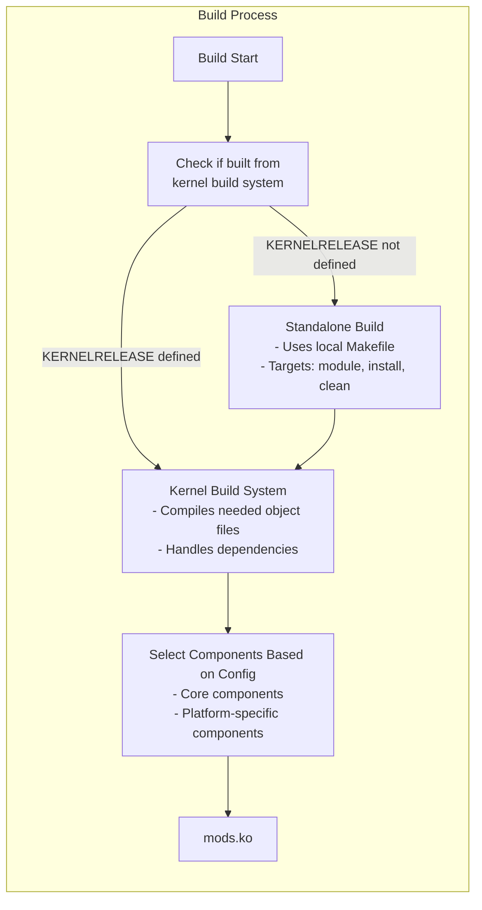
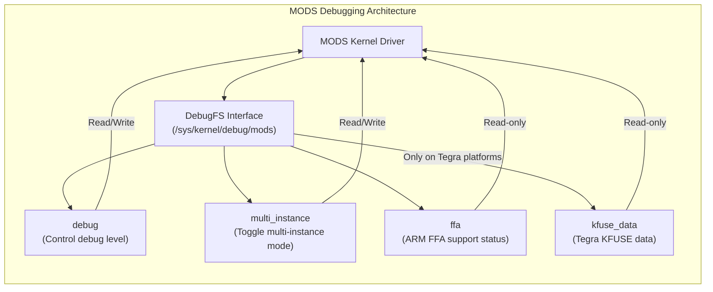
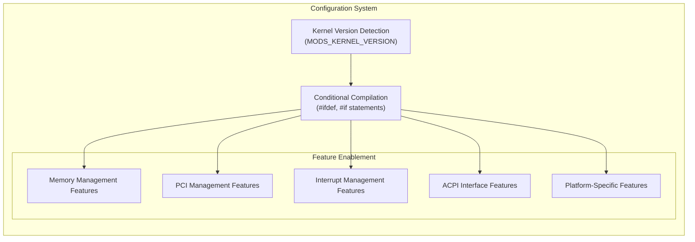

<!-- source: DeepWiki mcp.deepwiki.com · repo NVIDIA/mods-kernel-driver · page 6 Development and Debugging · fetched 2026-10-26 -->

# Development and Debugging

<details>
<summary>Relevant source files</summary>

The following files were used as context for generating this wiki page:

- [Makefile](Makefile)
- [mods_config.h](mods_config.h)
- [mods_debugfs.c](mods_debugfs.c)

</details>


This page provides developers with essential information for building, configuring, and debugging the NVIDIA MODS kernel driver. It covers the build process, debugging interfaces, and configuration options that are critical for development work with the driver.

For information about the overall architecture of the driver, see [Overview](#1) and [Architecture](#1.1).

## Building the Driver

The MODS kernel driver can be built either as part of the kernel or as a standalone module. The build process is controlled by the Makefile, which selects the appropriate source files based on system configuration.



Sources: [Makefile:1-44]()

### Build Commands

For a standalone build, the following commands are available:

| Command | Description |
|---------|-------------|
| `make` | Build the MODS kernel module |
| `make install` | Build and install the module |
| `make clean` | Clean build artifacts |

The kernel module can be built against a specific kernel by setting the `KERNELDIR` environment variable:

```bash
KERNELDIR=/path/to/kernel make
```

### Module Components

The following components are conditionally compiled based on system configuration:

| Component | Source File | Condition |
|-----------|-------------|-----------|
| Core Kernel Interface | mods_krnl.o | Always included |
| Memory Management | mods_mem.o | Always included |
| Interrupt Handling | mods_irq.o | Always included |
| PCI Management | mods_pci.o | CONFIG_PCI enabled |
| ACPI Interface | mods_acpi.o | CONFIG_ACPI enabled |
| ARM FFA Transport | mods_arm_ffa.o | CONFIG_ARM_FFA_TRANSPORT enabled |
| Debug Interface | mods_debugfs.o | CONFIG_DEBUG_FS enabled |
| PowerPC 64-bit Support | mods_ppc64.o | CONFIG_PPC64 enabled |
| Tegra BPMP IPC | mods_bpmpipc.o | CONFIG_TEGRA_IVC enabled |

Sources: [Makefile:21-30]()

## Debugging Interface

The MODS driver provides a debugging interface through debugfs, which enables runtime inspection and configuration of the driver. When loaded, the debugfs interface creates several debugging control files.



Sources: [mods_debugfs.c:89-142]()

### Debug Controls

The following debug control files are created in the debugfs directory:

| File | Permission | Description |
|------|------------|-------------|
| `debug` | 0644 | Get/set debug level bitmask |
| `multi_instance` | 0644 | Get/set multi-instance mode |
| `ffa` | 0444 | Check if ARM FFA is supported (read-only) |
| `kfuse_data` | 0444 | Read Tegra KFUSE data (Tegra platforms only) |

Sources: [mods_debugfs.c:107-135]()

### Debug Levels

The debug level is a bitmask controlling which types of debug messages are logged. You can read the current level or set a new level by reading from or writing to the `debug` file:

```bash
# Read current debug level
cat /sys/kernel/debug/mods/debug

# Set new debug level (example: 0x3 for ERROR and WARNING)
echo 0x3 > /sys/kernel/debug/mods/debug
```

The driver uses `mods_set_debug_level()` and `mods_get_debug_level()` functions to manage the debug level state.

Sources: [mods_debugfs.c:51-62]()

### Multi-Instance Mode

Multi-instance mode allows multiple user applications to open the MODS device simultaneously. This mode can be enabled/disabled through the `multi_instance` debugfs file:

```bash
# Check multi-instance mode status
cat /sys/kernel/debug/mods/multi_instance

# Enable multi-instance mode
echo 1 > /sys/kernel/debug/mods/multi_instance
```

Sources: [mods_debugfs.c:64-75]()

### Tegra-Specific Debugging

On Tegra platforms with KFUSE support, the `kfuse_data` file provides access to the device's KFUSE data for debugging purposes:

```bash
# Read KFUSE data
cat /sys/kernel/debug/mods/kfuse_data
```

Sources: [mods_debugfs.c:19-49]()

## Configuration Options

The MODS driver uses a sophisticated configuration system to maintain compatibility across different kernel versions and platforms. The configuration is primarily defined in `mods_config.h`.



Sources: [mods_config.h:1-128]()

### Kernel Version Compatibility

The driver detects the kernel version at compile time using `LINUX_VERSION_CODE` and defines `MODS_KERNEL_VERSION`. This is then used to conditionally enable/disable features based on when they were introduced or deprecated in the kernel.

Key version-dependent features include:

| Feature | Macro | Kernel Version |
|---------|-------|----------------|
| DMA Operations | MODS_HAS_DMA_OPS | >= 2.6.30 && < 4.16.0 (x86 only) |
| PCI Rescan Bus | MODS_HASNT_PCI_RESCAN_BUS | < 2.6.30 |
| IO Resource MEM_64 | MODS_HAS_IORESOURCE_MEM_64 | >= 2.6.31 |
| New ACPI Walk | MODS_HAS_NEW_ACPI_WALK | >= 2.6.33 |
| Console Lock | MODS_HAS_CONSOLE_LOCK | >= 2.6.38 (x86 only) |
| SR-IOV Support | MODS_HAS_SRIOV | >= 3.8.0 |
| MSI-X Range Support | MODS_HAS_MSIX_RANGE | >= 3.14.0 |
| DMA Alloc Pages | MODS_HAS_DMA_ALLOC_PAGES | >= 5.10.0 |

Sources: [mods_config.h:7-117]()

### Platform-Specific Configuration

Besides kernel version checks, the driver also includes platform-specific configurations:

| Platform | Feature | Condition |
|----------|---------|-----------|
| ARM | FFA Transport | CONFIG_ARM_FFA_TRANSPORT enabled |
| PowerPC64 | PNV PCI NPU Dev | CONFIG_PPC64 && kernel >= 4.5.0 |
| Tegra | BPMP MRQ API | MODS_HAS_TEGRA && kernel >= 5.1.0 |
| x86 | Memory Decryption | kernel >= 4.14.0 && CONFIG_X86 |

Sources: [mods_config.h:67-108]()

### Building with Specific Configurations

When building the MODS driver, you can enable or disable certain features by defining kernel configuration options. For example, to enable ARM FFA support:

```bash
# For in-kernel build
CONFIG_ARM_FFA_TRANSPORT=y

# For out-of-tree module with ARM FFA as module
ALLOW_ARM_FFA_TRANSPORT_AS_MODULE=1 make
```

Sources: [Makefile:8-19]()

## Handling Driver Compatibility Issues

When developing applications using the MODS driver across different kernel versions, it's important to be aware of the compatibility macros that might affect functionality. The following approach is recommended:

1. Check the kernel version of the target system
2. Review the relevant compatibility macros in `mods_config.h`
3. Adjust your application code to handle differences in driver behavior

For long-term maintenance, consider using runtime detection of capabilities rather than compile-time checks when possible.

Sources: [mods_config.h:1-128]()

---

