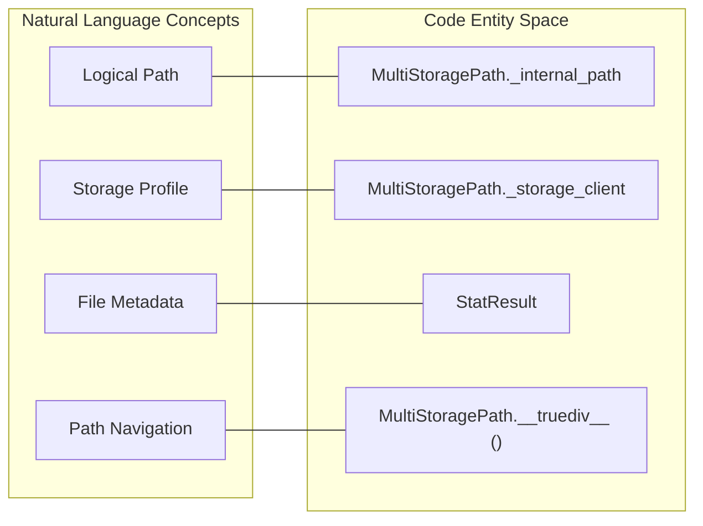
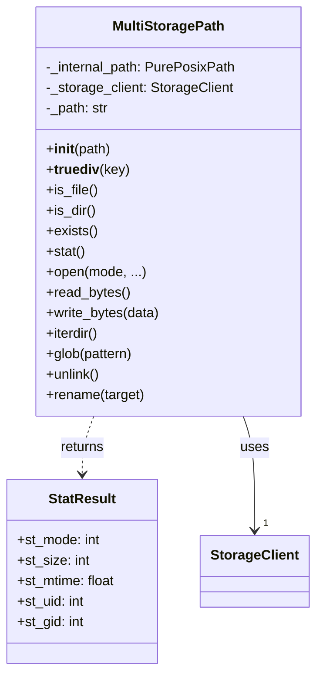
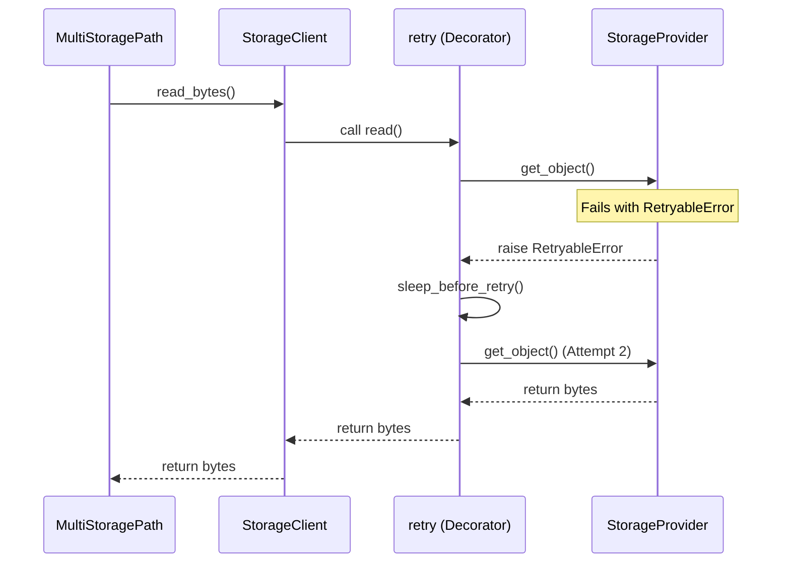

<!-- source: DeepWiki mcp.deepwiki.com · repo NVIDIA/multi-storage-client · page 3.3 Path-like Interface · fetched 2026-10-26 -->

# Path-like Interface

<details>
<summary>Relevant source files</summary>

The following files were used as context for generating this wiki page:

- [multi-storage-client/src/multistorageclient/contrib/torch/core.py](multi-storage-client/src/multistorageclient/contrib/torch/core.py)
- [multi-storage-client/src/multistorageclient/pathlib.py](multi-storage-client/src/multistorageclient/pathlib.py)
- [multi-storage-client/src/multistorageclient/retry.py](multi-storage-client/src/multistorageclient/retry.py)
- [multi-storage-client/tests/test_multistorageclient/unit/contrib/test_torch.py](multi-storage-client/tests/test_multistorageclient/unit/contrib/test_torch.py)
- [multi-storage-client/tests/test_multistorageclient/unit/test_pathlib.py](multi-storage-client/tests/test_multistorageclient/unit/test_pathlib.py)
- [multi-storage-client/tests/test_multistorageclient/unit/test_retry.py](multi-storage-client/tests/test_multistorageclient/unit/test_retry.py)

</details>


The Path-like Interface provides a unified, `pathlib`-compatible way to interact with files across multiple storage systems in `multi-storage-client`. The `MultiStoragePath` class offers a familiar API similar to Python's built-in `pathlib.Path`, but extended to work seamlessly with both local filesystems and remote storage providers (S3, Azure, GCS, etc.).

Sources: [src/multistorageclient/pathlib.py:75-91]()

## Overview

The Path-like Interface allows users to perform file and directory operations using a consistent, object-oriented API regardless of where the data is stored. It automatically resolves appropriate storage clients, handles path operations, and delegates to the underlying storage providers to execute operations.

### Entity Mapping: Path-like Interface to Code

The following diagram maps high-level path concepts to their specific class implementations and attributes within the codebase.


Sources: [src/multistorageclient/pathlib.py:33-73](), [src/multistorageclient/pathlib.py:93-109](), [src/multistorageclient/pathlib.py:165-170]()

## MultiStoragePath Class

`MultiStoragePath` is the central class for the path-like interface. It implements `os.PathLike` and uses `total_ordering` for path comparisons.



Sources: [src/multistorageclient/pathlib.py:75-160](), [src/multistorageclient/pathlib.py:33-73]()

## Path Construction and Resolution

When a `MultiStoragePath` is initialized, it calls `resolve_storage_client` to determine which `StorageClient` instance should handle operations for that path.

*   **Initialization**: The constructor [src/multistorageclient/pathlib.py:97-109]() takes a string or `os.PathLike`. It extracts the profile (e.g., `msc://s3-profile/`) and stores the remaining path as a `PurePosixPath`.
*   **Navigation**: The `/` operator is implemented via `__truediv__` [src/multistorageclient/pathlib.py:165-170](), which calls `joinpath`.
*   **Serialization**: The class implements `__getstate__` and `__setstate__` [src/multistorageclient/pathlib.py:177-184]() to support `pickle`, allowing path objects to be sent across process boundaries (useful for distributed frameworks like Ray or PyTorch).

Sources: [src/multistorageclient/pathlib.py:97-109](), [src/multistorageclient/pathlib.py:177-184](), [tests/test_multistorageclient/unit/test_pathlib.py:72-79]()

## Stat and Metadata

For remote paths, `MultiStoragePath.stat()` returns a `StatResult` object. This class mimics `os.stat_result` by translating `ObjectMetadata` fields into POSIX-like attributes.

| Stat Field | Mapping from ObjectMetadata |
| :--- | :--- |
| `st_mode` | `S_IFDIR | 0o755` for directories, `S_IFREG | 0o644` for files |
| `st_size` | `metadata.content_length` |
| `st_mtime` | `metadata.last_modified.timestamp()` |
| `st_uid / st_gid` | Process UID/GID (or 0) |

Sources: [src/multistorageclient/pathlib.py:33-73](), [src/multistorageclient/pathlib.py:304-310]()

## Supported Methods and Operations

`MultiStoragePath` provides a subset of `pathlib.Path` methods, optimized for multi-storage operations.

### File and Directory I/O
*   **open()**: Integrates with the MSC shortcut `open`, supporting features like prefetching and custom attributes [src/multistorageclient/pathlib.py:312-327]().
*   **read_bytes() / read_text()**: High-level wrappers around `open` [src/multistorageclient/pathlib.py:378-390]().
*   **iterdir()**: Lists the directory using the client's `list` method [src/multistorageclient/pathlib.py:329-338]().
*   **glob() / rglob()**: Implements pattern matching for both local and remote backends [src/multistorageclient/pathlib.py:340-357]().

### Path Inspection
*   **exists()**: Returns `True` if the path refers to an existing file or directory [src/multistorageclient/pathlib.py:286-294]().
*   **is_file() / is_dir()**: Differentiates between objects and directory prefixes [src/multistorageclient/pathlib.py:296-302]().
*   **relative_to()**: Computes the relative path between two `MultiStoragePath` objects [src/multistorageclient/pathlib.py:228-243]().

Sources: [src/multistorageclient/pathlib.py:286-390](), [tests/test_multistorageclient/unit/test_pathlib.py:141-165]()

## Retry Behavior

Operations performed via `MultiStoragePath` inherit the retry logic configured in the underlying `StorageClient`.



*   **Decorator**: The `@retry` decorator [src/multistorageclient/retry.py:89-125]() wraps client methods.
*   **Configuration**: Retry behavior is governed by `attempts`, `delay`, and `backoff_multiplier` defined in the storage profile [src/multistorageclient/retry.py:39-48]().
*   **Classification**: Errors are classified into `RetryableError` (e.g., connection timeouts) or non-retryable errors (e.g., `FileNotFoundError`) [src/multistorageclient/retry.py:103-116]().

Sources: [src/multistorageclient/retry.py:39-125](), [tests/test_multistorageclient/unit/test_retry.py:67-103]()

## Framework Integrations

### PyTorch Integration
`MultiStoragePath` is a first-class citizen in the `msc.torch` contrib module. `msc.torch.load` and `msc.torch.save` explicitly check for `MultiStoragePath` instances to handle binary streams correctly.

```python
# Example from multistorageclient/contrib/torch/core.py
def load(f: Union[str, os.PathLike[str], IO[bytes]], ...):
    if isinstance(f, MultiStoragePath):
        with f.open("rb") as fp:
            return _torch.load(fp, *args, **kwargs)
```

Sources: [src/multistorageclient/contrib/torch/core.py:27-55](), [tests/test_multistorageclient/unit/contrib/test_torch.py:55-67]()

## Summary of Support Matrix

| Method | Remote Support | Implementation Note |
| :--- | :--- | :--- |
| `anchor`, `name`, `suffix`, `stem` | Full | Purely string-based via `PurePosixPath` |
| `exists()`, `is_file()`, `is_dir()` | Full | Calls `client.info()` |
| `stat()` | Partial | Returns `StatResult` from metadata |
| `open()`, `read_*`, `write_*` | Full | Proxies to `client.open()` |
| `iterdir()`, `glob()` | Full | Proxies to `client.list()` |
| `unlink()` | Full | Proxies to `client.delete()` |
| `rename()` | Partial | Implemented as Copy + Delete (non-atomic) |
| `mkdir()`, `rmdir()` | POSIX Only | Remote storage often uses flat namespaces |

Sources: [src/multistorageclient/pathlib.py:129-437](), [tests/test_multistorageclient/unit/test_pathlib.py:32-102]()

---

