# Page: Overview

# Overview

<details>
<summary>Relevant source files</summary>

The following files were used as context for generating this wiki page:

- [.github/pull_request_template.md](.github/pull_request_template.md)
- [.github/workflows/slack.yml](.github/workflows/slack.yml)
- [.release_notes/.unreleased.md](.release_notes/.unreleased.md)
- [.release_notes/1.0.0.md](.release_notes/1.0.0.md)
- [CONTRIBUTING.md](CONTRIBUTING.md)
- [README.md](README.md)
- [multi-storage-client/pyproject.toml](multi-storage-client/pyproject.toml)
- [multi-storage-client/src/multistorageclient/providers/base.py](multi-storage-client/src/multistorageclient/providers/base.py)
- [multi-storage-client/src/multistorageclient/types.py](multi-storage-client/src/multistorageclient/types.py)
- [multi-storage-client/tests/test_multistorageclient/unit/providers/test_base_storage_provider.py](multi-storage-client/tests/test_multistorageclient/unit/providers/test_base_storage_provider.py)
- [pyproject.toml](pyproject.toml)
- [uv.lock](uv.lock)

</details>


The multi-storage-client (MSC) is a unified, high-performance Python client library for interacting with various object and file stores. It provides a consistent interface for accessing multiple storage backends including cloud providers (AWS S3, Azure Blob Storage, Google Cloud Storage, Oracle Cloud), POSIX file systems, and NVIDIA AIStore.

Sources: [README.md:1-6](), [multi-storage-client/pyproject.toml:8-10]()

## Purpose and Key Features

Multi-storage-client serves as an abstraction layer, enabling seamless interaction with diverse storage systems through a unified API. It provides:

- **Unified Interface**: A consistent API for operations across different storage backends.
- **Pluggable Architecture**: Support for multiple storage providers, credential systems, and metadata backends.
- **Performance Optimization**: Client-side caching, streaming capabilities, and Rust-accelerated transfers.
- **Observability**: Integrated metrics and tracing through OpenTelemetry.
- **Ecosystem Integration**: Compatibility with key Python data ecosystems (fsspec, PyTorch, Zarr, XArray, Ray).
- **Filesystem Access**: A FUSE-based daemon (MSFS) for POSIX-level access to cloud backends.

Sources: [multi-storage-client/pyproject.toml:28-42](), [multi-storage-client/pyproject.toml:48-126](), [README.md:45-47]()

## Monorepo Structure

The repository is organized as a monorepo containing the following components:

| Component | Path | Description |
|-----------|------|-------------|
| **Python Client** | `multi-storage-client` | The core Python library and Rust performance backend. |
| **Documentation** | `multi-storage-client-docs` | Sphinx-based documentation source. |
| **Scripts** | `multi-storage-client-scripts` | Internal tools for CI/CD, API compatibility, and releases. |
| **Web Explorer** | `multi-storage-explorer` | A React-based web UI for browsing storage backends. |
| **FUSE Filesystem** | `multi-storage-file-system` | A Go implementation of the MSFS daemon. |

Sources: [README.md:24-66](), [uv.lock:18-23]()

## System Architecture

The following diagram maps high-level system components to their respective code entities and shows the data flow from user interfaces to storage backends.

```mermaid
graph TD
    subgraph "User Interface Layer"
        [DirectAPI] --> |"StorageClient"| MSC["multistorageclient.client.StorageClient"]
        [Shortcuts] --> |"shortcuts.py"| MSC
        [PathAPI] --> |"MultiStoragePath"| MSC
        [CLI] --> |"msc command"| MSC
    end
    
    subgraph "Core Abstraction Layer"
        MSC --> |"delegates to"| SP["multistorageclient.types.StorageProvider"]
        MSC --> |"manages"| CM["multistorageclient.cache.manager.CacheManager"]
        MSC --> |"telemetry"| OTEL["opentelemetry-api"]
    end
    
    subgraph "Provider Implementations"
        SP --> S3["S3StorageProvider"]
        SP --> AZ["AzureBlobStorageProvider"]
        SP --> GCS["GoogleStorageProvider"]
        SP --> POS["PosixFileStorageProvider"]
        SP --> AIS["AIStoreStorageProvider"]
    end
    
    subgraph "Performance & Backend"
        MSC --> |"run_coroutine_sync"| RUST["multistorageclient_rust"]
        MSFS["MSFS Daemon (Go)"] -.-> |"FUSE"| POS
    end
```

Sources: [multi-storage-client/src/multistorageclient/providers/base.py:170-205](), [multi-storage-client/pyproject.toml:145-151](), [multi-storage-client/src/multistorageclient/providers/base.py:34-35]()

## Core Components and Relationships

The library follows a "Core + Extras" architecture. The core logic handles path resolution, caching, and telemetry, while specific storage backends and integrations are loaded as optional dependencies.

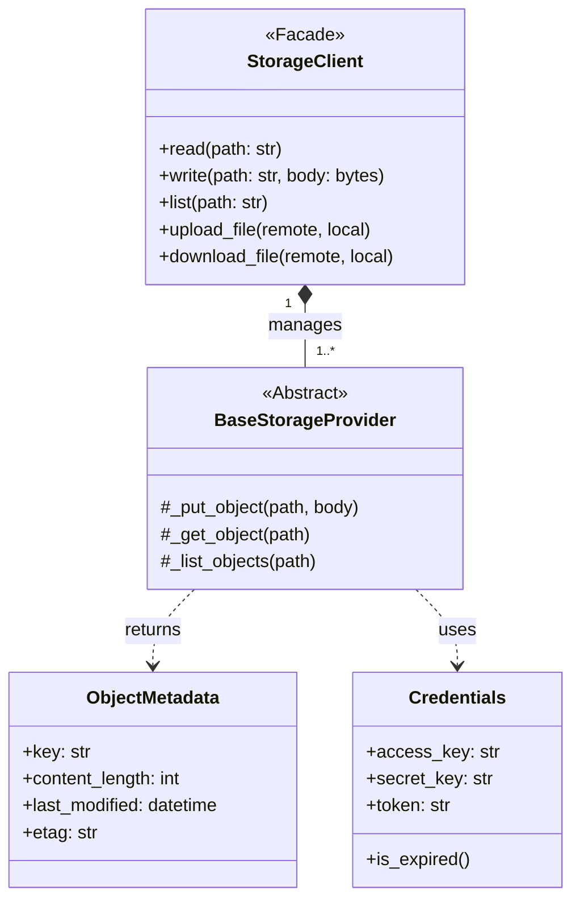

Sources: [multi-storage-client/src/multistorageclient/providers/base.py:170-205](), [multi-storage-client/src/multistorageclient/types.py:80-120](), [multi-storage-client/src/multistorageclient/types.py:120-146]()

## Storage Providers

The multi-storage-client supports multiple storage backends. Most cloud providers require specific optional dependencies:

| Provider | Description | Dependency Group |
|----------|-------------|---------------------|
| **S3** | AWS S3 and S3-compatible storage | `boto3` |
| **Azure** | Microsoft Azure Blob Storage | `azure-storage-blob` |
| **GCS** | Google Cloud Storage | `google-cloud-storage` |
| **OCI** | Oracle Cloud Infrastructure | `oci` |
| **POSIX** | Local filesystem access | (Core) |
| **AIStore** | NVIDIA AIStore | `aistore` |

Sources: [multi-storage-client/pyproject.toml:79-102]()

## Performance and Observability

- **Rust Backend**: High-performance async I/O is handled by `multistorageclient_rust` using PyO3 bindings. Python calls are bridged via `run_coroutine_sync`.
- **Parallel Listing**: The `_PrefixExpander` in the base provider uses a `ThreadPoolExecutor` to expand directory prefixes in parallel, improving listing performance for deep hierarchies.
- **Telemetry**: MSC uses OpenTelemetry to track operations (`read`, `write`, `copy`, `list`). It collects attributes such as `multistorageclient.provider` and `multistorageclient.operation`.

Sources: [multi-storage-client/src/multistorageclient/providers/base.py:34-35](), [multi-storage-client/src/multistorageclient/providers/base.py:88-154](), [multi-storage-client/src/multistorageclient/providers/base.py:180-205]()

## Stable API (MSC 1.0)

Starting with version 1.0.0, the project follows strict semantic versioning. Key changes in the stable release include:
- Standardized `symlink_handling` using the `SymlinkHandling` enum (`FOLLOW`, `SKIP`, `PRESERVE`).
- Unified `list(path=...)` interface.
- Stable cache eviction policies (FIFO, LRU, MRU).

Sources: [.release_notes/1.0.0.md:1-12](), [multi-storage-client/src/multistorageclient/types.py:43-66]()

---

# Page: Architecture

# Architecture

<details>
<summary>Relevant source files</summary>

The following files were used as context for generating this wiki page:

- [multi-storage-client/src/multistorageclient/client/client.py](multi-storage-client/src/multistorageclient/client/client.py)
- [multi-storage-client/src/multistorageclient/client/composite.py](multi-storage-client/src/multistorageclient/client/composite.py)
- [multi-storage-client/src/multistorageclient/client/single.py](multi-storage-client/src/multistorageclient/client/single.py)
- [multi-storage-client/src/multistorageclient/client/types.py](multi-storage-client/src/multistorageclient/client/types.py)
- [multi-storage-client/src/multistorageclient/providers/base.py](multi-storage-client/src/multistorageclient/providers/base.py)
- [multi-storage-client/src/multistorageclient/types.py](multi-storage-client/src/multistorageclient/types.py)
- [multi-storage-client/tests/test_multistorageclient/unit/providers/test_base_storage_provider.py](multi-storage-client/tests/test_multistorageclient/unit/providers/test_base_storage_provider.py)

</details>


This document outlines the architecture of the Multi-Storage Client (MSC), describing its core components and their interactions. It provides a high-level understanding of how MSC abstracts various storage backends behind a unified interface. For specific implementation details of individual components, see the related wiki pages on [Core Components](#2.1) and [Storage Provider Implementations](#2.3).

## System Overview

The Multi-Storage Client provides a unified, high-performance Python interface for interacting with various object and file storage systems. It abstracts the underlying storage providers, allowing users to work with different storage systems using a consistent API, regardless of whether the data is in S3, Azure Blob Storage, Google Cloud Storage, Oracle Cloud, a local POSIX file system, or AIStore.

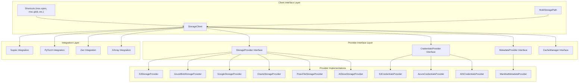

Sources: [src/multistorageclient/client/client.py:42-49](), [src/multistorageclient/types.py:153-283](), [src/multistorageclient/types.py:120-145](), [src/multistorageclient/types.py:286-381]()

## Core Architecture Principles

The Multi-Storage Client architecture is built around these key principles:

1. **Abstraction**: Provides a unified API that abstracts away the differences between various storage backends.
2. **Modularity**: Uses well-defined interfaces that allow for easy extension with new storage providers via a plugin system.
3. **Consistency**: Maintains consistent behavior across different storage providers (e.g., error translation and path normalization).
4. **Performance**: Incorporates caching and optimized data transfer mechanisms, including a Rust-based performance backend for cloud providers. [src/multistorageclient/client/single.py:175-180]()
5. **Observability**: Includes built-in instrumentation for monitoring and tracing using OpenTelemetry. [src/multistorageclient/providers/base.py:31-35]()

## Component Model

The architecture follows a delegated facade pattern. The `StorageClient` acts as a facade, delegating operations to either a `SingleStorageClient` or a `CompositeStorageClient`.

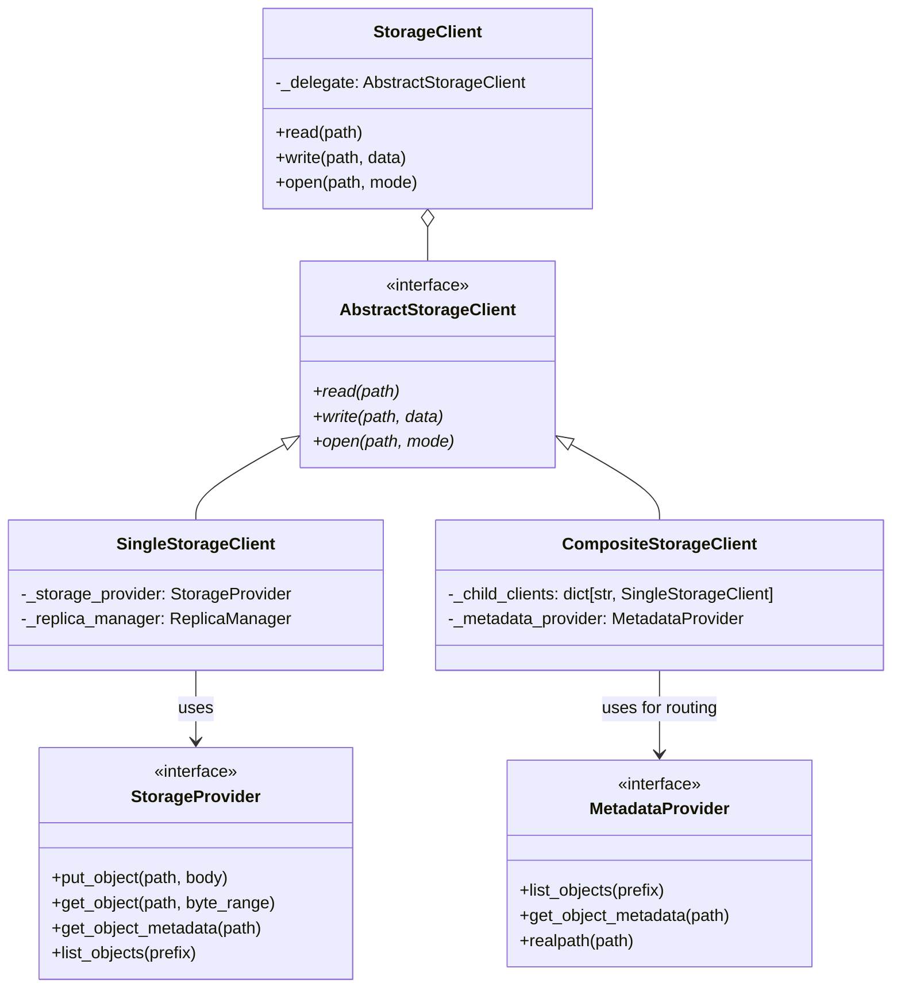

Sources: [src/multistorageclient/client/client.py:42-51](), [src/multistorageclient/client/types.py:42-58](), [src/multistorageclient/client/single.py:56-67](), [src/multistorageclient/client/composite.py:42-52](), [src/multistorageclient/types.py:186-283]()

## Data Flow

### Read Data Flow
Read operations are routed based on the client type. In a `CompositeStorageClient`, the `MetadataProvider` resolves the logical path to a physical path and a specific backend profile. [src/multistorageclient/client/composite.py:173-178]()

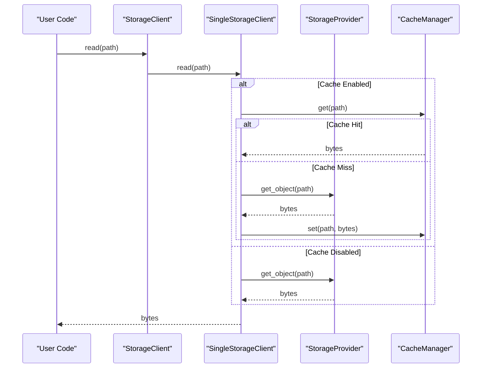

Sources: [src/multistorageclient/client/single.py:165-167](), [src/multistorageclient/client/composite.py:167-178]()

### Write Data Flow
Write operations are typically supported only by `SingleStorageClient`. `CompositeStorageClient` is read-only for most operations to maintain consistency across backends. [src/multistorageclient/client/composite.py:42-50]()

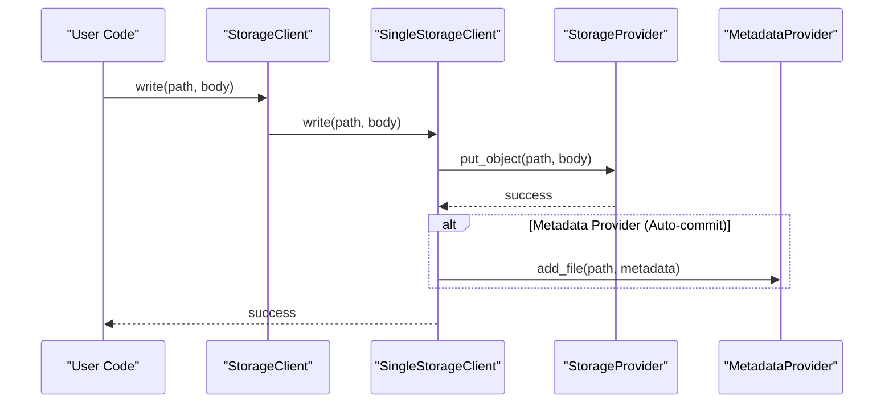

Sources: [src/multistorageclient/client/single.py:98-114](), [src/multistorageclient/client/single.py:228-235]()

## Provider Architecture

All storage providers inherit from `BaseStorageProvider`, which provides common logic for path normalization, telemetry, and parallel listing. [src/multistorageclient/providers/base.py:170-205]()

- **Path Normalization**: The `base_path` is automatically prepended to all paths before calling internal implementation methods like `_get_object`. [src/multistorageclient/providers/base.py:171-177]()
- **Parallel Listing**: Uses a `_PrefixExpander` and a heap-based consumer to parallelize directory traversal. [src/multistorageclient/providers/base.py:88-106]()
- **Telemetry**: Automatically emits metrics for operation latency, data size, and errors. [src/multistorageclient/providers/base.py:180-205]()

Sources: [src/multistorageclient/providers/base.py:170-205](), [src/multistorageclient/providers/base.py:88-106](), [tests/test_multistorageclient/unit/providers/test_base_storage_provider.py:31-78]()

## File Handling

MSC provides file-like objects for both POSIX and cloud backends:
- **`PosixFile`**: Wraps standard Python file objects for local filesystem access, supporting atomic writes via temporary files. [src/multistorageclient/file.py:532-550]()
- **`ObjectFile`**: Manages remote object streams, integrating with the `CacheManager` for local caching and the `StorageProvider` for multipart uploads. [src/multistorageclient/file.py:166-200]()

Sources: [src/multistorageclient/file.py:166-200](), [src/multistorageclient/file.py:532-550]()

## Summary

The Multi-Storage Client architecture provides a flexible, delegated framework for accessing various storage backends through a unified interface. Key architectural features include:
- **Delegation**: Facade pattern for single vs. composite backend routing.
- **Replica Management**: Automatic failover and priority-based read routing. [src/multistorageclient/client/single.py:118-138]()
- **Metadata Routing**: Logical-to-physical path resolution for multi-backend datasets. [src/multistorageclient/client/composite.py:173-178]()
- **Performance**: Rust-accelerated IO and parallelized provider operations. [src/multistorageclient/providers/base.py:34-35]()

For more details, see:
- [Core Components](#2.1)
- [Configuration System](#2.2)
- [Caching System](#2.5)
- [Rust Backend](#2.7)

---

# Page: Core Components

# Core Components

<details>
<summary>Relevant source files</summary>

The following files were used as context for generating this wiki page:

- [multi-storage-client-docs/src/user_guide/explorer.rst](multi-storage-client-docs/src/user_guide/explorer.rst)
- [multi-storage-client-docs/src/user_guide/rust.rst](multi-storage-client-docs/src/user_guide/rust.rst)
- [multi-storage-client/src/multistorageclient/client/client.py](multi-storage-client/src/multistorageclient/client/client.py)
- [multi-storage-client/src/multistorageclient/client/composite.py](multi-storage-client/src/multistorageclient/client/composite.py)
- [multi-storage-client/src/multistorageclient/client/single.py](multi-storage-client/src/multistorageclient/client/single.py)
- [multi-storage-client/src/multistorageclient/client/types.py](multi-storage-client/src/multistorageclient/client/types.py)
- [multi-storage-client/src/multistorageclient/file.py](multi-storage-client/src/multistorageclient/file.py)
- [multi-storage-client/src/multistorageclient/providers/base.py](multi-storage-client/src/multistorageclient/providers/base.py)
- [multi-storage-client/src/multistorageclient/types.py](multi-storage-client/src/multistorageclient/types.py)
- [multi-storage-client/src/multistorageclient/utils.py](multi-storage-client/src/multistorageclient/utils.py)
- [multi-storage-client/tests/test_multistorageclient/unit/client/test_client.py](multi-storage-client/tests/test_multistorageclient/unit/client/test_client.py)
- [multi-storage-client/tests/test_multistorageclient/unit/providers/test_base_storage_provider.py](multi-storage-client/tests/test_multistorageclient/unit/providers/test_base_storage_provider.py)
- [multi-storage-client/tests/test_multistorageclient/unit/test_file.py](multi-storage-client/tests/test_multistorageclient/unit/test_file.py)
- [multi-storage-client/tests/test_multistorageclient/unit/test_utils.py](multi-storage-client/tests/test_multistorageclient/unit/test_utils.py)

</details>


This page documents the core architectural components of the Multi-Storage Client library. It provides detailed information about the primary interfaces and classes that form the foundation of the system.

For configuration details, see [Configuration System](2.2). For specific storage provider implementations, see [Storage Provider Implementations](2.3).

## Overview of Core Components

The Multi-Storage Client architecture is built around several key interfaces that work together to provide a unified storage experience across different backends. The system uses a facade pattern where `StorageClient` delegates to specific implementations based on the configuration.

### System Class Diagram

```mermaid
classDiagram
    class "StorageClient" {
        +read(path)
        +write(path, data)
        +copy(src, dest)
        +delete(path)
        +list(prefix)
        +glob(pattern)
        +open(path, mode)
        +upload_file/download_file()
        +sync_from(source_client)
    }
    
    class "AbstractStorageClient" {
        <<abstract>>
        #_config: StorageClientConfig
        #_storage_provider: StorageProvider
        #_metadata_provider: MetadataProvider
        +read()*
        +open()*
        +list_objects()*
    }

    class "StorageProvider" {
        <<interface>>
        +put_object(path, body)
        +get_object(path)
        +copy_object(src, dest)
        +delete_object(path)
        +list_objects(prefix)
        +get_object_metadata(path)
    }
    
    class "CredentialsProvider" {
        <<interface>>
        +get_credentials()
        +refresh_credentials()
    }
    
    class "MetadataProvider" {
        <<interface>>
        +list_objects(prefix)
        +get_object_metadata(path)
        +realpath(path)
        +commit_updates()
    }
    
    "StorageClient" *-- "AbstractStorageClient" : delegates to
    "AbstractStorageClient" <|-- "SingleStorageClient"
    "AbstractStorageClient" <|-- "CompositeStorageClient"
    "AbstractStorageClient" --> "StorageProvider" : uses
    "AbstractStorageClient" --> "CredentialsProvider" : configures
    "AbstractStorageClient" --> "MetadataProvider" : optional
```
Sources: [src/multistorageclient/client/types.py:42-57](), [src/multistorageclient/client/client.py:42-51](), [src/multistorageclient/types.py:19-25]()

## StorageClient Facade

The `StorageClient` class in [src/multistorageclient/client/client.py:42-49]() acts as a unified facade. It inspects the provided `StorageClientConfig` and automatically instantiates the appropriate internal delegate.

- **`SingleStorageClient`**: Used for single-backend configurations. Supports full read and write operations [src/multistorageclient/client/single.py:56-61]().
- **`CompositeStorageClient`**: Used for multi-backend configurations (e.g., when `storage_provider_profiles` is set). This implementation is **read-only** and routes requests to child `SingleStorageClient` instances based on metadata [src/multistorageclient/client/composite.py:42-50]().

Sources: [src/multistorageclient/client/client.py:53-60](), [src/multistorageclient/client/single.py:79-84](), [src/multistorageclient/client/composite.py:61-68]()

### Composite Routing and Provider Bundles
The `CompositeStorageClient` relies on a `MetadataProvider` to make routing decisions. It uses `realpath(path)` to obtain a `ResolvedPath`, which contains the `profile` name of the backend where the data physically resides [src/multistorageclient/client/composite.py:173-178]().

When using `ProviderBundleV2`, child configurations are pre-built and passed into the composite client via `config.child_configs` [src/multistorageclient/client/composite.py:83-86]().

Sources: [src/multistorageclient/client/composite.py:80-98](), [src/multistorageclient/client/composite.py:145-165]()

## StorageProvider Interface

The `StorageProvider` interface (defined in `multistorageclient.types`) is the contract for backend-specific logic. Most providers inherit from `BaseStorageProvider`.

### BaseStorageProvider
`BaseStorageProvider` [src/multistorageclient/providers/base.py:170-204]() handles:
1.  **Path Translation**: Automatically prepends `base_path` to all relative logical paths before calling internal methods [src/multistorageclient/providers/base.py:171-177]().
2.  **Telemetry**: Automatically collects metrics for `READ`, `WRITE`, `COPY`, and `DELETE` operations using OpenTelemetry [src/multistorageclient/providers/base.py:180-204]().
3.  **Parallel Listing**: Implements a `_PrefixExpander` using a `ThreadPoolExecutor` to accelerate directory traversal for providers that support it [src/multistorageclient/providers/base.py:88-154]().

### ObjectMetadata
All listing and info operations return `ObjectMetadata` [src/multistorageclient/types.py:120-145]().

| Field | Description |
| :--- | :--- |
| `key` | Logical relative path |
| `content_length` | Size in bytes |
| `last_modified` | `datetime` object (UTC) |
| `etag` | Entity tag for versioning |
| `symlink_target` | Populated if the object represents a symbolic link [src/multistorageclient/types.py:142-145]() |

Sources: [src/multistorageclient/providers/base.py:170-204](), [src/multistorageclient/types.py:120-146]()

## CredentialsProvider and MetadataProvider

### CredentialsProvider
Provides a `Credentials` object containing `access_key`, `secret_key`, and an optional `token` [src/multistorageclient/types.py:81-95](). It includes an `is_expired()` helper to facilitate proactive refreshing [src/multistorageclient/types.py:97-106]().

### MetadataProvider
Decouples logical paths from physical locations.
- **`realpath(path)`**: The most critical function for composite clients; it returns a `ResolvedPath` mapping a logical string to a `(physical_path, profile)` pair [src/multistorageclient/client/composite.py:173-177]().
- **Auto-Commit**: `SingleStorageClient` can manage a background `_committer_thread` to periodically call `commit_metadata()` if `autocommit_config` is enabled [src/multistorageclient/client/single.py:98-114]().

Sources: [src/multistorageclient/types.py:81-118](), [src/multistorageclient/client/single.py:140-154]()

## File Abstractions

MSC provides file-like objects that implement the standard `IO[bytes]` interface.

### ObjectFile vs PosixFile
- **`PosixFile`**: Returned when the backend is a local filesystem. Supports atomic writes by writing to a temporary file and renaming on `close()` [src/multistorageclient/file.py:532-540]().
- **`ObjectFile`**: Returned for cloud backends.
    - **Read**: Uses `RemoteFileReader` for range-based streaming [src/multistorageclient/file.py:43-49]().
    - **Write**: Buffers to a local temporary file and uploads the entire result to the provider upon `close()` [src/multistorageclient/file.py:184-194]().

### RemoteFileReader Data Flow
For large files, `RemoteFileReader` performs range requests to avoid OOM (Out Of Memory) issues.

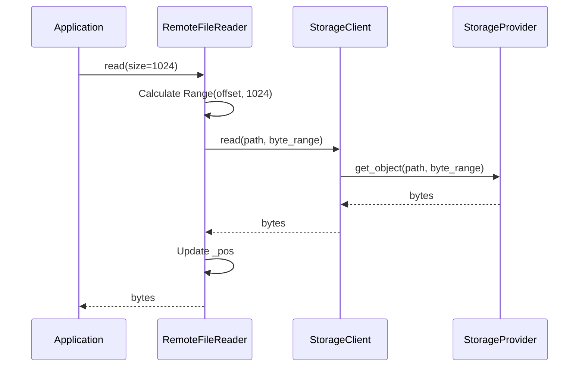
Sources: [src/multistorageclient/file.py:93-118](), [src/multistorageclient/file.py:43-62]()

## Component Interactions: Write Operation

The following diagram shows the interaction when writing to a single backend.

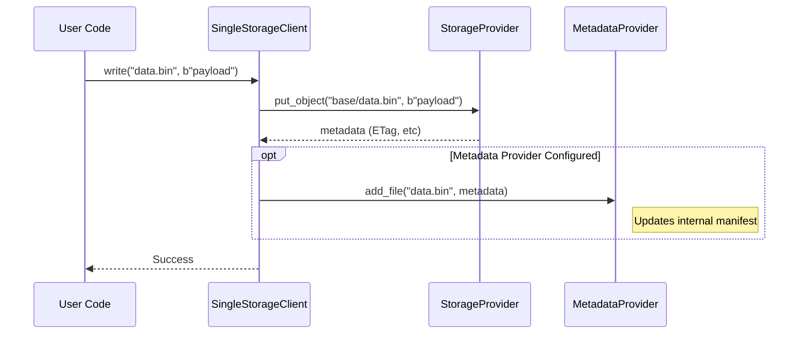
Sources: [src/multistorageclient/client/single.py:246-270](), [src/multistorageclient/client/single.py:159-163]()

---

# Page: Configuration System

# Configuration System

<details>
<summary>Relevant source files</summary>

The following files were used as context for generating this wiki page:

- [multi-storage-client-docs/src/references/configuration.rst](multi-storage-client-docs/src/references/configuration.rst)
- [multi-storage-client-docs/src/user_guide/cache.rst](multi-storage-client-docs/src/user_guide/cache.rst)
- [multi-storage-client/.msc/config.yaml](multi-storage-client/.msc/config.yaml)
- [multi-storage-client/src/multistorageclient/caching/README.md](multi-storage-client/src/multistorageclient/caching/README.md)
- [multi-storage-client/src/multistorageclient/config.py](multi-storage-client/src/multistorageclient/config.py)
- [multi-storage-client/src/multistorageclient/schema.py](multi-storage-client/src/multistorageclient/schema.py)
- [multi-storage-client/tests/test_multistorageclient/unit/mcp/test_mcp_integration.py](multi-storage-client/tests/test_multistorageclient/unit/mcp/test_mcp_integration.py)
- [multi-storage-client/tests/test_multistorageclient/unit/test_config.py](multi-storage-client/tests/test_multistorageclient/unit/test_config.py)
- [multi-storage-client/tests/test_multistorageclient/unit/test_replica_manager.py](multi-storage-client/tests/test_multistorageclient/unit/test_replica_manager.py)
- [multi-storage-client/tests/test_multistorageclient/unit/test_schema.py](multi-storage-client/tests/test_multistorageclient/unit/test_schema.py)

</details>


The Configuration System in multi-storage-client provides a flexible and powerful way to configure and initialize storage clients. It supports multiple configuration formats, environment variable expansion, profile-based configurations, include directives, and schema validation to ensure correctness.

## Configuration Overview

The multi-storage-client configuration system revolves around the `StorageClientConfig` class, which is responsible for loading configuration from various sources and initializing the components needed by the `StorageClient`. The configuration system supports JSON, YAML, and dictionary-based configurations, with optional environment variable expansion and modular configuration management via includes.

### Code-to-System Mapping
The following diagram shows how configuration methods in `StorageClientConfig` relate to the internal loading and validation logic.

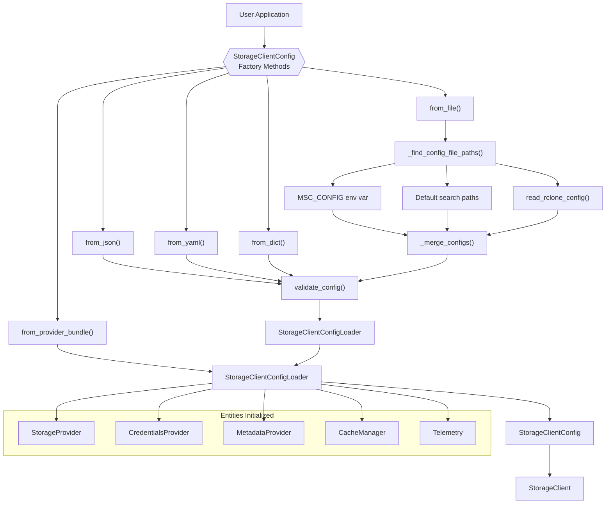

Sources: [src/multistorageclient/config.py:429-549](), [src/multistorageclient/config.py:105-428](), [src/multistorageclient/schema.py:33-33]()

## Configuration Methods

The `StorageClientConfig` class provides several static methods to create configurations from different sources:

1.  **`from_file()`**: Loads configuration from file(s), looking in common locations or specified by the `MSC_CONFIG` environment variable. It handles merging multiple files if `include` directives are present. [src/multistorageclient/config.py:462-511]()
2.  **`from_json()`**: Creates configuration from a JSON string. [src/multistorageclient/config.py:521-527]()
3.  **`from_yaml()`**: Creates configuration from a YAML string. [src/multistorageclient/config.py:513-519]()
4.  **`from_dict()`**: Creates configuration from a Python dictionary. [src/multistorageclient/config.py:447-460]()
5.  **`from_provider_bundle()`**: Creates configuration from a pre-built `ProviderBundle` instance. [src/multistorageclient/config.py:529-549]()

### File Search Order
When using `StorageClientConfig.from_file()`, the `_find_config_file_paths()` function searches for configuration files in the following order:
1.  Path specified in the `MSC_CONFIG` environment variable. [src/multistorageclient/config.py:487-490]()
2.  Standard configuration paths (e.g., `/etc/msc_config.yaml`, `~/.config/msc/config.yaml`). [src/multistorageclient/config.py:60-69]()
3.  rclone configuration file via `read_rclone_config()`. [src/multistorageclient/config.py:506-508]()

If no configuration file is found, a reserved POSIX profile named `__filesystem__` is used as a fallback. [src/multistorageclient/config.py:81-82]()

## Modular Configuration (Includes)

MSC supports splitting configuration across multiple files using the `include` keyword. This enables modular management of shared settings like OpenTelemetry or Cache.

*   **Merge Rules**:
    *   **Profiles**: Combined from all files. Identical profile definitions are allowed (idempotent), but conflicting definitions for the same profile name raise a `ValueError`. [src/multistorageclient/config.py:124-181]()
    *   **OpenTelemetry**: Attributes are concatenated. Readers and exporters must be identical across files or defined in only one. [src/multistorageclient/config.py:184-233]()
    *   **Path Mapping**: Entries are merged; conflicts raise an error. [src/multistorageclient/config.py:236-258]()
    *   **Cache / POSIX**: Must be identical across all files or defined in only one. [src/multistorageclient/config.py:261-277]()

Sources: [multi-storage-client-docs/src/references/configuration.rst:60-134](), [src/multistorageclient/config.py:109-281]()

## Configuration Schema and Validation

The configuration is validated using `jsonschema` against `CONFIG_SCHEMA`. [src/multistorageclient/schema.py:19-216]()

### Key Schema Sections
| Section | Description |
| :--- | :--- |
| `profiles` | Dictionary of profile definitions. Profile names must not start with `_` except for `__filesystem__`. [src/multistorageclient/schema.py:101-171]() |
| `cache` | Global cache settings including `size`, `location`, `eviction_policy`, and `check_source_version`. [src/multistorageclient/schema.py:54-98]() |
| `opentelemetry` | Metrics and tracing configuration. [src/multistorageclient/schema.py:32-52]() |
| `path_mapping` | Maps non-MSC URLs (e.g., `s3://`) to MSC profiles. [src/multistorageclient/schema.py:174-178]() |
| `posix` | FUSE mount settings for MSFS. [src/multistorageclient/schema.py:181-205]() |

Sources: [src/multistorageclient/schema.py:21-216](), [multi-storage-client-docs/src/references/configuration.rst:13-59]()

## Component Initialization

The `StorageClientConfigLoader` class manages the instantiation of the storage stack based on the selected profile.

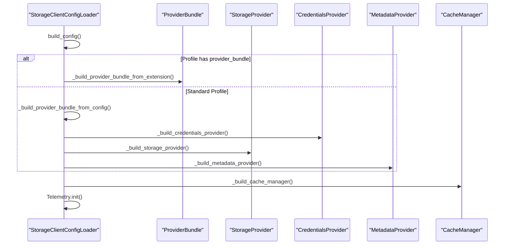

Sources: [src/multistorageclient/config.py:365-425]()

### Storage Provider Mapping
Storage providers are initialized using `STORAGE_PROVIDER_MAPPING`. [src/multistorageclient/config.py:84-95]()
*   `s3` -> `S3StorageProvider`
*   `file` -> `PosixFileStorageProvider`
*   `gcs` -> `GoogleStorageProvider`
*   `azure` -> `AzureBlobStorageProvider`
*   `ais` -> `AIStoreStorageProvider`

### Credentials Provider Mapping
Credentials providers use `CREDENTIALS_PROVIDER_MAPPING`. [src/multistorageclient/config.py:97-106]()
*   `S3Credentials` -> `StaticS3CredentialsProvider`
*   `DefaultAzureCredentials` -> `DefaultAzureCredentialsProvider`

## Path Mapping

The `path_mapping` system allows the client to resolve standard cloud URLs (like `s3://bucket/`) to specific MSC profiles. This is critical for transparently intercepting calls in libraries that don't natively use `msc://` protocols.

*   **Schema**: Keys are URL prefixes (must end in `/`), and values are MSC profile URLs (e.g., `msc://my-s3-profile/`). [src/multistorageclient/schema.py:174-178]()
*   **Expansion**: Environment variables are expanded in mapping values. [src/multistorageclient/config.py:440]()

Sources: [multi-storage-client-docs/src/references/configuration.rst:31-34](), [src/multistorageclient/config.py:438-442]()

## Cache Configuration

The cache system is configured globally but can be enabled/disabled per profile using `caching_enabled`. [src/multistorageclient/schema.py:148-148]()

*   **`check_source_version`**: Replaces the legacy `use_etag`. If `true`, MSC validates the remote object version before serving from cache. [multi-storage-client-docs/src/user_guide/cache.rst:37-44]()
*   **`cache_line_size`**: Defines chunk sizes for partial file caching (default 64MB). [multi-storage-client-docs/src/user_guide/cache.rst:56-57]()
*   **Eviction Policies**: Supports `lru`, `mru`, `fifo`, `random`, and `no_eviction`. [src/multistorageclient/schema.py:72-86]()

Sources: [src/multistorageclient/cache.py:29-30](), [multi-storage-client-docs/src/user_guide/cache.rst:28-72]()

## Environment Variable Expansion

MSC uses `expand_env_vars()` to resolve `${VAR}` syntax within configuration strings. This allows sensitive credentials or dynamic paths to be injected at runtime. [src/multistorageclient/utils.py:52-52]()

Example:
```yaml
storage_provider:
  type: s3
  options:
    base_path: ${MY_BUCKET_NAME}
```

Sources: [src/multistorageclient/config.py:52](), [multi-storage-client-docs/src/references/configuration.rst:151-151]()

---

# Page: Storage Provider Implementations

# Storage Provider Implementations

<details>
<summary>Relevant source files</summary>

The following files were used as context for generating this wiki page:

- [multi-storage-client/src/multistorageclient/providers/__init__.py](multi-storage-client/src/multistorageclient/providers/__init__.py)
- [multi-storage-client/src/multistorageclient/providers/base.py](multi-storage-client/src/multistorageclient/providers/base.py)
- [multi-storage-client/src/multistorageclient/providers/file_credentials.py](multi-storage-client/src/multistorageclient/providers/file_credentials.py)
- [multi-storage-client/src/multistorageclient/types.py](multi-storage-client/src/multistorageclient/types.py)
- [multi-storage-client/tests/test_multistorageclient/e2e/test_file_credentials.py](multi-storage-client/tests/test_multistorageclient/e2e/test_file_credentials.py)
- [multi-storage-client/tests/test_multistorageclient/unit/providers/test_base_storage_provider.py](multi-storage-client/tests/test_multistorageclient/unit/providers/test_base_storage_provider.py)
- [multi-storage-client/tests/test_multistorageclient/unit/providers/test_file_credentials_provider.py](multi-storage-client/tests/test_multistorageclient/unit/providers/test_file_credentials_provider.py)
- [multi-storage-client/tests/test_multistorageclient/unit/test_credentials_provider.py](multi-storage-client/tests/test_multistorageclient/unit/test_credentials_provider.py)

</details>


## Introduction

This page documents the storage provider implementations in the `multi-storage-client` library. Storage providers are the core components responsible for interfacing with different storage backends such as S3, Azure Blob Storage, Google Cloud Storage, Oracle Cloud Storage, POSIX file systems, and AIStore. These providers implement a common interface while abstracting away the specific details of each storage system.

The provider architecture is designed to be extensible, allowing new backends to be added by implementing the `StorageProvider` abstract base class [src/multistorageclient/types.py:207-356]().

For information about the core architecture and interfaces, see [Core Components](#2.1). For details about configuring storage providers, see [Configuration System](#2.2).

Sources: [src/multistorageclient/providers/base.py:170-205](), [src/multistorageclient/types.py:207-356]()

## Provider Architecture

The `multi-storage-client` uses a consistent inheritance model for all storage providers. The `BaseStorageProvider` [src/multistorageclient/providers/base.py:170]() implements common logic like path translation, telemetry, and parallel listing, while concrete subclasses handle the specific API calls.

### Code Entity Mapping: Provider Hierarchy

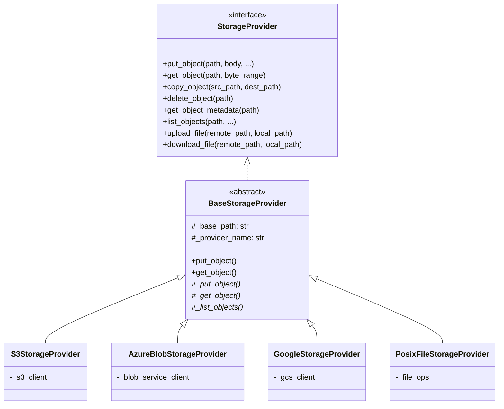

Sources: [src/multistorageclient/types.py:207-356](), [src/multistorageclient/providers/base.py:170-205](), [src/multistorageclient/providers/__init__.py:31-61]()

## Provider Registration and Loading

Providers are lazily loaded to minimize dependency overhead. The `multistorageclient.providers` module uses `__getattr__` to import specific provider classes only when requested [src/multistorageclient/providers/__init__.py:29-115](). If a provider's dependencies (e.g., `boto3`, `azure-storage-blob`) are missing, the client provides a helpful error message indicating which `pip install` extra is required [src/multistorageclient/providers/__init__.py:70-111]().

### Credentials Integration

Each provider works in tandem with a `CredentialsProvider` [src/multistorageclient/types.py:192-204](). For example, the `AzureBlobStorageProvider` can use a `DefaultAzureCredentialsProvider` [tests/test_multistorageclient/unit/test_credentials_provider.py:28-55](), and the `GoogleStorageProvider` supports `GoogleIdentityPoolCredentialsProvider` [tests/test_multistorageclient/unit/test_credentials_provider.py:82-109](). A generic `FileBasedCredentialsProvider` is also available for reading AWS-style JSON credential files [src/multistorageclient/providers/file_credentials.py:27-53]().

Sources: [src/multistorageclient/providers/__init__.py:29-115](), [src/multistorageclient/providers/file_credentials.py:27-53](), [tests/test_multistorageclient/unit/test_credentials_provider.py:28-109]()

## BaseStorageProvider Logic

The `BaseStorageProvider` class handles path normalization by automatically prepending a `base_path` to all logical paths provided by the user [src/multistorageclient/providers/base.py:171-177]().

### Path Resolution Sequence

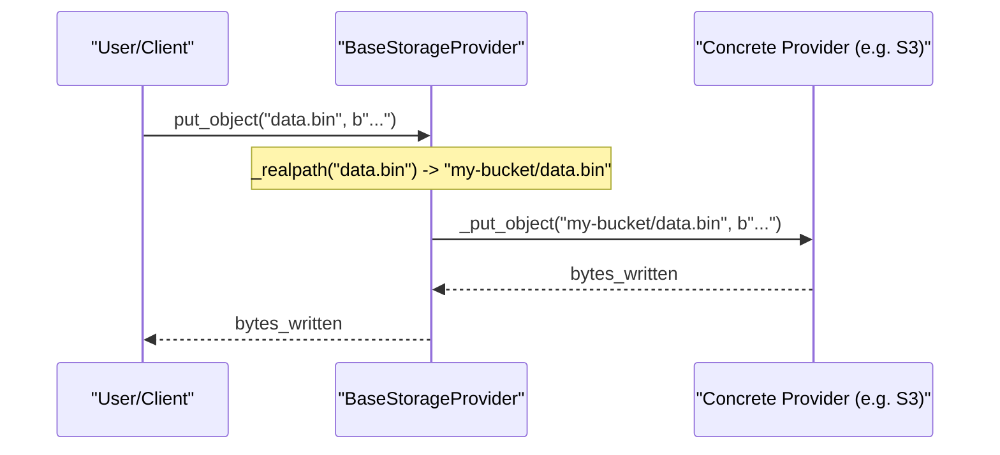

### Parallel Listing

`BaseStorageProvider` implements a sophisticated parallel listing mechanism using a `_PrefixExpander` and a heap-based consumer [src/multistorageclient/providers/base.py:74-154](). This allows the client to fetch multiple directory prefixes concurrently, significantly speeding up `list_objects` and `glob` operations on deep directory structures.

Sources: [src/multistorageclient/providers/base.py:74-154](), [src/multistorageclient/providers/base.py:170-205](), [tests/test_multistorageclient/unit/providers/test_base_storage_provider.py:103-132]()

## Major Provider Groups

Detailed documentation for each provider implementation is found in the following child pages:

### [AWS S3 Provider](#2.3.1)
Covers the `S3StorageProvider`, including support for S3-compatible backends like `s8k` and `gcs_s3`. It details multipart upload logic, Rust-accelerated transfers via `multistorageclient_rust`, and presigned URL generation.

### [Azure and Oracle Providers](#2.3.2)
Documents `AzureBlobStorageProvider` and `OracleStorageProvider`. Focuses on Azure-specific authentication (MSAL) and OCI's `UploadManager` integration.

### [Google Cloud Storage Provider](#2.3.3)
Covers the native `GoogleStorageProvider` and the S3-compatible `GoogleS3StorageProvider`. Includes details on Service Account and Identity Pool authentication.

### [POSIX and AIStore Providers](#2.3.4)
Documents `PosixFileStorageProvider` (local filesystem) and `AIStoreStorageProvider`. Details how the POSIX provider handles `SymlinkHandling` [src/multistorageclient/types.py:43-61]() and how AIStore leverages manifest generation.

## Common Features and Limitations

| Feature | Description | Implementation Note |
|:---|:---|:---|
| **Conditional Writes** | `if_match` and `if_none_match` support. | Handled via ETags in cloud providers [src/multistorageclient/types.py:120-146](). |
| **Batch Transfers** | `upload_files` and `download_files`. | Implemented with thread pools in `BaseStorageProvider` [src/multistorageclient/providers/base.py:63-70](). |
| **Symlinks** | Logical symlinks in object storage. | Encoded as objects with `symlink_target` metadata [src/multistorageclient/types.py:181-185](). |
| **Telemetry** | OpenTelemetry integration. | Providers emit `multistorageclient.operation` and `multistorageclient.status` metrics [src/multistorageclient/providers/base.py:180-199](). |

Sources: [src/multistorageclient/providers/base.py:180-205](), [src/multistorageclient/types.py:43-185]()

---

# Page: AWS S3 Provider

# AWS S3 Provider

<details>
<summary>Relevant source files</summary>

The following files were used as context for generating this wiki page:

- [multi-storage-client/src/multistorageclient/constants.py](multi-storage-client/src/multistorageclient/constants.py)
- [multi-storage-client/src/multistorageclient/providers/gcs.py](multi-storage-client/src/multistorageclient/providers/gcs.py)
- [multi-storage-client/src/multistorageclient/providers/gcs_s3.py](multi-storage-client/src/multistorageclient/providers/gcs_s3.py)
- [multi-storage-client/src/multistorageclient/providers/s3.py](multi-storage-client/src/multistorageclient/providers/s3.py)
- [multi-storage-client/src/multistorageclient/providers/s8k.py](multi-storage-client/src/multistorageclient/providers/s8k.py)
- [multi-storage-client/tests/test_multistorageclient/unit/providers/test_s3_checksum_algorithm.py](multi-storage-client/tests/test_multistorageclient/unit/providers/test_s3_checksum_algorithm.py)
- [multi-storage-client/tests/test_multistorageclient/unit/providers/test_s3_error_translation.py](multi-storage-client/tests/test_multistorageclient/unit/providers/test_s3_error_translation.py)

</details>


## Purpose and Scope

The AWS S3 Provider implements the storage provider interface for Amazon S3 and S3-compatible object stores (e.g., MinIO, SwiftStack, GCS via S3 interface). It enables the `multi-storage-client` to interact with S3 buckets through a consistent interface, supporting operations like reading, writing, copying, and deleting objects, as well as retrieving metadata and listing objects. The provider includes a high-performance Rust-accelerated path for large transfers and specific support for S3-compatible backends like `s8k` and `gcs_s3`.

Sources: [src/multistorageclient/providers/s3.py:143-146](), [src/multistorageclient/providers/s8k.py:24-28](), [src/multistorageclient/providers/gcs_s3.py:21-24]()

## Class Structure

The S3 provider ecosystem consists of the primary `S3StorageProvider` and specialized subclasses for S3-compatible storage.

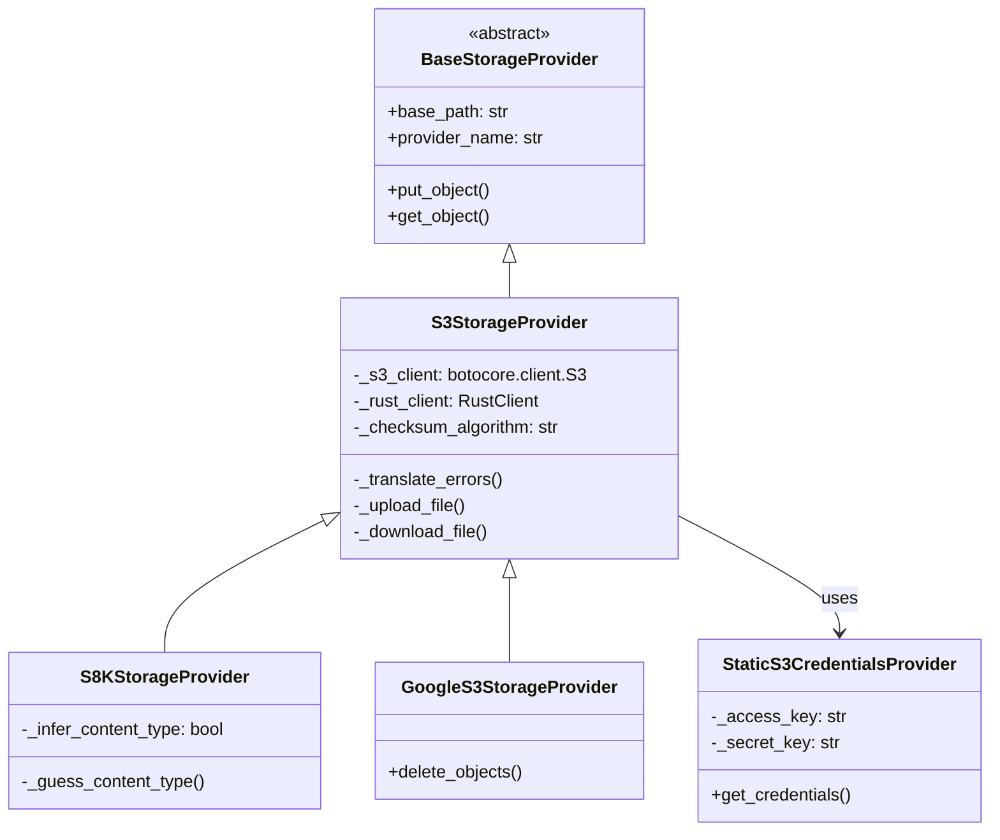

Sources: 
- [src/multistorageclient/providers/s3.py:74-83]()
- [src/multistorageclient/providers/s3.py:143-158]()
- [src/multistorageclient/providers/s8k.py:24-37]()
- [src/multistorageclient/providers/gcs_s3.py:21-38]()

## Implementation Details

### Rust-Accelerated Transfer Path
For high-performance requirements, the `S3StorageProvider` can utilize a `RustClient` (from `multistorageclient_rust`) to handle multipart uploads and downloads. This path is triggered when `rust_client` options are provided in the configuration and no complex `ExtraArgs` (like custom ACLs) are present that require the Python `boto3` layer.

Key functions for Rust integration:
- `run_async_rust_client_method`: Bridges Python sync calls to the async Rust backend [src/multistorageclient/rust_utils.py:44-54]().
- `_upload_file`: Routes to `rust_client.upload_multipart_from_path` if conditions are met [src/multistorageclient/providers/s3.py:596-610]().

### Checksum Support
The provider supports S3's additional checksum algorithms (CRC32, CRC32C, SHA1, SHA256, CRC64NVME).
- **Validation**: `_validate_checksum_algorithm` ensures the algorithm is supported by AWS [src/multistorageclient/providers/s3.py:255-267]().
- **Rust Limitation**: The Rust backend currently only supports `SHA256` for checksummed uploads [src/multistorageclient/providers/s3.py:207-209]().

### Presigned URLs
The `S3URLSigner` generates temporary URLs for GET/PUT operations using the underlying S3 client's `generate_presigned_url` method [src/multistorageclient/providers/s3.py:132-140]().

Sources: 
- [src/multistorageclient/providers/s3.py:71-71]()
- [src/multistorageclient/providers/s3.py:116-140]()
- [src/multistorageclient/providers/s3.py:596-610]()

## Data Flow: Large File Upload

The following diagram illustrates how the provider decides between the standard Python path and the Rust-accelerated path.

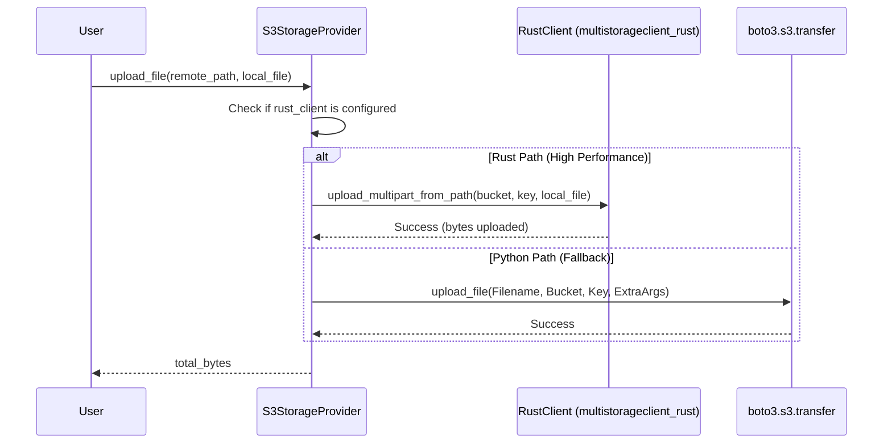

Sources: 
- [src/multistorageclient/providers/s3.py:570-627]()
- [src/multistorageclient/rust_utils.py:44-54]()

## S3-Compatible Variants

### SwiftStack (s8k)
The `S8KStorageProvider` adds specialized behavior for SwiftStack backends:
- **Content-Type Inference**: Automatically guesses MIME types based on file extensions (e.g., `.wav` to `audio/x-wav`) if `infer_content_type` is enabled [src/multistorageclient/providers/s8k.py:69-84]().
- **Retry Mode**: Forces `legacy` retry mode to handle HTTP 429 errors specific to SwiftStack [src/multistorageclient/providers/s8k.py:62-62]().

### GCS S3 Interface (gcs_s3)
The `GoogleS3StorageProvider` adapts the S3 provider for Google Cloud Storage's XML API:
- **Checksum Restriction**: Explicitly disables `checksum_algorithm` as GCS S3 does not support these specific S3 headers [src/multistorageclient/providers/gcs_s3.py:28-29]().
- **Bulk Deletion**: Overrides `_delete_objects` to perform individual deletes because GCS S3 does not support the S3 Bulk Delete API [src/multistorageclient/providers/gcs_s3.py:39-48]().

Sources:
- [src/multistorageclient/providers/s8k.py:57-67]()
- [src/multistorageclient/providers/gcs_s3.py:26-38]()

## Error Translation

The `_translate_errors` method maps `botocore` and `RustClient` exceptions to internal `multistorageclient` types.

| Source Exception | Condition | Translated Exception |
| :--- | :--- | :--- |
| `ClientError` | HTTP 404 (NoSuchKey) | `FileNotFoundError` |
| `ClientError` | HTTP 412 (PreconditionFailed) | `PreconditionFailedError` |
| `ClientError` | HTTP 429 / 503 | `RetryableError` |
| `RustRetryableError` | Connection Reset / Timeout | `RetryableError` |
| `IncompleteReadError` | Partial data transfer | `RetryableError` |

Sources: [src/multistorageclient/providers/s3.py:283-356](), [tests/test_multistorageclient/unit/providers/test_s3_error_translation.py:78-173]()

## Configuration Options

| Parameter | Type | Default | Description |
| :--- | :--- | :--- | :--- |
| `multipart_threshold` | `int` | 64 MiB | Threshold for switching to multipart logic [src/multistorageclient/providers/s3.py:60]() |
| `multipart_chunksize` | `int` | 32 MiB | Size of parts in multipart operations [src/multistorageclient/providers/s3.py:61]() |
| `checksum_algorithm` | `str` | `None` | One of CRC32, CRC32C, SHA1, SHA256, CRC64NVME [src/multistorageclient/providers/s3.py:71]() |
| `rust_client` | `dict` | `None` | Configuration for the Rust-accelerated backend [src/multistorageclient/providers/s3.py:196]() |
| `infer_content_type` | `bool` | `False` | (s8k only) Infer MIME type from extension [src/multistorageclient/providers/s8k.py:59]() |

Sources:
- [src/multistorageclient/providers/s3.py:57-65]()
- [src/multistorageclient/providers/s3.py:152-187]()
- [src/multistorageclient/constants.py:20-22]()

---

# Page: Azure and Oracle Providers

# Azure and Oracle Providers

<details>
<summary>Relevant source files</summary>

The following files were used as context for generating this wiki page:

- [multi-storage-client/src/multistorageclient/providers/azure.py](multi-storage-client/src/multistorageclient/providers/azure.py)
- [multi-storage-client/tests/test_multistorageclient/e2e/common.py](multi-storage-client/tests/test_multistorageclient/e2e/common.py)
- [multi-storage-client/tests/test_multistorageclient/e2e/test_azure.py](multi-storage-client/tests/test_multistorageclient/e2e/test_azure.py)
- [multi-storage-client/tests/test_multistorageclient/e2e/test_gcs.py](multi-storage-client/tests/test_multistorageclient/e2e/test_gcs.py)
- [multi-storage-client/tests/test_multistorageclient/e2e/test_oci.py](multi-storage-client/tests/test_multistorageclient/e2e/test_oci.py)
- [multi-storage-client/tests/test_multistorageclient/e2e/test_s3.py](multi-storage-client/tests/test_multistorageclient/e2e/test_s3.py)
- [multi-storage-client/tests/test_multistorageclient/e2e/test_swift.py](multi-storage-client/tests/test_multistorageclient/e2e/test_swift.py)
- [multi-storage-client/tests/test_multistorageclient/unit/providers/test_storage_providers.py](multi-storage-client/tests/test_multistorageclient/unit/providers/test_storage_providers.py)

</details>


## Introduction

This page documents the Azure Blob Storage and Oracle Cloud Infrastructure (OCI) Object Storage providers. These implementations allow the `StorageClient` to interact with Azure and OCI backends using the unified `StorageProvider` interface. Both providers support standard object operations, specialized authentication patterns (such as SAS for Azure), and integrated telemetry.

Sources: [src/multistorageclient/providers/azure.py:16-49](), [src/multistorageclient/providers/oci.py:16-50]()

## Provider Architecture

The following diagram maps the relationship between the base abstraction and the specific implementations for Azure and OCI, including their credential handling strategies.

```mermaid
classDiagram
    class "BaseStorageProvider" as BaseStorageProvider {
        [src/multistorageclient/providers/base.py]
        +put_object(path, body, ...)
        +get_object(path, range, ...)
        +list_objects(path, ...)
        +get_object_metadata(path)
    }

    class "AzureBlobStorageProvider" as AzureBlobStorageProvider {
        [src/multistorageclient/providers/azure.py]
        -_blob_service_client: BlobServiceClient
        -_account_url: str
        -_generate_presigned_url()
        -_refresh_blob_service_client_if_needed()
    }

    class "OracleStorageProvider" as OracleStorageProvider {
        [src/multistorageclient/providers/oci.py]
        -_oci_client: ObjectStorageClient
        -_upload_manager: UploadManager
        -_namespace: str
        -_refresh_oci_client_if_needed()
    }

    class "StaticAzureCredentialsProvider" as StaticAzureCredentialsProvider {
        [src/multistorageclient/providers/azure.py]
        -_connection: str
        +get_credentials()
    }

    BaseStorageProvider <|-- AzureBlobStorageProvider
    BaseStorageProvider <|-- OracleStorageProvider
    AzureBlobStorageProvider ..> StaticAzureCredentialsProvider : uses
```

Sources: [src/multistorageclient/providers/azure.py:49-55](), [src/multistorageclient/providers/azure.py:160-187](), [src/multistorageclient/providers/oci.py:52-86]()

## Azure Blob Storage Provider

The `AzureBlobStorageProvider` [src/multistorageclient/providers/azure.py:218-223]() utilizes the `azure-storage-blob` SDK. It maps logical paths to Azure containers and blobs.

### Authentication Patterns
Azure support includes three primary authentication methods:
1.  **Connection String**: Handled via `StaticAzureCredentialsProvider` [src/multistorageclient/providers/azure.py:160-187]().
2.  **Default Azure Credential**: Managed via `DefaultAzureCredentialsProvider` [src/multistorageclient/providers/azure.py:188-216](), which supports Managed Identity and Workload Identity.
3.  **SAS (Shared Access Signature)**: The `AzureURLSigner` [src/multistorageclient/providers/azure.py:102-158]() generates time-limited URLs. It supports both Account Keys and User Delegation Keys [src/multistorageclient/providers/azure.py:110-112]().

### Implementation Details
- **Multipart Uploads**: Azure uses a threshold of 64 MiB (`MULTIPART_THRESHOLD`) and chunk sizes of 32 MiB (`MULTIPART_CHUNKSIZE`) [src/multistorageclient/providers/azure.py:59-60]().
- **Content-MD5**: Azure REST API limits `Content-MD5` validation to ranges $\le$ 4 MiB [src/multistorageclient/providers/azure.py:64-66]().
- **Presigned URLs**: `generate_presigned_url` requires the `x-ms-blob-type: BlockBlob` header for `PUT` operations [tests/test_multistorageclient/e2e/test_azure.py:89-91]().

Sources: [src/multistorageclient/providers/azure.py:59-66](), [src/multistorageclient/providers/azure.py:102-158](), [tests/test_multistorageclient/e2e/test_azure.py:86-118]()

## Oracle Storage Provider

The `OracleStorageProvider` [src/multistorageclient/providers/oci.py:52-57]() implements support for OCI Object Storage using the `oci` Python SDK.

### Key Components and Data Flow

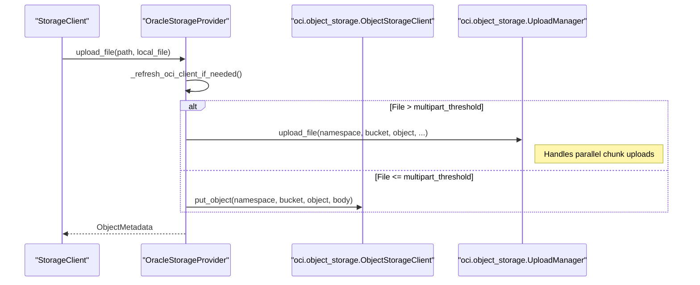

### OCI Specifics
- **Namespace**: Every OCI provider instance is bound to a specific OCI `namespace` [src/multistorageclient/providers/oci.py:65-68]().
- **Multipart Logic**: It uses a default `multipart_threshold` of 512 MiB and `multipart_chunksize` of 256 MiB [src/multistorageclient/providers/oci.py:44-48]().
- **Conditional Writes**: OCI supports `if-match` and `if-none-match: "*"` (to prevent overwrites), translating failures into `PreconditionFailedError` [tests/test_multistorageclient/e2e/test_oci.py:43-51]().

Sources: [src/multistorageclient/providers/oci.py:44-48](), [src/multistorageclient/providers/oci.py:65-86](), [tests/test_multistorageclient/e2e/test_oci.py:37-52]()

## Error Handling and Behavioral Differences

Both providers translate vendor-specific exceptions into the library's internal exception types defined in `multistorageclient.types`.

| Feature | Azure Behavior | Oracle (OCI) Behavior |
| :--- | :--- | :--- |
| **Over-write Protection** | Does not support `if-none-match="*"`; raises `RuntimeError` [tests/test_multistorageclient/e2e/test_azure.py:48-55](). | Supports `if-none-match="*"`; raises `PreconditionFailedError` [tests/test_multistorageclient/e2e/test_oci.py:43-51](). |
| **ETag Mismatch** | Raises `PreconditionFailedError` (412) [tests/test_multistorageclient/e2e/test_azure.py:46-47](). | Raises `PreconditionFailedError` (412) [tests/test_multistorageclient/e2e/test_oci.py:43-51](). |
| **Metadata Prefix** | Uses `msc_` prefix for custom attributes [tests/test_multistorageclient/e2e/test_azure.py:65-69](). | Uses `msc_` prefix for custom attributes [tests/test_multistorageclient/e2e/test_oci.py:55-59](). |
| **Presigned URL** | Requires `x-ms-blob-type` header for `PUT` [tests/test_multistorageclient/e2e/test_azure.py:105-111](). | Standard HTTP `PUT` [tests/test_multistorageclient/e2e/test_oci.py:23-35](). |

Sources: [tests/test_multistorageclient/e2e/test_azure.py:41-56](), [tests/test_multistorageclient/e2e/test_oci.py:37-52](), [src/multistorageclient/providers/azure.py:287-300](), [src/multistorageclient/providers/oci.py:252-265]()

---

# Page: Google Cloud Storage Provider

# Google Cloud Storage Provider

<details>
<summary>Relevant source files</summary>

The following files were used as context for generating this wiki page:

- [multi-storage-client/src/multistorageclient/constants.py](multi-storage-client/src/multistorageclient/constants.py)
- [multi-storage-client/src/multistorageclient/providers/gcs.py](multi-storage-client/src/multistorageclient/providers/gcs.py)
- [multi-storage-client/src/multistorageclient/providers/gcs_s3.py](multi-storage-client/src/multistorageclient/providers/gcs_s3.py)
- [multi-storage-client/src/multistorageclient/providers/s3.py](multi-storage-client/src/multistorageclient/providers/s3.py)
- [multi-storage-client/tests/test_multistorageclient/unit/providers/test_s3_error_translation.py](multi-storage-client/tests/test_multistorageclient/unit/providers/test_s3_error_translation.py)

</details>


This page documents the Google Cloud Storage (GCS) provider implementation in `multi-storage-client`, which enables interaction with Google Cloud Storage buckets and objects via native GCS APIs or the S3-compatible interface.

## Overview

The GCS implementation provides two distinct paths for interacting with Google Cloud Storage:
1.  **Native GCS Provider (`GoogleStorageProvider`)**: Uses the official `google-cloud-storage` Python SDK and a high-performance Rust-based backend for data transfers.
2.  **S3-Compatible GCS Provider (`GoogleS3StorageProvider`)**: Leverages the GCS S3-interoperability layer, allowing GCS to be treated as an S3 backend with specific GCS-specific adjustments.

Sources: [src/multistorageclient/providers/gcs.py:151-154](), [src/multistorageclient/providers/gcs_s3.py:21-24]()

## Architecture

### Provider Selection and Data Flow

The `multi-storage-client` selects between the native GCS implementation and the S3-compatible wrapper based on the `provider` string in the configuration (`gcs` vs `gcs_s3`).

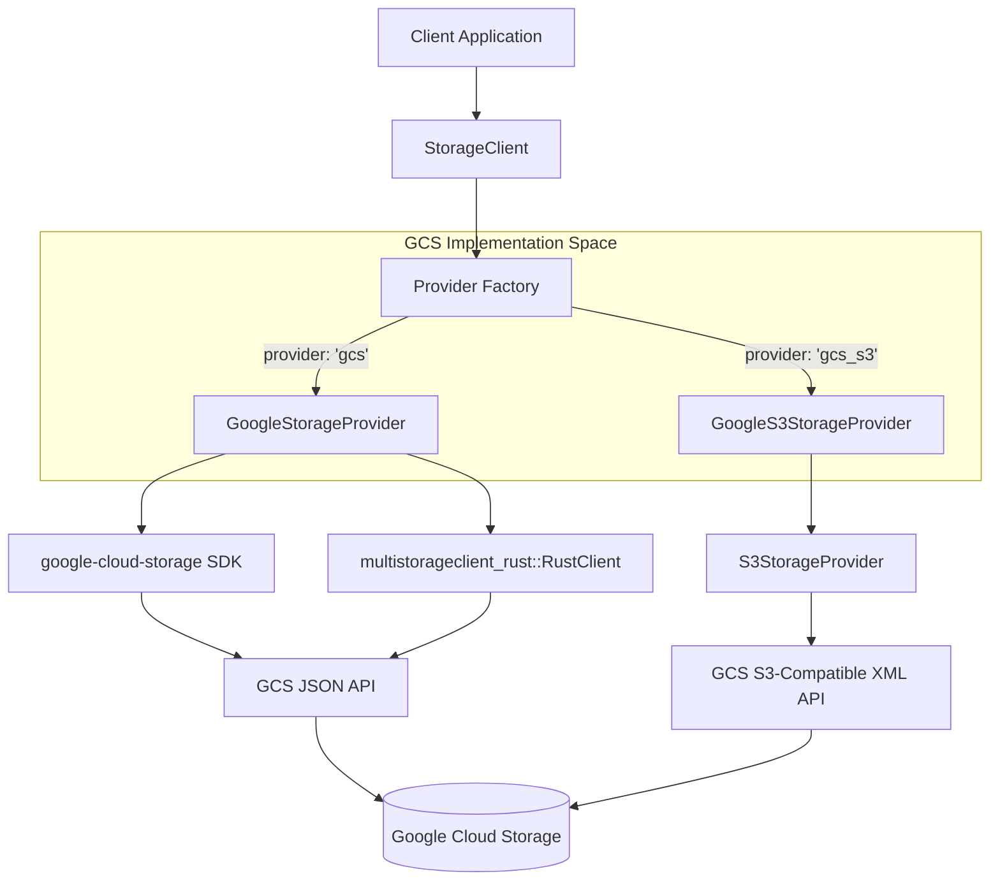

Sources: [src/multistorageclient/providers/gcs.py:60-61](), [src/multistorageclient/providers/gcs_s3.py:18-19](), [src/multistorageclient/providers/gcs.py:188-193]()

### Native GCS Provider Internal Structure

The `GoogleStorageProvider` inherits from `BaseStorageProvider` and integrates with both the Google Python SDK for metadata/management and a Rust client for high-throughput data movement.

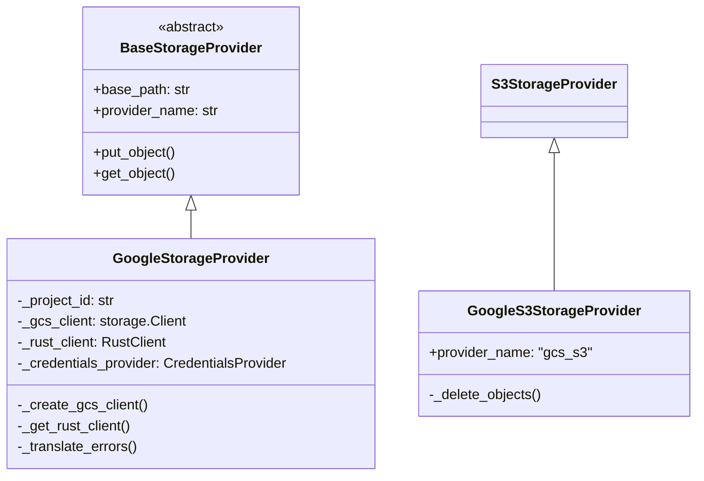

Sources: [src/multistorageclient/providers/gcs.py:151-156](), [src/multistorageclient/providers/gcs_s3.py:21-24]()

## Authentication

GCS supports several authentication mechanisms via the `CredentialsProvider` interface.

### Service Account Authentication
The `GoogleServiceAccountCredentialsProvider` allows using a JSON key file or a dictionary containing service account info.
*   **Source**: [src/multistorageclient/providers/gcs.py:112-149]()
*   **Key Function**: `get_credentials()` returns a `Credentials` object with the JSON info stored in `custom_fields`. [src/multistorageclient/providers/gcs.py:138-145]()

### Identity Pool Authentication
The `GoogleIdentityPoolCredentialsProvider` facilitates workload identity federation by providing an audience and a token supplier.
*   **Source**: [src/multistorageclient/providers/gcs.py:84-110]()

### Client Initialization
The `_create_gcs_client` method handles the conversion of MSC `Credentials` into Google-specific credential objects (`service_account.Credentials` or `OAuth2Credentials`).
*   **Call Site**: `GoogleStorageProvider.__init__` calls `_create_gcs_client`. [src/multistorageclient/providers/gcs.py:188-188]()
*   **Implementation**: [src/multistorageclient/providers/gcs.py:768-809]()

## Native GCS Provider (`gcs`)

### Configuration Parameters

| Parameter | Default | Description |
| :--- | :--- | :--- |
| `project_id` | `GOOGLE_CLOUD_PROJECT_ID` | GCP Project ID. [src/multistorageclient/providers/gcs.py:158]() |
| `multipart_threshold` | 64 MiB | Threshold for switching to multipart/chunked transfers. [src/multistorageclient/providers/gcs.py:64]() |
| `multipart_chunksize` | 32 MiB | Size of chunks for transfers. [src/multistorageclient/providers/gcs.py:65]() |
| `max_concurrency` | 8 | Concurrency limit for Python-based transfers. [src/multistorageclient/providers/gcs.py:67]() |

### Rust-Accelerated Transfers
If a `RustClient` is provided or initialized, `GoogleStorageProvider` offloads `upload_file` and `download_file` to the Rust backend for performance.
*   **Upload**: `_upload_file` uses `run_async_rust_client_method` with `upload_multipart_from_path`. [src/multistorageclient/providers/gcs.py:530-538]()
*   **Download**: `_download_file` uses `download_to_path`. [src/multistorageclient/providers/gcs.py:642-648]()

### Error Translation
The `_translate_errors` decorator maps Google API exceptions to MSC standard exceptions:
*   `google.api_core.exceptions.NotFound` -> `FileNotFoundError`. [src/multistorageclient/providers/gcs.py:146-148]()
*   `google.api_core.exceptions.PreconditionFailed` -> `PreconditionFailedError`. [src/multistorageclient/providers/gcs.py:150-152]()
*   `google.cloud.storage.exceptions.InvalidResponse` (304) -> `NotModifiedError`. [src/multistorageclient/providers/gcs.py:154-156]()

Sources: [src/multistorageclient/providers/gcs.py:143-171]()

## S3-Compatible GCS Provider (`gcs_s3`)

The `GoogleS3StorageProvider` is a specialized version of the `S3StorageProvider`. It is used when users want to interact with GCS via the XML API but need to account for specific GCS limitations.

### Key Differences from Standard S3
1.  **No Bulk Deletion**: GCS S3-compatible interface does not support the standard S3 `DeleteObjects` (bulk) operation. The implementation overrides `_delete_objects` to perform individual deletions. [src/multistorageclient/providers/gcs_s3.py:39-48]()
2.  **Checksum Constraints**: Checksum algorithms are explicitly disabled for `gcs_s3` as they are not supported in the same manner as AWS S3. [src/multistorageclient/providers/gcs_s3.py:28-29]()
3.  **Mandatory Checksum Behavior**: `request_checksum_calculation` and `response_checksum_validation` are forced to `"when_required"`. [src/multistorageclient/providers/gcs_s3.py:31-32]()

Sources: [src/multistorageclient/providers/gcs_s3.py:21-37]()

## Implementation Details

### Path Splitting
Both providers use `split_path` to decompose MSC paths into bucket names and object keys.
*   **Example**: `gs://my-bucket/my-key` -> `bucket="my-bucket"`, `key="my-key"`. [src/multistorageclient/providers/gcs.py:206-207]()

### Metadata Mapping
The `_get_object_metadata` method maps GCS `Blob` properties to the MSC `ObjectMetadata` structure.
*   `blob.updated` -> `last_modified`. [src/multistorageclient/providers/gcs.py:382]()
*   `blob.etag` -> `etag`. [src/multistorageclient/providers/gcs.py:383]()
*   `blob.size` -> `size`. [src/multistorageclient/providers/gcs.py:384]()

Sources: [src/multistorageclient/providers/gcs.py:366-391]()

### Directory Simulation
GCS is a flat namespace. The provider simulates directories by checking for a trailing slash or using the `prefix` and `delimiter` parameters in `list_blobs`.
*   **Directory Check**: `_is_dir` verifies if a prefix exists by performing a limited list operation. [src/multistorageclient/providers/gcs.py:288-305]()

Sources: [src/multistorageclient/providers/gcs.py:307-364]()

---

# Page: POSIX and AIStore Providers

# POSIX and AIStore Providers

<details>
<summary>Relevant source files</summary>

The following files were used as context for generating this wiki page:

- [multi-storage-client/src/multistorageclient/cache.py](multi-storage-client/src/multistorageclient/cache.py)
- [multi-storage-client/src/multistorageclient/providers/ais.py](multi-storage-client/src/multistorageclient/providers/ais.py)
- [multi-storage-client/src/multistorageclient/providers/huggingface.py](multi-storage-client/src/multistorageclient/providers/huggingface.py)
- [multi-storage-client/src/multistorageclient/providers/oci.py](multi-storage-client/src/multistorageclient/providers/oci.py)
- [multi-storage-client/src/multistorageclient/providers/posix_file.py](multi-storage-client/src/multistorageclient/providers/posix_file.py)
- [multi-storage-client/tests/test_multistorageclient/e2e/test_huggingface.py](multi-storage-client/tests/test_multistorageclient/e2e/test_huggingface.py)
- [multi-storage-client/tests/test_multistorageclient/unit/providers/test_parallel_listing.py](multi-storage-client/tests/test_multistorageclient/unit/providers/test_parallel_listing.py)
- [multi-storage-client/tests/test_multistorageclient/unit/providers/test_posix_file.py](multi-storage-client/tests/test_multistorageclient/unit/providers/test_posix_file.py)
- [multi-storage-client/tests/test_multistorageclient/unit/providers/test_symlinks.py](multi-storage-client/tests/test_multistorageclient/unit/providers/test_symlinks.py)
- [multi-storage-client/tests/test_multistorageclient/unit/test_cache.py](multi-storage-client/tests/test_multistorageclient/unit/test_cache.py)
- [multi-storage-client/tests/test_multistorageclient/unit/test_partial_file_caching.py](multi-storage-client/tests/test_multistorageclient/unit/test_partial_file_caching.py)

</details>


This document describes the POSIX file system provider and AIStore provider implementations in the multi-storage-client. These providers allow the storage client to interact with local file systems (POSIX) and NVIDIA's AIStore distributed object storage system, respectively.

## Provider Architecture Overview

The POSIX and AIStore providers implement the `BaseStorageProvider` interface, allowing them to be used interchangeably within the `StorageClient` facade.

### Class Relationship Diagram

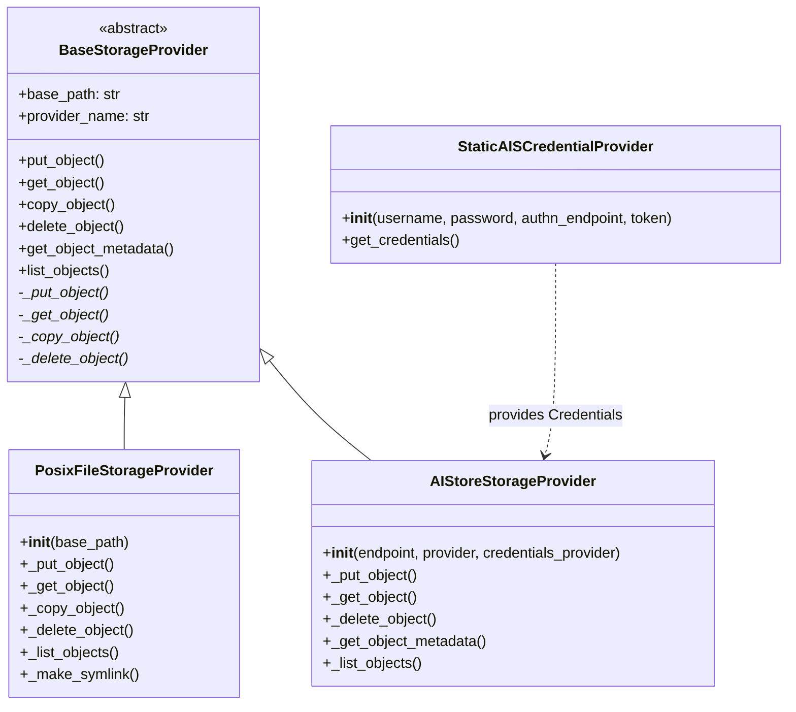

Sources: [src/multistorageclient/providers/posix_file.py:92-122](), [src/multistorageclient/providers/ais.py:98-158](), [src/multistorageclient/providers/ais.py:49-92]()

## POSIX File Storage Provider

The `PosixFileStorageProvider` enables interaction with local POSIX-compliant file systems. It maps object storage concepts (buckets/keys) to local directory structures.

### Key Features
- **Atomic Writes**: Uses temporary files and `os.rename` to ensure files are fully written or not at all [src/multistorageclient/providers/posix_file.py:59-89]().
- **Symlink Support**: Implements `_make_symlink` to create relative symlinks on the local filesystem [src/multistorageclient/providers/posix_file.py:191-201]().
- **Metadata**: Stores object metadata in extended attributes (`user.json` xattr) [src/multistorageclient/providers/posix_file.py:85-87]().
- **Parallel Listing**: Supports optimized parallel recursive listing via a heap-based BFS walk [src/multistorageclient/providers/posix_file.py:231-274]().

### Data Flow: Atomic Write

```mermaid
flowchart TD
    subgraph "PosixFileStorageProvider._put_object"
        START["put_object(path, body)"] --> MKDIR["safe_makedirs(dirname)"]
        MKDIR --> ATOMIC["atomic_write(body, path)"]
    end
    
    subgraph "atomic_write"
        TMP["tempfile.NamedTemporaryFile"] --> WRITE["Write chunks to .tmp"]
        WRITE --> XATTR["xattr.setxattr(user.json)"]
        XATTR --> RENAME["os.rename(tmp, path)"]
    end
```

Sources: [src/multistorageclient/providers/posix_file.py:146-159](), [src/multistorageclient/providers/posix_file.py:59-89]()

### Parallel Listing Implementation
The POSIX provider overrides `_list_objects` to handle both flat and recursive listing. For recursive listing, it uses a generator-based approach that yields `ObjectMetadata` for every file found under the base path, sorted by key [src/multistorageclient/providers/posix_file.py:231-274]().

## AIStore Storage Provider

The `AIStoreStorageProvider` integrates with NVIDIA's AIStore. It handles bucket/object lifecycle and supports AIStore-specific features like custom properties.

### Authentication and Credentials
AIStore authentication is managed via `StaticAISCredentialProvider`, which can perform a login against an AIStore `AuthN` endpoint to retrieve a token [src/multistorageclient/providers/ais.py:89-92]().

### AIStore Operation Flow

```mermaid
sequenceDiagram
    participant Client as StorageClient
    participant Provider as AIStoreStorageProvider
    participant SDK as aistore.sdk.Client
    participant AIS as AIStore Cluster
    
    Client->>Provider: get_object("bucket/key")
    Provider->>Provider: split_path("bucket/key")
    Provider->>SDK: bucket("bucket").object("key").get()
    SDK->>AIS: HTTP GET /v1/objects/bucket/key
    AIS-->>SDK: 200 OK (Data)
    SDK-->>Provider: Object Reader
    Provider-->>Client: bytes
```

Sources: [src/multistorageclient/providers/ais.py:224-240](), [src/multistorageclient/providers/ais.py:160-189]()

### AIStore Specific Features
- **Manifest Generation**: While handled largely in the FUSE layer (MSFS), the AIStore provider supports listing objects with custom properties which are used to build manifests [src/multistorageclient/providers/ais.py:277-310]().
- **Error Translation**: The provider translates `AISError` (like 404) into standard Python `FileNotFoundError` for consistency [src/multistorageclient/providers/ais.py:180-185]().

## Symlink Handling Across Providers

MSC provides a unified symlink interface. For POSIX, these are native symlinks. For object stores (like AIStore or S3), symlinks are represented as zero-byte objects with a specific metadata attribute `msc-symlink-target` [tests/test_multistorageclient/unit/providers/test_symlinks.py:44-48]().

| Feature | POSIX Provider Implementation | AIStore Provider Implementation |
| :--- | :--- | :--- |
| **Creation** | `os.symlink` (relative) [src/multistorageclient/providers/posix_file.py:194-196]() | Object with `msc-symlink-target` attr [src/multistorageclient/providers/ais.py:258-275]() |
| **Detection** | `os.path.islink` [src/multistorageclient/providers/posix_file.py:209-211]() | Check for `msc-symlink-target` in props [src/multistorageclient/providers/ais.py:277-310]() |
| **Resolution** | Native OS resolution | Metadata-based target extraction |

## Configuration Examples

### POSIX Provider
```yaml
profiles:
  local_data:
    storage_provider:
      type: file
      options:
        base_path: /mnt/data/storage
```

### AIStore Provider
```yaml
profiles:
  ais_data:
    storage_provider:
      type: ais
      options:
        endpoint: "http://ais-gateway:8080"
        base_path: "my-ais-bucket"
    credentials_provider:
      type: ais
      options:
        token: "your-auth-token"
```

Sources: [src/multistorageclient/providers/posix_file.py:97-108](), [src/multistorageclient/providers/ais.py:103-131]()

## Summary of Implementation Differences

| Feature | POSIX Provider | AIStore Provider |
| :--- | :--- | :--- |
| **Copy Object** | `os.rename` or file-to-file copy [src/multistorageclient/providers/posix_file.py:173-182]() | Not supported (AttributeError) [src/multistorageclient/providers/ais.py:242-256]() |
| **Atomic Writes** | Temporary file + Rename [src/multistorageclient/providers/posix_file.py:59-89]() | Native AIStore PUT atomicity |
| **Listing** | `os.walk` (Parallel BFS) [src/multistorageclient/providers/posix_file.py:231-274]() | `bucket.list_objects` (Paged) [src/multistorageclient/providers/ais.py:277-310]() |
| **Metadata** | Extended Attributes (xattr) [src/multistorageclient/providers/posix_file.py:85-87]() | AIStore Custom Properties [src/multistorageclient/providers/ais.py:214-222]() |

Sources: [src/multistorageclient/providers/posix_file.py:1-286](), [src/multistorageclient/providers/ais.py:1-315]()

---

# Page: Metadata System

# Metadata System

<details>
<summary>Relevant source files</summary>

The following files were used as context for generating this wiki page:

- [multi-storage-client-docs/src/references/api.rst](multi-storage-client-docs/src/references/api.rst)
- [multi-storage-client/src/multistorageclient/__init__.py](multi-storage-client/src/multistorageclient/__init__.py)
- [multi-storage-client/src/multistorageclient/client/__init__.py](multi-storage-client/src/multistorageclient/client/__init__.py)
- [multi-storage-client/src/multistorageclient/generators/manifest_metadata.py](multi-storage-client/src/multistorageclient/generators/manifest_metadata.py)
- [multi-storage-client/src/multistorageclient/providers/manifest_formats.py](multi-storage-client/src/multistorageclient/providers/manifest_formats.py)
- [multi-storage-client/src/multistorageclient/providers/manifest_metadata.py](multi-storage-client/src/multistorageclient/providers/manifest_metadata.py)
- [multi-storage-client/src/multistorageclient/providers/manifest_object_metadata.py](multi-storage-client/src/multistorageclient/providers/manifest_object_metadata.py)
- [multi-storage-client/tests/test_multistorageclient/unit/providers/test_manifest_metadata.py](multi-storage-client/tests/test_multistorageclient/unit/providers/test_manifest_metadata.py)
- [multi-storage-client/tests/test_multistorageclient/unit/providers/test_metadata_rewrite.py](multi-storage-client/tests/test_multistorageclient/unit/providers/test_metadata_rewrite.py)
- [multi-storage-client/tests/test_multistorageclient/unit/utils/mocks.py](multi-storage-client/tests/test_multistorageclient/unit/utils/mocks.py)

</details>


The Metadata System in `multi-storage-client` provides a way to track and manage object metadata separately from the actual objects stored in various storage providers. This separation allows for efficient querying and manipulation of metadata without needing to interact with the objects themselves. The primary implementation is the `ManifestMetadataProvider`, which stores metadata in manifest files within the storage system.

## Overview

The Metadata System serves as an optional component in the architecture, providing enhanced capabilities for tracking, querying, and managing object metadata. It allows for logical-to-physical path mapping and atomic metadata updates.

```mermaid
graph TD
    subgraph "Multi-Storage Client"
        SC["StorageClient"]
        SP["StorageProvider"]
        MP["MetadataProvider"]
        SC -->|uses| SP
        SC -->|optionally uses| MP
    end

    subgraph "Metadata Implementation"
        MP -->|implemented by| MMP["ManifestMetadataProvider"]
        MMP -->|reads/writes| MF["Manifest Files"]
        MF -->|contains| MI["Manifest Index"]
        MI -->|references| MPF["Manifest Part Files"]
        MPF -->|stores| OM["ManifestObjectMetadata"]
    end

    subgraph "Storage Backend"
        SP -->|interacts with| SB["Storage Backend"]
        MF -->|stored in| SB
    end
```

Sources: [src/multistorageclient/providers/manifest_metadata.py:111-141](), [src/multistorageclient/providers/manifest_object_metadata.py:23-35]()

## MetadataProvider Interface

The `MetadataProvider` interface defines the contract for metadata providers. Any implementation can be used to provide metadata services to the `StorageClient`.

```mermaid
classDiagram
    class MetadataProvider {
        <<interface>>
        +list_objects(prefix, start_after, end_at, include_directories)
        +get_object_metadata(path)
        +glob(pattern)
        +realpath(path)
        +generate_physical_path(logical_path)
        +add_file(path, metadata)
        +remove_file(path)
        +commit_updates()
        +is_writable()
    }

    class ManifestMetadataProvider {
        -_storage_provider: StorageProvider
        -_files: Dict[str, ManifestObjectMetadata] 
        -_pending_adds: Dict[str, ManifestObjectMetadata]
        -_pending_removes: set[str]
        -_manifest_path: str
        -_format: ManifestFormat
        +__init__(storage_provider, manifest_path, writable, manifest_format)
        +list_objects(prefix, start_after, end_at, include_directories)
        +get_object_metadata(path, include_pending)
        +glob(pattern)
        +realpath(path)
        +add_file(path, metadata)
        +remove_file(path)
        +commit_updates()
        -_load_manifest(storage_provider, manifest_path)
        -_write_manifest_files(storage_provider, object_metadata)
    }

    MetadataProvider <|.. ManifestMetadataProvider
```

Sources: [src/multistorageclient/providers/manifest_metadata.py:111-150](), [tests/test_multistorageclient/unit/utils/mocks.py:62-132]()

## Manifest Formats and Structure

The manifest system organizes metadata using a structured file format. It supports multiple serialization formats via the `ManifestFormat` enum and corresponding handlers.

### Supported Formats
- **JSONL**: Default format. Each line is a JSON object representing one file's metadata. [src/multistorageclient/providers/manifest_formats.py:50-74]()
- **Parquet**: Binary columnar format for high-performance metadata reading, requiring `pyarrow`. [src/multistorageclient/providers/manifest_formats.py:77-134]()

### File Hierarchy
The manifest is stored within a `.msc_manifests` directory by default. [src/multistorageclient/providers/manifest_metadata.py:42]()

```mermaid
graph TD
    subgraph "Manifest Directory (.msc_manifests)"
        MI["msc_manifest_index.json"] -->|references| MP1["parts/msc_manifest_part000001.jsonl"]
        MI -->|references| MP2["parts/msc_manifest_part000002.jsonl"]
        
        MP1 -->|contains| OM1["ManifestObjectMetadata (logical path + physical path)"]
        MP2 -->|contains| OM2["ManifestObjectMetadata"]
    end
```

Sources: [src/multistorageclient/providers/manifest_metadata.py:42-46](), [src/multistorageclient/providers/manifest_metadata.py:79-108](), [src/multistorageclient/providers/manifest_formats.py:25-28]()

## Physical vs. Logical Path Resolution

The system supports **Metadata Rewriting**, where a logical path (user-facing) maps to a different physical path (actual storage location). This is enabled by `ManifestObjectMetadata`.

- **Logical Path**: The key used by the user in the `StorageClient`.
- **Physical Path**: The actual key on the backend (e.g., a UUID or hashed path).
- **realpath()**: Resolves a logical path to a `ResolvedPath` containing the physical location. [src/multistorageclient/providers/manifest_metadata.py:381-397]()
- **generate_physical_path()**: Creates a new physical path for a logical path, supporting features like safe overwrites. [src/multistorageclient/providers/manifest_metadata.py:399-411]()

Sources: [src/multistorageclient/providers/manifest_object_metadata.py:23-35](), [tests/test_multistorageclient/unit/providers/test_metadata_rewrite.py:29-94]()

## Core Functionality

### Loading Manifests
During initialization, `ManifestMetadataProvider` performs a recursive search for the manifest index. [src/multistorageclient/providers/manifest_metadata.py:151-183]()

```mermaid
sequenceDiagram
    participant Client as "Client Code"
    participant MMP as "ManifestMetadataProvider"
    participant SP as "StorageProvider"
    
    Client->>MMP: __init__(storage_provider, manifest_path)
    MMP->>MMP: _load_manifest()
    MMP->>SP: get_object(msc_manifest_index.json)
    MMP->>MMP: Parse Manifest Index
    loop For each part in index
        MMP->>SP: get_object(parts/msc_manifest_part...)
        MMP->>MMP: Parse Part (JSONL or Parquet)
        MMP->>MMP: Populate _files cache
    end
```

Sources: [src/multistorageclient/providers/manifest_metadata.py:151-233](), [src/multistorageclient/providers/manifest_formats.py:137-148]()

### Transactional Updates
Metadata changes are not persisted immediately. They are held in `_pending_adds` and `_pending_removes` until a commit is triggered. [src/multistorageclient/providers/manifest_metadata.py:413-461]()

1. **add_file(path, metadata)**: Queues metadata for a new or updated file. [src/multistorageclient/providers/manifest_metadata.py:413-424]()
2. **remove_file(path)**: Queues a file for deletion from the manifest. [src/multistorageclient/providers/manifest_metadata.py:426-435]()
3. **commit_updates()**: Writes new manifest parts and a new index file to the storage provider. [src/multistorageclient/providers/manifest_metadata.py:441-461]()

Sources: [src/multistorageclient/providers/manifest_metadata.py:413-461](), [tests/test_multistorageclient/unit/providers/test_manifest_metadata.py:102-104]()

## Manifest Generator Utility

The `ManifestMetadataGenerator` is a utility for bootstrapping a manifest from an existing storage backend.

- **Listing**: It performs a full list of the `data_storage_client`. [src/multistorageclient/generators/manifest_metadata.py:108-110]()
- **Partitioning**: Supports `partition_keys` to parallelize the listing operation using a `ThreadPoolExecutor`. [src/multistorageclient/generators/manifest_metadata.py:90-106]()
- **Exclusion**: Automatically excludes the `.msc_manifests` directory from the generated manifest to avoid recursion. [src/multistorageclient/generators/manifest_metadata.py:100-101]()

Sources: [src/multistorageclient/generators/manifest_metadata.py:28-113]()

## Performance and Consistency

- **Fast Queries**: Once loaded, `list_objects`, `glob`, and `get_object_metadata` are served from an in-memory dictionary. [src/multistorageclient/providers/manifest_metadata.py:286-350]()
- **Atomicity**: The `commit_updates` process ensures that metadata updates are visible as a single atomic change once the index file is updated. [src/multistorageclient/providers/manifest_metadata.py:441-461]()
- **Soft Delete**: Supports a `should_use_soft_delete` mode where files are marked as deleted in metadata without immediately removing physical objects. [tests/test_multistorageclient/unit/providers/test_metadata_rewrite.py:130-132]()

Sources: [src/multistorageclient/providers/manifest_metadata.py:286-350](), [tests/test_multistorageclient/unit/providers/test_metadata_rewrite.py:29-85]()

---

# Page: Caching System

# Caching System

<details>
<summary>Relevant source files</summary>

The following files were used as context for generating this wiki page:

- [multi-storage-client-docs/src/references/configuration.rst](multi-storage-client-docs/src/references/configuration.rst)
- [multi-storage-client-docs/src/user_guide/cache.rst](multi-storage-client-docs/src/user_guide/cache.rst)
- [multi-storage-client/src/multistorageclient/cache.py](multi-storage-client/src/multistorageclient/cache.py)
- [multi-storage-client/src/multistorageclient/config.py](multi-storage-client/src/multistorageclient/config.py)
- [multi-storage-client/src/multistorageclient/providers/ais.py](multi-storage-client/src/multistorageclient/providers/ais.py)
- [multi-storage-client/src/multistorageclient/providers/oci.py](multi-storage-client/src/multistorageclient/providers/oci.py)
- [multi-storage-client/src/multistorageclient/schema.py](multi-storage-client/src/multistorageclient/schema.py)
- [multi-storage-client/tests/test_multistorageclient/unit/test_cache.py](multi-storage-client/tests/test_multistorageclient/unit/test_cache.py)
- [multi-storage-client/tests/test_multistorageclient/unit/test_config.py](multi-storage-client/tests/test_multistorageclient/unit/test_config.py)
- [multi-storage-client/tests/test_multistorageclient/unit/test_partial_file_caching.py](multi-storage-client/tests/test_multistorageclient/unit/test_partial_file_caching.py)
- [multi-storage-client/tests/test_multistorageclient/unit/test_schema.py](multi-storage-client/tests/test_multistorageclient/unit/test_schema.py)

</details>


The multi-storage-client caching system provides local caching capabilities to optimize performance when accessing remote storage objects. It stores frequently accessed data locally to reduce network requests, with configurable size limits and eviction policies. The system supports full-file caching as well as partial file caching using cache lines.

## Architecture Overview

The caching system is managed by the `CacheManager`, which coordinates cache backends, eviction policies, and data integrity checks.

Title: Caching System Architecture
```mermaid
classDiagram
    class CacheConfig {
        +str size
        +str cache_line_size
        +bool check_source_version
        +bool prefetch_file
        +EvictionPolicyConfig eviction_policy
        +size_bytes()
        +cache_line_size_bytes()
    }
    
    class CacheManager {
        -str _profile
        -CacheConfig _cache_config
        -EvictionPolicy _eviction_policy
        -int _cache_line_size
        +read(key, byte_range, source_version)
        +set(key, source, source_version)
        +contains(key, source_version)
        +refresh_cache()
        +evict_files()
    }
    
    class CacheItem {
        +str file_path
        +int file_size
        +float atime
        +float mtime
        +str source_version
        +from_path(file_path)
    }
    
    class EvictionPolicy {
        <<interface>>
        +sort_items(cache_items)
    }
    
    class LRUEvictionPolicy {
        +sort_items(cache_items)
    }
    
    class FIFOEvictionPolicy {
        +sort_items(cache_items)
    }

    CacheManager o-- CacheConfig : uses
    CacheManager o-- EvictionPolicy : uses
    CacheManager ..> CacheItem : manages
    EvictionPolicy <|-- LRUEvictionPolicy
    EvictionPolicy <|-- FIFOEvictionPolicy
```

Sources:
- [multi-storage-client/src/multistorageclient/cache.py:43-89]()
- [multi-storage-client/src/multistorageclient/caching/cache_config.py:31-118]()
- [multi-storage-client/src/multistorageclient/caching/cache_item.py:22-65]()
- [multi-storage-client/src/multistorageclient/caching/eviction_policy.py:37-128]()

## CacheManager Lifecycle

The `CacheManager` is initialized per profile when caching is enabled. It handles directory setup, initial cache population, and periodic maintenance.

1.  **Initialization**: Creates the cache directory structure under the configured `location` or a default temp path [multi-storage-client/src/multistorageclient/cache.py:68-74]().
2.  **Population**: Calls `refresh_cache()` on startup to index existing files in the cache directory [multi-storage-client/src/multistorageclient/cache.py:88-89]().
3.  **Operation**: Intercepts read/write requests. It uses `FileLock` to prevent concurrent writes to the same cached object [multi-storage-client/src/multistorageclient/cache.py:48-48]().
4.  **Maintenance**: Periodically triggers `evict_files()` based on the `refresh_interval` [multi-storage-client/src/multistorageclient/cache.py:60-61]().

Sources:
- [multi-storage-client/src/multistorageclient/cache.py:50-89]()
- [multi-storage-client-docs/src/user_guide/cache.rst:18-21]()

## Partial File Caching (Cache Lines)

MSC supports caching specific portions of large files, known as partial file caching. This is controlled by the `cache_line_size` parameter.

-   **Chunking**: Large files are split into chunks (default 64MB) [multi-storage-client/src/multistorageclient/cache.py:40-40]().
-   **Storage**: Chunks are stored as hidden files with a `#chunkN` suffix (e.g., `.data.bin#chunk0`) [multi-storage-client/src/multistorageclient/cache.py:173-174]().
-   **Range Requests**: When a specific byte range is requested via `client.read(..., byte_range=Range(...))`, MSC only downloads the chunks covering that range [multi-storage-client-docs/src/user_guide/cache.rst:56-58]().

Title: Partial Caching Data Flow
```mermaid
sequenceDiagram
    participant App as "Application"
    participant SC as "StorageClient"
    participant CM as "CacheManager"
    participant Disk as "Local Disk"
    participant Remote as "Remote Provider"

    App->>SC: read(path, Range(offset=1MB, size=1MB))
    SC->>CM: read(key, Range, source_version)
    CM->>Disk: Check for .file#chunk0
    alt Chunk Found
        Disk-->>CM: bytes
    else Chunk Missing
        CM->>Remote: get_object(path, Range(0, 64MB))
        Remote-->>CM: bytes
        CM->>Disk: write .file#chunk0
    end
    CM-->>SC: slice(bytes, 1MB, 1MB)
    SC-->>App: data
```

Sources:
- [multi-storage-client/src/multistorageclient/cache.py:40-41]()
- [multi-storage-client-docs/src/user_guide/cache.rst:52-58]()
- [multi-storage-client/tests/test_multistorageclient/unit/test_partial_file_caching.py:57-108]()

## Source Version Checking

To ensure data integrity, MSC can validate the remote object's version before serving a cached copy.

-   **Modes**: Controlled by `SourceVersionCheckMode` (`ENABLE`, `DISABLE`, `INHERIT`) [multi-storage-client/src/multistorageclient/types.py:108-112]().
-   **Mechanism**: MSC stores the source version (e.g., S3 ETag) as an extended attribute (`xattr`) on the cached file [multi-storage-client/src/multistorageclient/cache.py:27-27]().
-   **Validation**: If `check_source_version` is true, MSC performs a metadata check (HEAD request) on the remote provider. If the remote version differs from the cached `xattr`, the cache is invalidated [multi-storage-client-docs/src/user_guide/cache.rst:40-44]().

Sources:
- [multi-storage-client/src/multistorageclient/cache.py:168-185]()
- [multi-storage-client-docs/src/user_guide/cache.rst:96-108]()

## Eviction Policies

When the cache exceeds the configured `size`, the `EvictionPolicy` determines which files to remove.

| Policy | Description | Implementation Class |
| :--- | :--- | :--- |
| **LRU** | Least Recently Used (based on `atime`) | `LRUEvictionPolicy` |
| **MRU** | Most Recently Used | `MRUEvictionPolicy` |
| **FIFO** | First In First Out (based on `mtime`) | `FIFOEvictionPolicy` |
| **Random** | Randomly selects files for eviction | `RandomEvictionPolicy` |

Sources:
- [multi-storage-client/src/multistorageclient/schema.py:69-86]()
- [multi-storage-client/src/multistorageclient/caching/eviction_policy.py:37-128]()

## Configuration

Caching is configured in the top-level `cache` section of the YAML configuration.

```yaml
cache:
  size: 500G                 # Max total size (M, G, T suffixes)
  location: /mnt/nvme/cache  # Local path
  check_source_version: true # Enable ETag/version validation
  cache_line_size: 64M       # Chunk size for partial caching
  prefetch_file: false       # Use partial caching for open()
  eviction_policy:
    policy: lru
    refresh_interval: 300    # Seconds between eviction checks
```

Sources:
- [multi-storage-client/src/multistorageclient/schema.py:54-98]()
- [multi-storage-client-docs/src/references/configuration.rst:102-105]()

## Summary of Key Classes

| Class | Role | Source |
| :--- | :--- | :--- |
| `CacheManager` | Primary interface for storage clients to interact with the cache. | [multi-storage-client/src/multistorageclient/cache.py:43]() |
| `CacheConfig` | Parsed and validated cache settings. | [multi-storage-client/src/multistorageclient/caching/cache_config.py:31]() |
| `EvictionPolicyFactory` | Creates policy instances based on configuration strings. | [multi-storage-client/src/multistorageclient/caching/eviction_policy.py:131]() |
| `CacheItem` | Represents a single file or chunk in the cache with metadata. | [multi-storage-client/src/multistorageclient/caching/cache_item.py:22]() |

---

# Page: Observability

# Observability

<details>
<summary>Relevant source files</summary>

The following files were used as context for generating this wiki page:

- [multi-storage-client-scripts/src/multistorageclient_scripts/utils/argparse_extensions/__init__.py](multi-storage-client-scripts/src/multistorageclient_scripts/utils/argparse_extensions/__init__.py)
- [multi-storage-client-scripts/src/multistorageclient_scripts/utils/wait/__init__.py](multi-storage-client-scripts/src/multistorageclient_scripts/utils/wait/__init__.py)
- [multi-storage-client/src/multistorageclient/explorer/api/server.py](multi-storage-client/src/multistorageclient/explorer/api/server.py)
- [multi-storage-client/src/multistorageclient/instrumentation/auth.py](multi-storage-client/src/multistorageclient/instrumentation/auth.py)
- [multi-storage-client/src/multistorageclient/mcp/server.py](multi-storage-client/src/multistorageclient/mcp/server.py)
- [multi-storage-client/src/multistorageclient/signers/cloudfront.py](multi-storage-client/src/multistorageclient/signers/cloudfront.py)
- [multi-storage-client/src/multistorageclient/telemetry/__init__.py](multi-storage-client/src/multistorageclient/telemetry/__init__.py)
- [multi-storage-client/src/multistorageclient/telemetry/metrics/exporters/otlp_msal.py](multi-storage-client/src/multistorageclient/telemetry/metrics/exporters/otlp_msal.py)
- [multi-storage-client/src/multistorageclient/telemetry/metrics/exporters/otlp_mtls_vault.py](multi-storage-client/src/multistorageclient/telemetry/metrics/exporters/otlp_mtls_vault.py)
- [multi-storage-client/src/multistorageclient/telemetry/metrics/readers/diperiodic_exporting.py](multi-storage-client/src/multistorageclient/telemetry/metrics/readers/diperiodic_exporting.py)
- [multi-storage-client/tests/test_multistorageclient/unit/explorer/test_api_endpoints.py](multi-storage-client/tests/test_multistorageclient/unit/explorer/test_api_endpoints.py)
- [multi-storage-client/tests/test_multistorageclient/unit/instrumentation/test_vault_certificate_provider.py](multi-storage-client/tests/test_multistorageclient/unit/instrumentation/test_vault_certificate_provider.py)
- [multi-storage-client/tests/test_multistorageclient/unit/telemetry/metrics/exporters/__init__.py](multi-storage-client/tests/test_multistorageclient/unit/telemetry/metrics/exporters/__init__.py)
- [multi-storage-client/tests/test_multistorageclient/unit/telemetry/metrics/exporters/test_otlp_mtls.py](multi-storage-client/tests/test_multistorageclient/unit/telemetry/metrics/exporters/test_otlp_mtls.py)
- [multi-storage-client/tests/test_multistorageclient/unit/telemetry/metrics/exporters/test_otlp_mtls_vault.py](multi-storage-client/tests/test_multistorageclient/unit/telemetry/metrics/exporters/test_otlp_mtls_vault.py)

</details>


This document describes the observability features in the `multi-storage-client` library, which provides comprehensive instrumentation and monitoring capabilities through OpenTelemetry. The observability system collects metrics (latency, data size, data rate), traces request flows, and exports this telemetry data to configurable backends using OTLP. It includes advanced features like async metrics offloading, MSAL authentication, and mTLS certificate management via HashiCorp Vault.

## Architecture Overview

The observability system is built on OpenTelemetry (OTel) and provides both metrics collection and distributed tracing. It is designed to be optional and high-performance, utilizing background threads for exporting to avoid blocking the main storage I/O path.

```mermaid
flowchart TD
    subgraph "Storage Operations"
        SC["StorageClient"]
        SP["StorageProvider"]
        CM["CacheManager"]
    end

    subgraph "Instrumentation Layer"
        SH["StorageProviderMetricsHelper"]
        FT["file_tracer"]
        ID["instrumented decorator"]
        CMH["CacheManagerMetricsHelper"]
    end

    subgraph "OpenTelemetry Core"
        METER["METER"]
        TRACER["TRACER"]
        DEMR["DiperiodicExportingMetricReader"]
        EABP["ErrorAwareBatchSpanProcessor"]
    end

    subgraph "Exporters & Auth"
        OTLP_M["_OTLPMSALMetricExporter"]
        OTLP_V["_OTLPmTLSVaultMetricExporter"]
        VCP["VaultCertificateProvider"]
        AAP["AzureAccessTokenProvider"]
    end

    SC --> SH
    SP --> SH
    CM --> CMH
    SC --> ID
    SC --> FT

    SH --> METER
    CMH --> METER
    ID --> TRACER
    FT --> TRACER

    METER --> DEMR
    DEMR --> OTLP_M
    DEMR --> OTLP_V
    
    OTLP_M --> AAP
    OTLP_V --> VCP
    
    TRACER --> EABP
```

Sources: [src/multistorageclient/instrumentation/utils.py:250-330](), [src/multistorageclient/telemetry/metrics/readers/diperiodic_exporting.py:40-65](), [src/multistorageclient/telemetry/metrics/exporters/otlp_msal.py:30-45]()

## Metrics System

The metrics system tracks quantitative data about storage operations. To minimize impact on the application's critical path, the client uses a custom `DiperiodicExportingMetricReader`.

### Async Metrics Offloading

Unlike the standard OTel `PeriodicExportingMetricReader`, which couples collection and exporting, the `DiperiodicExportingMetricReader` runs two separate daemon threads:
1. **Collect Daemon**: Periodically gathers metrics from the SDK into a local buffer [src/multistorageclient/telemetry/metrics/readers/diperiodic_exporting.py:148-151]().
2. **Export Daemon**: Periodically flushes the buffer to the configured OTLP exporter [src/multistorageclient/telemetry/metrics/readers/diperiodic_exporting.py:154-157]().

This separation allows for high-frequency internal collection (e.g., every 1s) while maintaining lower-frequency external exports (e.g., every 60s) to reduce network overhead [src/multistorageclient/telemetry/metrics/readers/diperiodic_exporting.py:28-35]().

### Available Metrics

| Metric Name | Type | Description | Units |
|-------------|------|-------------|-------|
| `storageclient_api_duration` | Histogram | Latency of storage operations | milliseconds |
| `storageclient_object_size` | Histogram | Size of data transferred | megabytes |
| `storageclient_api_duration_p50/p99` | Gauge | Percentile latency via T-Digest | milliseconds |
| `storageclient_cache_manager_count` | Counter | Cache hits/misses/evictions | count |

Sources: [src/multistorageclient/instrumentation/utils.py:40-91](), [src/multistorageclient/instrumentation/utils.py:180-200]()

## Authentication and Exporters

The client supports sophisticated authentication mechanisms for telemetry backends, particularly useful in enterprise environments.

### MSAL Authentication
The `_OTLPMSALMetricExporter` integrates with the Microsoft Authentication Library (MSAL). It uses an `AccessTokenHTTPAdapter` to automatically inject Bearer tokens into OTLP export requests [src/multistorageclient/telemetry/metrics/exporters/otlp_msal.py:38-73](). This is managed by the `AzureAccessTokenProvider` [src/multistorageclient/telemetry/metrics/exporters/otlp_msal.py:92-93]().

### mTLS and Vault Certificate Provider
For secure OTLP communication, the library provides a `VaultCertificateProvider` that fetches mTLS certificates from HashiCorp Vault using AppRole authentication [src/multistorageclient/instrumentation/auth.py:85-104]().

**Key implementation details:**
- **Fingerprinting**: It computes a SHA-256 fingerprint of the configuration to manage multiple certificate sets [src/multistorageclient/instrumentation/auth.py:141-155]().
- **Caching**: Certificates are cached locally in a secure temporary directory (`0o600` permissions) to avoid repeated Vault calls [src/multistorageclient/instrumentation/auth.py:137-140](), [src/multistorageclient/instrumentation/auth.py:180-180]().
- **Expiration Check**: It uses the `cryptography` library to check the `not_valid_after_utc` field of cached certificates and refreshes them automatically if expired [src/multistorageclient/instrumentation/auth.py:182-198]().

Sources: [src/multistorageclient/instrumentation/auth.py:85-198](), [src/multistorageclient/telemetry/metrics/exporters/otlp_mtls_vault.py:58-65]()

## Tracing and Error-Aware Processing

Distributed tracing is implemented using the `ErrorAwareBatchSpanProcessor`. This processor performs "tail sampling" logic: it buffers spans and only flushes the full trace if an error is detected or if an operation exceeds a duration threshold [src/multistorageclient/instrumentation/error_aware_processor.py:22-50]().

### Instrumentation Decorators
- **`@instrumented`**: Automatically wraps class methods in spans, capturing the provider name, operation, and bucket as OTel attributes [src/multistorageclient/instrumentation/utils.py:348-380]().
- **`file_tracer`**: A specialized decorator for file-like objects that tracks `read()` and `write()` calls, recording the total bytes transferred as a span attribute [src/multistorageclient/instrumentation/utils.py:410-465]().

```mermaid
sequenceDiagram
    participant App as "Application"
    participant SC as "StorageClient"
    participant EABP as "ErrorAwareBatchSpanProcessor"
    participant OTLP as "OTLP Exporter"

    App->>SC: read("msc://bucket/file")
    SC->>SC: Start Span (StorageClient.read)
    SC-->>App: FileHandle
    App->>SC: FileHandle.read(1024)
    Note right of SC: file_tracer updates bytes_read
    App->>SC: FileHandle.close()
    SC->>EABP: on_end(Span)
    alt Span has Error OR Duration > Threshold
        EABP->>OTLP: Export Trace
    else Normal Operation
        EABP->>EABP: Sample/Discard based on ratio
    end
```

Sources: [src/multistorageclient/instrumentation/utils.py:410-465](), [src/multistorageclient/instrumentation/error_aware_processor.py:60-113]()

## Configuration

Observability is configured via the `observability` block in the MSC profile.

### mTLS Vault Example
```yaml
observability:
  metrics:
    exporter:
      type: "_otlp_mtls_vault"
      auth:
        vault_endpoint: "https://vault.internal"
        approle_id: "${VAULT_ROLE_ID}"
        approle_secret: "${VAULT_SECRET_ID}"
        secret_path: "pki/issue/msc-client"
      options:
        endpoint: "https://otel-collector:4318/v1/metrics"
```

Sources: [src/multistorageclient/telemetry/metrics/exporters/otlp_mtls_vault.py:81-94](), [src/multistorageclient/instrumentation/__init__.py:118-204]()

---

# Page: Rust Backend

# Rust Backend

<details>
<summary>Relevant source files</summary>

The following files were used as context for generating this wiki page:

- [multi-storage-client/rust-toolchain.toml](multi-storage-client/rust-toolchain.toml)
- [multi-storage-client/rust/Cargo.lock](multi-storage-client/rust/Cargo.lock)
- [multi-storage-client/rust/Cargo.toml](multi-storage-client/rust/Cargo.toml)
- [multi-storage-client/rust/src/credentials.rs](multi-storage-client/rust/src/credentials.rs)
- [multi-storage-client/rust/src/lib.rs](multi-storage-client/rust/src/lib.rs)
- [multi-storage-client/rust/src/types.rs](multi-storage-client/rust/src/types.rs)
- [multi-storage-client/src/multistorageclient/rclone.py](multi-storage-client/src/multistorageclient/rclone.py)
- [multi-storage-client/src/multistorageclient/rust_utils.py](multi-storage-client/src/multistorageclient/rust_utils.py)
- [multi-storage-client/src/multistorageclient_rust/__init__.py](multi-storage-client/src/multistorageclient_rust/__init__.py)
- [multi-storage-client/src/multistorageclient_rust/multistorageclient_rust.pyi](multi-storage-client/src/multistorageclient_rust/multistorageclient_rust.pyi)
- [multi-storage-client/tests/test_multistorageclient/unit/test_rust_utils.py](multi-storage-client/tests/test_multistorageclient/unit/test_rust_utils.py)
- [multi-storage-client/tests/test_multistorageclient_rust/unit/test_rustclient.py](multi-storage-client/tests/test_multistorageclient_rust/unit/test_rustclient.py)

</details>


The Rust backend, implemented in the `multistorageclient_rust` package, provides a high-performance, asynchronous transfer layer for the Multi-Storage Client. It leverages the Rust `object_store` ecosystem to accelerate S3 and GCS operations, particularly for large-scale multipart uploads and downloads that benefit from Rust's zero-cost abstractions and efficient concurrency model.

## Overview and Build System

The Rust backend is integrated into the Python ecosystem using **PyO3** for bindings and **maturin** as the build system [multi-storage-client/rust/Cargo.toml:12-17](). It is compiled as a `cdylib` and exposed to Python as a native extension [multi-storage-client/rust/Cargo.toml:13-14]().

The core of the backend relies on the following key Rust crates:
*   `object_store`: Provides the underlying asynchronous storage abstractions for S3 and GCS [multi-storage-client/rust/Cargo.toml:23]().
*   `tokio`: Serves as the asynchronous runtime [multi-storage-client/rust/Cargo.toml:20]().
*   `pyo3-async-runtimes`: Manages the lifecycle of the Tokio runtime and handles the conversion between Rust `Futures` and Python `awaitables` [multi-storage-client/rust/Cargo.toml:18]().

### Code Entity Mapping: Build and Initialization
| Component | Code Entity | Description |
| :--- | :--- | :--- |
| **Python Interface** | `RustClient` | The main class exposed to Python [multi-storage-client/rust/src/lib.rs:20](). |
| **Rust Entry Point** | `#[pymodule]` | Defines the `multistorageclient_rust` module [multi-storage-client/rust/src/lib.rs:24](). |
| **Async Bridge** | `future_into_py` | Converts Rust `async` results to Python `Future` objects [multi-storage-client/rust/src/lib.rs:28](). |

Sources: [multi-storage-client/rust/Cargo.toml:1-34](), [multi-storage-client/rust/src/lib.rs:1-165]()

## Architecture and Data Flow

The Rust backend acts as an accelerated sidecar to the primary Python `StorageClient`. When high-throughput operations (like `upload_file` or `download_file`) are requested, the Python layer can delegate the task to the `RustClient`.

### Data Flow: Python to Async Rust
The following diagram illustrates how a synchronous Python call traverses into the asynchronous Rust runtime.

**Diagram: Sync Python to Async Rust Execution**
```mermaid
sequenceDiagram
    participant P as Python Caller
    participant RU as rust_utils.py
    participant RC as RustClient (PyO3)
    participant TR as Tokio Runtime

    P->>RU: run_async_rust_client_method(method, args)
    RU->>RU: run_coroutine_sync(coro_factory)
    Note over RU: Spawns helper thread if loop exists
    RU->>RC: await method(*args)
    RC->>TR: tokio::spawn(future)
    TR-->>RC: Result
    RC-->>RU: Python Future Result
    RU-->>P: Return Value
```
Sources: [multi-storage-client/src/multistorageclient/rust_utils.py:69-115](), [multi-storage-client/rust/src/lib.rs:28]()

## Implementation Details

### RustClient and ObjectStore
The `RustClient` struct (defined in `lib.rs`) encapsulates an `Arc<dyn ObjectStore>`. It supports both S3 (via `AmazonS3Builder`) and GCS (via `GoogleCloudStorageBuilder`) [multi-storage-client/rust/src/lib.rs:17-18]().

Key performance features include:
*   **Multipart Acceleration**: Functions like `upload_multipart_from_file` and `download_multipart_to_file` split data into chunks (default 32MB) and process them with a configurable concurrency level (default 8) [multi-storage-client/rust/src/lib.rs:168-169]().
*   **Semaphore-based Throttling**: Uses `tokio::sync::Semaphore` to limit concurrent network requests [multi-storage-client/rust/src/lib.rs:40]().
*   **Retry Logic**: Implements a `RustRetryConfig` that controls attempts, backoff multipliers, and timeouts directly within the Rust layer to minimize GIL transitions during retries [multi-storage-client/rust/src/types.rs:69-75]().

### Credential Handling
A critical component is the `AwsCredentialsProvider` and `GcpCredentialsProvider`, which bridge Python-based credential providers to Rust's `object_store` [multi-storage-client/rust/src/credentials.rs:124-129]().

**Diagram: Credential Bridging Logic**
```mermaid
graph TD
    subgraph "Rust Space"
        ACP["AwsCredentialsProvider"]
        CC["CoreCredentialsProvider"]
        CACHE["CredentialCache (RwLock)"]
    end

    subgraph "Python Space"
        PP["Python Credentials Provider"]
    end

    ACP --> CC
    CC -- "call_method0('get_credentials')" --> PP
    PP -- "Return Dict/Object" --> CC
    CC -- "Parse RFC3339" --> CACHE
    CACHE -- "Shared Access" --> ACP
```

The implementation uses a **two-tier caching strategy**:
1.  **Fast Path**: Attempts to read from a `RwLock<Option<CredentialCache>>` [multi-storage-client/rust/src/credentials.rs:188-189]().
2.  **Slow Path**: If expired or missing, it acquires a `tokio::sync::Mutex` (to prevent thundering herds) and calls back into Python to refresh the credentials [multi-storage-client/rust/src/credentials.rs:72-75]().

Sources: [multi-storage-client/rust/src/credentials.rs:37-75](), [multi-storage-client/rust/src/credentials.rs:177-190](), [multi-storage-client/rust/src/lib.rs:168-174]()

## Error Handling and Translation

The backend defines a comprehensive `StorageError` enum to map Rust errors to Python exceptions [multi-storage-client/rust/src/lib.rs:55-71]().

| Rust Error Variant | Python Exception | Logic / Context |
| :--- | :--- | :--- |
| `HttpError(msg, status)` | `RustClientError` | Includes HTTP status codes (e.g., 404, 403) [multi-storage-client/rust/src/lib.rs:154-156](). |
| `RetryExhaustedError` | `RustRetryableError` | Triggered by connection resets or request timeouts [multi-storage-client/rust/src/lib.rs:151-153](). |
| `ConfigError` | `ValueError` | Invalid bucket or endpoint configuration [multi-storage-client/rust/src/lib.rs:148-150](). |

The function `extract_status_code` maps `object_store::Error` variants (like `NotFound`) to standard u16 status codes for consistent handling in the Python layer [multi-storage-client/rust/src/lib.rs:78-90]().

Sources: [multi-storage-client/rust/src/lib.rs:55-165]()

## Python Bridge: run_coroutine_sync

Since the Python `StorageClient` is primarily synchronous, but the Rust backend is inherently asynchronous (Tokio-based), a bridge is required. The `multistorageclient.rust_utils` module provides `run_coroutine_sync` [multi-storage-client/src/multistorageclient/rust_utils.py:69]().

If a user calls a Rust-accelerated method from a thread that **already has a running event loop** (e.g., inside a FastAPI request or a Jupyter notebook), `run_coroutine_sync` spawns a dedicated background thread to run the coroutine to completion, avoiding `RuntimeError: This event loop is already running` [multi-storage-client/src/multistorageclient/rust_utils.py:82-93]().

Sources: [multi-storage-client/src/multistorageclient/rust_utils.py:69-93](), [multi-storage-client/src/multistorageclient/rust_utils.py:96-115]()

---

# Page: User Interfaces

# User Interfaces

<details>
<summary>Relevant source files</summary>

The following files were used as context for generating this wiki page:

- [multi-storage-client-docs/justfile](multi-storage-client-docs/justfile)
- [multi-storage-client-docs/src/index.rst](multi-storage-client-docs/src/index.rst)
- [multi-storage-client-docs/src/references/checksum_support.rst](multi-storage-client-docs/src/references/checksum_support.rst)
- [multi-storage-client-docs/src/user_guide/cli.rst](multi-storage-client-docs/src/user_guide/cli.rst)
- [multi-storage-client-docs/src/user_guide/installation.rst](multi-storage-client-docs/src/user_guide/installation.rst)
- [multi-storage-client-docs/src/user_guide/mcp_server.rst](multi-storage-client-docs/src/user_guide/mcp_server.rst)
- [multi-storage-client/src/multistorageclient/commands/cli/actions/sync.py](multi-storage-client/src/multistorageclient/commands/cli/actions/sync.py)
- [multi-storage-client/src/multistorageclient/shortcuts.py](multi-storage-client/src/multistorageclient/shortcuts.py)
- [multi-storage-client/tests/test_multistorageclient/unit/sync/test_manager.py](multi-storage-client/tests/test_multistorageclient/unit/sync/test_manager.py)
- [multi-storage-client/tests/test_multistorageclient/unit/test_cli.py](multi-storage-client/tests/test_multistorageclient/unit/test_cli.py)
- [multi-storage-client/tests/test_multistorageclient/unit/test_shortcuts.py](multi-storage-client/tests/test_multistorageclient/unit/test_shortcuts.py)

</details>


This page provides an overview of the different ways to interact with the `multi-storage-client` library. It describes the available user interfaces, their use cases, and how they relate to each other. For detailed information about specific APIs or tools, see the corresponding child pages.

## Overview of Interface Options

The `multi-storage-client` library offers multiple interfaces to access storage systems, ranging from low-level programmatic APIs to high-level command-line tools and a web-based explorer.

1.  **Storage Client API** - The `StorageClient` class provides the primary, full-featured programmatic API [src/multistorageclient/client.py:44-102]().
2.  **Shortcut Functions** - Convenient global functions like `msc.open()` and `msc.glob()` that handle client resolution automatically [src/multistorageclient/shortcuts.py:245-258]().
3.  **Path-like Interface** - `MultiStoragePath` provides a familiar `pathlib`-like interface for navigating storage [src/multistorageclient/path.py:34-45]().
4.  **CLI and MCP Server** - Command-line tools for manual operations and a Model Context Protocol server for AI agent interactions [multi-storage-client-docs/src/user_guide/cli.rst:5-33]().
5.  **MSC Explorer** - A web-based UI for browsing and previewing files across all configured backends [multi-storage-client-docs/src/index.rst:36-36]().

### Interface Relationship Diagram

The following diagram shows how different interfaces bridge natural language requests and code entities to the underlying `StorageClient` logic.

```mermaid
flowchart TD
    subgraph "Natural Language & UI Space"
        User["User / AI Agent"]
        NaturalLang["'List files in S3'"]
        WebUI["MSC Explorer (React)"]
    end

    subgraph "Interface Layer (Code Entities)"
        MCPServer["MCPServer (FastMCP)"]
        CLI["msc CLI (argparse)"]
        Shortcuts["shortcuts.py"]
        MSPath["MultiStoragePath"]
    end

    subgraph "Core Logic"
        SC["StorageClient"]
        SCC["StorageClientConfig"]
        Cache["_STORAGE_CLIENT_CACHE"]
    end

    User -- "Natural Language" --> NaturalLang
    NaturalLang --> MCPServer
    User -- "Commands" --> CLI
    User -- "Browser" --> WebUI
    
    WebUI -- "REST API" --> SC
    MCPServer -- "Calls" --> SC
    CLI -- "Calls" --> SC
    Shortcuts -- "resolve_storage_client()" --> Cache
    MSPath -- "Uses" --> Shortcuts
    Cache -- "Instantiates" --> SC
    SC -- "Configured by" --> SCC
```
Sources: [src/multistorageclient/shortcuts.py:32-33](), [src/multistorageclient/path.py:34-45](), [multi-storage-client-docs/src/user_guide/mcp_server.rst:11-23](), [multi-storage-client-docs/src/user_guide/cli.rst:18-33]()

---

## Programmatic Interfaces

### Storage Client API
The `StorageClient` class is the primary interface. It supports standard CRUD operations, complex transfers, and replica management.
*   **For details, see [Storage Client API](#3.1)**

### Shortcut Functions
Located in `shortcuts.py`, these functions allow users to interact with storage using simple URLs (e.g., `msc://profile/path`) without manually managing `StorageClient` instances [src/multistorageclient/shortcuts.py:127-142]().
*   **For details, see [Shortcut Functions](#3.2)**

### Path-like Interface
The `MultiStoragePath` class implements a `pathlib.Path` compatible interface, allowing for intuitive path joins using the `/` operator and standard methods like `.exists()` or `.is_dir()` [src/multistorageclient/path.py:112-135]().
*   **For details, see [Path-like Interface](#3.3)**

---

## System Coordination and Tooling

### Distributed Locking
The `DistributedHint` system provides a mechanism for coordinating concurrent writers across different storage backends using "hint" files as locks [src/multistorageclient/types.py:100-110]().
*   **For details, see [Distributed Locking](#3.4)**

### CLI and MCP Server
The `msc` command-line tool provides subcommands for `ls`, `sync`, `rm`, and `config` [multi-storage-client-docs/src/user_guide/cli.rst:25-33](). Additionally, the `mcp-server` subcommand exposes these capabilities to AI assistants like Cursor or Claude via the Model Context Protocol [multi-storage-client-docs/src/user_guide/mcp_server.rst:53-58]().

```mermaid
flowchart LR
    subgraph "CLI Entry Points"
        msc_main["multistorageclient.commands.cli.main"]
        msc_bench["msc-benchmark"]
    end

    subgraph "Subcommands"
        Sync["SyncAction"]
        Ls["LsAction"]
        MCP["MCPServer"]
    end

    msc_main --> Sync
    msc_main --> Ls
    msc_main --> MCP
    
    Sync --> SyncManager["SyncManager"]
    Ls --> SC_list["StorageClient.list()"]
    MCP --> FastMCP["FastMCP Tools"]
```
Sources: [src/multistorageclient/commands/cli/actions/sync.py:27-34](), [src/multistorageclient/sync/manager.py:26-56](), [multi-storage-client-docs/src/user_guide/mcp_server.rst:164-169]()

*   **For details, see [CLI and MCP Server](#3.5)**

### MSC Explorer
The MSC Explorer is a web-based file manager built with React and FastAPI. It allows users to browse configured storage profiles, preview file contents, and manage data through a graphical interface [multi-storage-client-docs/src/index.rst:36-36]().
*   **For details, see [MSC Explorer](#3.6)**

---

## Summary of Interface Options

| Interface | Target Audience | Primary Use Case |
| :--- | :--- | :--- |
| **StorageClient** | Developers | High-performance, complex application logic. |
| **Shortcuts** | Data Scientists | Rapid prototyping and simple script I/O. |
| **Path-like** | Developers | Porting code that expects `pathlib.Path`. |
| **CLI** | DevOps / Users | Manual data migration and bucket inspection. |
| **MCP Server** | AI Agents | Enabling LLMs to interact with storage. |
| **Explorer** | All Users | Visual browsing and metadata inspection. |

Sources: [src/multistorageclient/shortcuts.py:245-258](), [src/multistorageclient/path.py:34-45](), [multi-storage-client-docs/src/user_guide/cli.rst:5-33](), [multi-storage-client-docs/src/user_guide/mcp_server.rst:11-23]()

---

# Page: Storage Client API

# Storage Client API

<details>
<summary>Relevant source files</summary>

The following files were used as context for generating this wiki page:

- [multi-storage-client-docs/src/user_guide/explorer.rst](multi-storage-client-docs/src/user_guide/explorer.rst)
- [multi-storage-client-docs/src/user_guide/rust.rst](multi-storage-client-docs/src/user_guide/rust.rst)
- [multi-storage-client/src/multistorageclient/client/client.py](multi-storage-client/src/multistorageclient/client/client.py)
- [multi-storage-client/src/multistorageclient/client/composite.py](multi-storage-client/src/multistorageclient/client/composite.py)
- [multi-storage-client/src/multistorageclient/client/single.py](multi-storage-client/src/multistorageclient/client/single.py)
- [multi-storage-client/src/multistorageclient/client/types.py](multi-storage-client/src/multistorageclient/client/types.py)
- [multi-storage-client/src/multistorageclient/file.py](multi-storage-client/src/multistorageclient/file.py)
- [multi-storage-client/src/multistorageclient/utils.py](multi-storage-client/src/multistorageclient/utils.py)
- [multi-storage-client/tests/test_multistorageclient/unit/client/test_client.py](multi-storage-client/tests/test_multistorageclient/unit/client/test_client.py)
- [multi-storage-client/tests/test_multistorageclient/unit/test_file.py](multi-storage-client/tests/test_multistorageclient/unit/test_file.py)
- [multi-storage-client/tests/test_multistorageclient/unit/test_utils.py](multi-storage-client/tests/test_multistorageclient/unit/test_utils.py)

</details>


The StorageClient API is the primary interface for interacting with files and objects across various storage systems. It provides a unified API to perform operations like reading, writing, listing, and deleting objects regardless of the underlying storage provider (S3, Azure, Google Cloud Storage, etc.).

This page documents the core `StorageClient` facade and its underlying implementations: `SingleStorageClient` and `CompositeStorageClient`.

## Overview

The `StorageClient` class acts as a facade that delegates operations to specific implementations based on the provided configuration. [multi-storage-client/src/multistorageclient/client/client.py:42-49]().

```mermaid
flowchart TD
    subgraph "StorageClient Facade"
        SC["StorageClient (facade)"]
    end

    subgraph "Implementation Layer"
        SSC["SingleStorageClient\n(Full Read/Write)"]
        CSC["CompositeStorageClient\n(Read-Only / Multi-Backend)"]
    end

    SC -->|delegates| SSC
    SC -->|delegates| CSC

    subgraph "Core Operations"
        OpRead["read() / open('rb')"]
        OpWrite["write() / open('wb')"]
        OpMeta["info() / list() / glob()"]
        OpTrans["upload_file() / download_file()"]
    end

    SSC --> OpRead
    SSC --> OpWrite
    SSC --> OpMeta
    SSC --> OpTrans

    CSC --> OpRead
    CSC --> OpMeta
    CSC -->|NotImplementedError| OpWrite
```

Sources: [multi-storage-client/src/multistorageclient/client/client.py:42-60](), [multi-storage-client/src/multistorageclient/client/composite.py:42-50]()

## Client Implementations

### SingleStorageClient
Used for single-backend configurations. It supports the full range of read and write operations against a specific `StorageProvider`. [multi-storage-client/src/multistorageclient/client/single.py:56-61]().

### CompositeStorageClient
Used for multi-backend configurations where a `MetadataProvider` (like a manifest) routes requests to different physical backends. [multi-storage-client/src/multistorageclient/client/composite.py:42-50]().
- **Read-Only**: Write operations like `write()`, `upload_file()`, `delete()`, or `copy()` raise `NotImplementedError`. [multi-storage-client/src/multistorageclient/client/composite.py:142-158]().
- **Routing**: It uses `realpath()` from the metadata provider to resolve a logical path to a physical path and a specific profile name, then delegates to a child `SingleStorageClient`. [multi-storage-client/src/multistorageclient/client/composite.py:167-178]().

Sources: [multi-storage-client/src/multistorageclient/client/single.py:56-117](), [multi-storage-client/src/multistorageclient/client/composite.py:42-98]()

## Basic Operations

### Reading and Writing
The API provides both high-level byte-oriented methods and file-like object access.

- **`read(path, byte_range=None)`**: Retrieves object content as bytes. Supports `Range` objects for partial reads. [multi-storage-client/src/multistorageclient/client/types.py:107-122]().
- **`write(path, body)`**: Writes bytes to a path. For `SingleStorageClient`, this triggers a `put_object` on the provider. [multi-storage-client/src/multistorageclient/client/single.py:276-291]().

### File-like Objects (`open`)
The `open()` method returns a `PosixFile` for local files or an `ObjectFile` for remote objects. [multi-storage-client/src/multistorageclient/client/types.py:125-161]().

| Feature | `ObjectFile` | `PosixFile` |
| :--- | :--- | :--- |
| **Backend** | S3, GCS, Azure, etc. | Local Filesystem |
| **Read Mode** | Downloads to memory or uses `RemoteFileReader`. | Direct OS `open()`. |
| **Write Mode** | Buffers locally, uploads on `close()`. | Atomic rename on `close()`. |
| **Caching** | Integrates with `CacheManager`. | N/A (Direct access). |

Sources: [multi-storage-client/src/multistorageclient/file.py:184-210](), [multi-storage-client/src/multistorageclient/file.py:532-550]()

## File Transfer and Sync

### Transfer Methods
- **`upload_file(remote_path, local_path)`**: Transfers a file from the local disk to storage. [multi-storage-client/src/multistorageclient/client/single.py:255-264]().
- **`download_file(remote_path, local_path)`**: Transfers an object to the local disk. [multi-storage-client/src/multistorageclient/client/single.py:234-243]().
- **`upload_files` / `download_files`**: Batch versions that use a `ThreadPoolExecutor` for parallel transfers. [multi-storage-client/src/multistorageclient/client/single.py:245-253](), [multi-storage-client/src/multistorageclient/client/single.py:266-274]().

### Sync Engine (`sync_from`)
The `sync_from()` method synchronizes data from a source `StorageClient` to the current client. It uses a `SyncManager` to coordinate the transfer, supporting multi-threaded or multi-process execution. [multi-storage-client/src/multistorageclient/client/single.py:531-576]().

Sources: [multi-storage-client/src/multistorageclient/client/single.py:234-274](), [multi-storage-client/src/multistorageclient/sync.py:35-100]()

## Listing and Globbing

MSC provides powerful listing capabilities that unify object store prefixes and filesystem directories.

- **`list(prefix)`**: Returns an iterator of `ObjectMetadata`. [multi-storage-client/src/multistorageclient/client/single.py:375-397]().
- **`glob(pattern)`**: Supports Unix-style wildcards and recursive `**` matching. [multi-storage-client/src/multistorageclient/client/single.py:408-435]().

```mermaid
sequenceDiagram
    participant App as "Application"
    participant SC as "StorageClient"
    participant SP as "StorageProvider"
    participant Utils as "utils.glob"

    App->>SC: glob("data/**/*.csv")
    SC->>SP: list_objects(prefix="data/")
    SP-->>SC: ["data/1.csv", "data/sub/2.csv", "data/3.txt"]
    SC->>Utils: globmatch(["data/1.csv", ...], "data/**/*.csv")
    Utils-->>SC: ["data/1.csv", "data/sub/2.csv"]
    SC-->>App: ["data/1.csv", "data/sub/2.csv"]
```

Sources: [multi-storage-client/src/multistorageclient/client/single.py:408-435](), [multi-storage-client/src/multistorageclient/utils.py:101-110]()

## Replica Management

`SingleStorageClient` can manage multiple replicas of data. Replicas are sorted by `read_priority`. [multi-storage-client/src/multistorageclient/client/single.py:118-138]().
- If a read operation fails on the primary backend, the `ReplicaManager` can automatically attempt to read from the next available replica.
- Replicas are themselves `StorageClient` instances initialized from secondary profiles.

Sources: [multi-storage-client/src/multistorageclient/client/single.py:118-138](), [multi-storage-client/src/multistorageclient/replica_manager.py:25-50]()

## Autocommit and Metadata

For clients using a `MetadataProvider`, MSC supports an **autocommit** background thread.
- **Background Thread**: Periodically calls `commit_metadata()` at a configured interval. [multi-storage-client/src/multistorageclient/client/single.py:140-149]().
- **Exit Handler**: Uses `atexit` to ensure metadata is committed when the Python process terminates. [multi-storage-client/src/multistorageclient/client/single.py:151-153]().

Sources: [multi-storage-client/src/multistorageclient/client/single.py:98-114](), [multi-storage-client/src/multistorageclient/client/single.py:140-153]()

## Rust Acceleration

If the `rust_client` option is enabled in the configuration, the `StorageProvider` delegates I/O-heavy operations (like `get_object` and `put_object`) to a Rust-based backend. [multi-storage-client-docs/src/user_guide/rust.rst:70-83]().
- **GIL Bypass**: Rust handles parallelism via async I/O, bypassing Python's Global Interpreter Lock. [multi-storage-client-docs/src/user_guide/rust.rst:11-13]().
- **Check**: The client checks `_is_rust_client_enabled()` to determine if it can use single-process multi-threading instead of multi-processing for sync operations. [multi-storage-client/src/multistorageclient/client/composite.py:116-126]().

Sources: [multi-storage-client-docs/src/user_guide/rust.rst:5-44](), [multi-storage-client/src/multistorageclient/client/single.py:175-179]()

---

# Page: Shortcut Functions

# Shortcut Functions

<details>
<summary>Relevant source files</summary>

The following files were used as context for generating this wiki page:

- [multi-storage-client-docs/src/user_guide/explorer.rst](multi-storage-client-docs/src/user_guide/explorer.rst)
- [multi-storage-client-docs/src/user_guide/rust.rst](multi-storage-client-docs/src/user_guide/rust.rst)
- [multi-storage-client/src/multistorageclient/file.py](multi-storage-client/src/multistorageclient/file.py)
- [multi-storage-client/src/multistorageclient/shortcuts.py](multi-storage-client/src/multistorageclient/shortcuts.py)
- [multi-storage-client/src/multistorageclient/utils.py](multi-storage-client/src/multistorageclient/utils.py)
- [multi-storage-client/tests/test_multistorageclient/unit/client/test_client.py](multi-storage-client/tests/test_multistorageclient/unit/client/test_client.py)
- [multi-storage-client/tests/test_multistorageclient/unit/test_file.py](multi-storage-client/tests/test_multistorageclient/unit/test_file.py)
- [multi-storage-client/tests/test_multistorageclient/unit/test_shortcuts.py](multi-storage-client/tests/test_multistorageclient/unit/test_shortcuts.py)
- [multi-storage-client/tests/test_multistorageclient/unit/test_utils.py](multi-storage-client/tests/test_multistorageclient/unit/test_utils.py)

</details>


The Multi-Storage Client (MSC) provides a set of convenient shortcut functions in `shortcuts.py` that allow users to perform common storage operations without directly instantiating a `StorageClient`. These functions serve as a simplified interface to the underlying storage capabilities, accepting URIs in the form `msc://profile/path` and automatically resolving the appropriate storage client and credentials.

## Overview

The shortcut functions act as a layer of abstraction over the core `StorageClient` facade [src/multistorageclient/client/__init__.py:28-40](). They handle client instantiation, thread-safe caching, and path resolution automatically. The module also includes fork-safety mechanisms to reinitialize state after a process fork [src/multistorageclient/shortcuts.py:41-82]().

### Shortcut Data Flow

The following diagram shows how a shortcut call (e.g., `msc.read()`) flows through the resolution logic to the underlying `StorageClient`.

**Shortcut Resolution to Code Entities**
```mermaid
flowchart TD
    A["User Call: msc.read('msc://my-s3/data.bin')"] --> B["shortcuts.py: resolve_storage_client()"]
    B --> C["shortcuts.py: _resolve_msc_url()"]
    C --> D["shortcuts.py: _STORAGE_CLIENT_CACHE"]
    D -- "Cache Miss" --> E["config.py: StorageClientConfig.from_file()"]
    E --> F["client/__init__.py: StorageClient(config)"]
    F --> G["shortcuts.py: _STORAGE_CLIENT_CACHE.update()"]
    G --> H["StorageClient.read(path)"]
    H --> I["StorageProvider.get_object()"]
```
Sources: [src/multistorageclient/shortcuts.py:32-36](), [src/multistorageclient/shortcuts.py:410-432](), [src/multistorageclient/client/__init__.py:28-40]()

## URI Format and Resolution

The shortcuts resolve strings into a `(StorageClient, path)` tuple. Supported formats include:
- **MSC URIs**: `msc://profile/path` [src/multistorageclient/shortcuts.py:127-142]().
- **POSIX Paths**: Absolute paths (e.g., `/tmp/file`) or `file://` URIs are mapped to the reserved `__filesystem__` profile [src/multistorageclient/shortcuts.py:165-195]().
- **Implicit Profiles**: Protocols like `s3://`, `gs://`, or `az://` can be resolved into implicit profiles if configured [src/multistorageclient/shortcuts.py:202-219]().
- **Path Mapping**: Users can define `path_mapping` in configuration to redirect standard POSIX paths to MSC profiles automatically [src/multistorageclient/shortcuts.py:178-183](), [src/multistorageclient/config.py:734-758]().

### URI Resolution Logic
```mermaid
flowchart TD
    URL["Input URL String"] --> PM["_read_cached_path_mapping()"]
    PM --> FOUND{Mapping Found?}
    FOUND -- "Yes" --> RET["Return Profile + Path"]
    FOUND -- "No" --> SCHEME{Scheme?}
    
    SCHEME -- "msc://" --> MSC["_resolve_msc_url()"]
    SCHEME -- "file://" --> POSIX["RESERVED_POSIX_PROFILE_NAME"]
    SCHEME -- "s3/gs/az/..." --> IMP["_resolve_implicit_url()"]
    SCHEME -- "None (Absolute Path)" --> POSIX
    
    MSC --> RET
    POSIX --> RET
    IMP --> RET
```
Sources: [src/multistorageclient/shortcuts.py:127-219](), [src/multistorageclient/config.py:734-758]()

## Client and Path Mapping Caching

To maintain performance, `shortcuts.py` implements two primary caches:
1. **`_STORAGE_CLIENT_CACHE`**: A dictionary mapping profile names to `StorageClient` instances [src/multistorageclient/shortcuts.py:32-33]().
2. **`_PATH_MAPPING_CACHE`**: Caches the `PathMapping` object loaded from the `MSC_CONFIG` environment variable to avoid repeated disk I/O [src/multistorageclient/shortcuts.py:144-162]().

Both caches are protected by `threading.Lock` and are cleared automatically upon a process fork via `os.register_at_fork` [src/multistorageclient/shortcuts.py:81-82]().

## Available Shortcut Functions

The following functions are the primary entry points in `shortcuts.py`. They wrap the `StorageClient` methods but handle URL resolution internally.

| Function | StorageClient Equivalent | Description |
| :--- | :--- | :--- |
| `open(url, ...)` | `client.open(path, ...)` | Opens a file-like `ObjectFile` or `PosixFile` [src/multistorageclient/shortcuts.py:246-267](). |
| `read(url, ...)` | `client.read(path, ...)` | Reads the entire content of a file into memory [src/multistorageclient/shortcuts.py:410-432](). |
| `write(url, body, ...)` | `client.write(path, body, ...)` | Writes bytes/strings to a remote object [src/multistorageclient/shortcuts.py:435-458](). |
| `glob(pattern, ...)` | `client.glob(path_pattern, ...)` | Expands wildcards across storage backends [src/multistorageclient/shortcuts.py:270-302](). |
| `list(url, ...)` | `client.list(path, ...)` | Iterates over `ObjectMetadata` in a prefix [src/multistorageclient/shortcuts.py:381-407](). |
| `sync(src, dst, ...)` | `SyncManager.sync(...)` | High-level directory synchronization [src/multistorageclient/shortcuts.py:355-378](). |
| `upload_file(...)` | `client.upload_file(...)` | Transfers local file to remote [src/multistorageclient/shortcuts.py:305-326](). |
| `download_file(...)` | `client.download_file(...)` | Transfers remote object to local [src/multistorageclient/shortcuts.py:329-352](). |

Sources: [src/multistorageclient/shortcuts.py:246-458]()

## Implementation Details

### Telemetry Integration
Shortcut functions can be configured with a global telemetry provider. The `set_telemetry_provider` function allows users to inject a callable that returns a `Telemetry` instance, which is then passed to every `StorageClient` created by the shortcuts [src/multistorageclient/shortcuts.py:85-108]().

### Fork Safety
The module tracks the process ID (`_PROCESS_ID`). If `_check_and_reinitialize_if_forked()` detects a PID change, it clears the caches and resets the locks to prevent deadlocks or shared socket issues in child processes [src/multistorageclient/shortcuts.py:36-79]().

### Handling Special Characters
The `_build_full_path` helper ensures that query strings (used in some glob patterns) and fragments are preserved during the URL parsing phase [src/multistorageclient/shortcuts.py:109-124]().

**Code Entity Relationship: Shortcuts to Files**
```mermaid
classDiagram
    class shortcuts {
        +open(url)
        +read(url)
        +write(url, body)
        +resolve_storage_client(url)
    }
    class StorageClient {
        +open(path)
        +read(path)
        +write(path, body)
    }
    class ObjectFile {
        +read()
        +write()
    }
    class PosixFile {
        +read()
        +write()
    }

    shortcuts ..> StorageClient : wraps
    StorageClient ..> ObjectFile : returns (remote)
    StorageClient ..> PosixFile : returns (local)
```
Sources: [src/multistorageclient/shortcuts.py:246-267](), [src/multistorageclient/file.py:184-210](), [src/multistorageclient/file.py:535-545]()

## Integration with `__init__.py`
The top-level `multistorageclient` package exports these shortcuts directly, allowing usage like `import multistorageclient as msc; msc.read(...)`. It also implements a lazy-loading mechanism for "contrib" modules (like `msc.torch` or `msc.numpy`), which internally utilize these shortcuts for storage access [src/multistorageclient/__init__.py:25-72]().

Sources:
- [src/multistorageclient/shortcuts.py:1-458]()
- [src/multistorageclient/client/__init__.py:28-40]()
- [src/multistorageclient/config.py:734-758]()
- [src/multistorageclient/__init__.py:25-72]()
- [src/multistorageclient/file.py:184-545]()

---

# Page: Path-like Interface

# Path-like Interface

<details>
<summary>Relevant source files</summary>

The following files were used as context for generating this wiki page:

- [multi-storage-client/src/multistorageclient/contrib/torch/core.py](multi-storage-client/src/multistorageclient/contrib/torch/core.py)
- [multi-storage-client/src/multistorageclient/pathlib.py](multi-storage-client/src/multistorageclient/pathlib.py)
- [multi-storage-client/src/multistorageclient/retry.py](multi-storage-client/src/multistorageclient/retry.py)
- [multi-storage-client/tests/test_multistorageclient/unit/contrib/test_torch.py](multi-storage-client/tests/test_multistorageclient/unit/contrib/test_torch.py)
- [multi-storage-client/tests/test_multistorageclient/unit/test_pathlib.py](multi-storage-client/tests/test_multistorageclient/unit/test_pathlib.py)
- [multi-storage-client/tests/test_multistorageclient/unit/test_retry.py](multi-storage-client/tests/test_multistorageclient/unit/test_retry.py)

</details>


The Path-like Interface provides a unified, `pathlib`-compatible way to interact with files across multiple storage systems in `multi-storage-client`. The `MultiStoragePath` class offers a familiar API similar to Python's built-in `pathlib.Path`, but extended to work seamlessly with both local filesystems and remote storage providers (S3, Azure, GCS, etc.).

Sources: [src/multistorageclient/pathlib.py:75-91]()

## Overview

The Path-like Interface allows users to perform file and directory operations using a consistent, object-oriented API regardless of where the data is stored. It automatically resolves appropriate storage clients, handles path operations, and delegates to the underlying storage providers to execute operations.

### Entity Mapping: Path-like Interface to Code

The following diagram maps high-level path concepts to their specific class implementations and attributes within the codebase.

```mermaid
flowchart LR
    subgraph "Natural Language Concepts"
        A["Logical Path"]
        B["Storage Profile"]
        C["File Metadata"]
        D["Path Navigation"]
    end

    subgraph "Code Entity Space"
        A1["MultiStoragePath._internal_path"]
        B1["MultiStoragePath._storage_client"]
        C1["StatResult"]
        D1["MultiStoragePath.__truediv__ ()"]
    end

    A --- A1
    B --- B1
    C --- C1
    D --- D1
```
Sources: [src/multistorageclient/pathlib.py:33-73](), [src/multistorageclient/pathlib.py:93-109](), [src/multistorageclient/pathlib.py:165-170]()

## MultiStoragePath Class

`MultiStoragePath` is the central class for the path-like interface. It implements `os.PathLike` and uses `total_ordering` for path comparisons.

```mermaid
classDiagram
    class MultiStoragePath {
        -_internal_path: PurePosixPath
        -_storage_client: StorageClient
        -_path: str
        +__init__(path)
        +__truediv__(key)
        +is_file()
        +is_dir()
        +exists()
        +stat()
        +open(mode, ...)
        +read_bytes()
        +write_bytes(data)
        +iterdir()
        +glob(pattern)
        +unlink()
        +rename(target)
    }

    class StatResult {
        +st_mode: int
        +st_size: int
        +st_mtime: float
        +st_uid: int
        +st_gid: int
    }

    MultiStoragePath ..> StatResult : returns
    MultiStoragePath --> "1" StorageClient : uses
```

Sources: [src/multistorageclient/pathlib.py:75-160](), [src/multistorageclient/pathlib.py:33-73]()

## Path Construction and Resolution

When a `MultiStoragePath` is initialized, it calls `resolve_storage_client` to determine which `StorageClient` instance should handle operations for that path.

*   **Initialization**: The constructor [src/multistorageclient/pathlib.py:97-109]() takes a string or `os.PathLike`. It extracts the profile (e.g., `msc://s3-profile/`) and stores the remaining path as a `PurePosixPath`.
*   **Navigation**: The `/` operator is implemented via `__truediv__` [src/multistorageclient/pathlib.py:165-170](), which calls `joinpath`.
*   **Serialization**: The class implements `__getstate__` and `__setstate__` [src/multistorageclient/pathlib.py:177-184]() to support `pickle`, allowing path objects to be sent across process boundaries (useful for distributed frameworks like Ray or PyTorch).

Sources: [src/multistorageclient/pathlib.py:97-109](), [src/multistorageclient/pathlib.py:177-184](), [tests/test_multistorageclient/unit/test_pathlib.py:72-79]()

## Stat and Metadata

For remote paths, `MultiStoragePath.stat()` returns a `StatResult` object. This class mimics `os.stat_result` by translating `ObjectMetadata` fields into POSIX-like attributes.

| Stat Field | Mapping from ObjectMetadata |
| :--- | :--- |
| `st_mode` | `S_IFDIR | 0o755` for directories, `S_IFREG | 0o644` for files |
| `st_size` | `metadata.content_length` |
| `st_mtime` | `metadata.last_modified.timestamp()` |
| `st_uid / st_gid` | Process UID/GID (or 0) |

Sources: [src/multistorageclient/pathlib.py:33-73](), [src/multistorageclient/pathlib.py:304-310]()

## Supported Methods and Operations

`MultiStoragePath` provides a subset of `pathlib.Path` methods, optimized for multi-storage operations.

### File and Directory I/O
*   **open()**: Integrates with the MSC shortcut `open`, supporting features like prefetching and custom attributes [src/multistorageclient/pathlib.py:312-327]().
*   **read_bytes() / read_text()**: High-level wrappers around `open` [src/multistorageclient/pathlib.py:378-390]().
*   **iterdir()**: Lists the directory using the client's `list` method [src/multistorageclient/pathlib.py:329-338]().
*   **glob() / rglob()**: Implements pattern matching for both local and remote backends [src/multistorageclient/pathlib.py:340-357]().

### Path Inspection
*   **exists()**: Returns `True` if the path refers to an existing file or directory [src/multistorageclient/pathlib.py:286-294]().
*   **is_file() / is_dir()**: Differentiates between objects and directory prefixes [src/multistorageclient/pathlib.py:296-302]().
*   **relative_to()**: Computes the relative path between two `MultiStoragePath` objects [src/multistorageclient/pathlib.py:228-243]().

Sources: [src/multistorageclient/pathlib.py:286-390](), [tests/test_multistorageclient/unit/test_pathlib.py:141-165]()

## Retry Behavior

Operations performed via `MultiStoragePath` inherit the retry logic configured in the underlying `StorageClient`.

```mermaid
sequenceDiagram
    participant P as MultiStoragePath
    participant C as StorageClient
    participant R as retry (Decorator)
    participant S as StorageProvider

    P->>C: read_bytes()
    C->>R: call read()
    R->>S: get_object()
    Note over S: Fails with RetryableError
    S-->>R: raise RetryableError
    R->>R: sleep_before_retry()
    R->>S: get_object() (Attempt 2)
    S-->>R: return bytes
    R-->>C: return bytes
    C-->>P: return bytes
```

*   **Decorator**: The `@retry` decorator [src/multistorageclient/retry.py:89-125]() wraps client methods.
*   **Configuration**: Retry behavior is governed by `attempts`, `delay`, and `backoff_multiplier` defined in the storage profile [src/multistorageclient/retry.py:39-48]().
*   **Classification**: Errors are classified into `RetryableError` (e.g., connection timeouts) or non-retryable errors (e.g., `FileNotFoundError`) [src/multistorageclient/retry.py:103-116]().

Sources: [src/multistorageclient/retry.py:39-125](), [tests/test_multistorageclient/unit/test_retry.py:67-103]()

## Framework Integrations

### PyTorch Integration
`MultiStoragePath` is a first-class citizen in the `msc.torch` contrib module. `msc.torch.load` and `msc.torch.save` explicitly check for `MultiStoragePath` instances to handle binary streams correctly.

```python
# Example from multistorageclient/contrib/torch/core.py
def load(f: Union[str, os.PathLike[str], IO[bytes]], ...):
    if isinstance(f, MultiStoragePath):
        with f.open("rb") as fp:
            return _torch.load(fp, *args, **kwargs)
```

Sources: [src/multistorageclient/contrib/torch/core.py:27-55](), [tests/test_multistorageclient/unit/contrib/test_torch.py:55-67]()

## Summary of Support Matrix

| Method | Remote Support | Implementation Note |
| :--- | :--- | :--- |
| `anchor`, `name`, `suffix`, `stem` | Full | Purely string-based via `PurePosixPath` |
| `exists()`, `is_file()`, `is_dir()` | Full | Calls `client.info()` |
| `stat()` | Partial | Returns `StatResult` from metadata |
| `open()`, `read_*`, `write_*` | Full | Proxies to `client.open()` |
| `iterdir()`, `glob()` | Full | Proxies to `client.list()` |
| `unlink()` | Full | Proxies to `client.delete()` |
| `rename()` | Partial | Implemented as Copy + Delete (non-atomic) |
| `mkdir()`, `rmdir()` | POSIX Only | Remote storage often uses flat namespaces |

Sources: [src/multistorageclient/pathlib.py:129-437](), [tests/test_multistorageclient/unit/test_pathlib.py:32-102]()

---

# Page: Distributed Locking

# Distributed Locking

<details>
<summary>Relevant source files</summary>

The following files were used as context for generating this wiki page:

- [multi-storage-client/.msc/config.yaml](multi-storage-client/.msc/config.yaml)
- [multi-storage-client/src/multistorageclient/caching/README.md](multi-storage-client/src/multistorageclient/caching/README.md)
- [multi-storage-client/src/multistorageclient/client/client.py](multi-storage-client/src/multistorageclient/client/client.py)
- [multi-storage-client/src/multistorageclient/client/composite.py](multi-storage-client/src/multistorageclient/client/composite.py)
- [multi-storage-client/src/multistorageclient/client/single.py](multi-storage-client/src/multistorageclient/client/single.py)
- [multi-storage-client/src/multistorageclient/client/types.py](multi-storage-client/src/multistorageclient/client/types.py)
- [multi-storage-client/tests/test_multistorageclient/unit/mcp/test_mcp_integration.py](multi-storage-client/tests/test_multistorageclient/unit/mcp/test_mcp_integration.py)
- [multi-storage-client/tests/test_multistorageclient/unit/test_replica_manager.py](multi-storage-client/tests/test_multistorageclient/unit/test_replica_manager.py)

</details>


This document describes the distributed locking system within the multi-storage-client library. The locking mechanism enables coordination between multiple clients, processes, or threads accessing shared resources in distributed systems. It implements a distributed hint protocol similar to the DynamoDB lock client protocol.

## 1. Overview

The distributed locking system provides a way to coordinate access to shared resources across distributed applications. It's built on top of storage providers to ensure consistent locking without requiring a dedicated locking service.

```mermaid
flowchart TD
    subgraph "Natural Language Space"
        Lock["Distributed Lock"]
        HB["Lock Renewal"]
        Cleanup["Lock Cleanup"]
    end

    subgraph "Code Entity Space"
        DH["DistributedHint Class"]
        HT["_heartbeat_thread"]
        SP["StorageProvider"]
        ACQ["acquire()"]
        REL["release()"]
    end

    Lock --- ACQ
    HB --- HT
    Cleanup --- REL
    DH --> SP
    
    ACQ -->|"put_object(if_none_match)"| SP
    HT -->|"put_object(if_match)"| SP
    REL -->|"delete_object(if_match)"| SP
```
Sources: [src/multistorageclient/caching/distributed_hint.py:54-63](), [src/multistorageclient/caching/distributed_hint.py:100-136]()

## 2. Implementation Architecture

The distributed locking mechanism is implemented through the `DistributedHint` class, which leverages storage providers to persist lock information. This approach avoids the need for a dedicated locking service by using existing storage infrastructure.

```mermaid
classDiagram
    class DistributedHint {
        +__init__(storage_provider, hint_prefix, heartbeat_interval, heartbeat_buffer)
        +acquire() bool
        +release() void
        +__enter__() DistributedHint
        +__exit__() void
        -_heartbeat_loop() void
        -_start_heartbeat_thread() void
        -_get_hint_data() bytes
        -_acquire_hint_with_condition(if_match, if_none_match) bool
    }

    class StorageProvider {
        <<interface>>
        +put_object(path, data, if_match, if_none_match)
        +get_object_metadata(path)
        +delete_object(path, if_match)
    }

    class HintObject {
        +metadata ObjectMetadata
        +data bytes
    }

    DistributedHint --> StorageProvider : uses
    DistributedHint --> HintObject : maintains
```
Sources: [src/multistorageclient/caching/distributed_hint.py:40-46](), [src/multistorageclient/caching/distributed_hint.py:54-252]()

## 3. Key Components

### 3.1 DistributedHint Class

The `DistributedHint` class is the main component that implements the distributed locking mechanism.

```
DistributedHint
├── Initialize with storage provider and prefix
├── Acquire and release locks
├── Manage heartbeat thread for lock renewal
└── Support context manager interface
```

The class requires a storage provider to store the lock data and a prefix path where lock information will be stored. It also accepts configurable heartbeat intervals and buffer times to control lock expiration behavior.

Sources: [src/multistorageclient/caching/distributed_hint.py:65-91]()

### 3.2 Heartbeat Mechanism

Locks are maintained through a heartbeat mechanism that periodically refreshes the lock to prevent expiration:

```mermaid
sequenceDiagram
    participant C as "Client"
    participant DH as "DistributedHint"
    participant HBT as "Heartbeat Thread"
    participant SP as "Storage Provider"
    
    C->>DH: acquire()
    DH->>SP: put_object(path, data, if_none_match="*")
    SP-->>DH: Success
    DH->>HBT: Start thread
    DH-->>C: return True
    
    loop Every heartbeat_interval
        HBT->>SP: put_object(path, data, if_match=etag)
        SP-->>HBT: Success + new etag
        HBT->>HBT: Update hint_object with new metadata
    end
    
    C->>DH: release()
    DH->>HBT: Stop thread
    DH->>SP: delete_object(path, if_match=etag)
    SP-->>DH: Success
    DH-->>C: return
```
Sources: [src/multistorageclient/caching/distributed_hint.py:100-136](), [src/multistorageclient/caching/distributed_hint.py:137-141]()

## 4. Lock Acquisition Process

### 4.1 Acquiring a Lock

The lock acquisition process involves checking for an existing lock and either creating a new one or taking over an expired lock:

```mermaid
flowchart TD
    A["acquire()"] --> B{"Already own lock?"}
    B -->|"Yes"| C["Return True"]
    B -->|"No"| D["Try to get current hint state"]
    D -->|"Success"| E["Wait for heartbeat lifespan"]
    D -->|"FileNotFoundError"| F["No existing hint"]
    E --> G["Try to take over with if_match"]
    F --> H["Try to create with if_none_match='*'"]
    G -->|"Success"| I["Start heartbeat thread"]
    G -->|"Failure"| J["Return False"]
    H -->|"Success"| I
    H -->|"Failure"| J
    I --> C
```
Sources: [src/multistorageclient/caching/distributed_hint.py:178-211]()

### 4.2 Lock Storage Format

Locks are stored as objects in the underlying storage provider with a path constructed from the provided hint prefix. The lock data contains a timestamp that is updated with each heartbeat:

```json
{
  "timestamp": "2023-01-01T12:00:00Z"
}
```

The object's ETag (or equivalent metadata) is used for conditional operations to ensure atomicity.

Sources: [src/multistorageclient/caching/distributed_hint.py:93-98]()

## 5. Lock Release Process

The release process stops the heartbeat thread and deletes the lock object using conditional deletion to ensure only the owner can release the lock:

```mermaid
flowchart TD
    A["release()"] --> B{"Owns lock?"}
    B -->|"No"| C["Return"]
    B -->|"Yes"| D["Stop heartbeat thread"]
    D --> E["Join thread if not current thread"]
    E --> F["Delete object with if_match=etag"]
    F --> G["Clear hint_object"]
```
Sources: [src/multistorageclient/caching/distributed_hint.py:213-230]()

## 6. Error Handling and Resilience

The distributed locking system includes several mechanisms for error handling and resilience:

### 6.1 Heartbeat Error Handling

The heartbeat mechanism includes robust error handling to deal with transient failures:

```mermaid
flowchart TD
    A["Heartbeat Loop"] --> B["Put object with if_match"]
    B -->|"Success"| C["Reset error count"]
    B -->|"PreconditionFailedError"| D["Stop - lost lock"]
    B -->|"Other error"| E["Increment error count"]
    E --> F{"Error count >= max?"}
    F -->|"Yes"| G["Stop heartbeat"]
    F -->|"No"| H["Exponential backoff"]
    H --> A
    C --> I["Wait for next interval"]
    I --> A
```
Sources: [src/multistorageclient/caching/distributed_hint.py:100-136]()

### 6.2 Exponential Backoff

For transient errors, an exponential backoff strategy is used to reduce contention:

```
error_backoff = min(1.0 * (2 ** (consecutive_errors - 1)), 30.0)
```

This increases the delay between retry attempts based on the number of consecutive errors, up to a maximum of 30 seconds.

Sources: [src/multistorageclient/caching/distributed_hint.py:134-135]()

## 7. Thread and Process Safety

The `DistributedHint` class is designed to be thread and process safe, allowing coordination between:
- Multiple threads within the same process
- Multiple processes on the same machine
- Distributed processes across different machines

A transition lock `self._lock` ensures thread safety for operations that modify the hint state.

Sources: [src/multistorageclient/caching/distributed_hint.py:91](), [src/multistorageclient/caching/distributed_hint.py:185](), [src/multistorageclient/caching/distributed_hint.py:215]()

## 8. Usage Examples

### 8.1 Basic Usage

```python
# Create a distributed hint
hint = DistributedHint(
    storage_provider=storage_client._storage_provider,
    hint_prefix="path/to/lock",
    heartbeat_interval=timedelta(seconds=30),
    heartbeat_buffer=timedelta(seconds=10),
)

# Acquire the lock
if hint.acquire():
    try:
        # Perform operations requiring exclusive access
        pass
    finally:
        # Always release the lock
        hint.release()
else:
    # Failed to acquire the lock
    pass
```

### 8.2 Context Manager Usage

The `DistributedHint` class implements the context manager protocol for easier use:

```python
with DistributedHint(
    storage_provider=storage_client._storage_provider,
    hint_prefix="path/to/lock",
) as hint:
    # Perform operations requiring exclusive access
    pass
# Lock is automatically released when exiting the context
```

Sources: [src/multistorageclient/caching/distributed_hint.py:231-247]()

## 9. Configuration Parameters

| Parameter | Default | Description |
|-----------|---------|-------------|
| `storage_provider` | Required | The storage provider to use for storing the hint |
| `hint_prefix` | Required | The prefix to use for the hint object key |
| `heartbeat_interval` | 30 seconds | The interval between heartbeat updates |
| `heartbeat_buffer` | 10 seconds | Buffer time before a hint is considered expired |

The total lifespan of a lock without heartbeat renewal is `heartbeat_interval + heartbeat_buffer`.

Sources: [src/multistorageclient/caching/distributed_hint.py:34-36](), [src/multistorageclient/caching/distributed_hint.py:65-91]()

## 10. Implementation Details

### 10.1 Lock Acquisition Logic

The lock acquisition logic follows these steps:
1. Check if we already own the lock via `self.owns_lock`.
2. Try to get the current lock state via `_storage_provider.get_object_metadata`.
3. If a lock exists, wait for the heartbeat lifespan to see if it's maintained.
4. Try to take over the lock with the matching ETag via `_acquire_hint_with_condition(if_match=etag)`.
5. If no lock exists, try to create a new one with `if_none_match='*'`.
6. Start the heartbeat thread via `_start_heartbeat_thread()` if acquisition was successful.

Sources: [src/multistorageclient/caching/distributed_hint.py:178-211]()

### 10.2 Storage Requirements

The storage provider must support:
1. Conditional operations (`if_match`, `if_none_match`) via `put_object` [src/multistorageclient/types.py:446-447]().
2. Object metadata retrieval via `get_object_metadata` [src/multistorageclient/types.py:417-422]().
3. Atomic operations.

This ensures proper lock coordination between distributed clients.

Sources: [src/multistorageclient/caching/distributed_hint.py:156-161]()

## 11. Known Limitations

1. Relies on the storage provider's consistency guarantees.
2. Network partitions can lead to multiple processes believing they hold the lock.
3. Clock synchronization between nodes is not explicitly handled.

Tests for this functionality have been marked as "Flaky. Needs debugging" in the test suite, indicating potential reliability issues in certain scenarios.

Sources: [tests/test_multistorageclient/e2e/test_distributed_hint.py:231-232](), [tests/test_multistorageclient/e2e/test_distributed_hint.py:246-247]()

---

# Page: CLI and MCP Server

# CLI and MCP Server

<details>
<summary>Relevant source files</summary>

The following files were used as context for generating this wiki page:

- [multi-storage-client-docs/justfile](multi-storage-client-docs/justfile)
- [multi-storage-client-docs/src/index.rst](multi-storage-client-docs/src/index.rst)
- [multi-storage-client-docs/src/references/checksum_support.rst](multi-storage-client-docs/src/references/checksum_support.rst)
- [multi-storage-client-docs/src/user_guide/cli.rst](multi-storage-client-docs/src/user_guide/cli.rst)
- [multi-storage-client-docs/src/user_guide/installation.rst](multi-storage-client-docs/src/user_guide/installation.rst)
- [multi-storage-client-docs/src/user_guide/mcp_server.rst](multi-storage-client-docs/src/user_guide/mcp_server.rst)
- [multi-storage-client/src/multistorageclient/commands/cli/actions/__init__.py](multi-storage-client/src/multistorageclient/commands/cli/actions/__init__.py)
- [multi-storage-client/src/multistorageclient/commands/cli/actions/sync.py](multi-storage-client/src/multistorageclient/commands/cli/actions/sync.py)
- [multi-storage-client/src/multistorageclient/commands/cli/main.py](multi-storage-client/src/multistorageclient/commands/cli/main.py)
- [multi-storage-client/src/multistorageclient/commands/msc_benchmark.py](multi-storage-client/src/multistorageclient/commands/msc_benchmark.py)
- [multi-storage-client/src/multistorageclient/mcp/tools.py](multi-storage-client/src/multistorageclient/mcp/tools.py)
- [multi-storage-client/tests/test_multistorageclient/unit/commands/__init__.py](multi-storage-client/tests/test_multistorageclient/unit/commands/__init__.py)
- [multi-storage-client/tests/test_multistorageclient/unit/commands/test_msc_benchmark.py](multi-storage-client/tests/test_multistorageclient/unit/commands/test_msc_benchmark.py)
- [multi-storage-client/tests/test_multistorageclient/unit/mcp/test_mcp.py](multi-storage-client/tests/test_multistorageclient/unit/mcp/test_mcp.py)
- [multi-storage-client/tests/test_multistorageclient/unit/sync/test_manager.py](multi-storage-client/tests/test_multistorageclient/unit/sync/test_manager.py)
- [multi-storage-client/tests/test_multistorageclient/unit/test_cli.py](multi-storage-client/tests/test_multistorageclient/unit/test_cli.py)

</details>


The Multi-Storage Client (MSC) provides multiple interfaces for interacting with storage backends outside of the Python SDK. This includes a comprehensive Command-Line Interface (CLI) for manual operations and automation, a dedicated benchmarking tool for performance analysis, and a Model Context Protocol (MCP) server that exposes storage operations to AI agents.

## Command-Line Interface (CLI)

The `msc` command is the primary entry point for command-line interaction [multi-storage-client-docs/src/user_guide/cli.rst:5-7](). It is implemented using a modular action-based architecture where each subcommand corresponds to an `Action` class [multi-storage-client/src/multistorageclient/commands/cli/actions/sync.py:27-31]().

### Subcommands and Usage

| Command | Description | Key Features |
| :--- | :--- | :--- |
| `ls` | List files and directories | Attribute filtering, human-readable sizes, recursive listing [multi-storage-client-docs/src/user_guide/cli.rst:116-125]() |
| `sync` | Synchronize storage locations | Multi-backend sync, Ray integration, dry-run mode, symlink handling [multi-storage-client/src/multistorageclient/commands/cli/actions/sync.py:100-105]() |
| `rm` | Delete objects | Remove files or directories from any supported backend [multi-storage-client-docs/src/user_guide/cli.rst:31-31]() |
| `config` | Manage configuration | Profile and credential management [multi-storage-client-docs/src/user_guide/cli.rst:26-26]() |
| `explorer` | Launch Web UI | Starts the MSC Explorer application [multi-storage-client-docs/src/user_guide/cli.rst:27-27]() |
| `mcp-server` | AI Agent interface | Starts the MCP server for LLM integration [multi-storage-client-docs/src/user_guide/cli.rst:30-30]() |

### The Sync Engine CLI
The `sync` command leverages the `SyncManager` to perform high-performance transfers [multi-storage-client/tests/test_multistorageclient/unit/sync/test_manager.py:26-27](). It supports advanced features such as:
* **Symlink Handling**: Options to `follow`, `skip`, or `preserve` symlinks [multi-storage-client/src/multistorageclient/commands/cli/actions/sync.py:77-87]().
* **Dry-run Mode**: Enumerate changes and output them to JSONL files without modifying the target [multi-storage-client/src/multistorageclient/commands/cli/actions/sync.py:89-92]().
* **Pattern Filtering**: AWS S3-compatible include/exclude glob patterns [multi-storage-client/src/multistorageclient/commands/cli/actions/sync.py:60-70]().

**Sources:** [multi-storage-client-docs/src/user_guide/cli.rst:5-33](), [multi-storage-client/src/multistorageclient/commands/cli/actions/sync.py:27-160](), [multi-storage-client/tests/test_multistorageclient/unit/sync/test_manager.py:130-167]()

---

## MSC Benchmark Tool

`msc-benchmark` is a standalone utility (not an `msc` subcommand) designed to measure throughput and latency across different storage profiles [multi-storage-client-docs/src/user_guide/cli.rst:36-41]().

### Implementation Details
The benchmark tool executes the following lifecycle:
1. **Generation**: Creates test objects of varying sizes (defaulting to 4MB and 64MB) [multi-storage-client-docs/src/user_guide/cli.rst:71-71]().
2. **Execution**: Performs parallel `write` and `read` operations using a configurable number of processes and threads [multi-storage-client-docs/src/user_guide/cli.rst:71-83]().
3. **Measurement**: Reports total throughput and response time percentiles (P50, P90, P99) [multi-storage-client-docs/src/user_guide/cli.rst:39-39]().
4. **Cleanup**: Deletes all generated test objects under the specified `--prefix` [multi-storage-client-docs/src/user_guide/cli.rst:97-99]().

If `--include-file-tests` is specified, the tool also benchmarks local disk I/O by exercising `upload_file` and `download_file` APIs [multi-storage-client-docs/src/user_guide/cli.rst:91-95]().

**Sources:** [multi-storage-client-docs/src/user_guide/cli.rst:36-104]()

---

## Model Context Protocol (MCP) Server

The MSC MCP Server implements the Model Context Protocol, allowing AI assistants (like Cursor or Claude Desktop) to interact with storage backends using natural language [multi-storage-client-docs/src/user_guide/mcp_server:5-11]().

### System Architecture: Natural Language to Storage

The following diagram illustrates how natural language prompts from a user are translated into code entities and storage operations via the MCP Server.

**MCP Tool Resolution Flow**
```mermaid
graph TD
    User["User (Natural Language)"] -- "Prompt: 'List files in s3 bucket'" --> Client["MCP Client (e.g., Cursor)"]
    Client -- "JSON-RPC (stdio)" --> Server["MCP Server (msc mcp-server)"]
    
    subgraph "Code Entity Space"
        Server -- "lookup_tool()" --> Tools["multistorageclient.mcp.tools"]
        Tools -- "call" --> msc_list["msc_list()"]
        msc_list -- "get_storage_client_for_url()" --> ClientFactory["multistorageclient.mcp.utils"]
        ClientFactory -- "instantiate" --> StorageClient["StorageClient (Python API)"]
    end
    
    StorageClient -- "API Call" --> Backend["Storage Backend (S3/GCS/POSIX)"]
```
**Sources:** [multi-storage-client-docs/src/user_guide/mcp_server:65-68](), [multi-storage-client/src/multistorageclient/mcp/tools.py:29-56](), [multi-storage-client/src/multistorageclient/mcp/utils.py:23-23]()

### Exposed Tools
The server uses `FastMCP` to register Python functions as tools available to the LLM [multi-storage-client/tests/test_multistorageclient/unit/mcp/test_mcp.py:36-43]().

| Tool Name | Python Function | Description |
| :--- | :--- | :--- |
| `msc_list` | `msc_list()` | Lists objects under a URL prefix [multi-storage-client/src/multistorageclient/mcp/tools.py:29-37]() |
| `msc_info` | `msc_info()` | Retrieves metadata for a specific object [multi-storage-client/src/multistorageclient/mcp/tools.py:94-103]() |
| `msc_upload_file` | `msc_upload_file()` | Uploads a local file to a remote URL [multi-storage-client/src/multistorageclient/mcp/tools.py:123-134]() |
| `msc_download_file`| `msc_download_file()`| Downloads a remote file to local path [multi-storage-client/src/multistorageclient/mcp/tools.py:166-175]() |
| `msc_sync` | `msc_sync()` | Synchronizes two storage locations [multi-storage-client/tests/test_multistorageclient/unit/mcp/test_mcp.py:53-53]() |

### Data Flow and Communication
The MCP server communicates via **stdio** using JSON-RPC 2.0 [multi-storage-client-docs/src/user_guide/mcp_server:65-68]().
1. **Request**: The AI assistant sends a tool call request via `stdin`.
2. **Execution**: The server identifies the tool in `multistorageclient.mcp.tools`, resolves the appropriate `StorageClient` for the provided URL, and executes the operation [multi-storage-client/src/multistorageclient/mcp/tools.py:56-58]().
3. **Response**: The result is serialized to JSON and returned via `stdout` [multi-storage-client/src/multistorageclient/mcp/tools.py:85-85]().

**Sources:** [multi-storage-client-docs/src/user_guide/mcp_server:65-132](), [multi-storage-client/src/multistorageclient/mcp/tools.py:16-192](), [multi-storage-client/tests/test_multistorageclient/unit/mcp/test_mcp.py:36-63]()

---

## Configuration and Setup

### Agent Tooling Configuration
For AI agents to use MSC effectively, the server must be configured in the agent's environment (e.g., `mcp.json` for Cursor) [multi-storage-client-docs/src/user_guide/mcp_server:75-81]().

**Cursor Configuration Entity Mapping**
```mermaid
graph LR
    subgraph "Configuration File (mcp.json)"
        Command["'command': 'msc'"]
        Args["'args': ['mcp-server', 'start']"]
    end

    subgraph "Code Execution"
        Entry["multistorageclient.commands.cli.main:main"]
        Action["multistorageclient.commands.cli.actions.mcp_server:McpServerAction"]
        FastMCP["mcp.server:mcp.run()"]
    end

    Command --> Entry
    Args --> Action
    Action --> FastMCP
```
**Sources:** [multi-storage-client-docs/src/user_guide/mcp_server:85-95](), [multi-storage-client/src/multistorageclient/commands/cli/main.py:1-20]()

### Installation
The CLI and MCP server are available via specific extras:
* `pip install multi-storage-client` (Base CLI) [multi-storage-client-docs/src/user_guide/installation.rst:23-23]()
* `pip install multi-storage-client[mcp]` (MCP Server) [multi-storage-client-docs/src/user_guide/installation.rst:73-73]()

**Sources:** [multi-storage-client-docs/src/user_guide/installation.rst:1-81]()

---

# Page: MSC Explorer

# MSC Explorer

<details>
<summary>Relevant source files</summary>

The following files were used as context for generating this wiki page:

- [multi-storage-client-scripts/src/multistorageclient_scripts/utils/argparse_extensions/__init__.py](multi-storage-client-scripts/src/multistorageclient_scripts/utils/argparse_extensions/__init__.py)
- [multi-storage-client-scripts/src/multistorageclient_scripts/utils/wait/__init__.py](multi-storage-client-scripts/src/multistorageclient_scripts/utils/wait/__init__.py)
- [multi-storage-client/src/multistorageclient/explorer/api/server.py](multi-storage-client/src/multistorageclient/explorer/api/server.py)
- [multi-storage-client/src/multistorageclient/instrumentation/auth.py](multi-storage-client/src/multistorageclient/instrumentation/auth.py)
- [multi-storage-client/src/multistorageclient/mcp/server.py](multi-storage-client/src/multistorageclient/mcp/server.py)
- [multi-storage-client/src/multistorageclient/signers/cloudfront.py](multi-storage-client/src/multistorageclient/signers/cloudfront.py)
- [multi-storage-client/tests/test_multistorageclient/unit/explorer/test_api_endpoints.py](multi-storage-client/tests/test_multistorageclient/unit/explorer/test_api_endpoints.py)
- [multi-storage-explorer/bun.lock](multi-storage-explorer/bun.lock)
- [multi-storage-explorer/justfile](multi-storage-explorer/justfile)
- [multi-storage-explorer/package.json](multi-storage-explorer/package.json)
- [multi-storage-explorer/src/__tests__/components/FileManager.test.jsx](multi-storage-explorer/src/__tests__/components/FileManager.test.jsx)
- [multi-storage-explorer/src/__tests__/components/FilePreview.test.jsx](multi-storage-explorer/src/__tests__/components/FilePreview.test.jsx)
- [multi-storage-explorer/src/components/FileManager.jsx](multi-storage-explorer/src/components/FileManager.jsx)
- [multi-storage-explorer/src/components/FilePreview.jsx](multi-storage-explorer/src/components/FilePreview.jsx)
- [multi-storage-explorer/src/main.jsx](multi-storage-explorer/src/main.jsx)
- [multi-storage-explorer/src/services/api.js](multi-storage-explorer/src/services/api.js)
- [multi-storage-explorer/vitest.config.js](multi-storage-explorer/vitest.config.js)

</details>


The **MSC Explorer** is a web-based graphical user interface for the Multi-Storage Client. It provides a user-friendly way to browse files across different storage backends, view metadata, and perform basic file operations without using the CLI or Python API. The system consists of a React-based frontend and a FastAPI-based backend server that interfaces directly with the `StorageClient`.

## System Architecture

The MSC Explorer follows a decoupled architecture where the frontend communicates with the backend via a RESTful API.

### Component Interaction Flow

The following diagram illustrates how a user request flows from the UI to the underlying storage providers.

**Explorer Data Flow**
```mermaid
graph TD
    subgraph "Frontend (React + Ant Design)"
        A["FileManager.jsx"] -- "calls" --> B["api.js (axios)"]
        C["FilePreview.jsx"] -- "calls" --> B
    end

    subgraph "Backend (FastAPI)"
        B -- "HTTP POST /api/files/list" --> D["server.py:list_files"]
        B -- "HTTP GET /api/files/preview" --> E["server.py:get_preview"]
        D -- "run_sync" --> F["ThreadPoolExecutor"]
        E -- "run_sync" --> F
    end

    subgraph "MSC Core"
        F -- "calls" --> G["StorageClient.list()"]
        F -- "calls" --> H["StorageClient.info()"]
        G -- "interacts" --> I["StorageProvider (S3/GCS/POSIX)"]
    end
```
**Sources:** `[multi-storage-explorer/src/components/FileManager.jsx:30-33]()`, `[multi-storage-client/src/multistorageclient/explorer/api/server.py:49-51]()`, `[multi-storage-client/src/multistorageclient/explorer/api/server.py:186-190]()`.

---

## Backend Server

The backend is implemented using **FastAPI** and is located in `multistorageclient.explorer.api.server`. It serves as a bridge between the web UI and the `StorageClient` logic.

### Key Implementation Details
- **Client Caching**: The server maintains a `_client_cache` [multi-storage-client/src/multistorageclient/explorer/api/server.py:150]() to reuse `StorageClient` instances across requests for the same profile.
- **Thread Management**: Since many MSC operations are blocking/synchronous, the server uses a `ThreadPoolExecutor` and a `run_sync` helper [multi-storage-client/src/multistorageclient/explorer/api/server.py:147-190]() to avoid blocking the FastAPI event loop.
- **CORS Configuration**: The server includes a `get_cors_origins` function [multi-storage-client/src/multistorageclient/explorer/api/server.py:62-88]() that defaults to common development ports (Vite, React) but can be overridden via the `CORS_ORIGINS` environment variable.

### REST API Endpoints

| Endpoint | Method | Model | Description |
| :--- | :--- | :--- | :--- |
| `/api/health` | GET | N/A | Returns status and config state [multi-storage-client/tests/test_multistorageclient/unit/explorer/test_api_endpoints.py:29-40](). |
| `/api/config/profiles` | GET | N/A | Lists available MSC profiles from the loaded config. |
| `/api/files/list` | POST | `ListRequest` | Lists objects and directories for a given `msc://` URL [multi-storage-client/src/multistorageclient/explorer/api/server.py:34-43](). |
| `/api/files/info` | POST | `InfoRequest` | Retrieves detailed metadata for a specific object. |
| `/api/files/preview` | POST | `PreviewRequest` | Fetches the first N bytes of a file (default 1MB) for UI preview [multi-storage-client/tests/test_multistorageclient/unit/explorer/test_api_endpoints.py:158-165](). |

**Sources:** `[multi-storage-client/src/multistorageclient/explorer/api/server.py:49-143]()`, `[multi-storage-client/src/multistorageclient/explorer/api/models.py]()`.

---

## Frontend Components

The frontend is built with **React 19** and **Ant Design (antd) 6**. It utilizes **Vite** as the build tool and **Axios** for API communication.

### FileManager Component
The `FileManager` [multi-storage-explorer/src/components/FileManager.jsx]() is the primary interface.
- **Infinite Scroll**: Uses an `IntersectionObserver` with a `bottomSentinelRef` [multi-storage-explorer/src/components/FileManager.jsx:54-55]() to load more files as the user scrolls, utilizing the `start_after` pagination parameter [multi-storage-explorer/src/components/FileManager.jsx:88-90]().
- **Navigation**: Supports breadcrumb navigation and profile switching. It normalizes paths to ensure compatibility with MSC URL structures [multi-storage-explorer/src/components/FileManager.jsx:101-109]().

### FilePreview Component
The `FilePreview` [multi-storage-explorer/src/components/FilePreview.jsx]() provides a modal interface for object details.
- **Metadata Display**: Shows standard properties (Size, ETag, Content-Type) and custom metadata [multi-storage-explorer/src/components/FilePreview.jsx:154-189]().
- **Formatting**: Includes utilities for human-readable file sizes and localized date formatting [multi-storage-explorer/src/components/FilePreview.jsx:89-124]().

**Sources:** `[multi-storage-explorer/package.json:7-13]()`, `[multi-storage-explorer/src/components/FileManager.jsx:159-192]()`, `[multi-storage-explorer/src/components/FilePreview.jsx:26-31]()`.

---

## Static Asset Bundling

The MSC Explorer is designed to be distributed as part of the `multi-storage-client` Python package.

1. **Building**: The `just bundle` command [multi-storage-explorer/justfile:39-44]() runs `vite build`.
2. **Distribution**: The build process outputs static files to `src/multistorageclient/explorer/static` within the Python source tree.
3. **Serving**: The FastAPI server mounts this directory using `StaticFiles` [multi-storage-client/src/multistorageclient/explorer/api/server.py:29-47]() to serve the UI from the same port as the API in production.

**Sources:** `[multi-storage-explorer/justfile:39-44]()`, `[multi-storage-client/src/multistorageclient/explorer/api/server.py:45-47]()`.

---

## Code Entity Mapping

The following diagram maps high-level UI actions to the specific backend code entities that handle them.

**UI to Code Mapping**
```mermaid
classDiagram
    class UI_Action {
        <<Natural Language>>
        "Browse Directory"
        "View File Details"
        "Download File"
    }

    class Frontend_Component {
        FileManager.jsx
        FilePreview.jsx
        api.js
    }

    class Backend_Route {
        /api/files/list
        /api/files/info
        /api/files/download
    }

    class MSC_Core {
        StorageClient
        _resolve_msc_url()
    }

    UI_Action --> Frontend_Component : triggers
    Frontend_Component --> Backend_Route : axios.post()
    Backend_Route --> MSC_Core : get_msc_client_and_path()
```

**Sources:** `[multi-storage-explorer/src/components/FileManager.jsx:30-33]()`, `[multi-storage-client/src/multistorageclient/explorer/api/server.py:153-183]()`, `[multi-storage-client/src/multistorageclient/shortcuts.py:32]()`.

---

## Launching the Explorer

The explorer can be launched via the `start-explorer` script.

- **Development Mode**: Run `just start-frontend` in the `multi-storage-explorer` directory to start the Vite dev server with hot-reloading [multi-storage-explorer/justfile:17-19]().
- **Backend Only**: Run `just start-backend` to launch the FastAPI server [multi-storage-explorer/justfile:22-24]().

**Sources:** `[multi-storage-explorer/justfile:16-24]()`.

---

# Page: Integrations

# Integrations

<details>
<summary>Relevant source files</summary>

The following files were used as context for generating this wiki page:

- [multi-storage-client/src/multistorageclient/contrib/torch/core.py](multi-storage-client/src/multistorageclient/contrib/torch/core.py)
- [multi-storage-client/src/multistorageclient/pathlib.py](multi-storage-client/src/multistorageclient/pathlib.py)
- [multi-storage-client/src/multistorageclient/retry.py](multi-storage-client/src/multistorageclient/retry.py)
- [multi-storage-client/tests/test_multistorageclient/unit/conftest.py](multi-storage-client/tests/test_multistorageclient/unit/conftest.py)
- [multi-storage-client/tests/test_multistorageclient/unit/contrib/test_async_fs.py](multi-storage-client/tests/test_multistorageclient/unit/contrib/test_async_fs.py)
- [multi-storage-client/tests/test_multistorageclient/unit/contrib/test_numpy.py](multi-storage-client/tests/test_multistorageclient/unit/contrib/test_numpy.py)
- [multi-storage-client/tests/test_multistorageclient/unit/contrib/test_pickle.py](multi-storage-client/tests/test_multistorageclient/unit/contrib/test_pickle.py)
- [multi-storage-client/tests/test_multistorageclient/unit/contrib/test_torch.py](multi-storage-client/tests/test_multistorageclient/unit/contrib/test_torch.py)
- [multi-storage-client/tests/test_multistorageclient/unit/test_pathlib.py](multi-storage-client/tests/test_multistorageclient/unit/test_pathlib.py)
- [multi-storage-client/tests/test_multistorageclient/unit/test_retry.py](multi-storage-client/tests/test_multistorageclient/unit/test_retry.py)

</details>


This page documents how `multi-storage-client` (MSC) integrates with various data science, machine learning, and general-purpose libraries. These integrations allow you to continue using familiar APIs while leveraging MSC's unified storage interface and performance optimizations across different backends.

## Integration Architecture

MSC integrates with other libraries through adapter modules in the `contrib` namespace. These adapters implement the specific interfaces required by third-party libraries while using the `StorageClient` for the underlying I/O.

```mermaid
graph TD
    subgraph "Client Application"
        App["Application Code"]
    end

    subgraph "Library Integrations (contrib)"
        FSSPEC["fsspec Integration\n(MultiAsyncFileSystem)"]
        TORCH["Torch Integration\n(save/load/DCP)"]
        NUMPY["NumPy Integration\n(save/load/memmap)"]
        PICKLE["Pickle Integration\n(dump/load)"]
    end

    subgraph "MSC Core"
        SC["StorageClient"]
        Path["MultiStoragePath"]
        Shortcuts["Shortcuts\n(msc.open, etc.)"]
    end

    App --> FSSPEC
    App --> TORCH
    App --> NUMPY
    App --> Path
    
    FSSPEC --> SC
    TORCH --> Shortcuts
    NUMPY --> Shortcuts
    PICKLE --> Shortcuts
    Path --> SC
    
    SC --> Providers["Storage Providers\n(S3, GCS, Azure, POSIX)"]
```

Sources: [src/multistorageclient/contrib/torch/core.py:21-23](), [src/multistorageclient/pathlib.py:25-27](), [src/multistorageclient/shortcuts.py:26-27]()

## fsspec Integration

[fsspec Integration](#4.1) — MSC integrates with the `fsspec` ecosystem through the `MultiAsyncFileSystem`. This enables any `fsspec`-compatible library (such as **Dask**, **Pandas**, or **XArray**) to interact with MSC backends transparently using the `msc://` protocol.

The integration is registered as an entry point, allowing users to call `fsspec.filesystem("msc")` [tests/test_multistorageclient/unit/contrib/test_async_fs.py:31-31](). It supports standard filesystem operations including `_pipe_file`, `_cat_file`, `_ls`, and `_info` [tests/test_multistorageclient/unit/contrib/test_async_fs.py:33-56]().

For details, see [fsspec Integration](#4.1).

## Framework Integrations

[Framework Integrations](#4.2) — MSC provides specialized wrappers for common ML and data science frameworks to handle serialization and N-dimensional array I/O.

### PyTorch
The `msc.torch` module adapts `torch.save` and `torch.load` to support `msc://` URIs and `MultiStoragePath` objects [src/multistorageclient/contrib/torch/core.py:27-55](). It also provides `MultiStorageFileSystemReader` and `MultiStorageFileSystemWriter` for PyTorch Distributed Checkpoint (DCP) support [tests/test_multistorageclient/unit/contrib/test_torch.py:103-117]().

### NumPy
The NumPy integration supports `msc.numpy.save`, `msc.numpy.load`, and `msc.numpy.memmap` [tests/test_multistorageclient/unit/contrib/test_numpy.py:33-127](). This allows for memory-mapping large files directly from cloud storage (when used with the MSC cache) or POSIX backends.

### Pickle
The `msc.pickle` module provides `dump` and `load` functions that accept MSC paths, facilitating the serialization of Python objects directly to remote buckets [tests/test_multistorageclient/unit/contrib/test_pickle.py:41-84]().

For details, see [Framework Integrations](#4.2).

## Sync Engine

[Sync Engine](#4.3) — The Sync Engine is a high-performance subsystem designed for bulk data movement between different storage providers (e.g., S3 to POSIX, or POSIX to GCS). 

It utilizes a multi-threaded/multi-process architecture managed by a `SyncManager`. The engine performs efficient merge-sort comparisons to identify differences between source and destination and processes transfers in `OperationBatch` units [tests/test_multistorageclient/unit/test_retry.py:151-155](). It includes robust retry logic via the `@batch_retry` decorator to handle transient network failures during large-scale transfers [src/multistorageclient/retry.py:128-140]().

For details, see [Sync Engine](#4.3).

## Pathlib-like Interface

MSC provides a `MultiStoragePath` class that mimics the standard `pathlib.Path` API but works across all MSC-supported backends [src/multistorageclient/pathlib.py:75-91]().

| Feature | Description | Code Entity |
| :--- | :--- | :--- |
| **Unified Path** | Supports `msc://profile/path` and local paths. | `MultiStoragePath` [src/multistorageclient/pathlib.py:97-109]() |
| **Stat Support** | Returns `StatResult` with size and timestamps. | `StatResult` [src/multistorageclient/pathlib.py:33-40]() |
| **Navigation** | Supports `/` operator and `.parent`. | `__truediv__` [src/multistorageclient/pathlib.py:165-169]() |
| **I/O** | `path.open()`, `path.read_bytes()`, `path.write_text()`. | `open` [src/multistorageclient/pathlib.py:408-410]() |

Sources: [src/multistorageclient/pathlib.py:33-410](), [tests/test_multistorageclient/unit/test_pathlib.py:32-102]()

## Error Handling and Retries

Integrations benefit from a centralized retry mechanism defined in `retry.py`. The `@retry` decorator is used to automatically re-attempt operations that raise a `RetryableError` [src/multistorageclient/retry.py:89-96]().

```mermaid
sequenceDiagram
    participant App as "Integration Module"
    participant Decorator as "@retry / @batch_retry"
    participant Client as "StorageProvider"

    App->>Decorator: call(path)
    Decorator->>Client: execute()
    Client-->>Decorator: raise RetryableError
    Note over Decorator: sleep_before_retry (Exponential Backoff)
    Decorator->>Client: execute() (Attempt 2)
    Client-->>Decorator: Success
    Decorator-->>App: Return Result
```

Sources: [src/multistorageclient/retry.py:39-49](), [tests/test_multistorageclient/unit/test_retry.py:67-92]()

---

# Page: fsspec Integration

# fsspec Integration

<details>
<summary>Relevant source files</summary>

The following files were used as context for generating this wiki page:

- [multi-storage-client-docs/src/user_guide/libraries.rst](multi-storage-client-docs/src/user_guide/libraries.rst)
- [multi-storage-client-docs/src/user_guide/manifests.rst](multi-storage-client-docs/src/user_guide/manifests.rst)
- [multi-storage-client-docs/src/user_guide/presigned_urls.rst](multi-storage-client-docs/src/user_guide/presigned_urls.rst)
- [multi-storage-client-docs/src/user_guide/quickstart.rst](multi-storage-client-docs/src/user_guide/quickstart.rst)
- [multi-storage-client-docs/src/user_guide/telemetry.rst](multi-storage-client-docs/src/user_guide/telemetry.rst)
- [multi-storage-client/tests/test_multistorageclient/unit/conftest.py](multi-storage-client/tests/test_multistorageclient/unit/conftest.py)
- [multi-storage-client/tests/test_multistorageclient/unit/contrib/test_async_fs.py](multi-storage-client/tests/test_multistorageclient/unit/contrib/test_async_fs.py)
- [multi-storage-client/tests/test_multistorageclient/unit/contrib/test_numpy.py](multi-storage-client/tests/test_multistorageclient/unit/contrib/test_numpy.py)
- [multi-storage-client/tests/test_multistorageclient/unit/contrib/test_pickle.py](multi-storage-client/tests/test_multistorageclient/unit/contrib/test_pickle.py)
- [multi-storage-client/tests/test_multistorageclient/unit/test_presigned_url.py](multi-storage-client/tests/test_multistorageclient/unit/test_presigned_url.py)

</details>


This page documents the fsspec integration in `multi-storage-client`, explaining how the library provides an implementation of the fsspec filesystem interface. This integration enables users to leverage the capabilities of `multi-storage-client` through the familiar fsspec API, making it compatible with numerous data science libraries and frameworks like Zarr, XArray, and Dask.

## Overview

Multi-storage-client provides a custom fsspec filesystem implementation through the `MultiStorageAsyncFileSystem` class (aliased as `MultiAsyncFileSystem`). This implementation registers the `msc://` protocol with fsspec, allowing users to access any storage provider supported by multi-storage-client using fsspec's consistent interface.

### System Flow: Natural Language to Code Entities

The following diagram maps high-level user actions to the specific code entities involved in the fsspec integration.

```mermaid
flowchart TD
    subgraph "User Space"
        User["User Code (fsspec.open)"]
    end

    subgraph "MSC fsspec Adapter"
        Registry["fsspec Registry (msc:)"]
        MAFS["MultiStorageAsyncFileSystem\n(contrib/async_fs.py)"]
        Resolver["resolve_path_and_storage_client"]
    end

    subgraph "MSC Core"
        SC["StorageClient\n(client.py)"]
        Shortcuts["shortcuts.py\n(resolve_msc_url)"]
    end

    User -- "msc://profile/key" --> Registry
    Registry --> MAFS
    MAFS -- "Parse URL" --> Resolver
    Resolver -- "Get Client" --> Shortcuts
    Shortcuts -- "Return" --> SC
    MAFS -- "Invoke Async" --> SC
```

Sources: [multi-storage-client-docs/src/user_guide/libraries.rst:5-33](), [multi-storage-client/src/multistorageclient/contrib/async_fs.py:33-304]()

## Key Features

- **Protocol Registration**: Registers the `msc://` protocol with fsspec automatically upon installation.
- **Asynchronous Support**: Implements the `AsyncFileSystem` interface, providing `_ls`, `_info`, `_cat_file`, and `_pipe_file`.
- **Unified Access**: Provides access to all storage providers (S3, GCS, Azure, POSIX) through a single `msc://` interface.
- **Transparent Path Resolution**: Automatically resolves `msc://{profile}/{path}` to the appropriate `StorageClient` instance.

## Implementation Details

### Class Structure

`MultiStorageAsyncFileSystem` extends fsspec's `AsyncFileSystem` class. It bridges the asynchronous fsspec API to the synchronous `StorageClient` methods using a thread pool.

```mermaid
classDiagram
    class AsyncFileSystem {
        <<fsspec>>
        +_ls(path)
        +_info(path)
        +_open(path)
    }
    
    class MultiStorageAsyncFileSystem {
        +protocol : str = "msc"
        +resolve_path_and_storage_client(path)
        +_ls(path)
        +_info(path)
        +_cat_file(path)
        +_pipe_file(path, value)
        +_put_file(lpath, rpath)
        +_get_file(rpath, lpath)
    }
    
    AsyncFileSystem <|-- MultiStorageAsyncFileSystem
```

Sources: [multi-storage-client/src/multistorageclient/contrib/async_fs.py:33-266]()

### Path Resolution Logic

The method `resolve_path_and_storage_client` is the core utility for translating fsspec paths. It uses `multistorageclient.shortcuts.resolve_msc_url` to obtain a `StorageClient` for the specific profile and the relative object path.

- **Input**: `msc://data-s3-iad/animal-photos/red-panda.png`
- **Output**: `(StorageClient<data-s3-iad>, "animal-photos/red-panda.png")`

Sources: [multi-storage-client/src/multistorageclient/contrib/async_fs.py:49-58](), [multi-storage-client-docs/src/user_guide/quickstart.rst:199-202]()

### Asynchronous Bridging

Since the core `StorageClient` is synchronous, `MultiStorageAsyncFileSystem` wraps calls in `asynchronize_sync`. This helper uses `asyncio.get_event_loop().run_in_executor` to offload blocking I/O to a thread pool, satisfying fsspec's async requirements.

```mermaid
sequenceDiagram
    participant App as Application
    participant MAFS as MultiStorageAsyncFileSystem
    participant Executor as ThreadPoolExecutor
    participant SC as StorageClient
    
    App->>MAFS: await _cat_file("msc://profile/key")
    MAFS->>MAFS: asynchronize_sync(read, "msc://profile/key")
    MAFS->>Executor: run_in_executor(...)
    Executor->>SC: read("key")
    SC-->>Executor: bytes
    Executor-->>MAFS: bytes
    MAFS-->>App: bytes
```

Sources: [multi-storage-client/src/multistorageclient/contrib/async_fs.py:29-72](), [multi-storage-client/src/multistorageclient/contrib/async_fs.py:300-309]()

## Usage Examples

### fsspec Native Usage
The `msc://` protocol is automatically registered, allowing standard fsspec usage:

```python
import fsspec
import multistorageclient as msc

# The msc:// protocol is resolved by MultiStorageAsyncFileSystem
fs = fsspec.filesystem("msc")

# Open a file from a specific profile defined in config.yaml
with fs.open("msc://my-s3-profile/data.bin", "rb") as f:
    data = f.read()
```
Sources: [multi-storage-client-docs/src/user_guide/libraries.rst:15-33]()

### Integration with Higher-Level Libraries
Libraries that support fsspec URLs can use MSC transparently.

| Library | Usage Pattern |
| :--- | :--- |
| **Zarr** | `zarr.open("msc://profile/data.zarr")` |
| **XArray** | `xarray.open_zarr("msc://profile/data.zarr")` |
| **Dask** | `dd.read_parquet("msc://profile/data/*.parquet")` |
| **NumPy** | `msc.numpy.load("msc://profile/array.npy")` |

Sources: [multi-storage-client-docs/src/user_guide/libraries.rst:135-182]()

## Implementation Mapping

The `MultiStorageAsyncFileSystem` maps fsspec operations to `StorageClient` methods as follows:

| fsspec Operation | MSC Implementation | MSC Core Method |
| :--- | :--- | :--- |
| `_ls` | `asynchronize_sync(client.list)` | `StorageClient.list` |
| `_info` | `asynchronize_sync(client.info)` | `StorageClient.info` |
| `_rm_file` | `asynchronize_sync(client.delete)` | `StorageClient.delete` |
| `_cp_file` | `asynchronize_sync(client.copy)` | `StorageClient.copy` |
| `_open` | `asynchronize_sync(client.open)` | `StorageClient.open` |
| `_cat_file` | `asynchronize_sync(client.read)` | `StorageClient.read` |
| `_pipe_file` | `asynchronize_sync(client.write)` | `StorageClient.write` |

Sources: [multi-storage-client/src/multistorageclient/contrib/async_fs.py:74-309]()

## Limitations

- **Cross-Profile Copy**: `_cp_file` requires both source and destination to reside within the same `StorageClient` (same profile). Cross-profile copies are not supported via the fsspec interface and will raise an `AttributeError`.
- **Thread-Based Async**: While the interface is `async`, the underlying execution is synchronous and blocking within a thread pool. Performance is bound by the `MSC_MAX_WORKERS` or thread pool limits.

Sources: [multi-storage-client/src/multistorageclient/contrib/async_fs.py:168-198](), [multi-storage-client/tests/test_multistorageclient/unit/conftest.py:121]()

---

# Page: Framework Integrations

# Framework Integrations

<details>
<summary>Relevant source files</summary>

The following files were used as context for generating this wiki page:

- [.gitignore](.gitignore)
- [multi-storage-client-docs/src/user_guide/libraries.rst](multi-storage-client-docs/src/user_guide/libraries.rst)
- [multi-storage-client-docs/src/user_guide/manifests.rst](multi-storage-client-docs/src/user_guide/manifests.rst)
- [multi-storage-client-docs/src/user_guide/presigned_urls.rst](multi-storage-client-docs/src/user_guide/presigned_urls.rst)
- [multi-storage-client-docs/src/user_guide/quickstart.rst](multi-storage-client-docs/src/user_guide/quickstart.rst)
- [multi-storage-client-docs/src/user_guide/telemetry.rst](multi-storage-client-docs/src/user_guide/telemetry.rst)
- [multi-storage-client/.rayignore](multi-storage-client/.rayignore)
- [multi-storage-client/justfile](multi-storage-client/justfile)
- [multi-storage-client/src/multistorageclient/contrib/pickle.py](multi-storage-client/src/multistorageclient/contrib/pickle.py)
- [multi-storage-client/src/multistorageclient/contrib/torch/core.py](multi-storage-client/src/multistorageclient/contrib/torch/core.py)
- [multi-storage-client/src/multistorageclient/pathlib.py](multi-storage-client/src/multistorageclient/pathlib.py)
- [multi-storage-client/src/multistorageclient/retry.py](multi-storage-client/src/multistorageclient/retry.py)
- [multi-storage-client/tests/test_multistorageclient/unit/contrib/test_ray.py](multi-storage-client/tests/test_multistorageclient/unit/contrib/test_ray.py)
- [multi-storage-client/tests/test_multistorageclient/unit/contrib/test_torch.py](multi-storage-client/tests/test_multistorageclient/unit/contrib/test_torch.py)
- [multi-storage-client/tests/test_multistorageclient/unit/test_pathlib.py](multi-storage-client/tests/test_multistorageclient/unit/test_pathlib.py)
- [multi-storage-client/tests/test_multistorageclient/unit/test_presigned_url.py](multi-storage-client/tests/test_multistorageclient/unit/test_presigned_url.py)
- [multi-storage-client/tests/test_multistorageclient/unit/test_retry.py](multi-storage-client/tests/test_multistorageclient/unit/test_retry.py)

</details>


This page describes how `multi-storage-client` integrates with popular data science and machine learning frameworks. These integrations enable transparent access to remote storage systems without requiring framework-specific storage adaptors or changing your existing code significantly. For information about the fsspec integration specifically, see [fsspec Integration]().

## Overview

Multi-storage-client provides native integrations with several popular frameworks, allowing them to read from and write to supported storage backends using the familiar `msc://` URL scheme. This approach maintains the original framework APIs while extending them to work with remote storage.

```mermaid
graph TD
    A["User Application"]
    B["Framework APIs\n(PyTorch, Zarr, NumPy, XArray, Pickle)"]
    C["Framework Integration Adapters\n(multistorageclient.contrib)"]
    D["multi-storage-client Core\n(StorageClient)"]
    E["Storage Providers\n(S3, GCS, Azure, etc.)"]
    
    A --> B
    B --> C
    C --> D
    D --> E
    
    style A fill:white
    style B fill:white
    style C fill:white
    style D fill:white
    style E fill:white
```

Sources: [multi-storage-client/src/multistorageclient/__init__.py:60-65]()

## Lazy-Loading Integration Mechanism

Framework integrations are implemented using a lazy-loading mechanism that imports framework-specific modules only when they're first accessed. This approach minimizes unnecessary dependencies and startup time.

```mermaid
classDiagram
    class "multistorageclient" {
        __getattr__(name)
    }
    
    class "contrib.torch" {
        load()
        save()
        MultiStorageFileSystemWriter
    }
    
    class "contrib.zarr" {
        open_consolidated()
        LazyZarrStore
    }
    
    class "contrib.numpy" {
        load()
        save()
        memmap()
    }
    
    class "contrib.pickle" {
        load()
        dump()
    }
    
    multistorageclient --> "contrib.torch" : loads on demand
    multistorageclient --> "contrib.zarr" : loads on demand
    multistorageclient --> "contrib.numpy" : loads on demand
    multistorageclient --> "contrib.pickle" : loads on demand
```

Each framework integration is accessed as an attribute of the main package (e.g., `msc.torch`, `msc.zarr`), but is only imported when first accessed via `__getattr__` in the package root.

Sources: [multi-storage-client/src/multistorageclient/__init__.py:60-65]()

## PyTorch Integration

The `multistorageclient.torch` module (aliasing `multistorageclient.contrib.torch`) provides adapted versions of PyTorch's `load` and `save` functions. It also supports PyTorch Distributed Checkpoint (DCP) through custom reader and writer classes.

### Distributed Checkpoint (DCP) Support
MSC implements `MultiStorageFileSystemWriter` and `MultiStorageFileSystemReader` to enable saving and loading model checkpoints directly to remote storage using `torch.distributed.checkpoint`.

```mermaid
sequenceDiagram
    participant App as "PyTorch App"
    participant DCP as "torch.distributed.checkpoint"
    participant MSCW as "MultiStorageFileSystemWriter"
    participant Client as "StorageClient"
    
    App->>MSCW: init("msc://profile/ckpt")
    App->>DCP: save(state_dict, MSCW)
    DCP->>MSCW: write_data()
    MSCW->>Client: write(path, buffer)
    Client-->>MSCW: success
    MSCW-->>DCP: success
```

### Usage Example
```python
import multistorageclient as msc
import torch.distributed.checkpoint as dcp

# Using DCP with MSC
writer = msc.torch.MultiStorageFileSystemWriter("msc://data-s3-iad/checkpoint/1")
dcp.save(state_dict=state_dict, storage_writer=writer)

# Simple load/save
tensor = msc.torch.load("msc://data-s3-iad/tensors/tensor-1.pt")
```

Sources: [multi-storage-client/src/multistorageclient/contrib/torch/core.py:25-44](), [multi-storage-client-docs/src/user_guide/libraries.rst:89-130](), [multi-storage-client/tests/test_multistorageclient/unit/contrib/test_torch.py:103-117]()

## Ray Integration

The Ray integration provides distributed synchronization capabilities. It includes specialized data structures like `SharedQueue` and `SharedEvent` to coordinate work across Ray workers.

### Distributed Sync Execution
When performing a `sync_from` operation, MSC can utilize Ray as an execution backend by setting `execution_mode=ExecutionMode.RAY`. This distributes the transfer tasks across a Ray cluster.

```mermaid
graph TD
    SC["StorageClient.sync_from"] -->|ExecutionMode.RAY| RM["Ray Sync Engine"]
    RM --> P["Producer (Main Process)"]
    RM --> C1["Ray Worker 1 (Consumer)"]
    RM --> C2["Ray Worker 2 (Consumer)"]
    P -->|SharedQueue| C1
    P -->|SharedQueue| C2
```

### Usage Example
```python
from multistorageclient.types import ExecutionMode

# Synchronize buckets using Ray workers
target_client.sync_from(
    source_client, 
    "source/", 
    "target/", 
    execution_mode=ExecutionMode.RAY
)
```

Sources: [multi-storage-client/tests/test_multistorageclient/unit/contrib/test_ray.py:59-73](), [multi-storage-client/tests/test_multistorageclient/unit/contrib/test_ray.py:171-201]()

## NumPy and Pickle Integrations

### NumPy
The `multistorageclient.numpy` module allows for loading and saving NumPy arrays directly to storage. It also supports `memmap` for memory-mapped access to large arrays stored remotely.

| Function | Description |
| :--- | :--- |
| `load(url)` | Loads a `.npy` or `.npz` file from an MSC URL. |
| `save(url, array)` | Saves an array to an MSC URL. |
| `memmap(url, ...)` | Creates a memory-map to a file on remote storage. |

Sources: [multi-storage-client-docs/src/user_guide/libraries.rst:60-84]()

### Pickle
The `multistorageclient.contrib.pickle` module provides `dump` and `load` functions that wrap the standard `pickle` library but handle MSC URLs transparently.

```python
import multistorageclient as msc

data = {"key": "value"}
# Serialize object to S3
msc.contrib.pickle.dump(data, "msc://my-profile/objects/data.pkl")

# Deserialize object
loaded_data = msc.contrib.pickle.load("msc://my-profile/objects/data.pkl")
```

Sources: [multi-storage-client/src/multistorageclient/contrib/pickle.py:1-30]()

## Path-like Interface (`MultiStoragePath`)

The `MultiStoragePath` class (aliased as `msc.Path`) provides a `pathlib`-compatible interface for remote storage. It translates standard path operations into `StorageClient` calls.

### Stat Mapping
Remote object metadata is mapped to a `StatResult` object that mimics `os.stat_result`.

| `os.stat_result` field | MSC Mapping |
| :--- | :--- |
| `st_mode` | `S_IFDIR` for directories, `S_IFREG` for files. |
| `st_size` | `ObjectMetadata.content_length`. |
| `st_mtime` | `ObjectMetadata.last_modified` timestamp. |

Sources: [multi-storage-client/src/multistorageclient/pathlib.py:33-72](), [multi-storage-client/src/multistorageclient/pathlib.py:75-105]()

## Zarr and XArray Integrations

Both Zarr and XArray integrations leverage the `fsspec` compatibility layer but provide convenience wrappers.

- **Zarr**: Provides `open_consolidated` to read Zarr groups using `LazyZarrStore`.
- **XArray**: Provides `open_zarr` which utilizes the MSC `fsspec` implementation to load datasets.

Sources: [multi-storage-client-docs/src/user_guide/libraries.rst:132-182]()

---

# Page: Sync Engine

# Sync Engine

<details>
<summary>Relevant source files</summary>

The following files were used as context for generating this wiki page:

- [multi-storage-client/src/multistorageclient/sync/__init__.py](multi-storage-client/src/multistorageclient/sync/__init__.py)
- [multi-storage-client/src/multistorageclient/sync/manager.py](multi-storage-client/src/multistorageclient/sync/manager.py)
- [multi-storage-client/src/multistorageclient/sync/metadata_proxy.py](multi-storage-client/src/multistorageclient/sync/metadata_proxy.py)
- [multi-storage-client/src/multistorageclient/sync/monitors.py](multi-storage-client/src/multistorageclient/sync/monitors.py)
- [multi-storage-client/src/multistorageclient/sync/producer.py](multi-storage-client/src/multistorageclient/sync/producer.py)
- [multi-storage-client/src/multistorageclient/sync/progress_bar.py](multi-storage-client/src/multistorageclient/sync/progress_bar.py)
- [multi-storage-client/src/multistorageclient/sync/types.py](multi-storage-client/src/multistorageclient/sync/types.py)
- [multi-storage-client/src/multistorageclient/sync/worker.py](multi-storage-client/src/multistorageclient/sync/worker.py)
- [multi-storage-client/tests/test_multistorageclient/unit/sync/__init__.py](multi-storage-client/tests/test_multistorageclient/unit/sync/__init__.py)
- [multi-storage-client/tests/test_multistorageclient/unit/sync/test_metadata_proxy.py](multi-storage-client/tests/test_multistorageclient/unit/sync/test_metadata_proxy.py)
- [multi-storage-client/tests/test_multistorageclient/unit/sync/test_monitors.py](multi-storage-client/tests/test_multistorageclient/unit/sync/test_monitors.py)
- [multi-storage-client/tests/test_multistorageclient/unit/sync/test_producer.py](multi-storage-client/tests/test_multistorageclient/unit/sync/test_producer.py)
- [multi-storage-client/tests/test_multistorageclient/unit/sync/test_progress_bar.py](multi-storage-client/tests/test_multistorageclient/unit/sync/test_progress_bar.py)
- [multi-storage-client/tests/test_multistorageclient/unit/sync/test_worker.py](multi-storage-client/tests/test_multistorageclient/unit/sync/test_worker.py)
- [multi-storage-client/tests/test_multistorageclient/unit/test_sync.py](multi-storage-client/tests/test_multistorageclient/unit/test_sync.py)

</details>


The Sync Engine is a high-performance, multi-threaded, and multi-process synchronization framework designed to reconcile files between two storage locations. It supports diverse backend combinations (POSIX, S3, GCS, Azure, etc.) and employs a merge-sort comparison strategy to efficiently identify differences without loading entire file lists into memory.

## Architecture Overview

The sync process is orchestrated by the `SyncManager`, which coordinates a pipeline of specialized threads and processes. The engine is designed to be "fail-fast," meaning any unrecoverable error in a worker immediately signals a shutdown across all components to prevent inconsistent states.

### Core Pipeline Components

| Component | Entity | Role |
| :--- | :--- | :--- |
| **Manager** | `SyncManager` | Orchestrates lifecycle, calculates worker counts, and aggregates final results. |
| **Producer** | `ProducerThread` | Iterates source and target; performs merge-sort comparison; enqueues `OperationBatch`. |
| **Worker** | `BatchSyncHandler` | Executes the physical transfer (upload, download, copy, or delete). |
| **Result Monitor** | `ResultMonitorThread` | Tracks completed units, updates byte counts, and updates the `MetadataProvider`. |
| **Error Monitor** | `ErrorMonitorThread` | Collects exceptions from workers and triggers the global `shutdown_event`. |

### Sync Engine Data Flow

This diagram illustrates how data and control signals flow between the different code entities during a sync operation.

```mermaid
graph TD
    subgraph "Main Process"
        SM["SyncManager [manager.py]"]
        PT["ProducerThread [producer.py]"]
        RMT["ResultMonitorThread [monitors.py]"]
        EMT["ErrorMonitorThread [monitors.py]"]
        FQ[("File Queue (OperationBatch)")]
        RQ[("Result Queue")]
        EQ[("Error Queue")]
    end

    subgraph "Worker Processes / Threads"
        W1["sync_worker_process [worker.py]"]
        W2["sync_worker_process [worker.py]"]
    end

    SM --> PT
    SM --> RMT
    SM --> EMT
    
    PT -- "Compares Listings" --> FQ
    FQ --> W1
    FQ --> W2
    
    W1 -- "Success" --> RQ
    W2 -- "Success" --> RQ
    W1 -- "Failure" --> EQ
    W2 -- "Failure" --> EQ
    
    RQ --> RMT
    EQ --> EMT
    EMT -- "Set shutdown_event" --> PT
    EMT -- "Set shutdown_event" --> W1
```

**Sources:** [src/multistorageclient/sync/manager.py:49-56](), [src/multistorageclient/sync/producer.py:52-70](), [src/multistorageclient/sync/worker.py:34-34](), [src/multistorageclient/sync/monitors.py:32-38]().

---

## Producer and Comparison Logic

The `ProducerThread` is responsible for determining the delta between the source and target.

### Merge-Sort Comparison
Instead of fetching all metadata into memory, the producer utilizes sorted iterators from both the source and target storage clients. It performs a merge-style comparison by relative path:
1. If a path exists only in source: **ADD**.
2. If a path exists only in target: **DELETE** (if `delete_unmatched_files` is enabled).
3. If path exists in both: Compare `content_length` and `last_modified` (at second resolution). If they differ, **ADD** (overwrite).

### SizeBucket Optimization
To optimize worker throughput, the producer groups operations into `OperationBatch` objects based on `SizeBucket`. This ensures that workers are not blocked by a single massive file while small files wait in the queue.

| Bucket | Range | Logic |
| :--- | :--- | :--- |
| `SMALL` | 0 - 1MB | Batched heavily to reduce overhead. |
| `MEDIUM` | 1MB - 64MB | Standard batching. |
| `LARGE` | 64MB - 1GB | Smaller batches for load balancing. |
| `VERY_LARGE` | > 1GB | Usually processed individually. |

**Sources:** [src/multistorageclient/sync/producer.py:43-50](), [src/multistorageclient/sync/producer.py:114-123](), [src/multistorageclient/sync/producer.py:134-165](), [tests/test_multistorageclient/unit/sync/test_producer.py:85-121]().

---

## Worker Implementations

The `BatchSyncHandler` is an abstract base class implemented for specific source-target pairs. The `create_sync_handler` factory selects the appropriate implementation based on the storage provider types.

### Implementation Mapping

| Implementation | Source | Target | Key Functionality |
| :--- | :--- | :--- | :--- |
| `PosixToPosixHandler` | POSIX | POSIX | Uses `shutil.copy2` to preserve timestamps/permissions. |
| `PosixToRemoteHandler` | POSIX | Remote | Uses `target_client.upload_file`. |
| `RemoteToPosixHandler` | Remote | POSIX | Uses `source_client.download_file`. |
| `RemoteToRemoteHandler` | Remote | Remote | Uses `target_client.copy` (server-side copy if supported). |

### Metadata Propagation
Workers use `QueueBackedMetadataProvider` to ensure that metadata updates (like `add_file`) performed in a worker process are proxied back to the `ResultMonitorThread` in the main process. This prevents consistency issues in multi-process mode where memory is not shared.

```mermaid
sequenceDiagram
    participant W as BatchSyncHandler (Worker)
    participant P as QueueBackedMetadataProvider
    participant Q as Result Queue
    participant M as ResultMonitorThread (Main)
    participant D as Real MetadataProvider

    W->>P: add_file(path, metadata)
    P->>Q: put(OperationType.ADD, path, metadata)
    Q->>M: get()
    M->>D: add_file(path, metadata)
```

**Sources:** [src/multistorageclient/sync/worker.py:175-186](), [src/multistorageclient/sync/metadata_proxy.py:23-43](), [src/multistorageclient/sync/metadata_proxy.py:51-65]().

---

## Operational Features

### Dryrun Mode
When `dryrun=True` is passed to `sync_objects`, the engine performs the full comparison logic but skips the actual transfer calls. Instead, it generates JSONL files containing the planned operations (ADD/DELETE).

### Fail-Fast Error Propagation
The `ErrorMonitorThread` listens on a dedicated `error_queue`. Upon receiving the first `ErrorInfo` object:
1. It logs the traceback and exception.
2. It sets the `shutdown_event`.
3. The `ProducerThread` and all `BatchSyncHandler` workers check this event and terminate gracefully.
4. The `SyncManager` raises a `SyncError` containing all collected errors.

### Progress Monitoring
The `ProgressBar` class wraps `tqdm` with specific enhancements:
* **Capping**: Percentages are capped at 99.9% until the `ResultMonitorThread` confirms all operations are finished.
* **Throttling**: Updates are throttled to 1Hz to prevent UI flicker and reduce overhead in high-throughput syncs.

**Sources:** [src/multistorageclient/sync/manager.py:134-137](), [src/multistorageclient/sync/monitors.py:99-106](), [src/multistorageclient/sync/monitors.py:121-137](), [src/multistorageclient/sync/progress_bar.py:9-28](), [src/multistorageclient/sync/progress_bar.py:43-52]().

---

# Page: Multi-Storage File System (MSFS)

# Multi-Storage File System (MSFS)

<details>
<summary>Relevant source files</summary>

The following files were used as context for generating this wiki page:

- [multi-storage-file-system/Dockerfile](multi-storage-file-system/Dockerfile)
- [multi-storage-file-system/Makefile](multi-storage-file-system/Makefile)
- [multi-storage-file-system/README.md](multi-storage-file-system/README.md)
- [multi-storage-file-system/cache.go](multi-storage-file-system/cache.go)
- [multi-storage-file-system/config.go](multi-storage-file-system/config.go)
- [multi-storage-file-system/config_test.go](multi-storage-file-system/config_test.go)
- [multi-storage-file-system/dev_setup.sh](multi-storage-file-system/dev_setup.sh)
- [multi-storage-file-system/docker-compose.yaml](multi-storage-file-system/docker-compose.yaml)
- [multi-storage-file-system/fission.go](multi-storage-file-system/fission.go)
- [multi-storage-file-system/fission_test.go](multi-storage-file-system/fission_test.go)
- [multi-storage-file-system/fs.go](multi-storage-file-system/fs.go)
- [multi-storage-file-system/globals.go](multi-storage-file-system/globals.go)
- [multi-storage-file-system/go.mod](multi-storage-file-system/go.mod)
- [multi-storage-file-system/go.sum](multi-storage-file-system/go.sum)

</details>


The Multi-Storage File System (MSFS) is a high-performance FUSE-based daemon written in Go that provides a POSIX-compliant interface to various cloud and object storage backends [multi-storage-file-system/README.md:1-13](). It allows applications that rely on standard file system operations (like `open`, `read`, and `readdir`) to interact with object storage without modification [multi-storage-file-system/README.md:3-9]().

### System Overview

MSFS acts as a bridge between the Linux Virtual File System (VFS) and remote storage providers. It leverages the `fission` library to handle FUSE kernel communication [multi-storage-file-system/fission.go:12-14](). The daemon maintains a sophisticated in-memory inode representation and a multi-tier caching system to mitigate the latency inherent in object storage.

```mermaid
graph TD
    subgraph "Linux Kernel"
        VFS["Virtual File System (VFS)"]
        FUSE_K["FUSE Kernel Module"]
    end

    subgraph "MSFS Daemon (Go)"
        Fission["fission.Volume"]
        Globals["globalsStruct (State)"]
        InodeMap["inodeMap (Sharded)"]
        DataCache["Data Caching Layer"]
        
        subgraph "Backends"
            S3["S3 Context"]
            GCS["GCS Context"]
            AIS["AIStore Context"]
            RAM["RAM/Pseudo Context"]
        end
    end

    VFS <--> FUSE_K
    FUSE_K <--> Fission
    Fission <--> Globals
    Globals <--> InodeMap
    Globals <--> DataCache
    DataCache <--> S3
    DataCache <--> GCS
    DataCache <--> AIS
```
**Sources:** [multi-storage-file-system/fission.go:68-83](), [multi-storage-file-system/globals.go:343-380](), [multi-storage-file-system/fs.go:50-53]()

### Architecture and FUSE Implementation
The core of MSFS is the `globalsStruct`, which manages the filesystem state, including the `inodeMap` and `backendMap` [multi-storage-file-system/globals.go:343-380](). MSFS implements standard FUSE callbacks such as `DoLookup`, `DoRead`, and `DoReadDir` to translate POSIX requests into backend-specific operations [multi-storage-file-system/fission.go:158-171]().

Key architectural features include:
*   **Inode Lifecycle:** Inodes are managed via a sharded map and an eviction queue to bound memory usage [multi-storage-file-system/fs.go:50-51]().
*   **Concurrency:** The system supports parallel directory operations and asynchronous reads [multi-storage-file-system/fission.go:19-27]().
*   **Fission Integration:** Uses `github.com/NVIDIA/fission/v4` for high-performance FUSE worker management [multi-storage-file-system/fission.go:68-81]().

For details, see [MSFS Architecture and FUSE Implementation](#5.1).

### Configuration and Backends
MSFS supports two configuration schemas: `v0` for compatibility with the Python Multi-Storage Client and `v1` for native MSFS features [multi-storage-file-system/README.md:47-51](). It supports a variety of backends, including AWS S3, Google Cloud Storage (GCS), AIStore, and specialized testing backends like `RAM` and `PSEUDO` [multi-storage-file-system/globals.go:24-110]().

*   **Hot Reload:** Supports configuration updates via `SIGHUP` [multi-storage-file-system/globals.go:351]().
*   **AIStore Manifests:** An AIStore backend can route metadata operations to a "manifest generation" backend (e.g., direct S3) while serving data through AIS for caching performance [multi-storage-file-system/globals.go:34-40]().

For details, see [MSFS Configuration and Backends](#5.2).

### Caching Layer
MSFS employs a multi-tier data caching strategy to optimize throughput and reduce backend costs. The cache is divided into "cache lines" of configurable size [multi-storage-file-system/cache.go:30]().

| Cache Storage Mode | Implementation | Description |
| :--- | :--- | :--- |
| `ram` | Anonymous `mmap` | High performance, memory-only cache [multi-storage-file-system/cache.go:70-75](). |
| `mapped-file` | Shared `mmap` file | Persists across process restarts in a single file [multi-storage-file-system/cache.go:48-53](). |
| `per-inode-file` | Sparse files | Individual files per inode, allowing kernel page cache integration [multi-storage-file-system/cache.go:33-42](). |

For details, see [MSFS Caching Layer](#5.3).

### Build, Packaging, and CSI
The MSFS project includes a comprehensive build system and deployment tools. It is distributed as `.deb` and `.rpm` packages for both `amd64` and `arm64` architectures [multi-storage-file-system/Makefile:128-140]().

*   **CSI Driver:** A Kubernetes Container Storage Interface (CSI) driver allows MSFS to be used as a persistent volume provider in K8s clusters.
*   **Observability:** Integrated with Prometheus and OpenTelemetry for monitoring filesystem metrics and backend performance [multi-storage-file-system/go.mod:19-24]().
*   **Development:** A `docker-compose` environment provides local instances of MinIO, fake-GCS, and AIStore for end-to-end testing [multi-storage-file-system/Dockerfile:1-4]().

For details, see [MSFS Build, Packaging, and CSI Driver](#5.4).

### Code Entity Mapping

```mermaid
classDiagram
    class globalsStruct {
        +fissionVolume fission.Volume
        +inodeMap shardedInodeMap
        +backendMap map[uint64]*backendStruct
        +dataCacheLinesTracker []dataCacheLineTrackerStruct
        +DoLookup()
        +DoRead()
        +DoOpen()
    }
    class inodeStruct {
        +inodeNumber uint64
        +inodeType uint32
        +objectPath string
        +sizeInBackend uint64
    }
    class backendStruct {
        +dirName string
        +backendType string
        +context interface{}
        +setupContext()
    }
    class dataCacheLineTrackerStruct {
        +state uint32
        +inodeNumber uint64
        +lineNumber uint64
    }

    globalsStruct "1" *-- "many" inodeStruct : manages
    globalsStruct "1" *-- "many" backendStruct : routes to
    globalsStruct "1" *-- "many" dataCacheLineTrackerStruct : tracks
```
**Sources:** [multi-storage-file-system/globals.go:343-380](), [multi-storage-file-system/globals.go:1210-1250](), [multi-storage-file-system/globals.go:160-230](), [multi-storage-file-system/globals.go:1330-1350]()

---

# Page: MSFS Architecture and FUSE Implementation

# MSFS Architecture and FUSE Implementation

<details>
<summary>Relevant source files</summary>

The following files were used as context for generating this wiki page:

- [multi-storage-file-system/README.md](multi-storage-file-system/README.md)
- [multi-storage-file-system/bptree.go](multi-storage-file-system/bptree.go)
- [multi-storage-file-system/cache.go](multi-storage-file-system/cache.go)
- [multi-storage-file-system/config.go](multi-storage-file-system/config.go)
- [multi-storage-file-system/config_test.go](multi-storage-file-system/config_test.go)
- [multi-storage-file-system/fission.go](multi-storage-file-system/fission.go)
- [multi-storage-file-system/fission_test.go](multi-storage-file-system/fission_test.go)
- [multi-storage-file-system/fs.go](multi-storage-file-system/fs.go)
- [multi-storage-file-system/globals.go](multi-storage-file-system/globals.go)
- [multi-storage-file-system/globals_lock.go](multi-storage-file-system/globals_lock.go)

</details>


The Multi-Storage File System (MSFS) is a FUSE-based daemon implemented in Go that provides a POSIX-compliant interface to disparate cloud storage backends [multi-storage-file-system/README.md:1-14](). It leverages the `fission` library to handle the low-level FUSE protocol communication and manages metadata and data caching to reconcile object storage semantics with POSIX requirements [multi-storage-file-system/fission.go:12-14](), [multi-storage-file-system/README.md:11-14]().

## Core Architecture and Global State

The central state of the MSFS daemon is managed by the `globalsStruct`, which holds configuration, backend maps, inode management structures, and metrics [multi-storage-file-system/globals.go:34323-34323]().

### The `globalsStruct` Central State
The `globals` variable is a singleton instance of `globalsStruct` that acts as the primary coordinator for the filesystem [multi-storage-file-system/globals.go:34323-34323](). Key members include:
*   **`backendMap`**: Maps a unique `uint64` nonce to a `backendStruct`, representing active storage providers [multi-storage-file-system/globals.go:34323-34323]().
*   **`inodeMap`**: A sharded B+Tree mapping inode numbers to `inodeStruct` objects [multi-storage-file-system/fs.go:50-50]().
*   **`fhMap`**: Tracks open file handles (`fhStruct`) [multi-storage-file-system/fs.go:104-104]().
*   **`fissionVolume`**: The handle to the FUSE mount managed by the `fission` library [multi-storage-file-system/fission.go:83-83]().

### System Initialization Flow
The initialization process sets up the memory limits, B+Tree storage, and the root inode before performing the FUSE mount.

**Initialization Sequence:**
1.  **`initFS()`**: Creates temporary cache directories, initializes the `inodeMap` and `inodeEvictionQueue`, and creates the `FUSERootDir` inode [multi-storage-file-system/fs.go:15-110]().
2.  **`processToMountList()`**: Iterates through configured backends, sets up their specific contexts (S3, GCS, etc.), and mounts them as virtual subdirectories under the root [multi-storage-file-system/fs.go:160-200]().
3.  **`performFissionMount()`**: Configures the `fission.VolumeConfig` and invokes `DoMount()` to start the FUSE event loop [multi-storage-file-system/fission.go:62-88]().

**Sources:** [multi-storage-file-system/globals.go:34323-34323](), [multi-storage-file-system/fs.go:15-110](), [multi-storage-file-system/fs.go:160-200](), [multi-storage-file-system/fission.go:62-88]()

## FUSE Implementation via Fission

MSFS implements the `fission.Callbacks` interface. When the Linux kernel sends a FUSE request, the `fission` library invokes the corresponding method on the `globals` object [multi-storage-file-system/fission.go:68-78]().

### Key FUSE Callbacks

| Callback | Code Entity | Description |
| :--- | :--- | :--- |
| **DoLookup** | `(*globalsStruct).DoLookup` | Resolves a name in a directory to an inode. Handles virtual root, backend roots, and physical objects [multi-storage-file-system/fission.go:158-203](). |
| **DoOpen** | `(*globalsStruct).DoOpen` | Validates file existence and creates an `fhStruct` (File Handle) for subsequent I/O [multi-storage-file-system/fission.go:880-900](). |
| **DoRead** | `(*globalsStruct).DoRead` | Serves data from the `dataCache` or fetches from the backend if a cache miss occurs [multi-storage-file-system/fission.go:1072-1163](). |
| **DoReadDir** | `(*globalsStruct).DoReadDir` | Lists directory contents, utilizing paging for large object storage buckets [multi-storage-file-system/fission.go:1821-1944](). |

### Logical Flow of a Lookup
```mermaid
sequenceDiagram
    participant K as Linux Kernel (VFS)
    participant F as Fission Library
    participant G as globalsStruct (DoLookup)
    participant I as InodeMap (B+Tree)
    participant B as Backend Context

    K->>F: LOOKUP (parent_ino, name)
    F->>G: DoLookup(inHeader, lookupIn)
    G->>I: get(inHeader.NodeID)
    I-->>G: parentInode
    alt is Virtual Root
        G->>G: Check virtChildDirEntryMap
    else is Physical Backend
        G->>B: List/Stat Object in Backend
    end
    G->>I: put(childInode)
    G-->>F: LookupOut (Attr + NodeID)
    F-->>K: FUSE_LOOKUP Response
```
**Sources:** [multi-storage-file-system/fission.go:158-223](), [multi-storage-file-system/fs.go:50-53](), [multi-storage-file-system/fission.go:68-78]()

## Inode Lifecycle and Eviction

Inodes in MSFS represent files or directories. Because object storage can contain millions of objects, MSFS uses an eviction strategy to bound memory usage.

### Inode Structure
The `inodeStruct` tracks metadata such as `inodeNumber`, `inodeType` (File, Dir, or Root), `objectPath`, and cache status [multi-storage-file-system/fs.go:61-82]().

### Persistence and Sharding
Inodes are stored in a sharded B+Tree (`inodeMap`) backed by a PebbleDB page store (`bptreePageStore`) to ensure that even large metadata sets do not exhaust RAM [multi-storage-file-system/fs.go:50-50](), [multi-storage-file-system/bptree.go:34-40]().

### Eviction Mechanism
1.  **`inodeEvictionQueue`**: A `xTimeInodeNumberSetStruct` tracks inodes based on their last access time (`xTime`) [multi-storage-file-system/fs.go:51-51]().
2.  **`inodeEvictor`**: A background goroutine that monitors the queue and removes inodes that have exceeded the `evictable_inode_ttl` [multi-storage-file-system/fs.go:101-102](), [multi-storage-file-system/README.md:62-62]().
3.  **Active Inodes**: Inodes with open file handles (`fhSet`) or active cache lines are protected from eviction [multi-storage-file-system/fs.go:76-80]().

**Sources:** [multi-storage-file-system/fs.go:50-82](), [multi-storage-file-system/bptree.go:34-40](), [multi-storage-file-system/README.md:62-62]()

## Read Operations and Optimistic Concurrency

MSFS implements an optimistic concurrency model for reads to minimize locking overhead during data transfers.

### Data Flow for `DoRead`
1.  **Cache Check**: The system checks if the requested byte range is resident in the `dataCacheLinesTracker` [multi-storage-file-system/cache.go:88-111]().
2.  **Optimistic Read**: If the line is `CacheLineClean`, the system attempts to read data while tracking the `contentGeneration` [multi-storage-file-system/cache.go:105-105]().
3.  **Backend Fetch**: On a miss, a backend request is initiated. The line state moves to `CacheLineInbound` while the fetch is in progress [multi-storage-file-system/cache.go:113-118]().
4.  **Verification**: After the read, the `contentGeneration` is checked again. If it changed (due to eviction or overwrite), the read is retried [multi-storage-file-system/cache.go:105-105]().

### Direct I/O and Page Cache
MSFS supports different `cache_storage` modes that affect how the Linux kernel interacts with the filesystem:
*   **`ram` / `mapped-file`**: Uses `FOpenResponseDirectIO`. The kernel does not cache data, making MSFS the sole authority [multi-storage-file-system/fission.go:48-53]().
*   **`per-inode-file`**: DirectIO is disabled, allowing the kernel page cache to absorb repeated warm reads, similar to `s3fs` behavior [multi-storage-file-system/fission.go:54-59]().

**Sources:** [multi-storage-file-system/cache.go:88-118](), [multi-storage-file-system/fission.go:48-59](), [multi-storage-file-system/fission.go:1072-1163]()

## Directory Listing and Paging

Listing directories in object storage is often expensive and limited by provider page sizes (e.g., 1000 objects for S3).

### Paging Implementation
The `DoReadDir` and `DoReadDirPlus` callbacks manage state across multiple FUSE requests using the `Offset` field in the FUSE header [multi-storage-file-system/fission.go:1821-1944]().
*   **Initial Request**: MSFS initiates a listing against the backend provider.
*   **Continuation**: If the provider returns a truncation token, MSFS stores the next expected object name as the FUSE offset.
*   **Resumption**: Subsequent `DoReadDir` calls use the offset to resume listing from the correct point in the backend [multi-storage-file-system/fission.go:1944-1944]().

### Virtual vs. Physical Entries
*   **Virtual Entries**: Includes `.`, `..`, and backend root directories (e.g., `/mnt/s3_backend/`). These are managed via `virtChildDirEntryMap` [multi-storage-file-system/fs.go:53-53](), [multi-storage-file-system/fs.go:90-99]().
*   **Physical Entries**: Actual objects in the cloud bucket, managed via `physChildDirEntryMap` [multi-storage-file-system/fs.go:52-52]().

**Sources:** [multi-storage-file-system/fission.go:1821-1944](), [multi-storage-file-system/fs.go:52-53](), [multi-storage-file-system/fs.go:90-99]()

## Concurrency Control: The Globals Lock

MSFS uses a coarse-grained global mutex to protect the consistency of the `globalsStruct`. To prevent deadlocks and identify performance bottlenecks, the codebase uses an instrumented locking pattern.

### Lock Instrumentation
Instead of `sync.Mutex` directly, the code uses `globalsLock(site)` and `globalsUnlock()` [multi-storage-file-system/globals_lock.go:3-4]().
*   **`globalsLockSiteCount`**: Tracks distinct call sites (currently 67) [multi-storage-file-system/globals_lock.go:21-21]().
*   **`globalsLockMaxHoldBySite`**: A map that records the hold count, total duration, and maximum hold time for every specific line of code that acquires the lock [multi-storage-file-system/globals_lock.go:52-100]().
*   **Prometheus Integration**: Metrics like `globalsLockAcquisitionDepth` track how many goroutines are waiting for the lock at any time [multi-storage-file-system/globals_lock.go:40-40]().

```mermaid
graph TD
    subgraph "Lock Acquisition"
        A["globalsLock(site)"] --> B["atomic.Add(AcquisitionDepth, 1)"]
        B --> C["sync.Mutex.Lock()"]
        C --> D["globalsMuHoldStart = time.Now()"]
        D --> E["globalsLockHolderSite = site"]
    end
    subgraph "Lock Release"
        F["globalsUnlock()"] --> G["Calculate HoldDuration"]
        G --> H["Update globalsLockMaxHoldBySite[site]"]
        H --> I["sync.Mutex.Unlock()"]
    end
```

**Sources:** [multi-storage-file-system/globals_lock.go:1-100](), [multi-storage-file-system/fission.go:194-194]()

---

# Page: MSFS Configuration and Backends

# MSFS Configuration and Backends

<details>
<summary>Relevant source files</summary>

The following files were used as context for generating this wiki page:

- [multi-storage-file-system/README.md](multi-storage-file-system/README.md)
- [multi-storage-file-system/backend.go](multi-storage-file-system/backend.go)
- [multi-storage-file-system/backend_aistore.go](multi-storage-file-system/backend_aistore.go)
- [multi-storage-file-system/backend_gcs.go](multi-storage-file-system/backend_gcs.go)
- [multi-storage-file-system/backend_pseudo.go](multi-storage-file-system/backend_pseudo.go)
- [multi-storage-file-system/backend_pseudo_test.go](multi-storage-file-system/backend_pseudo_test.go)
- [multi-storage-file-system/backend_ram.go](multi-storage-file-system/backend_ram.go)
- [multi-storage-file-system/backend_s3.go](multi-storage-file-system/backend_s3.go)
- [multi-storage-file-system/benchmark.fio](multi-storage-file-system/benchmark.fio)
- [multi-storage-file-system/config.go](multi-storage-file-system/config.go)
- [multi-storage-file-system/dev_traffic.sh](multi-storage-file-system/dev_traffic.sh)
- [multi-storage-file-system/globals.go](multi-storage-file-system/globals.go)
- [multi-storage-file-system/http.go](multi-storage-file-system/http.go)
- [multi-storage-file-system/metrics.go](multi-storage-file-system/metrics.go)
- [multi-storage-file-system/msfs_config_dev.json](multi-storage-file-system/msfs_config_dev.json)
- [multi-storage-file-system/msfs_config_dev.yaml](multi-storage-file-system/msfs_config_dev.yaml)
- [multi-storage-file-system/run_benchmark.sh](multi-storage-file-system/run_benchmark.sh)

</details>


The Multi-Storage File System (MSFS) is a FUSE-based daemon that provides a POSIX-compliant interface to various cloud and local storage backends. It bridges the gap between applications requiring standard filesystem access and the object storage APIs provided by modern cloud providers.

## Configuration Schemas

MSFS supports two primary configuration modes, distinguished by the `msfs_version` top-level key. Configuration files can be authored in either JSON or YAML format [multi-storage-file-system/README.md:15-24]().

### v0: Python-Compatibility Mode
When `msfs_version` is 0 (the default), the configuration follows the standard Multi-Storage Client specification used by the Python library [multi-storage-file-system/globals.go:19-22](). This allows users to share a single configuration file between Python applications using the MSC SDK and the FUSE mount [multi-storage-file-system/README.md:49-51]().

### v1: Native MSFS Schema
Setting `msfs_version` to 1 enables MSFS-specific tuning parameters for the FUSE layer, including control over worker threads, inode timeouts, and specific backend optimizations [multi-storage-file-system/README.md:47-64]().

#### Global MSFS Settings
| Setting | Default | Description |
| :--- | :--- | :--- |
| `mountpoint` | `${MSFS_MOUNTPOINT:-/mnt}` | The local path where the FUSE filesystem is mounted [multi-storage-file-system/README.md:53-53](). |
| `fuse_workers` | `0` (NumCPU) | Number of FUSE device file readers [multi-storage-file-system/README.md:54-54](). |
| `entry_attr_ttl` | `10000` ms | Time the Linux VFS caches metadata [multi-storage-file-system/README.md:61-61](). |
| `cache_storage` | `mapped-file` | Storage backend for data caching (`ram`, `mapped-file`, or `per-inode-file`) [multi-storage-file-system/config.go:229-245](). |

### Hot-Reload via SIGHUP
MSFS supports dynamic configuration updates without unmounting the filesystem. Upon receiving a `SIGHUP` signal, the daemon re-parses the configuration file. This allows for adding or removing backends and updating credentials on the fly.

**Sources:** [multi-storage-file-system/README.md:47-64](), [multi-storage-file-system/globals.go:19-22](), [multi-storage-file-system/config.go:229-245]()

---

## Supported Backend Types

The MSFS architecture uses a `backendContextIf` interface to abstract storage operations [multi-storage-file-system/backend.go:41-80]().

### S3 Backend
The S3 provider supports AWS S3 and S3-compatible endpoints (e.g., MinIO, Garage). It utilizes the AWS SDK for Go v2 and supports:
*   **Authentication:** Static credentials, environment variables, or anonymous access [multi-storage-file-system/backend_s3.go:59-72]().
*   **Request Styles:** Virtual-hosted or path-style requests [multi-storage-file-system/backend_s3.go:112-118]().
*   **Retries:** Configurable retry delays with logic to determine if an error is retryable based on HTTP status codes [multi-storage-file-system/backend_s3.go:142-186]().

### GCS Backend
Native Google Cloud Storage support, allowing direct interaction with GCS buckets without requiring an S3-compatibility layer [multi-storage-file-system/backend.go:22-23]().

### AIStore Backend
A specialized backend for [AIStore](https://github.com/NVIDIA/aistore).
*   **Token Rotation:** Automatically reloads AuthN JWTs from disk when the file mtime changes, preventing mount expiration during long-running jobs [multi-storage-file-system/backend_aistore.go:160-181]().
*   **Manifest Generation:** Can delegate `LIST` and `STAT` operations to a secondary "source" backend (e.g., direct S3) while routing `READ` operations through AIS for high-performance caching [multi-storage-file-system/globals.go:34-40]().

### RAM and PSEUDO Backends
*   **RAM:** A volatile, in-memory storage backend useful for testing or high-speed temporary scratch space [multi-storage-file-system/backend_ram.go:50-62]().
*   **PSEUDO:** A read-only backend that generates deterministic synthetic data. It is primarily used for benchmarking the FUSE layer without network bottlenecks [multi-storage-file-system/backend_pseudo.go:31-71]().

**Sources:** [multi-storage-file-system/backend.go:16-35](), [multi-storage-file-system/backend_s3.go:1-137](), [multi-storage-file-system/backend_aistore.go:1-181](), [multi-storage-file-system/backend_ram.go:1-62](), [multi-storage-file-system/backend_pseudo.go:1-86]()

---

## AIStore Manifest Generation Backend

The `manifest_gen_backend` is a unique feature of the AIStore implementation designed to solve "cold listing" performance issues.

### Implementation Logic
When `manifest_gen_backend` is configured, the `aistoreContextStruct` holds a pointer to a different configured backend (the `listBackend`) [multi-storage-file-system/backend_aistore.go:29-36]().

1.  **Read Path:** Calls to `readFile` or `statFile` go through the `baseParams` (AIStore endpoint) to leverage AIS caching [multi-storage-file-system/backend_aistore.go:37-38]().
2.  **Metadata Path:** Calls to `listDirectory` or `statDirectory` are intercepted and routed to the `listBackend.context` [multi-storage-file-system/backend_aistore.go:138-146]().

### Data Flow Diagram: Manifest Delegation
Title: AIStore Manifest Delegation Flow
```mermaid
graph TD
    "FUSE_Callback"["FUSE Callback"] --> "MSFS_Inode"["MSFS Inode"]
    "MSFS_Inode" --> "backend_aistore.go"["backend_aistore.go"]
    
    subgraph "AIStore Backend Context"
        "backend_aistore.go" -- "Read/Stat-File" --> "AIS_API"["AIStore API (baseParams)"]
        "backend_aistore.go" -- "List/Stat-Dir" --> "Delegation_Logic"{"Has listBackend?"}
        "Delegation_Logic" -- "Yes" --> "Source_Backend"["Source Backend (e.g. S3 Context)"]
        "Delegation_Logic" -- "No" --> "AIS_API"
    end
    
    "AIS_API" --> "Cloud_Storage"["Cloud Storage"]
    "Source_Backend" --> "Cloud_Storage"
```
**Sources:** [multi-storage-file-system/globals.go:34-44](), [multi-storage-file-system/backend_aistore.go:25-49](), [multi-storage-file-system/backend_aistore.go:135-146]()

---

## Management and Observability

MSFS exposes a RESTful management endpoint (defaulting to port 9088) for introspection and health monitoring [multi-storage-file-system/http.go:53-62]().

### Management Endpoints
| Path | Function |
| :--- | :--- |
| `/backends` | Lists all active backend names [multi-storage-file-system/http.go:181-190](). |
| `/metrics` | Standard Prometheus metrics for the FUSE layer [multi-storage-file-system/http.go:149-149](). |
| `/metrics/{name}` | Per-backend performance metrics [multi-storage-file-system/http.go:157-159](). |
| `/locks` | Dumps current global lock hold durations and sites for debugging deadlocks [multi-storage-file-system/http.go:215-233](). |
| `/drain` | Forces the inode evictor to purge all possible inodes from memory [multi-storage-file-system/http.go:192-201](). |

### Code Entity Association
Title: HTTP Management Routing
```mermaid
graph LR
    "HTTP_Request"["HTTP Request"] --> "globalsStruct.ServeHTTP"["globalsStruct.ServeHTTP (http.go:112)"]
    
    "globalsStruct.ServeHTTP" --> "Route_Backends"["/backends"]
    "globalsStruct.ServeHTTP" --> "Route_Locks"["/locks"]
    "globalsStruct.ServeHTTP" --> "Route_Metrics"["/metrics"]
    "globalsStruct.ServeHTTP" --> "Route_Drain"["/drain"]
    
    "Route_Locks" --> "GlobalsLockMaxHoldDurations"["GlobalsLockMaxHoldDurations()"]
    "Route_Metrics" --> "promhttp.Handler"["promhttp.Handler"]
    "Route_Drain" --> "inodeEvictorForceDrain"["inodeEvictorForceDrain()"]
    "Route_Backends" --> "globals.config.backends"["globals.config.backends"]
```

**Sources:** [multi-storage-file-system/http.go:53-110](), [multi-storage-file-system/http.go:112-233](), [multi-storage-file-system/metrics.go:7-81]()

---

# Page: MSFS Caching Layer

# MSFS Caching Layer

<details>
<summary>Relevant source files</summary>

The following files were used as context for generating this wiki page:

- [multi-storage-file-system/README.md](multi-storage-file-system/README.md)
- [multi-storage-file-system/cache.go](multi-storage-file-system/cache.go)
- [multi-storage-file-system/cache_disk.go](multi-storage-file-system/cache_disk.go)
- [multi-storage-file-system/cache_disk_linux.go](multi-storage-file-system/cache_disk_linux.go)
- [multi-storage-file-system/cache_disk_other.go](multi-storage-file-system/cache_disk_other.go)
- [multi-storage-file-system/cache_disk_test.go](multi-storage-file-system/cache_disk_test.go)
- [multi-storage-file-system/config.go](multi-storage-file-system/config.go)
- [multi-storage-file-system/config_test.go](multi-storage-file-system/config_test.go)
- [multi-storage-file-system/fission.go](multi-storage-file-system/fission.go)
- [multi-storage-file-system/fission_test.go](multi-storage-file-system/fission_test.go)
- [multi-storage-file-system/fs.go](multi-storage-file-system/fs.go)
- [multi-storage-file-system/globals.go](multi-storage-file-system/globals.go)

</details>


The Multi-Storage File System (MSFS) implements a sophisticated multi-tier caching strategy designed to provide POSIX-compliant access to object storage backends while maintaining high performance. This layer manages data at the granularity of "cache lines" and supports various physical storage backends for the cache itself, ranging from pure RAM to per-inode sparse files.

## Cache Storage Modes

MSFS supports three distinct storage modes for cache data, configured via the `cache_storage` setting [multi-storage-file-system/config.go:229-245]().

| Mode | Identifier | Implementation | Key Characteristics |
| :--- | :--- | :--- | :--- |
| **RAM** | `ram` | Anonymous `mmap` [multi-storage-file-system/cache.go:77-81]() | Volatile; bypasses Go heap to avoid GC overhead; pages committed on first touch [multi-storage-file-system/cache.go:71-75](). |
| **Mapped File** | `mapped-file` | Shared memory-mapped file [multi-storage-file-system/cache.go:48-64]() | Single large file `MSFS_data_cache` [multi-storage-file-system/cache.go:12]() used as a shared arena for all inodes. |
| **Per-Inode File** | `per-inode-file` | Individual sparse files [multi-storage-file-system/cache_disk.go:13-20]() | One file per inode in `<cacheDir>/cachelines/inode_<N>.bin`. Supports kernel readahead and `fallocate` hole punching [multi-storage-file-system/cache_disk.go:18-20](). |

### Mode Comparison and Code Entities
The following diagram bridges the configuration choices to the internal implementation structures.

"Cache Storage Architecture"
```mermaid
graph TD
    subgraph "Configuration Space"
        CONFIG["config.cacheStorage"]
    end

    subgraph "Implementation Space"
        RAM["cacheStorageRAM"]
        MAPPED["cacheStorageMappedFile"]
        DISK["cacheStoragePerInodeFile"]
    end

    subgraph "Code Entities"
        ARENA["globals.dataCacheLinesContent"]
        IDCF_MAP["globals.inodeDiskCacheFiles"]
        TRACKER["dataCacheLineTrackerStruct"]
    end

    CONFIG -->|"ram"| RAM
    CONFIG -->|"mapped-file"| MAPPED
    CONFIG -->|"per-inode-file"| DISK

    RAM --> ARENA
    MAPPED --> ARENA
    DISK --> IDCF_MAP
    
    ARENA -.-> TRACKER
    IDCF_MAP -.-> TRACKER
```
Sources: [multi-storage-file-system/cache.go:15-21](), [multi-storage-file-system/cache_disk.go:33-36](), [multi-storage-file-system/globals.go:34323-34323]() (globalsStruct definition).

## Cache Line Lifecycle

Data is managed in fixed-size segments called cache lines. Each line is tracked by a `dataCacheLineTrackerStruct` [multi-storage-file-system/cache.go:88]() and moves through several states managed by LRU (Least Recently Used) queues [multi-storage-file-system/cache.go:90-139]().

### Lifecycle States

1.  **Free**: The line is available for assignment to an inode [multi-storage-file-system/cache.go:94]().
2.  **Inbound**: Data is currently being fetched from the storage backend into this line [multi-storage-file-system/cache.go:117]().
3.  **Clean**: The line contains valid data that matches the backend source [multi-storage-file-system/cache.go:124]().
4.  **Dirty**: The line contains data written by the user that has not yet been flushed to the backend [multi-storage-file-system/cache.go:138]().
5.  **Outbound**: The line is currently being uploaded to the backend [multi-storage-file-system/cache.go:131]().

### Lifecycle State Machine
"Cache Line State Transitions"
```mermaid
stateDiagram-v2
    [*] --> Free
    Free --> Inbound : "Assign to Inode"
    Inbound --> Clean : "Fetch Complete"
    Clean --> Dirty : "POSIX Write"
    Dirty --> Outbound : "Flush Trigger"
    Outbound --> Clean : "Upload Success"
    Clean --> Free : "Eviction (LRU)"
    Inbound --> Free : "Fetch Error"
    Outbound --> Dirty : "Upload Error"
```
Sources: [multi-storage-file-system/cache.go:177-200]() (LRU push/pop), [multi-storage-file-system/fission.go:158-223]() (Lifecycle logic in FUSE ops).

## Per-Inode File Backend and Space Reclamation

The `per-inode-file` backend provides a unique optimization for Linux systems. Each file is treated as a sparse representation of the object's total size [multi-storage-file-system/cache_disk.go:13-16]().

### Space Reclamation via PUNCH_HOLE
When a cache line is evicted from the `per-inode-file` cache, MSFS does not necessarily delete the file. Instead, it uses the `fallocate` system call with the `FALLOC_FL_PUNCH_HOLE` flag [multi-storage-file-system/cache_disk_linux.go:14-17]().

*   **Function**: `punchHoleDisk()` [multi-storage-file-system/cache_disk.go:116-143]().
*   **Behavior**: It releases the disk blocks associated with the evicted line's offset while preserving the file's logical size and the offsets of other resident lines [multi-storage-file-system/cache_disk.go:18-20]().
*   **Cleanup**: The backing file is only closed and removed when `residentLines` reaches zero [multi-storage-file-system/cache_disk.go:130-138]().

## Concurrency and Performance

### Optimistic Concurrency
Warm reads (reads from data already in cache) are optimized to avoid lock contention. MSFS uses an optimistic re-check pattern in `DoRead`:
1.  The `contentGeneration` is checked using atomic operations [multi-storage-file-system/cache.go:105]().
2.  Data is served via `pread` (in disk mode) or `memcpy` (in arena mode) outside the global lock [multi-storage-file-system/cache_disk.go:22-25]().
3.  The generation is re-verified to ensure the line wasn't evicted during the read.

### Multi-part Upload Concurrency
For writes to remote backends (e.g., S3, GCS), MSFS utilizes multi-part uploads. 
*   **Flush Triggers**: Dirty lines are flushed when they reach a certain threshold or when a file is closed (`DoRelease`) [multi-storage-file-system/fission.go:19-27]().
*   **Concurrency**: Multiple `Outbound` lines can be uploaded in parallel, managed by the backend-specific context [multi-storage-file-system/globals.go:26-44]().

## Key Functions and Data Structures

| Entity | Location | Purpose |
| :--- | :--- | :--- |
| `dataCacheUp` | [multi-storage-file-system/cache.go:23]() | Initializes the cache arena or disk structures at startup. |
| `dataCacheLineTrackerStruct` | [multi-storage-file-system/cache.go:98]() | Metadata for a single cache line (offset, state, generation). |
| `inodeDiskCacheFileStruct` | [multi-storage-file-system/cache_disk.go:33]() | Tracks the `os.File` handle and residency count for disk-based caching. |
| `storeContentDisk` | [multi-storage-file-system/cache_disk.go:75]() | Writes fetched backend data to the per-inode backing file. |
| `punchHoleSyscall` | [multi-storage-file-system/cache_disk_linux.go:14]() | Linux-specific implementation of hole punching. |

Sources: [multi-storage-file-system/cache.go:1-200](), [multi-storage-file-system/cache_disk.go:1-144](), [multi-storage-file-system/cache_disk_linux.go:1-18](), [multi-storage-file-system/config.go:229-260]().

---

# Page: MSFS Build, Packaging, and CSI Driver

# MSFS Build, Packaging, and CSI Driver

<details>
<summary>Relevant source files</summary>

The following files were used as context for generating this wiki page:

- [multi-storage-file-system/Dockerfile](multi-storage-file-system/Dockerfile)
- [multi-storage-file-system/Makefile](multi-storage-file-system/Makefile)
- [multi-storage-file-system/csi/README.md](multi-storage-file-system/csi/README.md)
- [multi-storage-file-system/csi/charts/msfs-csi/README.md](multi-storage-file-system/csi/charts/msfs-csi/README.md)
- [multi-storage-file-system/csi/charts/msfs-csi/templates/csidriver.yaml](multi-storage-file-system/csi/charts/msfs-csi/templates/csidriver.yaml)
- [multi-storage-file-system/csi/charts/msfs-csi/values.yaml](multi-storage-file-system/csi/charts/msfs-csi/values.yaml)
- [multi-storage-file-system/csi/deploy/README.md](multi-storage-file-system/csi/deploy/README.md)
- [multi-storage-file-system/csi/deploy/csi-driver.yaml](multi-storage-file-system/csi/deploy/csi-driver.yaml)
- [multi-storage-file-system/csi/deploy/example-pv-pvc-per-workload-irsa.yaml](multi-storage-file-system/csi/deploy/example-pv-pvc-per-workload-irsa.yaml)
- [multi-storage-file-system/csi/pkg/driver/node.go](multi-storage-file-system/csi/pkg/driver/node.go)
- [multi-storage-file-system/csi/pkg/driver/node_test.go](multi-storage-file-system/csi/pkg/driver/node_test.go)
- [multi-storage-file-system/dev_setup.sh](multi-storage-file-system/dev_setup.sh)
- [multi-storage-file-system/docker-compose.yaml](multi-storage-file-system/docker-compose.yaml)
- [multi-storage-file-system/go.mod](multi-storage-file-system/go.mod)
- [multi-storage-file-system/go.sum](multi-storage-file-system/go.sum)
- [multi-storage-file-system/grafana-provisioning/dashboards/dashboard-provider.yaml](multi-storage-file-system/grafana-provisioning/dashboards/dashboard-provider.yaml)
- [multi-storage-file-system/grafana-provisioning/dashboards/msfs-dashboard.json](multi-storage-file-system/grafana-provisioning/dashboards/msfs-dashboard.json)
- [multi-storage-file-system/grafana.ini](multi-storage-file-system/grafana.ini)
- [multi-storage-file-system/telemetry/auth/azure_access_token_provider.go](multi-storage-file-system/telemetry/auth/azure_access_token_provider.go)
- [multi-storage-file-system/telemetry/metrics/exporters/otlp_msal.go](multi-storage-file-system/telemetry/metrics/exporters/otlp_msal.go)
- [multi-storage-file-system/telemetry/metrics/readers/diperiodic_reader.go](multi-storage-file-system/telemetry/metrics/readers/diperiodic_reader.go)
- [multi-storage-file-system/telemetry/metrics_diperiodic.go](multi-storage-file-system/telemetry/metrics_diperiodic.go)
- [multi-storage-file-system/telemetry/setup.go](multi-storage-file-system/telemetry/setup.go)

</details>


This page documents the build system, distribution packaging, and Kubernetes integration for the Multi-Storage File System (MSFS). It covers the Go-based build process, the multi-backend development environment, the CSI driver architecture for Kubernetes, and the observability stack.

## Build System and Packaging

MSFS is implemented in Go and utilizes a `Makefile` for managing the build lifecycle, including linting, testing, and cross-platform compilation. The build system supports generating native binaries for `amd64` and `arm64` architectures.

### Makefile Targets
The `Makefile` defines the following primary targets:
*   `build`: Compiles the `msfs` binary using current architecture [multi-storage-file-system/Makefile:30-31]().
*   `msfs-linux-amd64` / `msfs-linux-arm64`: Cross-compiles for specific architectures [multi-storage-file-system/Makefile:58-62]().
*   `deb-packages` / `rpm-packages`: Orchestrates the creation of Debian and RPM packages [multi-storage-file-system/Makefile:129-139]().
*   `assets`: Bundles binaries, packages, and installation scripts into `.tar.gz` and `.zip` archives [multi-storage-file-system/Makefile:103-120]().

### Distribution Packages
MSFS is distributed via standard Linux package managers. The build process creates:
*   **Debian (.deb)**: Includes the `msfs` binary in `/usr/bin/` and a `mount.msfs` helper in `/usr/sbin/` [multi-storage-file-system/Makefile:145-153](). It defines a dependency on `fuse3` [multi-storage-file-system/Makefile:161]().
*   **RPM (.rpm)**: Provides equivalent structure for RedHat-based distributions.
*   **Installation Script**: A generated `msfs_install.sh` handles architecture detection and installs the appropriate package [multi-storage-file-system/Makefile:111-117]().

### Build-to-Entity Mapping
The following diagram bridges the build definitions to the resulting filesystem entities.

**Build Artifact Mapping**
```mermaid
graph TD
    subgraph "Makefile Definitions"
        M_VERSION["VERSION := 0.100.0"]
        M_DEB["_build-deb"]
        M_RPM["_build-rpm"]
    end

    subgraph "Filesystem Entities"
        BIN_MSFS["/usr/bin/msfs"]
        BIN_MOUNT["/usr/sbin/mount.msfs"]
        LOG_DIR["/var/log/msfs"]
    end

    M_DEB --> BIN_MSFS
    M_DEB --> BIN_MOUNT
    M_DEB -- "postinst" --> LOG_DIR
    M_RPM --> BIN_MSFS
    M_RPM --> BIN_MOUNT
```
Sources: [multi-storage-file-system/Makefile:5-8](), [multi-storage-file-system/Makefile:142-174]()

## Development Environment

A comprehensive development environment is provided via `docker-compose.yaml`, enabling local testing against various storage backends and observability tools.

### Integrated Services
*   **Storage Backends**:
    *   `minio`: S3-compatible storage [multi-storage-file-system/docker-compose.yaml:75-86]().
    *   `fake-gcs`: Simulated Google Cloud Storage [multi-storage-file-system/docker-compose.yaml:53-61]().
    *   `ais`: AIStore cluster for high-performance object storage [multi-storage-file-system/docker-compose.yaml:39-52]().
    *   `versity`: Versitygw for POSIX-to-S3 gateway testing [multi-storage-file-system/docker-compose.yaml:87-98]().
*   **Observability**:
    *   `prometheus`: Scrapes MSFS metrics [multi-storage-file-system/docker-compose.yaml:5-11]().
    *   `grafana`: Visualizes metrics with pre-provisioned dashboards [multi-storage-file-system/docker-compose.yaml:14-23]().
    *   `otel-collector`: Receives OpenTelemetry metrics via OTLP [multi-storage-file-system/docker-compose.yaml:28-36]().

### Environment Initialization
The `dev_setup.sh` script automates the population of these backends with test data. It includes functions to wait for service readiness (e.g., `waitForAIStore`, `waitForMinIO`) and commands to create buckets and upload local files [multi-storage-file-system/dev_setup.sh:24-127]().

Sources: [multi-storage-file-system/docker-compose.yaml:1-171](), [multi-storage-file-system/dev_setup.sh:1-128]()

## Kubernetes CSI Driver

The MSFS CSI Driver (`msfs-csi`) allows Kubernetes pods to mount S3/MSC backends as local FUSE filesystems. Unlike sidecar implementations, the CSI driver uses `kubelet` to manage the FUSE mount directly, avoiding the need for privileged application pods [multi-storage-file-system/csi/README.md:5-11]().

### Architecture and Components
The driver runs as a `DaemonSet` on every worker node [multi-storage-file-system/csi/README.md:67-72]().

*   **`msfs-csi-node` Pod**: Contains the `msfs-csi-driver` and a `node-driver-registrar` sidecar [multi-storage-file-system/csi/README.md:70]().
*   **`NodePublishVolume`**: Triggered by `kubelet`, this function in `node.go` writes a temporary `msfs.yaml` configuration and executes the `msfs` binary as a child process [multi-storage-file-system/csi/pkg/driver/node.go:108-186]().
*   **`NodeUnpublishVolume`**: Terminates the `msfs` process and cleans up the mount and configuration [multi-storage-file-system/csi/README.md:82]().

### Authentication Modes
The driver supports several `credentialMode` types via `volumeAttributes.authType` [multi-storage-file-system/csi/pkg/driver/node.go:44-51]():
*   `static`: Uses AWS keys from a Kubernetes Secret [multi-storage-file-system/csi/pkg/driver/node.go:48-51]().
*   `irsa` (IAM Roles for Service Accounts): Uses the driver's IAM role via projected tokens [multi-storage-file-system/csi/pkg/driver/node.go:49]().
*   `per-workload IRSA`: (Opt-in) Uses the application pod's own ServiceAccount token and a specified `roleArn` [multi-storage-file-system/csi/pkg/driver/node.go:188-196]().
*   `none` / `anonymous`: Connects without credentials (e.g., for public buckets) [multi-storage-file-system/csi/pkg/driver/node.go:50]().

### CSI Code Entity Mapping
The following diagram maps CSI gRPC operations to the Go implementation and the resulting system processes.

**CSI Operation Flow**
```mermaid
graph TD
    subgraph "Kubelet Interaction"
        K_REQ["gRPC NodePublishVolumeRequest"]
    end

    subgraph "msfs-csi-driver (Go)"
        N_SRV["nodeServer struct"]
        N_PUB["NodePublishVolume()"]
        W_CONF["writeConfig()"]
        R_WIF["resolveWorkloadIdentity()"]
    end

    subgraph "System Process"
        P_MSFS["msfs binary (child process)"]
        F_MOUNT["FUSE Mount Point"]
    end

    K_REQ --> N_PUB
    N_SRV -- "contains" --> N_PUB
    N_PUB --> W_CONF
    N_PUB --> R_WIF
    N_PUB -- "os/exec" --> P_MSFS
    P_MSFS -- "creates" --> F_MOUNT
```
Sources: [multi-storage-file-system/csi/pkg/driver/node.go:91-98](), [multi-storage-file-system/csi/pkg/driver/node.go:108-156](), [multi-storage-file-system/csi/pkg/driver/node.go:174-192]()

## Observability

MSFS includes built-in support for Prometheus and OpenTelemetry (OTel) to provide insights into filesystem performance and health.

### Metrics Stack
*   **Prometheus**: MSFS exposes a metrics endpoint that is scraped by the Prometheus service [multi-storage-file-system/docker-compose.yaml:5-11]().
*   **OpenTelemetry**: MSFS can export metrics via OTLP HTTP. The `otel-collector` service acts as an intermediary, receiving metrics on port `4318` [multi-storage-file-system/docker-compose.yaml:28-35]().
*   **Grafana**: A pre-configured dashboard (`msfs-dashboard.json`) provides visualizations for throughput, latency, and cache performance.

### Implementation Details
The Go implementation uses the following libraries and patterns:
*   `github.com/prometheus/client_golang` for native Prometheus metrics [multi-storage-file-system/go.mod:19]().
*   `go.opentelemetry.io/otel` for instrumenting the filesystem with the OTel SDK [multi-storage-file-system/go.mod:20-24]().
*   A "diperiodic" reader and exporter pattern for handling asynchronous metric offloading.

Sources: [multi-storage-file-system/go.mod:19-24](), [multi-storage-file-system/docker-compose.yaml:5-37]()

---

# Page: User Guide

# User Guide

<details>
<summary>Relevant source files</summary>

The following files were used as context for generating this wiki page:

- [multi-storage-client-docs/justfile](multi-storage-client-docs/justfile)
- [multi-storage-client-docs/src/index.rst](multi-storage-client-docs/src/index.rst)
- [multi-storage-client-docs/src/references/checksum_support.rst](multi-storage-client-docs/src/references/checksum_support.rst)
- [multi-storage-client-docs/src/user_guide/cli.rst](multi-storage-client-docs/src/user_guide/cli.rst)
- [multi-storage-client-docs/src/user_guide/installation.rst](multi-storage-client-docs/src/user_guide/installation.rst)
- [multi-storage-client-docs/src/user_guide/libraries.rst](multi-storage-client-docs/src/user_guide/libraries.rst)
- [multi-storage-client-docs/src/user_guide/manifests.rst](multi-storage-client-docs/src/user_guide/manifests.rst)
- [multi-storage-client-docs/src/user_guide/mcp_server.rst](multi-storage-client-docs/src/user_guide/mcp_server.rst)
- [multi-storage-client-docs/src/user_guide/presigned_urls.rst](multi-storage-client-docs/src/user_guide/presigned_urls.rst)
- [multi-storage-client-docs/src/user_guide/quickstart.rst](multi-storage-client-docs/src/user_guide/quickstart.rst)
- [multi-storage-client-docs/src/user_guide/telemetry.rst](multi-storage-client-docs/src/user_guide/telemetry.rst)
- [multi-storage-client/src/multistorageclient/commands/cli/actions/sync.py](multi-storage-client/src/multistorageclient/commands/cli/actions/sync.py)
- [multi-storage-client/tests/test_multistorageclient/unit/sync/test_manager.py](multi-storage-client/tests/test_multistorageclient/unit/sync/test_manager.py)
- [multi-storage-client/tests/test_multistorageclient/unit/test_cli.py](multi-storage-client/tests/test_multistorageclient/unit/test_cli.py)
- [multi-storage-client/tests/test_multistorageclient/unit/test_presigned_url.py](multi-storage-client/tests/test_multistorageclient/unit/test_presigned_url.py)

</details>


Practical usage information for the Multi-Storage Client (MSC). This guide covers installation, configuration, and common usage patterns for developers and data scientists.

## Overview

The Multi-Storage Client (MSC) provides a unified high-performance Python interface for interacting with diverse storage backends like AWS S3, Azure Blob Storage, Google Cloud Storage (GCS), NVIDIA AIStore, and POSIX filesystems [multi-storage-client-docs/src/index.rst:5-8](). By abstracting provider-specific SDKs, MSC allows users to write storage-agnostic code that can be easily ported between cloud and on-premise environments.

For detailed information on specific topics, refer to the following child pages:
- **[Getting Started](#6.1)**: Installation and first operations.
- **[Configuration Examples](#6.2)**: Detailed profile setups for various backends.
- **[Advanced Usage](#6.3)**: Performance tuning, manifest-based datasets, and Rust acceleration.

## Getting Started

### Installation
MSC is available on PyPI. The base package supports POSIX filesystems. Accessing cloud backends requires specific "extras" to include the necessary SDK dependencies [multi-storage-client-docs/src/user_guide/installation.rst:5-9]().

```bash
# Base installation (POSIX only)
pip install multi-storage-client

# Recommended installation with observability and S3 support
pip install "multi-storage-client[observability-otel,boto3]"
```

### Basic Configuration
MSC looks for configuration in YAML or JSON format at several locations, including `~/.msc_config.yaml` or the path defined by the `MSC_CONFIG` environment variable [multi-storage-client-docs/src/user_guide/quickstart.rst:40-49]().

```yaml
profiles:
  my-s3-bucket:
    storage_provider:
      type: s3
      options:
        base_path: my-data-bucket
        region_name: us-east-1
```
*Sources: [multi-storage-client-docs/src/user_guide/installation.rst:14-41](), [multi-storage-client-docs/src/user_guide/quickstart.rst:55-69]()*

## Core Interfaces

MSC provides three primary ways to interact with storage: **Shortcut Functions**, the **StorageClient API**, and the **Path-like Interface**.

### System Interaction Diagram
The following diagram maps high-level user actions to the internal code entities that handle them.

```mermaid
flowchart LR
    subgraph "Natural Language Space"
        Read["'Read a file'"]
        List["'List directory'"]
        Sync["'Sync buckets'"]
    end

    subgraph "Code Entity Space"
        Read --> Shortcuts["shortcuts.py\n(open, read)"]
        List --> MSPath["MultiStoragePath\n(glob, iterdir)"]
        Sync --> SManager["SyncManager\n(sync_objects)"]
        
        Shortcuts --> SClient["StorageClient\n(client.py)"]
        MSPath --> SClient
        SManager --> SClient
        
        SClient --> SProvider["StorageProvider\n(S3, Azure, GCS, etc.)"]
    end
```
*Sources: [multi-storage-client-docs/src/user_guide/quickstart.rst:173-210](), [multi-storage-client/tests/test_multistorageclient/unit/sync/test_manager.py:25-28]()*

### Shortcut Functions
The `multistorageclient` module provides convenient top-level functions that automatically manage client lifecycles using `msc://` URLs [multi-storage-client-docs/src/user_guide/quickstart.rst:179-183]().

```python
import multistorageclient as msc

# msc://{profile}/{relative_path}
with msc.open("msc://my-s3-bucket/data/file.txt", "r") as f:
    print(f.read())
```

### Path-like Interface
The `MultiStoragePath` (aliased as `msc.Path`) provides an interface familiar to users of `pathlib` [multi-storage-client-docs/src/user_guide/libraries.rst:187-190]().

```python
path = msc.Path("msc://my-s3-bucket/logs")
for log in path.glob("*.log"):
    if log.exists():
        print(log.name, log.stat().st_size)
```
*Sources: [multi-storage-client-docs/src/user_guide/quickstart.rst:188-204](), [multi-storage-client-docs/src/user_guide/libraries.rst:191-222]()*

## Advanced Capabilities

### Sync Engine
The `SyncManager` allows for high-performance synchronization between different storage providers, supporting multi-threaded execution and dry-run modes [multi-storage-client/tests/test_multistorageclient/unit/sync/test_manager.py:26-28]().

```python
from multistorageclient.sync import SyncManager

manager = SyncManager(source_client=src, source_path="data/", 
                      target_client=dst, target_path="backup/")
manager.sync_objects(delete_unmatched_files=True)
```

### Telemetry and Observability
MSC integrates with OpenTelemetry to provide metrics on latency, throughput, and error rates. This can be configured globally in the MSC configuration file [multi-storage-client-docs/src/user_guide/telemetry.rst:5-10]().

### Manifest-Based Datasets
For large-scale datasets, MSC can use **Manifests** (JSONL or Parquet) to accelerate listing and metadata retrieval, avoiding expensive `list_objects` calls to cloud providers [multi-storage-client-docs/src/user_guide/manifests.rst:5-8]().

### CLI and MCP Server
- **CLI**: The `msc` command provides subcommands like `ls`, `rm`, and `sync` [multi-storage-client-docs/src/user_guide/cli.rst:25-33]().
- **MCP Server**: Allows AI assistants (like Cursor or Claude) to interact with your storage backends using natural language [multi-storage-client-docs/src/user_guide/mcp_server.rst:5-11]().

### Presigned URLs
MSC supports generating time-limited presigned URLs for S3 and Azure, allowing temporary access without sharing credentials [multi-storage-client-docs/src/user_guide/presigned_urls.rst:5-8]().

```python
url = msc.generate_presigned_url("msc://my-s3-profile/model.bin", expires_in=3600)
```

## Configuration Schema Overview

| Feature | Config Key | Description |
| :--- | :--- | :--- |
| **Profiles** | `profiles` | Map of profile names to provider settings [multi-storage-client-docs/src/user_guide/quickstart.rst:59-60](). |
| **Caching** | `cache_config` | Defines eviction policy (LRU, FIFO) and storage (memory, disk) [multi-storage-client-docs/src/index.rst:23](). |
| **Telemetry** | `opentelemetry` | Configures OTLP exporters and metric attributes [multi-storage-client-docs/src/user_guide/telemetry.rst:17-18](). |
| **Checksums** | `checksum_algorithm` | Enables end-to-end integrity (e.g., CRC32, SHA256) [multi-storage-client-docs/src/references/checksum_support.rst:78-80](). |

*Sources: [multi-storage-client-docs/src/user_guide/quickstart.rst:55-95](), [multi-storage-client-docs/src/user_guide/telemetry.rst:11-46](), [multi-storage-client-docs/src/references/checksum_support.rst:22-70]()*

For more details, see [Configuration Examples](#6.2) and [Advanced Usage](#6.3).

---

# Page: Getting Started

# Getting Started

<details>
<summary>Relevant source files</summary>

The following files were used as context for generating this wiki page:

- [multi-storage-client-docs/src/user_guide/libraries.rst](multi-storage-client-docs/src/user_guide/libraries.rst)
- [multi-storage-client-docs/src/user_guide/manifests.rst](multi-storage-client-docs/src/user_guide/manifests.rst)
- [multi-storage-client-docs/src/user_guide/presigned_urls.rst](multi-storage-client-docs/src/user_guide/presigned_urls.rst)
- [multi-storage-client-docs/src/user_guide/quickstart.rst](multi-storage-client-docs/src/user_guide/quickstart.rst)
- [multi-storage-client-docs/src/user_guide/telemetry.rst](multi-storage-client-docs/src/user_guide/telemetry.rst)
- [multi-storage-client/src/multistorageclient/shortcuts.py](multi-storage-client/src/multistorageclient/shortcuts.py)
- [multi-storage-client/tests/test_multistorageclient/unit/test_presigned_url.py](multi-storage-client/tests/test_multistorageclient/unit/test_presigned_url.py)
- [multi-storage-client/tests/test_multistorageclient/unit/test_shortcuts.py](multi-storage-client/tests/test_multistorageclient/unit/test_shortcuts.py)

</details>


This document provides a practical guide for new users to quickly start using the `multi-storage-client` library. It covers installation, basic configuration setup, essential operations via shortcuts and the `StorageClient` API, and basic usage patterns.

## Installation

The library can be installed via `pip`. It uses an extras-based architecture to keep the core footprint small while allowing users to opt-in to specific provider dependencies.

```bash
# Core installation
pip install multi-storage-client

# Installation with common extras
pip install multi-storage-client[s3,azure,gcs,observability-otel]
```

Key extras include:
* `s3`: AWS S3 support (via `boto3`).
* `azure`: Azure Blob Storage support.
* `gcs`: Google Cloud Storage support.
* `observability-otel`: OpenTelemetry SDK for metrics and tracing [multi-storage-client-docs/src/user_guide/telemetry.rst:7-8]().
* `parquet`: Support for Parquet-formatted manifests [multi-storage-client-docs/src/user_guide/manifests.rst:113-115]().

## Configuration Setup

The library requires a configuration to map profiles to storage backends. By default, it searches for configuration files in multiple locations, including `MSC_CONFIG` environment variable, `${HOME}/.msc_config.yaml`, and `/etc/msc_config.yaml` [multi-storage-client-docs/src/user_guide/quickstart.rst:40-48]().

### 1. Basic YAML Configuration
Create a file at `~/.msc_config.yaml`:

```yaml
profiles:
  my-s3-bucket:
    storage_provider:
      type: s3
      options:
        base_path: my-bucket-name
        region_name: us-east-1
  
  local-data:
    storage_provider:
      type: posix
      options:
        base_path: /mnt/data
```
Sources: [multi-storage-client-docs/src/user_guide/quickstart.rst:59-69]()

### 2. Rclone Compatibility
MSC can automatically load existing `rclone` configurations. It searches standard locations like `~/.config/rclone/rclone.conf` [multi-storage-client-docs/src/user_guide/quickstart.rst:151-157]().

### 3. Zero-Config POSIX Access
You can use MSC without any configuration to access absolute POSIX paths. It uses a reserved profile named `__filesystem__` internally [multi-storage-client-docs/src/user_guide/quickstart.rst:9-17](), [multi-storageclient/src/multistorageclient/shortcuts.py:185-191]().

## Basic Operations

There are two primary ways to interact with storage: **Shortcut Functions** (convenient, global) and the **StorageClient API** (explicit, instance-based).

### Shortcut Functions
Shortcut functions in the `multistorageclient` module automatically manage a cache of `StorageClient` instances [multi-storageclient/src/multistorageclient/shortcuts.py:32-33]().

```python
import multistorageclient as msc

# Read a file from an S3 profile
content = msc.read_bytes("msc://my-s3-bucket/path/to/object.bin")

# Write to a local profile
msc.write_bytes("msc://local-data/output.txt", b"Hello MSC")

# Glob listing
for path in msc.glob("msc://my-s3-bucket/logs/*.log"):
    print(path)
```
Sources: [multi-storage-client-docs/src/user_guide/quickstart.rst:188-204](), [multi-storageclient/src/multistorageclient/shortcuts.py:179-183]()

### StorageClient API
For programmatic control or when using dictionary-based configs, use the `StorageClient` class directly.

```python
from multistorageclient import StorageClient, StorageClientConfig

# Create client from a specific profile in the default config file
client = StorageClient(StorageClientConfig.from_file(profile="my-s3-bucket"))

# Perform operations
with client.open("data.csv", "r") as f:
    data = f.read()
```
Sources: [multi-storage-client-docs/src/user_guide/quickstart.rst:213-222]()

## Data Flow and Path Resolution

The library resolves URLs into specific `StorageProvider` implementations.

### Path Resolution Logic
1. **MSC Protocol**: `msc://<profile>/<path>` maps directly to a configured profile [multi-storageclient/src/multistorageclient/shortcuts.py:127-141]().
2. **Path Mapping**: If a standard path (e.g., `/mnt/s3/...`) is used, MSC checks `PathMapping` in the config to see if it should be handled by a specific profile [multi-storageclient/src/multistorageclient/shortcuts.py:178-183]().
3. **Implicit/POSIX**: Absolute paths starting with `/` or `file://` fall back to the `__filesystem__` provider [multi-storageclient/src/multistorageclient/shortcuts.py:185-191]().

### Operation Flow Diagram
This diagram shows how a shortcut call like `msc.open()` travels through the system.

```mermaid
sequenceDiagram
    participant U as "User Code"
    participant S as "shortcuts.py"
    participant C as "StorageClient"
    participant P as "StorageProvider (e.g. S3StorageProvider)"
    participant B as "Cloud Backend"

    U->>S: "open('msc://my-s3/file.txt')"
    S->>S: "_resolve_msc_url()"
    Note over S: "Extracts profile: 'my-s3'"
    S->>C: "get_storage_client('my-s3')"
    C->>P: "open('file.txt')"
    P->>B: "Boto3/SDK Request"
    B-->>P: "Byte Stream"
    P-->>C: "ObjectFile/PosixFile"
    C-->>S: "File Object"
    S-->>U: "IO Handle"
```
Sources: [multi-storageclient/src/multistorageclient/shortcuts.py:127-141](), [multi-storageclient/src/multistorageclient/shortcuts.py:236-250](), [multi-storage-client-docs/src/user_guide/quickstart.rst:182-204]()

## Component Architecture

The following diagram maps the logical storage abstractions to their code entities.

```mermaid
classDiagram
    class "multistorageclient" {
        <<module>>
        open()
        glob()
        read_bytes()
    }
    class "StorageClient" {
        <<interface>>
        +open(path)
        +list(path)
        +upload_file(local, remote)
    }
    class "StorageProvider" {
        <<abstract>>
        +get_object()
        +put_object()
    }
    class "S3StorageProvider" {
        +boto3_client
    }
    class "PosixFileStorageProvider" {
        +os_operations
    }
    class "StorageClientConfig" {
        +from_file()
        +from_dict()
    }

    "multistorageclient" ..> "StorageClient" : "uses cached instances"
    "StorageClient" o-- "StorageProvider" : "delegates to"
    "StorageProvider" <|-- "S3StorageProvider"
    "StorageProvider" <|-- "PosixFileStorageProvider"
    "StorageClient" ..> "StorageClientConfig" : "initialized by"
```
Sources: [multi-storageclient/src/multistorageclient/shortcuts.py:24-28](), [multi-storage-client-docs/src/user_guide/quickstart.rst:175-179](), [multi-storage-client-docs/src/user_guide/quickstart.rst:112-130]()

## Advanced Features Quick-Look

### Presigned URLs
Generate temporary access URLs for S3 or Azure backends:
```python
url = msc.generate_presigned_url("msc://my-s3-profile/data.bin", expires_in=3600)
```
Sources: [multi-storage-client-docs/src/user_guide/presigned_urls.rst:12-18]()

### Manifest-Based Listing
For massive buckets, use a manifest to avoid slow O(N) cloud listing:
```yaml
profiles:
  fast-list:
    storage_provider: {type: s3, options: {base_path: my-bucket}}
    metadata_provider:
      type: manifest
      options: {manifest_path: .msc_manifests}
```
Sources: [multi-storage-client-docs/src/user_guide/manifests.rst:127-138]()

### Pathlib Interface
Use `msc.Path` for a `pathlib`-compatible experience:
```python
path = msc.Path("msc://my-s3-bucket/data")
if path.exists():
    for file in path.glob("*.jpg"):
        print(file.name)
```
Sources: [multi-storage-client-docs/src/user_guide/libraries.rst:187-217]()

---

# Page: Configuration Examples

# Configuration Examples

<details>
<summary>Relevant source files</summary>

The following files were used as context for generating this wiki page:

- [multi-storage-client-docs/src/references/configuration.rst](multi-storage-client-docs/src/references/configuration.rst)
- [multi-storage-client-docs/src/user_guide/cache.rst](multi-storage-client-docs/src/user_guide/cache.rst)
- [multi-storage-client/.msc/config.yaml](multi-storage-client/.msc/config.yaml)
- [multi-storage-client/src/multistorageclient/caching/README.md](multi-storage-client/src/multistorageclient/caching/README.md)
- [multi-storage-client/src/multistorageclient/config.py](multi-storage-client/src/multistorageclient/config.py)
- [multi-storage-client/src/multistorageclient/schema.py](multi-storage-client/src/multistorageclient/schema.py)
- [multi-storage-client/tests/test_multistorageclient/unit/mcp/test_mcp_integration.py](multi-storage-client/tests/test_multistorageclient/unit/mcp/test_mcp_integration.py)
- [multi-storage-client/tests/test_multistorageclient/unit/test_config.py](multi-storage-client/tests/test_multistorageclient/unit/test_config.py)
- [multi-storage-client/tests/test_multistorageclient/unit/test_replica_manager.py](multi-storage-client/tests/test_multistorageclient/unit/test_replica_manager.py)
- [multi-storage-client/tests/test_multistorageclient/unit/test_schema.py](multi-storage-client/tests/test_multistorageclient/unit/test_schema.py)

</details>


This page provides technical details and practical examples for configuring the Multi-Storage Client (MSC). It illustrates how to define storage profiles, credential providers, metadata providers, and advanced features like caching, path mapping, and OpenTelemetry integration.

## Configuration Data Flow

The configuration system follows a structured path from raw YAML/JSON input to validated provider objects.

```mermaid
flowchart TD
    subgraph "Input Space"
        A["MSC_CONFIG Env Var"]
        B["Default Paths (/etc/msc_config.yaml, etc.)"]
        C["Include Directives"]
        D["rclone.conf Integration"]
    end

    subgraph "Processing Space"
        E["_merge_configs()"]
        F["validate_config() via jsonschema"]
        G["expand_env_vars()"]
    end

    subgraph "Code Entity Space"
        H["StorageClientConfig Class"]
        I["StorageProviderFactory"]
        J["CredentialsProviderFactory"]
    end

    A & B & D --> E
    E --> C
    C --> E
    E --> F
    F --> G
    G --> H
    H --> I & J
    I --> SP["StorageProvider (S3, GCS, etc.)"]
    J --> CP["CredentialsProvider (Static, Azure, etc.)"]
```

Sources: [src/multistorageclient/config.py:32-53](), [src/multistorageclient/config.py:459-485](), [src/multistorageclient/schema.py:19-33]()

## Core Configuration Scenarios

### 1. S3 and S3-Compatible Backends
The S3 provider supports standard AWS S3 as well as compatible backends like AIStore (`ais_s3`), Google S3 (`gcs_s3`), and SwiftStack (`s8k`).

```yaml
profiles:
  aws-s3:
    storage_provider:
      type: s3
      options:
        base_path: my-bucket/prefix
        region_name: us-east-1
    credentials_provider:
      type: S3Credentials
      options:
        access_key: ${AWS_ACCESS_KEY}
        secret_key: ${AWS_SECRET_KEY}
  
  s8k-backend:
    storage_provider:
      type: s8k
      options:
        base_path: my-bucket
        endpoint_url: https://pdx.s8k.io
        rust_client: {} # Enables Rust-accelerated transfers
```
Sources: [multi-storage-client/.msc/config.yaml:72-83](), [multi-storage-client/.msc/config.yaml:132-143](), [src/multistorageclient/config.py:84-95]()

### 2. Azure and GCS Native Backends
MSC provides native drivers for Azure Blob Storage and Google Cloud Storage, supporting specific auth mechanisms like Workload Identity.

```yaml
profiles:
  azure-prod:
    credentials_provider:
      type: DefaultAzureCredentials
      options:
        workload_identity_tenant_id: ${AZURE_TENANT_ID}
    storage_provider:
      type: azure
      options:
        base_path: msc-container
        endpoint_url: https://account.blob.core.windows.net
  
  gcs-native:
    storage_provider:
      type: gcs
      options:
        base_path: my-gcs-bucket
        project_id: data-platform-dev
```
Sources: [multi-storage-client/.msc/config.yaml:7-19](), [multi-storage-client/.msc/config.yaml:20-28]()

### 3. POSIX Profiles
The `__filesystem__` profile is a reserved name for local disk access.

```yaml
profiles:
  local-data:
    storage_provider:
      type: file
      options:
        base_path: /mnt/data
```
Sources: [src/multistorageclient/config.py:81-83](), [tests/test_multistorageclient/unit/test_config.py:82-99]()

## Composite and Replica Configs

### Multi-Backend Composite Configs
A composite profile allows mapping logical paths to multiple physical backends via a `metadata_provider`.

```yaml
profiles:
  composite-view:
    storage_provider_profiles: ["aws-s3", "gcs-native"]
    metadata_provider:
      type: manifest
      options:
        manifest_path: /path/to/manifests
```
Sources: [src/multistorageclient/schema.py:149-166](), [tests/test_multistorageclient/unit/test_schema.py:76-89]()

### Replica Management
Replicas allow MSC to opportunistically read from faster or closer storage locations.

```yaml
profiles:
  origin-with-replica:
    storage_provider:
      type: s3
      options:
        base_path: main-bucket
    replicas:
      - replica_profile: local-cache-bucket
        read_priority: 1
```
Sources: [multi-storage-client/.msc/config.yaml:84-98](), [tests/test_multistorageclient/unit/test_replica_manager.py:34-49]()

## Advanced System Configuration

### Caching Setup
The `cache` section defines global behavior for local object caching, including partial file caching via `cache_line_size`.

```yaml
cache:
  size: 500G
  location: /scratch/msc_cache
  check_source_version: true
  cache_line_size: 64M
  eviction_policy:
    policy: lru
    refresh_interval: 300
```
Sources: [multi-storage-client-docs/src/user_guide/cache.rst:31-39](), [src/multistorageclient/schema.py:54-98]()

### OpenTelemetry and Path Mapping
MSC can export metrics to OTLP collectors and map standard URLs to MSC profiles.

```yaml
opentelemetry:
  metrics:
    exporter:
      type: otlp
      options:
        endpoint: http://localhost:4318/v1/metrics
    attributes:
      - type: static
        options:
          attributes:
            cluster: prod-us-east

path_mapping:
  "s3://my-raw-bucket/": "msc://aws-s3/"
```
Sources: [multi-storage-client-docs/src/references/configuration.rst:107-124](), [src/multistorageclient/schema.py:174-178]()

## Implementation Mapping

```mermaid
classDiagram
    class StorageClientConfig {
        +from_file()
        +from_yaml()
        +_merge_configs()
        +profile: str
    }
    class SchemaValidator {
        +validate_config(dict)
    }
    class CacheManager {
        +CacheConfig config
        +EvictionPolicy policy
    }
    class ProviderBundle {
        <<interface>>
        +storage_provider
        +credentials_provider
    }

    StorageClientConfig ..> SchemaValidator : uses
    StorageClientConfig --> CacheManager : initializes
    StorageClientConfig --> ProviderBundle : resolves
```

Sources: [src/multistorageclient/config.py:29-52](), [src/multistorageclient/schema.py:101-171]()

## Configuration Rules & Merging
1. **Include Order**: Files are processed in the order listed in the `include` block. Later entries extend earlier ones [multi-storage-client-docs/src/references/configuration.rst:70-73]().
2. **Profile Conflicts**: Identical profile definitions are allowed; different definitions for the same name raise a `ValueError` [src/multistorageclient/config.py:177-179]().
3. **Environment Expansion**: All string values are processed by `expand_env_vars` using `${VAR}` syntax [src/multistorageclient/utils.py:52]().
4. **Reserved Names**: The profile `__filesystem__` is reserved for native POSIX access and cannot be redefined as a cloud provider [tests/test_multistorageclient/unit/test_config.py:101-119]().

Sources: [src/multistorageclient/config.py:109-181](), [multi-storage-client-docs/src/references/configuration.rst:127-134]()

---

# Page: Advanced Usage

# Advanced Usage

<details>
<summary>Relevant source files</summary>

The following files were used as context for generating this wiki page:

- [multi-storage-client-docs/src/user_guide/libraries.rst](multi-storage-client-docs/src/user_guide/libraries.rst)
- [multi-storage-client-docs/src/user_guide/manifests.rst](multi-storage-client-docs/src/user_guide/manifests.rst)
- [multi-storage-client-docs/src/user_guide/presigned_urls.rst](multi-storage-client-docs/src/user_guide/presigned_urls.rst)
- [multi-storage-client-docs/src/user_guide/quickstart.rst](multi-storage-client-docs/src/user_guide/quickstart.rst)
- [multi-storage-client-docs/src/user_guide/telemetry.rst](multi-storage-client-docs/src/user_guide/telemetry.rst)
- [multi-storage-client-scripts/src/multistorageclient_scripts/utils/argparse_extensions/__init__.py](multi-storage-client-scripts/src/multistorageclient_scripts/utils/argparse_extensions/__init__.py)
- [multi-storage-client-scripts/src/multistorageclient_scripts/utils/wait/__init__.py](multi-storage-client-scripts/src/multistorageclient_scripts/utils/wait/__init__.py)
- [multi-storage-client/src/multistorageclient/__init__.py](multi-storage-client/src/multistorageclient/__init__.py)
- [multi-storage-client/src/multistorageclient/explorer/api/server.py](multi-storage-client/src/multistorageclient/explorer/api/server.py)
- [multi-storage-client/src/multistorageclient/instrumentation/auth.py](multi-storage-client/src/multistorageclient/instrumentation/auth.py)
- [multi-storage-client/src/multistorageclient/mcp/server.py](multi-storage-client/src/multistorageclient/mcp/server.py)
- [multi-storage-client/src/multistorageclient/providers/manifest_metadata.py](multi-storage-client/src/multistorageclient/providers/manifest_metadata.py)
- [multi-storage-client/src/multistorageclient/signers/cloudfront.py](multi-storage-client/src/multistorageclient/signers/cloudfront.py)
- [multi-storage-client/tests/test_multistorageclient/unit/explorer/test_api_endpoints.py](multi-storage-client/tests/test_multistorageclient/unit/explorer/test_api_endpoints.py)
- [multi-storage-client/tests/test_multistorageclient/unit/providers/test_manifest_metadata.py](multi-storage-client/tests/test_multistorageclient/unit/providers/test_manifest_metadata.py)
- [multi-storage-client/tests/test_multistorageclient/unit/providers/test_metadata_rewrite.py](multi-storage-client/tests/test_multistorageclient/unit/providers/test_metadata_rewrite.py)
- [multi-storage-client/tests/test_multistorageclient/unit/test_presigned_url.py](multi-storage-client/tests/test_multistorageclient/unit/test_presigned_url.py)
- [multi-storage-client/tests/test_multistorageclient/unit/utils/mocks.py](multi-storage-client/tests/test_multistorageclient/unit/utils/mocks.py)

</details>


This page documents advanced features and usage patterns of the Multi-Storage Client (MSC) beyond basic operations. It covers the pathlib-like interface, presigned URLs, CloudFront integration, manifest-based datasets, replica management, and integration with popular data science frameworks like Hydra and fsspec.

## Path-like Interface

The Multi-Storage Client provides a pathlib-like interface through the `MultiStoragePath` class, which allows for intuitive file system operations across different storage backends.

```mermaid
classDiagram
    class "MultiStoragePath" {
        +_internal_path: PurePosixPath
        +_storage_client: StorageClient
        +_path: str
        +__init__(path)
        +__str__()
        +name
        +suffix
        +parent
        +exists()
        +is_file()
        +is_dir()
        +open()
        +read_bytes()
        +read_text()
        +write_bytes()
        +write_text()
        +glob()
        +iterdir()
        +unlink()
        +rename()
    }

    class "PurePosixPath" {
        +parts
        +suffix
        +name
        +parent
        +parents
    }

    class "StorageClient" {
        +read()
        +write()
        +delete()
        +info()
        +list()
        +glob()
    }

    "MultiStoragePath" --> "PurePosixPath" : "uses for path operations"
    "MultiStoragePath" --> "StorageClient" : "delegates storage operations"
```

Sources: [multi-storage-client/src/multistorageclient/pathlib.py:22-437](), [multi-storage-client/src/multistorageclient/__init__.py:22-22]()

### Key Operations

The `MultiStoragePath` class supports many operations similar to the standard `pathlib.Path`:

| Operation | Description | Local Support | Remote Support |
|-----------|-------------|---------------|---------------|
| `path.exists()` | Check if path exists | ✓ | ✓ |
| `path.is_file()` | Check if path is a file | ✓ | ✓ |
| `path.is_dir()` | Check if path is a directory | ✓ | ✓ |
| `path.open()` | Open file for reading/writing | ✓ | ✓ |
| `path.read_bytes()` | Read file content as bytes | ✓ | ✓ |
| `path.write_bytes()` | Write bytes to file | ✓ | ✓ |
| `path.glob()` | Find paths matching a pattern | ✓ | ✓ |
| `path.unlink()` | Delete file | ✓ | ✓ |

Sources: [multi-storage-client/src/multistorageclient/pathlib.py:230-410]()

## Presigned URLs and CloudFront Signing

Presigned URLs grant temporary access to private objects without requiring the requester to hold credentials. MSC supports native S3 signing, Azure SAS tokens, and CloudFront RSA-based signing.

### URL Signer Architecture

```mermaid
classDiagram
    class "URLSigner" {
        <<interface>>
        +generate_presigned_url(path, method)
    }
    class "CloudFrontURLSigner" {
        -_key_pair_id: str
        -_private_key_path: str
        -_domain: str
        +generate_presigned_url(path, method)
    }
    class "S3StorageProvider" {
        +generate_presigned_url(path, method)
    }
    class "AzureStorageProvider" {
        +generate_presigned_url(path, method)
    }

    URLSigner <|.. CloudFrontURLSigner
    "S3StorageProvider" ..> URLSigner : "uses"
```

Sources: [multi-storage-client/src/multistorageclient/signers/base.py:16-25](), [multi-storage-client/src/multistorageclient/signers/cloudfront.py:37-110]()

### CloudFront Signing
For CloudFront signed URLs (e.g., wildcard-signed URLs for Zarr datasets), MSC implements the canned-policy signing spec using RSA-SHA1 via the `cryptography` package [multi-storage-client/src/multistorageclient/signers/cloudfront.py:37-44]().

```python
from multistorageclient import SignerType, generate_presigned_url

url = generate_presigned_url(
    "msc://profile/results/experiment.zarr/*",
    signer_type=SignerType.CLOUDFRONT,
    signer_options={
        "key_pair_id": "K2JCJMDEHXQW5F",
        "private_key_path": "/secrets/cloudfront.pem",
        "domain": "d111111abcdef8.cloudfront.net",
        "expires_in": 7200,
    },
)
```
Sources: [multi-storage-client-docs/src/user_guide/presigned_urls.rst:78-97](), [multi-storage-client/src/multistorageclient/signers/cloudfront.py:53-73]()

## Manifest-Based Datasets

The `ManifestMetadataProvider` allows MSC to manage datasets where file metadata is decoupled from the underlying storage. This is useful for large-scale datasets, metadata-only listing, and physical path remapping.

### Data Flow for Manifests

```mermaid
flowchart TD
    subgraph "Manifest System"
        MMP["ManifestMetadataProvider"]
        MF["ManifestFormat Handler"]
        MOM["ManifestObjectMetadata"]
    end
    
    subgraph "Storage"
        IDX["msc_manifest_index.json"]
        PARTS["msc_manifest_part_000001.jsonl"]
    end

    MMP -- "loads" --> IDX
    IDX -- "references" --> PARTS
    PARTS -- "parsed by" --> MF
    MF -- "creates" --> MOM
    MMP -- "returns" --> MOM
```

Sources: [multi-storage-client/src/multistorageclient/providers/manifest_metadata.py:111-150](), [multi-storage-client/src/multistorageclient/providers/manifest_formats.py:16-45]()

### Manifest Structure
Manifests consist of an index file (`msc_manifest_index.json`) and multiple parts (JSONL or Parquet). The provider tracks `_pending_adds` and `_pending_removes` until `commit_metadata()` is called [multi-storage-client/src/multistorageclient/providers/manifest_metadata.py:113-144]().

Sources: [multi-storage-client/src/multistorageclient/providers/manifest_metadata.py:42-46](), [multi-storage-client/tests/test_multistorageclient/unit/providers/test_manifest_metadata.py:97-103]()

## Replica Management

MSC supports multi-replica configurations where a logical object can exist in multiple physical locations. The `sync_replicas` shortcut ensures all replicas are up-to-date with the primary backend.

```python
import multistorageclient as msc

# Syncs all configured replicas for the given profile
msc.sync_replicas("msc://data-profile/")
```
Sources: [multi-storage-client/src/multistorageclient/shortcuts.py:211-224](), [multi-storage-client/src/multistorageclient/__init__.py:40-40]()

## Hydra Plugin Integration

The MSC Hydra plugin enables loading Hydra configurations directly from object storage using `msc://` URLs. The plugin is automatically registered when `multistorageclient` and `hydra-core` are installed.

```python
import hydra
from omegaconf import DictConfig

@hydra.main(version_base=None, config_path="msc://profile/configs", config_name="training")
def my_app(cfg: DictConfig) -> None:
    print(f"Config loaded from storage: {cfg}")
```
Sources: [multi-storage-client-docs/src/user_guide/libraries.rst:35-58](), [multi-storage-client/src/multistorageclient/__init__.py:96-99]()

## Partial File Caching Tuning

The caching system allows for partial file caching via cache lines. This can be tuned via `CacheConfig` or environment variables to optimize for specific workloads.

### Cache Tuning Parameters
- `collect_interval_millis`: Frequency of metric collection [multi-storage-client-docs/src/user_guide/telemetry.rst:35-36]().
- `disable_read_cache`: Can be passed to `open()` to bypass the cache for specific large files [multi-storage-client-docs/src/user_guide/quickstart.rst:240-242]().

Sources: [multi-storage-client/src/multistorageclient/cache.py:19-19](), [multi-storage-client-docs/src/user_guide/telemetry.rst:17-46]()

## Rclone Compatibility Layer

MSC can ingest `rclone.conf` files to automatically generate profiles. It searches standard locations like `~/.config/rclone/rclone.conf` or the `rclone` executable directory.

| Feature | MSC Native | Rclone INI |
|---------|------------|------------|
| Storage Access | ✓ | ✓ |
| Caching | ✓ | ✗ |
| Observability | ✓ | ✗ |
| Manifests | ✓ | ✗ |

Sources: [multi-storage-client-docs/src/user_guide/quickstart.rst:132-165]()

## Observability and Auth Providers

For secure telemetry, MSC supports `VaultCertificateProvider` to fetch mTLS certificates from HashiCorp Vault using AppRole authentication.

```mermaid
sequenceDiagram
    participant App as "StorageClient"
    participant VCP as "VaultCertificateProvider"
    participant Vault as "HashiCorp Vault"
    
    App->>VCP: get_certificates()
    VCP->>Vault: Authenticate (AppRole)
    Vault-->>VCP: Token
    VCP->>Vault: Read Secret (mount/data/path)
    Vault-->>VCP: Certs (cert, key, ca)
    VCP->>VCP: _write_cache_metadata()
    VCP-->>App: CertificatePaths
```

Sources: [multi-storage-client/src/multistorageclient/instrumentation/auth.py:85-134](), [multi-storage-client/src/multistorageclient/instrumentation/auth.py:172-180]()

---

# Page: Development

# Development

<details>
<summary>Relevant source files</summary>

The following files were used as context for generating this wiki page:

- [.github/actionlint.yaml](.github/actionlint.yaml)
- [.github/workflows/.beta.yml](.github/workflows/.beta.yml)
- [.github/workflows/.github_pages.yml](.github/workflows/.github_pages.yml)
- [.github/workflows/.production.yml](.github/workflows/.production.yml)
- [.github/workflows/.source.yml](.github/workflows/.source.yml)
- [.github/workflows/default_branch.yml](.github/workflows/default_branch.yml)
- [.github/workflows/pull_request.yml](.github/workflows/pull_request.yml)
- [.gitlab/pipelines/.beta.yml](.gitlab/pipelines/.beta.yml)
- [.gitlab/pipelines/.source.yml](.gitlab/pipelines/.source.yml)
- [flake.lock](flake.lock)
- [flake.nix](flake.nix)
- [justfile](justfile)
- [multi-storage-client-scripts/README.md](multi-storage-client-scripts/README.md)

</details>


This page provides information for developers who want to contribute to or modify the multi-storage-client codebase. It covers the high-level development environment, the unified task management system, and the automated verification infrastructure.

For detailed information about specific development topics, see the following child pages:

- [Development Environment](#7.1) — Detailed instructions for setting up Nix, `uv` workspaces, and AI agent tooling.
- [CI/CD Pipeline](#7.2) — In-depth documentation on GitHub Actions and GitLab CI automated test chains.
- [Release Process](#7.3) — Details on semantic versioning, API compatibility checks, and publishing to PyPI.

## Development Environment Overview

The project uses a Nix-based environment to ensure consistency across different platforms and Python versions. The environment is defined in `flake.nix` and managed via `uv` for Python dependencies.

```mermaid
flowchart TD
    subgraph "Nix Shell (flake.nix)"
        A["Python Interpreters (3.10-3.13)"]
        B["uv (Workspace Manager)"]
        C["just (Task Runner)"]
        D["rustc/cargo (Backend Build)"]
    end

    subgraph "Project Components"
        E["multi-storage-client (Core)"]
        F["multi-storage-explorer (UI)"]
        G["multi-storage-file-system (FUSE)"]
        H["multi-storage-client-scripts (Internal)"]
    end

    A --> E & F & G & H
    B --> E & H
    C --> E & F & G & H
    D --> E
```
Sources: [flake.nix:38-123](), [justfile:14-39]()

The environment supports a matrix of Python versions from 3.10 to 3.13 [flake.nix:42-46](), [.github/workflows/.source.yml:75-79]().

## Task Management with Just

The project uses `just` as a unified entry point for all development tasks, from building the React-based explorer to running end-to-end tests.

| Task | Command | Description |
|------|---------|-------------|
| **Full Build** | `just build` | Builds Nix, Explorer, Client, Docs, Scripts, and FUSE components [justfile:39-39]() |
| **Client Build** | `just multi-storage-client` | Builds the Python client and Rust backend [justfile:23-24]() |
| **Explorer Build** | `just multi-storage-explorer` | Builds the React/Ant Design web interface [justfile:19-20]() |
| **Agent Setup** | `just setup-agent-tools` | Configures MCP and rules for AI agents (Cursor, Claude, Windsurf) [justfile:46-157]() |

Sources: [justfile:11-40](), [justfile:46-85]()

## AI Agent Integration

A unique aspect of the development workflow is the native support for AI coding agents. The project maintains a set of canonical rules and skills in the `.agents/` directory, which are synced to specific tool configurations (like `.cursorrules` or `.clauderules`) via the `setup-agent-tools` recipe [justfile:41-46](). This includes:
- **Model Context Protocol (MCP)**: A server that allows AI agents to perform storage operations directly [justfile:100-108]().
- **Agent Learnings**: A shared `agent-learnings.md` file to prevent agents from repeating mistakes [justfile:58-62]().

## Verification Infrastructure

The project employs a multi-stage verification process that spans unit tests, minimal verification, and full end-to-end (E2E) suites.

```mermaid
flowchart LR
    subgraph "Local Development"
        A["just run-minimal-verification"]
    end

    subgraph "CI Pipeline (Source Stage)"
        B["Unit Tests"]
        C["API Compatibility Check"]
        D["Ruff/Pyright"]
    end

    subgraph "CI Pipeline (Beta Stage)"
        E["run-e2e-tests"]
    end

    A --> B
    B --> C
    C --> E
```
Sources: [.github/workflows/.source.yml:111-116](), [.github/workflows/.beta.yml:17-46]()

### CI/CD Pipeline Summary
The pipeline is structured into three distinct environments:
1. **Source**: Handles linting, unit tests, and building wheels across the Python version matrix [.github/workflows/.source.yml:69-81]().
2. **Beta**: Executes heavy E2E tests that require specialized hardware or cloud credentials [.github/workflows/.beta.yml:17-21]().
3. **Production**: Manages the release of artifacts to PyPI and documentation to GitHub Pages [.github/workflows/.production.yml:17-21]().

For details on the pipeline logic, see [CI/CD Pipeline](#7.2).

## Release Management

Releases are automated via the `msc-scripts` internal tool, which enforces a two-phase publish pattern [multi-storage-client-scripts/README.md:1-3]().
- **Phase Check**: Verifies API compatibility against the previous version [.github/workflows/.source.yml:113-116]().
- **Phase Publish**: Finalizes the release on GitHub and PyPI [.github/workflows/.production.yml:41-43]().

For details on versioning and the release checklist, see [Release Process](#7.3).

Sources: [.github/workflows/.source.yml:113-116](), [.github/workflows/.production.yml:41-43](), [multi-storage-client-scripts/README.md:1-43]()

---

# Page: Development Environment

# Development Environment

<details>
<summary>Relevant source files</summary>

The following files were used as context for generating this wiki page:

- [.cachekeep](.cachekeep)
- [.gitignore](.gitignore)
- [.gitlab/pipelines/.beta.yml](.gitlab/pipelines/.beta.yml)
- [.gitlab/pipelines/.source.yml](.gitlab/pipelines/.source.yml)
- [flake.lock](flake.lock)
- [flake.nix](flake.nix)
- [justfile](justfile)
- [multi-storage-client/.rayignore](multi-storage-client/.rayignore)
- [multi-storage-client/justfile](multi-storage-client/justfile)
- [multi-storage-client/tests/test_multistorageclient/unit/contrib/test_ray.py](multi-storage-client/tests/test_multistorageclient/unit/contrib/test_ray.py)
- [nix/overlays/development/multi-storage-client/devShells/default.nix](nix/overlays/development/multi-storage-client/devShells/default.nix)
- [nix/overlays/development/multi-storage-client/packages/aistore/package.nix](nix/overlays/development/multi-storage-client/packages/aistore/package.nix)

</details>


This document explains how to set up, configure, and use the development environment for the `multi-storage-client` repository. It covers dependency management via `uv`, the Nix-based reproducible environment, testing frameworks, and AI agent integration.

## Prerequisites

The project supports a matrix of Python versions from 3.10 to 3.13 [justfile:119-123](). While standard Python installations work, the recommended development stack includes:

1.  **Nix**: Provides a reproducible environment with all system dependencies (Go, Rust, Storage Emulators) [flake.nix:7-28]().
2.  **uv**: High-performance Python package and project manager used for workspace management [multi-storage-client/justfile:25-29]().
3.  **just**: Command runner for executing development recipes [justfile:1-5]().
4.  **Rustup**: Required for building the Rust-accelerated backend (`multistorageclient_rust`) [multi-storage-client/justfile:21-23]().

Sources: [flake.nix:7-28](), [justfile:7-9](), [multi-storage-client/justfile:10-15]().

## Environment Setup

The repository is a monorepo containing the Python client, a FUSE filesystem (MSFS), and a web explorer.

### Nix Development Shell
The `flake.nix` defines a development shell that includes all necessary binaries, including storage systems like `aistore`, `azurite`, and `fake-gcs-server` [nix/overlays/development/multi-storage-client/devShells/default.nix:106-114]().

```bash
# Enter the development environment
nix develop
```

This shell automatically configures `LD_LIBRARY_PATH` for dynamic linking and sets up SDK paths for cross-compilation [nix/overlays/development/multi-storage-client/devShells/default.nix:139-152]().

### Python Workspace Management
The project uses `uv` to manage the virtual environment and install extras. The `prepare-toolchain` recipe handles Rust target addition and Python dependency synchronization [multi-storage-client/justfile:21-29]().

```bash
# Set up the Python environment and build Rust extensions
just multi-storage-client/prepare-toolchain
```

Sources: [flake.nix:119-123](), [nix/overlays/development/multi-storage-client/devShells/default.nix:49-130](), [multi-storage-client/justfile:21-29]().

## Development Workflow

The following table summarizes key `just` recipes for daily development:

| Recipe | Description |
|:---|:---|
| `just analyze` | Runs `ruff format`, `ruff check`, and `pyright` type checking [multi-storage-client/justfile:41-49](). |
| `just run-unit-tests` | Starts storage emulators, runs Rust `cargo test`, and Python `pytest` [multi-storage-client/justfile:147-153](). |
| `just run-e2e-tests` | Executes end-to-end tests against live or emulated backends [multi-storage-client/justfile:161-163](). |
| `just start-explorer` | Launches the MSC Explorer web UI backend [multi-storage-client/justfile:37-38](). |
| `just setup-agent-tools` | Configures AI agent rules (Cursor, Claude, Windsurf) and MCP server [justfile:46-108](). |

Sources: [multi-storage-client/justfile:41-163](), [justfile:46-108]().

### Code Quality Tools
The project enforces strict quality standards using:
*   **Ruff**: For linting and formatting [multi-storage-client/justfile:45-47]().
*   **Pyright**: For static type analysis [multi-storage-client/justfile:49]().
*   **Actionlint**: For validating GitHub Actions workflows [nix/overlays/development/multi-storage-client/devShells/default.nix:58]().

## Testing Infrastructure

The environment provides a full suite of storage and telemetry emulators to simulate cloud environments locally.

### Storage System Emulators
Storage systems are managed via `start-storage-systems` and `stop-storage-systems` recipes.

| System | Role | Ports |
|:---|:---|:---|
| **AIStore** | High-performance AI storage | 51080 (Proxy), 51081 (Target) [multi-storage-client/justfile:68](). |
| **Azurite** | Azure Blob Storage emulator | 10000-10002 [multi-storage-client/justfile:69](). |
| **fake-gcs-server** | Google Cloud Storage emulator | 4443 [multi-storage-client/justfile:70](). |
| **versitygw** | S3-to-POSIX gateway | 7070 [multi-storage-client/justfile:71](). |

**Data Flow: Test Execution**
Title: Local Test Environment Data Flow
```mermaid
flowchart TD
    subgraph "Test Runner"
        A["pytest"] -- "Executes" --> B["Unit/E2E Tests"]
    end

    subgraph "Emulated Services"
        B -- "S3 API" --> C["versitygw [Port 7070]"]
        B -- "GCS API" --> D["fake-gcs-server [Port 4443]"]
        B -- "Azure API" --> E["Azurite [Port 10000]"]
        B -- "AIS API" --> F["aisnode [Port 51080]"]
    end

    subgraph "Storage Backends"
        C -- "Writes" --> G["./.versitygw/sandbox"]
        F -- "Writes" --> H["./.aistore/sandbox"]
    end
```
Sources: [multi-storage-client/justfile:61-104]().

### Telemetry Stack
For testing observability features, the environment can spin up a local LGTM stack (Loki, Grafana, Tempo, Mimir).
*   **Grafana**: Port 3000 [multi-storage-client/justfile:126]().
*   **Mimir**: Port 8080 (Prometheus compatible) [multi-storage-client/justfile:127]().
*   **Tempo**: Port 8081 (Otel Traces) [multi-storage-client/justfile:128]().

Sources: [multi-storage-client/justfile:114-144]().

## AI Agent Integration

The project includes specific tooling for AI-assisted development (Cursor, Claude Code, Windsurf). The `setup-agent-tools` recipe synchronizes project rules and configures the Model Context Protocol (MCP) server.

### MCP Configuration
The MSC MCP server allows AI agents to interact directly with storage backends via the `msc` CLI [justfile:69-85](). The configuration is generated by `.agents/configure-mcp.py` [justfile:100-108]().

### Agent Rules and Learnings
*   **`.agents/rules/`**: Canonical source for project-specific rules [justfile:50]().
*   **`agent-learnings.md`**: A living document where agents record and read project-specific gotchas [justfile:58-62]().
*   **Tool-specific output**: The recipe generates `.cursor/rules/`, `.claude/rules/`, and `.windsurf/mcp.json` [justfile:130-198]().

**Entity Mapping: Agent Tooling**
Title: AI Agent Tooling and Rule Propagation
```mermaid
flowchart LR
    subgraph "Source (Git Tracked)"
        SR["./.agents/rules/project-rules.md"]
        SL["./agent-learnings.md"]
        SK["./.agents/skills/"]
    end

    subgraph "Just Recipe"
        J["just setup-agent-tools"]
    end

    subgraph "Tool Configs (Git Ignored)"
        C1[".cursor/rules/*.mdc"]
        C2[".claude/rules/*.md"]
        C3[".windsurf/mcp.json"]
    end

    SR & SL & SK --> J
    J --> C1 & C2 & C3
```
Sources: [justfile:46-198](), [.gitignore:53-60]().

## CI/CD Pipeline Integration

The development environment is mirrored in GitLab CI. Pipelines run across the Python version matrix (3.10-3.13) using Nix-based images [ .gitlab/pipelines/.source.yml:118-123]().

*   **Static Analysis**: Artifacts are exported in GitLab-compatible JSON for code quality integration [multi-storage-client/justfile:47]().
*   **Coverage**: Cobertura XML reports are generated for unit tests [ .gitlab/pipelines/.source.yml:139-141]().
*   **E2E Tests**: Run in a "Beta" environment with specialized JWT tokens for service access [ .gitlab/pipelines/.beta.yml:55-64]().

Sources: [.gitlab/pipelines/.source.yml:118-143](), [.gitlab/pipelines/.beta.yml:55-81]().

---

# Page: CI/CD Pipeline

# CI/CD Pipeline

<details>
<summary>Relevant source files</summary>

The following files were used as context for generating this wiki page:

- [.github/actionlint.yaml](.github/actionlint.yaml)
- [.github/workflows/.beta.yml](.github/workflows/.beta.yml)
- [.github/workflows/.github_pages.yml](.github/workflows/.github_pages.yml)
- [.github/workflows/.production.yml](.github/workflows/.production.yml)
- [.github/workflows/.pypi.yml](.github/workflows/.pypi.yml)
- [.github/workflows/.source.yml](.github/workflows/.source.yml)
- [.github/workflows/default_branch.yml](.github/workflows/default_branch.yml)
- [.github/workflows/pull_request.yml](.github/workflows/pull_request.yml)
- [.github/workflows/release.yml](.github/workflows/release.yml)
- [.gitlab-ci.yml](.gitlab-ci.yml)
- [.gitlab/pipelines/.pypi.yml](.gitlab/pipelines/.pypi.yml)
- [.gitlab/pipelines/default_branch.yml](.gitlab/pipelines/default_branch.yml)
- [.gitlab/pipelines/merge_request.yml](.gitlab/pipelines/merge_request.yml)
- [.gitlab/pipelines/tag.yml](.gitlab/pipelines/tag.yml)
- [multi-storage-client-docs/src/user_guide/multi_storage_file_system.rst](multi-storage-client-docs/src/user_guide/multi_storage_file_system.rst)
- [multi-storage-client-scripts/README.md](multi-storage-client-scripts/README.md)
- [multi-storage-client-scripts/justfile](multi-storage-client-scripts/justfile)
- [multi-storage-client-scripts/pyproject.toml](multi-storage-client-scripts/pyproject.toml)
- [multi-storage-client-scripts/src/multistorageclient_scripts/cli/__main__.py](multi-storage-client-scripts/src/multistorageclient_scripts/cli/__main__.py)
- [multi-storage-client-scripts/src/multistorageclient_scripts/cli/check_python_api_compat/__init__.py](multi-storage-client-scripts/src/multistorageclient_scripts/cli/check_python_api_compat/__init__.py)
- [multi-storage-client-scripts/src/multistorageclient_scripts/cli/publish_documentation/__init__.py](multi-storage-client-scripts/src/multistorageclient_scripts/cli/publish_documentation/__init__.py)
- [multi-storage-client-scripts/src/multistorageclient_scripts/cli/publish_release/__init__.py](multi-storage-client-scripts/src/multistorageclient_scripts/cli/publish_release/__init__.py)
- [multi-storage-client-scripts/src/multistorageclient_scripts/cli/publish_wheels/__init__.py](multi-storage-client-scripts/src/multistorageclient_scripts/cli/publish_wheels/__init__.py)
- [multi-storage-client-scripts/src/multistorageclient_scripts/utils/httpx/auth/__init__.py](multi-storage-client-scripts/src/multistorageclient_scripts/utils/httpx/auth/__init__.py)
- [multi-storage-client-scripts/tests/test_multistorageclient_scripts/cli/test_check_python_api_compat.py](multi-storage-client-scripts/tests/test_multistorageclient_scripts/cli/test_check_python_api_compat.py)
- [multi-storage-file-system/Dockerfile.csi](multi-storage-file-system/Dockerfile.csi)
- [multi-storage-file-system/justfile](multi-storage-file-system/justfile)
- [multi-storage-file-system/main.go](multi-storage-file-system/main.go)

</details>


## Purpose and Scope

This document describes the Continuous Integration and Continuous Deployment (CI/CD) pipeline for the `multi-storage-client` repository. The pipeline automates the lifecycle of the monorepo, including the Python client, FUSE filesystem (MSFS), web explorer, and documentation. It utilizes GitHub Actions as the primary orchestration engine, supported by a secondary GitLab CI configuration for internal environments.

## Pipeline Architecture

The CI/CD system follows a tiered promotion model (Source -> Beta -> Production). It relies heavily on **Nix** to provide a reproducible environment across all runners, ensuring that dependencies and toolchains are identical in local development and CI [ .github/workflows/.source.yml:13-15 ]().

### Workflow Chain

```mermaid
graph TD
    subgraph "CI/CD Tiers"
        S[".source.yml"] -->|Success| B[".beta.yml"]
        B -->|Success| P[".production.yml"]
    end

    subgraph "Source Phase (Validation)"
        S1["multi-storage-client (Unit Tests + API Check)"]
        S2["multi-storage-file-system (Go Build)"]
        S3["multi-storage-explorer (Node/React Build)"]
        S4["multi-storage-client-docs (Sphinx)"]
    end

    subgraph "Beta Phase (Integration)"
        B1["End-to-End Tests (Python 3.10-3.13)"]
    end

    subgraph "Production Phase (Release)"
        P1["msc-scripts publish-release"]
        P2["msc-scripts publish-documentation"]
    end

    S --- S1 & S2 & S3 & S4
    B --- B1
    P --- P1 & P2
```
Sources: [ .github/workflows/default_branch.yml:13-32 ](), [ .github/workflows/.source.yml:7-184 ]()

## Component Workflows

### 1. Source Validation (`.source.yml`)
This workflow executes on every pull request and push to the default branch. It performs parallel builds of all monorepo components.

*   **multi-storage-client**: Runs a matrix across Python 3.10, 3.11, 3.12, and 3.13 [ .github/workflows/.source.yml:73-79 ]().
    *   Executes `just build` and `just run-minimal-verification` [ .github/workflows/.source.yml:110-111 ]().
    *   Invokes `msc-scripts check-api-compat` to ensure no breaking changes against the baseline version [ .github/workflows/.source.yml:113-116 ]().
*   **multi-storage-file-system**: Builds the Go-based FUSE daemon and packages it into `.deb`, `.rpm`, `.tar`, and `.zip` formats [ .github/workflows/.source.yml:184-202 ]().
*   **multi-storage-explorer**: Bundles the React frontend into static assets for the Python wheel [ .github/workflows/.source.yml:43-68 ]().

### 2. Beta Integration (`.beta.yml`)
The Beta tier runs end-to-end (E2E) tests. These tests interact with live or emulated storage backends (e.g., MinIO, Azurite) to verify the client's behavior in real-world scenarios [ .github/workflows/.beta.yml:17-47 ]().

### 3. Production Release (`.production.yml`)
Triggered only on the default branch after Beta tests pass. It uses the `msc-scripts` internal tool to perform a two-phase release (check then publish) [ .github/workflows/.production.yml:17-43 ]().

## Internal Tooling: `msc-scripts`

The `multi-storage-client-scripts` package is a dedicated Python toolset for CI/CD automation [ multi-storage-client-scripts/pyproject.toml:7-28 ]().

### Key Commands and Logic

| Command | Implementation | Purpose |
| :--- | :--- | :--- |
| `check-api-compat` | `check_python_api_compat/__init__.py` | Compares the current codebase against a git tag to detect breaking changes in public signatures. |
| `publish-release` | `publish_release/__init__.py` | Handles GitHub Release creation, asset upload (wheels, MSFS packages), and release note extraction [ multi-storage-client-scripts/src/multistorageclient_scripts/cli/publish_release/__init__.py:78-116 ](). |
| `publish-documentation` | `publish_documentation/__init__.py` | Deploys Sphinx-generated HTML to GitHub Pages using OIDC tokens [ multi-storage-client-scripts/src/multistorageclient_scripts/cli/publish_documentation/__init__.py:153-184 ](). |

### Release Phase Logic
The `publish-release` and `publish-documentation` commands implement a `Phase` enum (`check` vs `publish`) [ multi-storage-client-scripts/src/multistorageclient_scripts/cli/publish_release/__init__.py:38-46 ](). This allows the CI to validate all assets exist before committing to a remote write operation.

```mermaid
sequenceDiagram
    participant CI as GitHub Action
    participant MSC as msc-scripts
    participant GH as GitHub API

    CI->>MSC: run publish-release --phase check
    MSC->>MSC: Validate .release_notes/*.md exists
    MSC->>MSC: Verify wheel versions match pyproject.toml
    MSC-->>CI: Success (Check Passed)

    CI->>MSC: run publish-release --phase publish
    MSC->>GH: Create GitHub Release
    MSC->>GH: Upload .whl, .deb, .rpm, .zip assets
    MSC-->>CI: Release Published
```
Sources: [ multi-storage-client-scripts/src/multistorageclient_scripts/cli/publish_release/__init__.py:78-184 ]()

## Artifact Types

The pipeline produces several distinct artifact types, which are cached and passed between workflow jobs:

1.  **Python Wheels**: Built via `uv build` in the `multi-storage-client` job [ .github/workflows/.source.yml:96 ]().
2.  **MSFS Packages**: OS-specific installers (`.deb`, `.rpm`) for the FUSE filesystem [ .github/workflows/.source.yml:199-200 ]().
3.  **Documentation Archive**: A ZIP containing the Sphinx website, later deployed to GitHub Pages [ multi-storage-client-scripts/src/multistorageclient_scripts/cli/publish_release/__init__.py:98-108 ]().
4.  **Coverage Reports**: JUnit and Cobertura XMLs for test tracking [ .github/workflows/.source.yml:95 ]().

## Code Quality and Linting

*   **actionlint**: A dedicated runner configuration ensures GitHub Action YAML files are syntactically correct and follow best practices [ .github/actionlint.yaml ]().
*   **ruff & pyright**: Executed via `just build` in the Source phase to enforce formatting and type safety [ .github/workflows/.source.yml:110 ]().

## GitLab CI Equivalence

For environments where GitHub Actions are not available, the repository maintains `.gitlab-ci.yml`. This uses a dispatch pattern to include specific pipeline definitions based on the source (merge request, push, or tag) [ .gitlab-ci.yml:17-52 ](). It mirrors the logic found in the GitHub workflows but is optimized for GitLab runners.

Sources: [ .gitlab-ci.yml:1-64 ](), [ .gitlab/pipelines/default_branch.yml:1-32 ]()

---

# Page: Release Process

# Release Process

<details>
<summary>Relevant source files</summary>

The following files were used as context for generating this wiki page:

- [.github/workflows/.pypi.yml](.github/workflows/.pypi.yml)
- [.github/workflows/release.yml](.github/workflows/release.yml)
- [.gitlab/pipelines/.pypi.yml](.gitlab/pipelines/.pypi.yml)
- [.release_notes/.unreleased.md](.release_notes/.unreleased.md)
- [multi-storage-client-docs/src/user_guide/multi_storage_file_system.rst](multi-storage-client-docs/src/user_guide/multi_storage_file_system.rst)
- [multi-storage-client-scripts/src/multistorageclient_scripts/cli/publish_documentation/__init__.py](multi-storage-client-scripts/src/multistorageclient_scripts/cli/publish_documentation/__init__.py)
- [multi-storage-client-scripts/src/multistorageclient_scripts/cli/publish_release/__init__.py](multi-storage-client-scripts/src/multistorageclient_scripts/cli/publish_release/__init__.py)
- [multi-storage-client-scripts/src/multistorageclient_scripts/cli/publish_wheels/__init__.py](multi-storage-client-scripts/src/multistorageclient_scripts/cli/publish_wheels/__init__.py)
- [multi-storage-client-scripts/src/multistorageclient_scripts/utils/httpx/auth/__init__.py](multi-storage-client-scripts/src/multistorageclient_scripts/utils/httpx/auth/__init__.py)
- [multi-storage-client/pyproject.toml](multi-storage-client/pyproject.toml)
- [multi-storage-file-system/Dockerfile.csi](multi-storage-file-system/Dockerfile.csi)
- [multi-storage-file-system/justfile](multi-storage-file-system/justfile)
- [multi-storage-file-system/main.go](multi-storage-file-system/main.go)
- [pyproject.toml](pyproject.toml)
- [uv.lock](uv.lock)

</details>


This document outlines the workflow and procedures for releasing new versions of the Multi-Storage Client (MSC). It covers semantic versioning, change tracking, the two-phase publish pattern, and the automated deployment of wheels and documentation.

## Versioning and Change Tracking

The project follows semantic versioning conventions. Versions are defined in the project's metadata, such as `multi-storage-client/pyproject.toml` [multi-storage-client/pyproject.toml:9-9]().

### Release Notes Management
Before a release, changes are tracked in the `.release_notes/` directory. 
- **Unreleased Changes**: Contributors add items to `.release_notes/.unreleased.md` [ .release_notes/.unreleased.md:1-8](). This file is divided into `Breaking Changes`, `New Features`, and `Bug Fixes`.
- **Release Specific Notes**: During the release process, the content of the unreleased notes is moved to a version-specific file (e.g., `1.0.0.md`). The release script specifically looks for a file matching the current version string in this directory [multi-storage-client-scripts/src/multistorageclient_scripts/cli/publish_release/__init__.py:91-91]().

Sources: [.release_notes/.unreleased.md:1-8](), [multi-storage-client/pyproject.toml:9-9](), [multi-storage-client-scripts/src/multistorageclient_scripts/cli/publish_release/__init__.py:91-91]()

## The Two-Phase Publish Pattern

To ensure reliability and prevent partial failures during public releases, the release scripts utilize a "Check then Publish" pattern via the `Phase` enum [multi-storage-client-scripts/src/multistorageclient_scripts/cli/publish_release/__init__.py:38-46]().

1.  **Check Phase**: Validates all inputs, ensures release notes exist and are not empty, verifies that built wheels match the expected version, and checks for documentation artifacts [multi-storage-client-scripts/src/multistorageclient_scripts/cli/publish_release/__init__.py:123-183]().
2.  **Publish Phase**: Executes the actual network operations to upload artifacts to GitHub, PyPI, or GitHub Pages [multi-storage-client-scripts/src/multistorageclient_scripts/cli/publish_release/__init__.py:187-190]().

### Release Logic Flow
The following diagram illustrates the `publish-release` logic implemented in `multistorageclient_scripts`:

**Release Validation and Execution Flow**
```mermaid
graph TD
    Start["func(arguments)"] --> Collect["Collect Git Commit & Version"]
    Collect --> FindAssets["Locate .whl and docs.zip"]
    FindAssets --> CheckPhase{"Phase == Check?"}
    
    subgraph Validation ["Validation (Phase.check)"]
        CheckPhase -- Yes --> VerifyNotes["Verify .release_notes/VERSION.md exists"]
        VerifyNotes --> VerifyWheels["Verify wheel filenames match VERSION"]
        VerifyWheels --> VerifyDocs["Verify index.html in docs dist"]
    end
    
    VerifyDocs --> Success["Return ExitCode 0"]
    
    CheckPhase -- No --> Publish["Execute Publishing"]
    Publish --> GHRelease["Create GitHub Release"]
    GHRelease --> UploadAssets["Upload Wheels & Docs to GitHub"]
```
Sources: [multi-storage-client-scripts/src/multistorageclient_scripts/cli/publish_release/__init__.py:78-190]()

## Artifact Publishing

### PyPI and Python Wheels
The Python client is packaged as a wheel using `maturin` [multi-storage-client/pyproject.toml:1-5](). The release process for wheels is orchestrated by `publish-wheels` which is triggered in CI pipelines [ .github/workflows/.pypi.yml:41-41]().
- **Build System**: Uses `maturin` to handle both Python code and Rust extensions [multi-storage-client/pyproject.toml:173-179]().
- **Static Assets**: Pre-built static assets for the MSC Explorer are explicitly included in the wheel [multi-storage-client/pyproject.toml:180-183]().

### MSFS System Packages
The Multi-Storage File System (MSFS) is released as system-level packages (DEB, RPM, and Tarballs).
- **Tooling**: Managed via `justfile` recipes in the `multi-storage-file-system` directory [multi-storage-file-system/justfile:41-83]().
- **Architecture**: Supports both `amd64` and `arm64` [multi-storage-file-system/justfile:35-35]().

### Documentation Deployment
Documentation is hosted on GitHub Pages. The deployment is handled by the `publish-documentation` script [multi-storage-client-scripts/src/multistorageclient_scripts/cli/publish_documentation/__init__.py:88-88]().
- **OIDC Authentication**: Uses GitHub Actions OIDC tokens to authenticate with the GitHub Pages deployment API [multi-storage-client-scripts/src/multistorageclient_scripts/cli/publish_documentation/__init__.py:171-183]().
- **Deployment**: Only triggers for the latest, non-draft, non-prerelease tags [multi-storage-client-scripts/src/multistorageclient_scripts/cli/publish_documentation/__init__.py:159-167]().

Sources: [multi-storage-client/pyproject.toml:1-5, 173-183](), [multi-storage-file-system/justfile:41-83](), [multi-storage-client-scripts/src/multistorageclient_scripts/cli/publish_documentation/__init__.py:88-183]()

## CI/CD Pipeline Integration

The release process is integrated into both GitHub Actions and GitLab CI.

**CI Release Pipeline Architecture**
```mermaid
graph LR
    subgraph Trigger ["Release Triggers"]
        Tag["Git Tag Push"]
        Manual["workflow_dispatch"]
    end

    subgraph Scripts ["msc-scripts Tooling"]
        PW["publish-wheels"]
        PR["publish-release"]
        PD["publish-documentation"]
    end

    subgraph Targets ["Release Targets"]
        PyPI["PyPI (Wheels)"]
        GH["GitHub Releases"]
        GHP["GitHub Pages (Docs)"]
    end

    Tag --> PW
    Manual --> PR
    PR --> GH
    GH --> PD
    PW --> PyPI
    PD --> GHP
```

### GitHub Actions
The `release.yml` workflow coordinates the sub-workflows for PyPI and GitHub Pages [ .github/workflows/release.yml:19-46](). It uses `permissions` to allow writing `id-token` for secure OIDC publishing [ .github/workflows/release.yml:21-24]().

### GitLab CI
The GitLab pipeline uses a `nix` environment to run the `msc-scripts` commands [ .gitlab/pipelines/.pypi.yml:64-67](). It leverages the `publish-wheels` command with tokens stored in environment variables [ .gitlab/pipelines/.pypi.yml:66-66]().

Sources: [.github/workflows/release.yml:19-46](), [.gitlab/pipelines/.pypi.yml:64-67](), [.github/workflows/.pypi.yml:41-41]()

## API Compatibility Checking
As part of the release pipeline (referenced in `msc-scripts`), the `check-api-compat` tool (internal to the scripts package) ensures that new releases do not introduce unintended breaking changes to the public API, supporting the project's commitment to semantic versioning.

Sources: [multi-storage-client-scripts/src/multistorageclient_scripts/cli/publish_release/__init__.py:63-64]()

---

# Page: Glossary

# Glossary

<details>
<summary>Relevant source files</summary>

The following files were used as context for generating this wiki page:

- [.release_notes/.unreleased.md](.release_notes/.unreleased.md)
- [multi-storage-client-docs/src/references/configuration.rst](multi-storage-client-docs/src/references/configuration.rst)
- [multi-storage-client-docs/src/user_guide/cache.rst](multi-storage-client-docs/src/user_guide/cache.rst)
- [multi-storage-client/pyproject.toml](multi-storage-client/pyproject.toml)
- [multi-storage-client/src/multistorageclient/config.py](multi-storage-client/src/multistorageclient/config.py)
- [multi-storage-client/src/multistorageclient/providers/base.py](multi-storage-client/src/multistorageclient/providers/base.py)
- [multi-storage-client/src/multistorageclient/schema.py](multi-storage-client/src/multistorageclient/schema.py)
- [multi-storage-client/src/multistorageclient/sync/manager.py](multi-storage-client/src/multistorageclient/sync/manager.py)
- [multi-storage-client/src/multistorageclient/sync/producer.py](multi-storage-client/src/multistorageclient/sync/producer.py)
- [multi-storage-client/src/multistorageclient/sync/types.py](multi-storage-client/src/multistorageclient/sync/types.py)
- [multi-storage-client/src/multistorageclient/sync/worker.py](multi-storage-client/src/multistorageclient/sync/worker.py)
- [multi-storage-client/src/multistorageclient/types.py](multi-storage-client/src/multistorageclient/types.py)
- [multi-storage-client/tests/test_multistorageclient/unit/providers/test_base_storage_provider.py](multi-storage-client/tests/test_multistorageclient/unit/providers/test_base_storage_provider.py)
- [multi-storage-client/tests/test_multistorageclient/unit/sync/test_producer.py](multi-storage-client/tests/test_multistorageclient/unit/sync/test_producer.py)
- [multi-storage-client/tests/test_multistorageclient/unit/sync/test_worker.py](multi-storage-client/tests/test_multistorageclient/unit/sync/test_worker.py)
- [multi-storage-client/tests/test_multistorageclient/unit/test_config.py](multi-storage-client/tests/test_multistorageclient/unit/test_config.py)
- [multi-storage-client/tests/test_multistorageclient/unit/test_schema.py](multi-storage-client/tests/test_multistorageclient/unit/test_schema.py)
- [multi-storage-client/tests/test_multistorageclient/unit/test_sync.py](multi-storage-client/tests/test_multistorageclient/unit/test_sync.py)
- [multi-storage-file-system/README.md](multi-storage-file-system/README.md)
- [multi-storage-file-system/config.go](multi-storage-file-system/config.go)
- [multi-storage-file-system/globals.go](multi-storage-file-system/globals.go)
- [pyproject.toml](pyproject.toml)
- [uv.lock](uv.lock)

</details>


This glossary defines technical terms, domain-specific jargon, and architectural concepts used within the `multi-storage-client` (MSC) and `multi-storage-file-system` (MSFS) codebases. It is intended to help onboarding engineers navigate the "Natural Language Space" and map it to specific "Code Entity Space" implementations.

## Core Client Concepts

### MSC (Multi-Storage Client)
The unified Python high-performance client for interacting with multiple object and file stores. It provides a consistent API across different providers (S3, GCS, Azure, AIS, POSIX).
*   **Code Pointer:** `multistorageclient.client.StorageClient` in [multi-storage-client/src/multistorageclient/client.py]() (referenced in [multi-storage-client/pyproject.toml:8-10]()).

### Provider
The abstraction layer for storage, metadata, and credentials. 
*   **StorageProvider:** Defines methods for data I/O (read, write, list, delete). [multi-storage-client/src/multistorageclient/types.py:44]()
*   **MetadataProvider:** Provides metadata for objects, often used for manifest-based datasets. [multi-storage-client/src/multistorageclient/providers/manifest_metadata.py]()
*   **CredentialsProvider:** Handles authentication and token lifecycle. [multi-storage-client/src/multistorageclient/types.py:81-118]()

### Profile
A named configuration block in the MSC config file that bundles specific storage, metadata, and credential settings.
*   **Implementation:** `StorageClientConfig` parses these from YAML/JSON. [multi-storage-client/src/multistorageclient/config.py]()
*   **Schema:** Defined in [multi-storage-client/src/multistorageclient/schema.py]().

### MSC URL
A URI scheme formatted as `msc://<profile_name>/<path>`.
*   **Code Pointer:** `MSC_PROTOCOL` in [multi-storage-client/src/multistorageclient/types.py:28-29]().
*   **Resolution:** Handled by `resolve_storage_client` in `multistorageclient.shortcuts`.

### Symlink Handling
Strategies for managing symbolic links, primarily in POSIX providers.
*   **FOLLOW:** Transparently recurse into directory links.
*   **SKIP:** Exclude links.
*   **PRESERVE:** Yield links as leaf entries with `symlink_target` metadata.
*   **Code Pointer:** `SymlinkHandling` enum in [multi-storage-client/src/multistorageclient/types.py:43-65]().

---

## Sync Engine Terminology

The Sync Engine is responsible for high-performance data movement between different storage locations.

| Term | Definition | Code Entity |
| :--- | :--- | :--- |
| **SyncManager** | The orchestrator that manages the lifecycle of a sync operation, including producer and worker threads. | `multistorageclient.sync.manager.SyncManager` |
| **ProducerThread** | Performs a merge-sort comparison of source and target listings to identify required work (add/delete). | `multistorageclient.sync.producer.ProducerThread` |
| **WorkUnit** | A single task (e.g., "copy file A to B" or "delete file C") sent to a worker. | `multistorageclient.sync.types.WorkUnit` |
| **BatchSyncHandler** | Provider-specific optimization for batch transfers (e.g., POSIX-to-POSIX vs. S3-to-S3). | `multistorageclient.sync.worker.BatchSyncHandler` |

### Sync Engine Data Flow

This diagram bridges the conceptual "Sync Operation" to the specific classes and functions that execute it.

**Sync Execution Logic**
```mermaid
graph TD
    subgraph "Natural Language Space"
        UserSync["User calls msc.sync()"]
        Comparison["Compare Source vs Target"]
        Transfer["Transfer Data"]
    end

    subgraph "Code Entity Space"
        UserSync --> Shortcut["shortcuts.sync()"]
        Shortcut --> Manager["SyncManager.run()"]
        Manager --> Producer["ProducerThread._compare_listings()"]
        Producer --> Queue["PriorityQueue[WorkUnit]"]
        Queue --> Worker["WorkerThread._process_work_unit()"]
        Worker --> Handler["BatchSyncHandler.handle_batch()"]
    end
```
**Sources:** [multi-storage-client/src/multistorageclient/sync/manager.py](), [multi-storage-client/src/multistorageclient/sync/producer.py](), [multi-storage-client/src/multistorageclient/sync/worker.py]()

---

## MSFS (Multi-Storage File System) Terms

### MSFS
The FUSE-based daemon (written in Go) that mounts MSC profiles as local POSIX filesystems.
*   **Code Pointer:** [multi-storage-file-system/main.go]().

### Inode
A data structure in MSFS representing a file or directory.
*   **Evictable Inode:** An auto-generated inode that is minimally maintained in memory. [multi-storage-file-system/README.md:62]().

### Cache Storage Modes
MSFS supports different tiers for data caching:
*   **RAM:** Shared memory arena.
*   **Mapped-File:** Single large file used as a block cache.
*   **Per-Inode-File:** Each remote object is cached in a corresponding local file.
*   **Code Pointer:** `resolveCacheStorage` in [multi-storage-file-system/config.go:229-263]().

### MSFS Global State
The `globalsStruct` contains the runtime configuration and state for the FUSE mount.
*   **Code Pointer:** [multi-storage-file-system/globals.go]().

### MSFS Configuration Mapping

This diagram maps MSFS configuration settings to the internal Go structs.

**MSFS Config to Struct Mapping**
```mermaid
graph LR
    subgraph "Configuration File (YAML/JSON)"
        V1["msfs_version: 1"]
        AIS["backend: aistore"]
        S3["backend: s3"]
    end

    subgraph "Go Internal Structures"
        V1 --> Global["globals.go: globalsStruct"]
        AIS --> AISConfig["globals.go: backendConfigAIStoreStruct"]
        S3 --> S3Config["globals.go: backendConfigS3Struct"]
    end

    Global --> Mount["mountname, mountpoint"]
    AISConfig --> AISParams["endpoint, authnToken, manifestGenBackend"]
    S3Config --> S3Params["accessKeyID, secretAccessKey, region"]
```
**Sources:** [multi-storage-file-system/globals.go:26-44](), [multi-storage-file-system/globals.go:94-108](), [multi-storage-file-system/config.go]()

---

## Infrastructure and Performance

### Multipart Threshold
The file size at which the client switches from a single PUT/GET to a multipart upload/download.
*   **Default:** 64 MiB. [multi-storage-client/src/multistorageclient/providers/base.py:167]().

### OpenTelemetry (OTel)
The system used for exporting metrics (latency, throughput, error rates).
*   **Implementation:** `Telemetry` class in `multistorageclient.telemetry`. [multi-storage-client/src/multistorageclient/providers/base.py:35]().
*   **Attributes:** Prefixed with `multistorageclient.`. [multi-storage-client/src/multistorageclient/providers/base.py:180-184]().

### Rust Backend (`multistorageclient_rust`)
A high-performance extension providing async I/O acceleration for S3 and GCS, bridged to Python via PyO3.
*   **Code Pointer:** [multi-storage-client/src/multistorageclient/rust_utils.py]() (referenced in [multi-storage-client/pyproject.toml:177]()).

### Manifest
A JSON/YAML file containing a list of objects and their metadata (size, ETag, etc.). Used to avoid expensive `LIST` operations on cloud providers.
*   **Provider:** `ManifestMetadataProvider`. [multi-storage-client/src/multistorageclient/providers/manifest_metadata.py]().
*   **MSFS Backend:** `manifestGenBackend` in [multi-storage-file-system/globals.go:40-43]().

---

## Domain Abbreviations

| Abbreviation | Full Term | Context |
| :--- | :--- | :--- |
| **AIS** | AIStore | A high-performance storage system optimized for AI workloads. [multi-storage-file-system/globals.go:26]() |
| **FUSE** | Filesystem in Userspace | The technology used by MSFS to provide POSIX access. [multi-storage-file-system/README.md:11]() |
| **GCS** | Google Cloud Storage | Google's object storage service. [multi-storage-file-system/globals.go:47]() |
| **MCP** | Model Context Protocol | Server implementation for exposing storage to AI agents. [multi-storage-client/pyproject.toml:68]() |
| **OCI** | Oracle Cloud Infrastructure | Oracle's cloud storage provider. [multi-storage-client/pyproject.toml:97]() |
| **S8K** | Storage 8K | NVIDIA internal S3-compatible storage. [multi-storage-client/tests/test_multistorageclient/unit/test_config.py:44]() |

**Sources:** [multi-storage-client/src/multistorageclient/types.py](), [multi-storage-file-system/globals.go](), [multi-storage-client/pyproject.toml]()