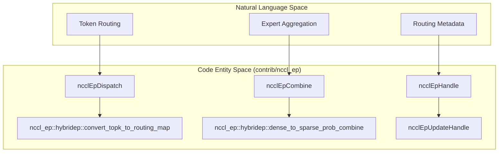
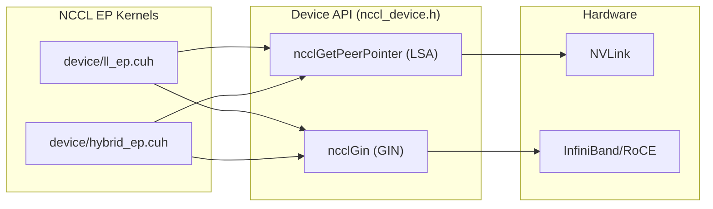

<!-- source: DeepWiki mcp.deepwiki.com · repo NVIDIA/nccl · page 10.3 NCCL EP: Expert Parallelism Extension · fetched 2026-10-26 -->

# NCCL EP: Expert Parallelism Extension

Relevant source files

The following files were used as context for generating this wiki page:

- [contrib/nccl_ep/CMakeLists.txt](contrib/nccl_ep/CMakeLists.txt)
- [contrib/nccl_ep/Makefile](contrib/nccl_ep/Makefile)
- [contrib/nccl_ep/README.md](contrib/nccl_ep/README.md)
- [contrib/nccl_ep/device/device_primitives.cuh](contrib/nccl_ep/device/device_primitives.cuh)
- [contrib/nccl_ep/device/hybrid_ep.cuh](contrib/nccl_ep/device/hybrid_ep.cuh)
- [contrib/nccl_ep/device/hybridep_adapter.cu](contrib/nccl_ep/device/hybridep_adapter.cu)
- [contrib/nccl_ep/device/hybridep_adapter.cuh](contrib/nccl_ep/device/hybridep_adapter.cuh)
- [contrib/nccl_ep/device/hybridep_configs.cuh](contrib/nccl_ep/device/hybridep_configs.cuh)
- [contrib/nccl_ep/device/jit/ht_combine_jit.cuh](contrib/nccl_ep/device/jit/ht_combine_jit.cuh)
- [contrib/nccl_ep/device/jit/ht_dispatch_jit.cuh](contrib/nccl_ep/device/jit/ht_dispatch_jit.cuh)
- [contrib/nccl_ep/device/jit/jit_cache.cc](contrib/nccl_ep/device/jit/jit_cache.cc)
- [contrib/nccl_ep/device/jit/jit_cache.hpp](contrib/nccl_ep/device/jit/jit_cache.hpp)
- [contrib/nccl_ep/device/jit/jit_compiler.hpp](contrib/nccl_ep/device/jit/jit_compiler.hpp)
- [contrib/nccl_ep/device/jit/jit_runtime.cc](contrib/nccl_ep/device/jit/jit_runtime.cc)
- [contrib/nccl_ep/device/jit/jit_runtime.hpp](contrib/nccl_ep/device/jit/jit_runtime.hpp)
- [contrib/nccl_ep/device/jit/jit_utils.cc](contrib/nccl_ep/device/jit/jit_utils.cc)
- [contrib/nccl_ep/device/jit/jit_utils.hpp](contrib/nccl_ep/device/jit/jit_utils.hpp)
- [contrib/nccl_ep/device/jit/ll_clean_jit.cuh](contrib/nccl_ep/device/jit/ll_clean_jit.cuh)
- [contrib/nccl_ep/device/jit/ll_combine_jit.cuh](contrib/nccl_ep/device/jit/ll_combine_jit.cuh)
- [contrib/nccl_ep/device/jit/ll_dispatch_jit.cuh](contrib/nccl_ep/device/jit/ll_dispatch_jit.cuh)
- [contrib/nccl_ep/device/jit/nvcc_compiler.cc](contrib/nccl_ep/device/jit/nvcc_compiler.cc)
- [contrib/nccl_ep/device/jit/preprocess_jit.cuh](contrib/nccl_ep/device/jit/preprocess_jit.cuh)
- [contrib/nccl_ep/device/ll_ep.cuh](contrib/nccl_ep/device/ll_ep.cuh)
- [contrib/nccl_ep/device/scan_kernel.cuh](contrib/nccl_ep/device/scan_kernel.cuh)
- [contrib/nccl_ep/ep_bench.cu](contrib/nccl_ep/ep_bench.cu)
- [contrib/nccl_ep/ep_test.cu](contrib/nccl_ep/ep_test.cu)
- [contrib/nccl_ep/ep_test.py](contrib/nccl_ep/ep_test.py)
- [contrib/nccl_ep/include/common.hpp](contrib/nccl_ep/include/common.hpp)
- [contrib/nccl_ep/include/ep_enums.h](contrib/nccl_ep/include/ep_enums.h)
- [contrib/nccl_ep/include/nccl_ep.h](contrib/nccl_ep/include/nccl_ep.h)
- [contrib/nccl_ep/nccl_ep.cc](contrib/nccl_ep/nccl_ep.cc)
- [contrib/nccl_ep/nccl_ep_env.cc](contrib/nccl_ep/nccl_ep_env.cc)
- [contrib/nccl_ep/nccl_ep_env.h](contrib/nccl_ep/nccl_ep_env.h)
- [contrib/nccl_ep/nccl_ep_test_internal.h](contrib/nccl_ep/nccl_ep_test_internal.h)
- [contrib/nccl_ep/tests/Makefile](contrib/nccl_ep/tests/Makefile)
- [contrib/nccl_ep/tests/run_tests.sh](contrib/nccl_ep/tests/run_tests.sh)
- [contrib/nccl_ep/tests/test_common.h](contrib/nccl_ep/tests/test_common.h)
- [contrib/nccl_ep/tests/test_handle_maps.cu](contrib/nccl_ep/tests/test_handle_maps.cu)
- [contrib/nccl_ep/tests/test_ht_bwd.cu](contrib/nccl_ep/tests/test_ht_bwd.cu)
- [contrib/nccl_ep/tests/test_ht_stale_routing_map.cu](contrib/nccl_ep/tests/test_ht_stale_routing_map.cu)
- [contrib/nccl_ep/tests/test_lifecycle.cu](contrib/nccl_ep/tests/test_lifecycle.cu)
- [contrib/nccl_ep/tests/test_output_layout.cu](contrib/nccl_ep/tests/test_output_layout.cu)
- [contrib/nccl_ep/tests/test_tensor_create.cu](contrib/nccl_ep/tests/test_tensor_create.cu)

NCCL EP is a high-performance extension for efficient Mixture-of-Experts (MoE) communication [contrib/nccl_ep/README.md:1-5](). It provides optimized primitives for token "dispatch" and expert output "combine" operations, implemented on top of the NCCL Device API using Load-Store Accessible (LSA) and GPU-Initiated Networking (GIN) operations [contrib/nccl_ep/README.md:7-9]().

## Overview and Core Primitives

The extension targets Expert Parallelism (EP) by eliminating CPU involvement in the critical path while inheriting NCCL's topology detection and plugin architecture [contrib/nccl_ep/README.md:41-43]().

### Key Primitives
*   **`ncclEpDispatch`**: Routes tokens from a batch to their assigned experts across the distributed system [contrib/nccl_ep/nccl_ep.cc:606-613]().
*   **`ncclEpCombine`**: Aggregates processed expert outputs back into the original batch format [contrib/nccl_ep/nccl_ep.cc:631-637]().
*   **`ncclEpComplete`**: Finalizes outstanding asynchronous operations, primarily used in Low-Latency mode to ensure all GIN signals are processed [contrib/nccl_ep/nccl_ep.cc:653-658]().

### Execution Modes
NCCL EP supports two distinct communication algorithms tailored for different workloads:

| Mode | Target Workload | Characteristics |
| :--- | :--- | :--- |
| **Low-Latency (LL)** | LLM Inference (small batch) | Point-to-point all-to-all using direct NVLink/RDMA. Minimizes latency by avoiding aggregation steps [contrib/nccl_ep/README.md:38-39](). |
| **High-Throughput (HT)** | Training / Prefilling (large batch) | Hierarchical patterns; NVLink for intra-node aggregation and RDMA for inter-node communication. Leverages Hopper warp-specialized pipelines [contrib/nccl_ep/README.md:40-42](). |

**Sources:** [contrib/nccl_ep/README.md:30-43](), [contrib/nccl_ep/nccl_ep.cc:606-658]()

## Lifecycle and Resource Management

The API uses a tiered management structure involving `ncclEpGroup` for shared resources and `ncclEpHandle` for operation-specific metadata.

### Group and Handle Lifecycle
1.  **Group Creation**: `ncclEpCreateGroup` initializes the environment, associating it with a `ncclComm_t`. It allows custom allocators via `ncclEpAllocConfig_t` [contrib/nccl_ep/nccl_ep.cc:257-264]().
2.  **Handle Creation**: `ncclEpCreateHandle` prepares routing metadata. It captures the `ncclEpLayout_t` and caches routing info from `topk_idx` [contrib/nccl_ep/nccl_ep.cc:398-406]().
3.  **Update**: `ncclEpUpdateHandle` allows refreshing routing information (e.g., for new tokens) without destroying the handle [contrib/nccl_ep/nccl_ep.cc:536-541]().
4.  **Execution**: Dispatch and Combine operations are launched on a specified `cudaStream_t` [contrib/nccl_ep/nccl_ep.cc:613-637]().
5.  **Destruction**: Resources are freed via `ncclEpHandleDestroy` and `ncclEpGroupDestroy` [contrib/nccl_ep/nccl_ep.cc:380-385](), [contrib/nccl_ep/nccl_ep.cc:589-593]().

### MoE Routing Data Flow
The following diagram illustrates the transition from high-level MoE concepts to the specific code entities in the EP extension.

**MoE to NCCL EP Mapping**

**Sources:** [contrib/nccl_ep/nccl_ep.cc:606-637](), [contrib/nccl_ep/device/hybridep_adapter.cu:33-42](), [contrib/nccl_ep/device/hybridep_adapter.cuh:115-123]()

## Implementation Details

### Low-Latency (LL) Mode
The LL mode implementation utilizes direct point-to-point communication. It is designed for minimal overhead in latency-sensitive inference tasks [contrib/nccl_ep/README.md:38-39]().

*   **Staged Execution**: Supports computation-communication overlap via a `send-only` flag in `ncclEpDispatchConfig_t` [contrib/nccl_ep/README.md:46-47]().
*   **Message Format**: Uses `DispatchHdr` to carry token identity and per-topk routing entries [contrib/nccl_ep/include/common.hpp:128-131]().
*   **RDMA Staging**: Uses `LowLatencyBuffer` to manage relative offsets for send/recv data and signaling flags within the group's RDMA buffer [contrib/nccl_ep/include/common.hpp:166-178]().

### High-Throughput (HT) Mode
HT mode uses hierarchical patterns and JIT-compiled kernels to optimize for specific topologies [contrib/nccl_ep/device/hybridep_adapter.cuh:26-36]().

*   **Memory Regions**: Uses `dispatch_memory_region_info_t` to manage staging buffers for RDMA and intra-node aggregation [contrib/nccl_ep/device/hybrid_ep.cuh:76-90]().
*   **Layouts**: Supports `NCCL_EP_LAYOUT_FLAT` and `NCCL_EP_LAYOUT_EXPERT_MAJOR` [contrib/nccl_ep/README.md:153-156](). Expert-major layout groups received tokens by local expert to optimize downstream computation.
*   **Preprocessing**: The `call_metadata_preprocessing` function generates dense routing maps from sparse top-k indices, fusing expert-major remap passes when alignment is required [contrib/nccl_ep/device/hybridep_adapter.cuh:132-142]().

### Architecture: Hardware Interaction
The diagram below shows how the EP kernels interact with NCCL's underlying transport mechanisms via the Device API.

**NCCL EP Hardware Abstraction**

**Sources:** [contrib/nccl_ep/device/hybrid_ep.cuh:73-82](), [contrib/nccl_ep/README.md:7-9](), [contrib/nccl_ep/device/hybridep_adapter.cuh:77-86]()

## Python Bindings

The extension includes Python bindings provided via the `nccl.ep` namespace, which can be installed alongside `nccl4py` [contrib/nccl_ep/README.md:80-82]().

*   **`nccl.ep.Group`**: Manages the lifecycle of the EP group.
*   **`nccl.ep.Handle`**: Encapsulates routing state and layout metadata.
*   **Allocators**: Allows Python-defined memory allocators to be used by the C++ library via `nccl_ep.AllocFn` and `nccl_ep.FreeFn` decorators [contrib/nccl_ep/ep_test.py:47-61]().
*   **Tensor Abstraction**: Uses `nccl_ep.Tensor` (or `DevTensor` in tests) to pair raw `cudaMalloc` allocations with NCCL EP descriptors [contrib/nccl_ep/ep_test.py:116-130]().

## Build and Configuration

The extension requires a Hopper (SM90) or newer GPU architecture for HT mode and certain LL optimizations [contrib/nccl_ep/Makefile:17-19]().

### Build Requirements
*   **Compute Capability**: Requires `sm_90` or higher. The build system detects CUDA version to set appropriate architecture flags (e.g., `sm_100` for CUDA 12.8+) [contrib/nccl_ep/Makefile:20-37]().
*   **C++ Standard**: Requires `C++17` for host and device code [contrib/nccl_ep/Makefile:7-7]().
*   **JIT Headers**: Staged headers in `device/jit/` are used for runtime kernel generation in HT mode [contrib/nccl_ep/Makefile:61-72]().

### Key Build Variables
*   **`WARP_TIMING=1`**: Enables internal warp-level timing instrumentation via `HYBRIDEP_ENABLE_WARP_TIMING` [contrib/nccl_ep/Makefile:99-102]().
*   **`NCCL_EP_MAJOR/MINOR/PATCH`**: Defined in `include/nccl_ep.h`, these serve as the single source of truth for library versioning [contrib/nccl_ep/include/nccl_ep.h:21-23]().

**Sources:** [contrib/nccl_ep/Makefile:7-102](), [contrib/nccl_ep/CMakeLists.txt:6-33](), [contrib/nccl_ep/include/nccl_ep.h:21-68]()

---

