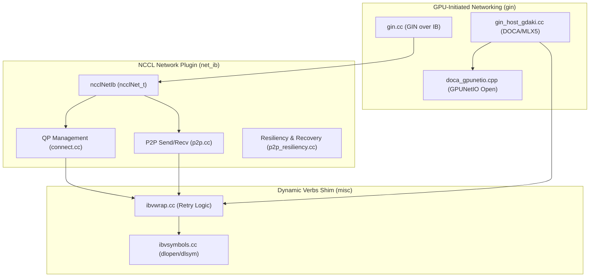
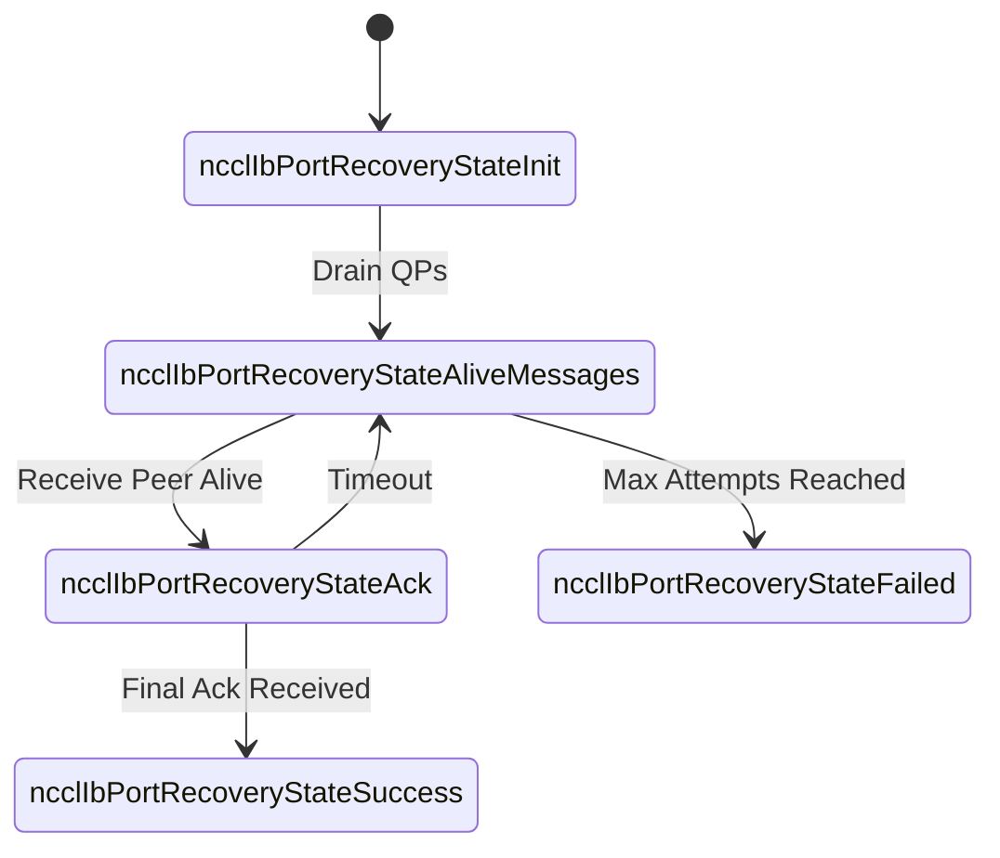

<!-- source: DeepWiki mcp.deepwiki.com · repo NVIDIA/nccl · page 5.3 InfiniBand and RDMA Transport · fetched 2026-10-26 -->

# InfiniBand and RDMA Transport

Relevant source files

The following files were used as context for generating this wiki page:

- [src/graph/xml.cc](src/graph/xml.cc)
- [src/graph/xml.h](src/graph/xml.h)
- [src/include/cudawrap.h](src/include/cudawrap.h)
- [src/include/ibvcore.h](src/include/ibvcore.h)
- [src/include/ibvsymbols.h](src/include/ibvsymbols.h)
- [src/include/ibvwrap.h](src/include/ibvwrap.h)
- [src/include/plugin/gin/gin_v13.h](src/include/plugin/gin/gin_v13.h)
- [src/misc/cudawrap.cc](src/misc/cudawrap.cc)
- [src/misc/ibvsymbols.cc](src/misc/ibvsymbols.cc)
- [src/misc/ibvwrap.cc](src/misc/ibvwrap.cc)
- [src/os/windows_ipcsocket.cc](src/os/windows_ipcsocket.cc)
- [src/transport/net_ib/CMakeLists.txt](src/transport/net_ib/CMakeLists.txt)
- [src/transport/net_ib/common.cc](src/transport/net_ib/common.cc)
- [src/transport/net_ib/common.h](src/transport/net_ib/common.h)
- [src/transport/net_ib/connect.cc](src/transport/net_ib/connect.cc)
- [src/transport/net_ib/connect.h](src/transport/net_ib/connect.h)
- [src/transport/net_ib/gdaki/doca-gpunetio/include/host/doca_error.h](src/transport/net_ib/gdaki/doca-gpunetio/include/host/doca_error.h)
- [src/transport/net_ib/gdaki/doca-gpunetio/include/host/mlx5_ifc.h](src/transport/net_ib/gdaki/doca-gpunetio/include/host/mlx5_ifc.h)
- [src/transport/net_ib/gdaki/doca-gpunetio/src/doca_gpunetio.cpp](src/transport/net_ib/gdaki/doca-gpunetio/src/doca_gpunetio.cpp)
- [src/transport/net_ib/gdaki/doca-gpunetio/src/doca_gpunetio_gdrcopy.h](src/transport/net_ib/gdaki/doca-gpunetio/src/doca_gpunetio_gdrcopy.h)
- [src/transport/net_ib/gdaki/doca-gpunetio/src/doca_verbs_device_attr.cpp](src/transport/net_ib/gdaki/doca-gpunetio/src/doca_verbs_device_attr.cpp)
- [src/transport/net_ib/gdaki/doca-gpunetio/src/doca_verbs_net_wrapper.h](src/transport/net_ib/gdaki/doca-gpunetio/src/doca_verbs_net_wrapper.h)
- [src/transport/net_ib/gdaki/doca-gpunetio/src/doca_verbs_uar.cpp](src/transport/net_ib/gdaki/doca-gpunetio/src/doca_verbs_uar.cpp)
- [src/transport/net_ib/gdaki/doca-gpunetio/src/doca_verbs_umem.cpp](src/transport/net_ib/gdaki/doca-gpunetio/src/doca_verbs_umem.cpp)
- [src/transport/net_ib/gdaki/gin_host_gdaki.cc](src/transport/net_ib/gdaki/gin_host_gdaki.cc)
- [src/transport/net_ib/gdaki/gin_host_gdaki.h](src/transport/net_ib/gdaki/gin_host_gdaki.h)
- [src/transport/net_ib/gin.cc](src/transport/net_ib/gin.cc)
- [src/transport/net_ib/init.cc](src/transport/net_ib/init.cc)
- [src/transport/net_ib/p2p.cc](src/transport/net_ib/p2p.cc)
- [src/transport/net_ib/p2p_resiliency.cc](src/transport/net_ib/p2p_resiliency.cc)
- [src/transport/net_ib/p2p_resiliency.h](src/transport/net_ib/p2p_resiliency.h)
- [src/transport/net_ib/p2p_resiliency_recovery.cc](src/transport/net_ib/p2p_resiliency_recovery.cc)
- [src/transport/net_ib/p2p_resiliency_recovery.h](src/transport/net_ib/p2p_resiliency_recovery.h)
- [src/transport/net_ib/wqe_lat_mon.cc](src/transport/net_ib/wqe_lat_mon.cc)
- [src/transport/net_ib/wqe_lat_mon.h](src/transport/net_ib/wqe_lat_mon.h)

## Purpose and Scope

This page describes NCCL's InfiniBand and RoCE (RDMA over Converged Ethernet) transport implementation. The transport layer is responsible for high-performance inter-node communication using Remote Memory Access (RDMA) primitives.

The implementation is centered around:
- `src/transport/net_ib/`: The core InfiniBand network plugin, implementing the `ncclNet_t` interface. This includes complex Queue Pair (QP) management, RDMA send/recv operations, and resiliency mechanisms.
- `src/misc/ibvwrap.cc` and `src/misc/ibvsymbols.cc`: A dynamic symbol resolution layer that loads `libibverbs` at runtime, providing a shim for all `ibv_*` calls with enhanced error checking and retry logic.
- `src/transport/net_ib/gdaki/`: Support for GPU-Initiated Direct Access (GDAKI), allowing GPU kernels to trigger network operations directly via the GIN (GPU-Initiated Networking) subsystem and DOCA GPUNetIO.

The IB transport is selected during communicator initialization when InfiniBand hardware is detected and determined to be the optimal path by the topology system.

Sources: [src/transport/net_ib/p2p.cc:1-20](), [src/misc/ibvwrap.cc:1-30](), [src/transport/net_ib/init.cc:1-30]()

---

## Architecture and Component Mapping

The InfiniBand transport acts as a bridge between the NCCL network API and the low-level verbs drivers.

**IB Transport Component Map**

Sources: [src/transport/net_ib/p2p.cc:21-36](), [src/transport/net_ib/connect.cc:64-78](), [src/misc/ibvwrap.cc:26-30](), [src/transport/net_ib/gdaki/gin_host_gdaki.cc:25-30]()

---

## Queue Pair (QP) Management

NCCL establishes RDMA connections using Reliable Connected (RC) Queue Pairs. The connection process involves a handshake over the bootstrap network to exchange GIDs, LIDs, and Queue Pair Numbers (QPNs).

### QP Lifecycle and States
QPs transition through several states defined by the IB specification. The `ncclIbCommState` enum in `connect.cc` tracks the internal state machine for establishing these connections.
1.  **RESET -> INIT**: Sets the primary port and access flags (Local Write, Remote Write, Remote Read).
2.  **INIT -> RTR (Ready to Receive)**: Configures the remote QPN, LID/GID, and MTU.
3.  **RTR -> RTS (Ready to Send)**: Configures timeout, retry counts, and sequence numbers.

### Multi-QP Support
NCCL can use multiple QPs per connection to maximize bandwidth and utilize hardware features like Adaptive Routing (AR). The number of QPs is controlled by `NCCL_IB_QPS_PER_CONNECTION`.

| Entity | Role |
| :--- | :--- |
| `ncclIbQp` | Struct holding `ibv_qp` and its connection attributes (`initAttr`, `rtrAttr`, `rtsAttr`). |
| `ncclIbHandle` | Metadata exchanged via bootstrap to establish the RDMA link. |
| `ncclIbInitCommDevBase` | Initializes the protection domain (`ibv_pd`) and completion queue (`ibv_cq`). |

Sources: [src/transport/net_ib/connect.cc:32-43](), [src/transport/net_ib/connect.cc:52-60](), [src/transport/net_ib/connect.cc:66-84](), [src/transport/net_ib/common.cc:51-62]()

---

## `ibvwrap.cc`: Resilient Symbol Resolution

NCCL does not link directly against `libibverbs.so` at build time by default. Instead, it uses a dynamic loading mechanism to remain portable.

### Dynamic Loading
`buildIbvSymbols` in `ibvsymbols.cc` attempts to load `libibverbs.so` or `libibverbs.so.1` using `dlopen`. It populates the `ncclIbvSymbols` structure with function pointers for all required verbs APIs.

Sources: [src/misc/ibvsymbols.cc:74-88](), [src/misc/ibvsymbols.cc:108-137]()

### `ibv_modify_qp` Retry Logic
Modifying QP states can fail transiently in heavily loaded systems. `wrap_ibv_modify_qp` implements a retry loop with exponential backoff.

| Parameter | Environment Variable | Default |
| :--- | :--- | :--- |
| Max Retries | `NCCL_IB_MQP_RETRY_CNT` | 34 |
| Sleep Interval | `NCCL_IB_MQP_RETRY_SLEEP_MSEC` | 100ms |
| Retry All Errors | `NCCL_IB_MQP_RETRY_ALL` | 0 (Only ETIMEDOUT) |

Sources: [src/misc/ibvwrap.cc:98-106](), [src/misc/ibvwrap.cc:290-312]()

---

## Resiliency and Recovery

The IB transport includes a resiliency layer to handle network faults without aborting the communicator.

### Error Detection
When a Work Completion (`ibv_wc`) returns an error (e.g., `IBV_WC_RETRY_EXC_ERR` or `IBV_WC_WR_FLUSH_ERR`), `ncclIbResiliencyCheckErrorNotFatal` determines if the system can recover. If non-fatal, NCCL attempts a failover to another functional device or QP.

Sources: [src/transport/net_ib/p2p_resiliency.cc:23-65](), [src/transport/net_ib/p2p_resiliency.cc:68-124]()

### Port Recovery Protocol
The recovery process involves an asynchronous thread (`ncclIbPortRecoveryAsyncThread`) that executes a handshake protocol to re-establish connectivity on a failed port.

**Recovery State Machine**

Sources: [src/transport/net_ib/p2p_resiliency_recovery.cc:78-112](), [src/transport/net_ib/p2p_resiliency_recovery.cc:35-42]()

---

## GPUDirect RDMA and DMA-BUF

NCCL optimizes data transfers by allowing the HCA to access GPU memory directly.

### Memory Registration
NCCL supports multiple memory registration paths in `gdakiRegMr`:
- **Standard Verbs**: `ibv_reg_mr_iova2` with `IBV_ACCESS_RELAXED_ORDERING` if supported.
- **DMA-BUF**: Uses Linux DMA-BUF handles for GPU memory, providing a more robust registration path that avoids some limitations of `nv_peer_mem`. It uses `cuMemGetHandleForAddressRange` to obtain the FD.

Sources: [src/transport/net_ib/gdaki/gin_host_gdaki.cc:100-153](), [src/transport/net_ib/gdaki/gin_host_gdaki.cc:155-166]()

### GDAKI (GPU-Direct Access)
For Hopper and later architectures, NCCL supports GDAKI, which allows the GPU to initiate network operations via DOCA GPUNetIO. This bypasses the CPU for posting work requests.

| Code Entity | Description |
| :--- | :--- |
| `doca_gpu_create` | Initializes the DOCA GPU device handle using the PCI Bus ID. |
| `gdakiRegMr` | Registers memory with `MLX5DV_REG_DMABUF_ACCESS_DATA_DIRECT` for low-latency access. |
| `ncclGinIbGdakiInitOnce` | Discovers MLX5 providers capable of GDAKI support. |

Sources: [src/transport/net_ib/gdaki/doca-gpunetio/src/doca_gpunetio.cpp:123-162](), [src/transport/net_ib/gdaki/gin_host_gdaki.cc:124-133](), [src/transport/net_ib/gin.cc:54-72]()

---

## Configuration Parameters

The IB transport is highly tunable via environment variables:

| Variable | Description | Default |
| :--- | :--- | :--- |
| `NCCL_IB_DISABLE` | Disable InfiniBand transport | 0 |
| `NCCL_IB_ADAPTIVE_ROUTING` | Enable Adaptive Routing support | -2 (Auto) |
| `NCCL_IB_TIMEOUT` | IB QP timeout (4.096us * 2^timeout) | 20 |
| `NCCL_IB_RETRY_CNT` | IB QP retry count | 7 |
| `NCCL_IB_PCI_RELAXED_ORDERING` | Enable PCI Relaxed Ordering | 2 |
| `NCCL_IB_OOO_RQ` | Enable Out-of-Order Receive Queue support | 0 |

Sources: [src/transport/net_ib/init.cc:11-16](), [src/transport/net_ib/connect.cc:12-22](), [src/transport/net_ib/init.cc:27-30]()

---

