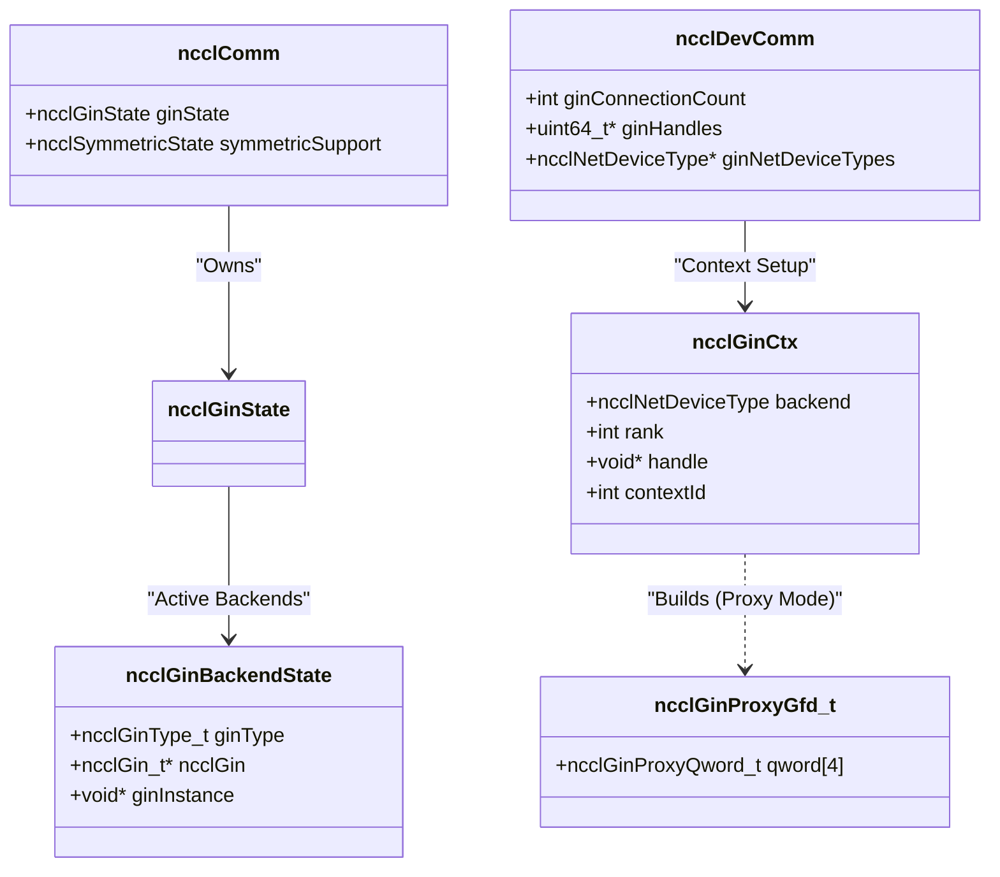

<!-- source: DeepWiki mcp.deepwiki.com · repo NVIDIA/nccl · page 5.9 GIN and RMA: Device-Initiated Networking · fetched 2026-10-26 -->

# GIN and RMA: Device-Initiated Networking

<details>
<summary>Relevant source files</summary>

The following files were used as context for generating this wiki page:

- [.clang-format](.clang-format)
- [.clang-format-ignore](.clang-format-ignore)
- [docs/userguide/source/api/p2p.rst](docs/userguide/source/api/p2p.rst)
- [docs/userguide/source/usage/p2p.rst](docs/userguide/source/usage/p2p.rst)
- [maint/README.md](maint/README.md)
- [maint/run-clang-format.sh](maint/run-clang-format.sh)
- [src/gin/gin_host.cc](src/gin/gin_host.cc)
- [src/gin/gin_host_proxy.cc](src/gin/gin_host_proxy.cc)
- [src/include/gin/gin_host.h](src/include/gin/gin_host.h)
- [src/include/gin/gin_host_win_stub.h](src/include/gin/gin_host_win_stub.h)
- [src/include/nccl_device/core.h](src/include/nccl_device/core.h)
- [src/include/nccl_device/gin.h](src/include/nccl_device/gin.h)
- [src/include/nccl_device/gin/efa_gda/gin_efa_gda.h](src/include/nccl_device/gin/efa_gda/gin_efa_gda.h)
- [src/include/nccl_device/gin/efa_gda/gin_efa_gda_dev.h](src/include/nccl_device/gin/efa_gda/gin_efa_gda_dev.h)
- [src/include/nccl_device/gin/gdaki/gin_gdaki.h](src/include/nccl_device/gin/gdaki/gin_gdaki.h)
- [src/include/nccl_device/gin/gin_device_api.h](src/include/nccl_device/gin/gin_device_api.h)
- [src/include/nccl_device/gin/gin_device_common.h](src/include/nccl_device/gin/gin_device_common.h)
- [src/include/nccl_device/gin/gpi/gin_gpi.h](src/include/nccl_device/gin/gpi/gin_gpi.h)
- [src/include/nccl_device/gin/proxy/gin_proxy.h](src/include/nccl_device/gin/proxy/gin_proxy.h)
- [src/include/nccl_device/gin/proxy/gin_proxy_device_host_common.h](src/include/nccl_device/gin/proxy/gin_proxy_device_host_common.h)
- [src/include/nccl_device/impl/gin__funcs.h](src/include/nccl_device/impl/gin__funcs.h)
- [src/include/nccl_device/net_device.h](src/include/nccl_device/net_device.h)
- [src/include/plugin/gin/gin_v13.h](src/include/plugin/gin/gin_v13.h)
- [src/include/plugin/gin/gin_v14.h](src/include/plugin/gin/gin_v14.h)
- [src/include/plugin/nccl_gin.h](src/include/plugin/nccl_gin.h)
- [src/include/plugin/nccl_rma.h](src/include/plugin/nccl_rma.h)
- [src/include/plugin/rma/rma_v14.h](src/include/plugin/rma/rma_v14.h)
- [src/include/plugin/rma/rma_v15.h](src/include/plugin/rma/rma_v15.h)
- [src/include/profiler.h](src/include/profiler.h)
- [src/include/rma/rma.h](src/include/rma/rma.h)
- [src/include/rma/rma_proxy.h](src/include/rma/rma_proxy.h)
- [src/os/windows_stubs.cc](src/os/windows_stubs.cc)
- [src/plugin/gin/gin_v13.cc](src/plugin/gin/gin_v13.cc)
- [src/plugin/gin/gin_v14.cc](src/plugin/gin/gin_v14.cc)
- [src/plugin/profiler.cc](src/plugin/profiler.cc)
- [src/plugin/rma/CMakeLists.txt](src/plugin/rma/CMakeLists.txt)
- [src/plugin/rma/rma_v13.cc](src/plugin/rma/rma_v13.cc)
- [src/plugin/rma/rma_v14.cc](src/plugin/rma/rma_v14.cc)
- [src/plugin/rma/rma_v15.cc](src/plugin/rma/rma_v15.cc)
- [src/rma/rma.cc](src/rma/rma.cc)
- [src/rma/rma_proxy.cc](src/rma/rma_proxy.cc)
- [src/rma/rma_proxy_launch.cc](src/rma/rma_proxy_launch.cc)
- [src/rma/rma_proxy_progress.cc](src/rma/rma_proxy_progress.cc)
- [src/transport/net_ib/gdaki/gin_host_gdaki.cc](src/transport/net_ib/gdaki/gin_host_gdaki.cc)
- [src/transport/net_ib/gdaki/gin_host_gdaki.h](src/transport/net_ib/gdaki/gin_host_gdaki.h)
- [src/transport/net_ib/gin.cc](src/transport/net_ib/gin.cc)

</details>


This page describes the architecture and implementation of **GPU-Initiated Networking (GIN)** in `src/gin/` and **Remote Memory Access (RMA)** in `src/rma/`. These subsystems enable GPU kernels to directly initiate network transfers and perform remote memory operations, reducing CPU overhead and latency for fine-grained communication.

## Purpose and Scope

Traditionally, NCCL relies on a host-side proxy thread to manage network state machines and InfiniBand verbs. GIN and RMA shift the initiation of these operations to the GPU device itself.
- **GIN (GPU-Initiated Networking):** Provides device-side primitives for network transfers (Put, Signal) via specialized hardware paths or proxy-assisted mechanisms.
- **RMA (Remote Memory Access):** Manages window-based memory registration and coordination between host-side proxy paths and hardware-accelerated device paths.

## Architecture Overview

The GIN/RMA subsystem bridges high-level collectives with low-level network hardware. It supports multiple backend types categorized by how the GPU interacts with the NIC.

### GIN Types
1.  **PROXY:** The GPU kernel writes a command (GFD) to a shared memory FIFO. The host-side progress thread polls this queue and executes the network operation [src/gin/gin_host_proxy.cc:112-152]().
2.  **GDAKI (GPU Direct Async Kernel Initiation):** A hardware-accelerated path using NVIDIA DOCA GPUNetIO. The GPU kernel directly triggers NIC operations via doorbells, bypassing the host CPU [src/include/nccl_device/gin/gdaki/gin_gdaki.h:59-126]().
3.  **EFA_GDA:** A specialization for AWS EFA devices using `efa-dp-direct` to post WQEs and ring doorbells directly from GPU threads [src/include/nccl_device/gin/efa_gda/gin_efa_gda.h:10-15]().

### Coordination Diagram: Device to Network
The following diagram illustrates the data flow from a GPU kernel through the GIN backends to the network.

**Diagram: GIN/RMA Data Flow**
```mermaid
graph TD
    subgraph "GPU Device (src/device)"
        [GPU_Kernel] --> |"ncclGinPut/Signal"| [ncclGin_C]
        [ncclGin_C] --> |"buildGfd"| [GFD_Descriptor]
    end

    subgraph "GIN Backends (src/gin)"
        [GFD_Descriptor] --> |"PROXY Path"| [ginProxyHostGpuCtx]
        [GFD_Descriptor] --> |"GDAKI Path"| [ncclGinGdakiGPUContext]
        [GFD_Descriptor] --> |"EFA Path"| [nccl_ofi_gin_gdaki_dev_handle]
    end

    subgraph "Host Progress (src/gin)"
        [ginProxyHostGpuCtx] --> |"Poll GFD"| [proxyGinPollCompletions]
        [proxyGinPollCompletions] --> |"rmaBackend->test"| [Network_NIC]
        [ncclGinProgress] --> |"ginProgress"| [Backend_Poll]
    end

    subgraph "Hardware"
        [ncclGinGdakiGPUContext] --> |"Direct Doorbell"| [Network_NIC]
        [nccl_ofi_gin_gdaki_dev_handle] --> |"ringDoorbell"| [Network_NIC]
        [Network_NIC] --> |"RDMA"| [Remote_Peer]
    end
```
**Sources:** [src/include/nccl_device/impl/gin__funcs.h:145-154](), [src/include/nccl_device/gin/proxy/gin_proxy.h:101-136](), [src/gin/gin_host_proxy.cc:112-152](), [src/include/nccl_device/gin/gdaki/gin_gdaki.h:59-126](), [src/gin/gin_host.cc:56-87](), [src/include/nccl_device/gin/efa_gda/gin_efa_gda.h:111-122]()

---

## Remote Memory Access (RMA) Implementation

The RMA subsystem handles memory window lifecycles and coordination of proxy paths.

### RMA Proxy Path
When network involvement is required in proxy mode, the RMA proxy manages asynchronous `put` and `signal` operations coordinated via host threads.
- **Signal Buffers:** Signals are allocated on the GPU and registered with the RMA plugin. Host-side `signalsHost` tracks expected values [src/rma/rma_proxy.cc:122-129]().
- **Sequence Management:** Per-rank sequence numbers (`opSeqs`, `readySeqs`, `doneSeqs`) are used to track descriptor progress across CPU-accessible memory [src/rma/rma_proxy.cc:132-137]().
- **Progress Loop:** A host thread polls for completions in `proxyGinPollCompletions`, updating GPU counters once operations are finished [src/gin/gin_host_proxy.cc:112-152]().

**Sources:** [src/rma/rma_proxy.cc:122-156](), [src/gin/gin_host_proxy.cc:112-152]()

---

## GPU-Initiated Networking (GIN) Implementation

GIN provides the device-side logic to initiate network operations, abstracting hardware into a unified API.

### GIN Device-Side Logic
The `ncclGin_C` class and `ncclGinCtx` manage the device state [src/include/nccl_device/impl/gin__funcs.h:139-143]().
- **GFD Building:** For PROXY mode, `buildGfd` constructs a descriptor containing the operation type, source/destination offsets, and handles [src/include/nccl_device/gin/proxy/gin_proxy.h:141-150]().
- **Posting:** `postGfd` writes the descriptor to the queue using 16-byte vector stores (`__stwt`) to ensure write-through to memory visible by the host [src/include/nccl_device/gin/proxy/gin_proxy.h:101-136]().

### GDAKI (DOCA) Path
GDAKI utilizes `doca_gpu_dev_verbs` to perform direct operations [src/include/nccl_device/gin/gdaki/gin_gdaki.h:27-28]().
- **Resource Sharing:** Supports `EXCLUSIVE`, `CTA`, and `GPU` sharing modes for Queue Pairs (QP) [src/include/nccl_device/gin/gdaki/gin_gdaki.h:131-150]().
- **Direct Put:** `putImplMode` translates GIN parameters into DOCA verbs like `doca_gpu_dev_verbs_put_signal_counter` [src/include/nccl_device/gin/gdaki/gin_gdaki.h:99-102]().

### EFA GDA Path
The EFA GDA implementation targets AWS EFA via `efa-dp-direct` [src/include/nccl_device/gin/efa_gda/gin_efa_gda.h:5-9]().
- **Hardware Counters:** Uses 31-bit masked differences to compare producer cursors with NIC hardware counters [src/include/nccl_device/gin/efa_gda/gin_efa_gda.h:47-54]().
- **Doorbell MMIO:** `ringDoorbell` performs a relaxed MMIO write to the SQ doorbell address followed by a system-scope fence [src/include/nccl_device/gin/efa_gda/gin_efa_gda.h:111-122]().

**Sources:** [src/include/nccl_device/gin/proxy/gin_proxy.h:101-150](), [src/include/nccl_device/gin/gdaki/gin_gdaki.h:131-150](), [src/include/nccl_device/gin/efa_gda/gin_efa_gda.h:111-122]()

---

## Code Entity Map

The following diagram maps the GIN/RMA system components to the specific code entities that implement them.

**Diagram: GIN/RMA Code Entity Relationship**

**Sources:** [src/gin/gin_host.cc:92-110](), [src/include/nccl_device/impl/gin__funcs.h:159-174](), [src/include/gin/gin_host.h:40-60](), [src/include/nccl_device/gin/proxy/gin_proxy_device_host_common.h:52-56]()

### Key Data Structures

| Structure | File | Description |
| :--- | :--- | :--- |
| `ncclGinState` | [src/include/gin/gin_host.h:40-60]() | Host-side state managing backends, progress threads, and connection types. |
| `ncclGinProxyGfd_t` | [src/include/nccl_device/gin/proxy/gin_proxy_device_host_common.h:52-56]() | 64-byte descriptor for GPU-to-Proxy communication. |
| `ncclGinGdakiGPUContext` | [src/transport/net_ib/gdaki/gin_host_gdaki.h:14-22]() | Device-side handle for GDAKI (DOCA) Queue Pairs and memory keys. |
| `ncclDevCommRequirements` | [src/include/nccl_device/core.h:106-155]() | Structure used to request GIN resources (contexts, signals, counters) during communicator init. |

**Sources:** [src/include/gin/gin_host.h:40-60](), [src/include/nccl_device/gin/proxy/gin_proxy_device_host_common.h:52-56](), [src/include/nccl_device/core.h:106-155]()

---

