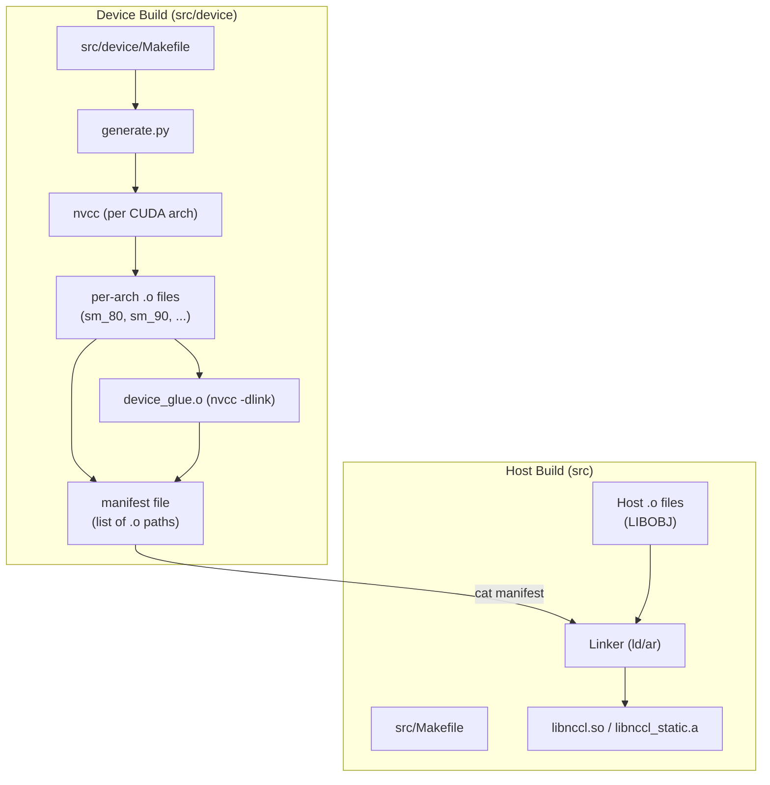
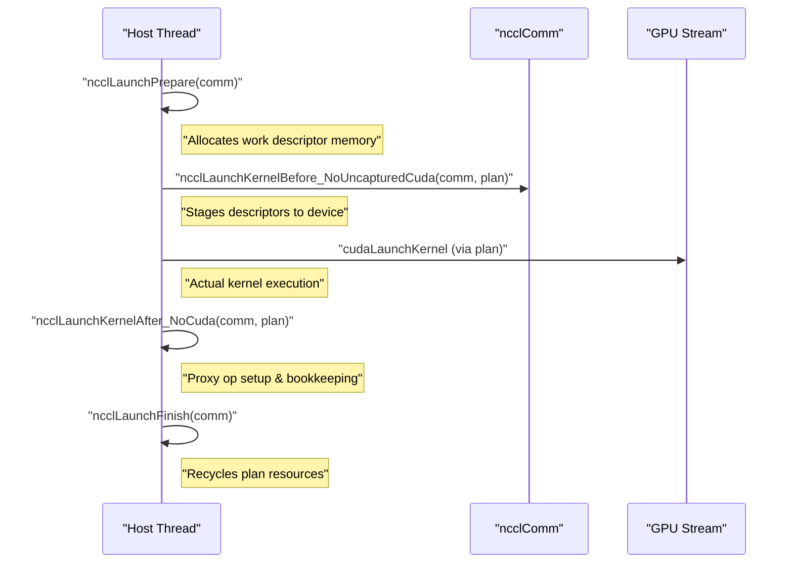
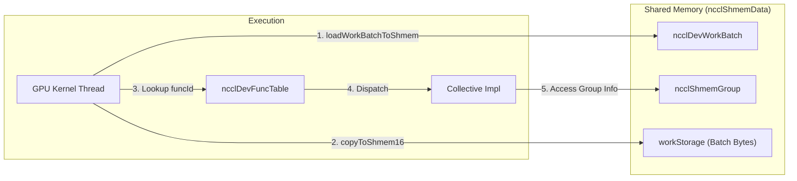

<!-- source: DeepWiki mcp.deepwiki.com · repo NVIDIA/nccl · page 7 Device-Side Execution · fetched 2026-10-26 -->

# Device-Side Execution

<details>
<summary>Relevant source files</summary>

The following files were used as context for generating this wiki page:

- [src/device/CMakeLists.txt](src/device/CMakeLists.txt)
- [src/device/Makefile](src/device/Makefile)
- [src/device/common.h](src/device/common.h)
- [src/device/common_kernel.h](src/device/common_kernel.h)
- [src/device/generate.py](src/device/generate.py)
- [src/device/prims_ll.h](src/device/prims_ll.h)
- [src/device/prims_ll128.h](src/device/prims_ll128.h)
- [src/include/os/windows.h](src/include/os/windows.h)
- [src/plugin/net.cc](src/plugin/net.cc)

</details>


## Purpose and Scope

This page covers the infrastructure that compiles, links, and dispatches GPU-side NCCL kernels. It describes the `src/device/` build process and manifest system, the architecture-specific function registration mechanism, and the host-side launch chain that bridges host-side planning to device-side execution.

For details on specific kernel logic, see:
- [Collective Kernel Implementations](#7.1) — Per-collective logic (Ring, Tree, NVLS).
- [Communication Primitives and Protocols](#7.2) — Data movement protocols (Simple, LL, LL128).
- [Symmetric Memory and Device API](#7.3) — GPU-initiated networking and direct memory access.

---

## The `src/device/` Subdirectory

All GPU-executable code lives under `src/device/`. It is built as a separate make invocation rather than as part of the main `src/` compilation. The build process uses a manifest system to coordinate with the host-side library link.

- **Source Generation**: NCCL uses `generate.py` and `symmetric/generate.py` to produce a large volume of kernel variants for different data types, collectives, algorithms, and protocols. [src/device/Makefile:80-91](), [src/device/CMakeLists.txt:1-17]()
- **Object Compilation**: Kernels are compiled into `.o` object files with architecture-specific flags (e.g., `-maxrregcount=128`). [src/device/Makefile:27-28]()
- **Device Link (dlink)**: All device objects are combined into a single `device_glue.o` using `nvcc -dlink`. [src/device/Makefile:133-134]()
- **Manifest**: A file at `$(OBJDIR)/manifest` lists all generated object files and the glue object for the top-level link. [src/device/Makefile:137-138]()

Sources: [src/device/Makefile:20-22](), [src/device/Makefile:80-91](), [src/device/Makefile:133-139](), [src/device/CMakeLists.txt:48-71]()

---

## The Manifest System

The manifest file is the interface between the device sub-build and the main library link step.

**Build-time data flow diagram:**



When the top-level `src/Makefile` links `libnccl.so`, it reads the manifest and passes those object file paths directly to the linker. This ensures the final library contains optimized kernels for all targeted architectures.

Sources: [src/device/Makefile:20-22](), [src/device/Makefile:137-139](), [src/device/CMakeLists.txt:1-17]()

---

## Architecture-Specific Function Selection

NCCL selects kernel function pointers at communicator creation time based on the target GPU's compute capability.

### Device Function Table
The device code exports a global table of function pointers, `ncclDevFuncTable`, which contains the entry points for all supported combinations of collectives, algorithms, and protocols. [src/device/common.h:26-32]()

```cpp
typedef void (*ncclDevFuncPtr_t)();
extern __device__ ncclDevFuncPtr_t const ncclDevFuncTable[];
```

### Registration and Initialization
The device kernels are compiled for specific architectures (e.g., SM90 for Hopper, SM100 for Blackwell). The build system uses `NVCC_GENCODE_LDMC_FP8` and other flags to target specific hardware features. [src/device/Makefile:47-53](). This allows NCCL to use architecture-specific optimizations when available, while falling back to generic implementations on older hardware.

Sources: [src/device/common.h:26-32](), [src/device/Makefile:47-53](), [src/device/Makefile:27-28]()

---

## The Host-to-Device Launch Chain

Once a `ncclKernelPlan` is assembled, the host drives it to execution through a sequence of functions designed to be compatible with **CUDA Graph Capture**.

**Kernel Launch Sequence:**



The system is split to ensure that no "uncaptured" CUDA calls occur during the critical path of a CUDA Graph recording. The device kernel receives its parameters through the `ncclDevKernelArgs` structure. [src/device/common.h:49-53]()

Sources: [src/device/common.h:49-53](), [src/device/common.h:140-142]()

---

## Work Batch Dispatch

The GPU kernel is a generic driver that processes a list of `ncclDevWorkBatch` structures. These batches are loaded into shared memory to minimize global memory traffic.

### Device-Side Dispatch
Inside the kernel, threads load the work batch into Shared Memory (`ncclShmem`) using `loadWorkBatchToShmem`. [src/device/common.h:140-141](). The kernel then dispatches to the implementation indexed by `funcId`. [src/device/common.h:58]()

**Work Loading Logic:**
1.  **Bitset Resolution**: The kernel uses `offsetBitset` to identify which work items are active in the current batch. [src/device/common.h:145-164]()
2.  **Shared Memory Copy**: Data is moved to `ncclShmem` using optimized 16-byte copies (`copyToShmem16`). [src/device/common.h:129-137]()
3.  **Warp Scratchpad**: Warps use `ncclScratchForWarp` to manage intermediate results during bitset computation. [src/device/common.h:80-82]()



Sources: [src/device/common.h:48-72](), [src/device/common.h:129-137](), [src/device/common.h:140-196]()

---

## Shared Memory Layout

NCCL heavily utilizes shared memory for performance. The `ncclShmemData` structure contains:
- **`args`**: Kernel arguments and communicator state. [src/device/common.h:49-53]()
- **`groups`**: Metadata for the active communication groups (up to `NCCL_MAX_GROUPS`). [src/device/common.h:63]()
- **`workStorage`**: A buffer of size `ncclMaxDevWorkBatchBytes()` for staging work items. [src/device/common.h:65]()
- **`devicePlugin`**: Opaque storage for plugin-specific shared memory data (e.g., for `unpack`). [src/device/common.h:67-70]()
- **`ncclShmemPerWarp`**: A scratchpad used by warps for synchronization and bitset operations. [src/device/common.h:73-78]()

Sources: [src/device/common.h:48-82]()

---

