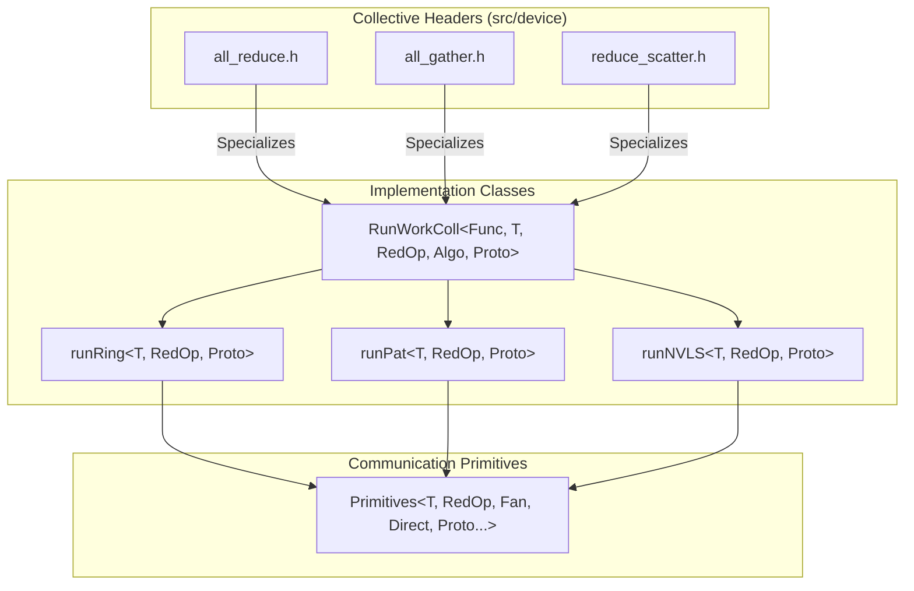
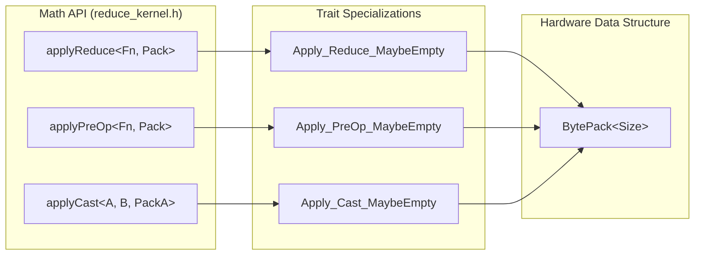

<!-- source: DeepWiki mcp.deepwiki.com · repo NVIDIA/nccl · page 7.1 Collective Kernel Implementations · fetched 2026-10-26 -->

# Collective Kernel Implementations

Relevant source files

The following files were used as context for generating this wiki page:

- [src/device/all_gather.h](src/device/all_gather.h)
- [src/device/prims_simple.h](src/device/prims_simple.h)
- [src/device/reduce_kernel.h](src/device/reduce_kernel.h)
- [src/device/reduce_scatter.h](src/device/reduce_scatter.h)
- [src/include/collectives.h](src/include/collectives.h)
- [src/include/device.h](src/include/device.h)
- [src/include/ras.h](src/include/ras.h)
- [src/ras/client.cc](src/ras/client.cc)
- [src/ras/client_support.cc](src/ras/client_support.cc)
- [src/ras/collectives.cc](src/ras/collectives.cc)
- [src/ras/peers.cc](src/ras/peers.cc)
- [src/ras/ras.cc](src/ras/ras.cc)
- [src/ras/ras_internal.h](src/ras/ras_internal.h)
- [src/ras/ras_param.cc](src/ras/ras_param.cc)
- [src/ras/ras_param.h](src/ras/ras_param.h)
- [src/ras/rasnet.cc](src/ras/rasnet.cc)

The device-side implementation of NCCL collectives is located in `src/device/`. Each collective operation (AllReduce, AllGather, ReduceScatter, Broadcast, Reduce, and SendRecv) is implemented as a set of header files that define the data movement logic for different communication algorithms (Ring, Tree, NVLS, PAT). These implementations leverage a common set of communication primitives and math functions to ensure high performance and consistency across different hardware topologies and protocols.

## Architecture of Collective Kernels

Collective kernels are structured as template functions that are specialized based on the data type (`T`), the reduction operation (`RedOp`), and the communication protocol (`Proto`).

### Per-Collective Implementation Headers

Each collective has a dedicated header file in `src/device/` that contains the algorithm-specific logic:

*   **AllReduce** (`all_reduce.h`): Implements Ring, Tree, and NVLS algorithms.
*   **AllGather** (`all_gather.h`): Implements Ring and PAT (Parallel Aggregation Tree) algorithms. [src/device/all_gather.h:13-115]()
*   **ReduceScatter** (`reduce_scatter.h`): Implements Ring, PAT, and NVLS algorithms. [src/device/reduce_scatter.h:13-152]()
*   **Broadcast** (`broadcast.h`): Implements Ring and Tree algorithms.
*   **Reduce** (`reduce.h`): Implements Ring and Tree algorithms.
*   **SendRecv** (`sendrecv.h`): Implements point-to-point primitives used within the collective framework.

### Mapping Collective to Code Entities

The following diagram shows how a collective operation call maps to specific implementation classes and functions within the device code.

**Collective Kernel Mapping**

**Sources:** [src/device/all_gather.h:91-115](), [src/device/reduce_scatter.h:59-152](), [src/device/reduce_scatter.h:13-56]()

---

## Algorithm Variants

NCCL selects the optimal algorithm based on the topology and message size. The kernels are structured to handle these variants:

### Ring Algorithm
The Ring algorithm divides the data into chunks and passes them around a logical ring of GPUs.
*   **AllGather Ring**: Data from the local rank is pushed to the next GPU in the ring, and then forwarded $nranks-1$ times. [src/device/all_gather.h:13-88]()
*   **ReduceScatter Ring**: Data is reduced as it moves around the ring. In step 0, data is sent to the next GPU. In subsequent steps, incoming data is reduced with local data and sent forward. [src/device/reduce_scatter.h:13-56]()
*   **Implementation**: Uses `Primitives::send`, `recvReduceSend`, and `recvReduceCopy` to pipeline data between `ring->prev` and `ring->next`. [src/device/reduce_scatter.h:31-54]()

### Tree Algorithm
The Tree algorithm is used primarily for AllReduce and Reduce/Broadcast operations, utilizing a binary tree topology to reduce latency for small messages.
*   **Structure**: Uses `ncclTree` to manage parent (`up`) and children (`down`) connections. [src/include/device.h:194-198]()

### PAT (Parallel Aggregation Tree)
PAT is a specialized algorithm for AllGather and ReduceScatter that uses multiple warps to parallelize the aggregation.
*   **Logic**: It uses a computation thread (e.g., `tid == nworkers` or `tid == NCCL_MAX_NTHREADS - 1`) to generate operations and multiple worker threads to execute them. [src/device/reduce_scatter.h:109-152]()
*   **Implementation**: Found in `all_gather.h` and `reduce_scatter.h`. It utilizes `ncclPatStep` and `ncclPatShmem` for coordination. [src/device/reduce_scatter.h:97-104]()

### NVLS (NVLink SHARP)
NVLS utilizes hardware-accelerated in-network reduction for systems with NVLink Switch.
*   **Implementation**: Utilizes `multimem.ld_reduce` instructions to perform atomic reductions in the network. [src/device/prims_simple.h:85-95]()
*   **Polling**: Optimized with `NvlsMinPolling` flags to reduce overhead when waiting for data. [src/device/prims_simple.h:27-27]()

---

## Math Primitives (`reduce_kernel.h`)

The `src/device/reduce_kernel.h` file defines the fundamental math operations used during reductions. It uses template metaprogramming to support various data types and operations.

### Key Components:
1.  **Function Classes**: Structs like `FuncSum`, `FuncProd`, and `FuncMinMax` define the operation type. [src/device/reduce_kernel.h:41-66]()
2.  **Apply Traits**: `Apply_Reduce`, `Apply_PreOp`, and `Apply_PostOp` provide the actual CUDA inline assembly or intrinsic calls to perform the math on `BytePack` data structures. [src/device/reduce_kernel.h:105-136]()
3.  **Vectorization**: The `BytePack` system allows the kernels to operate on vectorized loads/stores regardless of the underlying data type size. [src/device/reduce_kernel.h:193-210]()

**Math Primitive Flow**

**Sources:** [src/device/reduce_kernel.h:149-210](), [src/device/reduce_kernel.h:41-66]()

---

## Data Flow and Pipelining

The collective implementations use a "Step and Slice" pipelining model to overlap memory copies with network transfers.

### `ncclCollCbdPart`
This function is called at the start of every collective kernel to calculate the specific portion of the user buffer (count, offset, and chunk size) this channel/thread-block is responsible for.
[src/device/reduce_scatter.h:22-22](), [src/device/reduce_scatter.h:92-93]()

### Loop Structure
Kernels iterate over the data in `chunkCount` increments. Inside the loop, the `Primitives` class manages the synchronization and data movement:

1.  **Wait**: `waitPeer` ensures the producer (local or remote) has finished writing data to the current FIFO slice by polling `connStepPtr`. [src/device/prims_simple.h:102-116]()
2.  **Work**: `genericOp` performs the math (if reduction) and copy data. It handles `DirectWrite` and `DirectRead` optimizations. [src/device/prims_simple.h:176-180]()
3.  **Post**: `postPeer` increments the local step counter and performs a `fence_acq_rel_sys` to signal the consumer. [src/device/prims_simple.h:166-174]()

### Multi-Protocol Support
The kernels are transparently compatible with different protocols via the `Proto` template parameter:
*   **Simple**: Standard buffer-based communication. [src/device/prims_simple.h:17-20]()
*   **LL (Low Latency)**: Uses 8-byte flags embedded in the data stream. [src/device/reduce_scatter.h:68-72]()
*   **LL128**: Optimized for NVLink, using 128-bit loads/stores and specialized flag placement. [src/device/reduce_scatter.h:75-79]()

**Sources:** [src/device/prims_simple.h:17-182](), [src/device/reduce_scatter.h:13-56](), [src/include/device.h:134-152]()

---

