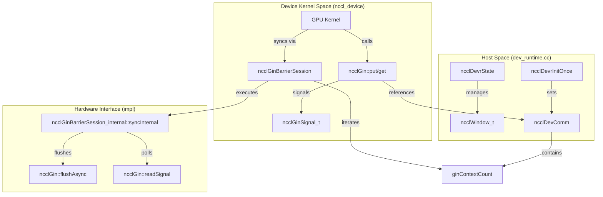
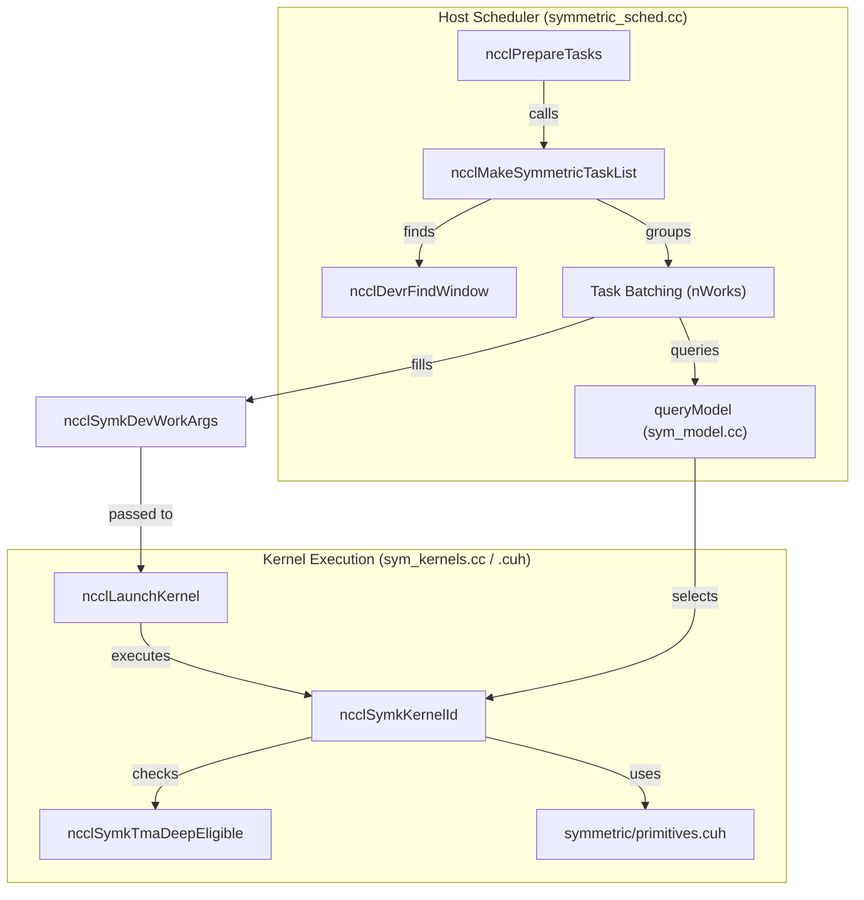

<!-- source: DeepWiki mcp.deepwiki.com · repo NVIDIA/nccl · page 7.3 Symmetric Memory and Device API · fetched 2026-10-26 -->

# Symmetric Memory and Device API

Relevant source files

The following files were used as context for generating this wiki page:

- [bindings/ir/nccl_device_wrapper.h](bindings/ir/nccl_device_wrapper.h)
- [bindings/ir/nccl_device_wrapper__impl.h](bindings/ir/nccl_device_wrapper__impl.h)
- [docs/examples/01_communicators/01_multiple_devices_single_process/c/README.md](docs/examples/01_communicators/01_multiple_devices_single_process/c/README.md)
- [docs/examples/01_communicators/01_multiple_devices_single_process/python/README.md](docs/examples/01_communicators/01_multiple_devices_single_process/python/README.md)
- [docs/examples/08_ras/01_fault_detection/README.md](docs/examples/08_ras/01_fault_detection/README.md)
- [docs/userguide/source/api/device_gin.rst](docs/userguide/source/api/device_gin.rst)
- [docs/userguide/source/api/device_memory.rst](docs/userguide/source/api/device_memory.rst)
- [docs/userguide/source/api/device_setup.rst](docs/userguide/source/api/device_setup.rst)
- [docs/userguide/source/api/flags.rst](docs/userguide/source/api/flags.rst)
- [docs/userguide/source/usage/communicators.rst](docs/userguide/source/usage/communicators.rst)
- [docs/userguide/source/usage/deviceapi.rst](docs/userguide/source/usage/deviceapi.rst)
- [src/dev_runtime.cc](src/dev_runtime.cc)
- [src/dev_runtime_internal.h](src/dev_runtime_internal.h)
- [src/dev_runtime_segments.cc](src/dev_runtime_segments.cc)
- [src/devcomm/CMakeLists.txt](src/devcomm/CMakeLists.txt)
- [src/devcomm/devcomm_v22902.cc](src/devcomm/devcomm_v22902.cc)
- [src/devcomm/devcomm_v22902.h](src/devcomm/devcomm_v22902.h)
- [src/devcomm/devcomm_v22907.cc](src/devcomm/devcomm_v22907.cc)
- [src/devcomm/devcomm_v23000.cc](src/devcomm/devcomm_v23000.cc)
- [src/devcomm/devcomm_v23100.cc](src/devcomm/devcomm_v23100.cc)
- [src/device/symmetric/all_gather.cuh](src/device/symmetric/all_gather.cuh)
- [src/device/symmetric/all_gather_gin.cuh](src/device/symmetric/all_gather_gin.cuh)
- [src/device/symmetric/all_reduce.cuh](src/device/symmetric/all_reduce.cuh)
- [src/device/symmetric/data_ops.cuh](src/device/symmetric/data_ops.cuh)
- [src/device/symmetric/generate.py](src/device/symmetric/generate.py)
- [src/device/symmetric/kernel.cuh](src/device/symmetric/kernel.cuh)
- [src/device/symmetric/primitives.cuh](src/device/symmetric/primitives.cuh)
- [src/device/symmetric/reduce_scatter.cuh](src/device/symmetric/reduce_scatter.cuh)
- [src/device/symmetric/reduce_scatter_gin.cuh](src/device/symmetric/reduce_scatter_gin.cuh)
- [src/include/bitops.h](src/include/bitops.h)
- [src/include/dev_runtime.h](src/include/dev_runtime.h)
- [src/include/nccl_device/barrier.h](src/include/nccl_device/barrier.h)
- [src/include/nccl_device/cft.h](src/include/nccl_device/cft.h)
- [src/include/nccl_device/gin_barrier.h](src/include/nccl_device/gin_barrier.h)
- [src/include/nccl_device/impl/barrier__funcs.h](src/include/nccl_device/impl/barrier__funcs.h)
- [src/include/nccl_device/impl/barrier__types.h](src/include/nccl_device/impl/barrier__types.h)
- [src/include/nccl_device/impl/cft__funcs.h](src/include/nccl_device/impl/cft__funcs.h)
- [src/include/nccl_device/impl/cft__types.h](src/include/nccl_device/impl/cft__types.h)
- [src/include/nccl_device/impl/cft_barrier__funcs.h](src/include/nccl_device/impl/cft_barrier__funcs.h)
- [src/include/nccl_device/impl/comm__types.h](src/include/nccl_device/impl/comm__types.h)
- [src/include/nccl_device/impl/core__types.h](src/include/nccl_device/impl/core__types.h)
- [src/include/nccl_device/impl/gin_barrier__funcs.h](src/include/nccl_device/impl/gin_barrier__funcs.h)
- [src/include/nccl_device/impl/gin_barrier__types.h](src/include/nccl_device/impl/gin_barrier__types.h)
- [src/include/nccl_device/impl/lsa_barrier__funcs.h](src/include/nccl_device/impl/lsa_barrier__funcs.h)
- [src/include/nccl_device/impl/lsa_barrier__types.h](src/include/nccl_device/impl/lsa_barrier__types.h)
- [src/include/nccl_device/lsa_barrier.h](src/include/nccl_device/lsa_barrier.h)
- [src/include/nccl_device/utility.h](src/include/nccl_device/utility.h)
- [src/include/sym_kernels.h](src/include/sym_kernels.h)
- [src/scheduler/symmetric_sched.cc](src/scheduler/symmetric_sched.cc)
- [src/sym_kernels.cc](src/sym_kernels.cc)
- [src/tuning/sym_model.cc](src/tuning/sym_model.cc)

The Symmetric Memory and Device API subsystem provides the infrastructure for direct GPU-to-GPU communication initiated from within CUDA kernels. It bypasses the traditional host-side orchestration by exposing a low-level API for window registration, Load-Store Accessible (LSA) operations, and GPU-Initiated Networking (GIN). This subsystem is primarily located in `src/device/symmetric/`, `src/gin/`, and `src/scheduler/`.

## 1. Symmetric Memory Subsystem

Symmetric memory allows GPUs to expose local memory regions to peers, creating a "window" that can be accessed via direct load/store instructions or network primitives. The host-side management of these regions is handled by the `ncclDevrState` within the communicator [src/dev_runtime.cc:145-146]().

### Window Registration and Management
A window (`ncclWindow_t`) represents a memory region that is registered across a communicator. The registration process ensures that each rank can resolve the remote address of any other rank's buffer.

*   **Global Window Map**: NCCL maintains a global map of window objects using an intrusive address map (`ncclWindowMap`), which uses the video memory address as a key [src/dev_runtime.cc:81-83]().
*   **LSA Team Calculation**: LSA requires a consecutive set of ranks. The `computeLsaSize` function determines the team size based on the topology, often extending to the full NVLink domain if cross-clique P2P is enabled [src/dev_runtime.cc:110-136]().
*   **Virtual Address (VA) Stride**: Symmetric windows are mapped into a large contiguous virtual address space, with the stride size determined by `NCCL_WIN_STRIDE` or the maximum global memory of peers [src/dev_runtime.cc:176-184]().

### Load-Store Accessible (LSA) Operations
LSA enables a GPU kernel to directly dereference a pointer belonging to another GPU. The Device API provides functions to resolve these addresses and synchronize.

| Function | Description |
| :--- | :--- |
| `ncclGetPeerPointerTeam` | Returns a direct pointer to a peer's memory within a symmetric window [bindings/ir/nccl_device_wrapper.h:100-100](). |
| `ncclLsaBarrierSession` | A device-side synchronization primitive used to coordinate LSA kernels across ranks [src/include/nccl_device/lsa_barrier.h:29-30](). |
| `ncclMultimemHandle_t` | Handle for NVLink Multicast (NVLS) memory used in LSA collectives [src/include/nccl_device/impl/comm__types.h:45-45](). |

**Sources:** [src/dev_runtime.cc:81-184](), [src/include/nccl_device/impl/comm__types.h:28-78](), [bindings/ir/nccl_device_wrapper.h:88-100]()

---

## 2. GIN: GPU-Initiated Networking

GPU-Initiated Networking (GIN) allows kernels to perform Remote Memory Access (RMA) operations—such as `put`, `get`, and `signal`—directly through the network interface without CPU intervention [docs/userguide/source/api/device_gin.rst:6-9]().

### Device-Side Primitives
The GIN API is encapsulated in the `ncclGin` class, callable only from device code [docs/userguide/source/api/device_gin.rst:9-11]().

*   **`ncclGin` Class**: Initialized with a device communicator and a `contextIndex`. Using multiple contexts allows traffic to spread across multiple network channels [docs/userguide/source/api/device_gin.rst:18-24]().
*   **`put` / `get`**: One-sided data transfers between local and remote windows. These support `RemoteAction` (e.g., `ncclGin_StrongSignalInc`) to trigger completion events on the peer [docs/userguide/source/api/device_gin.rst:30-71]().
*   **`flush` / `wait`**: Primitives to ensure local consumption of transfers or visibility of remote data [docs/userguide/source/api/device_gin.rst:73-90]().
*   **Signals and Counters**: 64-bit integer values manipulated atomically. "Strong" signals imply visibility of all preceding puts on the same context, while "Weak" signals only cover the attached payload [docs/userguide/source/api/device_gin.rst:97-125]().

### GIN Barrier and Synchronization
The `ncclGinBarrierSession` provides synchronization across a GIN team. It can be bound to a single context or every context on the communicator to ensure all sharded traffic is flushed [src/include/nccl_device/gin_barrier.h:55-64]().

**Title: GIN System Entity Relationship**

**Sources:** [src/include/nccl_device/impl/gin_barrier__funcs.h:71-155](), [docs/userguide/source/api/device_gin.rst:11-61](), [src/include/nccl_device/impl/comm__types.h:28-78]()

---

## 3. CFT: Collective Fabric Technology

For architectures supporting fabric-native instructions (CUDA 13.3+), NCCL provides `ncclCft` (Collective Fabric Technology) for GPU-initiated reductions [src/include/nccl_device/impl/cft__funcs.h:18-23]().

*   **Fabric Reductions**: Uses PTX instructions like `fabric.try_red.async` and `fabric.try_pullred.async` to perform in-network reductions [src/include/nccl_device/impl/cft__funcs.h:97-155]().
*   **Multimem Support**: CFT integrates with `multimem` for efficient multicast-based reductions [src/include/nccl_device/impl/cft__funcs.h:122-132]().
*   **Mbarrier Sync**: CFT operations are coordinated via shared memory `mbarrier` objects [src/include/nccl_device/impl/cft__funcs.h:68-88]().

**Sources:** [src/include/nccl_device/impl/cft__funcs.h:18-178](), [src/include/nccl_device/impl/cft__types.h:15-25]()

---

## 4. Device API Kernels and Scheduler

The Device API enables the implementation of complex collectives as symmetric kernels. These are managed by the scheduler and specialized per architecture.

### Symmetric Collective Kernels
Collective operations like `AllReduce` and `AllGather` are implemented as specialized device functions in `src/device/symmetric/`.

*   **Kernel Selection**: The `ncclSymkKernelId` enum identifies variants such as `AllReduce_RSxLDMC_AGxSTMC` (Reduce-Scatter via LDMC, All-Gather via STMC) [src/sym_kernels.cc:17-39]().
*   **TMA Support**: On Blackwell+ (CompCap 100+), kernels use Tensor Memory Accelerator (TMA) for asynchronous deep-loop memory movement [src/sym_kernels.cc:92-116]().
*   **GIN Kernels**: Specialized kernels like `ReduceScatter_RailA2A_LsaLDMC` use GIN for cross-rail communication [src/sym_kernels.cc:55-57]().

### Scheduler Logic
The scheduler (`src/scheduler/symmetric_sched.cc`) determines the optimal symmetric kernel and CTA configuration during task preparation.

*   **Task Aggregation**: The scheduler batches multiple symmetric tasks into a single kernel launch if they share the same function, reduction op, and datatype [src/scheduler/symmetric_sched.cc:139-169]().
*   **Performance Modeling**: `queryModel` in `sym_model.cc` estimates execution time using hardware latencies and bus multipliers to select the best algorithm [src/tuning/sym_model.cc:114-121]().
*   **Alignment Checks**: The scheduler verifies 16-byte alignment for TMA-eligible batches [src/scheduler/symmetric_sched.cc:69-77]().

**Title: Symmetric Task Scheduling and Execution**

**Sources:** [src/scheduler/symmetric_sched.cc:79-178](), [src/sym_kernels.cc:92-129](), [src/tuning/sym_model.cc:123-178]()

---

## 5. Summary of Subsystem Components

| Component | File | Role |
| :--- | :--- | :--- |
| `ncclDevrState` | `src/dev_runtime.cc` | Host-side state for symmetric memory, LSA team, and VA management [src/dev_runtime.cc:143-184](). |
| `ncclGin` | `docs/api/device_gin.rst` | Device-side class for initiating one-sided network operations [docs/userguide/source/api/device_gin.rst:11-33](). |
| `ncclCft` | `cft__funcs.h` | Fabric-native collective primitives for reductions [src/include/nccl_device/impl/cft__funcs.h:97-155](). |
| `ncclGinBarrierSession` | `gin_barrier.h` | Synchronization primitive for GIN teams with multi-context fence support [src/include/nccl_device/gin_barrier.h:55-73](). |
| `ncclSymkKernelId` | `sym_kernels.h` | Enumeration of available symmetric collective kernels [src/include/sym_kernels.h:16-54](). |

**Sources:** [src/dev_runtime.cc:143-184](), [src/include/nccl_device/gin_barrier.h:55-106](), [src/scheduler/symmetric_sched.cc:79-129]()

---

