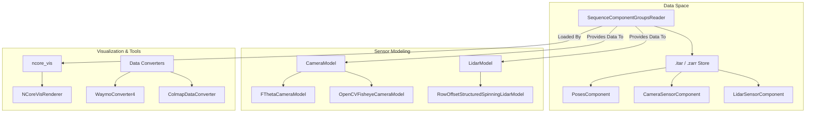
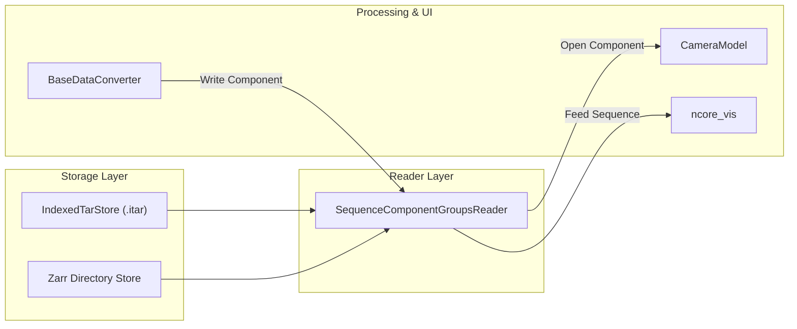

<!-- source: DeepWiki mcp.deepwiki.com · repo NVIDIA/ncore · page 1 NCore Overview · fetched 2026-10-26 -->

# NCore Overview

Relevant source files

The following files were used as context for generating this wiki page:

- [CHANGELOG.md](CHANGELOG.md)
- [CODE_OF_CONDUCT.md](CODE_OF_CONDUCT.md)
- [CONTRIBUTING.md](CONTRIBUTING.md)
- [README.md](README.md)
- [SECURITY.md](SECURITY.md)
- [docs/README.md](docs/README.md)
- [docs/data/formats.rst](docs/data/formats.rst)
- [docs/data/storage_and_access.rst](docs/data/storage_and_access.rst)
- [docs/index.rst](docs/index.rst)
- [docs/tools/ncore_vis.rst](docs/tools/ncore_vis.rst)
- [ncore/BUILD.bazel](ncore/BUILD.bazel)

NCore is a technical framework providing canonical data representations, APIs, and tools designed for data-driven neural 3D reconstruction and simulation [README.md:11-12](). Developed by the [NVIDIA SIL Lab](https://research.nvidia.com/labs/sil), it focuses on multi-sensor recordings for robotics and autonomous vehicle (AV) applications, supporting platforms like NVIDIA Hyperion and NVIDIA Carter, as well as 3rd-party datasets such as Waymo Open Dataset and ScanNet++ [docs/index.rst:7-17]().

## Key Features

*   **V4 Component-Based Data Format**: A modular specification where data types (poses, sensors, labels) are stored in independent, versioned Zarr stores [docs/data/formats.rst:10-15]().
*   **GPU-Accelerated Sensor Models**: High-performance intrinsic models for Camera (FTheta, OpenCV Pinhole/Fisheye) and LiDAR [README.md:17-17]().
*   **Data Converters**: A suite of tools to transform external formats (COLMAP, Waymo, PAI) into the NCore representation [README.md:18-18]().
*   **Interactive 3D Visualization**: A browser-based viewer (`ncore_vis`) built on `viser` for inspecting sequences, sensor frustums, and point clouds [docs/tools/ncore_vis.rst:7-9]().

**Sources:** [README.md:11-19](), [docs/index.rst:7-17](), [docs/data/formats.rst:10-21]()

---

## Architecture Pillars

The NCore architecture bridges high-level robotics concepts to specialized data structures and GPU kernels.

### 1. Data Representation & Storage
NCore utilizes a "Component Store" hierarchy. Each sequence is a collection of component groups, typically persisted as `.zarr.itar` (Indexed Tar) files [docs/data/formats.rst:34-38](). The `.itar` format combines the streaming efficiency of TAR with $O(1)$ random-access via an appended CBOR/LZMA index [docs/data/storage_and_access.rst:21-26]().

### 2. Sensor & Spatial Modeling
The framework enforces strict coordinate conventions. Spatial relationships are managed via a pose graph, while sensor-specific geometry is handled by dedicated model classes that support features like rolling-shutter compensation [docs/data/formats.rst:142-145]().

### 3. Tooling & Integration
NCore provides a unified entry point for visualization and conversion, abstracting away the underlying storage backends (Local, S3, GCS) via `universal_pathlib` [docs/data/storage_and_access.rst:164-170]().

### System Component Mapping
The following diagram maps high-level functional pillars to their primary code entities.

**NCore System Architecture**

**Sources:** [ncore/data/v4:pylib](), [docs/data/formats.rst:41-57](), [docs/data/storage_and_access.rst:146-158](), [docs/tools/ncore_vis.rst:7-12]()

---

## Major Subsystems

### V4 Data Specification
The V4 format separates data into modular groups. For example, a sequence might have one group for raw sensor data and another for alternative calibrations or labels [docs/data/storage_and_access.rst:149-153]().
*   **Core Components**: `PosesComponent`, `IntrinsicsComponent`, `CameraSensorComponent`, `LidarSensorComponent`, `CuboidsComponent` [docs/data/formats.rst:45-57]().
*   **Details**: See [V4 Data Format](#2).

### Sensor Modeling Layer
This layer provides the mathematical implementation for projecting 3D points to 2D sensor coordinates.
*   **Cameras**: Supports `ftheta`, `opencv-pinhole`, and `opencv-fisheye` models [docs/data/formats.rst:142-143]().
*   **LiDAR**: Implements `row-offset-spinning` models to handle the specific firing patterns of hardware like Velodyne or Ouster [docs/data/formats.rst:143-144]().
*   **Details**: See [Sensor Models](#3).

### Data Conversion Framework
Converters are responsible for mapping diverse external schemas into NCore's component-based structure.
*   **COLMAP**: Processes SfM outputs and ScanNet++ [CHANGELOG.md:28-28]().
*   **Waymo**: Handles TFRecord ingestion and multi-return LiDAR processing [CHANGELOG.md:75-75]().
*   **Physical AI (PAI)**: Supports streaming datasets from HuggingFace [CHANGELOG.md:23-24]().
*   **Details**: See [Data Converters](#4).

### Visualization (`ncore_vis`)
A high-level tool for interactive inspection. It synchronizes multiple sensors based on a "Reference Sensor" (usually a LiDAR) and provides overlays for cuboids and masks [docs/tools/ncore_vis.rst:100-117]().
*   **Details**: See [ncore_vis: 3D Visualizer](#5).

### Code Entity Relationship
This diagram illustrates how data flows from storage through the reader into the visualization and modeling components.

**Entity Interaction Diagram**

**Sources:** [ncore/data/v4:pylib](), [docs/data/storage_and_access.rst:10-14](), [docs/data/storage_and_access.rst:164-170](), [docs/tools/ncore_vis.rst:21-30]()

---

## Next Steps

To begin working with the codebase, please refer to the following child pages:

*   **[Getting Started](#1.1)**: Installation via `pip`, setting up the Bazel environment, and running initial tests [CONTRIBUTING.md:35-56]().
*   **[Repository Structure](#1.2)**: A detailed look at the directory layout and the Bazel module system [ncore/BUILD.bazel:19-30]().

**Sources:** [CONTRIBUTING.md:1-56](), [ncore/BUILD.bazel:1-74]()

---

