# Page: NCore Overview

# NCore Overview

<details>
<summary>Relevant source files</summary>

The following files were used as context for generating this wiki page:

- [CHANGELOG.md](CHANGELOG.md)
- [CODE_OF_CONDUCT.md](CODE_OF_CONDUCT.md)
- [CONTRIBUTING.md](CONTRIBUTING.md)
- [README.md](README.md)
- [SECURITY.md](SECURITY.md)
- [docs/README.md](docs/README.md)
- [docs/data/formats.rst](docs/data/formats.rst)
- [docs/data/storage_and_access.rst](docs/data/storage_and_access.rst)
- [docs/index.rst](docs/index.rst)
- [docs/tools/ncore_vis.rst](docs/tools/ncore_vis.rst)
- [ncore/BUILD.bazel](ncore/BUILD.bazel)

</details>


NCore is a technical framework providing canonical data representations, APIs, and tools designed for data-driven neural 3D reconstruction and simulation [README.md:11-12](). Developed by the [NVIDIA SIL Lab](https://research.nvidia.com/labs/sil), it focuses on multi-sensor recordings for robotics and autonomous vehicle (AV) applications, supporting platforms like NVIDIA Hyperion and NVIDIA Carter, as well as 3rd-party datasets such as Waymo Open Dataset and ScanNet++ [docs/index.rst:7-17]().

## Key Features

*   **V4 Component-Based Data Format**: A modular specification where data types (poses, sensors, labels) are stored in independent, versioned Zarr stores [docs/data/formats.rst:10-15]().
*   **GPU-Accelerated Sensor Models**: High-performance intrinsic models for Camera (FTheta, OpenCV Pinhole/Fisheye) and LiDAR [README.md:17-17]().
*   **Data Converters**: A suite of tools to transform external formats (COLMAP, Waymo, PAI) into the NCore representation [README.md:18-18]().
*   **Interactive 3D Visualization**: A browser-based viewer (`ncore_vis`) built on `viser` for inspecting sequences, sensor frustums, and point clouds [docs/tools/ncore_vis.rst:7-9]().

**Sources:** [README.md:11-19](), [docs/index.rst:7-17](), [docs/data/formats.rst:10-21]()

---

## Architecture Pillars

The NCore architecture bridges high-level robotics concepts to specialized data structures and GPU kernels.

### 1. Data Representation & Storage
NCore utilizes a "Component Store" hierarchy. Each sequence is a collection of component groups, typically persisted as `.zarr.itar` (Indexed Tar) files [docs/data/formats.rst:34-38](). The `.itar` format combines the streaming efficiency of TAR with $O(1)$ random-access via an appended CBOR/LZMA index [docs/data/storage_and_access.rst:21-26]().

### 2. Sensor & Spatial Modeling
The framework enforces strict coordinate conventions. Spatial relationships are managed via a pose graph, while sensor-specific geometry is handled by dedicated model classes that support features like rolling-shutter compensation [docs/data/formats.rst:142-145]().

### 3. Tooling & Integration
NCore provides a unified entry point for visualization and conversion, abstracting away the underlying storage backends (Local, S3, GCS) via `universal_pathlib` [docs/data/storage_and_access.rst:164-170]().

### System Component Mapping
The following diagram maps high-level functional pillars to their primary code entities.

**NCore System Architecture**
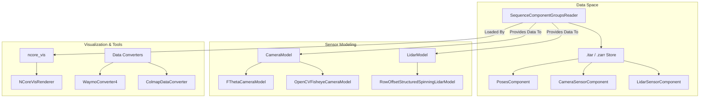
**Sources:** [ncore/data/v4:pylib](), [docs/data/formats.rst:41-57](), [docs/data/storage_and_access.rst:146-158](), [docs/tools/ncore_vis.rst:7-12]()

---

## Major Subsystems

### V4 Data Specification
The V4 format separates data into modular groups. For example, a sequence might have one group for raw sensor data and another for alternative calibrations or labels [docs/data/storage_and_access.rst:149-153]().
*   **Core Components**: `PosesComponent`, `IntrinsicsComponent`, `CameraSensorComponent`, `LidarSensorComponent`, `CuboidsComponent` [docs/data/formats.rst:45-57]().
*   **Details**: See [V4 Data Format](#2).

### Sensor Modeling Layer
This layer provides the mathematical implementation for projecting 3D points to 2D sensor coordinates.
*   **Cameras**: Supports `ftheta`, `opencv-pinhole`, and `opencv-fisheye` models [docs/data/formats.rst:142-143]().
*   **LiDAR**: Implements `row-offset-spinning` models to handle the specific firing patterns of hardware like Velodyne or Ouster [docs/data/formats.rst:143-144]().
*   **Details**: See [Sensor Models](#3).

### Data Conversion Framework
Converters are responsible for mapping diverse external schemas into NCore's component-based structure.
*   **COLMAP**: Processes SfM outputs and ScanNet++ [CHANGELOG.md:28-28]().
*   **Waymo**: Handles TFRecord ingestion and multi-return LiDAR processing [CHANGELOG.md:75-75]().
*   **Physical AI (PAI)**: Supports streaming datasets from HuggingFace [CHANGELOG.md:23-24]().
*   **Details**: See [Data Converters](#4).

### Visualization (`ncore_vis`)
A high-level tool for interactive inspection. It synchronizes multiple sensors based on a "Reference Sensor" (usually a LiDAR) and provides overlays for cuboids and masks [docs/tools/ncore_vis.rst:100-117]().
*   **Details**: See [ncore_vis: 3D Visualizer](#5).

### Code Entity Relationship
This diagram illustrates how data flows from storage through the reader into the visualization and modeling components.

**Entity Interaction Diagram**
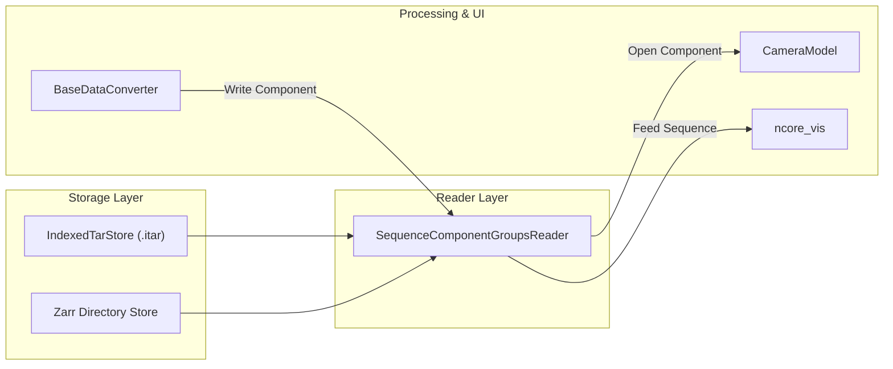
**Sources:** [ncore/data/v4:pylib](), [docs/data/storage_and_access.rst:10-14](), [docs/data/storage_and_access.rst:164-170](), [docs/tools/ncore_vis.rst:21-30]()

---

## Next Steps

To begin working with the codebase, please refer to the following child pages:

*   **[Getting Started](#1.1)**: Installation via `pip`, setting up the Bazel environment, and running initial tests [CONTRIBUTING.md:35-56]().
*   **[Repository Structure](#1.2)**: A detailed look at the directory layout and the Bazel module system [ncore/BUILD.bazel:19-30]().

**Sources:** [CONTRIBUTING.md:1-56](), [ncore/BUILD.bazel:1-74]()

---

# Page: Getting Started

# Getting Started

<details>
<summary>Relevant source files</summary>

The following files were used as context for generating this wiki page:

- [.github/actions/setup-bazel/action.yml](.github/actions/setup-bazel/action.yml)
- [.github/workflows/ci.yml](.github/workflows/ci.yml)
- [CONTRIBUTING.md](CONTRIBUTING.md)
- [MODULE.bazel](MODULE.bazel)
- [bazel/rules_python/BUILD.bazel](bazel/rules_python/BUILD.bazel)
- [bazel/rules_python/rules_python_repo_contents_cache.patch](bazel/rules_python/rules_python_repo_contents_cache.patch)
- [deps/pycolmap/BUILD.bazel](deps/pycolmap/BUILD.bazel)
- [deps/pycolmap/fix-python3-map.patch](deps/pycolmap/fix-python3-map.patch)
- [docs/README.md](docs/README.md)

</details>


This page provides a comprehensive guide for setting up the NCore development environment. It covers installation for end-users via `pip`, as well as full environment configuration for contributors using Bazel, GitHub Personal Access Tokens (PAT), and specialized build tools.

## Installation via Pip

For users who only need to consume the NCore library without modifying its source code, the package is available on PyPI.

```bash
pip install nvidia-ncore
```

**Note:** NCore relies on several heavy dependencies such as `numpy`, `torch`, and `open3d`. Ensure your environment is configured to handle these, particularly if using specific CUDA versions [ncore/MODULE.bazel:149-151]().

**Sources:** [.github/workflows/ci.yml:141-153]().

---

## Development Environment Setup

NCore uses **Bazel** as its core build system to manage complex dependencies, including Python toolchains, Protobuf definitions, and C++ patches [CONTRIBUTING.md:37-39]().

### 1. System Requirements
Before setting up the repository, ensure the following are installed on your Ubuntu system:
*   **NVIDIA Drivers & CUDA Runtime**: Version > 11.1.
*   **Pandoc**: Required for generating documentation from Jupyter notebooks [CONTRIBUTING.md:12-13](), [.github/actions/setup-bazel/action.yml:53-57]().

### 2. GitHub PAT Configuration
NCore fetches unit test data and documentation assets from GitHub Packages, which requires authentication [MODULE.bazel:81-82]().

1.  Create a GitHub Personal Access Token (PAT) with the `read:packages` scope.
2.  Configure your `~/.netrc` file to allow Bazel to authenticate during the fetch phase [CONTRIBUTING.md:17-26]():

```netrc
machine maven.pkg.github.com
  login <GITHUB_USER>
  password <GITHUB_TOKEN>
```

### 3. Bazel and Bazelisk
To ensure every developer uses the exact Bazel version defined in `.bazelversion`, the use of `bazelisk` is mandatory [CONTRIBUTING.md:37-41]().

```bash
sudo wget -O /usr/local/bin/bazel https://github.com/bazelbuild/bazelisk/releases/latest/download/bazelisk-linux-amd64
sudo chmod +x /usr/local/bin/bazel
```

**Sources:** [CONTRIBUTING.md:7-46](), [MODULE.bazel:81-97](), [.github/actions/setup-bazel/action.yml:45-51]().

---

## Build and Test Commands

Once the environment is configured, use the following commands to manage the lifecycle of the project.

| Action | Command | Description |
| :--- | :--- | :--- |
| **Build All** | `bazel build //...` | Compiles all targets including protos and wheels [CONTRIBUTING.md:52](). |
| **Run Tests** | `bazel test //...` | Executes all unit tests [CONTRIBUTING.md:55](). |
| **Format Code** | `bazel run //:format` | Automatically formats Python and Bazel files [CONTRIBUTING.md:66](). |
| **Check Format** | `bazel run //:format.check` | Validates formatting without applying changes (used in CI) [CONTRIBUTING.md:69](). |
| **Build Docs** | `bazel build //docs:ncore` | Generates Sphinx HTML documentation [docs/README.md:13](). |
| **View Docs** | `bazel run //docs:view_ncore` | Builds and opens documentation in a browser [docs/README.md:21](). |

### Static Type Checking
NCore enforces static typing via `mypy`, which runs as a Bazel aspect during the build process [CONTRIBUTING.md:81-82](). To speed up local execution, you can enable a persistent cache by adding the following to your `.bazelrc.user` [CONTRIBUTING.md:89-95]():

```bazel
build --sandbox_writable_path=/path/to/.mypy_cache
build --action_env=MYPY_CACHE_DIR=/path/to/.mypy_cache
```

**Sources:** [CONTRIBUTING.md:48-98](), [docs/README.md:8-25]().

---

## Coding Guidelines

### Formatting and Linting
*   **Python**: Formatted using **Ruff** with a 120-character line length [CONTRIBUTING.md:74]().
*   **Bazel**: Formatted using **Buildifier** [CONTRIBUTING.md:75]().
*   **License Headers**: Every source file must contain the SPDX Apache-2.0 header [CONTRIBUTING.md:101-106]().

### Commit Messages
NCore follows the **Conventional Commits** specification. Messages are validated in CI using `cocogitto` [CONTRIBUTING.md:110-135]().

**Format:** `<type>[optional scope]: <description>`

| Type | Purpose |
| :--- | :--- |
| `feat` | New feature |
| `fix` | Bug fix |
| `docs` | Documentation changes |
| `build` | Build system or dependency changes |

### Linear History and Signing
*   **Rebase Only**: PRs are merged via rebase to maintain a linear history [CONTRIBUTING.md:151-158]().
*   **GPG Signing**: All commits must be GPG-signed to certify agreement with the Developer Certificate of Origin (DCO) [CONTRIBUTING.md:173-180]().

**Sources:** [CONTRIBUTING.md:60-180]().

---

## Dependency Management and Data Flow

The following diagrams illustrate how Bazel manages the environment and external dependencies, bridging the gap between high-level setup steps and internal code entities.

### Environment Initialization Flow
This diagram shows how `bazelisk` and `MODULE.bazel` coordinate to fetch the correct toolchains and external repositories.

Title: NCore Environment Initialization
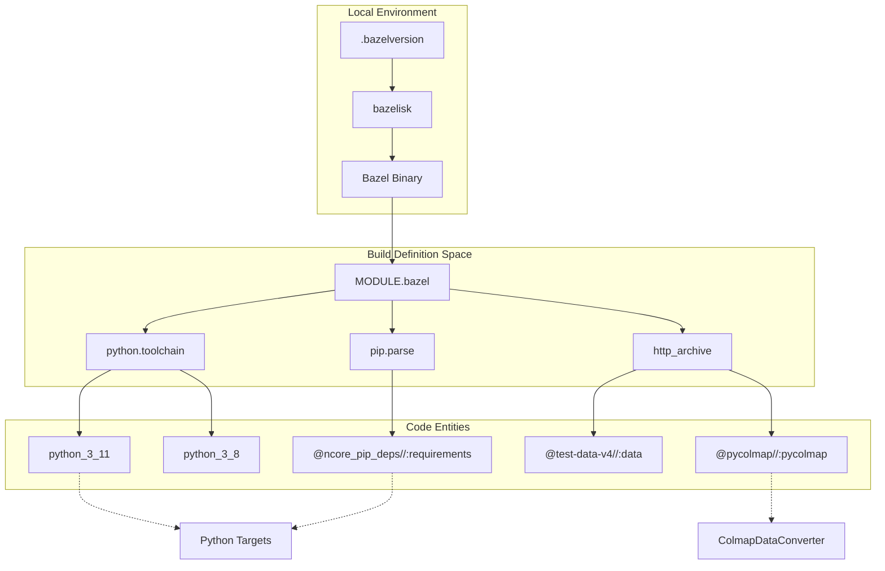
**Sources:** [MODULE.bazel:20-123](), [CONTRIBUTING.md:37-46]().

### Dependency Patching Logic
NCore maintains its own patches for external libraries to ensure compatibility with Python 3 and modern Bazel features.

Title: External Repository Patching Architecture
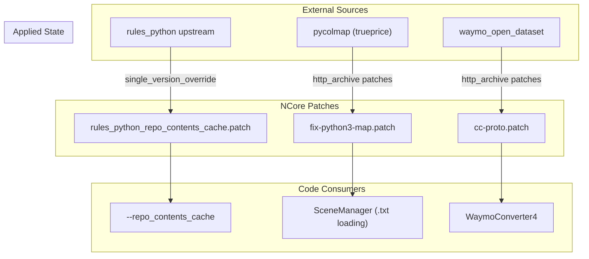
**Sources:** [MODULE.bazel:39-47](), [MODULE.bazel:100-123](), [deps/pycolmap/fix-python3-map.patch:1-15](), [bazel/rules_python/rules_python_repo_contents_cache.patch:1-9]().

---

# Page: Repository Structure

# Repository Structure

<details>
<summary>Relevant source files</summary>

The following files were used as context for generating this wiki page:

- [MODULE.bazel](MODULE.bazel)
- [deps/pip/BUILD.bazel](deps/pip/BUILD.bazel)
- [deps/pip/requirements_3_11.in](deps/pip/requirements_3_11.in)
- [deps/pip/requirements_3_11.txt](deps/pip/requirements_3_11.txt)
- [deps/pip/requirements_ncore.in](deps/pip/requirements_ncore.in)
- [deps/pip/requirements_pai.in](deps/pip/requirements_pai.in)
- [deps/pip/requirements_tools.in](deps/pip/requirements_tools.in)
- [deps/pycolmap/BUILD.bazel](deps/pycolmap/BUILD.bazel)
- [deps/pycolmap/fix-python3-map.patch](deps/pycolmap/fix-python3-map.patch)
- [tools/BUILD.bazel](tools/BUILD.bazel)

</details>


This page provides a technical overview of the NCore repository layout, the Bazel-based build system, and the management of Python dependencies. The repository is organized to separate core library logic from auxiliary tools, data converters, and external dependencies.

## Top-Level Directory Layout

The repository is structured to support both a high-performance Python library and a suite of command-line tools for data processing and visualization.

| Directory | Purpose |
| :--- | :--- |
| `ncore/` | The core library implementation, including data models, sensor models, and storage backends. |
| `tools/` | Command-line utilities for data inspection, export, and the `ncore_vis` visualizer. |
| `deps/` | External dependency configurations, including third-party patches and Python requirement files. |
| `bazel/` | Internal Bazel rules, macros, and patches for the build system. |
| `docs/` | Documentation source files and configuration. |

### Data Flow and Component Relationship

The following diagram illustrates how the different top-level modules interact during a typical data processing and visualization lifecycle.

**System Component Interaction**
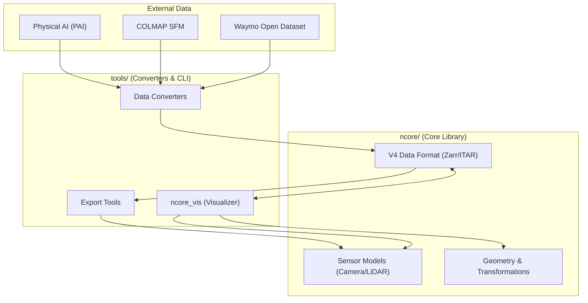
Sources: [tools/BUILD.bazel:47-134](), [MODULE.bazel:16-23]()

---

## The Bazel Module System

NCore uses the Bazel `MODULE.bazel` (Bzlmod) system for dependency management and build configuration. This ensures reproducible builds and hermetic Python environments.

### Toolchains and Extensions
The project defines two primary Python toolchains to ensure compatibility across different environments:
*   **Python 3.11**: The default toolchain used for most development and tools [MODULE.bazel:50-53]().
*   **Python 3.8**: Maintained for legacy compatibility with specific data formats or environments [MODULE.bazel:54-56]().

### External Repositories
Bazel manages several critical external dependencies that are not available as standard wheels or require specific patches:
*   **`waymo_open_dataset`**: Fetched as an `http_archive` to provide Protobuf definitions for the Waymo converter [MODULE.bazel:99-110]().
*   **`pycolmap`**: A Python COLMAP reader patched to support Python 3 `map()` iterator behavior [MODULE.bazel:115-123]().
*   **`test-data-v4`**: Remote archive containing artifacts for unit and integration tests [MODULE.bazel:86-90]().

**Bazel Dependency Resolution**
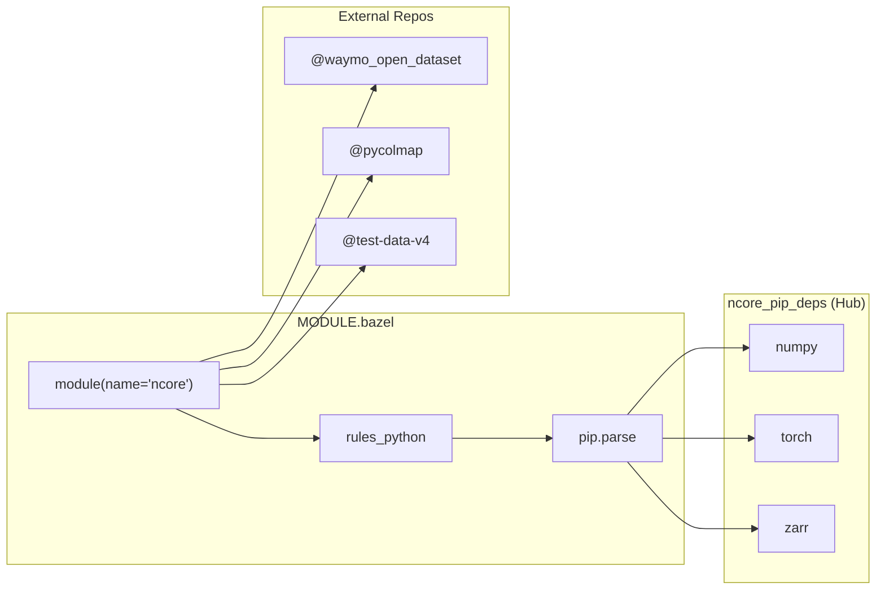
Sources: [MODULE.bazel:20-72](), [MODULE.bazel:86-123]()

---

## Python Package Distribution (`deps/`)

Python dependencies are managed via `uv` and pinned in the `deps/pip/` directory.

### Requirement Layers
To keep the core library lightweight, requirements are split into functional groups:
*   **`requirements_ncore.in`**: Minimal dependencies for the `ncore` package (e.g., `numpy`, `zarr`, `cbor2`, `scipy`) [deps/pip/requirements_ncore.in:16-37]().
*   **`requirements_tools.in`**: Dependencies for the visualizer and CLI tools (e.g., `viser`, `click`, `matplotlib`, `opencv-python-headless`) [deps/pip/requirements_tools.in:16-29]().
*   **`requirements_pai.in`**: Specialized dependencies for Physical AI data streaming (e.g., `DracoPy`, `remotezip`) [deps/pip/requirements_pai.in:16-30]().

### Lock File Generation
Bazel targets in `deps/pip/BUILD.bazel` automate the compilation of these `.in` files into fully hashed lock files (`requirements_3_11.txt`) using `rules_uv` [deps/pip/BUILD.bazel:32-49](). This ensures that every developer and CI runner uses identical versions of every transitive dependency.

### Version Rationales
Specific versions are often pinned for technical reasons:
*   **`zarr>=2.12.0,<3.0.0`**: Pinned to avoid breaking changes in Zarr 3 and to maintain Python 3.8 support [deps/pip/requirements_ncore.in:21-25]().
*   **`cbor2>=5.9.0`**: Required for security fixes (CVE-2026-26209) on Python 3.9+ [deps/pip/requirements_ncore.in:27-32]().
*   **`torch==1.13.0+cu116`**: Specific CUDA-enabled build required for GPU-accelerated sensor operations [deps/pip/requirements_3_11.in:29-30]().

Sources: [deps/pip/BUILD.bazel:65-72](), [deps/pip/requirements_3_11.txt:1-102]()

---

## Tools and CLI Entry Points

The `tools/` directory contains the primary interface for users interacting with NCore data. These are defined as `py_binary` targets in Bazel.

| Target | File | Description |
| :--- | :--- | :--- |
| `ncore_export_ply` | `tools/ncore_export_ply.py` | Converts NCore V4 point clouds to PLY format for external tools [tools/BUILD.bazel:47-62](). |
| `ncore_export_camera` | `tools/ncore_export_camera.py` | Extracts raw images and intrinsics from V4 sequences [tools/BUILD.bazel:66-79](). |
| `ncore_project_pc_to_img` | `tools/ncore_project_pc_to_img.py` | Debug utility to project LiDAR points onto camera frames using `pylib_camera` and `pylib_lidar` [tools/BUILD.bazel:83-101](). |
| `ncore_sequence_meta` | `tools/ncore_sequence_meta.py` | Inspects and prints metadata for a V4 sequence [tools/BUILD.bazel:124-134](). |

These tools rely on a shared CLI library `pylib_cli` which abstracts common `click` configurations [tools/BUILD.bazel:24-33]().

Sources: [tools/BUILD.bazel:1-135]()

---

# Page: V4 Data Format

# V4 Data Format

<details>
<summary>Relevant source files</summary>

The following files were used as context for generating this wiki page:

- [docs/data/formats.rst](docs/data/formats.rst)
- [docs/data/storage_and_access.rst](docs/data/storage_and_access.rst)
- [docs/index.rst](docs/index.rst)
- [docs/tools/ncore_vis.rst](docs/tools/ncore_vis.rst)
- [ncore/impl/data/v4/components.py](ncore/impl/data/v4/components.py)

</details>


The NCore V4 data format is a modular, component-based specification designed for multi-sensor robotics and autonomous vehicle recordings. It replaces monolithic data structures with independent, versioned components stored as [Zarr](https://zarr.readthedocs.io/en/stable) hierarchies. This architecture enables flexible data composition, parallel access, and the ability to update specific data (e.g., re-running calibration) without reprocessing an entire sequence [docs/data/formats.rst:10-21]().

## System Overview

The V4 format organizes data into **Component Groups**. A logical sequence is often formed by combining multiple groups (e.g., a base group for sensor data and a separate group for updated poses).

### Data to Code Mapping
The following diagram illustrates how high-level data concepts map to specific classes and storage entities in the NCore codebase.

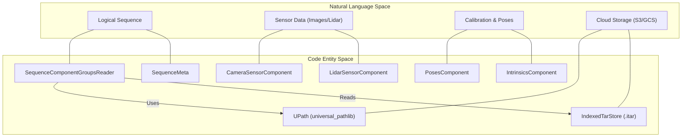
**Sources:** [ncore/impl/data/v4/components.py:102-104](), [docs/data/formats.rst:41-57](), [docs/data/storage_and_access.rst:164-170]()

---

## Component Architecture

Every V4 sequence is a collection of components. Each component type serves a specific purpose and follows a standardized Zarr internal structure.

| Component Type | Purpose | Key Data Entities |
| :--- | :--- | :--- |
| `PosesComponent` | Spatial transforms | `static_poses`, `dynamic_poses` |
| `IntrinsicsComponent` | Sensor calibration | `camera_model_parameters`, `lidar_model_type` |
| `CameraSensorComponent` | Visual data | `image`, `format` (JPEG/PNG) |
| `LidarSensorComponent` | Range data | `ray_bundle`, `ray_bundle_returns` |
| `CuboidsComponent` | Object labels | 3D bounding box tracks and attributes |
| `MasksComponent` | Static sensor masks | Per-camera boolean exclusion masks |

For a deep dive into the internal Zarr hierarchy and schema for these types, see **[Data Components and Schema](#2.1)**.

**Sources:** [docs/data/formats.rst:38-60](), [docs/data/formats.rst:88-162]()

---

## Storage and Access

NCore supports two primary physical storage backends for Zarr data:
1.  **Directory Store**: Standard Zarr structure where every chunk is a separate file. Best for local debugging.
2.  **Indexed Tar (.itar)**: A custom NCore format that packages Zarr chunks into a single TAR file with a CBOR/LZMA index at the end for $O(1)$ random access [docs/data/storage_and_access.rst:18-26]().

### Storage Layer Bridge
This diagram shows how the `SequenceComponentGroupsReader` interacts with the storage backends.

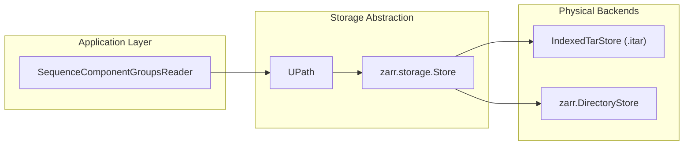
**Sources:** [docs/data/storage_and_access.rst:37-41](), [ncore/impl/data/v4/components.py:190-200]()

For performance benchmarks and implementation details of the `.itar` format, see **[Storage Backends: .itar and Zarr](#2.2)**.

---

## Spatial and Temporal Conventions

NCore enforces strict conventions to ensure interoperability between different sensors and datasets:
*   **Coordinates**: Uses SE(3) 4x4 matrices for poses.
*   **Notation**: Follows $T_{a\_b}$ (transform from frame $b$ to frame $a$) [docs/data/formats.rst:111-118]().
*   **Time**: All timestamps are in microseconds (`uint64`). Intervals are represented by the `HalfClosedInterval` class [ncore/impl/data/v4/components.py:52-53]().

For details on the `PoseGraphInterpolator` and coordinate rig definitions, see **[Coordinate Conventions and Pose Graph](#2.3)**.

---

## Reading and Writing

The primary entry points for interacting with V4 data are the `SequenceComponentGroupsReader` and `SequenceComponentGroupsWriter` classes.

```python
# Example: Loading a sequence from multiple stores
from ncore.data.v4 import SequenceComponentGroupsReader, PosesComponent
from pathlib import Path

reader = SequenceComponentGroupsReader([
    Path("base_data.zarr.itar"),
    Path("refined_poses.zarr.itar") # Overrides/adds to base
])

# Open a specific component
pose_reader = reader.open_component_readers(PosesComponent.Reader)
```
**Sources:** [docs/data/storage_and_access.rst:146-158]()

For information on `ComponentGroupAssignments` and using the `SequenceLoaderV4` compatibility layer, see **[Reading and Writing Sequences](#2.4)**.

---

# Page: Data Components and Schema

# Data Components and Schema

<details>
<summary>Relevant source files</summary>

The following files were used as context for generating this wiki page:

- [docs/data/formats.rst](docs/data/formats.rst)
- [docs/data/storage_and_access.rst](docs/data/storage_and_access.rst)
- [docs/index.rst](docs/index.rst)
- [docs/tools/ncore_vis.rst](docs/tools/ncore_vis.rst)
- [ncore/impl/data/compat.py](ncore/impl/data/compat.py)
- [ncore/impl/data/v4/BUILD.bazel](ncore/impl/data/v4/BUILD.bazel)
- [ncore/impl/data/v4/compat.py](ncore/impl/data/v4/compat.py)
- [ncore/impl/data/v4/compat_test.py](ncore/impl/data/v4/compat_test.py)
- [ncore/impl/data/v4/components.py](ncore/impl/data/v4/components.py)
- [ncore/impl/data/v4/components_test.py](ncore/impl/data/v4/components_test.py)

</details>


The NCore V4 data format is a modular, component-based specification designed for robotics and autonomous vehicle recordings. It decomposes complex multi-sensor sequences into independent, versioned data units called **Components**. These components are stored within **Component Groups**, typically serialized as Zarr hierarchies in either directory-based stores or single-file Indexed Tar (`.itar`) archives [docs/data/formats.rst:10-15]().

This page provides a technical reference for the built-in component types, their Zarr hierarchy, and the schemas used for spatial and sensor data.

## Component Architecture and Hierarchy

Each sequence is represented as a collection of component groups. A component group is a Zarr store containing specific component instances (e.g., a "poses" component, multiple "camera" components) [docs/data/formats.rst:38-43]().

### Root Structure
The root of a V4 Zarr store contains sequence-level metadata and organized sub-directories for each component type [docs/data/formats.rst:65-86]().

```text
ncore4[-{group_name}].zarr/
├── sequence_meta_data/           # Global sequence info
│   ├── sequence_id: str
│   ├── version: "v4"
│   └── sequence_timestamp_interval_us: {start, stop}
└── {component_type}/             # e.g., "poses", "cameras", "lidars"
    └── {instance_name}/          # e.g., "default", "camera_front"
         ├── component_meta_data/
         └── {data_arrays}        # Zarr datasets (poses, images, etc.)
```

### System Component Mapping
The following diagram bridges the logical component names used in the NCore API to their underlying implementation classes and storage paths.

**NCore Component Entity Mapping**
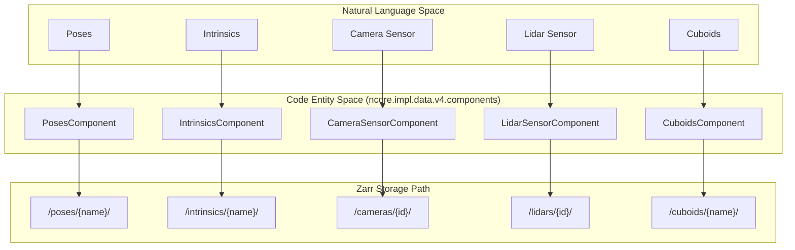
Sources: [docs/data/formats.rst:41-58](), [ncore/impl/data/v4/components.py:43-55]()

---

## Spatial and Calibration Components

### PosesComponent
Stores rigid SE(3) transformations (4x4 matrices) between coordinate frames. It distinguishes between **Static Poses** (e.g., extrinsic calibration) and **Dynamic Poses** (e.g., ego-vehicle trajectory) [docs/data/formats.rst:88-109]().

*   **Static Poses**: Stored as attributes keyed by `(source_frame, target_frame)`.
*   **Dynamic Poses**: Stored as `[N, 4, 4]` float arrays with an associated `[N]` uint64 timestamp array [docs/data/formats.rst:104-109]().
*   **Common Frames**: `rig` (vehicle body), `world` (local navigation frame), and `world_global` (e.g., ECEF) [docs/data/formats.rst:111-114]().

### IntrinsicsComponent
Contains mathematical models for sensor projections. Supported models include `ftheta`, `opencv-pinhole`, and `opencv-fisheye` for cameras, and `row-offset-spinning` for LiDAR [docs/data/formats.rst:120-145]().

Sources: [docs/data/formats.rst:88-145](), [ncore/impl/data/v4/components.py:51-51]()

---

## Sensor Components

Sensor components share a frame-based indexing scheme where data is keyed by the **end-of-frame timestamp** [docs/data/formats.rst:166-183]().

### CameraSensorComponent
Stores image data and per-frame metadata. Images are typically stored as encoded bytes (e.g., JPEG, PNG) in a Zarr array of type `|Sx` [docs/data/formats.rst:184-191]().

### Ray-Bundle Sensors (LiDAR and Radar)
NCore V4 uses a unified "Ray Bundle" serialization for LiDAR and Radar to support flexible multi-return data.

*   **Ray Bundle**: Stores the geometric properties of rays (e.g., normalized directions in the sensor frame) [docs/data/formats.rst:203-205]().
*   **Ray Bundle Returns**: Stores per-return properties like `range`, `intensity`, and `timestamp_offset_us` [docs/data/formats.rst:206-215]().
*   **Valid Mask**: A bit-packed mask (`ray_bundle_returns_valid_mask_packed`) indicates which returns are valid for a given ray [docs/data/formats.rst:198-199]().

**Sensor Data Flow**
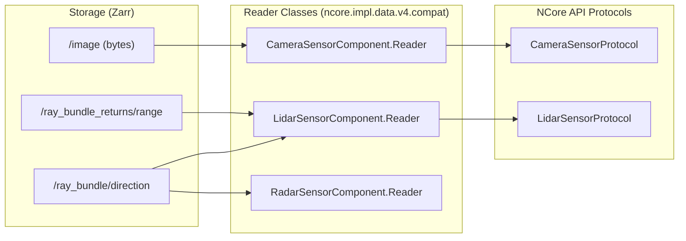
Sources: [docs/data/formats.rst:166-215](), [ncore/impl/data/v4/compat.py:43-53]()

---

## Annotation Components

### CuboidsComponent
Stores 3D bounding box tracks. Each observation includes [docs/data/formats.rst:56-57]():
*   **Pose**: Center position and orientation in a reference frame (usually `world`).
*   **Dimensions**: Width, length, height.
*   **Metadata**: `track_id`, `label`, and `label_source` (e.g., manual, model-generated).

### MasksComponent
Stores static boolean masks for sensors, currently primarily used for cameras to mask out ego-vehicle parts (e.g., side mirrors, hood) [docs/data/formats.rst:147-162]().

---

## Timestamp Indexing and Access

NCore uses `HalfClosedInterval` (`[start, stop)`) for all time-based queries [ncore/impl/data/v4/components.py:52]().

1.  **Sequence Level**: The `sequence_timestamp_interval_us` defines the valid range for the entire recording [ncore/impl/data/v4/components.py:96]().
2.  **Frame Level**: Every sensor frame has a `[start, end]` timestamp pair stored in the `frames/attrs/frames_timestamps_us` array [docs/data/formats.rst:176]().
3.  **Lookup**: The `SequenceLoaderV4` provides `get_closest_frame_index`, which uses `closest_index_sorted` to resolve a query timestamp to a specific frame index based on a `relative_frame_time` (0.0 for start, 1.0 for end) [ncore/impl/data/v4/compat_test.py:142-167]().

Sources: [ncore/impl/data/v4/components.py:52-100](), [ncore/impl/data/v4/compat_test.py:142-167](), [docs/data/formats.rst:176-178]()

---

# Page: Storage Backends: .itar and Zarr

# Storage Backends: .itar and Zarr

<details>
<summary>Relevant source files</summary>

The following files were used as context for generating this wiki page:

- [docs/_static/custom.css](docs/_static/custom.css)
- [docs/apis/install.rst](docs/apis/install.rst)
- [docs/data/conventions.rst](docs/data/conventions.rst)
- [docs/data/formats.rst](docs/data/formats.rst)
- [docs/data/storage_and_access.rst](docs/data/storage_and_access.rst)
- [docs/index.rst](docs/index.rst)
- [docs/tools/ncore_vis.rst](docs/tools/ncore_vis.rst)
- [ncore/impl/data/stores.py](ncore/impl/data/stores.py)
- [ncore/impl/sensors/camera.py](ncore/impl/sensors/camera.py)
- [ncore/impl/sensors/camera_test.py](ncore/impl/sensors/camera_test.py)
- [ncore/impl/sensors/common.py](ncore/impl/sensors/common.py)
- [ncore/impl/sensors/lidar.py](ncore/impl/sensors/lidar.py)

</details>


This page details the storage layer of the NCore V4 data format, focusing on the `IndexedTarStore` (`.itar`) format and its integration with `zarr`. It covers the technical implementation of O(1) random access within TAR archives, performance characteristics, and the unified access model for local and cloud storage.

## Overview

NCore V4 components are persisted as `zarr` groups [docs/data/storage_and_access.rst:10-13](). While standard `zarr` often uses directory-based storage (one file per chunk), NCore introduces the `.itar` (Indexed Tar Archive) format to consolidate these chunks into a single, cloud-optimized container [docs/data/storage_and_access.rst:18-27]().

| Feature | Directory Store (`.zarr`) | Indexed Tar (`.zarr.itar`) |
| :--- | :--- | :--- |
| **Structure** | Folder with many small files | Single consolidated file |
| **Access** | Native OS filesystem | `IndexedTarStore` via `zarr` |
| **Random Access** | O(1) via filesystem | O(1) via CBOR/LZMA index |
| **Cloud Optimization** | High request overhead | Efficient (Range-requests) |
| **Updates** | Supports incremental updates | Write-once / Append-only |

Sources: [docs/data/storage_and_access.rst:43-53]()

## The Indexed Tar (.itar) Format

The `.itar` format addresses the "many small files" problem of standard Zarr stores while maintaining random-access performance. It appends a compressed index to a standard TAR archive, allowing the library to locate any member without scanning the entire file [docs/data/storage_and_access.rst:21-27]().

### Implementation: `IndexedTarStore`

The `IndexedTarStore` class implements the abstract `zarr.Store` interface [ncore/impl/data/stores.py:43-43](). It manages a `TarRecordIndex` which maps string keys (Zarr chunk paths) to specific byte offsets and sizes within the TAR container [ncore/impl/data/stores.py:69-79]().

#### Data Flow: Reading a Chunk
1. **Key Lookup**: The store queries the `index.records` dictionary [ncore/impl/data/stores.py:137-137]().
2. **File Seek**: The underlying file object performs a `seek()` to the `offset_data` [ncore/impl/data/stores.py:143-143]().
3. **Direct Read**: Exactly `size` bytes are read into memory [ncore/impl/data/stores.py:144-144]().

#### Data Flow: Writing/Closing
When writing in `"w"` mode, members are added sequentially [ncore/impl/data/stores.py:169-169](). Upon calling `close()`, the store serializes the index using **CBOR** and compresses it with **LZMA** before appending it as a trailer to the file [ncore/impl/data/stores.py:198-210]().

### System Architecture: Storage Abstraction

The following diagram shows how `IndexedTarStore` bridges the Zarr API to various physical storage backends.

**Storage Backend Architecture**
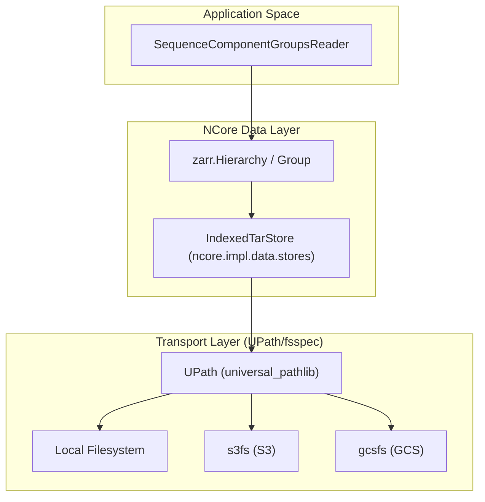
Sources: [ncore/impl/data/stores.py:43-111](), [docs/data/storage_and_access.rst:159-173]()

## Performance Benchmarks

`.itar` is optimized for high-throughput sequential and random access. Because it bypasses the standard Python `tarfile` module's multiple wrapping layers (like `ExFileObject`), it achieves significantly higher speeds [docs/data/storage_and_access.rst:119-123]().

### Read Throughput Comparison (Local SSD)

| Format | Sequential (MB/s) | Random (MB/s) | Latency (ms) | Time-to-first-read |
| :--- | :--- | :--- | :--- | :--- |
| **.itar** | **9847** | **9492** | **0.46** | **2.1 ms** (index load) |
| `tarfile` (pre-parsed) | 8470 | 7402 | 0.54 | 82.6 ms (header scan) |
| `WebDataset` | 1557 | N/A | 2.91 | 3.2 ms |
| `Parquet` | 1552 | 1542 | 2.92 | 2929.0 ms |
| `HDF5` | 754 | 1027 | 6.01 | 1.0 ms |

Sources: [docs/data/storage_and_access.rst:72-117]()

## Cloud and Remote Access

NCore utilizes `UPath` (built on `fsspec`) to provide protocol-agnostic access to data [docs/data/storage_and_access.rst:164-170](). 

### Data Access Flow
When a user provides a path like `s3://bucket/data.zarr.itar`, the following occurs:
1. `IndexedTarStore` initializes a `UPath` object [ncore/impl/data/stores.py:94-99]().
2. The `fsspec` implementation (e.g., `s3fs`) handles HTTP Range-Requests [docs/data/storage_and_access.rst:164-173]().
3. The `.itar` index is read from the end of the remote file first [ncore/impl/data/stores.py:115-115]().
4. Subsequent chunk reads only fetch the specific byte ranges required, minimizing egress costs and latency [docs/data/storage_and_access.rst:45-47]().

**Remote Access Entity Mapping**
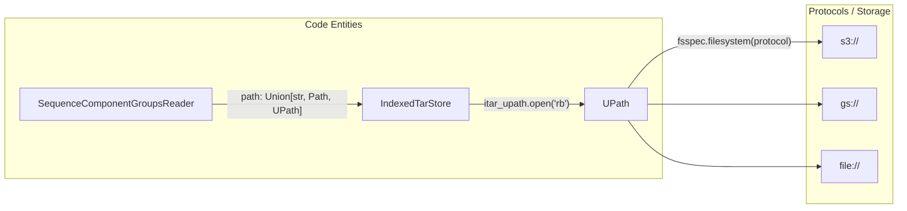
Sources: [ncore/impl/data/stores.py:81-111](), [docs/data/storage_and_access.rst:142-158]()

## Usage Example

Loading a sequence composed of multiple `.itar` stores:

```python
from ncore.data.v4 import SequenceComponentGroupsReader, PosesComponent
from pathlib import Path

# Combine base data with a separate calibration update
reader = SequenceComponentGroupsReader([
    Path("base_sequence.zarr.itar"),
    Path("updated_calib.zarr.itar"),
])

# Open readers for specific components
poses = reader.open_component_readers(PosesComponent.Reader)
```
Sources: [docs/data/storage_and_access.rst:144-158]()

## Key Classes Reference

| Class | Responsibility | File |
| :--- | :--- | :--- |
| `IndexedTarStore` | Implements Zarr `Store` interface for indexed TARs. | [ncore/impl/data/stores.py:43]() |
| `TarRecordIndex` | Data structure holding the mapping of keys to offsets. | [ncore/impl/data/stores.py:76]() |
| `SequenceComponentGroupsReader` | High-level API for reading combined V4 components. | [docs/data/storage_and_access.rst:52]() |

Sources: [ncore/impl/data/stores.py:43-80](), [docs/data/storage_and_access.rst:51-53]()

---

# Page: Coordinate Conventions and Pose Graph

# Coordinate Conventions and Pose Graph

<details>
<summary>Relevant source files</summary>

The following files were used as context for generating this wiki page:

- [docs/_static/custom.css](docs/_static/custom.css)
- [docs/apis/install.rst](docs/apis/install.rst)
- [docs/data/conventions.rst](docs/data/conventions.rst)
- [ncore/impl/data/compat.py](ncore/impl/data/compat.py)
- [ncore/impl/data/v4/BUILD.bazel](ncore/impl/data/v4/BUILD.bazel)
- [ncore/impl/data/v4/compat.py](ncore/impl/data/v4/compat.py)
- [ncore/impl/data/v4/compat_test.py](ncore/impl/data/v4/compat_test.py)
- [ncore/impl/data/v4/components.py](ncore/impl/data/v4/components.py)

</details>


NCore defines a rigorous spatial specification to ensure consistency across various sensors, ego-vehicles, and global reference frames. All spatial relationships are represented in a **pose graph**, a tree-like structure that manages both static calibrations and time-varying trajectories.

## Coordinate Systems and Transformations

NCore follows a specific convention for representing 3D spatial data to ensure interoperability between modules.

### SE(3) Matrices and $T_{a}^{b}$ Notation
All relative transformations are stored as homogeneous 4x4 $SE(3)$ matrices. These matrices consist of a 3x3 rotation matrix $\mathbf{R}$ and a 3x1 translation vector $\mathbf{t}$ [docs/data/conventions.rst:24-27]().

NCore uses the identifier `T_a_b` to represent the transformation $T_{a}^{b}$, which maps points from coordinate system $a$ to coordinate system $b$ [docs/data/conventions.rst:28-30]().
*   **Point Transformation**: $\mathbf{p}_b = \mathbf{R}_a^b \, \mathbf{p}_a + \mathbf{t}_a^b$ [docs/data/conventions.rst:32-36]().
*   **Chaining**: Transformations are composed via matrix multiplication: $T_a^c = T_b^c \, T_a^b$ [docs/data/conventions.rst:38-43]().

### Standard Coordinate Frames
The following named frames are standard across NCore:

| Frame Name | Description | Orientation |
| :--- | :--- | :--- |
| `rig` | Vehicle/robot body frame. Origin is middle of rear axis on ground [docs/data/conventions.rst:109-112](). | X-front, Y-left, Z-up (Right-handed) |
| `world` | Sequence-local reference frame, usually identity at the first ego pose [docs/data/conventions.rst:95-97](). | Local metric space |
| `world_global` | Earth-Centered-Earth-Fixed (ECEF) global frame [docs/data/conventions.rst:82-82](). | Global ECEF |
| `camera` | Sensor-local frame. Origin at optical center [docs/data/conventions.rst:128-131](). | Z-forward, X-right, Y-down |
| `image` | 2D pixel coordinates. Origin at top-left [docs/data/conventions.rst:135-138](). | U-right, V-down |

Sources: [docs/data/conventions.rst:24-140]()

## Pose Graph Representation

The pose graph is a tree of named coordinate frames connected by rigid transformations. Because it is a tree (no cycles), there is a unique path between any two frames, traversable via composition or $SE(3)$ inversion [docs/data/conventions.rst:49-54]().

### Static vs. Dynamic Edges
Edges in the graph fall into two categories:
1.  **Static Edges**: Time-invariant $SE(3)$ matrices representing fixed relationships like extrinsic calibrations (e.g., `T_camera_rig`) [docs/data/conventions.rst:58-61]().
2.  **Dynamic Edges**: Time-dependent trajectories. These are sequences of $SE(3)$ matrices with associated timestamps, interpolated using SLERP (rotation) and linear interpolation (translation) [docs/data/conventions.rst:63-67]().

### Pose Graph Implementation
In the codebase, the pose graph is managed by the `PoseGraphInterpolator` [ncore/impl/common/transformations.py:26-26](). When a `SequenceLoaderV4` is initialized, it constructs this graph by reading both static and dynamic poses from the `PosesComponent` [ncore/impl/data/v4/compat.py:123-138]().

**Pose Graph Data Flow**
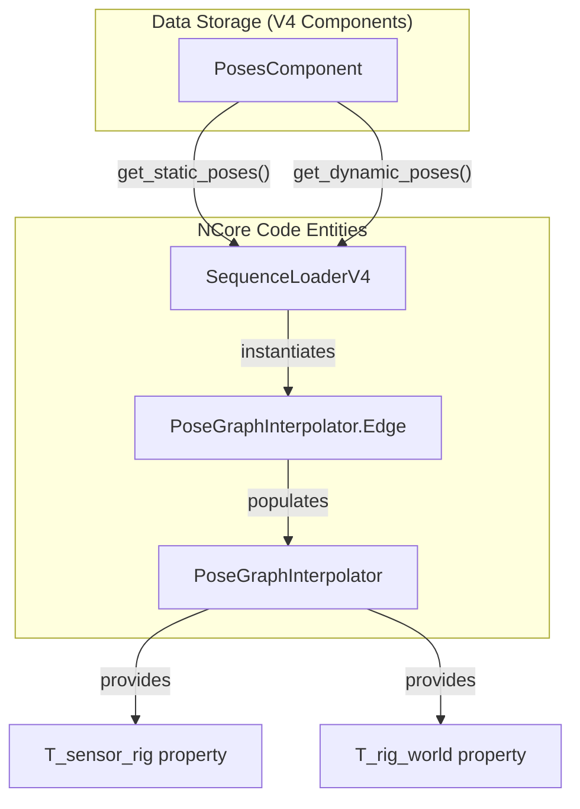
Sources: [ncore/impl/data/v4/compat.py:86-138](), [docs/data/conventions.rst:49-68]()

## Timestamps and Intervals

NCore uses microsecond-precision integers for timestamps. Temporal ranges are represented using the `HalfClosedInterval` class, which defines a range $[start, stop)$ [ncore/impl/common/transformations.py:26-26]().

*   **Sequence Interval**: Every sequence has a `sequence_timestamp_interval_us` defining its total duration [ncore/impl/data/v4/components.py:96-96]().
*   **Sensor Frames**: Sensors (Camera, LiDAR, Radar) store frame timing as an $(N, 2)$ array of start/end timestamps [ncore/impl/data/compat.py:173-175]().
*   **FrameTimepoint**: An enumeration (`START` or `END`) used to select which timestamp to use when querying poses or indexing frames [ncore/impl/data/compat.py:177-180]().

Sources: [ncore/impl/data/v4/components.py:74-79](), [ncore/impl/data/compat.py:173-180]()

## PoseGraphInterpolator and Motion Compensation

The `PoseGraphInterpolator` is the primary tool for resolving spatial queries at specific points in time. It is used extensively for **Motion Compensation**, especially for sensors with non-instantaneous capture like rolling-shutter cameras or spinning LiDARs.

### Key Capabilities
*   **Interpolation**: Computes the pose at any timestamp $t$ within the trajectory range [docs/data/conventions.rst:64-65]().
*   **Frame-Relative Queries**: Through the `SensorProtocol`, users can query `T_sensor_rig` (static) or `T_rig_world` (interpolated at frame start/end) [ncore/impl/data/compat.py:193-200]().
*   **Coordinate Conversion**: The `MotionCompensator` utility uses the pose graph to transform point clouds or rays from their capture time to a common reference time [ncore/impl/common/transformations.py:26-26]().

**Entity Relationship: Pose Querying**
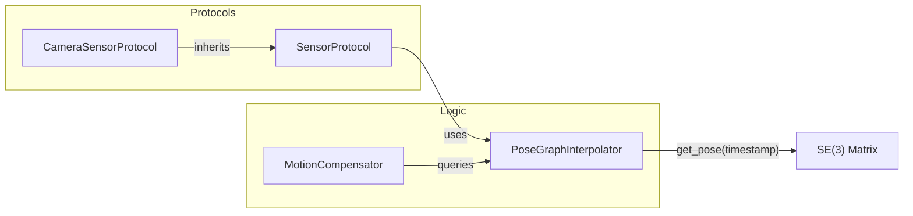
Sources: [ncore/impl/data/compat.py:157-200](), [ncore/impl/data/v4/compat.py:26-26](), [docs/data/conventions.rst:114-117]()

---

# Page: Reading and Writing Sequences

# Reading and Writing Sequences

<details>
<summary>Relevant source files</summary>

The following files were used as context for generating this wiki page:

- [docs/data/formats.rst](docs/data/formats.rst)
- [docs/data/storage_and_access.rst](docs/data/storage_and_access.rst)
- [docs/index.rst](docs/index.rst)
- [docs/tools/ncore_vis.rst](docs/tools/ncore_vis.rst)
- [ncore/data_converter/__init__.py](ncore/data_converter/__init__.py)
- [ncore/impl/data/compat.py](ncore/impl/data/compat.py)
- [ncore/impl/data/v4/BUILD.bazel](ncore/impl/data/v4/BUILD.bazel)
- [ncore/impl/data/v4/compat.py](ncore/impl/data/v4/compat.py)
- [ncore/impl/data/v4/compat_test.py](ncore/impl/data/v4/compat_test.py)
- [ncore/impl/data/v4/components.py](ncore/impl/data/v4/components.py)
- [ncore/impl/data_converter/base.py](ncore/impl/data_converter/base.py)
- [tools/data_converter/BUILD.bazel](tools/data_converter/BUILD.bazel)

</details>


NCore V4 utilizes a component-based architecture for reading and writing data. Unlike monolithic formats, V4 distributes data across modular *component groups*, which are independently managed Zarr stores. This design allows for flexible composition of sequences by combining different stores (e.g., combining a base sensor store with a separate calibration or labels store).

## Sequence Reading and Writing Architecture

The primary interface for interacting with V4 data consists of the `SequenceComponentGroupsReader` and `SequenceComponentGroupsWriter` classes. These classes manage the lifecycle of Zarr stores and coordinate access to specific data components like poses, intrinsics, and sensor frames.

### Reading Sequences
The `SequenceComponentGroupsReader` accepts a list of paths to component stores. It aggregates these stores into a single logical sequence view.

*   **Initialization**: It reads metadata from each store and verifies sequence consistency (e.g., matching `sequence_id`) [ncore/impl/data/v4/components.py:102-121]().
*   **Component Access**: Users open specific component readers (e.g., `PosesComponent.Reader`) by passing the desired reader class to `open_component_readers()` [docs/data/storage_and_access.rst:150-157]().

### Writing Sequences
The `SequenceComponentGroupsWriter` manages the creation of new Zarr stores, either as directory-based stores or `.itar` archives.

*   **Lazy Initialization**: Stores are created on-demand when a component group is first accessed [ncore/impl/data/v4/components.py:170-180]().
*   **Storage Profiles**: The `store_type` parameter determines if the output is a standard directory or a high-performance `.itar` file [ncore/impl/data/v4/components.py:191-197]().

### Sequence Reading Data Flow
The following diagram illustrates how the reader aggregates multiple physical Zarr stores into a unified logical sequence.

**Sequence Reader Component Aggregation**
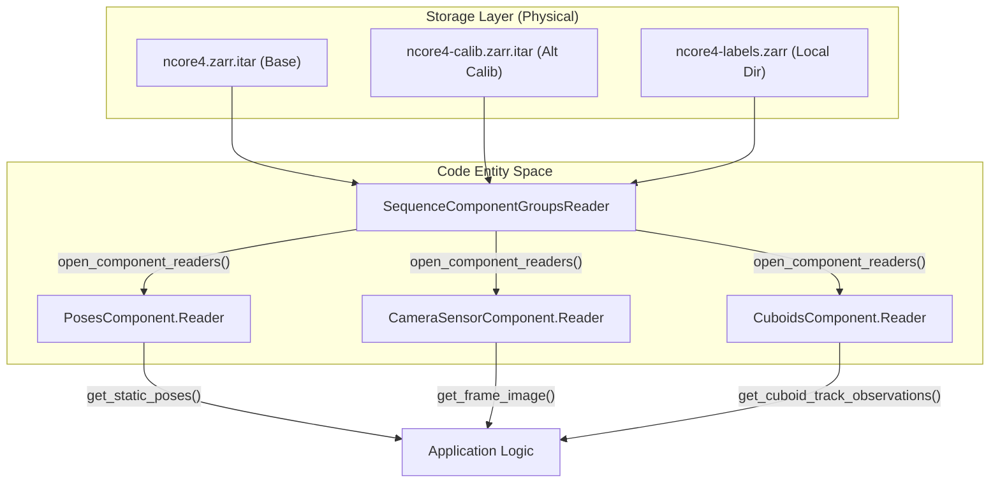
Sources: [ncore/impl/data/v4/components.py:102-121](), [ncore/impl/data/v4/compat.py:85-121](), [docs/data/storage_and_access.rst:142-158]()

## SequenceLoaderV4 Compatibility Layer

The `SequenceLoaderV4` class provides a unified, protocol-based interface (`SequenceLoaderProtocol`) for accessing sequence data. It abstracts the underlying component-based structure into a more sensor-centric API, making it easier to migrate from older formats or build generic tools.

### Key Responsibilities
1.  **Pose Graph Construction**: It automatically instantiates a `PoseGraphInterpolator` by collecting all static and dynamic poses from the `PosesComponent` [ncore/impl/data/v4/compat.py:123-138]().
2.  **Sensor Mapping**: It maps sensor IDs to their respective component readers (Cameras, Lidars, Radars) [ncore/impl/data/v4/compat.py:112-120]().
3.  **Resource Management**: Implements `reload_resources()` to handle multi-process data loading scenarios by refreshing internal Zarr handles [ncore/impl/data/v4/compat.py:161-163]().

**Compatibility Layer Architecture**
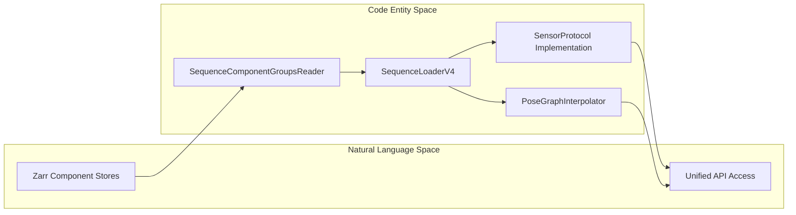
Sources: [ncore/impl/data/v4/compat.py:60-141](), [ncore/impl/data/compat.py:79-154]()

## Component Group Assignments

NCore supports different organizational profiles for data components. While the default is a single store, complex datasets often separate sensors to optimize parallel I/O or independent updates.

| Profile | Description | Typical Usage |
| :--- | :--- | :--- |
| **Default** | All components (poses, sensors, etc.) in a single `ncore4.zarr.itar` file. | Small sequences, distribution-ready datasets. |
| **Separate Sensors** | Each sensor type (e.g., `ncore4-cameras`, `ncore4-lidars`) has its own store. | Large datasets where users might only need one modality. |
| **Separate All** | Every component instance has a dedicated store (e.g., `ncore4-camera_front_wide`). | High-performance training pipelines requiring maximum I/O parallelism. |

In the `SequenceLoaderV4` and visualization tools like `ncore_vis`, these are managed via group name parameters (e.g., `poses_component_group_name`) [ncore/impl/data/v4/compat.py:78-81](), [docs/tools/ncore_vis.rst:83-94]().

## UPath and Cloud-Agnostic Access

NCore utilizes `universal_pathlib` (`UPath`) for all filesystem operations. This allows the same reading and writing code to work across local files and cloud object storage without modification [docs/data/storage_and_access.rst:164-170]().

### Implementation Detail
The `BaseDataConverter` and `SequenceComponentGroupsWriter` both cast input strings to `UPath` objects [ncore/impl/data_converter/base.py:63-63](), [ncore/impl/data/v4/components.py:125-140](). This enables:
*   **Transparent S3/GCS Access**: Using URLs like `s3://bucket/seq.zarr.itar` [docs/data/storage_and_access.rst:184-189]().
*   **Atomic Operations**: Remote filesystems leverage `fsspec` implementations for robust cloud I/O [docs/data/storage_and_access.rst:198-202]().

Sources: [ncore/impl/data/v4/components.py:49-50](), [ncore/impl/data_converter/base.py:25-25](), [docs/data/storage_and_access.rst:159-170]()

---

# Page: Sensor Models

# Sensor Models

<details>
<summary>Relevant source files</summary>

The following files were used as context for generating this wiki page:

- [CHANGELOG.md](CHANGELOG.md)
- [README.md](README.md)
- [docs/data/sensor_models.rst](docs/data/sensor_models.rst)
- [ncore/BUILD.bazel](ncore/BUILD.bazel)
- [ncore/impl/data/stores.py](ncore/impl/data/stores.py)
- [ncore/impl/data/types.py](ncore/impl/data/types.py)
- [ncore/impl/sensors/camera.py](ncore/impl/sensors/camera.py)
- [ncore/impl/sensors/camera_test.py](ncore/impl/sensors/camera_test.py)
- [ncore/impl/sensors/common.py](ncore/impl/sensors/common.py)
- [ncore/impl/sensors/lidar.py](ncore/impl/sensors/lidar.py)

</details>


NCore provides a high-level, GPU-accelerated sensor modeling layer designed for neural reconstruction and robotics applications. This layer abstracts the mathematical complexities of different camera and LiDAR hardware into unified APIs for projection, unprojection, and motion compensation [README.md:11-17]().

The sensor modeling subsystem is built on top of `torch.nn.Module` to enable seamless integration into deep learning pipelines and to leverage CUDA acceleration for high-throughput ray operations [ncore/impl/sensors/common.py:22-31]().

### Core Architecture

All sensor models inherit from a common `BaseModel` which manages device placement (CPU/GPU) and floating-point precision (`dtype`) [ncore/impl/sensors/common.py:22-32](). The system distinguishes between **Intrinsics** (internal sensor geometry) and **External Distortion** (environmental effects like windshields).

#### System Entity Map: Sensors to Code
The following diagram maps high-level sensor concepts to their corresponding implementation classes and data structures in the NCore codebase.

**Sensor Model Entity Mapping**
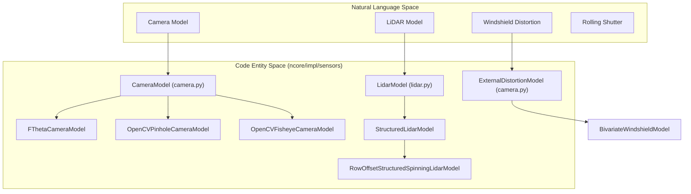
**Sources:** [ncore/impl/sensors/camera.py:40-48](), [ncore/impl/sensors/camera.py:175-185](), [ncore/impl/sensors/lidar.py:37-38](), [ncore/impl/sensors/lidar.py:130-131]()

---

### Camera Models

NCore supports multiple camera parameterizations to handle everything from standard pinhole lenses to ultra-wide fisheye optics.

*   **FTheta Model**: NVIDIA's proprietary model using polynomial distortion, ideal for wide FOV sensors [docs/data/sensor_models.rst:45-57]().
*   **OpenCV Pinhole**: Standard model supporting radial, tangential, and thin-prism distortion [docs/data/sensor_models.rst:109-135]().
*   **OpenCV Fisheye**: Specialized polynomial distortion for hemispherical lenses [docs/data/sensor_models.rst:185-190]().

#### Key Features
*   **Rolling Shutter**: Models include `ShutterType` (e.g., `ROLLING_TOP_TO_BOTTOM`) to account for CMOS sensor readout timing [ncore/impl/data/types.py:64-72]().
*   **External Distortion**: The `BivariateWindshieldModel` uses 2D polynomials to correct for ray deflection caused by vehicle glass [ncore/impl/sensors/camera.py:78-85]().

For implementation details and mathematical definitions, see **[Camera Models](#3.1)**.

**Sources:** [ncore/impl/sensors/camera.py:175-185](), [docs/data/sensor_models.rst:15-28]()

---

### LiDAR Models

The LiDAR layer provides tools for mapping between 3D world points and sensor-specific angular representations (Azimuth/Elevation).

*   **Structured LiDAR**: Models sensors with a fixed grid of lasers (rows) and firing sequence (columns), such as the Hesai P128 [ncore/impl/sensors/lidar.py:180-182]().
*   **Ray-to-Angle Mapping**: Efficient conversion between `sensor_rays` and `sensor_angles` [ncore/impl/sensors/lidar.py:115-128]().

#### Motion Compensation
LiDAR scans are often "smeared" because the vehicle moves during the spin. NCore provides `MotionCompensator` utilities to de-warp point clouds based on high-frequency ego-pose data [ncore/impl/sensors/lidar.py:63-74]().

For implementation details and structured lookup logic, see **[LiDAR Models](#3.2)**.

**Sources:** [ncore/impl/sensors/lidar.py:37-60](), [ncore/impl/sensors/lidar.py:130-146]()

---

### Data Integration

Sensor models are typically initialized from the NCore V4 Data Format using the `from_parameters` factory methods.

**Parameter to Model Flow**
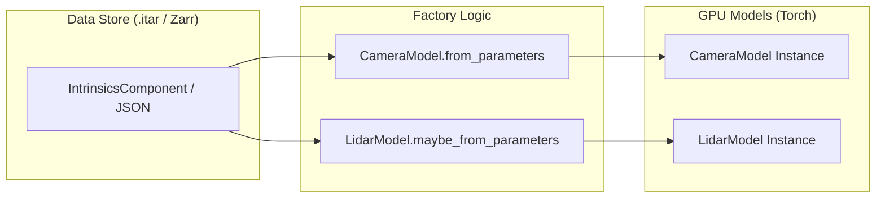

| Model Class | Parameter Type | File Reference |
| :--- | :--- | :--- |
| `FThetaCameraModel` | `FThetaCameraModelParameters` | [ncore/impl/sensors/camera.py:189]() |
| `OpenCVPinholeCameraModel` | `OpenCVPinholeCameraModelParameters` | [ncore/impl/sensors/camera.py:461]() |
| `RowOffsetStructuredSpinningLidarModel` | `RowOffsetStructuredSpinningLidarModelParameters` | [ncore/impl/sensors/lidar.py:180]() |

**Sources:** [ncore/impl/sensors/camera.py:189-200](), [ncore/impl/sensors/lidar.py:98-114](), [ncore/impl/data/types.py:138-150]()

---

# Page: Camera Models

# Camera Models

<details>
<summary>Relevant source files</summary>

The following files were used as context for generating this wiki page:

- [docs/data/sensor_models.rst](docs/data/sensor_models.rst)
- [ncore/impl/data/stores.py](ncore/impl/data/stores.py)
- [ncore/impl/data/types.py](ncore/impl/data/types.py)
- [ncore/impl/sensors/camera.py](ncore/impl/sensors/camera.py)
- [ncore/impl/sensors/camera_test.py](ncore/impl/sensors/camera_test.py)
- [ncore/impl/sensors/common.py](ncore/impl/sensors/common.py)
- [ncore/impl/sensors/lidar.py](ncore/impl/sensors/lidar.py)

</details>


NCore provides a suite of GPU-accelerated camera models designed for high-performance projection and unprojection tasks. These models support various lens geometries, including standard perspective, wide-angle fisheye, and NVIDIA's proprietary FTheta parameterization. The system explicitly handles rolling-shutter effects through iterative optimization and supports external distortion models, such as those caused by vehicle windshields.

## Architecture Overview

All camera models inherit from a common base and provide consistent APIs for mapping between 3D rays and 2D image coordinates. The implementation leverages PyTorch for batch processing on both CPU and GPU.

### Class Hierarchy and Data Flow

The following diagram illustrates the relationship between the camera model classes and the data structures defined in the NCore schema.

**Camera Model Entity Map**
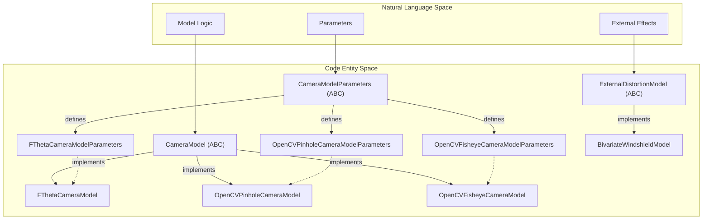
Sources: [ncore/impl/sensors/camera.py:40-42](), [ncore/impl/sensors/camera.py:228-230](), [ncore/impl/data/types.py:139-141]()

## Supported Camera Models

### FTheta Camera Model
The `FThetaCameraModel` is a flexible polynomial-based model suitable for a wide range of field-of-views. It maps the angle $\theta$ (between the ray and the principal axis) to a pixel distance $\delta$ using a 5th-order polynomial [docs/data/sensor_models.rst:83-91]().

*   **Forward Polynomial**: Maps angle $\theta$ to pixel distance $\delta$.
*   **Backward Polynomial**: Maps pixel distance $\delta$ to angle $\theta$.
*   **Reference System**: One polynomial is designated as the `reference_poly`, while the other is an approximation used for initialization [ncore/impl/data/types.py:59-62]().

### OpenCV Models
NCore implements standard OpenCV-compatible models for integration with existing computer vision pipelines:
*   **OpenCVPinholeCameraModel**: Supports rational radial ($k_1 \dots k_6$), tangential ($p_1, p_2$), and thin prism ($s_1 \dots s_4$) distortion [docs/data/sensor_models.rst:120-135]().
*   **OpenCVFisheyeCameraModel**: Uses a 4th-order polynomial distortion mapping $\theta$ to $d = \theta(1 + k_1\theta^2 + k_2\theta^4 + k_3\theta^6 + k_4\theta^8)$ [docs/data/sensor_models.rst:198-205]().

Sources: [ncore/impl/sensors/camera.py:488-490](), [ncore/impl/sensors/camera.py:657-659](), [ncore/impl/sensors/camera.py:821-823]()

## Projection and Unprojection APIs

The models provide two primary functional interfaces: `project` and `unproject`. These functions handle batches of points/rays and integrate with the rolling-shutter and external distortion logic.

| Function | Input | Output | Description |
| :--- | :--- | :--- | :--- |
| `project` | 3D Points (World/Rig) | 2D Image Coords | Projects 3D points to pixels, optionally compensating for motion/shutter. |
| `unproject` | 2D Image Coords | 3D Rays (Sensor) | Converts pixel coordinates back into normalized 3D rays. |

### Data Flow for Projection
```mermaid
sequenceDiagram
    participant App as Application
    participant CM as CameraModel
    participant ED as ExternalDistortionModel
    participant Opt as ShutterOptimizer

    App->>CM: project(points, T_world_sensor)
    alt is Rolling Shutter
        CM->>Opt: find_shutter_times(points)
        Opt-->>CM: timestamps_us
    end
    CM->>ED: distort_camera_rays(rays)
    ED-->>CM: distorted_rays
    CM->>CM: apply_intrinsic_distortion(distorted_rays)
    CM-->>App: image_points
```
Sources: [ncore/impl/sensors/camera.py:321-340](), [ncore/impl/sensors/camera.py:384-405]()

## Rolling-Shutter Compensation

For cameras with `ShutterType` other than `GLOBAL` (e.g., `ROLLING_TOP_TO_BOTTOM`), the exact time a pixel is captured depends on its image coordinates [ncore/impl/data/types.py:64-71](). 

### Iterative Shutter Optimization
Because the pixel coordinate depends on the camera pose at a specific time, and that time depends on the pixel coordinate, NCore uses an iterative loop to find a consistent solution:
1.  **Initialize**: Assume global shutter time (frame timestamp).
2.  **Project**: Map 3D points to image coordinates using the current pose.
3.  **Update Time**: Calculate new per-point timestamps based on the projected `u` or `v` coordinates and the `shutter_type` [ncore/impl/sensors/camera.py:1152-1175]().
4.  **Interpolate Pose**: Get updated `T_world_sensor` for each point using `PoseGraphInterpolator`.
5.  **Repeat**: Typically converges in 2-3 iterations [ncore/impl/sensors/camera.py:1183-1195]().

Sources: [ncore/impl/sensors/camera.py:1134-1145](), [ncore/impl/sensors/camera.py:1178-1198]()

## External Distortion: BivariateWindshieldModel

The `BivariateWindshieldModel` accounts for refraction through a vehicle's windshield. It is applied to rays before they enter the camera lens (during projection) or after they exit the lens (during unprojection) [ncore/impl/sensors/camera.py:78-84]().

*   **Mechanism**: It uses spherical coordinates $\phi = \arcsin(x/\text{norm})$ and $\theta = \arcsin(y/\text{norm})$ [ncore/impl/sensors/camera.py:81-82]().
*   **Polynomials**: Deflection is computed via bivariate polynomials of order $N$ in both $\phi$ and $\theta$ [ncore/impl/sensors/camera.py:83-84]().
*   **Application**:
    *   `distort_camera_rays`: Transforms external rays to internal (camera-side) rays [ncore/impl/sensors/camera.py:186-191]().
    *   `undistort_camera_rays`: Transforms internal rays to external (world-side) rays [ncore/impl/sensors/camera.py:193-198]().

Sources: [ncore/impl/sensors/camera.py:78-100](), [ncore/impl/sensors/camera.py:186-198]()

---

# Page: LiDAR Models

# LiDAR Models

<details>
<summary>Relevant source files</summary>

The following files were used as context for generating this wiki page:

- [docs/data/sensor_models.rst](docs/data/sensor_models.rst)
- [ncore/impl/data/stores.py](ncore/impl/data/stores.py)
- [ncore/impl/data/types.py](ncore/impl/data/types.py)
- [ncore/impl/sensors/camera.py](ncore/impl/sensors/camera.py)
- [ncore/impl/sensors/camera_test.py](ncore/impl/sensors/camera_test.py)
- [ncore/impl/sensors/common.py](ncore/impl/sensors/common.py)
- [ncore/impl/sensors/lidar.py](ncore/impl/sensors/lidar.py)

</details>


NCore provides a GPU-accelerated sensor modeling layer for LiDAR sensors, supporting both generic and structured spinning models. These models handle the conversion between 3D points, sensor rays, and spherical angles, while accounting for per-row offsets and motion compensation during vehicle movement.

## Core Abstractions

LiDAR modeling in NCore is built around a hierarchy of classes that define how rays are mapped to angles and how structured data (like range images) relates to 3D space.

### LidarModel
The base class `LidarModel` defines the standard interface for all LiDAR types. It provides abstract methods for converting between sensor rays and sensor angles (elevation and azimuth) [ncore/impl/sensors/lidar.py:37-38]().

Key return types include:
*   `SensorAnglesReturn`: Contains elevation/azimuth angles and a validity flag [ncore/impl/sensors/lidar.py:41-49]().
*   `SensorRayReturn`: Contains 3D sensor rays and a validity flag [ncore/impl/sensors/lidar.py:52-60]().
*   `WorldRaysReturn`: Encapsulates rays in the world frame, including origin, direction, and optional per-ray timestamps for motion compensation [ncore/impl/sensors/lidar.py:63-74]().

### StructuredLidarModel
An extension of the base model for sensors with a fixed grid-like scan pattern (e.g., spinning LiDARs). It introduces "elements" (row/column indices) and provides methods to map these indices directly to 3D points or rays [ncore/impl/sensors/lidar.py:130-178]().

### Class Hierarchy and Data Flow
The following diagram illustrates the relationship between the LiDAR model entities and the data structures they produce.

**LiDAR Model Entity Mapping**
```mermaid
graph TD
    subgraph "Code Entity Space"
        LM["LidarModel (Base)"]
        SLM["StructuredLidarModel"]
        ROSLM["RowOffsetStructuredSpinningLidarModel"]
        MC["MotionCompensator"]
        
        SAR["SensorAnglesReturn"]
        SRR["SensorRayReturn"]
        WRR["WorldRaysReturn"]
    end

    subgraph "Natural Language Concepts"
        RA["Ray-to-Angle Mapping"]
        RO["Per-row Azimuth Offsets"]
        MC_CONCEPT["Motion Compensation"]
        RI["Range Image Elements"]
    end

    LM -->|defines| RA
    SLM --|> LM
    SLM -->|manages| RI
    ROSLM --|> SLM
    ROSLM -->|implements| RO
    MC -->|produces| WRR
    MC_CONCEPT --> MC
```
Sources: [ncore/impl/sensors/lidar.py:37-181](), [ncore/impl/sensors/lidar.py:41-74]()

---

## RowOffsetStructuredSpinningLidarModel

The `RowOffsetStructuredSpinningLidarModel` is the primary implementation for modern high-resolution spinning sensors (e.g., Hesai P128). It models the sensor as a grid where each row (laser) may have a unique azimuth offset relative to the global rotation [ncore/impl/sensors/lidar.py:180-185]().

### Ray-to-Angle Mapping
The model uses spherical coordinates where:
1.  **Elevation ($\theta$):** The angle from the XY plane.
2.  **Azimuth ($\phi$):** The rotation around the Z-axis.

For this model, the azimuth is corrected per-row:
$$\phi_{effective} = \phi_{column} + \text{offset}_{row}$$

Implementation:
*   `elements_to_sensor_angles`: Maps `(row, col)` to `(elevation, azimuth)` [ncore/impl/sensors/lidar.py:270-282]().
*   `sensor_rays_to_sensor_angles`: Converts 3D directions to spherical angles using `atan2` and `asin` [ncore/impl/sensors/lidar.py:284-306]().

### Column Lookup (cKDTree)
To perform the inverse mapping (angles to columns), the model employs a `scipy.spatial.cKDTree`. This is used to build a lookup table (`angles_to_columns_map`) that allows the model to find the nearest column index for a given azimuth angle efficiently [ncore/impl/sensors/lidar.py:221-268]().

Sources: [ncore/impl/sensors/lidar.py:180-306]()

---

## Motion Compensation

Because LiDAR sensors capture points over a period of time (a "sweep"), the ego-vehicle's movement causes spatial distortion. NCore provides the `MotionCompensator` utility to resolve this.

### Data Flow for Motion Compensation
The compensator takes a set of points, their timestamps, and the vehicle's pose trajectory to produce accurately localized rays in the world coordinate frame.

**Motion Compensation Data Flow**
```mermaid
graph LR
    subgraph "Input Data"
        PTS["Points (N, 3)"]
        TS["Timestamps (N,)"]
        PG["PoseGraph (T_world_sensor)"]
    end

    subgraph "MotionCompensator"
        INT["PoseGraphInterpolator"]
        TR["Transform Rays"]
    end

    subgraph "Output"
        WR["WorldRaysReturn"]
    end

    PTS --> TR
    TS --> INT
    PG --> INT
    INT -->|Interpolated Poses| TR
    TR --> WR
```
Sources: [ncore/impl/sensors/lidar.py:494-547](), [ncore/impl/data/types.py:36]()

### Key Functions
*   **`apply_motion_compensation`**: The main entry point. It interpolates the sensor's pose at every individual point's timestamp and transforms the points into a unified world frame [ncore/impl/sensors/lidar.py:514-547]().
*   **`PoseGraphInterpolator`**: Used internally to provide $SE(3)$ poses at arbitrary timestamps using SLERP for rotations and linear interpolation for translations [ncore/impl/data/types.py:36]().

---

## Technical Implementation Details

### Parameterization
LiDAR models are initialized from `LidarModelParameters`. The `RowOffsetStructuredSpinningLidarModelParameters` includes:
*   `row_elevations_rad`: Array of elevation angles for each laser [ncore/impl/sensors/lidar.py:183]().
*   `column_azimuths_rad`: Array of azimuth angles for each horizontal step [ncore/impl/sensors/lidar.py:184]().
*   `row_azimuth_offsets_rad`: Per-row corrections for the azimuth [ncore/impl/sensors/lidar.py:185]().

### GPU Acceleration
All heavy mathematical operations (ray-to-angle conversion, point transformations) are implemented using `torch` to leverage GPU acceleration [ncore/impl/sensors/lidar.py:25-34](). The `BaseModel` ensures that all buffers and parameters are correctly moved to the target `device` (e.g., `cuda`) during initialization [ncore/impl/sensors/common.py:22-59]().

### Summary Table: Key LiDAR Methods
| Method | Input | Output | Description |
| :--- | :--- | :--- | :--- |
| `sensor_angles_to_sensor_rays` | $(\theta, \phi)$ | $(x, y, z)$ | Converts spherical angles to unit vectors. |
| `elements_to_sensor_points` | $(r, c, dist)$ | $(x, y, z)$ | Maps range image pixels to 3D sensor space. |
| `apply_motion_compensation` | $P_{sensor}, t$ | $P_{world}$ | Transforms points to world frame using timestamps. |

Sources: [ncore/impl/sensors/lidar.py:125-171](), [ncore/impl/sensors/lidar.py:514-547](), [ncore/impl/sensors/common.py:22-78]()

---

# Page: Data Converters

# Data Converters

<details>
<summary>Relevant source files</summary>

The following files were used as context for generating this wiki page:

- [docs/conversions/index.rst](docs/conversions/index.rst)
- [ncore/data_converter/__init__.py](ncore/data_converter/__init__.py)
- [ncore/impl/data_converter/base.py](ncore/impl/data_converter/base.py)
- [tools/data_converter/BUILD.bazel](tools/data_converter/BUILD.bazel)
- [tools/data_converter/cli.py](tools/data_converter/cli.py)

</details>


NCore provides a robust data conversion framework designed to import 3rd-party dataset formats into the NCore V4 component-based format [docs/conversions/index.rst:7-9](). The framework abstracts common tasks such as sensor filtering, sequence discovery, and output directory management, allowing developers to focus on dataset-specific parsing logic.

### Conversion Architecture

The architecture is built around abstract base classes that define a standard lifecycle for processing datasets. The framework distinguishes between generic converters and those that operate specifically on local file systems.

#### Class Hierarchy and Core Entities

| Entity | Role | Source |
| :--- | :--- | :--- |
| `BaseDataConverter` | Abstract base class defining the conversion lifecycle (`convert`, `convert_sequence`). | [ncore/impl/data_converter/base.py:49-58]() |
| `BaseDataConverterConfig` | Dataclass for common CLI parameters like output paths and sensor filters. | [ncore/impl/data_converter/base.py:29-47]() |
| `FileBasedDataConverter` | Specialization for datasets stored in a local root directory. | [ncore/impl/data_converter/base.py:177-180]() |
| `FileBasedDataConverterConfig` | Adds `root_dir` requirement for local dataset discovery. | [ncore/impl/data_converter/base.py:159-174]() |

#### Data Conversion Lifecycle

The following diagram illustrates the relationship between the CLI entry point and the internal class methods that govern the conversion process.

**Data Converter Class Interaction**
```mermaid
graph TD
    subgraph "CLI Entry Space"
        CLI["tools.data_converter.cli:cli"] -- "parses" --> CFG["BaseDataConverterConfig"]
    end

    subgraph "Code Entity Space"
        BDC["BaseDataConverter"]
        BDC_C["BaseDataConverter.convert(config)"]
        BDC_GSI["BaseDataConverter.get_sequence_ids(config)"]
        BDC_FC["BaseDataConverter.from_config(config)"]
        BDC_CS["BaseDataConverter.convert_sequence(id)"]

        CFG --> BDC_C
        BDC_C --> BDC_GSI
        BDC_GSI -- "returns IDs" --> BDC_C
        BDC_C -- "loop per ID" --> BDC_FC
        BDC_FC -- "instantiates" --> BDC
        BDC_C --> BDC_CS
    end
```
**Sources:** [ncore/impl/data_converter/base.py:115-156](), [tools/data_converter/cli.py:34-75]()

### Sensor Filtering

The framework provides built-in mechanisms to filter which sensors are exported during conversion. This is managed via the `BaseDataConverterConfig` and resolved at runtime through helper methods.

*   **Selective Export:** Users can specify specific IDs for cameras, LiDARs, or radars, or disable entire sensor classes using flags like `--no-cameras` [tools/data_converter/cli.py:47-73]().
*   **Resolution Logic:** The `_get_active_sensor_ids` method ensures that requested sensor IDs are a valid subset of the sensors available in the source dataset [ncore/impl/data_converter/base.py:89-101]().

**Sensor Resolution Logic**
```mermaid
graph LR
    subgraph "Natural Language Space"
        UserReq["User Command Line Options"]
        DatasetMeta["Source Dataset Metadata"]
    end

    subgraph "Code Entity Space"
        CONFIG["BaseDataConverterConfig"]
        GA_CAM["get_active_camera_ids()"]
        GA_LID["get_active_lidar_ids()"]
        GA_RAD["get_active_radar_ids()"]
        VALIDATE["_get_active_sensor_ids()"]

        UserReq --> CONFIG
        DatasetMeta -- "all_camera_ids" --> GA_CAM
        CONFIG -- "camera_ids / no_cameras" --> GA_CAM
        GA_CAM --> VALIDATE
        VALIDATE -- "Assertion Check" --> Result["Final Active ID List"]
    end
```
**Sources:** [ncore/impl/data_converter/base.py:65-86](), [ncore/impl/data_converter/base.py:103-113]()

### CLI Entry Points

The conversion tools are unified under a single `click` group defined in `tools/data_converter/cli.py`. This CLI handles global configuration such as:
*   `--root-dir`: Input path for raw data [tools/data_converter/cli.py:35-40]().
*   `--output-dir`: Destination for V4 formatted data [tools/data_converter/cli.py:41]().
*   `--debug`: Support for remote `debugpy` sessions [tools/data_converter/cli.py:43-46]().

Subcommands (implemented in child pages) extend this group to provide dataset-specific parameters.

### Supported Datasets

NCore includes specialized converters for several major autonomous driving and robotics datasets. For detailed technical specifications, implementation details, and usage instructions, see the respective child pages:

*   **[COLMAP Converter](#4.1)**: Handles SfM outputs and ScanNet++ data, including virtual LiDAR generation from point clouds.
*   **[Waymo Open Dataset Converter](#4.2)**: Processes TFRecords, handles multi-return LiDAR, and parses panoptic segmentation.
*   **[Physical AI (PAI) Converter](#4.3)**: Manages local and streaming ingestion of PAI data with DRACO-encoded point clouds.

**Sources:** [docs/conversions/index.rst:7-17](), [ncore/impl/data_converter/base.py:49-58]()

---

# Page: COLMAP Converter

# COLMAP Converter

<details>
<summary>Relevant source files</summary>

The following files were used as context for generating this wiki page:

- [docs/conversions/colmap/colmap.rst](docs/conversions/colmap/colmap.rst)
- [tools/data_converter/colmap/BUILD.bazel](tools/data_converter/colmap/BUILD.bazel)
- [tools/data_converter/colmap/NOTICE](tools/data_converter/colmap/NOTICE)
- [tools/data_converter/colmap/README.md](tools/data_converter/colmap/README.md)
- [tools/data_converter/colmap/converter.py](tools/data_converter/colmap/converter.py)

</details>


The COLMAP Converter is a specialized tool within the NCore data conversion framework designed to transform COLMAP Structure-from-Motion (SfM) reconstructions into the NCore V4 component-based data format. Since COLMAP data lacks native temporal information and follows specific SfM conventions, this converter implements several logical mappings to align SfM outputs with NCore's time-indexed, sensor-centric architecture.

## Architecture and Data Flow

The converter is implemented in `ColmapDataConverter`, which extends `FileBasedDataConverter` [tools/data_converter/colmap/converter.py:168-171](). It leverages `pycolmap` to parse sparse reconstructions and uses the `SequenceComponentGroupsWriter` to serialize the resulting data into `.itar` or Zarr directory stores [tools/data_converter/colmap/converter.py:32-41]().

### Logical Entity Mapping

| COLMAP Entity | NCore V4 Entity | Implementation Detail |
| :--- | :--- | :--- |
| Camera ID (int) | Sensor ID (str) | Prefixed with `camera_prefix` (e.g., `camera1`) [tools/data_converter/colmap/converter.py:178](). |
| Image Frame | Timestep | Assigned at 1 FPS starting from `start_time_sec` [tools/data_converter/colmap/converter.py:89-90](). |
| Camera Extrinsics | `PosesComponent` | Converted from World-to-Camera (COLMAP) to Camera-to-World (NCore) [tools/data_converter/colmap/converter.py:93-99](). |
| 3D Point Cloud | `LidarSensorComponent` | Exported as a single static frame in `virtual_lidar` [tools/data_converter/colmap/converter.py:320-332](). |
| Image Masks | `MasksComponent` | Automatically detected via file naming conventions [tools/data_converter/colmap/converter.py:270-285](). |

### Data Flow Diagram

The following diagram illustrates the transformation from COLMAP filesystem structures to NCore V4 components.

**COLMAP to NCore V4 Conversion Pipeline**
```mermaid
graph TD
    subgraph "COLMAP Workspace"
        A["sparse/0/ (reconstruction)"]
        B["images/ (raw images)"]
        C["masks/ (optional masks)"]
    end

    subgraph "ColmapDataConverter"
        D["pycolmap.Reconstruction"]
        E["ColmapCamera Object"]
        F["PoseGraph Transformation"]
    end

    subgraph "NCore V4 Output"
        G["PosesComponent"]
        H["IntrinsicsComponent"]
        I["CameraSensorComponent"]
        J["LidarSensorComponent (virtual)"]
        K["MasksComponent"]
    end

    A -->|"parsed by"| D
    B -->|"mapped by"| E
    D -->|"extrinsics"| F
    F --> G
    D -->|"intrinsics"| H
    B --> I
    D -->|"3D points"| J
    C --> K
```
Sources: [tools/data_converter/colmap/converter.py:168-350](), [docs/conversions/colmap/colmap.rst:80-84]()

## Configuration and CLI

The converter is configured via `ColmapConverter4Config` [tools/data_converter/colmap/converter.py:56-70](). It supports two primary CLI subcommands: `colmap-v4` for general reconstructions and `scannetpp-v4` for the ScanNet++ DSLR dataset.

### Subcommand: colmap-v4
This is the generic entry point for standard COLMAP exports.

*   **Logical Timestamps**: Since SfM images are unordered in time, the converter assigns a synthetic 1 FPS timeline [tools/data_converter/colmap/converter.py:89-90]().
*   **Downsampled Sensors**: If `include_downsampled_images` is enabled, the converter looks for directories like `images_2`, `images_4`, etc., and creates separate sensor entries (e.g., `camera1_2`) with appropriately scaled intrinsics [tools/data_converter/colmap/converter.py:204-213]().
*   **Virtual LiDAR**: SfM points are converted into a `LidarSensorComponent` frame. RGB values from the reconstruction are stored as generic `rgb` per-point data [tools/data_converter/colmap/converter.py:328-332]().

### Subcommand: scannetpp-v4
A specialized wrapper for ScanNet++ DSLR data [tools/data_converter/colmap/converter.py:461-483]().
*   Sets default paths to `dslr/colmap` and `dslr/resized_images`.
*   Forces the use of `OPENCV_FISHEYE` camera models.
*   Extracts train/test split metadata from `train_test_lists.json` and stores it in the sequence metadata [tools/data_converter/colmap/converter.py:488-510]().

Sources: [tools/data_converter/colmap/converter.py:56-70](), [tools/data_converter/colmap/converter.py:461-510](), [docs/conversions/colmap/colmap.rst:131-178]()

## Implementation Details

### Camera Model Mapping
The `ColmapCamera.camera_model` property maps COLMAP integer camera types to NCore's `OpenCVPinholeCameraModelParameters` or `OpenCVFisheyeCameraModelParameters` [tools/data_converter/colmap/converter.py:102-165]().

| COLMAP Type | COLMAP Name | NCore Model |
| :--- | :--- | :--- |
| 0 | `SIMPLE_PINHOLE` | `OpenCVPinholeCameraModel` |
| 1 | `PINHOLE` | `OpenCVPinholeCameraModel` |
| 2 | `SIMPLE_RADIAL` | `OpenCVPinholeCameraModel` (k1 only) |
| 3 | `RADIAL` | `OpenCVPinholeCameraModel` (k1, k2) |
| 4 | `OPENCV` | `OpenCVPinholeCameraModel` (k1, k2, p1, p2) |
| 5 | `OPENCV_FISHEYE` | `OpenCVFisheyeCameraModel` (k1, k2, k3, k4) |

Sources: [tools/data_converter/colmap/converter.py:128-165](), [docs/conversions/colmap/colmap.rst:36-40]()

### Mask Detection Conventions
The converter searches for binary/grayscale masks using a priority-based resolution logic [tools/data_converter/colmap/converter.py:270-285]():
1.  **Explicit**: Path provided via `--masks-dir`.
2.  **Co-located**: File named `<image_stem>_mask.png` in the same directory as the image.
3.  **Standard Directory**: File in a `masks/` subdirectory with the same name as the image.

Sources: [tools/data_converter/colmap/converter.py:270-285](), [docs/conversions/colmap/colmap.rst:49-60]()

### Class Relationship Diagram

This diagram shows how the conversion logic is structured internally.

**Internal Converter Logic and Component Writers**
```mermaid
classDiagram
    class FileBasedDataConverter {
        <<Abstract>>
        +convert_all()
        +convert_sequence()
    }

    class ColmapDataConverter {
        +ColmapConverter4Config config
        +convert_sequence(sequence_path)
        -_write_camera_sensor()
        -_write_lidar_sensor()
    }

    class ColmapCamera {
        +pycolmap.Camera colmap_camera
        +camera_model()
        +T_camera_refs()
    }

    class SequenceComponentGroupsWriter {
        +write_component(component)
    }

    FileBasedDataConverter <|-- ColmapDataConverter
    ColmapDataConverter o-- ColmapCamera : manages
    ColmapDataConverter ..> SequenceComponentGroupsWriter : uses to write V4
```
Sources: [tools/data_converter/colmap/converter.py:73-168](), [tools/data_converter/colmap/converter.py:343-350]()

## Usage Examples

### Standard COLMAP Conversion
```bash
bazel run //tools/data_converter/colmap:convert -- \
    --root-dir /path/to/colmap_reconstruction \
    --output-dir /path/to/ncore_v4 \
    colmap-v4
```

### ScanNet++ Conversion
```bash
bazel run //tools/data_converter/colmap:convert -- \
    --root-dir /path/to/scannetpp/scene_id \
    --output-dir /path/to/output \
    scannetpp-v4
```

Sources: [tools/data_converter/colmap/README.md:46-50](), [tools/data_converter/colmap/README.md:113-117]()

---

# Page: Waymo Open Dataset Converter

# Waymo Open Dataset Converter

<details>
<summary>Relevant source files</summary>

The following files were used as context for generating this wiki page:

- [deps/waymo-open-dataset/cc-proto.patch](deps/waymo-open-dataset/cc-proto.patch)
- [deps/waymo-open-dataset/py-utils.patch](deps/waymo-open-dataset/py-utils.patch)
- [docs/conversions/waymo/waymo.rst](docs/conversions/waymo/waymo.rst)
- [tools/data_converter/waymo/BUILD.bazel](tools/data_converter/waymo/BUILD.bazel)
- [tools/data_converter/waymo/NOTICE](tools/data_converter/waymo/NOTICE)
- [tools/data_converter/waymo/converter.py](tools/data_converter/waymo/converter.py)
- [tools/data_converter/waymo/deps.py](tools/data_converter/waymo/deps.py)
- [tools/data_converter/waymo/utils.py](tools/data_converter/waymo/utils.py)
- [tools/data_converter/waymo/waymo_range_image_utils.py](tools/data_converter/waymo/waymo_range_image_utils.py)

</details>


The `WaymoConverter4` is a specialized implementation of the NCore V4 data conversion framework designed to ingest the [Waymo Open Dataset](https://waymo.com/open) (WOD) from its native `TFRecord` format and produce standardized NCore V4 sequences. This converter handles complex sensor data including multi-return LiDAR with motion de-compensation, panoptic segmentation masks, and high-frequency egomotion interpolation.

## Architecture and Data Flow

The converter follows a structured lifecycle: it first ingests all frames from a `.tfrecord` file into memory, decodes the global pose graph, and then iterates through sensors to write V4 components.

### System Entity Mapping
The following diagram maps high-level conversion stages to specific code entities and data structures.

**Conversion Data Flow**
```mermaid
graph TD
    subgraph "Ingestion Phase"
        TF["TFRecord File"] --> |"tf.data.TFRecordDataset"| W["WaymoConverter4"]
        W --> |"ParseFromString"| F["dataset_pb2.Frame"]
    end

    subgraph "Processing Phase"
        F --> |"decode_poses()"| PI["PoseInterpolator"]
        F --> |"parse_range_image_and_segmentations()"| RI["Range Images"]
        RI --> |"convert_range_images_to_point_clouds()"| PC["Point Clouds"]
    end

    subgraph "Storage Phase"
        PI --> |"register_component_writer"| PW["PosesComponent.Writer"]
        PC --> |"register_component_writer"| LW["LidarSensorComponent.Writer"]
        F --> |"decode_camera_images()"| CW["CameraSensorComponent.Writer"]
    end
```
Sources: `[tools/data_converter/waymo/converter.py:129-188]()`, `[tools/data_converter/waymo/utils.py:97-122]()`

## LiDAR Processing Pipeline

Waymo LiDAR data is stored as "range images" (spherical projections). The converter implements a high-performance pipeline to transform these into motion-compensated 3D point clouds.

### Multi-Return and Motion Compensation
Waymo provides two returns (primary and secondary). The converter uses `convert_range_images_to_point_clouds` to batch these returns into a single TensorFlow operation to minimize overhead `[tools/data_converter/waymo/utils.py:105-108]()`.

Key features include:
*   **Per-Pixel Poses**: For the `TOP` LiDAR, the converter utilizes `range_image_pose_compressed` to account for the vehicle's motion during the sensor's 360-degree sweep `[tools/data_converter/waymo/waymo_range_image_utils.py:106-113]()`.
*   **Timestamp Approximation**: Individual point timestamps are linearly interpolated between the start and end of the LiDAR spin `[tools/data_converter/waymo/waymo_range_image_utils.py:130-135]()`.
*   **Return Matching**: The primary and secondary returns are matched and stored, maintaining the `RowOffsetStructuredSpinningLidarModel` parameters for downstream ray-casting `[tools/data_converter/waymo/converter.py:47-49]()`.

### Implementation Detail: Range Image Parsing
The converter uses a custom `parse_matrix_proto` function (implemented in `proto_utils.py`) to bypass the slow default Python protobuf parser for large float/int matrices `[tools/data_converter/waymo/waymo_range_image_utils.py:112-123]()`.

Sources: `[tools/data_converter/waymo/waymo_range_image_utils.py:77-123]()`, `[tools/data_converter/waymo/utils.py:97-192]()`

## Camera and Panoptic Segmentation

The converter processes five camera sensors (Front, Front Left, Front Right, Side Left, Side Right) `[tools/data_converter/waymo/converter.py:92-98]()`.

### Coordinate Convention Fix
Waymo uses a camera coordinate system where +X is the principal axis, +Y is left, and +Z is up `[docs/conversions/waymo/waymo.rst:29-32]()`. The NCore standard requires +Z as the principal axis, +X right, and +Y down. The converter applies a 90-degree rotation during the `decode_camera_images` process to align with the NCore convention `[docs/conversions/waymo/waymo.rst:34-35]()`.

### Segmentation Masks
Panoptic segmentation data is parsed from the `camera_segmentation_pb2` protocol buffers. These are converted into `MasksComponent` entries, supporting 29 semantic classes `[docs/conversions/waymo/waymo.rst:37]()`.

Sources: `[tools/data_converter/waymo/converter.py:92-98]()`, `[docs/conversions/waymo/waymo.rst:18-38]()`

## Pose and Egomotion

Waymo provides egomotion via `frame.pose.transform`. However, because LiDAR points and camera shutters may trigger between frame timestamps, the converter uses a `PoseInterpolator` to provide SE(3) transforms at any arbitrary microsecond `[tools/data_converter/waymo/converter.py:35]()`.

### Velocity-Based Extrapolation
In cases where precise frame poses are missing or need refinement, `extrapolate_pose_based_on_velocity` uses the matrix exponential of the skew-symmetric angular velocity matrix to project the vehicle's state forward in time `[tools/data_converter/waymo/utils.py:43-61]()`.

**Pose Processing Logic**
```mermaid
graph LR
    subgraph "tools/data_converter/waymo/utils.py"
        SS["get_skew_symmetric()"] --> EX["extrapolate_pose_based_on_velocity()"]
    end
    
    subgraph "ncore/impl/common/transformations.py"
        EX --> PI["PoseInterpolator"]
    end

    subgraph "tools/data_converter/waymo/converter.py"
        PI --> DP["decode_poses()"]
    end
```
Sources: `[tools/data_converter/waymo/utils.py:43-82]()`, `[tools/data_converter/waymo/converter.py:152]()`

## Configuration and Usage

The converter is configured via `WaymoConverter4Config`, which defines the storage backend (`itar` or `directory`) and the component grouping profile `[tools/data_converter/waymo/converter.py:74-80]()`.

### CLI Execution
The converter is typically invoked via Bazel:
```bash
bazel run //tools/data_converter/waymo:convert -- \
    --root-dir <PATH_TO_TFRECORDS> \
    --output-dir <PATH_TO_OUTPUT> \
    waymo-v4
```
Sources: `[docs/conversions/waymo/waymo.rst:68-71]()`

### Component Grouping Profiles
Users can specify how data is partitioned into files:
| Profile | Description |
| :--- | :--- |
| `default` | Groups all sensors into a single storage group. |
| `separate-sensors` | Each sensor (e.g., `lidar_top`, `camera_front`) gets its own file/group. |
| `separate-all` | Every component type for every sensor is stored individually. |

Sources: `[tools/data_converter/waymo/converter.py:78]()`, `[docs/conversions/waymo/waymo.rst:118-122]()`

---

# Page: Physical AI (PAI) Converter

# Physical AI (PAI) Converter

<details>
<summary>Relevant source files</summary>

The following files were used as context for generating this wiki page:

- [docs/conversions/pai/pai.rst](docs/conversions/pai/pai.rst)
- [tools/data_converter/pai/README.md](tools/data_converter/pai/README.md)
- [tools/data_converter/pai/converter.py](tools/data_converter/pai/converter.py)
- [tools/data_converter/pai/data_provider.py](tools/data_converter/pai/data_provider.py)
- [tools/data_converter/pai/utils.py](tools/data_converter/pai/utils.py)

</details>


The Physical AI (PAI) Converter facilitates the ingestion of the [NVIDIA PhysicalAI-Autonomous-Vehicles](https://huggingface.co/datasets/nvidia/PhysicalAI-Autonomous-Vehicles) dataset into the NCore V4 format [tools/data_converter/pai/README.md:6-9](). It supports the NVIDIA Hyperion 8/8.1 sensor platform, which includes a topology of 7 cameras, a 360° top LiDAR, and associated egomotion and obstacle metadata [docs/conversions/pai/pai.rst:16-19]().

The system provides two primary operational modes:
1.  **Local Mode (`pai-v4`)**: Converts data already downloaded to the local filesystem using the `pai-clip-dl` tool [tools/data_converter/pai/converter.py:100-113]().
2.  **Streaming Mode (`pai-stream-v4`)**: Converts clips directly from HuggingFace using HTTP range requests to avoid full dataset downloads [tools/data_converter/pai/converter.py:116-129]().

### System Architecture and Code Entities

The converter is built on a provider-consumer architecture where a `ClipDataProvider` abstracts the underlying storage (local vs. remote), allowing the `_PaiConversionMixin` to process sensor data uniformly.

**Converter Entity Map**

```mermaid
graph TD
    subgraph "CLI Layer"
        CLI["pai-v4 / pai-stream-v4"]
    end

    subgraph "Logic Layer (_PaiConversionMixin)"
        PC["PaiConverter (Local)"]
        PSC["PaiStreamConverter (Remote)"]
        Mixin["_PaiConversionMixin"]
    end

    subgraph "Data Access Layer (ClipDataProvider)"
        LCDP["LocalClipDataProvider"]
        SCDP["StreamingClipDataProvider"]
        SZA["StreamingZipAccess"]
    end

    CLI --> PC
    CLI --> PSC
    PC -- "inherits" --> Mixin
    PSC -- "inherits" --> Mixin
    PC --> LCDP
    PSC --> SCDP
    SCDP --> SZA
```
Sources: [tools/data_converter/pai/converter.py:132-141](), [tools/data_converter/pai/data_provider.py:59-65](), [tools/data_converter/pai/data_provider.py:136-143]()

### Sensor Topology and Data Processing

The converter handles a specific suite of sensors common to the PAI dataset:

| Sensor Category | Specification | Processing Details |
| :--- | :--- | :--- |
| **Cameras** | 7 sensors (Front/Cross 120°, Rear 70°, Tele 30°) | MP4 extraction to JPEG; Shutter delay for rolling shutter [tools/data_converter/pai/converter.py:155-163](). |
| **LiDAR** | 1x Top LiDAR (360° FOV) | DRACO decompression; Ego-vehicle point filtering [tools/data_converter/pai/converter.py:166-168](). |
| **Egomotion** | Rig-to-World Trajectory | Parquet-based SE(3) pose interpolation [tools/data_converter/pai/utils.py:187-197](). |
| **Labels** | Cuboid Obstacles | 3D Bounding boxes with track IDs and class labels [docs/conversions/pai/pai.rst:68-71](). |

#### Point Cloud Filtering
To ensure data quality, the converter applies a spatial filter to LiDAR returns. Points falling within the ego-vehicle's bounding box (defined in `vehicle_dimensions.parquet`) are removed using `filter_ego_vehicle_points` [tools/data_converter/pai/utils.py:31-47]().

#### Video Extraction
Camera data is stored as MP4 files. The converter extracts these into individual JPEG frames and associates them with microsecond-precision timestamps from `timestamps.parquet` [docs/conversions/pai/pai.rst:32-34]().

Sources: [tools/data_converter/pai/converter.py:23-29](), [tools/data_converter/pai/utils.py:31-74](), [docs/conversions/pai/pai.rst:21-44]()

### Conversion Workflow

The conversion process follows a standardized lifecycle managed by the `_convert_clip` method [tools/data_converter/pai/converter.py:180-185]().

**PAI Conversion Sequence**

```mermaid
sequenceDiagram
    participant C as _PaiConversionMixin
    participant P as ClipDataProvider
    participant W as SequenceComponentGroupsWriter

    C->>P: check_offline_features()
    C->>P: load_parquet("sensor_extrinsics")
    C->>P: load_parquet("camera_intrinsics")
    
    rect rgb(240, 240, 240)
    Note over C, W: Sensor Processing Loop
    C->>P: get_video_path(camera_id)
    C->>C: extract_frames_to_jpeg()
    C->>W: write_component(CameraSensorComponent)
    end

    C->>P: load_parquet("lidar_top_360fov")
    C->>C: DracoPy.decode(points)
    C->>C: filter_ego_vehicle_points()
    C->>W: write_component(LidarSensorComponent)
    
    C->>W: close()
```
Sources: [tools/data_converter/pai/converter.py:180-230](), [tools/data_converter/pai/data_provider.py:116-124]()

### Output Profiles and Metadata

The converter supports several `ComponentGroupAssignments` profiles to control how data is partitioned within the `.itar` or directory-based Zarr store:
*   `default`: All components in a single group.
*   `separate-sensors`: Each sensor gets its own group (default) [tools/data_converter/pai/converter.py:111]().
*   `separate-all`: Every component is isolated.

Additionally, a `provenance.json` metadata sidecar is generated to track the source HuggingFace repository ID, revision, and commit SHA used during conversion [tools/data_converter/pai/data_provider.py:105-113]().

Sources: [tools/data_converter/pai/converter.py:100-113](), [tools/data_converter/pai/data_provider.py:185-192]()

### Remote Access and Tooling

For detailed information on how the converter communicates with HuggingFace, manages CDN sessions, and uses the `pai-clip-dl` CLI tool, see the child page:

*   **[PAI Remote Access and pai-clip-dl](#4.3.1)**: Covers `HFRemote`, `StreamingZipAccess`, and the range-request protocol for efficient data streaming.

---

# Page: PAI Remote Access and pai-clip-dl

# PAI Remote Access and pai-clip-dl

<details>
<summary>Relevant source files</summary>

The following files were used as context for generating this wiki page:

- [tools/data_converter/pai/BUILD.bazel](tools/data_converter/pai/BUILD.bazel)
- [tools/data_converter/pai/pai_remote/BUILD.bazel](tools/data_converter/pai/pai_remote/BUILD.bazel)
- [tools/data_converter/pai/pai_remote/cli.py](tools/data_converter/pai/pai_remote/cli.py)
- [tools/data_converter/pai/pai_remote/downloader.py](tools/data_converter/pai/pai_remote/downloader.py)
- [tools/data_converter/pai/pai_remote/index.py](tools/data_converter/pai/pai_remote/index.py)
- [tools/data_converter/pai/pai_remote/remote.py](tools/data_converter/pai/pai_remote/remote.py)
- [tools/data_converter/pai/pai_remote/streaming.py](tools/data_converter/pai/pai_remote/streaming.py)

</details>


The `pai_remote` sub-package provides a high-performance, authenticated interface for accessing the NVIDIA PhysicalAI-Autonomous-Vehicles dataset hosted on HuggingFace. It enables partial data extraction from large remote archives using HTTP range requests, intelligent CDN URL caching, and a CLI for dataset exploration and downloading.

## System Architecture and Data Flow

The `pai_remote` package bridges the gap between the remote HuggingFace repository and local processing by implementing a tiered access strategy. It resolves dataset revisions to specific commit SHAs, caches metadata locally, and uses `remotezip` to stream specific files from within multi-gigabyte ZIP chunks.

### Code Entity Space to Natural Language Space

The following diagram maps the core Python classes and CLI components to their functional roles in the remote access pipeline.

**Entity Mapping: Remote Access Components**
```mermaid
graph TD
    subgraph "CLI Layer"
        CLI["pai-clip-dl (cli.py)"]
    end

    subgraph "Orchestration Layer"
        CD["ClipDownloader (downloader.py)"]
        CI["ClipIndex (index.py)"]
    end

    subgraph "Transport Layer"
        HFR["HFRemote (remote.py)"]
        SZA["StreamingZipAccess (streaming.py)"]
    end

    subgraph "Remote Storage (HuggingFace)"
        HF_RESOLVE["/resolve/ endpoint"]
        CDN["Cloudfront/S3 Signed URLs"]
    end

    CLI --> CD
    CLI --> CI
    CD --> SZA
    CD --> CI
    SZA --> HFR
    CI --> HFR
    HFR -- "1. HEAD (Auth)" --> HF_RESOLVE
    HF_RESOLVE -- "2. Redirect" --> CDN
    HFR -- "3. GET Range (No Auth)" --> CDN
```
**Sources:** [tools/data_converter/pai/pai_remote/cli.py:49-53](), [tools/data_converter/pai/pai_remote/downloader.py:50-83](), [tools/data_converter/pai/pai_remote/remote.py:39-46](), [tools/data_converter/pai/pai_remote/streaming.py:39-44]()

## HFRemote: HTTP and CDN Management

The `HFRemote` class [tools/data_converter/pai/pai_remote/remote.py:39-46]() handles the complexities of HuggingFace's authentication and redirect-based CDN architecture. 

### Key Responsibilities:
*   **Authentication**: Injects the `HF_TOKEN` into a `requests.Session` [tools/data_converter/pai/pai_remote/remote.py:50-51]().
*   **CDN Resolution**: HuggingFace `/resolve/` URLs are temporary redirects to signed CDN URLs. `HFRemote` caches these resolved URLs for 50 minutes to avoid redundant `HEAD` requests [tools/data_converter/pai/pai_remote/remote.py:36-37](), [tools/data_converter/pai/pai_remote/remote.py:87-105]().
*   **Commit Tracking**: Extracts the `X-Repo-Commit` header from responses to ensure local caches remain synchronized with the remote repository state [tools/data_converter/pai/pai_remote/remote.py:65-80]().
*   **Local Caching**: Persists small, frequently used index files (like `clip_index.parquet`) to a local cache directory, invalidating them if the remote commit SHA changes [tools/data_converter/pai/pai_remote/remote.py:138-185]().

**Sources:** [tools/data_converter/pai/pai_remote/remote.py:36-185]()

## ClipIndex and Feature Resolution

The `ClipIndex` [tools/data_converter/pai/pai_remote/index.py:61-71]() provides a queryable interface for the dataset manifest. It is responsible for mapping a UUID-based `clip_id` to its corresponding storage artifacts.

| Method | Purpose | Source |
| :--- | :--- | :--- |
| `get_chunk_id(clip_id)` | Returns the integer chunk index (0-N) containing the clip. | [tools/data_converter/pai/pai_remote/index.py:92-97]() |
| `get_sensor_presence(clip_id)` | Returns a map of which sensors (e.g., `camera_front_wide`) are active for a clip. | [tools/data_converter/pai/pai_remote/index.py:159-165]() |
| `get_feature(name)` | Returns a `FeatureSpec` describing the path templates and formats for a feature. | [tools/data_converter/pai/pai_remote/index.py:122-128]() |

**FeatureSpec** [tools/data_converter/pai/pai_remote/index.py:35-43]() objects define whether a feature is stored as a ZIP (sensors, labels) or a Parquet (calibration). They provide templates for resolving the final repository paths [tools/data_converter/pai/pai_remote/index.py:52-58]().

**Sources:** [tools/data_converter/pai/pai_remote/index.py:35-180]()

## StreamingZipAccess: Range-Request Reading

`StreamingZipAccess` [tools/data_converter/pai/pai_remote/streaming.py:39-44]() enables "virtual" ZIP mounting. Instead of downloading a 5GB chunk to extract a 10MB clip, it:
1.  Fetches the ZIP's central directory (the last few KB of the file) [tools/data_converter/pai/pai_remote/streaming.py:81-88]().
2.  Parses the offsets of individual files within the archive.
3.  Performs targeted HTTP range requests via the `remotezip` library to fetch only the requested compressed bytes [tools/data_converter/pai/pai_remote/streaming.py:116-121]().

**Sources:** [tools/data_converter/pai/pai_remote/streaming.py:16-130]()

## pai-clip-dl CLI

The `pai-clip-dl` tool [tools/data_converter/pai/pai_remote/cli.py:67-70]() is the primary entry point for users to interact with remote PAI data.

### Commands and Data Flow

**Operation Logic: download and stream**
```mermaid
sequenceDiagram
    participant CLI as cli.py
    participant DL as ClipDownloader
    participant CI as ClipIndex
    participant SZA as StreamingZipAccess
    participant HFR as HFRemote

    CLI->>CI: clip_exists(clip_id)
    CI->>HFR: get_cached_or_download("clip_index.parquet")
    CLI->>DL: download_clips([clip_ids])
    DL->>CI: get_chunk_id(clip_id)
    DL->>SZA: from_feature(feature, chunk_id)
    SZA->>HFR: resolve_cdn_url(repo_path)
    SZA->>SZA: open() (reads zip directory)
    SZA->>DL: read(filename)
    DL->>DL: write to output_dir
```

### CLI Subcommands:
*   **`info`**: Displays the chunk ID, split (train/val/test), and sensor presence for specific clips [tools/data_converter/pai/pai_remote/cli.py:121-156]().
*   **`list-features`**: Enumerates all available data modalities (camera, lidar, radar, labels, calibration) and their storage formats [tools/data_converter/pai/pai_remote/cli.py:157-179]().
*   **`download`**: Orchestrates the batch download of multiple clips. It groups clips by chunk ID [tools/data_converter/pai/pai_remote/downloader.py:128-134]() to ensure each remote ZIP is opened only once, maximizing efficiency [tools/data_converter/pai/pai_remote/cli.py:73-119]().
*   **`stream`**: Allows listing files inside a remote ZIP or streaming a single file's content to `stdout` or a local path [tools/data_converter/pai/pai_remote/cli.py:180-213]().

**Sources:** [tools/data_converter/pai/pai_remote/cli.py:67-213](), [tools/data_converter/pai/pai_remote/downloader.py:50-134]()

---

# Page: ncore_vis: 3D Visualizer

# ncore_vis: 3D Visualizer

<details>
<summary>Relevant source files</summary>

The following files were used as context for generating this wiki page:

- [docs/data/formats.rst](docs/data/formats.rst)
- [docs/data/storage_and_access.rst](docs/data/storage_and_access.rst)
- [docs/index.rst](docs/index.rst)
- [docs/tools/ncore_vis.rst](docs/tools/ncore_vis.rst)
- [ncore/impl/common/transformations.py](ncore/impl/common/transformations.py)
- [tools/ncore_vis/README.md](tools/ncore_vis/README.md)
- [tools/ncore_vis/cli.py](tools/ncore_vis/cli.py)
- [tools/ncore_vis/components/__init__.py](tools/ncore_vis/components/__init__.py)
- [tools/ncore_vis/components/base.py](tools/ncore_vis/components/base.py)
- [tools/ncore_vis/server.py](tools/ncore_vis/server.py)

</details>


The `ncore_vis` tool is a browser-based interactive 3D visualization platform designed for inspecting NCore V4 sequence data. Built on the [viser](https://github.com/nerfstudio-project/viser) framework, it provides a high-performance, multi-user environment for exploring multi-sensor datasets, including camera imagery, LiDAR point clouds, 3D cuboids, and ego-vehicle trajectories [docs/tools/ncore_vis.rst:7-11]().

The visualizer employs a **component-based plugin architecture**, where each visualization feature (e.g., LiDAR, Cameras) is an independent module. This allows for concurrent inspection by multiple browser clients, each maintaining its own GUI state and scene viewpoint [tools/ncore_vis/README.md:38-43]().

### System Architecture

The visualization system is divided into three primary layers: the **Server**, the **Renderer**, and the **Components**.

1.  **Server (`NCoreVisServer`)**: Manages the `viser.ViserServer` lifecycle, handles network configuration, and instantiates a new `NCoreVisRenderer` for every unique client connection [tools/ncore_vis/server.py:34-39]().
2.  **Renderer (`NCoreVisRenderer`)**: Orchestrates the rendering pipeline for a specific client. It manages the global reference timeline and triggers updates across all active components [tools/ncore_vis/server.py:72-75]().
3.  **Components (`VisualizationComponent`)**: Individual plugins that define their own GUI tabs and 3D scene objects (e.g., frustums, point clouds) [tools/ncore_vis/components/base.py:67-78]().

#### Data to Entity Mapping: Visualizer Lifecycle
The following diagram illustrates how the CLI command initializes the core classes and transitions into the browser-based visualization loop.

**Visualizer Initialization Flow**
```mermaid
graph TD
    subgraph "CLI Space (Natural Language)"
        CLI["bazel run //tools/ncore_vis"]
    end

    subgraph "Code Entity Space"
        Entry["cli() [tools/ncore_vis/cli.py:54]"]
        V4Cmd["v4() [tools/ncore_vis/cli.py:67]"]
        LoaderV4["SequenceLoaderV4 [ncore/impl/data/v4/compat.py]"]
        VisServer["NCoreVisServer [tools/ncore_vis/server.py:34]"]
        VisRenderer["NCoreVisRenderer [tools/ncore_vis/renderer.py]"]
        DataLoad["DataLoader [tools/ncore_vis/data_loader.py]"]
    end

    CLI --> Entry
    Entry --> V4Cmd
    V4Cmd --> LoaderV4
    V4Cmd --> VisServer
    VisServer --> DataLoad
    VisServer -- "on_client_connect" --> VisRenderer
```
Sources: [tools/ncore_vis/cli.py:54-115](), [tools/ncore_vis/server.py:34-75](), [tools/ncore_vis/README.md:38-43]()

### Launching the Visualizer

The visualizer is typically launched via Bazel. It requires at least one NCore V4 component group (or a sequence metadata JSON) to run [tools/ncore_vis/cli.py:18-22]().

**Basic Usage:**
```bash
bazel run //tools/ncore_vis -- v4 --component-group=path/to/sequence_meta.json
```

**Advanced Options:**
| Option | Default | Description |
| :--- | :--- | :--- |
| `--host` | `0.0.0.0` | Server host address [tools/ncore_vis/cli.py:55]() |
| `--port` | `8080` | Server port [tools/ncore_vis/cli.py:56]() |
| `--rig-frame-id` | `rig` | Pose graph ID for the vehicle body [tools/ncore_vis/cli.py:57]() |
| `--world-frame-id` | `world` | Pose graph ID for the world reference [tools/ncore_vis/cli.py:58]() |

Sources: [docs/tools/ncore_vis.rst:20-69](), [tools/ncore_vis/cli.py:54-62]()

### Plugin Component System

The visualizer is extended by subclassing `VisualizationComponent` and using the `@register_component` decorator [tools/ncore_vis/components/base.py:47-53](). This registry-based approach determines the order of tabs in the GUI [tools/ncore_vis/components/__init__.py:25-26]().

**Component Class Hierarchy**
```mermaid
classDiagram
    class VisualizationComponent {
        <<abstract>>
        +client: viser.ClientHandle
        +data_loader: DataLoader
        +renderer: NCoreVisRenderer
        +create_gui(tab_group)
        +populate_scene()
        +on_reference_frame_change(interval_us)
    }
    
    VisualizationComponent <|-- CameraComponent
    VisualizationComponent <|-- LidarComponent
    VisualizationComponent <|-- CuboidsComponent
    VisualizationComponent <|-- TrajectoryComponent

    style VisualizationComponent font-weight:bold
```
Sources: [tools/ncore_vis/components/base.py:67-127](), [tools/ncore_vis/components/__init__.py:29-35]()

### Sub-System Details

The visualizer functionality is divided into three major areas, detailed in the following child pages:

#### [Renderer and Synchronization Pipeline](#5.1)
Covers the `NCoreVisRenderer` and how it manages the reference sensor timeline. It explains the `HalfClosedInterval` synchronization logic that ensures all sensors (Cameras, LiDAR) display the correct data for the current global timestamp [tools/ncore_vis/components/base.py:116-127]().

#### [Visualization Components](#5.2)
Detailed reference for the built-in plugins:
*   **CameraComponent**: Renders frustums with RGB images, supporting rolling-shutter aware projection for LiDAR and cuboid overlays [docs/tools/ncore_vis.rst:119-135]().
*   **LidarComponent**: Handles point cloud rendering with multiple coloring modes (Intensity, Range, Height, Timestamp) and multi-frame fusion [docs/tools/ncore_vis.rst:180-210]().
*   **CuboidsComponent**: Visualizes 3D bounding boxes with per-class coloring [docs/tools/ncore_vis.rst:211-214]().
*   **TrajectoryComponent**: Displays the ego-vehicle path [docs/tools/ncore_vis.rst:111-115]().

#### [Data Loader and Track Interpolation](#5.3)
Describes the `DataLoader` abstraction used to bridge the NCore V4 storage layer with the visualizer. It covers how `PoseGraphInterpolator` is used for smooth ego-motion and how `CuboidTrack` data is interpolated across timestamps using SLERP and LERP [ncore/impl/common/transformations.py:135-171]().

Sources: [docs/tools/ncore_vis.rst:100-214](), [tools/ncore_vis/components/base.py:67-127](), [ncore/impl/common/transformations.py:66-106]()

---

# Page: Renderer and Synchronization Pipeline

# Renderer and Synchronization Pipeline

<details>
<summary>Relevant source files</summary>

The following files were used as context for generating this wiki page:

- [tools/ncore_vis/components/camera.py](tools/ncore_vis/components/camera.py)
- [tools/ncore_vis/components/cuboids.py](tools/ncore_vis/components/cuboids.py)
- [tools/ncore_vis/components/lidar.py](tools/ncore_vis/components/lidar.py)
- [tools/ncore_vis/renderer.py](tools/ncore_vis/renderer.py)
- [tools/ncore_vis/server.py](tools/ncore_vis/server.py)
- [tools/ncore_vis/utils.py](tools/ncore_vis/utils.py)

</details>


The `NCoreVisRenderer` serves as the central orchestration layer for the `ncore_vis` visualizer. It manages the lifecycle of browser-based clients via the `viser` library, coordinates parallel rendering tasks, and maintains temporal synchronization across heterogeneous sensors using a reference timeline.

## Client Lifecycle and Server Management

The visualization system follows a per-client state model managed by `NCoreVisServer`. When a user connects to the visualizer, the server instantiates a dedicated `NCoreVisRenderer` instance.

*   **Server Entry Point**: `NCoreVisServer.start` initializes the `viser.ViserServer` and blocks, waiting for connections [[tools/ncore_vis/server.py:55-68]]().
*   **Connection Handling**: On `_on_connect`, a new `NCoreVisRenderer` is created, receiving its own `viser.ClientHandle` and a shared `DataLoader` [[tools/ncore_vis/server.py:70-76]]().
*   **Teardown**: On `_on_disconnect`, the renderer instance is removed from the server's tracking dictionary [[tools/ncore_vis/server.py:78-80]]().

### Renderer Initialization Flow
The renderer setup follows a four-phase sequence to ensure GUI elements and scene nodes are initialized in the correct order:
1.  **Sequence Tab Creation**: Establishes the primary timeline controls and playback settings [[tools/ncore_vis/renderer.py:119-120]]().
2.  **Component GUI Instantiation**: Calls `create_gui` on all registered `VisualizationComponent` subclasses [[tools/ncore_vis/renderer.py:123-134]]().
3.  **Cross-Component Linking**: Collects frame sliders from all components to allow the renderer to drive them during synchronization [[tools/ncore_vis/renderer.py:137-138]]().
4.  **Parallel Scene Population**: Triggers the initial 3D rendering of all components [[tools/ncore_vis/renderer.py:145-152]]().

**Sources:** [[tools/ncore_vis/server.py:34-80]](), [[tools/ncore_vis/renderer.py:43-152]]()

## Parallel Rendering Pipeline

To maintain a responsive UI when handling large datasets (e.g., high-resolution LiDAR or multiple camera streams), `NCoreVisRenderer` utilizes a `ThreadPoolExecutor` for non-blocking scene updates.

*   **Worker Pool**: A shared executor with `_MAX_WORKERS` (default 8) is used to offload `populate_scene` calls [[tools/ncore_vis/renderer.py:39-41]](), [[tools/ncore_vis/renderer.py:70-72]]().
*   **Thread-Safe Resources**: The renderer provides a thread-safe `get_class_color` method, protected by a `threading.Lock`, ensuring that multiple components can request deterministic colors for object classes simultaneously during parallel updates [[tools/ncore_vis/renderer.py:85-95]]().

### System Entity Mapping: Rendering Logic
The following diagram illustrates how the natural language concept of "Parallel Rendering" maps to specific code entities and their interactions.

Title: Renderer Threading and Component Interaction
```mermaid
graph TD
    subgraph "Natural Language Space"
        A["Parallel Rendering"]
        B["Client Connection"]
        C["Scene Update"]
    end

    subgraph "Code Entity Space"
        direction LR
        NCVR["NCoreVisRenderer [tools/ncore_vis/renderer.py]"]
        TPE["ThreadPoolExecutor [_executor]"]
        VC["VisualizationComponent [tools/ncore_vis/components/base.py]"]
        CL["viser.ClientHandle"]
        
        NCVR -- "manages" --> CL
        NCVR -- "owns" --> TPE
        NCVR -- "triggers" --> VC
        TPE -- "executes" --> PS["populate_scene()"]
        VC -- "implements" --> PS
    end

    A <--> TPE
    B <--> NCVR
    C <--> PS
```
**Sources:** [[tools/ncore_vis/renderer.py:43-72]](), [[tools/ncore_vis/renderer.py:145-152]](), [[tools/ncore_vis/components/base.py:1-40]]()

## Reference Sensor and Temporal Synchronization

A core challenge in multi-sensor visualization is keeping LiDAR, Cameras, and Cuboids in sync despite differing frame rates and trigger times. `NCoreVisRenderer` solves this through a **Reference Sensor Timeline**.

### HalfClosedInterval Synchronization
The renderer maintains a `reference_frame_interval_us`, which is a `HalfClosedInterval` representing the start and end timestamps of the current "active" frame [[tools/ncore_vis/renderer.py:62]]().

1.  **Reference Selection**: The user selects a "Reference Sensor" (typically a LiDAR sensor for better temporal coverage) via a dropdown in the "Sequence" tab [[tools/ncore_vis/renderer.py:155-160]]().
2.  **Interval Extraction**: When the reference frame slider moves, `update_all_sensor_frames` fetches the exact interval for that frame from the `DataLoader` [[tools/ncore_vis/renderer.py:97-105]]().
3.  **Component Notification**: The renderer calls `on_reference_frame_change(interval_us)` on every registered component [[tools/ncore_vis/renderer.py:106-107]]().

### Data Flow: Synchronization
The following diagram maps the synchronization flow from the UI interaction to the data retrieval logic.

Title: Temporal Synchronization Data Flow
```mermaid
sequenceDiagram
    participant UI as "viser.GuiInputHandle [Reference Slider]"
    participant R as "NCoreVisRenderer"
    participant DL as "DataLoader"
    participant VC as "VisualizationComponent [e.g. CuboidsComponent]"

    UI->>R: update_all_sensor_frames(ref_frame_idx)
    R->>DL: get_sensor_frame_interval_us(reference_sensor, ref_frame_idx)
    DL-->>R: HalfClosedInterval(start, end)
    R->>VC: on_reference_frame_change(interval_us)
    VC->>DL: get_cuboid_observations_in_world(interval_us, ...)
    DL-->>VC: List[CuboidObservation]
    VC->>UI: update scene nodes
```
**Sources:** [[tools/ncore_vis/renderer.py:97-108]](), [[tools/ncore_vis/components/cuboids.py:85-117]](), [[ncore/impl/common/transformations.py:1-50]]()

## The VisualizationComponent Base Class

All visualizer features (LiDAR, Cameras, Cuboids, Trajectories) are implemented as plugins inheriting from `VisualizationComponent`. This abstraction ensures a consistent interface for the renderer to manage.

### Key Lifecycle Methods
| Function | Purpose | Implementation Detail |
| :--- | :--- | :--- |
| `create_gui` | Defines the UI elements in the side panel. | Components typically add a dedicated tab (e.g., "Lidars") [[tools/ncore_vis/components/lidar.py:99]](). |
| `populate_scene` | Initial creation of 3D scene nodes. | Called during renderer setup to perform the first render pass [[tools/ncore_vis/renderer.py:145]](). |
| `on_reference_frame_change` | Updates the component when the timeline moves. | Used to re-query data based on the new `HalfClosedInterval` [[tools/ncore_vis/components/cuboids.py:85-88]](). |
| `get_frame_sliders` | Returns handles to sensor-specific sliders. | Allows the renderer to synchronize per-sensor UI state [[tools/ncore_vis/renderer.py:137-138]](). |

### Implementation Example: Cuboids
The `CuboidsComponent` demonstrates the synchronization logic:
1.  In `on_reference_frame_change`, it receives the `interval_us` [[tools/ncore_vis/components/cuboids.py:85]]().
2.  It calls `data_loader.get_cuboid_observations_in_world` using that interval [[tools/ncore_vis/components/cuboids.py:115-117]]().
3.  It iterates through observations, calculating SE(3) poses via `se3_from_centroid_euler` and `se3_to_position_wxyz` [[tools/ncore_vis/components/cuboids.py:122-123]]().
4.  It updates `viser` scene nodes within an `atomic()` block for smooth rendering [[tools/ncore_vis/components/cuboids.py:96-147]]().

**Sources:** [[tools/ncore_vis/components/base.py:1-40]](), [[tools/ncore_vis/components/cuboids.py:31-147]](), [[tools/ncore_vis/utils.py:27-56]]()

---

# Page: Visualization Components

# Visualization Components

<details>
<summary>Relevant source files</summary>

The following files were used as context for generating this wiki page:

- [ncore/impl/common/transformations.py](ncore/impl/common/transformations.py)
- [tools/ncore_vis/README.md](tools/ncore_vis/README.md)
- [tools/ncore_vis/cli.py](tools/ncore_vis/cli.py)
- [tools/ncore_vis/components/__init__.py](tools/ncore_vis/components/__init__.py)
- [tools/ncore_vis/components/base.py](tools/ncore_vis/components/base.py)
- [tools/ncore_vis/components/camera.py](tools/ncore_vis/components/camera.py)
- [tools/ncore_vis/components/cuboids.py](tools/ncore_vis/components/cuboids.py)
- [tools/ncore_vis/components/lidar.py](tools/ncore_vis/components/lidar.py)
- [tools/ncore_vis/components/trajectory.py](tools/ncore_vis/components/trajectory.py)
- [tools/ncore_vis/renderer.py](tools/ncore_vis/renderer.py)

</details>


Visualization components are the modular building blocks of the `ncore_vis` interactive 3D viewer. Built on a plugin architecture, each component is a subclass of `VisualizationComponent` and is responsible for managing its own GUI elements (typically in a dedicated tab) and 3D scene nodes [tools/ncore_vis/README.md:38-43]().

### Component Architecture and Lifecycle

Components are registered using the `@register_component` decorator [tools/ncore_vis/components/base.py:47-53](). When a client connects, the `NCoreVisRenderer` instantiates all registered components and executes their lifecycle methods in a specific order to ensure the GUI and scene are properly synchronized [tools/ncore_vis/renderer.py:123-146]().

| Lifecycle Method | Purpose |
| :--- | :--- |
| `__init__` | Stores references to the `viser` client, `DataLoader`, and `NCoreVisRenderer` [tools/ncore_vis/components/base.py:80-88](). |
| `create_gui` | Defines the component's primary GUI tab and input handles [tools/ncore_vis/components/base.py:91-93](). |
| `create_sequence_gui` | (Optional) Adds controls to the shared "Sequence" tab (e.g., global toggles) [tools/ncore_vis/components/base.py:95-99](). |
| `populate_scene` | Renders the initial 3D objects in the viewer [tools/ncore_vis/components/base.py:103-105](). |
| `on_reference_frame_change` | Updates scene nodes when the global timeline slider moves [tools/ncore_vis/components/base.py:116-127](). |

**Component Data Flow**
The following diagram illustrates how the `NCoreVisRenderer` orchestrates components and links them to the data layer.

Title: Component Orchestration and Data Flow
```mermaid
graph TD
    subgraph "Natural Language Space"
        User["User Interaction"]
        Viewer["3D Browser View"]
    end

    subgraph "Code Entity Space"
        Renderer["NCoreVisRenderer (renderer.py)"]
        Loader["DataLoader (data_loader.py)"]
        
        subgraph "Visualization Components"
            CamComp["CameraComponent (camera.py)"]
            LidComp["LidarComponent (lidar.py)"]
            CubComp["CuboidsComponent (cuboids.py)"]
            TraComp["TrajectoryComponent (trajectory.py)"]
        end

        User -- "Slider Move" --> Renderer
        Renderer -- "on_reference_frame_change(interval_us)" --> CamComp
        Renderer -- "on_reference_frame_change(interval_us)" --> LidComp
        Renderer -- "on_reference_frame_change(interval_us)" --> CubComp
        
        CamComp -- "get_camera_sensor()" --> Loader
        LidComp -- "get_lidar_sensor()" --> Loader
        CubComp -- "get_cuboid_observations_in_world()" --> Loader
        
        CamComp -- "add_frustum()" --> Viewer
        LidComp -- "add_point_cloud()" --> Viewer
        CubComp -- "add_box(wireframe=True)" --> Viewer
    end
```
Sources: [tools/ncore_vis/renderer.py:43-78](), [tools/ncore_vis/components/base.py:67-78](), [tools/ncore_vis/components/camera.py:85-93](), [tools/ncore_vis/components/cuboids.py:31-38]()

---

### CameraComponent

The `CameraComponent` visualizes camera frustums with decoded RGB images and supports advanced projection overlays [tools/ncore_vis/components/camera.py:85-93]().

*   **Frustum Visualization**: Renders a 3D frustum for each camera sensor based on its intrinsic parameters and pose [tools/ncore_vis/components/camera.py:126-130]().
*   **Lidar Projection**: Projects LiDAR point clouds onto the camera image. It supports multiple projection modes: `rolling-shutter`, `mean`, `start`, and `end` [tools/ncore_vis/components/camera.py:78-78](). Rolling-shutter projection utilizes the `CameraModel` to account for ego-motion during the exposure [tools/ncore_vis/components/camera.py:117-120]().
*   **Cuboid Projection**: Projects 3D bounding boxes into the 2D image plane using wireframe edges [tools/ncore_vis/components/camera.py:47-60]().
*   **Mask Overlays**: Applies semi-transparent color tints to images using static sensor masks (e.g., for ego-vehicle masking) [tools/ncore_vis/components/camera.py:124-137]().

Sources: [tools/ncore_vis/components/camera.py:16-116](), [tools/ncore_vis/components/camera.py:155-180]()

---

### LidarComponent

The `LidarComponent` manages the visualization of LiDAR point clouds, offering extensive coloring and processing options [tools/ncore_vis/components/lidar.py:68-74]().

*   **Coloring Styles**: Supports 8 built-in modes including Intensity (with gamma correction), Range (jet), Height (turbo), and per-point timestamps [tools/ncore_vis/components/lidar.py:43-52](). It also scans for generic metadata fields in the V4 data to provide custom coloring [tools/ncore_vis/components/lidar.py:80-82]().
*   **Fusing Mode**: Allows "fusing" multiple frames into a single view by accumulating points over a specified frame range and step [tools/ncore_vis/components/lidar.py:118-125]().
*   **Motion Compensation**: A toggle to enable/disable motion compensation, which corrects for ego-vehicle movement during the LiDAR scan [tools/ncore_vis/components/lidar.py:95-95]().

Sources: [tools/ncore_vis/components/lidar.py:16-126]()

---

### CuboidsComponent

The `CuboidsComponent` renders 3D wireframe bounding boxes. Unlike sensors that are indexed by frame, cuboids are queried by the global scene reference timestamp [tools/ncore_vis/components/cuboids.py:31-38]().

*   **Coordinate Transformation**: Cuboid observations are retrieved via the `DataLoader` and transformed into world coordinates using the pose graph [tools/ncore_vis/components/cuboids.py:115-117]().
*   **Class-Based Coloring**: Boxes are colored deterministically based on their `class_id` using the `NCoreVisRenderer.get_class_color()` helper [tools/ncore_vis/components/cuboids.py:124-124](), [tools/ncore_vis/renderer.py:85-95]().
*   **Labels**: Optional text labels showing `track_id` and `class_id` can be toggled to appear above the boxes [tools/ncore_vis/components/cuboids.py:137-146]().

Sources: [tools/ncore_vis/components/cuboids.py:16-147]()

---

### TrajectoryComponent

The `TrajectoryComponent` visualizes the historical path of the ego-vehicle (the "rig") [tools/ncore_vis/components/trajectory.py:45-51]().

*   **Path Rendering**: Samples the pose graph to render a sequence of red boxes along the rig's path [tools/ncore_vis/components/trajectory.py:113-125]().
*   **Directional Indicators**: Every 10th pose includes arrow-shaped boxes to indicate the forward heading of the vehicle [tools/ncore_vis/components/trajectory.py:128-151]().
*   **Coordinate Frames**: Provides toggles for a live coordinate tripod at the current rig pose and a static tripod at the world origin [tools/ncore_vis/components/trajectory.py:75-94]().

**Trajectory and Pose Synchronization**
The following diagram shows how the `TrajectoryComponent` interacts with the `PoseGraph` via the `DataLoader`.

Title: Trajectory Pose Synchronization
```mermaid
graph LR
    subgraph "Natural Language Space"
        Timeline["Timeline Slider"]
        Scene["3D Scene"]
    end

    subgraph "Code Entity Space"
        Renderer["NCoreVisRenderer"]
        TrajComp["TrajectoryComponent"]
        Loader["DataLoader"]

        Timeline -- "idx" --> Renderer
        Renderer -- "on_reference_frame_change(interval_us)" --> TrajComp
        TrajComp -- "get_rig_pose_at_timestamp(interval_us.end)" --> Loader
        Loader -- "PoseGraphInterpolator" --> Loader
        TrajComp -- "add_frame(name='rig_frame')" --> Scene
    end
```
Sources: [tools/ncore_vis/components/trajectory.py:157-162](), [tools/ncore_vis/renderer.py:97-107](), [ncore/impl/common/transformations.py:66-75]()

---

### Visualization Component Summary

| Component | Key Class | Primary Data Source | Main Scene Node |
| :--- | :--- | :--- | :--- |
| **Cameras** | `CameraComponent` | `CameraSensor` | `viser.SceneNodeHandle` (Frustum) |
| **LiDARs** | `LidarComponent` | `LidarSensor` | `viser.PointCloudHandle` |
| **Cuboids** | `CuboidsComponent` | `CuboidsComponent` (V4) | `viser.BoxHandle` (Wireframe) |
| **Trajectory** | `TrajectoryComponent` | `PosesComponent` (V4) | `viser.FrameHandle` (Tripod) |

Sources: [tools/ncore_vis/components/camera.py:85-93](), [tools/ncore_vis/components/lidar.py:68-74](), [tools/ncore_vis/components/cuboids.py:31-38](), [tools/ncore_vis/components/trajectory.py:45-51]()

---

# Page: Data Loader and Track Interpolation

# Data Loader and Track Interpolation

<details>
<summary>Relevant source files</summary>

The following files were used as context for generating this wiki page:

- [tools/ncore_vis/BUILD.bazel](tools/ncore_vis/BUILD.bazel)
- [tools/ncore_vis/data_loader.py](tools/ncore_vis/data_loader.py)
- [tools/ncore_vis/tracks.py](tools/ncore_vis/tracks.py)
- [tools/ncore_vis/tracks_test.py](tools/ncore_vis/tracks_test.py)

</details>


The Data Loader and Track Interpolation layer provides a high-level abstraction over the raw V4 sequence data, specifically tailored for interactive visualization. It manages sensor caching, trajectory sampling for the ego-vehicle, and the grouping of individual cuboid observations into continuous, interpolatable tracks.

## DataLoader Abstraction

The `DataLoader` class [tools/ncore_vis/data_loader.py:38-43]() acts as a convenience wrapper around the `SequenceLoaderProtocol` [ncore/impl/data/compat.py](). It centralizes access to sensors, the pose graph, and cuboid data, while adding visualization-specific features like LRU caching for sensor objects [tools/ncore_vis/data_loader.py:95-103]() and cross-sensor frame synchronization [tools/ncore_vis/data_loader.py:109-127]().

### Data Flow and Initialization

Upon initialization, the `DataLoader` eagerly processes all cuboid observations from the underlying sequence [tools/ncore_vis/data_loader.py:55-64](). It organizes this data into two primary structures:
1.  **Pandas DataFrame**: A `pd.DataFrame` containing all `CuboidTrackObservation` records, allowing for efficient filtering and querying by class, track ID, or timestamp [tools/ncore_vis/data_loader.py:58-63]().
2.  **CuboidTrack Objects**: A list of `CuboidTrack` instances, which group observations by `track_id` and provide temporal interpolation capabilities [tools/ncore_vis/data_loader.py:64]().

### Trajectory Sampling

The `DataLoader` provides a sampled trajectory of the ego-vehicle (the "rig") relative to the world frame.
*   **Sampling Rate**: Trajectories are sampled at approximately 10 Hz (every 100,000 microseconds) across the entire sequence interval [tools/ncore_vis/data_loader.py:142-146]().
*   **Pose Resolution**: It utilizes the `PoseGraphInterpolator` to evaluate the transformation between `rig_frame_id` and `world_frame_id` at each sampled timestamp [tools/ncore_vis/data_loader.py:149]().

### Entity Mapping: Data Access

The following diagram maps the high-level data requests to the internal code entities and their dependencies.

"Data Loader Entity Map"
```mermaid
graph TD
    subgraph "DataLoader_Class" ["DataLoader (tools/ncore_vis/data_loader.py)"]
        DL_INIT["__init__"]
        DL_TRAJ["get_trajectory_poses()"]
        DL_CUB_DF["_cuboid_df (pandas.DataFrame)"]
        DL_CUB_TR["_cuboid_tracks (List[CuboidTrack])"]
    end

    subgraph "External_Protocols" ["Protocols & Interpolators"]
        SLP["SequenceLoaderProtocol"]
        PGI["PoseGraphInterpolator"]
    end

    subgraph "Track_Logic" ["Track Management"]
        CT["CuboidTrack (tools/ncore_vis/tracks.py)"]
    end

    DL_INIT --> SLP
    DL_INIT --> CT
    DL_TRAJ --> PGI
    DL_CUB_TR --> CT
```
Sources: [tools/ncore_vis/data_loader.py:38-64](), [tools/ncore_vis/data_loader.py:133-158](), [tools/ncore_vis/tracks.py:37-49]()

---

## Cuboid Track Interpolation

The `CuboidTrack` class [tools/ncore_vis/tracks.py:37-49]() represents a temporal sequence of cuboid observations for a single tracked object. Because annotations are often sparse (keyframes), this class provides the logic to estimate the object's state at any arbitrary timestamp.

### Interpolation Logic

The core of this functionality is `interpolate_at(timestamp_us, ...)` [tools/ncore_vis/tracks.py:86-161](). It performs the following steps:

1.  **Out-of-Range Handling**: If the requested timestamp is outside the track's range, the method returns `None` unless a `max_clamp_us` threshold is provided [tools/ncore_vis/tracks.py:119-128](). If clamping is active and the timestamp is within the threshold, it returns the nearest boundary observation [tools/ncore_vis/tracks.py:123-128]().
2.  **Binary Search**: It uses `np.searchsorted` to find the two observations ("before" and "after") that bracket the target timestamp [tools/ncore_vis/tracks.py:133-136]().
3.  **Pose Blending**:
    *   The bounding box centroids and rotations are converted into SE(3) matrices using `bbox_pose` [tools/ncore_vis/tracks.py:144-150]().
    *   A `PoseInterpolator` [ncore/impl/common/transformations.py]() blends these matrices.
    *   **Translation** is interpolated linearly (LERP).
    *   **Rotation** is interpolated via Spherical Linear Interpolation (SLERP) [tools/ncore_vis/tracks.py:21-22]().
4.  **Dimension Persistence**: Object dimensions (`bbox3.dim`) are **not** interpolated; they are inherited from the `obs_before` keyframe [tools/ncore_vis/tracks.py:153-154]().

### Track Construction

Tracks are typically instantiated via the `from_observations` factory method [tools/ncore_vis/tracks.py:167-183](), which takes a flat list of `CuboidTrackObservation` objects, groups them by `track_id`, and ensures they are sorted chronologically [tools/ncore_vis/tracks.py:61]().

### Entity Mapping: Interpolation Pipeline

This diagram illustrates the transformation from discrete observations to a continuous temporal track.

"Interpolation Logic Pipeline"
```mermaid
graph LR
    subgraph "Input_Data" ["Discrete Observations"]
        OBS_A["Obs @ T1"]
        OBS_B["Obs @ T2"]
    end

    subgraph "CuboidTrack_Logic" ["CuboidTrack.interpolate_at()"]
        SEARCH["np.searchsorted"]
        POSE_CONV["bbox_pose()"]
        INTERP["PoseInterpolator (SLERP/LERP)"]
        RECON["pose_bbox()"]
    end

    subgraph "Output" ["Blended State"]
        RESULT["Interpolated Cuboid @ T_target"]
    end

    OBS_A & OBS_B --> SEARCH
    SEARCH --> POSE_CONV
    POSE_CONV --> INTERP
    INTERP --> RECON
    RECON --> RESULT
```
Sources: [tools/ncore_vis/tracks.py:86-161](), [tools/ncore_vis/tracks.py:167-183](), [tools/ncore_vis/tracks_test.py:78-103]()

---

## Key Functions and Methods

| Class / Method | Description | File Reference |
| :--- | :--- | :--- |
| `DataLoader.__init__` | Initializes pandas DataFrame and `CuboidTrack` list from sequence observations. | [tools/ncore_vis/data_loader.py:45-64]() |
| `DataLoader.get_trajectory_poses` | Samples rig-to-world poses at 10Hz using the pose graph. | [tools/ncore_vis/data_loader.py:133-158]() |
| `DataLoader.get_cuboids_at_timestamp` | Queries all tracks and returns interpolated observations for a specific time. | [tools/ncore_vis/data_loader.py:199-215]() |
| `CuboidTrack.interpolate_at` | Performs SLERP/LERP blending between keyframes with optional clamping. | [tools/ncore_vis/tracks.py:86-161]() |
| `CuboidTrack.from_observations` | Factory method to create a list of tracks from heterogeneous observations. | [tools/ncore_vis/tracks.py:167-183]() |

Sources: [tools/ncore_vis/data_loader.py:38-215](), [tools/ncore_vis/tracks.py:37-183]()

---

# Page: Build System and CI/CD

# Build System and CI/CD

<details>
<summary>Relevant source files</summary>

The following files were used as context for generating this wiki page:

- [.github/actions/setup-bazel/action.yml](.github/actions/setup-bazel/action.yml)
- [.github/workflows/ci.yml](.github/workflows/ci.yml)
- [MODULE.bazel](MODULE.bazel)
- [bazel/rules_python/BUILD.bazel](bazel/rules_python/BUILD.bazel)
- [bazel/rules_python/rules_python_repo_contents_cache.patch](bazel/rules_python/rules_python_repo_contents_cache.patch)
- [deps/pycolmap/BUILD.bazel](deps/pycolmap/BUILD.bazel)
- [deps/pycolmap/fix-python3-map.patch](deps/pycolmap/fix-python3-map.patch)

</details>


This page provides a high-level overview of the NCore build infrastructure, dependency management, and automated pipelines. NCore utilizes **Bazel** (via **Bazelisk**) to manage a complex polyglot environment involving Python toolchains, C++ protobuf compilation, and large-scale data dependencies.

## Build System Overview

NCore is built using Bazel's modern `MODULE.bazel` (Bzlmod) system [MODULE.bazel:20-23](). This architecture ensures hermeticity and reproducible builds across different developer environments and CI runners.

### Dependency Management
The system manages three primary types of dependencies:
1.  **Bazel Modules**: Standard rules for linting, Python, and protocol buffers [MODULE.bazel:25-37]().
2.  **Python Packages**: Managed via `rules_python`, with distinct requirement sets for Python 3.8 and 3.11 [MODULE.bazel:59-72]().
3.  **External Archives**: Third-party source code and test data fetched via `http_archive` [MODULE.bazel:83-123]().

### Toolchain and Patching
To support specialized requirements, NCore applies several patches to its build rules:
*   **Performance**: A patch to `rules_python` enables `--repo_contents_cache` (Bazel 8.3.0+), significantly speeding up CI by caching Python interpreters and wheels [MODULE.bazel:39-47](), [bazel/rules_python/rules_python_repo_contents_cache.patch:1-22]().
*   **Compatibility**: The `pycolmap` dependency is patched to fix Python 2-to-3 `map()` iterator issues [MODULE.bazel:115-123](), [deps/pycolmap/fix-python3-map.patch:1-15]().

For details on toolchain configuration and external repositories, see [Bazel Build Configuration](#6.1).

**Natural Language to Code Entity Mapping: Build System**

```mermaid
graph TD
    subgraph "Natural Language Space"
        B["Build System"]
        D["Dependency Hub"]
        P["Patch Logic"]
    end

    subgraph "Code Entity Space"
        BS["bazelisk"]
        MB["MODULE.bazel"]
        PH["ncore_pip_deps"]
        RPP["rules_python_repo_contents_cache.patch"]
        PCP["fix-python3-map.patch"]
    end

    B --- BS
    B --- MB
    D --- PH
    P --- RPP
    P --- PCP
    
    MB -- "defines" --> PH
    MB -- "applies" --> RPP
    MB -- "applies" --> PCP
```
Sources: [MODULE.bazel:20-72](), [bazel/rules_python/rules_python_repo_contents_cache.patch:1-5](), [deps/pycolmap/fix-python3-map.patch:1-13]()

---

## CI/CD Pipeline

NCore uses GitHub Actions for continuous integration and delivery. The pipeline is defined in a unified workflow [ .github/workflows/ci.yml:16-25]() that handles testing, documentation, and package distribution.

### Workflow Stages
1.  **Build and Test**: Triggered on all branches and PRs. It verifies code formatting and executes all Bazel test targets [ .github/workflows/ci.yml:51-71]().
2.  **Documentation**: Upon merging to `main`, the system builds the Sphinx-based documentation and deploys it to GitHub Pages [ .github/workflows/ci.yml:76-114]().
3.  **Release**: Automated publishing of the `nvidia-ncore` wheel to PyPI when changes are pushed to `main` [ .github/workflows/ci.yml:119-140]().

### Environment Setup
The `setup-bazel` composite action standardizes the runner environment [ .github/actions/setup-bazel/action.yml:16-17](). It performs critical maintenance tasks such as:
*   **Disk Management**: Removing pre-installed software (dotnet, android) to make room for large PyTorch CUDA wheels [ .github/actions/setup-bazel/action.yml:37-42]().
*   **Authentication**: Configuring `~/.netrc` for authenticated downloads from GitHub Packages [ .github/actions/setup-bazel/action.yml:45-51]().
*   **Caching**: Utilizing `bazel-contrib/setup-bazel` for multi-layer caching of Bazelisk, build artifacts, and repository contents [ .github/actions/setup-bazel/action.yml:60-78]().

For details on the specific jobs and release automation, see [CI/CD Workflows and Release Pipeline](#6.2).

**Natural Language to Code Entity Mapping: CI/CD Pipeline**

```mermaid
graph LR
    subgraph "Natural Language Space"
        CI["CI Workflow"]
        SA["Setup Action"]
        REL["Release Target"]
    end

    subgraph "Code Entity Space"
        CW[".github/workflows/ci.yml"]
        BT["build-and-test"]
        SB[".github/actions/setup-bazel/action.yml"]
        NW["//ncore:ncore_wheel.publish"]
    end

    CI --- CW
    CW -- "contains" --> BT
    SA --- SB
    REL --- NW
    BT -- "uses" --> SB
    CW -- "triggers" --> NW
```
Sources: [ .github/workflows/ci.yml:51-140](), [ .github/actions/setup-bazel/action.yml:1-17]()

---

## Summary Table

| Feature | Implementation | Source Reference |
| :--- | :--- | :--- |
| **Build Tool** | Bazel 8.x (Bzlmod) | [MODULE.bazel:20-23]() |
| **Python Support** | 3.8 and 3.11 | [MODULE.bazel:50-57]() |
| **CI Platform** | GitHub Actions | [ .github/workflows/ci.yml:25-27]() |
| **Artifacts** | PyPI Wheels (`nvidia-ncore`) | [ .github/workflows/ci.yml:139-151]() |
| **Caching** | Repository & Disk Cache | [ .github/actions/setup-bazel/action.yml:60-84]() |

## Child Pages
*   [Bazel Build Configuration](#6.1): Deep dive into module structure, toolchains, and external patches.
*   [CI/CD Workflows and Release Pipeline](#6.2): Detailed breakdown of GitHub Actions, caching strategies, and the PyPI release process.

---

# Page: Bazel Build Configuration

# Bazel Build Configuration

<details>
<summary>Relevant source files</summary>

The following files were used as context for generating this wiki page:

- [.bazelversion](.bazelversion)
- [MODULE.bazel](MODULE.bazel)
- [deps/pip/requirements_3_11.txt](deps/pip/requirements_3_11.txt)
- [deps/pip/requirements_colmap.in](deps/pip/requirements_colmap.in)
- [deps/pip/requirements_ncore.in](deps/pip/requirements_ncore.in)
- [deps/pip/requirements_pai.in](deps/pip/requirements_pai.in)
- [deps/pycolmap/BUILD.bazel](deps/pycolmap/BUILD.bazel)
- [deps/pycolmap/fix-python3-map.patch](deps/pycolmap/fix-python3-map.patch)
- [deps/pycolmap/pycolmap.BUILD](deps/pycolmap/pycolmap.BUILD)

</details>


This page details the Bazel build system configuration for NCore, including the dependency management via `MODULE.bazel`, multi-version Python toolchain support, and specialized patches for external repositories. NCore utilizes Bazel 8.5.1 as its primary build and orchestration tool [/.bazelversion:1-1]().

## MODULE.bazel Structure

The `MODULE.bazel` file serves as the central manifest for the NCore project, defining the module name as `ncore` and the repository name as `ncore_repo` [/MODULE.bazel:20-23](). It manages core build rules, linting tools, and external dependencies through the Bazel Mod system.

### Core Dependencies
NCore relies on several standard Bazel rule sets to manage its build lifecycle:
*   **rules_python**: For Python toolchains and package management [/MODULE.bazel:37-37]().
*   **aspect_rules_lint**: For static analysis and linting [/MODULE.bazel:25-25]().
*   **rules_uv**: Used for high-performance Python package resolution [/MODULE.bazel:27-27]().
*   **rules_multitool**: Manages the `ruff` formatter [/MODULE.bazel:75-78]().

### Python Toolchains
NCore supports two distinct Python versions to ensure compatibility across different environments:
*   **Python 3.11**: Configured as the default toolchain [/MODULE.bazel:50-53]().
*   **Python 3.8**: Maintained for legacy compatibility [/MODULE.bazel:54-56]().

These versions are exposed as repositories `@python_3_11` and `@python_3_8` [/MODULE.bazel:57-57]().

### The ncore_pip_deps Hub
Python dependencies are resolved using the `pip.parse` extension. To maintain deterministic builds across the supported Python versions, NCore uses separate requirements lock files generated by `uv` [/deps/pip/requirements_3_11.txt:1-2]().

| Hub Name | Python Version | Requirements Lock |
| :--- | :--- | :--- |
| `ncore_pip_deps` | 3.11 | `//deps/pip:requirements_3_11.txt` |
| `ncore_pip_deps` | 3.8 | `//deps/pip:requirements_3_8.txt` |

Sources: [/MODULE.bazel:59-72](), [/deps/pip/requirements_3_11.txt:1-4]()

## Dependency Flow and Entity Mapping

The following diagram illustrates how high-level dependency requirements are transformed into Bazel-accessible targets within the `ncore_pip_deps` hub.

**Diagram: Dependency Resolution Pipeline**
```mermaid
graph TD
    subgraph "Input Space (Natural Language/Policy)"
        A["requirements_ncore.in"]
        B["requirements_pai.in"]
        C["requirements_colmap.in"]
    end

    subgraph "Code Entity Space (Bazel/Python)"
        D["uv_pip_compile"]
        E["requirements_3_11.txt"]
        F["pip.parse (hub: ncore_pip_deps)"]
        G["@ncore_pip_deps//:requirements.bzl"]
    end

    A --> D
    B --> D
    C --> D
    D --> E
    E --> F
    F --> G
    G --> H["py_binary/py_library deps"]
```
Sources: [/deps/pip/requirements_ncore.in:1-37](), [/deps/pip/requirements_pai.in:1-31](), [/deps/pip/requirements_colmap.in:1-24](), [/MODULE.bazel:59-72]()

## External Repositories

NCore integrates several external projects as `http_archive` dependencies, often requiring custom build files or patches.

### Waymo Open Dataset
The `waymo_open_dataset` repository is integrated primarily for its Protobuf definitions [/MODULE.bazel:99-101](). It requires two specific patches to function within the NCore environment:
*   `cc-proto.patch`: Fixes C++ Protobuf compilation issues.
*   `py-utils.patch`: Adjusts Python utility functions for compatibility.

Sources: [/MODULE.bazel:102-110]()

### pycolmap and Python 3 Compatibility
NCore uses a fork of `trueprice/pycolmap` for reading COLMAP models. Because the upstream library was designed for Python 2, NCore applies a critical patch to fix `map()` behavior [/deps/pycolmap/fix-python3-map.patch:1-15]().

In Python 3, `map()` returns a lazy iterator rather than a list. The `fix-python3-map.patch` wraps these calls in `list()` to allow subscripting (e.g., `params[0]`) which is required by the `SceneManager` and `Camera` classes in `pycolmap` [/deps/pycolmap/fix-python3-map.patch:22-35]().

**Diagram: pycolmap Integration Architecture**
```mermaid
graph LR
    subgraph "External Source"
        A["trueprice/pycolmap (GitHub)"]
    end

    subgraph "NCore Overlay"
        B["pycolmap.BUILD"]
        C["fix-python3-map.patch"]
    end

    subgraph "Bazel Targets"
        D["@pycolmap//:pycolmap"]
    end

    A -- "Fetched by http_archive" --> D
    B -- "Injected as build_file" --> D
    C -- "Applied via patches" --> D
    
    D --> E["ColmapDataConverter"]
```
Sources: [/MODULE.bazel:115-123](), [/deps/pycolmap/pycolmap.BUILD:17-37](), [/deps/pycolmap/fix-python3-map.patch:1-12]()

### Test and Documentation Data
Binary assets for unit tests and documentation are hosted as Maven-style artifacts on GitHub Packages:
*   **test-data-v4**: Contains sequence data for V4 format validation [/MODULE.bazel:86-90]().
*   **ncore_docs_data**: Contains images and binary assets for the Sphinx documentation [/MODULE.bazel:93-97]().

## Critical Build Patches

### rules_python: repo_contents_cache
NCore applies a patch to `rules_python` to enable support for `--repo_contents_cache` (available in Bazel 8.3.0+) [/MODULE.bazel:39-42](). This allows Bazel to cache fetched repository contents (like Python interpreters and wheels) across different workspaces and clean builds, significantly reducing CI latency [/MODULE.bazel:43-47]().

### cbor2 Versioning
The `cbor2` library, used for `.itar` indexing, is version-locked specifically to handle Python 3.8 limitations and security vulnerabilities:
*   **>= 5.9.0**: Used for Python >= 3.9 to address CVE-2026-26209 and CVE-2025-68131 [/deps/pip/requirements_ncore.in:27-31]().
*   **5.7.0**: Used for Python 3.8, as newer versions dropped support for that interpreter [/deps/pip/requirements_ncore.in:30-32]().

Sources: [/deps/pip/requirements_ncore.in:27-32](), [/MODULE.bazel:39-47]()

---

# Page: CI/CD Workflows and Release Pipeline

# CI/CD Workflows and Release Pipeline

<details>
<summary>Relevant source files</summary>

The following files were used as context for generating this wiki page:

- [.cog.toml](.cog.toml)
- [.github/ISSUE_TEMPLATE/bug_report.yml](.github/ISSUE_TEMPLATE/bug_report.yml)
- [.github/ISSUE_TEMPLATE/config.yml](.github/ISSUE_TEMPLATE/config.yml)
- [.github/ISSUE_TEMPLATE/feature_request.yml](.github/ISSUE_TEMPLATE/feature_request.yml)
- [.github/PULL_REQUEST_TEMPLATE.md](.github/PULL_REQUEST_TEMPLATE.md)
- [.github/actions/setup-bazel/action.yml](.github/actions/setup-bazel/action.yml)
- [.github/workflows/ci.yml](.github/workflows/ci.yml)
- [.github/workflows/commit-lint.yml](.github/workflows/commit-lint.yml)
- [.gitignore](.gitignore)
- [bazel/rules_python/BUILD.bazel](bazel/rules_python/BUILD.bazel)
- [bazel/rules_python/rules_python_repo_contents_cache.patch](bazel/rules_python/rules_python_repo_contents_cache.patch)
- [bazel/typing/mypy.ini](bazel/typing/mypy.ini)
- [deps/pip/requirements_docs.in](deps/pip/requirements_docs.in)

</details>


This page describes the automated infrastructure for the NCore repository, covering continuous integration (CI), documentation deployment, and the Python package release process. The pipeline is built primarily on GitHub Actions and leverages Bazel for reproducible builds and testing.

## Pipeline Architecture Overview

The NCore CI/CD pipeline is defined in `.github/workflows/ci.yml` and consists of three primary stages: validation, documentation generation, and package distribution.

### Workflow Data Flow

The following diagram illustrates the transition from a code contribution to a public release.

**CI/CD Pipeline Data Flow**
```mermaid
graph TD
    subgraph "Validation Space"
        PR["Pull Request / Push"] --> CL["Commit Linting (.cog.toml)"]
        CL --> BT["build-and-test job"]
        BT --> FC["format.check"]
        BT --> BZ["bazelisk test ..."]
    end

    subgraph "Release Space (main branch only)"
        BT -- "Success" --> ED["export-docs job"]
        BT -- "Success" --> PP["publish-pypi job"]
        ED --> DD["deploy-docs job"]
        DD --> GP["GitHub Pages"]
        PP --> PYPI["PyPI (nvidia-ncore)"]
    end

    style PR stroke-width:2px
    style PYPI stroke-width:4px
    style GP stroke-width:4px
```
Sources: [.github/workflows/ci.yml:16-153](), [.github/workflows/commit-lint.yml:19-43]()

## Core CI Jobs

### build-and-test
The `build-and-test` job is the mandatory gatekeeper for all branches and pull requests [[.github/workflows/ci.yml:51-53]](). It executes on `ubuntu-22.04` and performs the following:
1.  **Environment Setup**: Uses the `setup-bazel` composite action to configure the runner [[.github/workflows/ci.yml:58-64]]().
2.  **Linting**: Runs `bazelisk run format.check` to ensure adherence to style guidelines [[.github/workflows/ci.yml:65-66]]().
3.  **Execution**: Performs a full build and test suite via `bazelisk build ...` and `bazelisk test ...` [[.github/workflows/ci.yml:68-71]]().

### Documentation Pipeline
Documentation is automatically built and deployed when changes are pushed to the `main` branch [[.github/workflows/ci.yml:76-77]]().
*   **export-docs**: Builds the documentation target `//docs:ncore` which generates HTML output in `bazel-bin/docs/ncore_html/` [[.github/workflows/ci.yml:92-94]](). This output is uploaded as a GitHub Pages artifact [[.github/workflows/ci.yml:98-101]]().
*   **deploy-docs**: Takes the uploaded artifact and deploys it to the live site [[.github/workflows/ci.yml:103-115]]().

### publish-pypi
On every push to `main`, the pipeline attempts to publish the updated package to PyPI [[.github/workflows/ci.yml:119-121]]().
*   It uses the `bazelisk run //ncore:ncore_wheel.publish` command [[.github/workflows/ci.yml:139]]().
*   Authentication is handled via a `PYPI_API_TOKEN` secret and the `__token__` username [[.github/workflows/ci.yml:136-138]]().
*   The job includes `--skip-existing` to prevent failures if the version has not been incremented [[.github/workflows/ci.yml:139]]().

Sources: [.github/workflows/ci.yml:51-140]()

## Bazel Environment Setup

The repository uses a custom composite action, `setup-bazel`, to standardize the build environment across different jobs.

### setup-bazel Logic and Caching
This action manages disk space, authentication, and multi-layer caching to optimize CI performance.

| Feature | Implementation | Purpose |
| :--- | :--- | :--- |
| **Disk Space** | `sudo rm -rf /usr/share/dotnet ...` | Reclaims ~20GB for large builds (e.g., PyTorch CUDA wheels) [[.github/actions/setup-bazel/action.yml:37-42]](). |
| **Auth** | `.netrc` configuration | Allows Bazel to authenticate with GitHub Packages for test data downloads [[.github/actions/setup-bazel/action.yml:45-51]](). |
| **Caching** | `bazel-contrib/setup-bazel` | Manages `bazelisk-cache`, `disk-cache`, and `repository-cache` [[.github/actions/setup-bazel/action.yml:60-74]](). |
| **Repo Contents** | `--repo_contents_cache` | Persists Python interpreters and pip wheels across runs (requires Bazel 8.3.0+) [[.github/actions/setup-bazel/action.yml:84]](). |

### Bazel 8.3.0+ Repository Caching
NCore utilizes a custom patch `rules_python_repo_contents_cache.patch` for `rules_python` to support the `--repo_contents_cache` flag [[bazel/rules_python/rules_python_repo_contents_cache.patch:1-39]](). This allows Bazel to cache the entire directory contents of external repositories (like Python toolchains and PyPI wheels) as reproducible artifacts, significantly reducing cold-start times in ephemeral CI environments [[bazel/rules_python/rules_python_repo_contents_cache.patch:3-8]]().

Sources: [.github/actions/setup-bazel/action.yml:16-85](), [bazel/rules_python/rules_python_repo_contents_cache.patch:1-39]()

## Commit Linting and Versioning

NCore enforces the [Conventional Commits](https://www.conventionalcommits.org) specification to automate changelog generation and version bumping.

### Conventional Commits Workflow
The `conventional-commits` job runs on all pull requests using the `cocogitto-action` [[.github/workflows/commit-lint.yml:29-43]](). It validates that commit messages follow the expected format (e.g., `feat:`, `fix:`, `docs:`) [[.cog.toml:37-47]]().

### Version Bumping Implementation
Versioning is managed by `cocogitto` (`cog`) via the `.cog.toml` configuration:
1.  **Pre-bump**: Before a release commit, `sed` is used to update the version string inside `ncore/BUILD.bazel` [[.cog.toml:19-21]]().
2.  **Post-bump**: The local tag created by `cog` is deleted, as actual tagging is performed by GitHub's release mechanism [[.cog.toml:24-26]]().

**Versioning Code Entities**
```mermaid
graph LR
    subgraph "cog --config .cog.toml bump"
        COG[".cog.toml"] -- "pre_bump_hooks" --> SED["sed -i 's/version = ...'"]
        SED --> BZ_FILE["ncore/BUILD.bazel"]
        COG -- "post_bump_hooks" --> TAG_DEL["git tag --delete"]
    end

    BZ_FILE -- "defines" --> WHL["nvidia-ncore wheel"]
    WHL -- "published by" --> PUB["//ncore:ncore_wheel.publish"]
```
Sources: [.github/workflows/commit-lint.yml:19-43](), [.cog.toml:1-48]()

## Release Process Summary

The release of a new version of `nvidia-ncore` follows these steps:

1.  **Development**: Commits are made following Conventional Commits [[.github/PULL_REQUEST_TEMPLATE.md:23]]().
2.  **Validation**: CI runs `build-and-test` and `conventional-commits` linting [[.github/workflows/ci.yml:51-72]]().
3.  **Merging**: PR is merged into `main`.
4.  **Bumping**: A maintainer runs `cog bump --auto` (locally or via automation) to increment the version based on commit types [[.cog.toml:8]]().
5.  **Publishing**: The push to `main` triggers the `publish-pypi` job, which executes `bazelisk run //ncore:ncore_wheel.publish` to upload the new wheel to PyPI [[.github/workflows/ci.yml:119-140]]().

Sources: [.github/workflows/ci.yml:119-140](), [.cog.toml:7-21](), [.github/PULL_REQUEST_TEMPLATE.md:20-30]()

---

# Page: Glossary

# Glossary

<details>
<summary>Relevant source files</summary>

The following files were used as context for generating this wiki page:

- [CHANGELOG.md](CHANGELOG.md)
- [README.md](README.md)
- [docs/_static/custom.css](docs/_static/custom.css)
- [docs/apis/install.rst](docs/apis/install.rst)
- [docs/data/conventions.rst](docs/data/conventions.rst)
- [docs/data/formats.rst](docs/data/formats.rst)
- [docs/data/sensor_models.rst](docs/data/sensor_models.rst)
- [docs/data/storage_and_access.rst](docs/data/storage_and_access.rst)
- [docs/index.rst](docs/index.rst)
- [docs/tools/ncore_vis.rst](docs/tools/ncore_vis.rst)
- [ncore/BUILD.bazel](ncore/BUILD.bazel)
- [ncore/impl/data/compat.py](ncore/impl/data/compat.py)
- [ncore/impl/data/stores.py](ncore/impl/data/stores.py)
- [ncore/impl/data/types.py](ncore/impl/data/types.py)
- [ncore/impl/data/v4/BUILD.bazel](ncore/impl/data/v4/BUILD.bazel)
- [ncore/impl/data/v4/compat.py](ncore/impl/data/v4/compat.py)
- [ncore/impl/data/v4/compat_test.py](ncore/impl/data/v4/compat_test.py)
- [ncore/impl/data/v4/components.py](ncore/impl/data/v4/components.py)
- [ncore/impl/sensors/camera.py](ncore/impl/sensors/camera.py)
- [ncore/impl/sensors/camera_test.py](ncore/impl/sensors/camera_test.py)
- [ncore/impl/sensors/common.py](ncore/impl/sensors/common.py)
- [ncore/impl/sensors/lidar.py](ncore/impl/sensors/lidar.py)
- [tools/data_converter/colmap/converter.py](tools/data_converter/colmap/converter.py)
- [tools/data_converter/pai/converter.py](tools/data_converter/pai/converter.py)
- [tools/data_converter/waymo/converter.py](tools/data_converter/waymo/converter.py)
- [tools/ncore_vis/components/camera.py](tools/ncore_vis/components/camera.py)
- [tools/ncore_vis/components/cuboids.py](tools/ncore_vis/components/cuboids.py)
- [tools/ncore_vis/components/lidar.py](tools/ncore_vis/components/lidar.py)
- [tools/ncore_vis/renderer.py](tools/ncore_vis/renderer.py)

</details>


This glossary defines technical terms, abbreviations, and domain-specific concepts used throughout the NCore codebase. It provides mapping between high-level autonomous vehicle (AV) concepts and their specific implementations in the NCore V4 data format and sensor modeling layers.

## Data Format & Architecture

### Component-Based Format (V4)
The NCore V4 specification represents a recording as a collection of modular, independent stores called "Components". Unlike monolithic formats, V4 allows for partial loading and independent versioning of different data types (e.g., updating labels without re-writing images).
*   **Code Pointers:** `ncore.data.v4` [ncore/data/v4:32-41](), `SequenceComponentGroupsWriter` [ncore/impl/data/v4/components.py:1-20]().
*   **Sources:** [docs/data/formats.rst:10-21](), [docs/data/formats.rst:31-37]().

### Component Group
A logical grouping of components that are stored together, often in a single Zarr hierarchy. NCore supports different profiles for grouping, such as `separate-sensors` (each sensor in its own store) or `default`.
*   **Code Pointers:** `ComponentGroupAssignments` [ncore/impl/data/v4/types.py:50-50](), `SequenceComponentGroupsReader` [ncore/data/v4:39-39]().
*   **Sources:** [tools/data_converter/colmap/converter.py:59-60](), [docs/data/formats.rst:62-66]().

### ITAR (Indexed TAR)
A high-performance storage backend (`.itar`) that appends a CBOR/LZMA index to a standard TAR file. This allows $O(1)$ random access to individual files (like Zarr chunks) within the archive without extracting it, making it ideal for cloud object storage (S3/GCS).
*   **Code Pointers:** `ncore.impl.data.stores.IndexedTarStore` [ncore/impl/data/stores.py:1-50]().
*   **Sources:** [docs/data/formats.rst:25-27](), [CHANGELOG.md:49-50]().

### Pose Graph
A tree structure managing coordinate transformations. It distinguishes between **Static Poses** (extrinsic calibrations, e.g., `camera` to `rig`) and **Dynamic Poses** (time-varying trajectories, e.g., `rig` to `world`).
*   **Code Pointers:** `PosesComponent` [ncore/data/v4:38-38](), `PoseInterpolator` [ncore/impl/common/transformations.py:35-35]().
*   **Sources:** [docs/data/formats.rst:88-118]().

## Sensor Modeling

### Camera Model
A mathematical abstraction for projecting 3D points to 2D image coordinates. NCore implements GPU-accelerated models including Pinhole, Fisheye, and F-Theta.
*   **Code Pointers:** `CameraModel` [ncore/impl/sensors/camera.py:35-35](), `OpenCVFisheyeCameraModel` [ncore/impl/sensors/camera.py:51-51](), `FThetaCameraModel` [ncore/impl/sensors/camera.py:1-100]().
*   **Sources:** [ncore/impl/sensors/camera.py:40-77](), [docs/data/formats.rst:120-145]().

### External Distortion
Distortion effects caused by elements outside the lens assembly, such as a vehicle's windshield. NCore models this using bivariate polynomials.
*   **Code Pointers:** `ExternalDistortionModel` [ncore/impl/sensors/camera.py:40-41](), `BivariateWindshieldModel` [ncore/impl/sensors/camera.py:78-84]().
*   **Sources:** [ncore/impl/sensors/camera.py:78-100]().

### Ray Bundle
The serialized representation of LiDAR or Radar data. It separates the geometry (ray directions) from the returns (intensity, range, elongation).
*   **Code Pointers:** `LidarSensorComponent` [ncore/data/v4:36-36]().
*   **Sources:** [docs/data/formats.rst:192-205]().

### Motion Compensation
The process of correcting "rolling-shutter" distortion in LiDAR scans caused by the vehicle moving while the LiDAR head spins.
*   **Code Pointers:** `MotionCompensator` [ncore/impl/common/transformations.py:34-34]().
*   **Sources:** [tools/ncore_vis/components/lidar.py:16-17](), [tools/data_converter/waymo/converter.py:100-104]().

## Visualization (ncore_vis)

### Reference Sensor
The sensor used to drive the global timeline in the visualizer. All other sensors and cuboids are synchronized to the timestamp interval of the current frame of the reference sensor.
*   **Code Pointers:** `NCoreVisRenderer.reference_sensor` [tools/ncore_vis/renderer.py:61-61](), `update_all_sensor_frames` [tools/ncore_vis/renderer.py:97-102]().
*   **Sources:** [tools/ncore_vis/renderer.py:43-49](), [tools/ncore_vis/renderer.py:153-167]().

### Half-Closed Interval
A time representation `[start, end)` used throughout NCore to define frame boundaries and query windows.
*   **Code Pointers:** `HalfClosedInterval` [ncore/impl/common/transformations.py:43-43]().
*   **Sources:** [tools/ncore_vis/renderer.py:103-105](), [docs/data/formats.rst:74-74]().

## System Mapping Diagrams

### Data Flow: Converter to V4 Storage
This diagram maps the natural language concept of "Data Conversion" to the specific code entities involved in writing V4 components.

```mermaid
graph TD
    subgraph "Natural Language Space"
        A["Raw Dataset (Waymo/COLMAP)"]
        B["NCore V4 Store"]
    end

    subgraph "Code Entity Space"
        C["FileBasedDataConverter"]
        D["SequenceComponentGroupsWriter"]
        E["PosesComponent.Writer"]
        F["CameraSensorComponent.Writer"]
        G["Zarr / ITAR Store"]
    end

    A --> C
    C -- "orchestrates" --> D
    D -- "registers" --> E
    D -- "registers" --> F
    E -- "serializes to" --> G
    F -- "serializes to" --> G
    G --> B
```
**Sources:** [tools/data_converter/waymo/converter.py:175-190](), [tools/data_converter/colmap/converter.py:168-185](), [docs/data/formats.rst:31-37]().

### Component Interaction: ncore_vis
This diagram bridges the visual concept of "Rendering a Frame" to the internal coordination between the `NCoreVisRenderer` and specific `VisualizationComponent` implementations.

```mermaid
graph LR
    subgraph "Natural Language Space"
        UI["User moves Slider"]
        Scene["3D Scene Update"]
    end

    subgraph "Code Entity Space"
        Renderer["NCoreVisRenderer"]
        DataLoader["DataLoader"]
        CamComp["CameraComponent"]
        LidComp["LidarComponent"]
        CubComp["CuboidsComponent"]
    end

    UI --> Renderer
    Renderer -- "on_reference_frame_change" --> CamComp
    Renderer -- "on_reference_frame_change" --> LidComp
    Renderer -- "on_reference_frame_change" --> CubComp
    
    CamComp -- "get_camera_sensor" --> DataLoader
    LidComp -- "get_lidar_sensor" --> DataLoader
    CubComp -- "get_cuboid_observations_in_world" --> DataLoader
    
    CamComp --> Scene
    LidComp --> Scene
    CubComp --> Scene
```
**Sources:** [tools/ncore_vis/renderer.py:97-108](), [tools/ncore_vis/components/camera.py:85-93](), [tools/ncore_vis/components/cuboids.py:31-38](), [tools/ncore_vis/components/lidar.py:68-74]().

## Common Abbreviations

| Abbreviation | Full Term | Context |
| :--- | :--- | :--- |
| **T_a_b** | Transformation from B to A | Pose graph / Matrix math [tools/data_converter/colmap/converter.py:98-99]() |
| **us** | Microseconds | Standard unit for NCore timestamps [docs/data/formats.rst:108-108]() |
| **SE(3)** | Special Euclidean Group | Representation of 3D rigid body poses (4x4 matrix) [ncore/impl/common/transformations.py:32-33]() |
| **FOV** | Field of View | Camera and LiDAR sensor specifications [tools/data_converter/pai/converter.py:23-24]() |
| **ITAR** | Indexed TAR | NCore proprietary archive format for random access [ncore/impl/data/stores.py:1-10]() |

**Sources:** [tools/data_converter/colmap/converter.py:81-99](), [docs/data/formats.rst:108-108](), [ncore/impl/common/transformations.py:32-33](), [tools/data_converter/pai/converter.py:23-24]().