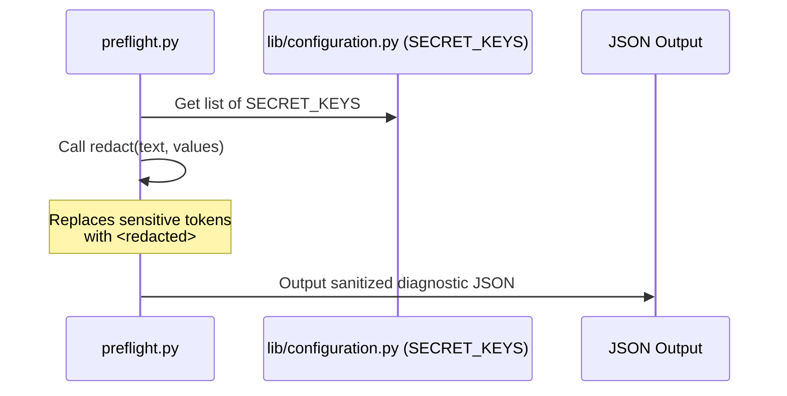

<!-- source: DeepWiki mcp.deepwiki.com · repo NVIDIA/nemoclaw-community · page 1.3 Getting Started and Prerequisites · fetched 2026-10-26 -->

# Getting Started and Prerequisites

<details>
<summary>Relevant source files</summary>

The following files were used as context for generating this wiki page:

- [README.md](README.md)
- [SUPPORT.md](SUPPORT.md)
- [examples/recipes/nvidia/developer-community-chief-of-staff/docs/guided-setup.md](examples/recipes/nvidia/developer-community-chief-of-staff/docs/guided-setup.md)
- [examples/recipes/nvidia/developer-community-chief-of-staff/scripts/configure.py](examples/recipes/nvidia/developer-community-chief-of-staff/scripts/configure.py)
- [examples/recipes/nvidia/developer-community-chief-of-staff/scripts/lib/configuration.py](examples/recipes/nvidia/developer-community-chief-of-staff/scripts/lib/configuration.py)
- [examples/recipes/nvidia/developer-community-chief-of-staff/scripts/preflight.py](examples/recipes/nvidia/developer-community-chief-of-staff/scripts/preflight.py)
- [examples/recipes/nvidia/developer-community-chief-of-staff/scripts/tests/test_configuration_tools.py](examples/recipes/nvidia/developer-community-chief-of-staff/scripts/tests/test_configuration_tools.py)

</details>


This page provides a technical guide for onboarding onto the NemoClaw Community repository. It covers the environment requirements, the core lifecycle of a NemoClaw blueprint, and the automated configuration and preflight tools used to ensure a successful deployment.

## Environment Requirements

NemoClaw blueprints are designed to run on managed Linux environments with specific security and networking substrates.

### Host Prerequisites
*   **Operating System**: Linux host with Docker or a compatible container runtime [README.md:40-40]().
*   **OpenShell Infrastructure**:
    *   **OpenShell CLI**: Required for managing sandbox lifecycles [README.md:41-41]().
    *   **OpenShell Gateway**: A background service that manages provider stores. The default endpoint is `https://127.0.0.1:17670` [examples/recipes/nvidia/developer-community-chief-of-staff/scripts/lib/configuration.py:29-29]().
*   **Inference**: Access to an OpenAI-compatible inference endpoint [README.md:42-42]().

### Credential Requirements
Most recipes require a set of credentials defined in a local `.env` file:
*   **Inference API Key**: Configured via `COMPATIBLE_API_KEY` or `OPENAI_API_KEY` [examples/recipes/nvidia/developer-community-chief-of-staff/scripts/lib/configuration.py:44-48]().
*   **Integration Tokens**: Tokens for Slack (`SLACK_BOT_TOKEN`), GitHub (`GITHUB_TOKEN`), or Microsoft Graph may be required depending on the selected messaging profile [examples/recipes/nvidia/developer-community-chief-of-staff/scripts/lib/configuration.py:46-50]().

**Sources:** [README.md:40-43](), [examples/recipes/nvidia/developer-community-chief-of-staff/scripts/lib/configuration.py:28-54]()

---

## Guided Configuration and Preflight

The repository provides specialized Python scripts to automate the setup and validation of the environment, reducing manual errors in `.env` creation.

### 1. Guided Configuration (`configure.py`)
The `configure.py` script [examples/recipes/nvidia/developer-community-chief-of-staff/scripts/configure.py:1-212]() provides an interactive CLI to build the `.env` file. It supports messaging profiles: `slack`, `outlook`, or `both` [examples/recipes/nvidia/developer-community-chief-of-staff/docs/guided-setup.md:45-49]().

*   **Secret Handling**: Credential prompts use `getpass` to ensure tokens are not echoed to the terminal [examples/recipes/nvidia/developer-community-chief-of-staff/scripts/configure.py:82-82]().
*   **Atomic Updates**: The script writes the `.env` file atomically and sets permissions to owner-only (`0600`) to protect secrets [examples/recipes/nvidia/developer-community-chief-of-staff/scripts/lib/configuration.py:125-133]().

### 2. Preflight Validation (`preflight.py`)
Before running bring-up scripts, `preflight.py` performs a suite of read-only checks [examples/recipes/nvidia/developer-community-chief-of-staff/scripts/preflight.py:5-141]():
*   **Local Checks**: Validates file permissions, Docker daemon status, and local port availability for services like Phoenix (OTLP) and PostgreSQL [examples/recipes/nvidia/developer-community-chief-of-staff/docs/guided-setup.md:130-141]().
*   **External Checks**: When invoked with `--external`, it validates inference connectivity and API key validity without starting the full agent stack [examples/recipes/nvidia/developer-community-chief-of-staff/docs/guided-setup.md:151-170]().

**Sources:** [examples/recipes/nvidia/developer-community-chief-of-staff/scripts/configure.py:1-212](), [examples/recipes/nvidia/developer-community-chief-of-staff/scripts/preflight.py:5-141](), [examples/recipes/nvidia/developer-community-chief-of-staff/docs/guided-setup.md:25-170]()

---

## The Standard Bring-Up Lifecycle

Running a NemoClaw example follows a structured process to synchronize host services, the OpenShell gateway, and the sandbox.

### 1. Repository Initialization
```bash
git clone https://github.com/NVIDIA/nemoclaw-community.git
cd nemoclaw-community
```
[README.md:31-34]()

### 2. Execution Phases
For a standard recipe, the lifecycle is managed by sequential scripts:

| Phase | Script | Description |
| :--- | :--- | :--- |
| **00** | `00-host-services.sh` | Starts Docker containers for data infra (PostgreSQL, MinIO) and observability (Phoenix) [examples/recipes/nvidia/developer-community-chief-of-staff/docs/guided-setup.md:139-140](). |
| **01** | `01-gateway.sh` | Verifies the `OPENSHELL_GATEWAY` is reachable [examples/recipes/nvidia/developer-community-chief-of-staff/scripts/lib/configuration.py:21-21](). |
| **02** | `02-providers.sh` | Populates the OpenShell provider store with credentials from `.env`. |
| **03** | `03-sandbox.sh` | Builds the sandbox image and applies the `policy.yaml` egress rules. |

**Sources:** [README.md:31-34](), [examples/recipes/nvidia/developer-community-chief-of-staff/docs/guided-setup.md:130-141](), [examples/recipes/nvidia/developer-community-chief-of-staff/scripts/lib/configuration.py:19-31]()

---

## Technical Architecture: Configuration Flow

The following diagram maps the configuration entities to the scripts that manage them, bridging the gap between natural language setup and the code implementation.

### Configuration Entity Mapping
"This diagram associates setup roles with the specific Python classes and functions responsible for enforcing them."

```mermaid
graph TD
    subgraph "Setup Tools (scripts)"
        [configure.py]:::code -- "calls" --> [collect_interactive_updates]:::code
        [preflight.py]:::code -- "calls" --> [configuration_checks]:::code
    end

    subgraph "Logic Layer (lib/configuration.py)"
        [collect_interactive_updates]:::code -- "uses" --> [EnvDocument]:::code
        [configuration_checks]:::code -- "uses" --> [resolved_values]:::code
        [EnvDocument]:::code -- "persists to" --> [dot_env_file]:::file
    end

    subgraph "Validation (preflight.py)"
        [Check]:::code -- "reports" --> [status_FAIL_PASS]
        [run_command]:::code -- "probes" --> [Docker_CLI]
    end

    classDef code font-family:monospace, font-weight:bold;
    classDef file font-style:italic;
```
**Sources:** [examples/recipes/nvidia/developer-community-chief-of-staff/scripts/configure.py:125-212](), [examples/recipes/nvidia/developer-community-chief-of-staff/scripts/preflight.py:51-165](), [examples/recipes/nvidia/developer-community-chief-of-staff/scripts/lib/configuration.py:106-113]()

---

## Fast Onboarding: Brev Launchable

For users without a local Linux environment, the **Brev Launchable** provides a pre-configured notebook environment.

*   **Platform**: Hosted on Brev.dev.
*   **Artifact**: A notebook that automates the installation of OpenShell, Docker, and the cloning of `nemoclaw-community` [README.md:23-24]().
*   **Usage**: Ideal for rapid prototyping of the *Hermes* sandbox without manual host configuration.

**Sources:** [README.md:23-24]()

---

## Troubleshooting and Support

*   **Permission Errors**: If `preflight.py` reports a "FAIL" on configuration file permissions, ensure the `.env` file is not world-readable. Use `chmod 600 .env` [examples/recipes/nvidia/developer-community-chief-of-staff/scripts/preflight.py:154-154]().
*   **Inference Failures**: The `inference_preflight.py` tool checks for `TOOL_MARKERS` leaks and schema validity before the agent starts [examples/recipes/nvidia/developer-community-chief-of-staff/scripts/preflight.py:28-28]().
*   **Support**: Use GitHub Issues for bugs. Include the output of `python3 scripts/preflight.py --json` (which automatically redacts secrets) to help maintainers diagnose the issue [SUPPORT.md:7-9](), [examples/recipes/nvidia/developer-community-chief-of-staff/scripts/preflight.py:117-123]().

### Data Flow: Credential Redaction in Diagnostics
"This diagram shows how the `redact` function ensures that diagnostic logs and JSON output remain secure."


**Sources:** [examples/recipes/nvidia/developer-community-chief-of-staff/scripts/preflight.py:117-123](), [examples/recipes/nvidia/developer-community-chief-of-staff/scripts/lib/configuration.py:39-54]()

---
**Sources:**
* `README.md`
* `SUPPORT.md`
* `examples/recipes/nvidia/developer-community-chief-of-staff/scripts/configure.py`
* `examples/recipes/nvidia/developer-community-chief-of-staff/scripts/preflight.py`
* `examples/recipes/nvidia/developer-community-chief-of-staff/scripts/lib/configuration.py`
* `examples/recipes/nvidia/developer-community-chief-of-staff/docs/guided-setup.md`

---

