# Page: NemoClaw Community — Overview

# NemoClaw Community — Overview

<details>
<summary>Relevant source files</summary>

The following files were used as context for generating this wiki page:

- [README.md](README.md)
- [SUPPORT.md](SUPPORT.md)
- [examples/README.md](examples/README.md)
- [examples/recipes/partners/bluetier/x402-payment-gate/.dockerignore](examples/recipes/partners/bluetier/x402-payment-gate/.dockerignore)

</details>


NemoClaw Community is a collection of reference examples and blueprints for building constrained, inspectable agent workflows. The repository demonstrates how to compose Large Language Models (LLMs) with specialized runtime harnesses and secure execution environments to create reliable agentic systems.

### Purpose and Scope

The primary goal of this repository is to provide a library of reusable patterns that bridge the gap between raw model inference and production-ready agents. Each example illustrates a "NemoClaw Blueprint," which defines how an agent is wired to tools, how its network access is restricted, and how its internal reasoning is made observable to human operators.

For detailed architecture information, see [Core Concepts and Architecture](#1.1).

### The Three-Layer Architecture

NemoClaw blueprints are composed of three distinct layers that work together to define an agent's capabilities and boundaries:

| Layer | Responsibility | Code Entity / Symbol |
| :--- | :--- | :--- |
| **Model** | The inference engine and provider configuration. | `inference` provider |
| **Harness** | The agent runtime, skills, bridges, and state. | `sandbox` / `harness` |
| **OpenShell** | The sandbox, gateway, and L7 policy enforcement. | `openshell` CLI / `policy.yaml` |

The following diagram illustrates how these layers interact to form a functional agent system, mapping the conceptual layers to specific files and processes within the repository.

#### NemoClaw Blueprint Composition
```mermaid
graph TD
    subgraph "NemoClaw_Blueprint"
        [ModelLayer] --> [HarnessLayer]
        [HarnessLayer] --> [OpenShellLayer]
    end

    subgraph "Code_Entities"
        [ModelLayer] -.-> "inference_preflight.py"
        [HarnessLayer] -.-> "nemoclaw-start"
        [OpenShellLayer] -.-> "policy.yaml"
    end

    [HarnessLayer] -- "Tool Calls" --> [OpenShellLayer]
    [OpenShellLayer] -- "Egress Filtering" --> [External_Services]
    [OpenShellLayer] -- "Credential Injection" --> [ModelLayer]
```
Sources: [README.md:8-14](), [examples/README.md:6-7]()

### Example Catalog Taxonomy

Examples in the repository are organized by their artifact type and provenance to ensure a "shared-nothing" isolation between different agent implementations. This structure allows each example to remain independently deployable with its own lifecycle scripts.

*   **Recipes:** Complete, reusable workflows (e.g., Chief of Staff, PR Review Advisor). These are further divided by provenance: `nvidia`, `partners`, and `community`.
*   **Demos:** Specific field demonstrations, often involving complex hardware or GUI automation (e.g., `blender-omniverse-dgx-station`).
*   **Launchables:** Fast-path onboarding scripts, such as the `brev` notebook path for Hermes.
*   **Tools:** Standalone utilities like the `harness-engineering-playground` (`hep`).

For a full list of available examples and their classification rules, see [Example Catalog and Taxonomy](#1.2).

#### System Mapping: Example Types to Directory Structure
```mermaid
graph LR
    [Repository_Root] --> [examples_dir]
    
    subgraph "Artifact_Taxonomy"
        [examples_dir] --> [recipes]
        [examples_dir] --> [demos]
        [examples_dir] --> [launchables]
        [examples_dir] --> [tools]
    end

    subgraph "Provenance"
        [recipes] --> [nvidia_recipes]
        [recipes] --> [partner_recipes]
        [recipes] --> [community_recipes]
    end

    [nvidia_recipes] -.-> "recipes/nvidia/"
    [partner_recipes] -.-> "recipes/partners/"
    [community_recipes] -.-> "recipes/community/"
    [tools] -.-> "tools/harness-engineering-playground/"
```
Sources: [examples/README.md:6-52](), [examples/recipes/partners/bluetier/x402-payment-gate/.dockerignore:1-6]()

### Getting Started

To begin using NemoClaw Community, users must have a Linux host with Docker, the `openshell` CLI, and access to an OpenAI-compatible inference endpoint. The repository uses a standard bring-up/tear-down lifecycle across most recipes, typically managed by numbered scripts (e.g., `00-host-services.sh` through `03-sandbox.sh`).

For a step-by-step onboarding guide, see [Getting Started and Prerequisites](#1.3).

### Navigation and Child Pages

This wiki is organized into the following detailed sections:

*   **[Core Concepts and Architecture](#1.1)**: Deep dive into the Blueprint composition model, the OpenShell gateway, and the L7 proxy credential-substitution pattern.
*   **[Example Catalog and Taxonomy](#1.2)**: Detailed documentation on the directory layout rules, naming conventions, and the `.agents/skills` used for repository maintenance.
*   **[Getting Started and Prerequisites](#1.3)**: Environment setup, tool installation, and the standard agent lifecycle (bring-up to tear-down).

Sources: [README.md:28-44](), [SUPPORT.md:7-9]()

---

# Page: Core Concepts and Architecture

# Core Concepts and Architecture

<details>
<summary>Relevant source files</summary>

The following files were used as context for generating this wiki page:

- [README.md](README.md)
- [SUPPORT.md](SUPPORT.md)
- [examples/recipes/nvidia/developer-community-chief-of-staff/.env.example](examples/recipes/nvidia/developer-community-chief-of-staff/.env.example)
- [examples/recipes/nvidia/developer-community-chief-of-staff/README.md](examples/recipes/nvidia/developer-community-chief-of-staff/README.md)

</details>


This page documents the fundamental building blocks and architectural patterns shared across the NemoClaw Community repository. It details the composition model, the security substrate provided by OpenShell, and the communication patterns that enable inspectable, constrained agent workflows.

## The Blueprint Composition Model

NemoClaw defines a "Blueprint" as the composition of three distinct layers. This separation ensures that agent logic (Harness) remains decoupled from both the intelligence source (Model) and the execution environment (OpenShell).

| Layer | Responsibility | Key Code Entities |
| :--- | :--- | :--- |
| **Model** | Inference endpoint, model selection, and provider configuration. | `NEMOCLAW_MODEL`, `NEMOCLAW_ENDPOINT_URL`, `COMPATIBLE_API_KEY` |
| **Harness** | The agent runtime, skills, bridges, state, and workflow-specific behavior. | `Hermes Agent`, `outlook-bridge.py`, `atif-bridge`, `NeMo Relay` |
| **OpenShell** | The sandbox, gateway, policy, provider, and networking substrate. | `policy.yaml`, `OpenShell Gateway`, `L7 Proxy`, `Privacy Router` |

**Sources:** [README.md:8-14](), [examples/recipes/nvidia/developer-community-chief-of-staff/README.md:22-34](), [examples/recipes/nvidia/developer-community-chief-of-staff/.env.example:22-36]()

## System Architecture and Data Flow

The architecture follows a "shared-nothing" isolation principle where each example operates within its own bounded sandbox. The OpenShell Supervisor manages the lifecycle and security boundaries of the Harness.

### Component Interaction and Code Mapping
This diagram maps the high-level conceptual components to the specific code entities and services defined in the `developer-community-chief-of-staff` recipe.

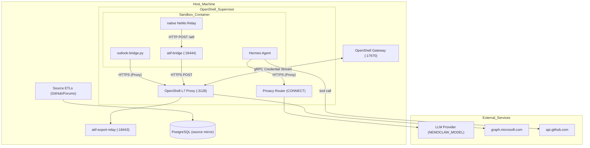
**Sources:** [examples/recipes/nvidia/developer-community-chief-of-staff/README.md:63-146](), [examples/recipes/nvidia/developer-community-chief-of-staff/.env.example:8-10](), [examples/recipes/nvidia/developer-community-chief-of-staff/.env.example:131-135]()

## OpenShell Sandbox and Gateway

The **OpenShell Gateway** acts as the central provider store and handles refresh-token rotation [examples/recipes/nvidia/developer-community-chief-of-staff/README.md:138-138](). It communicates with the **L7 Proxy** to provide credentials on-demand [examples/recipes/nvidia/developer-community-chief-of-staff/README.md:83-84]().

### Security Enforcement
1.  **L7 Egress Allowlists**: Defined in `policy.yaml`, these rules restrict the sandbox to specific domains and URI patterns, such as repository-scoped `GET` requests for GitHub [examples/recipes/nvidia/developer-community-chief-of-staff/README.md:46-51]().
2.  **Credential Substitution**: Real secrets (e.g., `GITHUB_TOKEN`, `TAVILY_API_KEY`) never enter the sandbox environment. Instead, the Harness uses provider placeholders which the L7 proxy replaces during transit [examples/recipes/nvidia/developer-community-chief-of-staff/README.md:49-52](), [examples/recipes/nvidia/developer-community-chief-of-staff/README.md:57-61]().
3.  **Kernel-Level Isolation**: Sandboxes utilize Landlock and seccomp to restrict filesystem and system call access, providing a hardened execution layer [examples/recipes/nvidia/developer-community-chief-of-staff/README.md:32-34]().

## L7 Proxy and Credential Substitution Pattern

The L7 proxy pattern is the primary mechanism for maintaining a "zero-trust" posture within the sandbox. When the agent or a skill makes a request, the flow proceeds as follows:

| Step | Entity | Action |
| :--- | :--- | :--- |
| 1 | **Harness** | Initiates HTTPS request using a placeholder (e.g., `Bearer {{github_token}}`). |
| 2 | **L7 Proxy** | Intercepts request; identifies the placeholder [examples/recipes/nvidia/developer-community-chief-of-staff/README.md:83-83](). |
| 3 | **Gateway** | Provides the active, rotated credential to the Proxy [examples/recipes/nvidia/developer-community-chief-of-staff/README.md:138-138](). |
| 4 | **L7 Proxy** | Substitutes placeholder with the real token and forwards to the upstream API. |

This ensures that even if the Harness is compromised, the underlying long-lived credentials or refresh tokens (like the `ms-graph-token.json`) are not exposed to the agent's memory space [examples/recipes/nvidia/developer-community-chief-of-staff/.env.example:52-54]().

**Sources:** [examples/recipes/nvidia/developer-community-chief-of-staff/README.md:46-61](), [examples/recipes/nvidia/developer-community-chief-of-staff/.env.example:84-94]()

## Example Isolation and "Shared-Nothing" Principle

Every example in the `nemoclaw-community` repository is designed to be self-contained. 
- **Independent Setup**: Each recipe has its own lifecycle scripts, such as `00-host-services.sh` and `bring-up.sh` [examples/recipes/nvidia/developer-community-chief-of-staff/.env.example:8-9]().
- **Dedicated Infrastructure**: While examples may share a host, they do not share sandboxes, policies, or credential scopes.
- **Provider Placeholders**: Placeholders are scoped per-sandbox. For instance, the `TAVILY_API_KEY` is only attached if configured for that specific instance [examples/recipes/nvidia/developer-community-chief-of-staff/README.md:57-61]().

## Inference Preflight and Provider Validation

To ensure system integrity before the agent begins execution, a preflight check is performed via `scripts/preflight.py` [examples/recipes/nvidia/developer-community-chief-of-staff/.env.example:3-4](). The `NEMOCLAW_INFERENCE_PREFLIGHT` mechanism validates:
1.  **Endpoint Connectivity**: Confirms the LLM provider is reachable via HTTPS or a local proxy [examples/recipes/nvidia/developer-community-chief-of-staff/.env.example:24-26]().
2.  **Credential Validity**: Tests the provided API key (e.g., `COMPATIBLE_API_KEY` or `OPENAI_API_KEY`) [examples/recipes/nvidia/developer-community-chief-of-staff/.env.example:15-22]().
3.  **Model Availability**: Ensures the requested `NEMOCLAW_MODEL` is active and responding to structured-tool requests [examples/recipes/nvidia/developer-community-chief-of-staff/.env.example:23-25]().

**Sources:** [examples/recipes/nvidia/developer-community-chief-of-staff/.env.example:1-30]()

---

# Page: Example Catalog and Taxonomy

# Example Catalog and Taxonomy

<details>
<summary>Relevant source files</summary>

The following files were used as context for generating this wiki page:

- [.agents/skills/_shared/controlled-words.md](.agents/skills/_shared/controlled-words.md)
- [.agents/skills/nemoclaw-community-contributor-examples/SKILL.md](.agents/skills/nemoclaw-community-contributor-examples/SKILL.md)
- [.agents/skills/nemoclaw-community-maintainer-policies/SKILL.md](.agents/skills/nemoclaw-community-maintainer-policies/SKILL.md)
- [.github/PULL_REQUEST_TEMPLATE.md](.github/PULL_REQUEST_TEMPLATE.md)
- [CONTRIBUTING.md](CONTRIBUTING.md)
- [WRITING.md](WRITING.md)
- [examples/README.md](examples/README.md)
- [examples/recipes/partners/bluetier/x402-payment-gate/.dockerignore](examples/recipes/partners/bluetier/x402-payment-gate/.dockerignore)

</details>


This page documents the organization, naming conventions, and classification system for all artifacts within the NemoClaw Community repository. It provides a technical map of how examples are structured and the requirements for contributing new blueprints to the catalog.

## Repository Taxonomy and Directory Layout

The repository uses a strict hierarchy to ensure examples remain independently deployable and discoverable. The top-level organization is based on **Artifact Type**, followed by **Contributor Provenance** for recipes [examples/README.md:6-7]().

### Artifact Types

| Type | Directory | Description |
| :--- | :--- | :--- |
| **Recipes** | `examples/recipes/` | Reusable, end-to-end agent blueprints including Model, Harness, and OpenShell policy [examples/README.md:25](). |
| **Demos** | `examples/demos/` | Specific field demonstrations (e.g., hardware-specific or vertical-specific setups) [examples/README.md:35-39](). |
| **Launchables** | `examples/launchables/` | Fast-path deployment configurations for specific cloud environments like Brev [examples/README.md:41-45](). |
| **Tools** | `examples/tools/` | Developer utilities and CLI tools for optimizing or evaluating agent harnesses [examples/README.md:47-51](). |

### Provenance Classification

Recipes are further categorized by their authoring entity to manage support expectations and licensing:
*   **NVIDIA**: Authored and maintained by NVIDIA teams (e.g., Chief of Staff, FinGuard) [examples/README.md:9-18]().
*   **Partners**: Contributed by ecosystem partners like HPE, BlueTier, and Shrike Security [examples/README.md:20-28]().
*   **Community**: General community contributions [examples/README.md:29-33]().

**Sources:** [examples/README.md:1-59](), [CONTRIBUTING.md:5-7]()

---

## Data Flow: Example Classification and Validation

When a new contribution is submitted, it undergoes a classification process driven by the `nemoclaw-community-contributor-examples` skill [.agents/skills/nemoclaw-community-contributor-examples/SKILL.md:1-44](). This ensures the artifact matches the repository's structural rules and naming conventions.

### Contribution Pipeline Diagram

"Example Contribution and Taxonomy Validation"
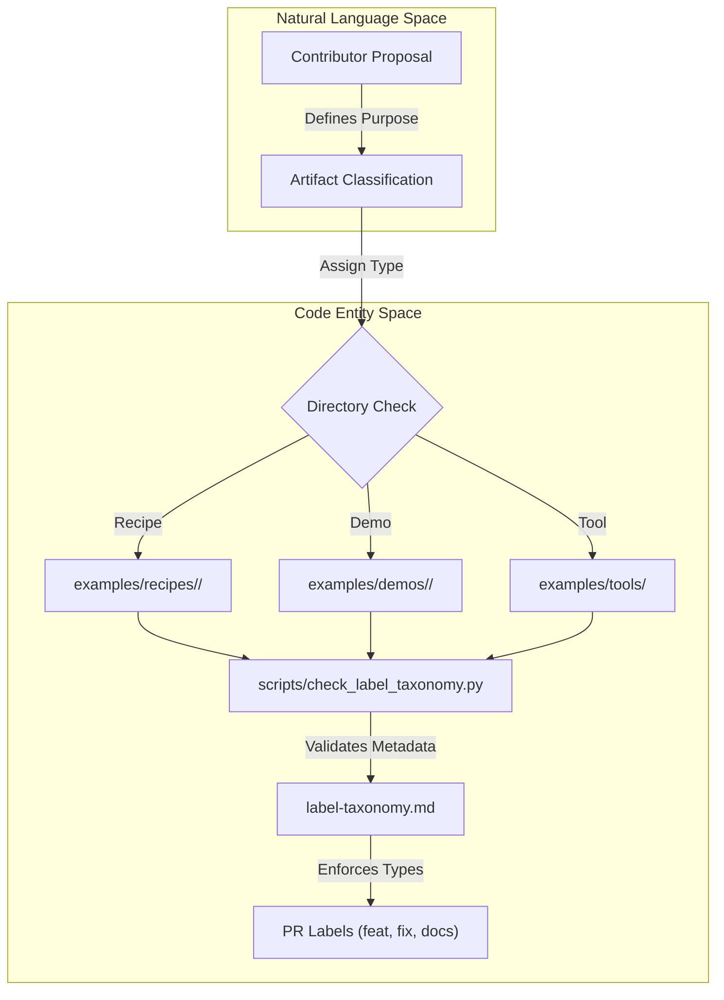

**Sources:** [CONTRIBUTING.md:39-60](), [.github/PULL_REQUEST_TEMPLATE.md:17-20](), [examples/README.md:53-59](), [.agents/skills/nemoclaw-community-contributor-examples/SKILL.md:14-33]()

---

## Naming and Content Standards

All examples must adhere to the **Shared-Nothing Isolation Principle**: no example may depend on private files, internal systems, or local state from another example [CONTRIBUTING.md:148-150]().

### Controlled Vocabulary
Contributors must use the `controlled-words.md` list to ensure consistency across the catalog. Key technical distinctions include:
*   **sandbox**: Refers specifically to the runtime boundary (OpenShell), not a general container [.agents/skills/_shared/controlled-words.md:39]().
*   **policy**: Refers to enforced permissions or restrictions, not general configuration [.agents/skills/_shared/controlled-words.md:40]().
*   **recipe**: Specifically for content under `examples/recipes/` [.agents/skills/_shared/controlled-words.md:25]().
*   **example**: The general term for an independently deployable contribution [.agents/skills/_shared/controlled-words.md:24]().

### Repository Governance and Sanitization
Before publication, all content must be sanitized to remove nonpublic information. This is enforced via the `PULL_REQUEST_TEMPLATE.md` and the `WRITING.md` guide [WRITING.md:27-44]().

"Sanitization and Attribution Logic"
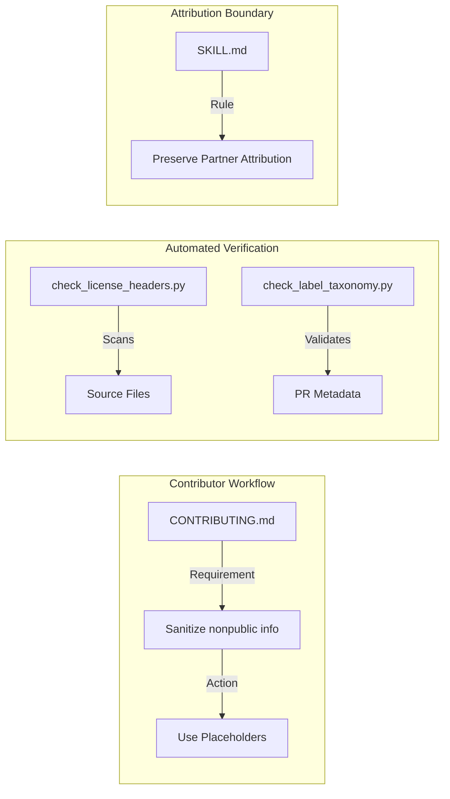

**Sources:** [WRITING.md:27-44](), [CONTRIBUTING.md:151-174](), [.github/PULL_REQUEST_TEMPLATE.md:42-52](), [.agents/skills/nemoclaw-community-contributor-examples/SKILL.md:25-27]()

---

## Detailed Catalog Reference

### NVIDIA Recipes
| Directory | Description | Key Components |
| :--- | :--- | :--- |
| `developer-community-chief-of-staff` | Signal synthesis for Slack/GitHub/Outlook | Multi-persona routing, NVTeam skills [examples/README.md:13](). |
| `pr-review-advisor` | Constrained Hermes PR review workflow | 6-stage finding ledger, attested artifacts [examples/README.md:18](). |
| `payment-ops-hermes` | Constrained payment screening assistant | NeMo Relay, Phoenix observability [examples/README.md:17](). |
| `memory-driven-chief-of-staff` | Locally-authoritative record keeping | SQLite obligation store, intent-gate [examples/README.md:15](). |

### Partner and Community Blueprints
*   **BlueTier x402 Payment Gate**: Implements a maker/checker boundary where the agent submits intents and a host-side gate issues GO/HOLD/STOP verdicts [examples/README.md:24]().
*   **Shrike Security Action Governance**: Uses a `before_tool_call` plugin to intercept and govern agent tool calls via an external enforce plane [examples/README.md:26]().
*   **Deep Research Worker**: A community-contributed recipe using a FastAPI host-side worker for long-running research tasks [examples/README.md:33]().

### Developer Tools
*   **Harness Engineering Playground (hep)**: Provides a CLI for eval-driven harness profile optimization using the `RalphLoopOptimizer`. It is explicitly not an OpenShell blueprint [examples/README.md:51]().

**Sources:** [examples/README.md:9-52](), [CONTRIBUTING.md:132-150](), [.agents/skills/nemoclaw-community-contributor-examples/SKILL.md:34-44]()

---

# Page: Getting Started and Prerequisites

# Getting Started and Prerequisites

<details>
<summary>Relevant source files</summary>

The following files were used as context for generating this wiki page:

- [README.md](README.md)
- [SUPPORT.md](SUPPORT.md)
- [examples/recipes/nvidia/developer-community-chief-of-staff/docs/guided-setup.md](examples/recipes/nvidia/developer-community-chief-of-staff/docs/guided-setup.md)
- [examples/recipes/nvidia/developer-community-chief-of-staff/scripts/configure.py](examples/recipes/nvidia/developer-community-chief-of-staff/scripts/configure.py)
- [examples/recipes/nvidia/developer-community-chief-of-staff/scripts/lib/configuration.py](examples/recipes/nvidia/developer-community-chief-of-staff/scripts/lib/configuration.py)
- [examples/recipes/nvidia/developer-community-chief-of-staff/scripts/preflight.py](examples/recipes/nvidia/developer-community-chief-of-staff/scripts/preflight.py)
- [examples/recipes/nvidia/developer-community-chief-of-staff/scripts/tests/test_configuration_tools.py](examples/recipes/nvidia/developer-community-chief-of-staff/scripts/tests/test_configuration_tools.py)

</details>


This page provides a technical guide for onboarding onto the NemoClaw Community repository. It covers the environment requirements, the core lifecycle of a NemoClaw blueprint, and the automated configuration and preflight tools used to ensure a successful deployment.

## Environment Requirements

NemoClaw blueprints are designed to run on managed Linux environments with specific security and networking substrates.

### Host Prerequisites
*   **Operating System**: Linux host with Docker or a compatible container runtime [README.md:40-40]().
*   **OpenShell Infrastructure**:
    *   **OpenShell CLI**: Required for managing sandbox lifecycles [README.md:41-41]().
    *   **OpenShell Gateway**: A background service that manages provider stores. The default endpoint is `https://127.0.0.1:17670` [examples/recipes/nvidia/developer-community-chief-of-staff/scripts/lib/configuration.py:29-29]().
*   **Inference**: Access to an OpenAI-compatible inference endpoint [README.md:42-42]().

### Credential Requirements
Most recipes require a set of credentials defined in a local `.env` file:
*   **Inference API Key**: Configured via `COMPATIBLE_API_KEY` or `OPENAI_API_KEY` [examples/recipes/nvidia/developer-community-chief-of-staff/scripts/lib/configuration.py:44-48]().
*   **Integration Tokens**: Tokens for Slack (`SLACK_BOT_TOKEN`), GitHub (`GITHUB_TOKEN`), or Microsoft Graph may be required depending on the selected messaging profile [examples/recipes/nvidia/developer-community-chief-of-staff/scripts/lib/configuration.py:46-50]().

**Sources:** [README.md:40-43](), [examples/recipes/nvidia/developer-community-chief-of-staff/scripts/lib/configuration.py:28-54]()

---

## Guided Configuration and Preflight

The repository provides specialized Python scripts to automate the setup and validation of the environment, reducing manual errors in `.env` creation.

### 1. Guided Configuration (`configure.py`)
The `configure.py` script [examples/recipes/nvidia/developer-community-chief-of-staff/scripts/configure.py:1-212]() provides an interactive CLI to build the `.env` file. It supports messaging profiles: `slack`, `outlook`, or `both` [examples/recipes/nvidia/developer-community-chief-of-staff/docs/guided-setup.md:45-49]().

*   **Secret Handling**: Credential prompts use `getpass` to ensure tokens are not echoed to the terminal [examples/recipes/nvidia/developer-community-chief-of-staff/scripts/configure.py:82-82]().
*   **Atomic Updates**: The script writes the `.env` file atomically and sets permissions to owner-only (`0600`) to protect secrets [examples/recipes/nvidia/developer-community-chief-of-staff/scripts/lib/configuration.py:125-133]().

### 2. Preflight Validation (`preflight.py`)
Before running bring-up scripts, `preflight.py` performs a suite of read-only checks [examples/recipes/nvidia/developer-community-chief-of-staff/scripts/preflight.py:5-141]():
*   **Local Checks**: Validates file permissions, Docker daemon status, and local port availability for services like Phoenix (OTLP) and PostgreSQL [examples/recipes/nvidia/developer-community-chief-of-staff/docs/guided-setup.md:130-141]().
*   **External Checks**: When invoked with `--external`, it validates inference connectivity and API key validity without starting the full agent stack [examples/recipes/nvidia/developer-community-chief-of-staff/docs/guided-setup.md:151-170]().

**Sources:** [examples/recipes/nvidia/developer-community-chief-of-staff/scripts/configure.py:1-212](), [examples/recipes/nvidia/developer-community-chief-of-staff/scripts/preflight.py:5-141](), [examples/recipes/nvidia/developer-community-chief-of-staff/docs/guided-setup.md:25-170]()

---

## The Standard Bring-Up Lifecycle

Running a NemoClaw example follows a structured process to synchronize host services, the OpenShell gateway, and the sandbox.

### 1. Repository Initialization
```bash
git clone https://github.com/NVIDIA/nemoclaw-community.git
cd nemoclaw-community
```
[README.md:31-34]()

### 2. Execution Phases
For a standard recipe, the lifecycle is managed by sequential scripts:

| Phase | Script | Description |
| :--- | :--- | :--- |
| **00** | `00-host-services.sh` | Starts Docker containers for data infra (PostgreSQL, MinIO) and observability (Phoenix) [examples/recipes/nvidia/developer-community-chief-of-staff/docs/guided-setup.md:139-140](). |
| **01** | `01-gateway.sh` | Verifies the `OPENSHELL_GATEWAY` is reachable [examples/recipes/nvidia/developer-community-chief-of-staff/scripts/lib/configuration.py:21-21](). |
| **02** | `02-providers.sh` | Populates the OpenShell provider store with credentials from `.env`. |
| **03** | `03-sandbox.sh` | Builds the sandbox image and applies the `policy.yaml` egress rules. |

**Sources:** [README.md:31-34](), [examples/recipes/nvidia/developer-community-chief-of-staff/docs/guided-setup.md:130-141](), [examples/recipes/nvidia/developer-community-chief-of-staff/scripts/lib/configuration.py:19-31]()

---

## Technical Architecture: Configuration Flow

The following diagram maps the configuration entities to the scripts that manage them, bridging the gap between natural language setup and the code implementation.

### Configuration Entity Mapping
"This diagram associates setup roles with the specific Python classes and functions responsible for enforcing them."

```mermaid
graph TD
    subgraph "Setup Tools (scripts)"
        [configure.py]:::code -- "calls" --> [collect_interactive_updates]:::code
        [preflight.py]:::code -- "calls" --> [configuration_checks]:::code
    end

    subgraph "Logic Layer (lib/configuration.py)"
        [collect_interactive_updates]:::code -- "uses" --> [EnvDocument]:::code
        [configuration_checks]:::code -- "uses" --> [resolved_values]:::code
        [EnvDocument]:::code -- "persists to" --> [dot_env_file]:::file
    end

    subgraph "Validation (preflight.py)"
        [Check]:::code -- "reports" --> [status_FAIL_PASS]
        [run_command]:::code -- "probes" --> [Docker_CLI]
    end

    classDef code font-family:monospace, font-weight:bold;
    classDef file font-style:italic;
```
**Sources:** [examples/recipes/nvidia/developer-community-chief-of-staff/scripts/configure.py:125-212](), [examples/recipes/nvidia/developer-community-chief-of-staff/scripts/preflight.py:51-165](), [examples/recipes/nvidia/developer-community-chief-of-staff/scripts/lib/configuration.py:106-113]()

---

## Fast Onboarding: Brev Launchable

For users without a local Linux environment, the **Brev Launchable** provides a pre-configured notebook environment.

*   **Platform**: Hosted on Brev.dev.
*   **Artifact**: A notebook that automates the installation of OpenShell, Docker, and the cloning of `nemoclaw-community` [README.md:23-24]().
*   **Usage**: Ideal for rapid prototyping of the *Hermes* sandbox without manual host configuration.

**Sources:** [README.md:23-24]()

---

## Troubleshooting and Support

*   **Permission Errors**: If `preflight.py` reports a "FAIL" on configuration file permissions, ensure the `.env` file is not world-readable. Use `chmod 600 .env` [examples/recipes/nvidia/developer-community-chief-of-staff/scripts/preflight.py:154-154]().
*   **Inference Failures**: The `inference_preflight.py` tool checks for `TOOL_MARKERS` leaks and schema validity before the agent starts [examples/recipes/nvidia/developer-community-chief-of-staff/scripts/preflight.py:28-28]().
*   **Support**: Use GitHub Issues for bugs. Include the output of `python3 scripts/preflight.py --json` (which automatically redacts secrets) to help maintainers diagnose the issue [SUPPORT.md:7-9](), [examples/recipes/nvidia/developer-community-chief-of-staff/scripts/preflight.py:117-123]().

### Data Flow: Credential Redaction in Diagnostics
"This diagram shows how the `redact` function ensures that diagnostic logs and JSON output remain secure."

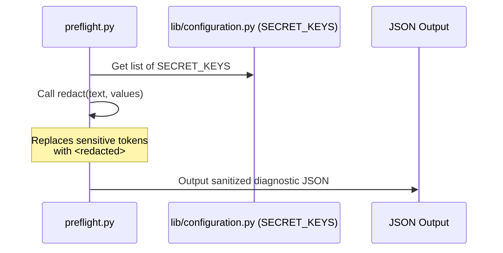
**Sources:** [examples/recipes/nvidia/developer-community-chief-of-staff/scripts/preflight.py:117-123](), [examples/recipes/nvidia/developer-community-chief-of-staff/scripts/lib/configuration.py:39-54]()

---
**Sources:**
* `README.md`
* `SUPPORT.md`
* `examples/recipes/nvidia/developer-community-chief-of-staff/scripts/configure.py`
* `examples/recipes/nvidia/developer-community-chief-of-staff/scripts/preflight.py`
* `examples/recipes/nvidia/developer-community-chief-of-staff/scripts/lib/configuration.py`
* `examples/recipes/nvidia/developer-community-chief-of-staff/docs/guided-setup.md`

---

# Page: NVIDIA Recipes

# NVIDIA Recipes

<details>
<summary>Relevant source files</summary>

The following files were used as context for generating this wiki page:

- [.github/workflows/nemoclaw-review-advisor-dogfood.yml](.github/workflows/nemoclaw-review-advisor-dogfood.yml)
- [examples/recipes/nvidia/developer-community-chief-of-staff/.env.example](examples/recipes/nvidia/developer-community-chief-of-staff/.env.example)
- [examples/recipes/nvidia/developer-community-chief-of-staff/README.md](examples/recipes/nvidia/developer-community-chief-of-staff/README.md)
- [examples/recipes/nvidia/kubernetes-gpu-autoscaling/.gitignore](examples/recipes/nvidia/kubernetes-gpu-autoscaling/.gitignore)
- [examples/recipes/nvidia/kubernetes-gpu-autoscaling/Chart.yaml](examples/recipes/nvidia/kubernetes-gpu-autoscaling/Chart.yaml)
- [examples/recipes/nvidia/kubernetes-gpu-autoscaling/README.md](examples/recipes/nvidia/kubernetes-gpu-autoscaling/README.md)
- [examples/recipes/nvidia/memory-driven-chief-of-staff/README.md](examples/recipes/nvidia/memory-driven-chief-of-staff/README.md)
- [examples/recipes/nvidia/memory-driven-chief-of-staff/fixtures/README.md](examples/recipes/nvidia/memory-driven-chief-of-staff/fixtures/README.md)
- [examples/recipes/nvidia/memory-driven-chief-of-staff/fixtures/envelopes/intake.json](examples/recipes/nvidia/memory-driven-chief-of-staff/fixtures/envelopes/intake.json)
- [examples/recipes/nvidia/pr-review-advisor/.env.example](examples/recipes/nvidia/pr-review-advisor/.env.example)
- [examples/recipes/nvidia/pr-review-advisor/.gitignore](examples/recipes/nvidia/pr-review-advisor/.gitignore)
- [examples/recipes/nvidia/pr-review-advisor/.npmignore](examples/recipes/nvidia/pr-review-advisor/.npmignore)
- [examples/recipes/nvidia/pr-review-advisor/LICENSE](examples/recipes/nvidia/pr-review-advisor/LICENSE)
- [examples/recipes/nvidia/pr-review-advisor/README.md](examples/recipes/nvidia/pr-review-advisor/README.md)
- [examples/recipes/nvidia/pr-review-advisor/agents/hermes/Dockerfile](examples/recipes/nvidia/pr-review-advisor/agents/hermes/Dockerfile)
- [examples/recipes/nvidia/pr-review-advisor/agents/hermes/SOUL.md](examples/recipes/nvidia/pr-review-advisor/agents/hermes/SOUL.md)
- [examples/recipes/nvidia/pr-review-advisor/agents/hermes/generate-config.ts](examples/recipes/nvidia/pr-review-advisor/agents/hermes/generate-config.ts)

</details>


NVIDIA Recipes are high-level agent blueprints designed to demonstrate production-grade patterns for constrained, inspectable AI agents. These recipes are built on a shared architecture involving the **Hermes agent**, **NeMo Relay** for observability, and **OpenShell** for sandbox enforcement. They serve as reference implementations for common enterprise workflows like community management, code review, financial operations, and technical research.

### Shared Architectural Patterns

All NVIDIA-authored recipes leverage a consistent security and observability stack:
*   **Hermes Agent:** The core reasoning engine, typically containerized and running with a specialized TUI or bridge.
*   **NeMo Relay:** An in-process plugin or sidecar that captures agent trajectories and exports them via the **ATIF** (Agent Trajectory Interchange Format) [examples/recipes/nvidia/developer-community-chief-of-staff/README.md:73-75]().
*   **OpenShell Policies:** L7 egress allowlists that enforce the "denied-edge" principle, ensuring agents can only communicate with approved inference providers and APIs [examples/recipes/nvidia/developer-community-chief-of-staff/README.md:38-46]().
*   **Credential Substitution:** Secrets are managed by the OpenShell Gateway and injected into the sandbox as placeholders, preventing raw API keys from ever residing in the agent's memory [examples/recipes/nvidia/developer-community-chief-of-staff/README.md:19-26]().

### The Recipe Catalog

The following recipes represent the core NVIDIA contributions to the NemoClaw Community.

| Recipe | Primary Purpose | Key Technologies |
| :--- | :--- | :--- |
| **Developer Community Chief of Staff** | Aggregates GitHub, Slack, and Forum signals into briefs. | NVTeam Personas, PostgREST, Outlook Bridge |
| **PR Review Advisor** | Security-first automated pull request analysis. | Finding Ledger, Fail-closed Policy, Dogfood CI |
| **FinGuard** | Constrained financial transaction screening. | Maker/Checker Boundary, Phoenix, Mock Rail |
| **NV Tech Assistant** | Grounded research using NVIDIA-internal and public sources. | Brave Search, arXiv integration, Sandbox Policy |
| **Memory-Driven Chief of Staff** | Local, revisable memory and obligation tracking. | SQLite Store, Intent Gate, Tiered Cascading |
| **Kubernetes GPU Autoscaling** | Cost-efficient HPA for GPU-backed inference. | Ollama, Metrics-Proxy, Envoy LeastRequest |

---

### Recipe Overview

#### Developer Community Chief of Staff
This flagship recipe acts as a personal assistant for community managers. It synthesizes signals from GitHub, Slack, and NVIDIA forums to identify gaps between community needs and internal priorities [examples/recipes/nvidia/developer-community-chief-of-staff/README.md:5-12](). It introduces the **NVTeam** role-routing system, allowing the agent to adopt specific personas for different analytical tasks.

For details, see [Developer Community Chief of Staff](#2.1).

#### PR Review Advisor
Designed for secure software development lifecycles, this recipe uses a "fail-closed" security model. It generates a ledger of findings that must be attested before being published by a separate maintainer action. It uses a specialized `generate-config.ts` to manage its Hermes configuration [examples/recipes/nvidia/pr-review-advisor/agents/hermes/generate-config.ts:1-75]().

For details, see [PR Review Advisor](#2.2).

#### Payment Operations Hermes Assistant (FinGuard)
FinGuard demonstrates how to manage high-risk financial operations. It implements a strict **maker/checker boundary** where the agent can only propose payments, but a host-side human checker must release them. OpenShell policies enforce a `denied-edge` to the actual payment rail for the agent.

For details, see [Payment Operations Hermes Assistant (FinGuard)](#2.3).

#### NV Tech Assistant
This recipe focuses on grounded technical research. It limits the agent's search space to allowlisted sources such as NVIDIA documentation and arXiv papers. It utilizes Brave Search for live web grounding within the constraints of the sandbox policy.

For details, see [NV Tech Assistant](#2.4).

#### Memory-Driven Chief of Staff
This recipe manages a local, revisable record of inbound messages in a SQLite database [examples/recipes/nvidia/memory-driven-chief-of-staff/README.md:6-8](). It features an **Intent Gate** that prevents externally "urgent" messages from reaching the high-priority tier unless they match the user's stated priorities in `MEMORY.md` [examples/recipes/nvidia/memory-driven-chief-of-staff/README.md:36-39]().

For details, see [Memory-Driven Chief of Staff](#2.5).

#### Kubernetes GPU Autoscaling
This recipe provides a cost-efficient architecture that runs a CPU-only OpenShell sandbox while autoscaling GPU-backed Ollama replicas [examples/recipes/nvidia/kubernetes-gpu-autoscaling/README.md:6-10](). It uses a `metrics-proxy` sidecar to expose `gpu_utilization` and `latency_avg` to the Kubernetes HPA [examples/recipes/nvidia/kubernetes-gpu-autoscaling/README.md:49-54]().

For details, see [Kubernetes GPU Autoscaling](#2.6).

---

### System Component Mapping

The following diagram bridges the high-level system concepts to the specific code entities and services used across these recipes.

**Diagram: NVIDIA Recipe Component Entity Map**
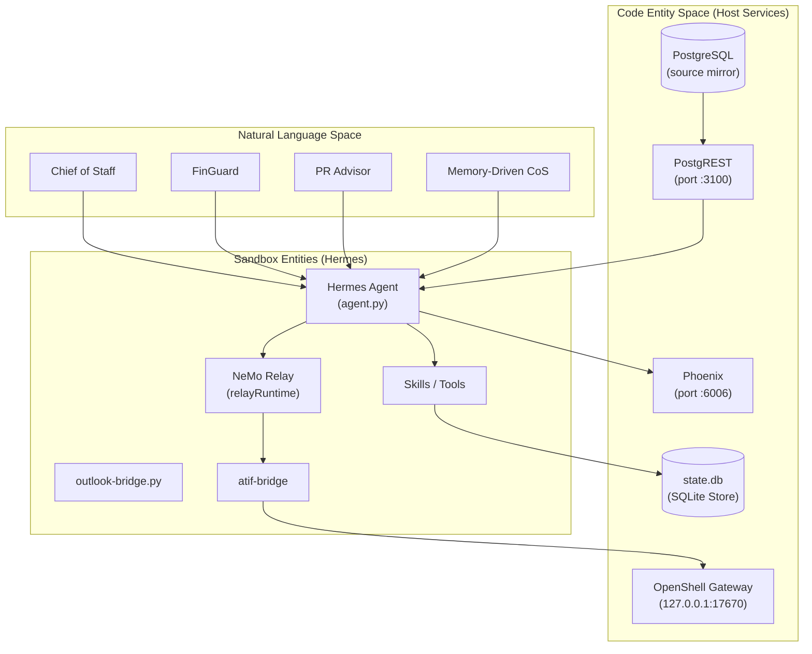
**Sources:** [examples/recipes/nvidia/developer-community-chief-of-staff/README.md:65-145](), [examples/recipes/nvidia/memory-driven-chief-of-staff/README.md:70-86]()

### Data Flow and Security Boundary

This diagram illustrates how data moves from external sources into the constrained sandbox environment while maintaining the security boundary.

**Diagram: Data Ingress and Policy Enforcement**
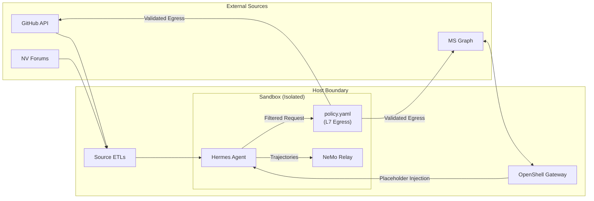
**Sources:** [examples/recipes/nvidia/developer-community-chief-of-staff/README.md:45-62](), [examples/recipes/nvidia/developer-community-chief-of-staff/README.md:130-138]()

---

# Page: Developer Community Chief of Staff

# Developer Community Chief of Staff

<details>
<summary>Relevant source files</summary>

The following files were used as context for generating this wiki page:

- [examples/recipes/nvidia/developer-community-chief-of-staff/.env.example](examples/recipes/nvidia/developer-community-chief-of-staff/.env.example)
- [examples/recipes/nvidia/developer-community-chief-of-staff/.env.example.s3](examples/recipes/nvidia/developer-community-chief-of-staff/.env.example.s3)
- [examples/recipes/nvidia/developer-community-chief-of-staff/README.md](examples/recipes/nvidia/developer-community-chief-of-staff/README.md)
- [examples/recipes/nvidia/developer-community-chief-of-staff/agents/hermes/SOUL.md](examples/recipes/nvidia/developer-community-chief-of-staff/agents/hermes/SOUL.md)

</details>


The **Developer Community Chief of Staff** is a flagship NemoClaw recipe designed to serve as a personal Hermes agent. It aggregates signals from disparate developer channels—GitHub, Slack, Outlook, and NVIDIA forums—into actionable operating briefs. By comparing community struggles and gaps against internal priorities, it enables teams to align resources with actual demand.

The system utilizes the **NVTeam role-routing system**, which employs specialized personas to handle cross-source gap analysis and sentiment tracking [examples/recipes/nvidia/developer-community-chief-of-staff/agents/hermes/SOUL.md:5-30](). It operates within a hardened **OpenShell sandbox**, ensuring that sensitive credentials (like GitHub tokens or Outlook OAuth2 secrets) never enter the agent's execution environment directly, but are instead managed by the OpenShell gateway and substituted at the L7 proxy layer [examples/recipes/nvidia/developer-community-chief-of-staff/README.md:27-34]().

### Architecture Overview

The recipe follows a single-host deployment model, typically running on a managed VM. It consists of a containerized Hermes agent and a suite of host-side services for data ingestion and observability.

#### System Component Diagram
This diagram bridges the natural language concepts of "Interaction" and "Data Ingestion" to the specific code entities and services defined in the recipe.

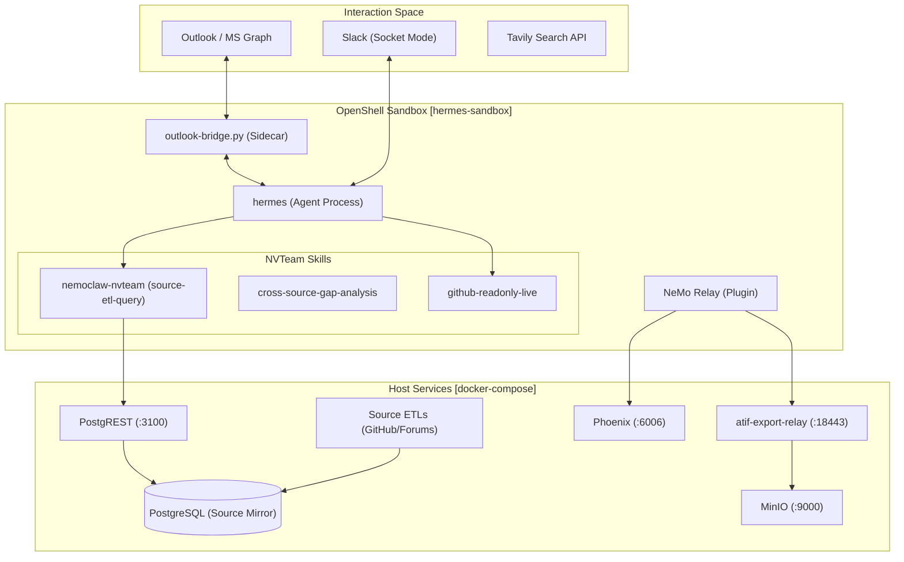
**Sources:** [examples/recipes/nvidia/developer-community-chief-of-staff/README.md:65-146](), [examples/recipes/nvidia/developer-community-chief-of-staff/.env.example:130-140]()

---

### Core Components

#### 1. Hermes Agent Sandbox
The **Hermes Agent Sandbox** is the primary execution environment. It is a containerized runtime protected by Landlock and seccomp, running the Hermes TUI and the NeMo Relay plugin [examples/recipes/nvidia/developer-community-chief-of-staff/README.md:86-94](). It communicates with the outside world via the OpenShell L7 proxy, which handles credential substitution for services like GitHub and Slack [examples/recipes/nvidia/developer-community-chief-of-staff/README.md:46-61]().
*   For details, see [Hermes Agent Sandbox](#2.1.1).

#### 2. Host Services and Data Infrastructure
The recipe relies on a Docker Compose stack to manage persistent state and data ingestion. This includes a **PostgreSQL** database acting as a source mirror, **PostgREST** for providing a read-only HTTP interface to the agent, and **Source ETLs** that scrape GitHub and NVIDIA forums for community signals [examples/recipes/nvidia/developer-community-chief-of-staff/README.md:138-145]().
*   For details, see [Host Services and Data Infrastructure](#2.1.2).

#### 3. Deployment and Bring-up Lifecycle
Deployment is managed through a structured four-phase pipeline. These scripts handle everything from preflight validation of LLM endpoints via `NEMOCLAW_INFERENCE_PREFLIGHT` to the injection of TLS certificates and the application of OpenShell egress policies [examples/recipes/nvidia/developer-community-chief-of-staff/.env.example:1-12]().
*   For details, see [Deployment Scripts and Provider Configuration](#2.1.3).

#### 4. NVTeam Skills and Agent Persona System
The **NVTeam** system defines the behavioral contract for the agent. It uses a `SOUL.md` file to dictate persona-driven responses (e.g., River for Product Management, Akira for Systems Engineering) and includes specialized skills for querying the host-side ETL mirrors and performing cross-platform sentiment analysis [examples/recipes/nvidia/developer-community-chief-of-staff/agents/hermes/SOUL.md:15-30]().
*   For details, see [NVTeam Skills and Agent Persona System](#2.1.4).

---

### Deployment Pipeline
The bring-up process is codified into four distinct phases to ensure infrastructure is ready before the agent starts.

| Phase | Script | Responsibility |
| :--- | :--- | :--- |
| **00** | `00-host-services.sh` | Starts Postgres, PostgREST, Phoenix, and ETL containers [examples/recipes/nvidia/developer-community-chief-of-staff/.env.example:8](). |
| **01** | `01-gateway.sh` | Initializes the OpenShell gateway and configuration. |
| **02** | `02-providers.sh` | Configures inference, Slack, and Outlook OAuth2 providers [examples/recipes/nvidia/developer-community-chief-of-staff/.env.example:12](). |
| **03** | `03-sandbox.sh` | Builds the sandbox, applies Landlock policies, and starts the agent. |

**Sources:** [examples/recipes/nvidia/developer-community-chief-of-staff/.env.example:1-12]()

### Data Flow Mapping
The following diagram maps how community signals move from external sources into the agent's context.

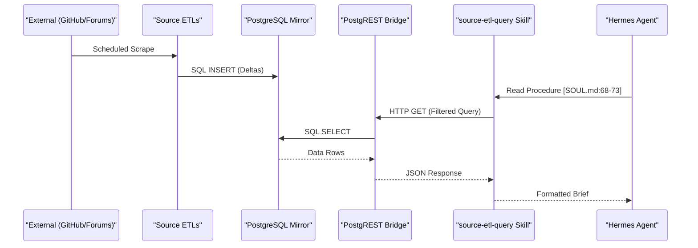
**Sources:** [examples/recipes/nvidia/developer-community-chief-of-staff/README.md:53-56](), [examples/recipes/nvidia/developer-community-chief-of-staff/agents/hermes/SOUL.md:80-82]()

---

# Page: Hermes Agent Sandbox

# Hermes Agent Sandbox

<details>
<summary>Relevant source files</summary>

The following files were used as context for generating this wiki page:

- [examples/recipes/nvidia/developer-community-chief-of-staff/agents/hermes/Dockerfile](examples/recipes/nvidia/developer-community-chief-of-staff/agents/hermes/Dockerfile)
- [examples/recipes/nvidia/developer-community-chief-of-staff/agents/hermes/bridges/atif/atif-bridge.py](examples/recipes/nvidia/developer-community-chief-of-staff/agents/hermes/bridges/atif/atif-bridge.py)
- [examples/recipes/nvidia/developer-community-chief-of-staff/agents/hermes/bridges/outlook/outlook-bridge.py](examples/recipes/nvidia/developer-community-chief-of-staff/agents/hermes/bridges/outlook/outlook-bridge.py)
- [examples/recipes/nvidia/developer-community-chief-of-staff/agents/hermes/manifest.yaml](examples/recipes/nvidia/developer-community-chief-of-staff/agents/hermes/manifest.yaml)
- [examples/recipes/nvidia/developer-community-chief-of-staff/agents/hermes/nemo-relay/hermes-cli-shim](examples/recipes/nvidia/developer-community-chief-of-staff/agents/hermes/nemo-relay/hermes-cli-shim)
- [examples/recipes/nvidia/developer-community-chief-of-staff/agents/hermes/patches/sitecustomize.py](examples/recipes/nvidia/developer-community-chief-of-staff/agents/hermes/patches/sitecustomize.py)
- [examples/recipes/nvidia/developer-community-chief-of-staff/agents/hermes/patches/slack_diagnostic.py](examples/recipes/nvidia/developer-community-chief-of-staff/agents/hermes/patches/slack_diagnostic.py)
- [examples/recipes/nvidia/developer-community-chief-of-staff/agents/hermes/start.sh](examples/recipes/nvidia/developer-community-chief-of-staff/agents/hermes/start.sh)
- [examples/recipes/nvidia/developer-community-chief-of-staff/agents/hermes/tests/test_slack_interactive_compat.py](examples/recipes/nvidia/developer-community-chief-of-staff/agents/hermes/tests/test_slack_interactive_compat.py)
- [examples/recipes/nvidia/developer-community-chief-of-staff/agents/hermes/tests/test_tui_runtime_contract.py](examples/recipes/nvidia/developer-community-chief-of-staff/agents/hermes/tests/test_tui_runtime_contract.py)
- [examples/recipes/nvidia/developer-community-chief-of-staff/docs/set-up-slack.md](examples/recipes/nvidia/developer-community-chief-of-staff/docs/set-up-slack.md)
- [examples/recipes/nvidia/developer-community-chief-of-staff/scripts/slack_delivery_diagnostic.py](examples/recipes/nvidia/developer-community-chief-of-staff/scripts/slack_delivery_diagnostic.py)
- [examples/recipes/nvidia/developer-community-chief-of-staff/scripts/tests/test_slack_delivery_diagnostic.py](examples/recipes/nvidia/developer-community-chief-of-staff/scripts/tests/test_slack_delivery_diagnostic.py)

</details>


The Hermes Agent Sandbox is a hardened, containerized execution environment designed for the **Developer Community Chief of Staff** recipe. It integrates the [Nous Research Hermes Agent](https://github.com/NousResearch/hermes-agent) with NVIDIA's **NeMo Relay** and **OpenShell** security primitives. The sandbox enforces a "shared-nothing" isolation model where the agent's runtime state is separated from its immutable configuration, and all egress is mediated by an L7 proxy with credential substitution.

## Architecture and Data Flow

The sandbox operates as a multi-process container. The primary agent process communicates with messaging platforms (Slack, Outlook) and inference endpoints through specialized sidecars and shims that bridge the gap between Hermes's native capabilities and the OpenShell security architecture.

### Sandbox Component Interaction
"Natural Language Space" to "Code Entity Space" Bridge:
```mermaid
graph TD
    subgraph "Sandbox Container (hermes-direct)"
        [Entrypoint] -- "starts" --> [nemoclaw-start]
        [nemoclaw-start] -- "spawns" --> [hermes-gateway]
        [nemoclaw-start] -- "spawns" --> [atif-bridge.py]
        [nemoclaw-start] -- "spawns" --> [outlook-bridge.py]
        
        subgraph "Hermes Runtime"
            [hermes-gateway] -- "loads" --> [nemo-relay-plugin]
            [nemo-relay-plugin] -- "exports" --> [atif-bridge.py]
        end
        
        subgraph "Bridges & Shims"
            [atif-bridge.py] -- "HTTPS (L7 Proxy)" --> [Host-Relay]
            [outlook-bridge.py] -- "HTTPS (L7 Proxy)" --> [MS-Graph]
            [hermes-cli-shim] -- "intercepts" --> [hermes-cli]
        end
    end

    subgraph "Host Services"
        [Host-Relay] -- "S3/MinIO" --> [Storage]
    end

    style [nemoclaw-start] stroke-dasharray: 5 5
    style [hermes-gateway] stroke-width: 2px
```
**Sources:** `examples/recipes/nvidia/developer-community-chief-of-staff/agents/hermes/Dockerfile` [1-100](), `examples/recipes/nvidia/developer-community-chief-of-staff/agents/hermes/start.sh` [105-200](), `examples/recipes/nvidia/developer-community-chief-of-staff/agents/hermes/manifest.yaml` [20-28]()

## Container Lifecycle and Entrypoint

The sandbox lifecycle is managed by `start.sh`, which serves as the `nemoclaw-start` entrypoint. It performs critical security initialization before launching the agent.

### Initialization Sequence
1.  **Security Hardening:** The script drops unnecessary Linux capabilities using `drop_capabilities` from the shared `sandbox-init.sh` library and sets process limits (`ulimit -u 512`) to prevent fork bombs [examples/recipes/nvidia/developer-community-chief-of-staff/agents/hermes/start.sh:30-36, 78-80]().
2.  **Config Integrity Verification:** It verifies the HMAC-SHA256 hash of the immutable configuration directory (`/sandbox/.hermes`) against a pre-calculated hash file [examples/recipes/nvidia/developer-community-chief-of-staff/agents/hermes/start.sh:119-124]().
3.  **Writable Overlay:** Verified config is copied to `/sandbox/.hermes-data`, a writable directory where Hermes stores its `state.db`, `memories`, and `sessions` [examples/recipes/nvidia/developer-community-chief-of-staff/agents/hermes/start.sh:7-10, 127-132]().
4.  **Placeholder Refresh:** The `refresh-placeholders.py` utility replaces `openshell:resolve:env:*` strings in the `.env` file with actual credentials provided by the OpenShell runtime environment [examples/recipes/nvidia/developer-community-chief-of-staff/agents/hermes/start.sh:134-158]().

**Sources:** `examples/recipes/nvidia/developer-community-chief-of-staff/agents/hermes/start.sh` [1-160](), `examples/recipes/nvidia/developer-community-chief-of-staff/agents/hermes/manifest.yaml` [38-62]()

## Multi-Stage Build and Runtime Contract

The `Dockerfile` uses a multi-stage build to ensure a minimal, hardened production image.

| Stage | Purpose | Key Actions |
| :--- | :--- | :--- |
| `hermes-builder` | Build native runtime | Pins Hermes to `0.20.0`, applies `hermes-dependencies.patch` to force `nemo-relay==0.7.2`, and builds TUI/Web assets [examples/recipes/nvidia/developer-community-chief-of-staff/agents/hermes/Dockerfile:21-84](). |
| `Main Sandbox` | Hardened runtime | Copies `/opt/hermes` from builder, removes build tools (gcc, make), and registers trusted CA certificates [examples/recipes/nvidia/developer-community-chief-of-staff/agents/hermes/Dockerfile:86-118](). |

### TUI Runtime Contract
The sandbox is optimized for a headless environment but retains a TUI (Terminal User Interface) bundle at `/opt/hermes/ui-tui/dist/entry.js`. The `start.sh` script exports `HERMES_TUI_DIR` and `HERMES_DISABLE_LAZY_INSTALLS=1` to ensure all required components are available offline within the sandbox [examples/recipes/nvidia/developer-community-chief-of-staff/agents/hermes/tests/test_tui_runtime_contract.py:12-24]().

**Sources:** `examples/recipes/nvidia/developer-community-chief-of-staff/agents/hermes/Dockerfile` [1-100](), `examples/recipes/nvidia/developer-community-chief-of-staff/agents/hermes/tests/test_tui_runtime_contract.py` [1-25]()

## Sidecar Bridges and Integrations

### ATIF Bridge (`atif-bridge.py`)
The `atif-bridge.py` sidecar is a protocol shim that enables the agent to export trajectories to the host-side relay.
*   **Purpose:** Works around a `rustls` limitation in the native NeMo Relay where it cannot validate OpenShell's L7 proxy MITM certificates due to missing `serverAuth` EKU [examples/recipes/nvidia/developer-community-chief-of-staff/agents/hermes/bridges/atif/atif-bridge.py:4-15]().
*   **Security:** The bridge is credential-opaque; it does not read the `ATIF_RELAY_AUTH_TOKEN`. Instead, it forwards the placeholder header, which is resolved by the OpenShell gateway during egress [examples/recipes/nvidia/developer-community-chief-of-staff/agents/hermes/bridges/atif/atif-bridge.py:17-23]().

### Outlook Bridge (`outlook-bridge.py`)
Enables the agent to interact with Microsoft Graph API for email search and replies. It handles the specific communication between the agent and the Graph API [examples/recipes/nvidia/developer-community-chief-of-staff/agents/hermes/manifest.yaml:79]().

### NeMo Relay Plugin
Hermes integrates NeMo Relay as an in-process plugin. The `plugins.toml` configuration defines the `atif` storage component, which targets the local `atif-bridge` at `http://127.0.0.1:18444/atif` [examples/recipes/nvidia/developer-community-chief-of-staff/agents/hermes/start.sh:44-47]().

**Sources:** `examples/recipes/nvidia/developer-community-chief-of-staff/agents/hermes/bridges/atif/atif-bridge.py` [1-130](), `examples/recipes/nvidia/developer-community-chief-of-staff/agents/hermes/start.sh` [41-47]()

## Slack Compatibility and Diagnostics

The sandbox includes narrow compatibility patches for the Slack runtime, located in `sitecustomize.py`. These patches add two features:
1.  **Slash Command Support:** A catch-all slash-command reply for workspace-specific command names [examples/recipes/nvidia/developer-community-chief-of-staff/agents/hermes/patches/sitecustomize.py:5-9]().
2.  **Interactive Choices:** One-tap Block Kit choices for Hermes clarification prompts [examples/recipes/nvidia/developer-community-chief-of-staff/agents/hermes/patches/sitecustomize.py:61-118]().

### Slack Delivery Diagnostic
The `slack_delivery_diagnostic.py` script provides a guided, operator-originated diagnostic to verify the full Slack delivery path, from Socket Mode connection to outbound response [examples/recipes/nvidia/developer-community-chief-of-staff/scripts/slack_delivery_diagnostic.py:4-43]().

| Stage | Description |
| :--- | :--- |
| `socket_mode_connection` | Verifies the WebSocket connection to Slack [examples/recipes/nvidia/developer-community-chief-of-staff/scripts/slack_delivery_diagnostic.py:30](). |
| `inbound_event_receipt` | Confirms receipt of events from Slack [examples/recipes/nvidia/developer-community-chief-of-staff/scripts/slack_delivery_diagnostic.py:31](). |
| `hermes_dispatch` | Verifies the message reached the Hermes core [examples/recipes/nvidia/developer-community-chief-of-staff/scripts/slack_delivery_diagnostic.py:32](). |
| `inference` | Monitors LLM generation for the response [examples/recipes/nvidia/developer-community-chief-of-staff/scripts/slack_delivery_diagnostic.py:33](). |
| `outbound_response` | Confirms the response was sent back to Slack [examples/recipes/nvidia/developer-community-chief-of-staff/scripts/slack_delivery_diagnostic.py:34](). |

**Sources:** `examples/recipes/nvidia/developer-community-chief-of-staff/agents/hermes/patches/sitecustomize.py` [1-118](), `examples/recipes/nvidia/developer-community-chief-of-staff/scripts/slack_delivery_diagnostic.py` [1-66]()

## Security Implementation

The sandbox utilizes several layers of security:
1.  **Landlock:** The agent's file system access is restricted via Landlock (inherited from the OpenShell base image), making the root filesystem and `/sandbox/.hermes` read-only [examples/recipes/nvidia/developer-community-chief-of-staff/agents/hermes/start.sh:7-15]().
2.  **L7 Proxy Egress:** All network traffic is forced through the OpenShell gateway. The `atif-bridge` uses `trust_env=True` to respect the `HTTPS_PROXY` injected by OpenShell [examples/recipes/nvidia/developer-community-chief-of-staff/agents/hermes/bridges/atif/atif-bridge.py:109-115]().
3.  **Credential Isolation:** Real API keys for GitHub, Slack, and Outlook never enter the sandbox environment variables. They are stored as placeholders and substituted by the host-side gateway [examples/recipes/nvidia/developer-community-chief-of-staff/agents/hermes/start.sh:134-158]().
4.  **Leak Guard:** The `atif-bridge` includes a trip-wire check that fails the process if real ATIF credentials (`ATIF_RELAY_AUTH_TOKEN`) are found in the environment [examples/recipes/nvidia/developer-community-chief-of-staff/agents/hermes/bridges/atif/atif-bridge.py:82-94]().

**Sources:** `examples/recipes/nvidia/developer-community-chief-of-staff/agents/hermes/start.sh` [38-40](), `examples/recipes/nvidia/developer-community-chief-of-staff/agents/hermes/bridges/atif/atif-bridge.py` [82-123]()

---

# Page: Host Services and Data Infrastructure

# Host Services and Data Infrastructure

<details>
<summary>Relevant source files</summary>

The following files were used as context for generating this wiki page:

- [examples/recipes/nvidia/developer-community-chief-of-staff/extras/docker-compose.yml](examples/recipes/nvidia/developer-community-chief-of-staff/extras/docker-compose.yml)
- [examples/recipes/nvidia/developer-community-chief-of-staff/extras/source-etls/README.md](examples/recipes/nvidia/developer-community-chief-of-staff/extras/source-etls/README.md)
- [examples/recipes/nvidia/developer-community-chief-of-staff/extras/source-etls/forums-etl/refresh_api_views.py](examples/recipes/nvidia/developer-community-chief-of-staff/extras/source-etls/forums-etl/refresh_api_views.py)
- [examples/recipes/nvidia/developer-community-chief-of-staff/extras/source-etls/github-etl/entrypoint.sh](examples/recipes/nvidia/developer-community-chief-of-staff/extras/source-etls/github-etl/entrypoint.sh)
- [examples/recipes/nvidia/developer-community-chief-of-staff/scripts/00-host-services.sh](examples/recipes/nvidia/developer-community-chief-of-staff/scripts/00-host-services.sh)
- [examples/recipes/nvidia/developer-community-chief-of-staff/scripts/tests/test-host-ca-bundle.sh](examples/recipes/nvidia/developer-community-chief-of-staff/scripts/tests/test-host-ca-bundle.sh)
- [examples/recipes/nvidia/developer-community-chief-of-staff/scripts/tests/test_forum_api_views.py](examples/recipes/nvidia/developer-community-chief-of-staff/scripts/tests/test_forum_api_views.py)
- [examples/recipes/nvidia/developer-community-chief-of-staff/scripts/tests/test_host_services_profiles.py](examples/recipes/nvidia/developer-community-chief-of-staff/scripts/tests/test_host_services_profiles.py)

</details>


The Host Services and Data Infrastructure layer provides the persistent storage, observability, and data ingestion services required by the Developer Community Chief of Staff recipe. These services run on the host machine in a dedicated Docker Compose stack, isolated from the agent sandbox to ensure that sensitive credentials (like S3 keys or database superuser passwords) never enter the agent's execution environment.

## System Architecture

The host infrastructure is composed of several functional blocks: an observability sink (Phoenix), a relational data store (PostgreSQL), specialized ETL workers for GitHub and NVIDIA Forums, and an ATIF trajectory export relay.

### Data Flow and Service Interaction

The following diagram illustrates how the agent sandbox interacts with host-side services through the OpenShell L7 proxy.

**Diagram: Sandbox-to-Host Data Flow**
```mermaid
graph TD
    subgraph "Agent Sandbox [agents/hermes/]"
        [Hermes_Agent] -->|OTLP| [Phoenix_Collector]
        [Hermes_Agent] -->|HTTP_GET| [PostgREST_API]
        [Hermes_Agent] -->|ATIF_POST| [atif-bridge]
    end

    subgraph "Host Services [extras/docker-compose.yml]"
        [Phoenix_Collector] --> [phoenix_service]
        [PostgREST_API] --> [postgrest_service]
        [postgrest_service] --> [postgres_db]
        [github-etl] --> [postgres_db]
        [forums-etl] --> [postgres_db]
        
        [atif-bridge] -->|HTTPS| [atif-export-relay]
        [atif-export-relay] -->|S3_API| [MinIO_or_S3]
    end

    subgraph "External Sources"
        [github-etl] -.-> [GitHub_API]
        [forums-etl] -.-> [NVIDIA_Forums]
    end
```
Sources: [examples/recipes/nvidia/developer-community-chief-of-staff/extras/docker-compose.yml:8-140](), [examples/recipes/nvidia/developer-community-chief-of-staff/extras/source-etls/README.md:1-9]()

## Core Services

### PostgreSQL and PostgREST
The infrastructure uses PostgreSQL as the primary sink for all mirrored external data [examples/recipes/nvidia/developer-community-chief-of-staff/extras/docker-compose.yml:25-48](). To maintain the "shared-nothing" isolation principle, the agent does not connect to PostgreSQL directly. Instead, it queries a **PostgREST** instance [examples/recipes/nvidia/developer-community-chief-of-staff/extras/docker-compose.yml:110-124]().

- **Isolation**: PostgREST is configured with a read-only role (`SOURCE_ETL_POSTGRES_READER_USER`) [examples/recipes/nvidia/developer-community-chief-of-staff/extras/docker-compose.yml:119-121]().
- **Schema Management**: The `api` schema in PostgreSQL defines the views accessible to the agent. A Python utility, `refresh_api_views.py`, ensures these views exist even if the underlying ETL tables are empty, maintaining a stable API contract for the `api.forum_topics` view [examples/recipes/nvidia/developer-community-chief-of-staff/extras/source-etls/forums-etl/refresh_api_views.py:12-26](). It uses `NOTIFY pgrst, 'reload schema'` to trigger PostgREST schema cache refreshes [examples/recipes/nvidia/developer-community-chief-of-staff/extras/source-etls/forums-etl/refresh_api_views.py:57]().

### Phoenix Observability
Trace collection is handled by **Arize Phoenix**, which listens for OpenInference (OTLP) data on ports `4317` (gRPC) and `4318` (HTTP) [examples/recipes/nvidia/developer-community-chief-of-staff/extras/docker-compose.yml:14-19]().

## Source ETLs

The ETL (Extract, Transform, Load) services mirror external community signals into the local PostgreSQL instance.

| Service | Source | Implementation | Configuration |
| :--- | :--- | :--- | :--- |
| `github-etl` | GitHub Issues/PRs | Singer-SDK based ingestion | `SOURCE_ETL_GITHUB_REPO` [examples/recipes/nvidia/developer-community-chief-of-staff/extras/docker-compose.yml:60]() |
| `forums-etl` | NVIDIA Forums | Discourse JSON API ingestion | `SOURCE_ETL_FORUM_TAG` [examples/recipes/nvidia/developer-community-chief-of-staff/extras/docker-compose.yml:92]() |

Both ETL services are profile-gated in the `docker-compose.yml` file and are only started if `SOURCE_ETL_GITHUB_ENABLED=1` is set [examples/recipes/nvidia/developer-community-chief-of-staff/scripts/00-host-services.sh:69-81](). The `github-etl` entrypoint specifically aligns the Python `certifi` bundle with the host's CA bundle to ensure TLS trust during GraphQL calls [examples/recipes/nvidia/developer-community-chief-of-staff/extras/source-etls/github-etl/entrypoint.sh:14-18]().

Sources: [examples/recipes/nvidia/developer-community-chief-of-staff/extras/source-etls/README.md:1-30](), [examples/recipes/nvidia/developer-community-chief-of-staff/scripts/tests/test_host_services_profiles.py:61-89]()

## ATIF Export Relay

The `atif-export-relay` is a specialized service that receives Agent Trajectory Interchange Format (ATIF) payloads from the sandbox and persists them to S3-compatible storage [examples/recipes/nvidia/developer-community-chief-of-staff/extras/docker-compose.yml:133-164]().

### Implementation Details
- **Protocol**: The relay provides an HTTPS endpoint, with TLS certificates generated during bring-up [examples/recipes/nvidia/developer-community-chief-of-staff/scripts/00-host-services.sh:95-99]().
- **Authentication**: It uses a per-VM bearer token (`ATIF_RELAY_AUTH_TOKEN`) generated by the provider scripts [examples/recipes/nvidia/developer-community-chief-of-staff/scripts/00-host-services.sh:91-93]().
- **Backends**: Supported backends include `s3`, `minio`, and `s3-compatible`, selected via the `ATIF_RELAY_BACKEND` variable [examples/recipes/nvidia/developer-community-chief-of-staff/extras/docker-compose.yml:154]().
- **Network Mode**: The relay uses `network_mode: host` to allow it to reach the AWS IMDS (169.254.169.254) for IAM role resolution when targeting real S3 [examples/recipes/nvidia/developer-community-chief-of-staff/extras/docker-compose.yml:138-142]().

**Diagram: ATIF Export Sequence**
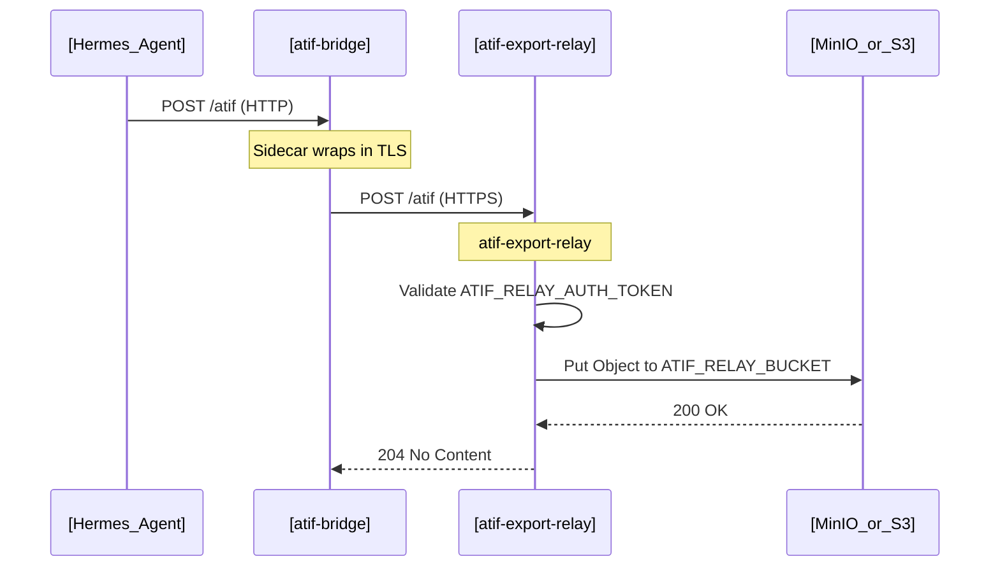
Sources: [examples/recipes/nvidia/developer-community-chief-of-staff/extras/docker-compose.yml:133-164](), [examples/recipes/nvidia/developer-community-chief-of-staff/scripts/00-host-services.sh:83-99]()

## Lifecycle and Preflight Validation

Host services are managed via the `00-host-services.sh` script [examples/recipes/nvidia/developer-community-chief-of-staff/scripts/00-host-services.sh:1-26]().

### CA Bundle Validation
A critical preflight check is the `assert_host_ca_bundle` function. It ensures that `NEMOCLAW_HOST_CA_BUNDLE` points to a valid, readable absolute path on the host before any containers are started [examples/recipes/nvidia/developer-community-chief-of-staff/scripts/00-host-services.sh:51-64](). This prevents Docker from creating empty directories at the bind-mount target if the host file is missing [examples/recipes/nvidia/developer-community-chief-of-staff/scripts/tests/test-host-ca-bundle.sh:35-36]().

### Service Bring-up (`cmd_up`)
The bring-up process follows these steps:
1. Validate the CA bundle [examples/recipes/nvidia/developer-community-chief-of-staff/scripts/00-host-services.sh:67]().
2. Resolve the ATIF relay backend (S3 or MinIO) and export the `ATIF_RELAY_BUCKET` [examples/recipes/nvidia/developer-community-chief-of-staff/scripts/00-host-services.sh:83-89]().
3. Execute `docker compose up` with profile arguments [examples/recipes/nvidia/developer-community-chief-of-staff/scripts/00-host-services.sh:105-111]().
4. If using MinIO, wait for healthiness (`/minio/health/live`) and create the bucket using a one-shot `minio/mc` container [examples/recipes/nvidia/developer-community-chief-of-staff/scripts/00-host-services.sh:114-130]().

Sources: [examples/recipes/nvidia/developer-community-chief-of-staff/scripts/00-host-services.sh:66-139](), [examples/recipes/nvidia/developer-community-chief-of-staff/scripts/tests/test-host-ca-bundle.sh:67-78]()

---

# Page: Deployment Scripts and Provider Configuration

# Deployment Scripts and Provider Configuration

<details>
<summary>Relevant source files</summary>

The following files were used as context for generating this wiki page:

- [examples/recipes/nvidia/developer-community-chief-of-staff/agents/hermes/generate-config.ts](examples/recipes/nvidia/developer-community-chief-of-staff/agents/hermes/generate-config.ts)
- [examples/recipes/nvidia/developer-community-chief-of-staff/agents/hermes/tests/test_nvteam_runtime_contract.py](examples/recipes/nvidia/developer-community-chief-of-staff/agents/hermes/tests/test_nvteam_runtime_contract.py)
- [examples/recipes/nvidia/developer-community-chief-of-staff/docs/guided-setup.md](examples/recipes/nvidia/developer-community-chief-of-staff/docs/guided-setup.md)
- [examples/recipes/nvidia/developer-community-chief-of-staff/docs/verify-functionality.md](examples/recipes/nvidia/developer-community-chief-of-staff/docs/verify-functionality.md)
- [examples/recipes/nvidia/developer-community-chief-of-staff/policy.yaml](examples/recipes/nvidia/developer-community-chief-of-staff/policy.yaml)
- [examples/recipes/nvidia/developer-community-chief-of-staff/scripts/02-providers.sh](examples/recipes/nvidia/developer-community-chief-of-staff/scripts/02-providers.sh)
- [examples/recipes/nvidia/developer-community-chief-of-staff/scripts/03-sandbox.sh](examples/recipes/nvidia/developer-community-chief-of-staff/scripts/03-sandbox.sh)
- [examples/recipes/nvidia/developer-community-chief-of-staff/scripts/configure.py](examples/recipes/nvidia/developer-community-chief-of-staff/scripts/configure.py)
- [examples/recipes/nvidia/developer-community-chief-of-staff/scripts/lib/configuration.py](examples/recipes/nvidia/developer-community-chief-of-staff/scripts/lib/configuration.py)
- [examples/recipes/nvidia/developer-community-chief-of-staff/scripts/preflight.py](examples/recipes/nvidia/developer-community-chief-of-staff/scripts/preflight.py)
- [examples/recipes/nvidia/developer-community-chief-of-staff/scripts/tear-down.sh](examples/recipes/nvidia/developer-community-chief-of-staff/scripts/tear-down.sh)
- [examples/recipes/nvidia/developer-community-chief-of-staff/scripts/tests/test-snapshot-safety.sh](examples/recipes/nvidia/developer-community-chief-of-staff/scripts/tests/test-snapshot-safety.sh)
- [examples/recipes/nvidia/developer-community-chief-of-staff/scripts/tests/test_configuration_tools.py](examples/recipes/nvidia/developer-community-chief-of-staff/scripts/tests/test_configuration_tools.py)

</details>


The NemoClaw Community recipes utilize a four-phase bring-up pipeline to ensure consistent, validated, and secure agent deployments. This pipeline manages everything from infrastructure setup to the injection of TLS certificates and the application of granular network policies.

## The Four-Phase Bring-Up Pipeline

The deployment lifecycle is orchestrated through a series of numbered scripts located in the `scripts/` directory of the recipe.

| Phase | Script | Primary Responsibility |
| :--- | :--- | :--- |
| **00** | `00-host-services.sh` | Launches Docker Compose for host-side infrastructure (PostgreSQL, Phoenix, ETLs) [examples/recipes/nvidia/developer-community-chief-of-staff/scripts/tear-down.sh:8-11](). |
| **01** | `01-gateway.sh` | Initializes the OpenShell gateway and verifies global settings. |
| **02** | `02-providers.sh` | Configures v2 provider profiles, handles OAuth2 flows, and runs preflight checks [examples/recipes/nvidia/developer-community-chief-of-staff/scripts/02-providers.sh:5-8](). |
| **03** | `03-sandbox.sh` | Patches the Dockerfile, builds the sandbox image, and applies the final security policy [examples/recipes/nvidia/developer-community-chief-of-staff/scripts/03-sandbox.sh:5-11](). |

### Phase 02: Provider Configuration and Preflight
`02-providers.sh` is responsible for importing v2 provider profiles and upserting the specific provider instances for the sandbox [examples/recipes/nvidia/developer-community-chief-of-staff/scripts/02-providers.sh:5-8](). 

Key behaviors include:
*   **Profile Management**: It performs a delete-then-import cycle for profiles like `nemoclaw-outlook-email`, `nemoclaw-slack`, and `nemoclaw-github` to ensure local YAML edits are applied [examples/recipes/nvidia/developer-community-chief-of-staff/scripts/02-providers.sh:37-40](). Profiles attached to live sandboxes are not re-imported to avoid collisions [examples/recipes/nvidia/developer-community-chief-of-staff/scripts/02-providers.sh:29-36]().
*   **Placeholder Substitution**: For the ATIF relay and GitLab, it uses `sed` to inject host and port placeholders into the profile before registration [examples/recipes/nvidia/developer-community-chief-of-staff/scripts/02-providers.sh:52-64]().
*   **Inference Preflight**: It invokes `inference_preflight.py` to validate the LLM endpoint, credentials, and model availability before the sandbox is created [examples/recipes/nvidia/developer-community-chief-of-staff/scripts/02-providers.sh:135-142]().

### Phase 03: Sandbox Build and Policy Injection
`03-sandbox.sh` handles the final assembly of the agent environment [examples/recipes/nvidia/developer-community-chief-of-staff/scripts/03-sandbox.sh:5-11]().

*   **Dockerfile Patching**: Since `openshell sandbox create` does not support `--build-arg`, the script uses `sed` to patch a staged Dockerfile (`.Dockerfile.staged`) with per-run values like `NEMOCLAW_MODEL`, `GITHUB_READONLY_REPOS`, and `PHOENIX_COLLECTOR_ENDPOINT` [examples/recipes/nvidia/developer-community-chief-of-staff/scripts/03-sandbox.sh:131-157]().
*   **TLS Injection**: It invokes `stage-enterprise-cas.sh` to copy local TLS-inspection roots into the build context, allowing the sandbox to trust corporate interception proxies [examples/recipes/nvidia/developer-community-chief-of-staff/scripts/03-sandbox.sh:127-129]().
*   **Two-Stage Policy Application**: The sandbox is created with a base policy, and then the final `policy.yaml` (patched with exact repository paths) is applied via `openshell policy set --wait` [examples/recipes/nvidia/developer-community-chief-of-staff/scripts/03-sandbox.sh:9-11]().

**Sources:**
* [examples/recipes/nvidia/developer-community-chief-of-staff/scripts/02-providers.sh:1-148]()
* [examples/recipes/nvidia/developer-community-chief-of-staff/scripts/03-sandbox.sh:1-166]()

---

## Configuration and Preflight Tools

The recipe provides specialized Python tools to manage the `.env` lifecycle and verify prerequisites before deployment.

### Guided Configuration
`configure.py` provides an interactive and non-interactive interface to generate a minimal `.env` file [examples/recipes/nvidia/developer-community-chief-of-staff/docs/guided-setup.md:35-41](). It preserves existing comments and unknown settings while enforcing owner-only permissions (`0600`) on the output [examples/recipes/nvidia/developer-community-chief-of-staff/scripts/lib/configuration.py:125-133]().

### Prerequisite Preflight
`preflight.py` performs read-only checks across the local host and optional external services [examples/recipes/nvidia/developer-community-chief-of-staff/docs/guided-setup.md:122-128]().

Title: Preflight Validation Logic
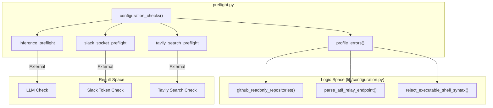
**Sources:**
* [examples/recipes/nvidia/developer-community-chief-of-staff/scripts/preflight.py:143-225]()
* [examples/recipes/nvidia/developer-community-chief-of-staff/scripts/lib/configuration.py:71-208]()
* [examples/recipes/nvidia/developer-community-chief-of-staff/docs/guided-setup.md:149-174]()

---

## Sandbox Environment Generation

The `generate-config.ts` script is executed during the Docker build phase to translate environment variables into Hermes-specific configuration files [examples/recipes/nvidia/developer-community-chief-of-staff/agents/hermes/generate-config.ts:4-9]().

### Configuration Mapping
The script generates two primary files:
1.  `~/.hermes/config.yaml`: Contains immutable settings like the model provider, toolset list, and platform tweaks [examples/recipes/nvidia/developer-community-chief-of-staff/agents/hermes/generate-config.ts:99-160]().
2.  `~/.hermes/.env`: Contains OpenShell placeholder strings (e.g., `openshell:resolve:env:SLACK_BOT_TOKEN`) that the gateway resolves at runtime [examples/recipes/nvidia/developer-community-chief-of-staff/agents/hermes/generate-config.ts:162-183]().

Title: Environment to Hermes Config Mapping
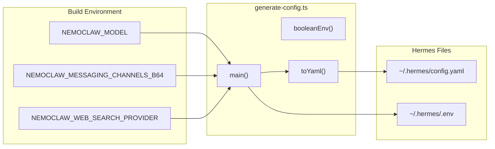
**Sources:**
* [examples/recipes/nvidia/developer-community-chief-of-staff/agents/hermes/generate-config.ts:63-214]()

---

## Tear-Down and Maintenance

`tear-down.sh` manages the removal of the sandbox and its associated providers [examples/recipes/nvidia/developer-community-chief-of-staff/scripts/tear-down.sh:5-11]().

*   **Standard Mode**: Deletes the sandbox and per-sandbox providers (Slack, Outlook, GitHub, etc.) [examples/recipes/nvidia/developer-community-chief-of-staff/scripts/tear-down.sh:75-84]().
*   **Host Services**: Optionally stops the host infrastructure stack via `--stop-host-services` or wipes data volumes via `--purge-host-services` [examples/recipes/nvidia/developer-community-chief-of-staff/scripts/tear-down.sh:86-95]().
*   **Snapshot Safety**: The `filter_credential_files` function in `_lib.sh` (tested by `test-snapshot-safety.sh`) ensures that sensitive files like `access-token.txt` are excluded from state snapshots to prevent accidental credential leakage [examples/recipes/nvidia/developer-community-chief-of-staff/scripts/tests/test-snapshot-safety.sh:29-45]().

**Sources:**
* [examples/recipes/nvidia/developer-community-chief-of-staff/scripts/tear-down.sh:34-112]()
* [examples/recipes/nvidia/developer-community-chief-of-staff/scripts/tests/test-snapshot-safety.sh:1-68]()

---

# Page: NVTeam Skills and Agent Persona System

# NVTeam Skills and Agent Persona System

<details>
<summary>Relevant source files</summary>

The following files were used as context for generating this wiki page:

- [examples/recipes/nvidia/developer-community-chief-of-staff/.env.example.s3](examples/recipes/nvidia/developer-community-chief-of-staff/.env.example.s3)
- [examples/recipes/nvidia/developer-community-chief-of-staff/agents/hermes/SOUL.md](examples/recipes/nvidia/developer-community-chief-of-staff/agents/hermes/SOUL.md)
- [examples/recipes/nvidia/developer-community-chief-of-staff/agents/hermes/skills/cross-source-gap-analysis/SKILL.md](examples/recipes/nvidia/developer-community-chief-of-staff/agents/hermes/skills/cross-source-gap-analysis/SKILL.md)
- [examples/recipes/nvidia/developer-community-chief-of-staff/agents/hermes/skills/github-readonly-live/SKILL.md](examples/recipes/nvidia/developer-community-chief-of-staff/agents/hermes/skills/github-readonly-live/SKILL.md)
- [examples/recipes/nvidia/developer-community-chief-of-staff/agents/hermes/skills/github-readonly-live/scripts/github_readonly.py](examples/recipes/nvidia/developer-community-chief-of-staff/agents/hermes/skills/github-readonly-live/scripts/github_readonly.py)
- [examples/recipes/nvidia/developer-community-chief-of-staff/agents/hermes/skills/nemoclaw-nvteam/SKILL.md](examples/recipes/nvidia/developer-community-chief-of-staff/agents/hermes/skills/nemoclaw-nvteam/SKILL.md)
- [examples/recipes/nvidia/developer-community-chief-of-staff/agents/hermes/skills/nemoclaw-nvteam/agents/openai.yaml](examples/recipes/nvidia/developer-community-chief-of-staff/agents/hermes/skills/nemoclaw-nvteam/agents/openai.yaml)
- [examples/recipes/nvidia/developer-community-chief-of-staff/agents/hermes/skills/nemoclaw-nvteam/evals/evals.json](examples/recipes/nvidia/developer-community-chief-of-staff/agents/hermes/skills/nemoclaw-nvteam/evals/evals.json)
- [examples/recipes/nvidia/developer-community-chief-of-staff/agents/hermes/skills/nemoclaw-nvteam/references/response-profiles.md](examples/recipes/nvidia/developer-community-chief-of-staff/agents/hermes/skills/nemoclaw-nvteam/references/response-profiles.md)
- [examples/recipes/nvidia/developer-community-chief-of-staff/agents/hermes/skills/outlook-email-search/scripts/get_thread.py](examples/recipes/nvidia/developer-community-chief-of-staff/agents/hermes/skills/outlook-email-search/scripts/get_thread.py)
- [examples/recipes/nvidia/developer-community-chief-of-staff/agents/hermes/skills/public-web-search/SKILL.md](examples/recipes/nvidia/developer-community-chief-of-staff/agents/hermes/skills/public-web-search/SKILL.md)
- [examples/recipes/nvidia/developer-community-chief-of-staff/agents/hermes/skills/slack-channel-summarizer/SKILL.md](examples/recipes/nvidia/developer-community-chief-of-staff/agents/hermes/skills/slack-channel-summarizer/SKILL.md)
- [examples/recipes/nvidia/developer-community-chief-of-staff/agents/hermes/skills/slack-channel-summarizer/scripts/fetch_slack_history.py](examples/recipes/nvidia/developer-community-chief-of-staff/agents/hermes/skills/slack-channel-summarizer/scripts/fetch_slack_history.py)
- [examples/recipes/nvidia/developer-community-chief-of-staff/agents/hermes/skills/source-etl-query/SKILL.md](examples/recipes/nvidia/developer-community-chief-of-staff/agents/hermes/skills/source-etl-query/SKILL.md)
- [examples/recipes/nvidia/developer-community-chief-of-staff/agents/hermes/tests/test_nvteam_skill_contract.py](examples/recipes/nvidia/developer-community-chief-of-staff/agents/hermes/tests/test_nvteam_skill_contract.py)
- [examples/recipes/nvidia/developer-community-chief-of-staff/agents/hermes/tests/test_slack_summary_history.py](examples/recipes/nvidia/developer-community-chief-of-staff/agents/hermes/tests/test_slack_summary_history.py)
- [examples/recipes/nvidia/developer-community-chief-of-staff/docs/public-web-search.md](examples/recipes/nvidia/developer-community-chief-of-staff/docs/public-web-search.md)
- [examples/recipes/nvidia/developer-community-chief-of-staff/scripts/tests/test_outlook_get_thread.py](examples/recipes/nvidia/developer-community-chief-of-staff/scripts/tests/test_outlook_get_thread.py)

</details>


The **NVTeam** system is a specialized role-routing framework integrated into the Developer Community Chief of Staff recipe. It provides a set of eight named specialist "lenses" that the agent uses to decompose complex community signals—such as GitHub issues, Slack discussions, and NVIDIA forum posts—into actionable, evidence-bounded technical insights.

## System Purpose and Attribution

The NVTeam system is defined as a local capability of the `developer-community-chief-of-staff` recipe and is explicitly distinguished from core NemoClaw product features [examples/recipes/nvidia/developer-community-chief-of-staff/agents/hermes/SOUL.md:7-13](). The system enforces strict attribution: the agent must never imply that these personas or routing behaviors are built-in model capabilities [examples/recipes/nvidia/developer-community-chief-of-staff/agents/hermes/skills/nemoclaw-nvteam/SKILL.md:13-20]().

### The Behavioral Contract (SOUL.md)
The `SOUL.md` file serves as the behavioral foundation for the agent. It instructs the agent to:
*   Introduce the NVTeam exactly once per conversation using a standardized Markdown table [examples/recipes/nvidia/developer-community-chief-of-staff/agents/hermes/SOUL.md:15-23]().
*   Use specialist lenses for substantive work by reading the `nemoclaw-nvteam` skill [examples/recipes/nvidia/developer-community-chief-of-staff/agents/hermes/SOUL.md:25-30]().
*   Maintain "Executive Density" by starting fast and shallow, then going deeper only if requested [examples/recipes/nvidia/developer-community-chief-of-staff/agents/hermes/SOUL.md:31-42]().
*   Prefer provided skills over creating custom Python code or terminal commands [examples/recipes/nvidia/developer-community-chief-of-staff/agents/hermes/SOUL.md:96-105]().

**Sources:** [examples/recipes/nvidia/developer-community-chief-of-staff/agents/hermes/SOUL.md:1-113](), [examples/recipes/nvidia/developer-community-chief-of-staff/agents/hermes/skills/nemoclaw-nvteam/SKILL.md:1-25]()

## The Eight Agent Personas

The system defines eight personas, each with a specific domain of responsibility. These are task-scoped lenses, not separate identities or organizational decision owners [examples/recipes/nvidia/developer-community-chief-of-staff/agents/hermes/SOUL.md:28-29]().

| Persona | Primary Role | Domain Focus |
| :--- | :--- | :--- |
| **River** | Product Manager | User outcomes, evidence, scope, and success measures. |
| **Quinn** | Technical Program Manager | Delivery, dependencies, readiness, and forecast confidence. |
| **Akira** | Backend & Systems Engineer | Architecture, implementation, APIs, and debugging. |
| **Jordan** | Data and ML Engineer | Pipelines, lineage, data quality, and evaluation. |
| **Robin** | Quality Engineer | Test strategy, failure clusters, and compatibility evidence. |
| **Alex** | Platform and SRE | Infrastructure health, observability, and recovery. |
| **Morgan** | Security Engineer | Trust boundaries, threats, controls, and residual risk. |
| **Parker** | Technical Marketing Engineer | Developer experience, community workflows, and feedback loops. |

**Sources:** [examples/recipes/nvidia/developer-community-chief-of-staff/agents/hermes/SOUL.md:17-20](), [examples/recipes/nvidia/developer-community-chief-of-staff/agents/hermes/skills/nemoclaw-nvteam/SKILL.md:71-80]()

## Implementation: Routing and Skill Interaction

The routing logic is implemented as a set of instructions within the `nemoclaw-nvteam` skill. The agent does not switch models; instead, it loads different reference documents based on the task requirements.

### Routing Logic Flow
1.  **Activation:** If a user explicitly asks for a persona, that persona is activated as the lead [examples/recipes/nvidia/developer-community-chief-of-staff/agents/hermes/skills/nemoclaw-nvteam/SKILL.md:46-53]().
2.  **Selection:** If no persona is specified, the agent selects the smallest useful lead based on the task domain. Quinn is used for cross-functional readiness reviews [examples/recipes/nvidia/developer-community-chief-of-staff/agents/hermes/skills/nemoclaw-nvteam/SKILL.md:61-62]().
3.  **Receipts:** Routing must be visible with a role-aware receipt, e.g., `River (Product Manager) active — focusing on user outcome...` [examples/recipes/nvidia/developer-community-chief-of-staff/agents/hermes/SOUL.md:26-28]().

### Data Retrieval Skills
Personas rely on specialized skills to interact with the sandbox environment correctly [examples/recipes/nvidia/developer-community-chief-of-staff/agents/hermes/SOUL.md:52]().

*   **`github-readonly-live`**: Authenticated `GET` requests to `api.github.com` for allowed repositories [examples/recipes/nvidia/developer-community-chief-of-staff/agents/hermes/skills/github-readonly-live/SKILL.md:8-10]().
*   **`source-etl-query`**: Queries host-side mirrored data for GitHub discussions and NVIDIA forums via `query_source_etl.py` [examples/recipes/nvidia/developer-community-chief-of-staff/agents/hermes/skills/source-etl-query/SKILL.md:8-16]().
*   **`slack-channel-summarizer`**: Fetches bounded history via `fetch_slack_history.py` and produces grounded summaries with citations [examples/recipes/nvidia/developer-community-chief-of-staff/agents/hermes/skills/slack-channel-summarizer/SKILL.md:8-16]().
*   **`outlook-email-search`**: Uses Microsoft Graph to search and retrieve email threads via `get_thread.py` [examples/recipes/nvidia/developer-community-chief-of-staff/agents/hermes/skills/outlook-email-search/scripts/get_thread.py:4-11]().
*   **`public-web-search`**: Optional Tavily integration restricted to `POST /search` on `api.tavily.com` [examples/recipes/nvidia/developer-community-chief-of-staff/agents/hermes/skills/public-web-search/SKILL.md:14-17]().

**NVTeam Skill and Data Routing**
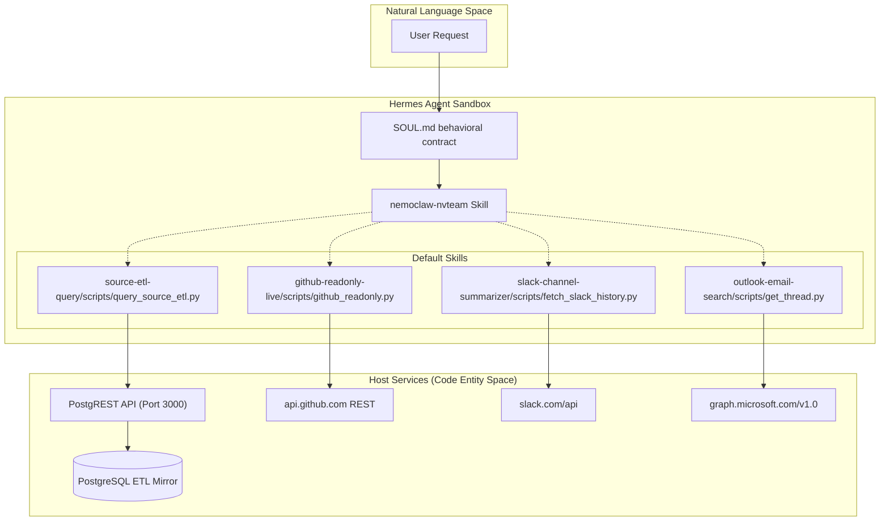
**Sources:** [examples/recipes/nvidia/developer-community-chief-of-staff/agents/hermes/SOUL.md:75-93](), [examples/recipes/nvidia/developer-community-chief-of-staff/agents/hermes/skills/slack-channel-summarizer/SKILL.md:42-45](), [examples/recipes/nvidia/developer-community-chief-of-staff/agents/hermes/skills/outlook-email-search/scripts/get_thread.py:25-26]()

## Cross-Source Gap Analysis

The `cross-source-gap-analysis` skill is used when a request requires comparing data across Slack, GitHub, forums, or Outlook [examples/recipes/nvidia/developer-community-chief-of-staff/agents/hermes/SOUL.md:83-86](). It instructs the agent to combine facts from multiple sources while keeping them labeled separately (e.g., distinguishing mirror facts from live REST facts) [examples/recipes/nvidia/developer-community-chief-of-staff/agents/hermes/skills/github-readonly-live/SKILL.md:122-124]().

## Evaluation Framework

The NVTeam system includes an evaluation suite in `evals/evals.json` and contract tests in `test_nvteam_skill_contract.py` to verify routing, persona behavior, and attribution boundaries.

**NVTeam Evaluation Mapping**
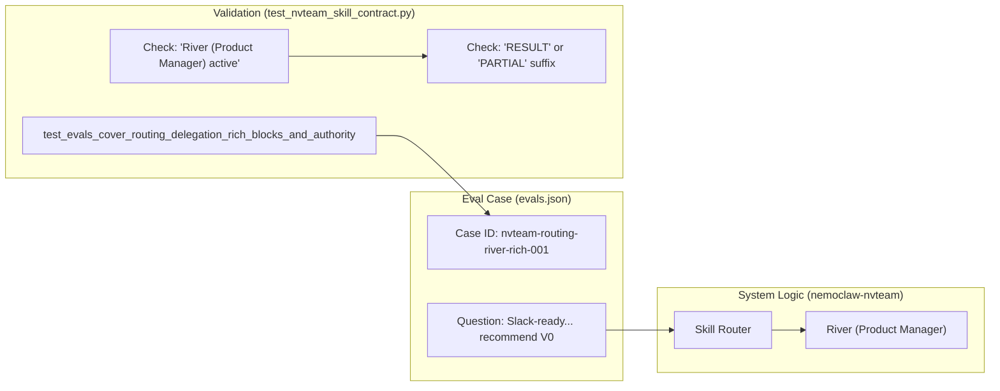
**Sources:** [examples/recipes/nvidia/developer-community-chief-of-staff/agents/hermes/skills/nemoclaw-nvteam/evals/evals.json:1-80](), [examples/recipes/nvidia/developer-community-chief-of-staff/agents/hermes/tests/test_nvteam_skill_contract.py:111-140]()

## Key Files and Implementation Locations

| File Path | Description |
| :--- | :--- |
| `SOUL.md` | Core behavioral contract and NVTeam introduction rules [examples/recipes/nvidia/developer-community-chief-of-staff/agents/hermes/SOUL.md]() |
| `skills/nemoclaw-nvteam/SKILL.md` | Primary routing logic and persona definitions [examples/recipes/nvidia/developer-community-chief-of-staff/agents/hermes/skills/nemoclaw-nvteam/SKILL.md]() |
| `skills/slack-channel-summarizer/scripts/fetch_slack_history.py` | Helper for retrieving Slack evidence [examples/recipes/nvidia/developer-community-chief-of-staff/agents/hermes/skills/slack-channel-summarizer/scripts/fetch_slack_history.py]() |
| `skills/github-readonly-live/scripts/github_readonly.py` | Authenticated, repository-scoped GitHub REST helper [examples/recipes/nvidia/developer-community-chief-of-staff/agents/hermes/skills/github-readonly-live/scripts/github_readonly.py]() |
| `skills/outlook-email-search/scripts/get_thread.py` | Microsoft Graph thread retrieval script [examples/recipes/nvidia/developer-community-chief-of-staff/agents/hermes/skills/outlook-email-search/scripts/get_thread.py]() |

**Sources:** [examples/recipes/nvidia/developer-community-chief-of-staff/agents/hermes/SOUL.md:1-113](), [examples/recipes/nvidia/developer-community-chief-of-staff/agents/hermes/skills/github-readonly-live/SKILL.md:86-94]()

---

# Page: PR Review Advisor

# PR Review Advisor

<details>
<summary>Relevant source files</summary>

The following files were used as context for generating this wiki page:

- [.github/workflows/nemoclaw-review-advisor-dogfood.yml](.github/workflows/nemoclaw-review-advisor-dogfood.yml)
- [examples/recipes/nvidia/pr-review-advisor/.env.example](examples/recipes/nvidia/pr-review-advisor/.env.example)
- [examples/recipes/nvidia/pr-review-advisor/.gitignore](examples/recipes/nvidia/pr-review-advisor/.gitignore)
- [examples/recipes/nvidia/pr-review-advisor/.npmignore](examples/recipes/nvidia/pr-review-advisor/.npmignore)
- [examples/recipes/nvidia/pr-review-advisor/LICENSE](examples/recipes/nvidia/pr-review-advisor/LICENSE)
- [examples/recipes/nvidia/pr-review-advisor/README.md](examples/recipes/nvidia/pr-review-advisor/README.md)
- [examples/recipes/nvidia/pr-review-advisor/agents/hermes/Dockerfile](examples/recipes/nvidia/pr-review-advisor/agents/hermes/Dockerfile)
- [examples/recipes/nvidia/pr-review-advisor/agents/hermes/SOUL.md](examples/recipes/nvidia/pr-review-advisor/agents/hermes/SOUL.md)
- [examples/recipes/nvidia/pr-review-advisor/agents/hermes/generate-config.ts](examples/recipes/nvidia/pr-review-advisor/agents/hermes/generate-config.ts)

</details>


The PR Review Advisor is a first-party NemoClaw recipe that transforms a Hermes agent and Nemotron-3 Ultra into a reusable, repository-aware pull-request reviewer [examples/recipes/nvidia/pr-review-advisor/README.md:8-12](). It employs a fail-closed security model, a six-stage finding ledger, and a detached-head analysis pattern to ensure that the agent provides high-integrity feedback without ever possessing the credentials to mutate the repository or GitHub state [examples/recipes/nvidia/pr-review-advisor/README.md:63-71]().

## System Architecture

The Advisor operates across a trust boundary between a **Trusted Host** (e.g., a GitHub Actions runner) and an **OpenShell Sandbox** [examples/recipes/nvidia/pr-review-advisor/README.md:43-62]().

1.  **Host Preparer**: Fetches a bounded snapshot of the PR (title, body, and linked issues) and creates a detached-head checkout of the repository [examples/recipes/nvidia/pr-review-advisor/README.md:48-48]().
2.  **OpenShell Sandbox**: Hosts the Hermes agent, the `review-advisor` plugin, and the `/pr-review` skill source [examples/recipes/nvidia/pr-review-advisor/README.md:51-55]().
3.  **Inference Proxy**: OpenShell intercepts model requests to `inference.local`, injecting the real provider credentials at the L7 boundary so the agent never sees them [examples/recipes/nvidia/pr-review-advisor/README.md:66-68]().

### Data Flow and Component Interaction

The following diagram illustrates the flow from PR trigger to artifact generation, highlighting the code entities involved in the lifecycle.

**PR Review Lifecycle: Host to Sandbox**
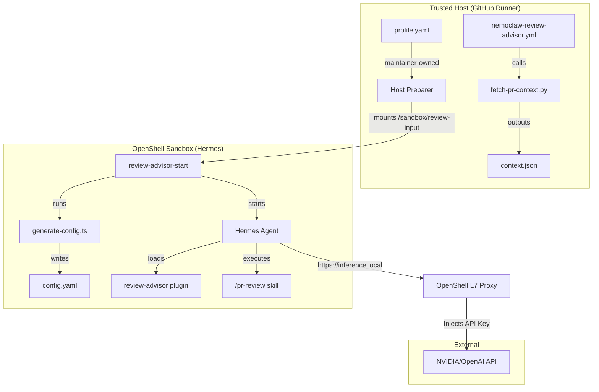
Sources: [examples/recipes/nvidia/pr-review-advisor/README.md:43-62](), [examples/recipes/nvidia/pr-review-advisor/agents/hermes/Dockerfile:45-55](), [examples/recipes/nvidia/pr-review-advisor/agents/hermes/generate-config.ts:21-65]()

## Review Advisor Plugin and Ledger

The `review-advisor` plugin is a stateful, read-only Python plugin that manages the review lifecycle and the **Finding Ledger**.

### Six-Stage Finding Ledger
The agent must commit findings to an ordered ledger through six enforced stages [examples/recipes/nvidia/pr-review-advisor/README.md:30-31]():

| Stage | Objective |
| :--- | :--- |
| `scope` | Map changed components, interfaces, and trust boundaries. |
| `correctness` | Trace state, errors, lifecycle, and acceptance criteria. |
| `security` | Cover credentials, input validation, and system boundaries. |
| `tests` | Identify missing regression coverage for changed behavior. |
| `operations` | Inspect automation, packaging, and upgrades. |
| `reconciliation` | Update, resolve, or supersede existing findings in the ledger. |

### Plugin and Skill Integration
The `SOUL.md` defines the behavioral contract, explicitly forbidding the use of standard Hermes tools like the terminal or browser, forcing interaction through the `review-advisor` plugin [examples/recipes/nvidia/pr-review-advisor/agents/hermes/SOUL.md:12-34](). The plugin returns a trusted protocol from `review_begin`, and the `pr-review` skill source is provided as an auditable reference rather than a mutable toolset [examples/recipes/nvidia/pr-review-advisor/README.md:14-17]().

Sources: [examples/recipes/nvidia/pr-review-advisor/README.md:21-41](), [examples/recipes/nvidia/pr-review-advisor/agents/hermes/SOUL.md:1-38]()

## Security Model: Fail-Closed and Proxy Pattern

The Advisor implements a **fail-closed security model** where the agent is stripped of all general-purpose tools [examples/recipes/nvidia/pr-review-advisor/agents/hermes/generate-config.ts:18-20]().

### generate-config.ts Inference Proxy
The `generate-config.ts` script generates the Hermes configuration inside the container [examples/recipes/nvidia/pr-review-advisor/agents/hermes/generate-config.ts:4-75](). It hardcodes the `api_key` to `sk-OPENSHELL-PROXY-REWRITE` [examples/recipes/nvidia/pr-review-advisor/agents/hermes/generate-config.ts:26-30](). This string is recognized by the OpenShell gateway, which substitutes it with the real credential stored in the host environment.

### Sandbox Isolation
The `Dockerfile` ensures the sandbox has no access to the host's terminal, browser, or generic filesystem by intentionally omitting these from the configuration [examples/recipes/nvidia/pr-review-advisor/agents/hermes/generate-config.ts:18-20]().
- **Restricted Tools**: The `SOUL.md` explicitly forbids the use of terminal, browser, web, or cron tools [examples/recipes/nvidia/pr-review-advisor/agents/hermes/SOUL.md:28-34]().
- **Attestation**: The host provides a 32-byte attestation key via `REVIEW_ADVISOR_ATTESTATION_KEY_FILE` [examples/recipes/nvidia/pr-review-advisor/agents/hermes/Dockerfile:54](). The host only accepts artifacts that verify against this HMAC and exact request identity [examples/recipes/nvidia/pr-review-advisor/README.md:69-71]().

Sources: [examples/recipes/nvidia/pr-review-advisor/agents/hermes/generate-config.ts:1-75](), [examples/recipes/nvidia/pr-review-advisor/agents/hermes/Dockerfile:1-64](), [examples/recipes/nvidia/pr-review-advisor/agents/hermes/SOUL.md:1-38]()

## Maintainer Feedback Loop

The system includes a feedback loop that allows maintainers to record "lessons" into Hermes' persistent memory [examples/recipes/nvidia/pr-review-advisor/README.md:32-33]().

### record-feedback.py
The `record-feedback.py` script validates and persists explicitly approved feedback [examples/recipes/nvidia/pr-review-advisor/agents/hermes/record-feedback.py:1-186](). It ensures that remembered lessons are treated as fallible hints; every claim must be re-established against the current patch and checkout by the agent during a review [examples/recipes/nvidia/pr-review-advisor/agents/hermes/SOUL.md:23-26]().

Sources: [examples/recipes/nvidia/pr-review-advisor/agents/hermes/record-feedback.py:1-186](), [examples/recipes/nvidia/pr-review-advisor/agents/hermes/SOUL.md:23-26]()

## Dogfood CI Workflow

The Advisor is used to review the NemoClaw repository itself via the `nemoclaw-review-advisor-dogfood.yml` workflow [.github/workflows/nemoclaw-review-advisor-dogfood.yml:1-12]().

### Workflow Lifecycle
1.  **Trigger**: `workflow_dispatch` with `base_sha`, `head_sha`, and `pr_number` [.github/workflows/nemoclaw-review-advisor-dogfood.yml:15-29]().
2.  **Fetch and Bind**: Uses `fetch-pr-context.py` to pull PR metadata and repository objects into a temporary, isolated directory [.github/workflows/nemoclaw-review-advisor-dogfood.yml:87-156]().
3.  **Review Execution**: Launches the OpenShell sandbox with the `REVIEW_PROFILE_PATH` pointing to the dogfood profile [.github/workflows/nemoclaw-review-advisor-dogfood.yml:58-59]().
4.  **Quarantine/Recovery**: The workflow enforces a monotonic wall deadline and cleans the trusted workspace while preserving private appliance configuration [.github/workflows/nemoclaw-review-advisor-dogfood.yml:51-78]().

**Code-to-System Mapping**
| Code Entity | System Role |
| :--- | :--- |
| `nemoclaw-review-advisor-dogfood.yml` | CI Orchestrator [.github/workflows/nemoclaw-review-advisor-dogfood.yml:12]() |
| `fetch-pr-context.py` | Acceptance Context Fetcher [.github/workflows/nemoclaw-review-advisor-dogfood.yml:150]() |
| `review-advisor-start` | Sandbox Entrypoint [examples/recipes/nvidia/pr-review-advisor/agents/hermes/Dockerfile:64]() |
| `generate-config.ts` | Config Integrity Manager [examples/recipes/nvidia/pr-review-advisor/agents/hermes/generate-config.ts:4]() |

Sources: [.github/workflows/nemoclaw-review-advisor-dogfood.yml:1-173](), [examples/recipes/nvidia/pr-review-advisor/README.md:138-154](), [examples/recipes/nvidia/pr-review-advisor/agents/hermes/Dockerfile:1-64]()

---

# Page: Payment Operations Hermes Assistant (FinGuard)

# Payment Operations Hermes Assistant (FinGuard)

<details>
<summary>Relevant source files</summary>

The following files were used as context for generating this wiki page:

- [examples/recipes/nvidia/developer-community-chief-of-staff/.env.example](examples/recipes/nvidia/developer-community-chief-of-staff/.env.example)
- [examples/recipes/nvidia/developer-community-chief-of-staff/README.md](examples/recipes/nvidia/developer-community-chief-of-staff/README.md)

</details>


The FinGuard recipe demonstrates a high-assurance payment operations assistant designed with a **maker/checker** security boundary. It uses the Hermes agent framework to facilitate payment requests while enforcing a strict "denied-edge" policy that prevents the agent from directly accessing production payment rails.

## Purpose and Scope

FinGuard is a reference implementation for financial workflows where an LLM-based agent (the "Maker") proposes actions that must be validated by a separate, trusted process or human (the "Checker"). The recipe integrates:
*   **Hermes Agent**: The primary assistant that interacts with users and prepares payment payloads.
*   **NeMo Relay Sidecar**: Provides the secure communication channel and structured tool-calling interface within the sandbox [examples/recipes/nvidia/developer-community-chief-of-staff/README.md:89-90]().
*   **Maker/Checker Boundary**: A structural separation where the agent generates a payment request but lacks the credentials or network path to execute it.
*   **OpenShell Policy**: A fail-closed configuration that explicitly denies the agent container access to the payment rail's production endpoints while allowing limited interaction with mock services [examples/recipes/nvidia/developer-community-chief-of-staff/README.md:32-34]().
*   **Phoenix Observability**: Provides OpenInference-compatible tracing for auditing the decision-making process [examples/recipes/nvidia/developer-community-chief-of-staff/README.md:140-140]().

## System Architecture

The FinGuard architecture bridges the "Natural Language Space" (user intent) to the "Code Entity Space" (execution and enforcement) through a multi-layered sandbox and proxy system.

### Data Flow and Boundary Enforcement

1.  **User Request**: A user provides a natural language payment instruction to the Hermes agent via Outlook or Slack [examples/recipes/nvidia/developer-community-chief-of-staff/README.md:11-12]().
2.  **Payload Generation**: Hermes uses its internal skills to format a `payment_request` JSON payload.
3.  **Policy Interception**: When the agent attempts to "commit" the payment, the **OpenShell Gateway** evaluates the request against the `policy.yaml` [examples/recipes/nvidia/developer-community-chief-of-staff/README.md:80-83]().
4.  **Denied-Edge Enforcement**: The policy allows the agent to talk to a **Mock Payment Rail** for testing but blocks all paths to the real financial API [examples/recipes/nvidia/developer-community-chief-of-staff/README.md:46-51]().
5.  **Checker Verification**: The generated request is routed to a host-side human-in-the-loop (HITL) service via the ATIF bridge [examples/recipes/nvidia/developer-community-chief-of-staff/README.md:125-127]().

### Code Entity Space Mapping

The following diagram maps high-level FinGuard components to specific files and functions within the repository.

**Diagram: FinGuard Entity Mapping**
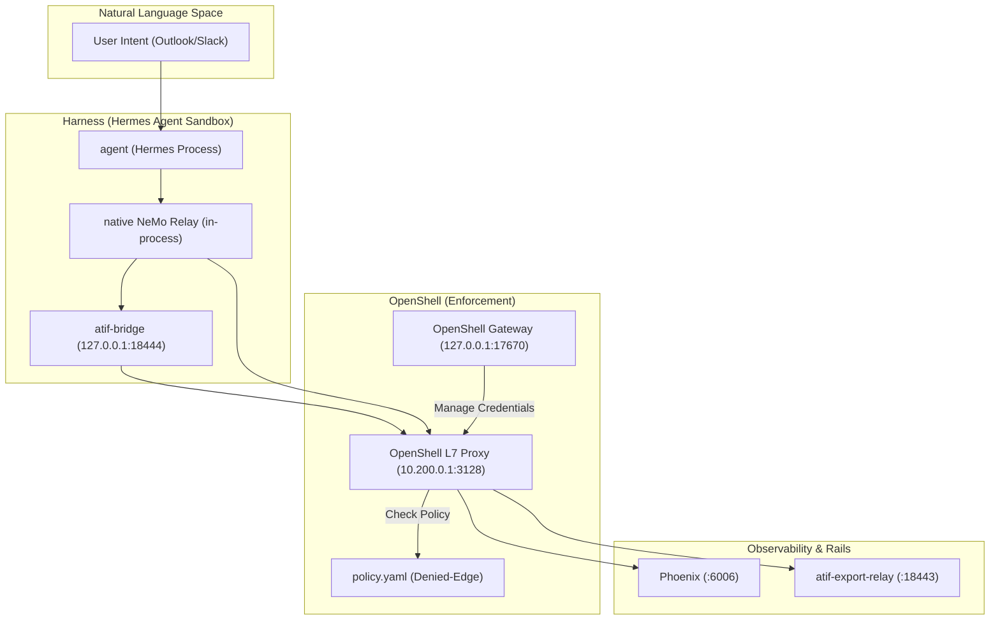
**Sources:** [examples/recipes/nvidia/developer-community-chief-of-staff/README.md:65-146](), [examples/recipes/nvidia/developer-community-chief-of-staff/.env.example:130-140]()

## Implementation Details

### Maker/Checker Logic
The FinGuard recipe implements the maker/checker pattern by ensuring the agent's environment lacks sensitive financial credentials. Instead, the agent is configured to send its output to an `atif-bridge` sidecar [examples/recipes/nvidia/developer-community-chief-of-staff/README.md:92-92]().

*   **Maker**: The Hermes agent, running in a restricted Docker container. It uses `relayRuntime` to capture events [examples/recipes/nvidia/developer-community-chief-of-staff/README.md:123-123]().
*   **Checker**: A host-side service (documented in the `00-host-services.sh` lifecycle) that receives the **ATIF (Agent Trajectory Interchange Format)** export and presents it for review via the `atif-export-relay` [examples/recipes/nvidia/developer-community-chief-of-staff/README.md:139-139]().

### OpenShell Policy Enforcement
The core security of FinGuard relies on the `policy.yaml`. This policy uses a "Shared-Nothing" isolation principle where only explicitly allowlisted routes are reachable [examples/recipes/nvidia/developer-community-chief-of-staff/README.md:31-34]().

| Feature | Enforcement Mechanism | Code Reference |
| :--- | :--- | :--- |
| **Inference Path** | Validated via `NEMOCLAW_INFERENCE_PREFLIGHT` | [examples/recipes/nvidia/developer-community-chief-of-staff/.env.example:22-29]() |
| **Egress Control** | OpenShell L7 Proxy & Privacy Router | [examples/recipes/nvidia/developer-community-chief-of-staff/README.md:83-85]() |
| **Credential Masking** | Placeholder substitution (e.g., `GITHUB_TOKEN`) | [examples/recipes/nvidia/developer-community-chief-of-staff/README.md:49-51]() |
| **Observability** | `PHOENIX_COLLECTOR_ENDPOINT` routing | [examples/recipes/nvidia/developer-community-chief-of-staff/.env.example:135-135]() |

### Observability with Phoenix
FinGuard utilizes Phoenix to provide a transparent audit trail of every tool call made by the agent. This is critical for the "Checker" to understand *why* a payment was proposed.

**Diagram: Trace and Export Flow**
```mermaid
sequenceDiagram
    participant Agent as "Hermes Agent (Sandbox)"
    participant Relay as "NeMo Relay (Sidecar)"
    participant L7 as "OpenShell L7 Proxy"
    participant Phoenix as "Phoenix (Host:6006)"
    participant ATIF as "atif-export-relay (Host:18443)"

    Agent->>Relay: Tool Call (Payment Request)
    Relay->>L7: OTLP HTTP POST (telemetry)
    L7->>Phoenix: Trace Ingest
    Relay->>Agent: Tool Result
    Note over Agent, Relay: Trajectory Completion
    Relay->>ATIF: HTTP POST /atif (via atif-bridge)
    ATIF->>ATIF: Sign & Persist Trajectory
```
**Sources:** [examples/recipes/nvidia/developer-community-chief-of-staff/README.md:125-146](), [examples/recipes/nvidia/developer-community-chief-of-staff/.env.example:130-140]()

## Key Configuration Variables

The behavior of the FinGuard assistant is controlled through the `.env` file, which influences the bring-up lifecycle of both host services and the sandbox.

*   `NEMOCLAW_INFERENCE_PREFLIGHT`: Ensures the LLM is reachable and supports structured tool calling before the sandbox starts [examples/recipes/nvidia/developer-community-chief-of-staff/.env.example:29-29]().
*   `OUTLOOK_LOGIN_CACHE`: Manages the lifecycle of the delegated credentials used by the `outlook-bridge` sidecar [examples/recipes/nvidia/developer-community-chief-of-staff/.env.example:60-60]().
*   `PHOENIX_PROJECT_NAME`: Groups traces under a specific FinGuard audit project to keep deployments separate [examples/recipes/nvidia/developer-community-chief-of-staff/.env.example:139-139]().

## Deployment Lifecycle

The FinGuard recipe follows the standard four-phase bring-up:
1.  **00-host-services.sh**: Launches Phoenix, PostgreSQL, and the ATIF Export Relay [examples/recipes/nvidia/developer-community-chief-of-staff/.env.example:8-8]().
2.  **01-gateway.sh**: Starts the OpenShell Gateway [examples/recipes/nvidia/developer-community-chief-of-staff/.env.example:9-9]().
3.  **02-providers.sh**: Configures the v2 providers (Inference, Outlook, GitHub) and validates credentials [examples/recipes/nvidia/developer-community-chief-of-staff/.env.example:12-12]().
4.  **03-sandbox.sh**: Builds the Hermes image, applies the "denied-edge" policy, and starts the container [examples/recipes/nvidia/developer-community-chief-of-staff/README.md:91-94]().

**Sources:** [examples/recipes/nvidia/developer-community-chief-of-staff/README.md:36-42](), [examples/recipes/nvidia/developer-community-chief-of-staff/.env.example:1-12]()

---

# Page: NV Tech Assistant

# NV Tech Assistant

<details>
<summary>Relevant source files</summary>

The following files were used as context for generating this wiki page:

- [examples/recipes/nvidia/developer-community-chief-of-staff/.env.example](examples/recipes/nvidia/developer-community-chief-of-staff/.env.example)
- [examples/recipes/nvidia/developer-community-chief-of-staff/README.md](examples/recipes/nvidia/developer-community-chief-of-staff/README.md)

</details>


The **NV Tech Assistant** is an NVIDIA-authored recipe designed for grounded technical research. It enables a sandboxed agent to answer complex technical questions by citing evidence from a restricted set of allowlisted domains, including NVIDIA documentation, GitHub repositories, and arXiv pre-prints. It utilizes the **Hermes** agent framework and integrates with **Brave Search** for targeted discovery within its allowlisted boundaries.

## Purpose and Scope

The primary goal of this recipe is to provide a "constrained researcher" persona that avoids hallucinations by strictly adhering to a high-fidelity source list. Unlike general-purpose search agents, the NV Tech Assistant is governed by an **OpenShell** policy that prevents it from accessing the open web, limiting its egress to specific API endpoints and technical domains.

Sources: [examples/README.md:14-14](), [examples/recipes/nvidia/developer-community-chief-of-staff/README.md:5-12]()

---

## Technical Architecture and Data Flow

The recipe follows the standard NemoClaw three-layer architecture: **Model**, **Harness**, and **OpenShell**. The agent operates within a hardened container (Sandbox) and communicates with external technical sources through a secure gateway that performs credential substitution and egress filtering.

### System Data Flow: From Query to Grounded Answer

The following diagram illustrates how a natural language technical query is processed through the system's code entities, specifically highlighting the interaction between the `Hermes` agent and the `OpenShell` L7 proxy.

**Diagram: NV Tech Assistant Technical Research Flow**
```mermaid
graph TD
    User["User Query"] --> Hermes["Hermes Agent (Harness)"]
    
    subgraph "Sandbox (OpenShell Managed)"
        Hermes --> BraveSkill["brave-search-skill"]
        BraveSkill --> OpenShellGateway["OpenShell L7 Proxy (10.200.0.1:3128)"]
    end

    subgraph "External API Space"
        OpenShellGateway -- "Filtered Egress (policy.yaml)" --> BraveAPI["api.search.brave.com"]
        BraveAPI -- "Results restricted to allowlist" --> TechnicalSources["Technical Sources"]
    end

    TechnicalSources --> Github["github.com (NVIDIA Repos)"]
    TechnicalSources --> NvidiaDocs["docs.nvidia.com"]
    TechnicalSources --> Arxiv["arxiv.org"]

    TechnicalSources --> Hermes
    Hermes --> FinalResponse["Grounded Technical Answer with Citations"]
```
Sources: [examples/recipes/nvidia/developer-community-chief-of-staff/README.md:63-135](), [examples/README.md:14-14]()

---

## Lifecycle Scripts

The NV Tech Assistant implements a standardized lifecycle pattern. These scripts manage the environment from initial dependency installation to the final application of the sandbox security policy. They are designed to auto-source configuration from the `.env` file.

| Script | Phase | Description |
| :--- | :--- | :--- |
| `00-onboard.sh` | Onboarding | Verifies the host environment and installs the OpenShell CLI. |
| `01-install.sh` | Installation | Pulls required Docker images and builds the local Hermes research image. |
| `02-providers.sh` | Configuration | Configures inference endpoints and injects the Brave Search API keys into the OpenShell provider store. |
| `03-start.sh` | Execution | Launches the sandbox and applies the `policy.yaml` to the container runtime. |

Sources: [examples/recipes/nvidia/developer-community-chief-of-staff/.env.example:1-12]()

---

## Sandbox Policy and Egress Control

The security of the NV Tech Assistant is defined by its `policy.yaml`. This file enforces a "deny-by-default" network stance, only permitting the agent to communicate with the specific technical domains required for research.

### Egress Allowlist

The agent's network access is strictly limited to:
1.  **Search Discovery**: `api.search.brave.com` (Used by the search skill).
2.  **Research Domains**:
    *   `docs.nvidia.com`
    *   `developer.nvidia.com`
    *   `github.com/NVIDIA/*`
    *   `arxiv.org`
3.  **Inference**: The configured LLM provider (e.g., NVIDIA NIM or OpenAI), validated by `inference_preflight.py`.

### Credential Substitution

The OpenShell gateway handles authentication via the `OpenShell Gateway (127.0.0.1:17670)`. The agent's search skill does not hold the actual `BRAVE_API_KEY`. Instead, it sends a placeholder header, which the gateway replaces with the real credential stored in the host-side provider vault before forwarding the request to Brave.

**Diagram: Credential Substitution and Egress Enforcement**
```mermaid
graph LR
    subgraph "Sandbox (Untrusted)"
        Skill["brave-search-skill"]
    end

    subgraph "Gateway (Trusted)"
        Proxy["OpenShell L7 Proxy"]
        Vault["Provider Store (v2 providers)"]
    end

    Skill -- "Request + Placeholder_Token" --> Proxy
    Proxy -- "Lookup Key" --> Vault
    Proxy -- "Request + Real_Token" --> BraveAPI["Brave Search API"]
    
    style Vault stroke-dasharray: 5 5
```
Sources: [examples/recipes/nvidia/developer-community-chief-of-staff/README.md:46-61](), [examples/recipes/nvidia/developer-community-chief-of-staff/README.md:138-138]()

---

## Key Components

### Hermes Agent Sandbox
The research logic resides in the Hermes sandbox. It uses a specific set of skills focused on retrieval and synthesis. The sandbox environment is provisioned with a narrow egress policy and uses `Landlock/seccomp` for kernel-level isolation.

### Brave Search Integration
The recipe includes a specialized skill that interacts with the Brave Search API. This skill is configured to use the `site:` operator or domain filters to ensure results only originate from the allowlisted technical sources defined in the project scope. The `TAVILY_API_KEY` (if configured in `.env`) provides a similar search-only discovery capability with restricted routes.

Sources: [examples/recipes/nvidia/developer-community-chief-of-staff/README.md:30-34](), [examples/recipes/nvidia/developer-community-chief-of-staff/.env.example:99-108]()

---

# Page: Memory-Driven Chief of Staff

# Memory-Driven Chief of Staff

<details>
<summary>Relevant source files</summary>

The following files were used as context for generating this wiki page:

- [examples/recipes/nvidia/memory-driven-chief-of-staff/README.md](examples/recipes/nvidia/memory-driven-chief-of-staff/README.md)
- [examples/recipes/nvidia/memory-driven-chief-of-staff/fixtures/README.md](examples/recipes/nvidia/memory-driven-chief-of-staff/fixtures/README.md)
- [examples/recipes/nvidia/memory-driven-chief-of-staff/fixtures/envelopes/intake.json](examples/recipes/nvidia/memory-driven-chief-of-staff/fixtures/envelopes/intake.json)
- [examples/recipes/nvidia/memory-driven-chief-of-staff/fixtures/graph_messages.json](examples/recipes/nvidia/memory-driven-chief-of-staff/fixtures/graph_messages.json)
- [examples/recipes/nvidia/memory-driven-chief-of-staff/fixtures/memory/attention/current_priorities.md](examples/recipes/nvidia/memory-driven-chief-of-staff/fixtures/memory/attention/current_priorities.md)
- [examples/recipes/nvidia/memory-driven-chief-of-staff/fixtures/memory/index.md](examples/recipes/nvidia/memory-driven-chief-of-staff/fixtures/memory/index.md)
- [examples/recipes/nvidia/memory-driven-chief-of-staff/fixtures/memory/people/dana_okoro.md](examples/recipes/nvidia/memory-driven-chief-of-staff/fixtures/memory/people/dana_okoro.md)
- [examples/recipes/nvidia/memory-driven-chief-of-staff/fixtures/memory/people/sam_ruiz.md](examples/recipes/nvidia/memory-driven-chief-of-staff/fixtures/memory/people/sam_ruiz.md)
- [examples/recipes/nvidia/memory-driven-chief-of-staff/fixtures/memory/projects/billing_migration/billing_migration.md](examples/recipes/nvidia/memory-driven-chief-of-staff/fixtures/memory/projects/billing_migration/billing_migration.md)
- [examples/recipes/nvidia/memory-driven-chief-of-staff/fixtures/slack_messages.json](examples/recipes/nvidia/memory-driven-chief-of-staff/fixtures/slack_messages.json)
- [examples/recipes/nvidia/memory-driven-chief-of-staff/profile/SOUL.md](examples/recipes/nvidia/memory-driven-chief-of-staff/profile/SOUL.md)
- [examples/recipes/nvidia/memory-driven-chief-of-staff/profile/distribution.yaml](examples/recipes/nvidia/memory-driven-chief-of-staff/profile/distribution.yaml)
- [examples/recipes/nvidia/memory-driven-chief-of-staff/profile/schema.md](examples/recipes/nvidia/memory-driven-chief-of-staff/profile/schema.md)
- [examples/recipes/nvidia/memory-driven-chief-of-staff/profile/scripts/_db.py](examples/recipes/nvidia/memory-driven-chief-of-staff/profile/scripts/_db.py)
- [examples/recipes/nvidia/memory-driven-chief-of-staff/profile/scripts/apply_decisions.py](examples/recipes/nvidia/memory-driven-chief-of-staff/profile/scripts/apply_decisions.py)
- [examples/recipes/nvidia/memory-driven-chief-of-staff/profile/scripts/correct.py](examples/recipes/nvidia/memory-driven-chief-of-staff/profile/scripts/correct.py)
- [examples/recipes/nvidia/memory-driven-chief-of-staff/profile/scripts/memory_check.py](examples/recipes/nvidia/memory-driven-chief-of-staff/profile/scripts/memory_check.py)
- [examples/recipes/nvidia/memory-driven-chief-of-staff/profile/scripts/preferences.py](examples/recipes/nvidia/memory-driven-chief-of-staff/profile/scripts/preferences.py)
- [examples/recipes/nvidia/memory-driven-chief-of-staff/profile/scripts/ranking.py](examples/recipes/nvidia/memory-driven-chief-of-staff/profile/scripts/ranking.py)
- [examples/recipes/nvidia/memory-driven-chief-of-staff/profile/scripts/tests/test_apply_decisions.py](examples/recipes/nvidia/memory-driven-chief-of-staff/profile/scripts/tests/test_apply_decisions.py)
- [examples/recipes/nvidia/memory-driven-chief-of-staff/profile/scripts/tests/test_durability.py](examples/recipes/nvidia/memory-driven-chief-of-staff/profile/scripts/tests/test_durability.py)
- [examples/recipes/nvidia/memory-driven-chief-of-staff/profile/scripts/tests/test_memory_check.py](examples/recipes/nvidia/memory-driven-chief-of-staff/profile/scripts/tests/test_memory_check.py)
- [examples/recipes/nvidia/memory-driven-chief-of-staff/profile/scripts/tests/test_ranking.py](examples/recipes/nvidia/memory-driven-chief-of-staff/profile/scripts/tests/test_ranking.py)
- [examples/recipes/nvidia/memory-driven-chief-of-staff/profile/scripts/tests/test_walkthrough.py](examples/recipes/nvidia/memory-driven-chief-of-staff/profile/scripts/tests/test_walkthrough.py)
- [examples/recipes/nvidia/memory-driven-chief-of-staff/profile/scripts/walkthrough.py](examples/recipes/nvidia/memory-driven-chief-of-staff/profile/scripts/walkthrough.py)
- [examples/recipes/nvidia/memory-driven-chief-of-staff/profile/skills/inbound-judging/SKILL.md](examples/recipes/nvidia/memory-driven-chief-of-staff/profile/skills/inbound-judging/SKILL.md)
- [examples/recipes/nvidia/memory-driven-chief-of-staff/profile/skills/memory-consolidation/SKILL.md](examples/recipes/nvidia/memory-driven-chief-of-staff/profile/skills/memory-consolidation/SKILL.md)
- [examples/recipes/nvidia/memory-driven-chief-of-staff/profile/skills/memory-repair/SKILL.md](examples/recipes/nvidia/memory-driven-chief-of-staff/profile/skills/memory-repair/SKILL.md)
- [examples/recipes/nvidia/memory-driven-chief-of-staff/profile/skills/obligation-review/SKILL.md](examples/recipes/nvidia/memory-driven-chief-of-staff/profile/skills/obligation-review/SKILL.md)
- [examples/recipes/nvidia/memory-driven-chief-of-staff/profile/skills/preference-update/SKILL.md](examples/recipes/nvidia/memory-driven-chief-of-staff/profile/skills/preference-update/SKILL.md)

</details>


The **Memory-Driven Chief of Staff** is a recipe for the Hermes agent runtime that maintains a locally-authoritative, revisable record of obligations derived from inbound signals (email and Slack). Unlike standard assistants that react to external urgency, this system uses a **Memory-Driven** approach: it admits items to the highest priority tier only if the user's own memory (Markdown-based persona and project files) indicates they have explicitly chosen that work [examples/recipes/nvidia/memory-driven-chief-of-staff/README.md:6-11]().

## System Architecture and Data Flow

The system operates as a closed loop between the **Store** (SQLite), the **Memory** (Markdown), and the **Hermes Skills**. It explicitly avoids writing back to source systems (Outlook/Slack) to preserve the user's data integrity [examples/recipes/nvidia/memory-driven-chief-of-staff/README.md:56-58]().

### Core Components
*   **Store**: A SQLite database at `$HERMES_HOME/workspace/ledger/state.db` containing items, obligations, an append-only audit trail, and source cursors [examples/recipes/nvidia/memory-driven-chief-of-staff/README.md:30]().
*   **Memory**: A set of structured Markdown files at `$HERMES_HOME/workspace/memory/` defining people, projects, and priorities [examples/recipes/nvidia/memory-driven-chief-of-staff/README.md:31]().
*   **Intent Gate**: A logic boundary that prevents "loud" external urgency from occupying the `high` tier unless a memory match exists [examples/recipes/nvidia/memory-driven-chief-of-staff/README.md:36-37]().

### Data Flow: Natural Language to Code Entities

The following diagram illustrates how natural language signals from external sources are transformed into structured obligations and governed by the memory contract.

**Figure 1: Signal Ingestion and Memory Gating**
```mermaid
graph TD
    subgraph "Natural Language Space"
        A["Slack/Email Message"]
        B["User Priorities (Markdown)"]
    end

    subgraph "Code Entity Space"
        direction TB
        C["normalize.py"]
        D[("state.db")]
        E["ranking.py"]
        F["apply_decisions.py"]
        G["schema.md (Contract)"]
    end

    A -->|"JSON Payload"| C
    C -->|"SQL INSERT"| D
    B -->|"Context"| E
    E -->|"Intent Verdict"| D
    G -->|"Validation"| E
    D -->|"Envelope"| F
```
**Sources:** [examples/recipes/nvidia/memory-driven-chief-of-staff/profile/scripts/normalize.py:1-10](), [examples/recipes/nvidia/memory-driven-chief-of-staff/profile/scripts/ranking.py:1-20](), [examples/recipes/nvidia/memory-driven-chief-of-staff/profile/schema.md:1-50]()

## The Store Schema and Persistence

The local SQLite store is the source of truth for all judgments. It tracks the `intent_gated` status and the `tier` (high, medium, low) for every obligation [examples/recipes/nvidia/memory-driven-chief-of-staff/README.md:32-39]().

### Schema Entities
| Entity | Code Reference | Purpose |
| :--- | :--- | :--- |
| **Obligation** | `state.db` | Represents a single actionable message with its rank and history. |
| **Audit Trail** | `schema.sql` | Append-only log of every change made by the agent or user. |
| **Source Cursors** | `schema.sql` | Tracks sync state for Microsoft Graph and Slack APIs. |

**Sources:** [examples/recipes/nvidia/memory-driven-chief-of-staff/profile/scripts/schema.sql:1-100](), [examples/recipes/nvidia/memory-driven-chief-of-staff/README.md:69-80]()

## Tier Ranking: Cap-and-Cascade

The system employs a deterministic **Cap-and-Cascade** system implemented in `ranking.py`. This ensures the user is never overwhelmed by a single tier [examples/recipes/nvidia/memory-driven-chief-of-staff/README.md:37-38]().

1.  **Cap**: Each tier (`high`, `medium`, `low`) has a fixed maximum number of slots.
2.  **Intent Gate**: Only rows where `intent_gated=True` (confirmed against memory) can enter the `high` tier [examples/recipes/nvidia/memory-driven-chief-of-staff/README.md:36]().
3.  **Cascade**: If an obligation is ranked highly by the model but fails the intent gate, it "cascades" down to the `medium` tier rather than being discarded [examples/recipes/nvidia/memory-driven-chief-of-staff/README.md:37]().
4.  **Reservation**: If fewer items pass the gate than the `high` cap allows, the tier remains partially empty to preserve focus [examples/recipes/nvidia/memory-driven-chief-of-staff/README.md:38]().

**Figure 2: The Ranking Logic Path**
```mermaid
graph TD
    subgraph "ranking.py Logic"
        Start["New Obligation"]
        Gate{"Intent Gated?"}
        HighCap{"High Tier Full?"}
        MedCap{"Med Tier Full?"}
        
        Start --> Gate
        Gate -- "Yes" --> HighCap
        Gate -- "No" --> MedCap
        
        HighCap -- "No" --> High["Assign 'high'"]
        HighCap -- "Yes" --> MedCap
        
        MedCap -- "No" --> Med["Assign 'medium'"]
        MedCap -- "Yes" --> Low["Assign 'low'"]
    end
```
**Sources:** [examples/recipes/nvidia/memory-driven-chief-of-staff/profile/scripts/ranking.py:1-50](), [examples/recipes/nvidia/memory-driven-chief-of-staff/README.md:36-39]()

## Hermes Skills

The recipe provides five core skills that the Hermes agent uses to manage the store and memory.

1.  **inbound-judging**: Evaluates new messages against `schema.md` and `SOUL.md` to produce an initial decision envelope [examples/recipes/nvidia/memory-driven-chief-of-staff/profile/skills/inbound-judging/SKILL.md:1-10]().
2.  **obligation-review**: Periodically re-evaluates open obligations to adjust ranks or decay urgency [examples/recipes/nvidia/memory-driven-chief-of-staff/profile/skills/obligation-review/SKILL.md:1-10]().
3.  **memory-repair**: Scans Markdown files for broken links or stale dates using `memory_check.py` [examples/recipes/nvidia/memory-driven-chief-of-staff/profile/skills/memory-repair/SKILL.md:1-10]().
4.  **memory-consolidation**: Merges fragmented notes into cohesive project/people pages to stay within character budgets [examples/recipes/nvidia/memory-driven-chief-of-staff/profile/skills/memory-consolidation/SKILL.md:1-10]().
5.  **preference-update**: Adjusts the system's ranking weights based on explicit user corrections (pins/ignores) via `preferences.py` [examples/recipes/nvidia/memory-driven-chief-of-staff/profile/skills/preference-update/SKILL.md:1-10]().

**Sources:** [examples/recipes/nvidia/memory-driven-chief-of-staff/README.md:85](), [examples/recipes/nvidia/memory-driven-chief-of-staff/profile/scripts/memory_check.py:1-30]()

## Persona and Memory Contracts

The system's behavior is governed by two foundational documents:

*   **SOUL.md**: The persona contract. It mandates that the agent **must** read the memory index before answering and **must not** guess if information is missing [examples/recipes/nvidia/memory-driven-chief-of-staff/profile/SOUL.md:14-22](). It also enforces the "Memory-Driven" rule: "urgent, but not something you picked up" is a valid and preferred justification for low ranking [examples/recipes/nvidia/memory-driven-chief-of-staff/profile/SOUL.md:38-40]().
*   **schema.md**: The memory contract. It defines six page types (People, Projects, Attention, etc.), indexing rules, and provenance requirements (e.g., `^[source: email, 2026-08-18, trust: high]`) [examples/recipes/nvidia/memory-driven-chief-of-staff/profile/schema.md:1-50]().

**Sources:** [examples/recipes/nvidia/memory-driven-chief-of-staff/profile/SOUL.md:1-40](), [examples/recipes/nvidia/memory-driven-chief-of-staff/profile/schema.md:1-50]()

## Fixture Walkthrough and Testing

The recipe includes a comprehensive test suite (157 tests) and a deterministic walkthrough that requires no live API keys or inference endpoints [examples/recipes/nvidia/memory-driven-chief-of-staff/README.md:13-19]().

### Walkthrough Steps
1.  **Ingestion**: Replays `fixtures/graph_messages.json` and `fixtures/slack_messages.json` through `load_fixtures.py` [examples/recipes/nvidia/memory-driven-chief-of-staff/README.md:108-114]().
2.  **Judgment**: Applies the pre-recorded `fixtures/envelopes/intake.json` decision envelope [examples/recipes/nvidia/memory-driven-chief-of-staff/README.md:80-83]().
3.  **Correction**: Demonstrates a user "pinning" a low-priority item, which triggers the `actor='user'` event in the audit trail [examples/recipes/nvidia/memory-driven-chief-of-staff/profile/scripts/correct.py:1-20]().
4.  **Verification**: Runs `memory_check.py` to detect intentional errors introduced in the fixture memory [examples/recipes/nvidia/memory-driven-chief-of-staff/README.md:103-106]().

### Privacy and Security Model
*   **Local-Only**: The SQLite store and Markdown memory never leave the `$HERMES_HOME` directory [examples/recipes/nvidia/memory-driven-chief-of-staff/README.md:29-31]().
*   **No Write-Back**: The system is physically incapable of modifying the user's real mailbox or Slack history [examples/recipes/nvidia/memory-driven-chief-of-staff/README.md:10-11]().
*   **Auditability**: Every change to an obligation's rank or status is recorded in an append-only table, identifying whether the `actor` was the `system` or the `user` [examples/recipes/nvidia/memory-driven-chief-of-staff/profile/scripts/correct.py:1-20]().

**Sources:** [examples/recipes/nvidia/memory-driven-chief-of-staff/README.md:112-128](), [examples/recipes/nvidia/memory-driven-chief-of-staff/profile/scripts/tests/test_ranking.py:1-50](), [examples/recipes/nvidia/memory-driven-chief-of-staff/fixtures/README.md:1-100]()

---

# Page: Kubernetes GPU Autoscaling

# Kubernetes GPU Autoscaling

<details>
<summary>Relevant source files</summary>

The following files were used as context for generating this wiki page:

- [examples/recipes/nvidia/kubernetes-gpu-autoscaling/.gitignore](examples/recipes/nvidia/kubernetes-gpu-autoscaling/.gitignore)
- [examples/recipes/nvidia/kubernetes-gpu-autoscaling/Chart.yaml](examples/recipes/nvidia/kubernetes-gpu-autoscaling/Chart.yaml)
- [examples/recipes/nvidia/kubernetes-gpu-autoscaling/README.md](examples/recipes/nvidia/kubernetes-gpu-autoscaling/README.md)
- [examples/recipes/nvidia/kubernetes-gpu-autoscaling/files/metrics-proxy-metrics.ts](examples/recipes/nvidia/kubernetes-gpu-autoscaling/files/metrics-proxy-metrics.ts)
- [examples/recipes/nvidia/kubernetes-gpu-autoscaling/files/metrics-proxy-server.ts](examples/recipes/nvidia/kubernetes-gpu-autoscaling/files/metrics-proxy-server.ts)
- [examples/recipes/nvidia/kubernetes-gpu-autoscaling/files/ollama-start.sh](examples/recipes/nvidia/kubernetes-gpu-autoscaling/files/ollama-start.sh)
- [examples/recipes/nvidia/kubernetes-gpu-autoscaling/files/package.json](examples/recipes/nvidia/kubernetes-gpu-autoscaling/files/package.json)
- [examples/recipes/nvidia/kubernetes-gpu-autoscaling/files/questions-sample.txt](examples/recipes/nvidia/kubernetes-gpu-autoscaling/files/questions-sample.txt)

</details>


The Kubernetes GPU Autoscaling recipe provides a production-grade architecture for deploying agentic workloads where the **OpenShell Sandbox** (CPU-only) is decoupled from the **Inference Backend** (GPU-backed Ollama). This separation allows for independent scaling: the agent remains a stable, low-resource sandbox while the GPU inference pool dynamically expands and contracts based on real-time demand metrics like GPU utilization or LLM response latency.

[examples/recipes/nvidia/kubernetes-gpu-autoscaling/README.md:8-10]()

## Architecture and Data Flow

The system uses a "Split-Plane" architecture. The **Agent Plane** runs the NemoClaw agent within a secured OpenShell sandbox on CPU nodes. The **Inference Plane** consists of a dynamic pool of Ollama pods, each managed by a Horizontal Pod Autoscaler (HPA).

### Inference Pod Structure
Each inference pod is a "2/2 Ready" unit containing two containers:
1.  **Ollama**: The model server (e.g., `llama3.2:3b`) bound to a physical GPU.
2.  **Metrics-Proxy**: A TypeScript-based sidecar that handles authentication, OpenAI-compatible proxying, health monitoring, and Prometheus metric generation.

### Request Lifecycle Diagram
This diagram illustrates the flow from the OpenShell Sandbox to the autoscaled GPU backends, identifying the specific code entities involved in the proxying and metrics collection.

"Inference Request Flow"
```mermaid
graph TD
    subgraph "Agent Plane (CPU)"
        A["OpenShell Sandbox"] -- "POST /v1/chat/completions" --> B["Envoy Gateway / Service"]
    end

    subgraph "Inference Plane (GPU Pod)"
        B -- "Load Balanced Request" --> C["metrics-proxy-server.ts"]
        subgraph "Pod Containers"
            C -- "Local Proxy" --> D["ollama-start.sh (Ollama)"]
            E["metrics-proxy-metrics.ts"] -- "Updates Gauges" --> C
        end
    end

    subgraph "Control Plane"
        F["Prometheus Adapter"] -- "Scrapes /metrics" --> C
        G["Kubernetes HPA"] -- "Queries Custom Metrics" --> F
        G -- "Scale Replicas" --> H["Deployment"]
    end
```
Sources: [examples/recipes/nvidia/kubernetes-gpu-autoscaling/README.md:23-45](), [examples/recipes/nvidia/kubernetes-gpu-autoscaling/files/metrics-proxy-server.ts:5-11]()

## Metrics-Proxy Implementation

The `metrics-proxy-server.ts` acts as the security and observability gateway for each GPU pod. It performs three critical functions:

### 1. Authentication and Security
The proxy enforces Bearer token authentication. It uses `timingSafeEqual` to prevent timing attacks when validating the `INFERENCE_API_KEY`.
- **Path**: [examples/recipes/nvidia/kubernetes-gpu-autoscaling/files/metrics-proxy-server.ts:30-48]()
- **Function**: `authorized(req)` checks both `Authorization: Bearer <key>` and `X-Api-Key` headers.

### 2. Request Proxying and Buffering
To protect the pod from memory exhaustion, the proxy caps the request body size and implements timeouts.
- **Max Body**: 2MB (default) [examples/recipes/nvidia/kubernetes-gpu-autoscaling/files/metrics-proxy-server.ts:24]()
- **Timeout**: 30 seconds [examples/recipes/nvidia/kubernetes-gpu-autoscaling/files/metrics-proxy-server.ts:25]()
- **Function**: `readBody(req)` [examples/recipes/nvidia/kubernetes-gpu-autoscaling/files/metrics-proxy-server.ts:69-104]() buffers the body before passing it to `proxyChatCompletions`.

### 3. Prometheus Metrics Generation
The proxy exposes a `/metrics` endpoint that provides data for the HPA.
- **Metric**: `nemoclaw_llm_latency_avg_milliseconds`
- **Logic**: A rolling average of the last 128 requests. If no requests occur for 60 seconds (`LLM_LATENCY_IDLE_EXPIRE_MS`), the gauge resets to 0 to allow the HPA to scale down.
- **Source**: [examples/recipes/nvidia/kubernetes-gpu-autoscaling/files/metrics-proxy-metrics.ts:5-20]()

## HPA Scaling Strategies

The recipe supports two primary HPA metrics, both utilizing the `AverageValue` target type across all Ready pods.

| Metric | Code Identifier | Scale-Out Trigger |
| :--- | :--- | :--- |
| **GPU Utilization** | `gpu_utilization` | Average pod GPU utilization > 40% |
| **LLM Latency** | `latency_avg` | Average pod response time > 3000ms |

Sources: [examples/recipes/nvidia/kubernetes-gpu-autoscaling/README.md:49-56]()

### HPA Metric Logic Diagram
This diagram maps the Prometheus metric names to the HPA scaling logic.

"Metrics to Scaling Mapping"
```mermaid
graph LR
    subgraph "Code Entities"
        M1["recordLlmLatency()"]
        M2["llmMetricsLines()"]
        M3["llmLatencyAvgMs()"]
    end

    subgraph "Prometheus / HPA"
        P1["nemoclaw_llm_latency_avg_milliseconds"]
        H1["HPA: latency_avg"]
    end

    M1 -- "updates window" --> M3
    M3 -- "calculates" --> M2
    M2 -- "exports" --> P1
    P1 -- "triggers" --> H1
```
Sources: [examples/recipes/nvidia/kubernetes-gpu-autoscaling/files/metrics-proxy-metrics.ts:46-99]()

## Lifecycle and Deployment

The deployment lifecycle is managed via a series of scripts that handle cluster preparation, registry setup, and verification.

### Key Lifecycle Scripts
- **`install-hpa.sh`**: The primary entry point. It configures the GPU operator, installs the Prometheus adapter, and deploys the Helm chart.
- **`ollama-start.sh`**: The entrypoint for the Ollama container. It handles the `ollama serve` process and performs a conditional `ollama pull` only if the model is missing from the persistent volume. [examples/recipes/nvidia/kubernetes-gpu-autoscaling/files/ollama-start.sh:9-31]()
- **`verify-hpa.sh`**: A validation script that checks the readiness of the `metrics-proxy` and ensures the HPA can successfully query the custom metrics.

### Load Testing
The recipe includes a load-testing mechanism using `questions-sample.txt` [examples/recipes/nvidia/kubernetes-gpu-autoscaling/files/questions-sample.txt:1-10](). The test script floods the inference pool with requests to trigger the HPA scale-up logic, allowing operators to verify that new GPU pods are provisioned and integrated into the Envoy LeastRequest pool.

## Configuration and Secrets

The deployment uses a tiered configuration approach:
- **`versions.env`**: Pins the versions for NemoClaw, OpenShell, and the Agent Sandbox. [examples/recipes/nvidia/kubernetes-gpu-autoscaling/README.md:21]()
- **`local.env`**: Stores cluster-specific settings like OIDC credentials and registry paths. This file is git-ignored to prevent credential leaks. [examples/recipes/nvidia/kubernetes-gpu-autoscaling/.gitignore:1-2]()
- **`hpa-tls-values.yaml`**: An overlay file generated during installation to handle mTLS and OIDC configuration for the Envoy Gateway. [examples/recipes/nvidia/kubernetes-gpu-autoscaling/.gitignore:3]()

Sources: [examples/recipes/nvidia/kubernetes-gpu-autoscaling/README.md:82-90]()

---

# Page: Partner Recipes

# Partner Recipes

<details>
<summary>Relevant source files</summary>

The following files were used as context for generating this wiki page:

- [examples/recipes/partners/bluetier/x402-payment-gate/README.md](examples/recipes/partners/bluetier/x402-payment-gate/README.md)
- [examples/recipes/partners/shrike/shrike-security/.env.example](examples/recipes/partners/shrike/shrike-security/.env.example)
- [examples/recipes/partners/shrike/shrike-security/.gitignore](examples/recipes/partners/shrike/shrike-security/.gitignore)
- [examples/recipes/partners/shrike/shrike-security/README.md](examples/recipes/partners/shrike/shrike-security/README.md)
- [examples/recipes/partners/shrike/shrike-security/agents.yaml](examples/recipes/partners/shrike/shrike-security/agents.yaml)
- [examples/recipes/partners/shrike/shrike-security/docs/verify-functionality.md](examples/recipes/partners/shrike/shrike-security/docs/verify-functionality.md)
- [examples/recipes/partners/shrike/shrike-security/plugin/.gitignore](examples/recipes/partners/shrike/shrike-security/plugin/.gitignore)
- [examples/recipes/partners/shrike/shrike-security/plugin/openclaw.plugin.json](examples/recipes/partners/shrike/shrike-security/plugin/openclaw.plugin.json)
- [examples/recipes/partners/shrike/shrike-security/plugin/package-lock.json](examples/recipes/partners/shrike/shrike-security/plugin/package-lock.json)
- [examples/recipes/partners/shrike/shrike-security/plugin/package.json](examples/recipes/partners/shrike/shrike-security/plugin/package.json)

</details>


Partner recipes represent contributions from the NemoClaw ecosystem that extend the core architecture with specialized security, financial, and operational patterns. These recipes leverage the **OpenShell v2 provider** model and the `before_tool_call` plugin architecture to enforce domain-specific constraints.

The primary patterns shared across these recipes include:
*   **Maker/Checker Boundaries**: Separating the intent generation (agent) from the execution/signing (host-side service).
*   **Interception Plugins**: Using `before_tool_call` to evaluate agent actions against external policy engines before execution.
*   **Scoped Egress**: Strict network policies that limit the agent's reach to specific partner APIs and internal relays.

### System Interconnectivity

The following diagram illustrates how partner-contributed components integrate with the NemoClaw sandbox and the OpenShell gateway.

**Partner Integration Architecture**
```mermaid
graph TD
    subgraph "Natural Language Space (Agent)"
        "AgentPersona"["Agent Persona (e.g., Retail Assistant)"]
    end

    subgraph "Code Entity Space (Sandbox)"
        "OpenShellPlugin"["before_tool_call Plugin"]
        "AgentSkill"["Skill (e.g., blackwall-payment-gate)"]
    end

    subgraph "Control Plane (Host)"
        "OpenShellGateway"["OpenShell Gateway"]
        "PartnerService"["Partner Verdict Service (e.g., Shrike Enforce Plane)"]
        "HumanRelease"["Human Approval Loopback"]
    end

    "AgentPersona" --> "AgentSkill"
    "AgentSkill" -- "Intercepted by" --> "OpenShellPlugin"
    "OpenShellPlugin" -- "Request Verdict" --> "PartnerService"
    "PartnerService" -- "ALLOW/BLOCK/WARN" --> "OpenShellPlugin"
    "OpenShellPlugin" -- "If approved" --> "OpenShellGateway"
    "OpenShellGateway" -- "External API Call" --> "Internet"
    "PartnerService" -- "Escalate" --> "HumanRelease"
```
**Sources:** [examples/recipes/partners/shrike/shrike-security/README.md:69-74](), [examples/recipes/partners/bluetier/x402-payment-gate/README.md:46-82]()

---

## BlueTier x402 Payment Gate

The **BlueTier x402 Payment Gate** recipe implements a financial "Maker/Checker" architecture. In this model, the sandboxed agent (the "Maker") is prohibited from signing or settling transactions directly. Instead, it can only submit payment intents to a host-side service (the "Checker") [examples/recipes/partners/bluetier/x402-payment-gate/README.md:5-9]().

Key features include:
*   **Blackwall Verdict Service**: Evaluates intents for counterparty reputation, price anomalies, and OFAC sanctions, returning `GO`, `HOLD`, or `STOP` verdicts [examples/recipes/partners/bluetier/x402-payment-gate/README.md:10-12]().
*   **Denied-Edge Network Policy**: The sandbox is restricted from accessing any payment rails directly; it can only communicate with the Blackwall relay via `host.openshell.internal` [examples/recipes/partners/bluetier/x402-payment-gate/README.md:84-92]().
*   **Human Approval Loopback**: A state machine that allows a named human operator to release `HELD` intents using a host-side token [examples/recipes/partners/bluetier/x402-payment-gate/README.md:119-122]().

For details, see [BlueTier x402 Payment Gate](#3.1).

**Sources:** [examples/recipes/partners/bluetier/x402-payment-gate/README.md:1-22](), [examples/recipes/partners/bluetier/x402-payment-gate/README.md:104-129]()

---

## Shrike Security Action Governance

The **Shrike Security** recipe focuses on fine-grained action governance using a `before_tool_call` interception plugin [examples/recipes/partners/shrike/shrike-security/README.md:7-10](). This allows the system to evaluate every tool call against the **Shrike Enforce Plane** before the tool is executed.

Key features include:
*   **Verdict Lifecycle**: Maps server-side verdicts (`allow`, `warn`, `require_approval`, `block`) to OpenClaw decisions [examples/recipes/partners/shrike/shrike-security/README.md:76-81]().
*   **Credential Injection**: Uses the `providers/shrike.yaml` OpenShell v2 provider to resolve the `SHRIKE_API_KEY` placeholder on egress [examples/recipes/partners/shrike/shrike-security/README.md:82-84]().
*   **Config-Integrity Shield**: Recommends the `image` install path to bake the plugin into the sandbox at build time, avoiding conflicts with the gateway's `.config-hash` integrity guard [examples/recipes/partners/shrike/shrike-security/README.md:103-119]().

For details, see [Shrike Security Action Governance](#3.2).

**Sources:** [examples/recipes/partners/shrike/shrike-security/README.md:5-23](), [examples/recipes/partners/shrike/shrike-security/README.md:76-89](), [examples/recipes/partners/shrike/shrike-security/plugin/openclaw.plugin.json:1-14]()

---

## HPE Retail Assistant and Tavily Watchtower

These recipes focus on operational automation and scheduled information gathering, demonstrating how NemoClaw can be integrated into existing enterprise infrastructure and cron-based workflows.

### HPE Retail Assistant
A Telegram-native, role-aware retail operations assistant. It utilizes a full-stack deployment including **FastAPI**, **PostgreSQL**, and **Docker Compose/Helm** to provide a production-ready interface for retail staff.

### Tavily Watchtower
A monitoring tool that runs scheduled, cited web searches. It features persistent deduplication to ensure the agent only reports new information and uses the **Tavily Search/Extract** API for high-fidelity data retrieval.

For details, see [HPE Retail Assistant and Tavily Watchtower](#3.3).

**Sources:** [examples/README.md:23-25]()

---

## Shared Patterns Table

| Pattern | BlueTier | Shrike | HPE/Tavily |
| :--- | :--- | :--- | :--- |
| **Interception** | Intent-based (Skill level) | Tool-call based (Plugin level) | Event-based (API level) |
| **Policy Enforcement** | External Verdict Service | 9-Layer Enforce Plane | Role-aware RBAC |
| **Persistence** | Transaction Ledger | Audit Logs | PostgreSQL / Dedupe Store |
| **Deployment** | Docker Compose | OpenShell Plugin | Helm / Docker Compose |

**Sources:** [examples/recipes/partners/shrike/shrike-security/README.md:76-89](), [examples/recipes/partners/bluetier/x402-payment-gate/README.md:46-82]()

---

# Page: BlueTier x402 Payment Gate

# BlueTier x402 Payment Gate

<details>
<summary>Relevant source files</summary>

The following files were used as context for generating this wiki page:

- [examples/recipes/partners/bluetier/x402-payment-gate/Dockerfile](examples/recipes/partners/bluetier/x402-payment-gate/Dockerfile)
- [examples/recipes/partners/bluetier/x402-payment-gate/README.md](examples/recipes/partners/bluetier/x402-payment-gate/README.md)
- [examples/recipes/partners/bluetier/x402-payment-gate/agents/hermes/skills/blackwall-payment-gate/SKILL.md](examples/recipes/partners/bluetier/x402-payment-gate/agents/hermes/skills/blackwall-payment-gate/SKILL.md)
- [examples/recipes/partners/bluetier/x402-payment-gate/host/mock_rail.py](examples/recipes/partners/bluetier/x402-payment-gate/host/mock_rail.py)
- [examples/recipes/partners/bluetier/x402-payment-gate/host/release_gate.py](examples/recipes/partners/bluetier/x402-payment-gate/host/release_gate.py)
- [examples/recipes/partners/bluetier/x402-payment-gate/host/test_release_gate.py](examples/recipes/partners/bluetier/x402-payment-gate/host/test_release_gate.py)
- [examples/recipes/partners/bluetier/x402-payment-gate/policy.yaml](examples/recipes/partners/bluetier/x402-payment-gate/policy.yaml)
- [examples/recipes/partners/bluetier/x402-payment-gate/scripts/blackwall_client.py](examples/recipes/partners/bluetier/x402-payment-gate/scripts/blackwall_client.py)
- [examples/recipes/partners/bluetier/x402-payment-gate/scripts/bring-up.sh](examples/recipes/partners/bluetier/x402-payment-gate/scripts/bring-up.sh)
- [examples/recipes/partners/bluetier/x402-payment-gate/scripts/demo_verdicts.py](examples/recipes/partners/bluetier/x402-payment-gate/scripts/demo_verdicts.py)
- [examples/recipes/partners/bluetier/x402-payment-gate/scripts/tear-down.sh](examples/recipes/partners/bluetier/x402-payment-gate/scripts/tear-down.sh)
- [examples/recipes/partners/bluetier/x402-payment-gate/scripts/verify.sh](examples/recipes/partners/bluetier/x402-payment-gate/scripts/verify.sh)

</details>


The **BlueTier x402 Payment Gate** is a partner-contributed recipe that implements a **Maker/Checker** security boundary for [x402](https://www.x402.org) machine payments. It demonstrates how a sandboxed agent (the **Maker**) can screen and submit payment intents while remaining strictly isolated from the signing keys and payment rails (the **Checker**).

The core security property is the **denied-edge**: the agent sandbox has no network route to any payment rail or facilitator. All settlement logic resides in a host-side release gate that enforces mandatory verdicts from the Blackwall service [examples/recipes/partners/bluetier/x402-payment-gate/README.md:1-21]().

## Architecture and Data Flow

The system splits responsibilities between the sandboxed agent and the host-side infrastructure. The agent uses the `blackwall-payment-gate` skill to perform advisory checks, while the `release_gate.py` service performs the mandatory enforcement.

### System Components Diagram
This diagram maps the logical roles to their specific code entities and network boundaries.

```mermaid
graph TD
    subgraph "Sandbox (Maker Context)"
        hermes["[Dockerfile:27] hermes-agent"]
        skill["[SKILL.md:6] blackwall-payment-gate"]
        client["[blackwall_client.py:6] blackwall_client.py"]
        hermes --> skill
        skill --> client
    end

    subgraph "Host Machine (Checker Context)"
        gate["[release_gate.py:6] release_gate.py"]
        rail["[mock_rail.py:6] mock_rail.py"]
        human["Human Operator"]
        
        subgraph "Listeners"
            submit_port["[release_gate.py:69] Port 8790 (Submit/Status)"]
            approve_port["[release_gate.py:77] Port 8791 (Host-Only Approve)"]
        end
    end

    subgraph "External Services"
        blackwall["[blackwall_client.py:36] Blackwall Service (GO/HOLD/STOP)"]
    end

    %% Data Flow
    client -.->|"forecast_payment()"| blackwall
    skill -->|"POST /v1/intents"| submit_port
    submit_port --> gate
    gate -->|"decide_release()"| blackwall
    gate -- "GO only" --> sign["[release_gate.py:129] simulate_signature"]
    sign -->|"POST /v1/settle"| rail
    human -->|"X-Operator + Token"| approve_port
    approve_port --> gate

    %% Boundary Enforcement
    policy["[policy.yaml:16] OpenShell Policy"]
    hermes -. "DENIED" .-> rail
    hermes -. "DENIED" .-> approve_port
```
**Sources:** [examples/recipes/partners/bluetier/x402-payment-gate/README.md:46-82](), [examples/recipes/partners/bluetier/x402-payment-gate/policy.yaml:125-146](), [examples/recipes/partners/bluetier/x402-payment-gate/host/release_gate.py:6-24]()

## Maker: blackwall-payment-gate Skill

The agent operates as the **Maker**. It can extract payment details from an HTTP 402 challenge and interact with the `blackwall_client.py` for early warnings [examples/recipes/partners/bluetier/x402-payment-gate/agents/hermes/skills/blackwall-payment-gate/SKILL.md:8-12]().

### Key Functions
*   **Advisory Pre-check**: Uses `forecast_payment` in `blackwall_client.py` to fetch a verdict. This is non-binding but allows the agent to warn the user if a payment is likely to be held or refused [examples/recipes/partners/bluetier/x402-payment-gate/scripts/blackwall_client.py:93-115]().
*   **Intent Submission**: The agent calls `POST /v1/intents` on `host.openshell.internal:8790`. This is the *only* path the agent has toward settlement [examples/recipes/partners/bluetier/x402-payment-gate/agents/hermes/skills/blackwall-payment-gate/SKILL.md:38-41]().

**Sources:** [examples/recipes/partners/bluetier/x402-payment-gate/agents/hermes/skills/blackwall-payment-gate/SKILL.md:1-64](), [examples/recipes/partners/bluetier/x402-payment-gate/scripts/blackwall_client.py:1-25]()

## Checker: release_gate.py

The `release_gate.py` script acts as the **Checker**. It runs outside the sandbox and manages the state machine for payment release. It implements two distinct listeners to maintain the security boundary [examples/recipes/partners/bluetier/x402-payment-gate/host/release_gate.py:6-24]().

### Verdict State Machine
The gate uses `decide_release()` to map Blackwall verdicts to internal actions [examples/recipes/partners/bluetier/x402-payment-gate/host/release_gate.py:117-126]():
*   **GO**: Automated release. The gate calls `simulate_signature()` and settles immediately [examples/recipes/partners/bluetier/x402-payment-gate/host/release_gate.py:124-125]().
*   **HOLD**: Escalation. The intent is stored in `INTENTS` with a `held` status, and a host-side `APPROVAL_TOKEN` is generated [examples/recipes/partners/bluetier/x402-payment-gate/host/release_gate.py:126]().
*   **STOP**: Terminal refusal. No human or token can release the payment [examples/recipes/partners/bluetier/x402-payment-gate/host/release_gate.py:122-123]().

### Human Approval Loopback
For `HELD` intents, the `process_approval` function requires [examples/recipes/partners/bluetier/x402-payment-gate/host/release_gate.py:16-20]():
1.  A valid `intent_id`.
2.  A `X-Operator` header identifying the human.
3.  An `approval_token` found only in the host-side logs (inaccessible to the sandbox).

Crucially, approval triggers a **fresh re-screen** via `forecast_fn`. If a payee becomes sanctioned (STOP) between submission and approval, the gate still refuses to sign [examples/recipes/partners/bluetier/x402-payment-gate/host/release_gate.py:22-24]().

**Sources:** [examples/recipes/partners/bluetier/x402-payment-gate/host/release_gate.py:46-161](), [examples/recipes/partners/bluetier/x402-payment-gate/host/test_release_gate.py:87-110]()

## Network Policy and Denied Edge

The `policy.yaml` defines the sandbox constraints that enforce the maker/checker split.

| Endpoint | Port | Policy | Purpose |
| :--- | :--- | :--- | :--- |
| `integrate.api.nvidia.com` | 443 | Allow | LLM Inference |
| `blackwall-free.onrender.com`| 443 | Allow | Advisory Verdicts |
| `host.openshell.internal` | 8790 | Allow | **Submit Intent** (Least Privilege) |
| `127.0.0.1` (Rail) | 8780 | **Denied** | Settlement (Checker Only) |
| `127.0.0.1` (Approve) | 8791 | **Denied** | Human Override (Checker Only) |

The `bring-up.sh` script facilitates this by binding the `release_gate.py` submit listener to the `openshell-docker` bridge gateway via `GATE_BIND`, while keeping the rail and approval listeners on host loopback (`127.0.0.1`) [examples/recipes/partners/bluetier/x402-payment-gate/scripts/bring-up.sh:51-64]().

### Denied Edge Implementation Diagram
This diagram shows how the `policy.yaml` and network binding create the security boundary.

```mermaid
graph TD
    subgraph "Sandbox Container"
        A["[Dockerfile:25] Agent Process"]
    end

    subgraph "OpenShell L7 Proxy"
        P["[policy.yaml:16] Policy Enforcement"]
    end

    subgraph "Host Interface (Bridge)"
        G_SUB["[release_gate.py:69] Gate:8790 (Submit)"]
    end

    subgraph "Host Loopback (127.0.0.1)"
        G_APP["[release_gate.py:77] Gate:8791 (Approve)"]
        RAIL["[mock_rail.py:28] Mock Rail:8780"]
    end

    A --> P
    P -->|"Allowed Route"| G_SUB
    P --x|"No Route in policy.yaml"| G_APP
    P --x|"No Route in policy.yaml"| RAIL
    
    G_SUB -->|"process_intent()"| RAIL
    G_APP -->|"process_approval()"| RAIL
```
**Sources:** [examples/recipes/partners/bluetier/x402-payment-gate/policy.yaml:125-146](), [examples/recipes/partners/bluetier/x402-payment-gate/scripts/bring-up.sh:39-50]()

## Implementation Details

### Mock Payment Rail
The `mock_rail.py` service simulates a financial ledger. It binds to `127.0.0.1:8780` and is intentionally unreachable from the sandbox [examples/recipes/partners/bluetier/x402-payment-gate/host/mock_rail.py:6-11](). It records all settled transactions to `RAIL_LEDGER` (defaulting to `.run/rail-ledger.jsonl`) for verification [examples/recipes/partners/bluetier/x402-payment-gate/host/mock_rail.py:28-32]().

### Lifecycle Scripts
*   `bring-up.sh`: Starts the `mock_rail.py` and `release_gate.py` host services, builds the sandbox image, and applies the `policy.yaml` [examples/recipes/partners/bluetier/x402-payment-gate/scripts/bring-up.sh:6-23]().
*   `verify.sh`: Exercises the boundary by attempting to submit intents via `submit()` and verifying that direct access to the rail is blocked by policy, returning an explicit HTTP 403 [examples/recipes/partners/bluetier/x402-payment-gate/scripts/verify.sh:97-128]().
*   `tear-down.sh`: Deletes the sandbox and kills host service processes using PID files stored in `.run/` [examples/recipes/partners/bluetier/x402-payment-gate/scripts/tear-down.sh:6-24]().

**Sources:** [examples/recipes/partners/bluetier/x402-payment-gate/host/mock_rail.py:1-98](), [examples/recipes/partners/bluetier/x402-payment-gate/scripts/bring-up.sh:1-135](), [examples/recipes/partners/bluetier/x402-payment-gate/scripts/tear-down.sh:1-25](), [examples/recipes/partners/bluetier/x402-payment-gate/scripts/verify.sh:1-130]()

---

# Page: Shrike Security Action Governance

# Shrike Security Action Governance

<details>
<summary>Relevant source files</summary>

The following files were used as context for generating this wiki page:

- [examples/recipes/partners/shrike/shrike-security/.env.example](examples/recipes/partners/shrike/shrike-security/.env.example)
- [examples/recipes/partners/shrike/shrike-security/.gitignore](examples/recipes/partners/shrike/shrike-security/.gitignore)
- [examples/recipes/partners/shrike/shrike-security/README.md](examples/recipes/partners/shrike/shrike-security/README.md)
- [examples/recipes/partners/shrike/shrike-security/agents.yaml](examples/recipes/partners/shrike/shrike-security/agents.yaml)
- [examples/recipes/partners/shrike/shrike-security/docs/verify-functionality.md](examples/recipes/partners/shrike/shrike-security/docs/verify-functionality.md)
- [examples/recipes/partners/shrike/shrike-security/plugin/.gitignore](examples/recipes/partners/shrike/shrike-security/plugin/.gitignore)
- [examples/recipes/partners/shrike/shrike-security/plugin/openclaw.plugin.json](examples/recipes/partners/shrike/shrike-security/plugin/openclaw.plugin.json)
- [examples/recipes/partners/shrike/shrike-security/plugin/package-lock.json](examples/recipes/partners/shrike/shrike-security/plugin/package-lock.json)
- [examples/recipes/partners/shrike/shrike-security/plugin/package.json](examples/recipes/partners/shrike/shrike-security/plugin/package.json)

</details>


The Shrike Security recipe implements action-level governance for OpenClaw agents. It intercepts tool calls using a `before_tool_call` plugin that evaluates the action content against the Shrike Enforce Plane. While OpenShell defines *where* an agent can act (network/filesystem egress), Shrike governs *what* the action is (e.g., blocking SQL injection or secret exfiltration within an allowed connection) [examples/recipes/partners/shrike/shrike-security/README.md:7-17]().

## System Architecture

The governance system operates as an **in-sandbox defense-in-depth** layer [examples/recipes/partners/shrike/shrike-security/README.md:19-21](). The plugin intercepts tool calls before execution, classifies the intent, and requests a verdict from the Shrike API via a secured egress path.

### Governance Data Flow
```mermaid
graph TD
    subgraph Sandbox["Sandbox Boundary"]
        Agent["OpenClaw Agent"]
        Plugin["before_tool_call Plugin"]
        Curl["curl (Binary)"]
    end

    subgraph Gateway["OpenShell Gateway"]
        Proxy["L7 Egress Proxy"]
        Resolver["Credential Resolver"]
    end

    subgraph Shrike["Shrike Enforce Plane"]
        API["api.shrikesecurity.com"]
        Policy["9-Layer Policy Engine"]
    end

    Agent -- "1. tool_call(params)" --> Plugin
    Plugin -- "2. classify(params)" --> Plugin
    Plugin -- "3. exec(curl)" --> Curl
    Curl -- "4. POST /enforce (Placeholder Auth)" --> Proxy
    Proxy -- "5. Resolve SHRIKE_API_KEY" --> Resolver
    Proxy -- "6. POST /enforce (Real Auth)" --> API
    API -- "7. verdict (allow/block)" --> Plugin
    Plugin -- "8. Decision (proceed/error)" --> Agent
```
**Sources:** [examples/recipes/partners/shrike/shrike-security/README.md:67-72](), [examples/recipes/partners/shrike/shrike-security/docs/verify-functionality.md:79-86]()

## Plugin Implementation

The plugin is a TypeScript module that registers with the OpenClaw runtime hook system. It maps Shrike's granular verdicts (`allow`, `warn`, `require_approval`, `block`) into binary OpenClaw decisions [examples/recipes/partners/shrike/shrike-security/README.md:74-79]().

### Key Entities and Hook Lifecycle
*   **`before_tool_call`**: The primary interception point. The plugin evaluates every tool call against Shrike's enforce plane before it runs, blocking when the verdict is `block` or `require_approval` [examples/recipes/partners/shrike/shrike-security/README.md:7-10]().
*   **Verdict Mapping**:
    *   `allow` / `warn` → OpenClaw `allow` [examples/recipes/partners/shrike/shrike-security/README.md:78-79]().
    *   `block` / `require_approval` → OpenClaw `block` [examples/recipes/partners/shrike/shrike-security/README.md:79-80]().
*   **Fail-Closed Mode**: If no Shrike credential is configured or the API is unreachable, the plugin blocks the action by default (`SHRIKE_FAIL_MODE=closed`) [examples/recipes/partners/shrike/shrike-security/README.md:44-45](), [examples/recipes/partners/shrike/shrike-security/.env.example:34-34]().

**Sources:** [examples/recipes/partners/shrike/shrike-security/README.md:7-17](), [examples/recipes/partners/shrike/shrike-security/plugin/openclaw.plugin.json:1-14]()

## Credential Injection and Network Security

The recipe uses the **OpenShell v2 provider pattern** to prevent the Shrike API key from ever entering the sandbox in plaintext [examples/recipes/partners/shrike/shrike-security/.env.example:3-7]().

| Component | Responsibility | Value |
| :--- | :--- | :--- |
| **Sandbox Env** | Credential Placeholder | `openshell:resolve:env:SHRIKE_API_KEY` |
| **L7 Proxy** | Credential Substitution | Replaces placeholder with real key on egress |
| **Provider Policy** | Egress Scoping | Limits `POST` to `api.shrikesecurity.com` |
| **Enforcement** | Action Governance | `enforcement: enforce` applied to the provider |

**Sources:** [examples/recipes/partners/shrike/shrike-security/providers/shrike.yaml:47](), [examples/recipes/partners/shrike/shrike-security/.env.example:3-7](), [examples/recipes/partners/shrike/shrike-security/docs/verify-functionality.md:105-107]()

## Installation Paths and Config Integrity

The recipe supports two installation modes, primarily differing in how they interact with the NemoClaw **Config-Integrity Shield**.

### Comparison of Install Modes

| Feature | `image` (Recommended) | `runtime` (Dev Escape Hatch) |
| :--- | :--- | :--- |
| **Mechanism** | Baked via `nemoclaw onboard --from` | Installed via `openclaw plugins install` |
| **Durability** | Persists across `rebuild` | Lost on `rebuild` |
| **Integrity** | Sealed at build time (Provenance-guarded) | Rewrites `openclaw.json` out-of-band |
| **Security** | Trusted build-time seal | May trip `GATEWAY_UNSAFE_CONFIG_PATH` |

**Sources:** [examples/recipes/partners/shrike/shrike-security/README.md:90-117](), [examples/recipes/partners/shrike/shrike-security/.env.example:17-27]()

### Image-Based Installation Flow
The recommended path bakes the plugin into a version-matched custom sandbox image during the onboard phase. This avoids runtime configuration races and ensures the plugin is present immediately upon sandbox start [examples/recipes/partners/shrike/shrike-security/docs/verify-functionality.md:55-62]().

```mermaid
sequenceDiagram
    participant Build as Image Builder
    participant Sandbox as Sandbox Filesystem
    participant CLI as NemoClaw CLI

    Build->>Build: Compile TypeScript Plugin
    Build->>Sandbox: COPY plugin to /opt/shrike-plugin-stage
    Build->>Sandbox: RUN openclaw plugins install
    Note over Sandbox: openclaw.json sealed with .config-hash
    CLI->>Sandbox: nemoclaw create --image custom-shrike-image
    CLI->>Sandbox: nemoclaw start
    Note over Sandbox: Plugin 'shrike-security' is loaded
```
**Sources:** [examples/recipes/partners/shrike/shrike-security/docs/verify-functionality.md:55-62](), [examples/recipes/partners/shrike/shrike-security/README.md:113-119]()

## Verification and Governance Coverage

The `verify.sh` script validates the governance layer by posting tool calls directly to the gateway's `/tools/invoke` endpoint and checking the results [examples/recipes/partners/shrike/shrike-security/docs/verify-functionality.md:7-14]().

### Governance Test Cases
The governance is exercised against a reference agent defined in `agents.yaml`, which explicitly allow-lists tool classes Shrike governs, such as file operations, command execution, and network access [examples/recipes/partners/shrike/shrike-security/agents.yaml:26-52]().

| Test Case | Expected Outcome | Shrike Reason / Error Type |
| :--- | :--- | :--- |
| Benign Query | `allowed` | Proceed to downstream tool execution |
| Destructive Command | `blocked` | `tool_call_blocked` |
| SQL Injection | `blocked` | `tool_call_blocked` |
| Prompt Injection | `blocked` | `tool_call_blocked` with recovery hint |
| Secret Exfiltration | `blocked` | `tool_call_blocked` |

**Sources:** [examples/recipes/partners/shrike/shrike-security/docs/verify-functionality.md:30-39](), [examples/recipes/partners/shrike/shrike-security/docs/verify-functionality.md:79-86](), [examples/recipes/partners/shrike/shrike-security/agents.yaml:26-52]()

---

# Page: HPE Retail Assistant and Tavily Watchtower

# HPE Retail Assistant and Tavily Watchtower

<details>
<summary>Relevant source files</summary>

The following files were used as context for generating this wiki page:

- [examples/recipes/partners/bluetier/x402-payment-gate/README.md](examples/recipes/partners/bluetier/x402-payment-gate/README.md)

</details>


This page documents two partner-contributed recipes: the **HPE Retail Assistant** and the **Tavily Watchtower**. While serving different domains—retail operations and web monitoring—both recipes demonstrate the integration of external APIs (Telegram, Tavily) with the NemoClaw architecture to provide role-aware, scheduled, and persistent agentic workflows.

## HPE Retail Assistant

The HPE Retail Assistant is a role-aware retail operations agent designed for Telegram-native interaction. It utilizes a stack comprising FastAPI, PostgreSQL, and Docker Compose for local development, with Helm charts provided for production Kubernetes deployment [examples/README.md:23-23]().

### Architecture and Data Flow

The assistant functions as a bridge between retail staff on the front end (Telegram) and enterprise data on the back end. It maintains state and role information to ensure that operational commands are executed within the correct context.

**HPE Retail Assistant Component Interaction**

```mermaid
graph TD
    subgraph "External_Interfaces"
        T["Telegram App"]
    end

    subgraph "OpenShell_Sandbox"
        A["Retail Agent"]
    end

    subgraph "Host_Services"
        F["FastAPI Service"]
        DB[("PostgreSQL")]
    end

    T <-->|"Webhooks / Long Polling"| F
    F <-->|"Context & Roles"| DB
    F <-->|"Command Execution"| A
    A <-->|"Query Data"| F
```

Sources: [examples/README.md:23-23]()

### Implementation Details

*   **Telegram Integration**: Native interaction via Telegram bots allows retail workers to query inventory, check schedules, or report issues directly from mobile devices.
*   **Role-Awareness**: The system uses a PostgreSQL backend to store user roles, ensuring that a "Store Manager" has different capabilities and data access than a "Floor Associate."
*   **Deployment Flexibility**: 
    *   **Docker Compose**: Used for rapid local prototyping and "shared-nothing" isolation [examples/README.md:23-23]().
    *   **Helm**: Provides the necessary configuration for scaling the FastAPI and PostgreSQL components in a Kubernetes environment.

## Tavily Watchtower

The Tavily Watchtower is a specialized recipe for scheduled, cited web monitoring. It focuses on persistent deduplication of search results to ensure that the agent only reports new, relevant information over time [examples/README.md:25-25]().

### Scheduled Monitoring Workflow

The Watchtower operates as an OpenClaw Cron Job, triggering search and extraction tasks at defined intervals. It leverages the Tavily API for high-quality web search and content extraction, specifically optimized for LLM consumption.

**Tavily Watchtower Logic Flow**

```mermaid
sequenceDiagram
    participant C as "OpenClaw Cron Job"
    participant A as "Watchtower Agent"
    participant T as "Tavily API"
    participant S as "Persistent Store (Deduplication)"

    C->>A: "Trigger Scheduled Run"
    A->>T: "tavily_search(query)"
    T-->>A: "Search Results & Snippets"
    A->>S: "Check against seen_urls"
    S-->>A: "New Content Only"
    A->>T: "tavily_extract(new_urls)"
    T-->>A: "Cleaned Markdown Content"
    A->>A: "Generate Cited Summary"
    A->>S: "Update seen_urls"
```

Sources: [examples/README.md:25-25]()

### Key Components

| Component | Code Entity / Role | Description |
| :--- | :--- | :--- |
| **Search Engine** | `Tavily Search` | Provides real-time web access with filtering for AI agents. |
| **Extractor** | `Tavily Extract` | Converts raw HTML from discovered URLs into clean, LLM-ready Markdown. |
| **Deduplicator** | `Persistent Store` | Prevents redundant processing of the same URLs across different scheduled runs. |
| **Scheduler** | `OpenClaw Cron` | Manages the execution lifecycle of the monitoring task. |

## Deployment Patterns

Both recipes follow the NemoClaw standard of being independently deployable with documented prerequisites and policies [examples/README.md:55-57]().

### Shared Patterns
*   **Credential Handling**: Both utilize OpenShell's mechanism for injecting API keys (Telegram Bot Token for HPE, Tavily API Key for Watchtower) without hardcoding them in the agent logic.
*   **Auditable Outputs**: The Tavily Watchtower specifically emphasizes auditable, cited outputs to ensure the provenance of web-sourced information [examples/README.md:25-25]().
*   **Maker/Checker Influence**: While these recipes are not strict maker/checker implementations like the `x402-payment-gate`, they follow the pattern of keeping high-privilege operations (like persistent database writes or external search triggers) outside the core LLM logic where possible [examples/recipes/partners/bluetier/x402-payment-gate/README.md:3-9]().

### Deployment Differences
*   **HPE Retail Assistant**: Optimized for persistent service availability (FastAPI) and multi-user state management (PostgreSQL) [examples/README.md:23-23]().
*   **Tavily Watchtower**: Optimized for ephemeral, scheduled execution (Cron Job) and incremental data processing (Deduplication) [examples/README.md:25-25]().

Sources: [examples/README.md:23-25](), [examples/README.md:55-57](), [examples/recipes/partners/bluetier/x402-payment-gate/README.md:3-9]()

---

# Page: Community Recipes and Developer Tools

# Community Recipes and Developer Tools

<details>
<summary>Relevant source files</summary>

The following files were used as context for generating this wiki page:

- [examples/recipes/community/deep-research-worker/.env.example](examples/recipes/community/deep-research-worker/.env.example)
- [examples/recipes/community/deep-research-worker/.gitignore](examples/recipes/community/deep-research-worker/.gitignore)
- [examples/recipes/community/deep-research-worker/README.md](examples/recipes/community/deep-research-worker/README.md)
- [examples/recipes/community/deep-research-worker/docker-compose.yml](examples/recipes/community/deep-research-worker/docker-compose.yml)
- [examples/recipes/community/deep-research-worker/policies/deep-research-worker.yaml](examples/recipes/community/deep-research-worker/policies/deep-research-worker.yaml)
- [examples/recipes/community/deep-research-worker/scripts/bring-up.sh](examples/recipes/community/deep-research-worker/scripts/bring-up.sh)
- [examples/recipes/community/deep-research-worker/scripts/teardown.sh](examples/recipes/community/deep-research-worker/scripts/teardown.sh)
- [examples/recipes/community/deep-research-worker/scripts/verify.sh](examples/recipes/community/deep-research-worker/scripts/verify.sh)
- [examples/recipes/community/deep-research-worker/src/Dockerfile](examples/recipes/community/deep-research-worker/src/Dockerfile)

</details>


This page provides an overview of community-contributed recipes, field demonstrations, and developer-oriented tooling within the NemoClaw Community repository. While NVIDIA and Partners provide core recipes, the community ecosystem includes asynchronous research workers and experimental optimization tools for harness engineering.

## Overview of Community and Tooling Artifacts

The catalog distinguishes between reusable **Recipes** (independent, deployable agent patterns), **Demos** (environment-specific field examples), **Launchables** (fast-path onboarding), and **Developer Tools** (experimental CLI utilities).

| Category | Example | Purpose |
| :--- | :--- | :--- |
| **Community Recipe** | [Deep Research Worker](#4.1) | Asynchronous long-horizon research via a host-side FastAPI worker. |
| **Developer Tool** | [Harness Engineering Playground (hep)](#4.2) | CLI for eval-driven harness profile optimization. |
| **Field Demo** | [Field Demos and Launchables](#4.3) | Hardware-specific demo for 3D rendering and physics simulation. |
| **Launchable** | [Field Demos and Launchables](#4.3) | Fastest path to a running sandbox on Brev.dev. |

Sources: [examples/README.md:4-51]()

---

## Deep Research Worker (#4.1)

The **Deep Research Worker** is a community-contributed recipe designed for long-running research tasks that exceed the typical interactive timeout of a standard agent session. It offloads complex research graphs to a host-side service while maintaining a narrow security posture for the sandbox [examples/recipes/community/deep-research-worker/README.md:6-10]().

### System Architecture: Sandbox to Worker
The following diagram illustrates how the `deep-research` skill bridges the OpenShell sandbox boundary to the host-side worker.

**Deep Research Task Flow**
```mermaid
graph TD
    subgraph "OpenShell_Sandbox"["OpenShell Sandbox"]
        A["/sandbox/bin/deep-research"] -- "Invokes" --> B["deep_research_client.py"]
        B -- "Authorized_by" --> C["/sandbox/.openclaw/skills/deep-research/.worker-token"]
    end

    subgraph "Host_Docker_Compose"["Host (Docker Compose)"]
        D["service.py_FastAPI_Worker_:9050"] -- "State" --> E[("SQLite_Task_Store")]
        D -- "Orchestration" --> F["DeepAgents_Graph_Engine"]
    end

    B -- "POST /v1/tasks" --> D
    F -- "Inference" --> G["OPENAI_API_BASE"]
    F -. "Read-only" .-> H["WEBSEARCH_ENDPOINT_URL"]
```
Sources: [examples/recipes/community/deep-research-worker/README.md:105-124](), [examples/recipes/community/deep-research-worker/scripts/bring-up.sh:26-51](), [examples/recipes/community/deep-research-worker/docker-compose.yml:13-28]()

### Key Components
*   **FastAPI Worker**: Runs on the host (port `9050`) and manages a queue of research tasks using a LangGraph-based engine [examples/recipes/community/deep-research-worker/README.md:168-172]().
*   **Task Lifecycle**: Tasks move through states (queued, planning, research, completed) with persistence in a local SQLite database [examples/recipes/community/deep-research-worker/README.md:129-160]().
*   **Narrow Egress Policy**: The sandbox is restricted via `policies/deep-research-worker.yaml` to only communicate with `host.openshell.internal:9050` [examples/recipes/community/deep-research-worker/policies/deep-research-worker.yaml:8-15]().
*   **Secret Handling**: Uses `DEEPAGENTS_SERVICE_SECRET` for bearer token authentication. `scripts/bring-up.sh` generates this token and installs it as a mode-`0600` file in the sandbox [examples/recipes/community/deep-research-worker/scripts/bring-up.sh:38-41](), [examples/recipes/community/deep-research-worker/scripts/bring-up.sh:109]().

For implementation details, task queue management, and bring-up scripts, see the **[Deep Research Worker](#4.1)** child page.

---

## Harness Engineering Playground (hep) (#4.2)

The **Harness Engineering Playground (`hep`)** is a developer tool designed for "Meta-Harnessing"—the process of using automated loops to optimize the configuration of an agent's harness. Unlike other examples in this repository, `hep` is not an OpenShell blueprint but an experimental CLI tool.

### Functional Scope
*   **RalphLoopOptimizer**: An automated routine that iteratively adjusts harness parameters to maximize performance against evaluation suites.
*   **HarnessAdapter**: An extension seam that allows developers to plug in different agent harnesses for tuning.
*   **DeepAgents Integration**: Leverages the DeepAgents evaluation suite to provide ground-truth scoring for the optimization loops.

**Harness Engineering Playground Entity Mapping**
```mermaid
graph LR
    subgraph "Developer_CLI_Space"["Developer CLI Space"]
        CLI["hep_CLI"] -- "commands" --> OPT["RalphLoopOptimizer"]
    end

    subgraph "Harness_Optimization_Logic"["Harness Optimization Logic"]
        OPT -- "tunes" --> ADAPT["HarnessAdapter"]
        ADAPT -- "executes" --> BLUE["Agent_Blueprint"]
        BLUE -- "feedback" --> EVAL["DeepAgents_Eval_Suite"]
        EVAL -- "scores" --> OPT
    end
```
Sources: [examples/README.md:47-49]()

For details on CLI usage and the optimization algorithms, see the **[Harness Engineering Playground (hep)](#4.2)** child page.

---

## Field Demos and Launchables (#4.3)

These artifacts provide specific entry points for specialized hardware or cloud environments.

### DGX Station Blender and Omniverse
A field-proven demo that showcases NemoClaw controlling a local GUI environment.
*   **Stack**: Uses `Nemotron 3 Ultra` for reasoning.
*   **Skills**: Integrates with `Blender MCP` and `OVPhysX` for 3D simulation and rendering.
*   **Entry Point**: Managed via a `Codex` entry point for high-fidelity 3D operations.

### Brev Launchable
The **Brev Hermes** launchable is the recommended starting point for users without local GPU resources. It provides a pre-configured Jupyter notebook that automates the setup of a NemoClaw-managed Hermes sandbox on a standard Brev CPU instance.

For setup guides and hardware requirements, see **[Field Demos and Launchables](#4.3)**.

Sources: [examples/README.md:35-43]()

---

# Page: Deep Research Worker

# Deep Research Worker

<details>
<summary>Relevant source files</summary>

The following files were used as context for generating this wiki page:

- [examples/recipes/community/deep-research-worker/.env.example](examples/recipes/community/deep-research-worker/.env.example)
- [examples/recipes/community/deep-research-worker/.gitignore](examples/recipes/community/deep-research-worker/.gitignore)
- [examples/recipes/community/deep-research-worker/README.md](examples/recipes/community/deep-research-worker/README.md)
- [examples/recipes/community/deep-research-worker/docker-compose.yml](examples/recipes/community/deep-research-worker/docker-compose.yml)
- [examples/recipes/community/deep-research-worker/policies/deep-research-worker.yaml](examples/recipes/community/deep-research-worker/policies/deep-research-worker.yaml)
- [examples/recipes/community/deep-research-worker/scripts/bring-up.sh](examples/recipes/community/deep-research-worker/scripts/bring-up.sh)
- [examples/recipes/community/deep-research-worker/scripts/teardown.sh](examples/recipes/community/deep-research-worker/scripts/teardown.sh)
- [examples/recipes/community/deep-research-worker/scripts/verify.sh](examples/recipes/community/deep-research-worker/scripts/verify.sh)
- [examples/recipes/community/deep-research-worker/src/Dockerfile](examples/recipes/community/deep-research-worker/src/Dockerfile)

</details>


The Deep Research Worker is a community-contributed recipe designed for asynchronous, long-horizon research within a NemoClaw-managed sandbox. It bridges the gap between interactive agent sessions and long-running analysis tasks by offloading complex research to a host-side worker service. The worker utilizes a LangChain DeepAgents graph, a SQLite task store, and narrow egress policies to maintain a secure, inspectable research environment [examples/recipes/community/deep-research-worker/README.md:6-10]().

## System Architecture

The recipe follows a host-worker pattern where the heavy lifting of research occurs outside the primary agent sandbox to avoid context window saturation and session timeouts [examples/recipes/community/deep-research-worker/README.md:101-124]().

### High-Level Data Flow

"Deep Research Data Flow"
```mermaid
flowchart LR
    subgraph Sandbox["OpenShell Sandbox"]
        direction TB
        [cli_wrapper]("/sandbox/bin/deep-research")
        [client_py]("deep_research_client.py")
        [token_file](".worker-token (0600)")
        
        [cli_wrapper] --> [client_py]
        [client_py] -. reads .-> [token_file]
    end

    subgraph Host["Host Services (Docker Compose)"]
        [fastapi_svc]("service.py (FastAPI)")
        [sqlite_db]("SQLite Queue")
        [worker_loop]("DeepAgents Engine (LangGraph)")
        
        [fastapi_svc] <--> [sqlite_db]
        [worker_loop] <--> [sqlite_db]
    end

    subgraph Egress["External Services"]
        [llm_api]("Inference Endpoint")
        [search_api]("Web/Doc Search")
    end

    [client_py] -- "REST (Bearer Auth)" --> [fastapi_svc]
    [worker_loop] -. tool calls .-> [search_api]
    [worker_loop] -- "Prompts" --> [llm_api]
```
Sources: [examples/recipes/community/deep-research-worker/README.md:103-124](), [examples/recipes/community/deep-research-worker/scripts/bring-up.sh:22-26](), [examples/recipes/community/deep-research-worker/src/Dockerfile:27]()

## Implementation Details

### Host-Side Worker Service
The worker is hosted as a FastAPI application within a Docker container. It manages a task queue and coordinates the research graph.

*   **FastAPI Host (`service.py`)**: Exposes the `/v1/tasks` API for creating, listing, and retrieving research results. It listens on port 9050 [examples/recipes/community/deep-research-worker/src/Dockerfile:20-27](), [examples/recipes/community/deep-research-worker/docker-compose.yml:16]().
*   **Task Store**: A SQLite-backed persistent queue with 7-day (168-hour) retention by default, tracking states such as `running`, `failed`, `cancelled`, and `expired` [examples/recipes/community/deep-research-worker/README.md:168-172](), [examples/recipes/community/deep-research-worker/.env.example:11]().
*   **DeepAgents Graph Engine**: A LangGraph-based agentic loop for multi-step research. It supports up to 5 concurrent worker threads [examples/recipes/community/deep-research-worker/README.md:171-179](), [examples/recipes/community/deep-research-worker/docker-compose.yml:17]().

### Sandbox Skill and CLI
The `deep-research` skill is installed into the sandbox, providing a command-line interface for users or other agents to trigger research tasks.

*   **CLI Wrapper**: A bash script generated at `/sandbox/bin/deep-research` that sets `DEEPAGENTS_ENDPOINT_URL` and `DEEPAGENTS_CREDENTIAL_FILE` before executing the Python client [examples/recipes/community/deep-research-worker/scripts/bring-up.sh:100-108]().
*   **Python Client (`deep_research_client.py`)**: Handles the HTTP communication with the host worker, including authentication via the `DEEPAGENTS_SERVICE_SECRET` bearer token [examples/recipes/community/deep-research-worker/scripts/bring-up.sh:97-98](), [examples/recipes/community/deep-research-worker/README.md:68-72]().
*   **Skill Metadata (`SKILL.md`)**: Provides the sandbox agent with the schema for interacting with the research service [examples/recipes/community/deep-research-worker/scripts/bring-up.sh:96]().

### Security and Egress Policy
The recipe enforces a "shared-nothing" isolation principle using a narrow `policy.yaml`.

*   **Network Policy**: The sandbox is restricted to `host.openshell.internal:9050` using the `rest` protocol [examples/recipes/community/deep-research-worker/policies/deep-research-worker.yaml:8-14]().
*   **Method Whitelisting**: Only `GET`, `POST`, and `DELETE` methods are allowed for specific paths like `/health`, `/healthz`, and `/v1/tasks/**` [examples/recipes/community/deep-research-worker/policies/deep-research-worker.yaml:16-34]().
*   **Credential Handling**: If not provided in `.env`, a strong URL-safe token is generated during bring-up and installed as a mode-`0600` file inside the sandbox [examples/recipes/community/deep-research-worker/scripts/bring-up.sh:38-40](), [examples/recipes/community/deep-research-worker/scripts/bring-up.sh:109]().

"Code Entity to Component Mapping"
```mermaid
classDiagram
    class HostService {
        service.py
        docker-compose.yml
        SQLite Store
    }
    class ResearchEngine {
        DeepAgents Graph
        LangGraph
        Worker Threads
    }
    class SandboxSkill {
        SKILL.md
        deep_research_client.py
        /sandbox/bin/deep-research
    }
    
    HostService --> ResearchEngine : picks up tasks
    SandboxSkill --> HostService : POST /v1/tasks
    ResearchEngine --> HostService : update task result
    HostService --> SandboxSkill : GET /v1/tasks/{id}
```
Sources: [examples/recipes/community/deep-research-worker/README.md:129-160](), [examples/recipes/community/deep-research-worker/docker-compose.yml:5-29](), [examples/recipes/community/deep-research-worker/scripts/bring-up.sh:94-110]()

## Task Lifecycle and Depth Presets

The research engine processes tasks through four distinct phases: Planning, Research, Cross-validation, and Finalization [examples/recipes/community/deep-research-worker/README.md:147-150]().

| Depth Preset | Description |
| :--- | :--- |
| `shallow` | Optimized for quick summaries and low latency. |
| `standard` | Balanced multi-step research. |
| `deep` | Comprehensive analysis with high step count and verification. |

Sources: [examples/recipes/community/deep-research-worker/README.md:91-92](), [examples/recipes/community/deep-research-worker/README.md:165](), [examples/recipes/community/deep-research-worker/docker-compose.yml:21]()

## Lifecycle Scripts

The recipe provides standardized scripts for deployment and maintenance.

*   **`scripts/bring-up.sh`**:
    1.  Generates or loads the `DEEPAGENTS_SERVICE_SECRET` [examples/recipes/community/deep-research-worker/scripts/bring-up.sh:29-40]().
    2.  Starts the host worker via `docker compose up -d --build` [examples/recipes/community/deep-research-worker/scripts/bring-up.sh:54]().
    3.  Applies the narrow egress policy to the target sandbox [examples/recipes/community/deep-research-worker/scripts/bring-up.sh:79-92]().
    4.  Installs skill assets and the CLI wrapper into the sandbox [examples/recipes/community/deep-research-worker/scripts/bring-up.sh:94-110]().
*   **`scripts/verify.sh`**: Performs syntax checks on shell and Python files, runs unit tests (via local environment or temporary Docker container), and validates policy/skill metadata [examples/recipes/community/deep-research-worker/scripts/verify.sh:10-54]().
*   **`scripts/teardown.sh`**: Stops the host-side worker and removes the installed skill assets from the sandbox [examples/recipes/community/deep-research-worker/scripts/teardown.sh:23-39]().

Sources: [examples/recipes/community/deep-research-worker/scripts/bring-up.sh:1-114](), [examples/recipes/community/deep-research-worker/scripts/verify.sh:1-56](), [examples/recipes/community/deep-research-worker/scripts/teardown.sh:1-41]()

---

# Page: Harness Engineering Playground (hep)

# Harness Engineering Playground (hep)

<details>
<summary>Relevant source files</summary>

The following files were used as context for generating this wiki page:

- [examples/recipes/community/deep-research-worker/.env.example](examples/recipes/community/deep-research-worker/.env.example)
- [examples/recipes/community/deep-research-worker/.gitignore](examples/recipes/community/deep-research-worker/.gitignore)
- [examples/recipes/community/deep-research-worker/README.md](examples/recipes/community/deep-research-worker/README.md)
- [examples/recipes/community/deep-research-worker/docker-compose.yml](examples/recipes/community/deep-research-worker/docker-compose.yml)
- [examples/recipes/community/deep-research-worker/policies/deep-research-worker.yaml](examples/recipes/community/deep-research-worker/policies/deep-research-worker.yaml)
- [examples/recipes/community/deep-research-worker/scripts/bring-up.sh](examples/recipes/community/deep-research-worker/scripts/bring-up.sh)
- [examples/recipes/community/deep-research-worker/scripts/teardown.sh](examples/recipes/community/deep-research-worker/scripts/teardown.sh)
- [examples/recipes/community/deep-research-worker/scripts/verify.sh](examples/recipes/community/deep-research-worker/scripts/verify.sh)
- [examples/recipes/community/deep-research-worker/src/Dockerfile](examples/recipes/community/deep-research-worker/src/Dockerfile)

</details>


The **Harness Engineering Playground (`hep`)** is a developer tool designed for the iterative optimization of agent harness profiles. Unlike standard agent blueprints in the NemoClaw Community repository, which are designed to be executed via the OpenShell gateway, `hep` provides an experimental CLI for eval-driven harness tuning. It automates the refinement of system prompts, tool definitions, and few-shot examples by closing the loop between agent performance and harness configuration [examples/README.md:47-49]().

## Core Architecture and Components

The `hep` tool operates as an optimization loop that bridges the gap between raw model capabilities and structured harness requirements. It is built around three primary entities: the `RalphLoopOptimizer`, the `HarnessAdapter`, and the `DeepAgents` evaluation suite.

### System Data Flow

The following diagram illustrates how `hep` iterates on a harness profile based on evaluation feedback.

**Diagram: hep Optimization Loop**
```mermaid
graph TD
    subgraph "Natural Language & Config Space"
        PROMPT["System Prompt (YAML/MD)"]
        TOOLS["Tool Definitions (JSON Schema)"]
        FEWSHOT["Few-Shot Examples"]
    end

    subgraph "Code Entity Space: hep Tooling"
        RLO["RalphLoopOptimizer class"]
        HA["HarnessAdapter extension seam"]
        CLI["hep CLI Interface"]
    end

    subgraph "Evaluation Space"
        DA["DeepAgents Eval Suite"]
        TRAJ["Agent Trajectories (ATIF)"]
    end

    CLI --> RLO
    RLO --> HA
    HA --> PROMPT
    HA --> TOOLS
    HA --> FEWSHOT
    
    PROMPT --> DA
    TOOLS --> DA
    FEWSHOT --> DA
    
    DA --> TRAJ
    TRAJ --> RLO
```
**Sources:** [examples/README.md:47-49]()

### Key Components

| Component | Role in `hep` |
| :--- | :--- |
| `RalphLoopOptimizer` | The central engine that analyzes evaluation results and suggests modifications to the harness configuration to improve specific metrics (e.g., tool-calling accuracy, grounding). |
| `HarnessAdapter` | An extension seam that allows `hep` to interface with different harness formats. It translates internal optimizer suggestions into the specific YAML or JSON structures required by the target agent. |
| `DeepAgents` Integration | A suite of evaluation benchmarks (integrated via LangChain DeepAgents graph patterns) that provides the "ground truth" performance data needed for the optimizer to make informed adjustments [examples/recipes/community/deep-research-worker/README.md:9-10](). |
| CLI Interface | The entry point for developers to trigger optimization runs, inspect proposed changes, and apply them to their local blueprints. |

**Sources:** [examples/README.md:47-49](), [examples/recipes/community/deep-research-worker/README.md:9-10]()

## Implementation Detail: Harness Tuning vs. Agent Execution

It is critical to distinguish `hep` from the standard NemoClaw blueprints found in `recipes/`. While a recipe defines a deployable agent instance (including sandbox policies and host services), `hep` is a meta-tool used during the *engineering phase* of those recipes.

### Comparison: hep vs. OpenShell Blueprints

| Feature | OpenShell Blueprint (e.g., Chief of Staff) | Harness Engineering Playground (`hep`) |
| :--- | :--- | :--- |
| **Primary Goal** | Task execution and production deployment. | Harness profile optimization and tuning. |
| **Runtime** | OpenShell Gateway + Sandbox Container. | Local CLI + Eval Runner. |
| **Configuration** | Static `policy.yaml` and `SOUL.md`. | Dynamic, evolving harness parameters. |
| **Output** | Completed tasks, ATIF trajectories. | Optimized system prompts and tool schemas. |

**Sources:** [examples/README.md:47-49](), [examples/README.md:55-57]()

## Integration with DeepAgents Eval Suite

The `hep` tool leverages the `DeepAgents` eval suite to quantify agent performance. The optimization process follows a specific sequence:
1. **Baseline Generation:** The `hep` CLI runs a set of tasks through the current harness configuration.
2. **Trajectory Analysis:** The resulting Agent Trajectory Interchange Format (ATIF) data is parsed by the `RalphLoopOptimizer`.
3. **Hypothesis Generation:** The optimizer identifies failure points (e.g., "Agent failed to call `search_github` because the parameter description was ambiguous").
4. **Refinement:** The `HarnessAdapter` updates the local configuration files.
5. **Validation:** The cycle repeats until the performance reaches the target threshold.

**Sources:** [examples/README.md:47-49](), [examples/README.md:31-31]()

## Code Structure and Extension Seams

Developers looking to extend `hep` for custom harness formats should focus on the `HarnessAdapter`. This class acts as the translation layer between the `RalphLoopOptimizer`'s generic optimization suggestions and the specific syntax of a target agent's configuration.

**Diagram: HarnessAdapter Extension Seam**
```mermaid
classDiagram
    class RalphLoopOptimizer {
        +analyze_trajectories(atif_data)
        +propose_changes()
    }
    class HarnessAdapter {
        <<interface>>
        +read_config(path)
        +write_config(path, updates)
        +format_tool_definition(tool_metadata)
    }
    class CustomRecipeAdapter {
        +read_config(path)
        +write_config(path, updates)
    }
    RalphLoopOptimizer --> HarnessAdapter : uses
    HarnessAdapter <|-- CustomRecipeAdapter : implements
```
**Sources:** [examples/README.md:47-49]()

---

# Page: Field Demos and Launchables

# Field Demos and Launchables

<details>
<summary>Relevant source files</summary>

The following files were used as context for generating this wiki page:

- [README.md](README.md)
- [SUPPORT.md](SUPPORT.md)
- [examples/README.md](examples/README.md)
- [examples/recipes/partners/bluetier/x402-payment-gate/.dockerignore](examples/recipes/partners/bluetier/x402-payment-gate/.dockerignore)

</details>


This section documents specialized deployment targets for NemoClaw blueprints that fall outside the standard recipe structure. These include high-fidelity field demonstrations involving 3D simulation environments and "Launchables"—streamlined entry points designed for rapid onboarding on cloud infrastructure [examples/README.md:35-45]().

## 1. DGX Station Blender and Omniverse Demo

The **DGX Station Blender and Omniverse** demo showcases the integration of a sandboxed agent with professional 3D content creation tools and simulation engines. Unlike text-only recipes, this demo focuses on spatial reasoning and physics-based simulation control [examples/README.md:39-39]().

### 1.1. System Architecture and Data Flow

The demo utilizes a multi-layered stack to bridge natural language instructions to high-fidelity 3D renders. The agent operates within an OpenShell sandbox, communicating with host-side 3D applications through a specialized Model Context Protocol (MCP) bridge.

**Diagram: Blender/Omniverse Control Flow**
```mermaid
graph TD
    subgraph "Natural Language Space"
        User["User Instruction: 'Simulate a falling cube'"]
    end

    subgraph "Sandbox (OpenShell)"
        Hermes["Hermes Agent (Nemotron 3 Ultra)"]
        BlenderMCP["Blender MCP Client"]
    end

    subgraph "Host (DGX Station)"
        Codex["Codex Entry Point"]
        Blender["Blender Instance"]
        OVRTX["Omniverse RTX Renderer"]
        OVPhysX["Omniverse PhysX Engine"]
    end

    User --> Hermes
    Hermes -- "Tool Call: generate_scene()" --> BlenderMCP
    BlenderMCP -- "L7 Proxy" --> Codex
    Codex -- "Python API" --> Blender
    Blender -- "USD Sync" --> OVRTX
    Blender -- "Physics Step" --> OVPhysX
```

### 1.2. Key Components

*   **Nemotron 3 Ultra**: The primary model used for complex reasoning and Python script generation for 3D scenes [examples/README.md:39-39]().
*   **Blender MCP**: A Model Context Protocol implementation that exposes Blender's internal state and command execution as tools to the agent.
*   **Codex Entry Point**: The primary interface on the host machine that receives instructions from the sandbox and translates them into Blender-native commands.
*   **OVRTX & OVPhysX**: NVIDIA Omniverse components used for real-time ray-traced rendering and hardware-accelerated physics simulations respectively [examples/README.md:39-39]().

**Sources:**
* [examples/README.md:35-40]()

---

## 2. Brev Launchable (Hermes)

The **Brev Launchable** represents the "fastest path" to a running NemoClaw environment. It is designed to move a developer from a fresh cloud instance to a functional Hermes sandbox in minimal time [examples/README.md:45-45]().

### 2.1. Deployment Workflow

The launchable is delivered as a notebook-driven path optimized for Brev.dev CPU instances. It automates the environment preparation that is typically performed manually in the "Getting Started" guide [README.md:26-34]().

**Diagram: Brev Launchable Lifecycle**
```mermaid
graph LR
    subgraph "Code Entity Space"
        NB["launchables/brev/hermes/README.md"]
        OS_CLI["OpenShell CLI"]
        HS_Script["00-host-services.sh"]
        SB_Script["03-sandbox.sh"]
    end

    Start["Brev CPU Instance"] --> NB
    NB -- "Step 1: Install" --> OS_CLI
    NB -- "Step 2: Initialize" --> HS_Script
    NB -- "Step 3: Launch" --> SB_Script
    SB_Script --> Running["Hermes Sandbox Active"]
```

### 2.2. Implementation Details

The Brev launchable abstracts the following complexities:
1.  **Dependency Injection**: Automatically handles the installation of the OpenShell CLI and necessary Docker configurations on the Brev instance [README.md:40-42]().
2.  **Resource Mapping**: Configures the sandbox to operate efficiently on CPU-only instances, ensuring the Hermes agent remains responsive without requiring a local GPU by leveraging remote inference providers [README.md:42-42]().
3.  **Connectivity**: Pre-configures the OpenShell gateway to handle the specific networking environment of a Brev instance, including the necessary L7 proxy and provider placeholders [README.md:12-14]().

**Sources:**
* [README.md:26-34]()
* [README.md:40-45]()
* [examples/README.md:41-46]()

---

# Page: Security, Observability, and Cross-Cutting Concerns

# Security, Observability, and Cross-Cutting Concerns

<details>
<summary>Relevant source files</summary>

The following files were used as context for generating this wiki page:

- [examples/recipes/nvidia/developer-community-chief-of-staff/agents/hermes/generate-config.ts](examples/recipes/nvidia/developer-community-chief-of-staff/agents/hermes/generate-config.ts)
- [examples/recipes/nvidia/developer-community-chief-of-staff/certs/README.md](examples/recipes/nvidia/developer-community-chief-of-staff/certs/README.md)
- [examples/recipes/nvidia/developer-community-chief-of-staff/docs/host-tls-proxy.md](examples/recipes/nvidia/developer-community-chief-of-staff/docs/host-tls-proxy.md)
- [examples/recipes/nvidia/developer-community-chief-of-staff/docs/verify-functionality.md](examples/recipes/nvidia/developer-community-chief-of-staff/docs/verify-functionality.md)
- [examples/recipes/nvidia/developer-community-chief-of-staff/policy.yaml](examples/recipes/nvidia/developer-community-chief-of-staff/policy.yaml)
- [examples/recipes/nvidia/developer-community-chief-of-staff/scripts/inference_preflight.py](examples/recipes/nvidia/developer-community-chief-of-staff/scripts/inference_preflight.py)
- [examples/recipes/nvidia/developer-community-chief-of-staff/scripts/stage-enterprise-cas.sh](examples/recipes/nvidia/developer-community-chief-of-staff/scripts/stage-enterprise-cas.sh)
- [examples/recipes/nvidia/developer-community-chief-of-staff/scripts/tear-down.sh](examples/recipes/nvidia/developer-community-chief-of-staff/scripts/tear-down.sh)
- [examples/recipes/nvidia/developer-community-chief-of-staff/scripts/tests/test-enterprise-ca-staging.sh](examples/recipes/nvidia/developer-community-chief-of-staff/scripts/tests/test-enterprise-ca-staging.sh)
- [examples/recipes/nvidia/developer-community-chief-of-staff/scripts/tests/test_inference_preflight.py](examples/recipes/nvidia/developer-community-chief-of-staff/scripts/tests/test_inference_preflight.py)

</details>


This section provides a high-level overview of the security and observability frameworks shared across all NemoClaw recipes. The repository implements a "defense-in-depth" strategy where security is not a perimeter concern but is integrated into the agent's runtime environment, network path, and credential lifecycle.

The architecture relies on the **OpenShell** sandbox supervisor to enforce workload-specific protections, including L7 egress allowlists and credential placeholder substitution, ensuring that real secrets never enter the agent's execution environment [examples/recipes/nvidia/developer-community-chief-of-staff/agents/hermes/generate-config.ts:207-210]().

### Security and Observability Architecture

The diagram below illustrates how security policies and observability probes are interleaved across the host and sandbox layers.

**Cross-Cutting Concern Integration Map**
```mermaid
graph TD
    subgraph "Sandbox (Execution Layer)"
        A["Agent (Hermes/NeMo Relay)"]
        B["Sidecars (atif-bridge, outlook-bridge)"]
        C["Local Policy (policy.yaml)"]
    end

    subgraph "OpenShell Supervisor (Enforcement Layer)"
        D["L7 Proxy (Credential Substitution)"]
        E["Privacy Router (Inference Proxy)"]
        F["Landlock/Seccomp"]
    end

    subgraph "Host Services (Observability/Storage)"
        G["Phoenix (OTLP Traces)"]
        H["ATIF Export Relay"]
        I["MinIO/S3 (Trajectory Store)"]
    end

    A -->|"OTLP Traces"| D
    A -->|"LLM Requests"| E
    A -->|"Trajectory"| B
    B -->|"HTTP + Placeholder"| D
    D -->|"Redacted/Enforced"| G
    D -->|"Re-signed Request"| H
    H --> I
    C -.->|"Defines Rules"| D
```
Sources: [examples/recipes/nvidia/developer-community-chief-of-staff/policy.yaml:89-108](), [examples/recipes/nvidia/developer-community-chief-of-staff/agents/hermes/generate-config.ts:153-155]()

---

### OpenShell Policy and Network Security
All recipes enforce a **denied-edge principle**. By default, the agent has no network access. Access is granted through a `policy.yaml` file that defines explicit L7 (HTTP/HTTPS) allowlists [examples/recipes/nvidia/developer-community-chief-of-staff/policy.yaml:36-80](). This mechanism also performs **credential substitution**: the agent uses placeholder strings (e.g., `openshell:resolve:env:SLACK_BOT_TOKEN`), which the OpenShell L7 proxy replaces with real credentials only as the request leaves the host [examples/recipes/nvidia/developer-community-chief-of-staff/agents/hermes/generate-config.ts:166-169]().

For details, see [OpenShell Policy and Network Security](#5.1).

### ATIF Trajectory Export and Observability
Observability is handled through two parallel paths:
1.  **OTLP/OpenInference Tracing**: Real-time spans are sent to a host-side **Phoenix** instance for debugging, typically via the `phoenix_collector` endpoint at `host.openshell.internal:6006` [examples/recipes/nvidia/developer-community-chief-of-staff/policy.yaml:89-93]().
2.  **ATIF (Agent Trajectory Interchange Format)**: Completed agent trajectories (logs, tool calls, and results) are bundled and exported via the `atif-bridge` sidecar to a central `atif-export-relay` [examples/recipes/nvidia/developer-community-chief-of-staff/scripts/tear-down.sh:8-11]().

For details, see [ATIF Trajectory Export and Observability](#5.2).

### Inference Preflight and Provider Validation
Before an agent starts, the `inference_preflight.py` system validates the environment. This includes checking for "leakage" of sensitive markers (e.g., `<tool_call>`) in model responses [examples/recipes/nvidia/developer-community-chief-of-staff/scripts/inference_preflight.py:26-26](), verifying that the configured inference route is active, and ensuring that the `SANDBOX_HOST_ALIAS` (`host.openshell.internal`) is correctly translated for the host-side preflight check [examples/recipes/nvidia/developer-community-chief-of-staff/scripts/inference_preflight.py:52-60]().

For details, see [Inference Preflight and Provider Validation](#5.3).

### Microsoft Graph OAuth2 and Outlook Integration
For recipes involving Microsoft 365, a specialized `outlook-bridge` sidecar manages the complexity of OAuth2 flows. It provides a local HTTP interface for the agent to poll and reply to emails while the OpenShell gateway handles background provider refreshes [examples/recipes/nvidia/developer-community-chief-of-staff/scripts/tear-down.sh:79-79](). The `outlook-bridge.py` sidecar ensures the agent can interact with mailboxes without handling raw OAuth2 tokens directly.

For details, see [Microsoft Graph OAuth2 and Outlook Integration](#5.4).

### TLS and CA Management
In environments with TLS interception (e.g., corporate proxies), the repository provides `stage-enterprise-cas.sh` to inject local CA certificates into the sandbox build context [examples/recipes/nvidia/developer-community-chief-of-staff/scripts/stage-enterprise-cas.sh:5-8](). Additionally, for inference endpoints that are difficult to reach due to split-horizon DNS or local CA chains, an optional `host-tls-proxy.py` can be used to bridge the sandbox to the host's trust store [examples/recipes/nvidia/developer-community-chief-of-staff/docs/host-tls-proxy.md:34-35]().

---

### Summary of Security Roles

| Component | Security/Observability Role | Code Entity / Service |
| :--- | :--- | :--- |
| **Sandbox** | Restricted Execution | `OpenShell Sandbox` |
| **Proxy** | Secret Masking & Egress Control | `OpenShell L7 Proxy` |
| **Telemetry** | OpenInference Tracing | `Phoenix` |
| **Persistence** | Immutable Trajectory Storage | `atif-export-relay` |
| **Validation** | Environment Integrity Checks | `inference_preflight.py` |
| **TLS Bridge** | Local CA Injection | `stage-enterprise-cas.sh` |

Sources: [examples/recipes/nvidia/developer-community-chief-of-staff/scripts/inference_preflight.py:31-35](), [examples/recipes/nvidia/developer-community-chief-of-staff/scripts/stage-enterprise-cas.sh:14-15](), [examples/recipes/nvidia/developer-community-chief-of-staff/docs/host-tls-proxy.md:43-47]()

---

# Page: OpenShell Policy and Network Security

# OpenShell Policy and Network Security

<details>
<summary>Relevant source files</summary>

The following files were used as context for generating this wiki page:

- [examples/recipes/nvidia/developer-community-chief-of-staff/agents/hermes/generate-config.ts](examples/recipes/nvidia/developer-community-chief-of-staff/agents/hermes/generate-config.ts)
- [examples/recipes/nvidia/developer-community-chief-of-staff/docs/verify-functionality.md](examples/recipes/nvidia/developer-community-chief-of-staff/docs/verify-functionality.md)
- [examples/recipes/nvidia/developer-community-chief-of-staff/policy.yaml](examples/recipes/nvidia/developer-community-chief-of-staff/policy.yaml)
- [examples/recipes/nvidia/developer-community-chief-of-staff/providers/github.yaml](examples/recipes/nvidia/developer-community-chief-of-staff/providers/github.yaml)
- [examples/recipes/nvidia/developer-community-chief-of-staff/providers/gitlab.yaml](examples/recipes/nvidia/developer-community-chief-of-staff/providers/gitlab.yaml)
- [examples/recipes/nvidia/developer-community-chief-of-staff/providers/tavily-search.yaml](examples/recipes/nvidia/developer-community-chief-of-staff/providers/tavily-search.yaml)
- [examples/recipes/nvidia/developer-community-chief-of-staff/scripts/tear-down.sh](examples/recipes/nvidia/developer-community-chief-of-staff/scripts/tear-down.sh)
- [examples/recipes/partners/bluetier/x402-payment-gate/policy.yaml](examples/recipes/partners/bluetier/x402-payment-gate/policy.yaml)

</details>


This page documents the security architecture of the NemoClaw Community repository, focusing on how **OpenShell** enforces network isolation, credential safety, and the "denied-edge" principle. It covers the implementation of whitelist-based egress rules, the L7 proxy mechanism for credential substitution, and the lifecycle of policy application during agent bring-up.

## Purpose and Scope

The security model ensures that even if an agent's prompt is compromised (e.g., via prompt injection), the impact is strictly limited by the **OpenShell Gateway**. The gateway acts as an L7 intercepting proxy that validates every request against a `policy.yaml` definition before it leaves the sandbox.

Key security guarantees include:
*   **Whitelist-only Egress:** No network traffic is permitted unless explicitly defined in the policy [examples/recipes/nvidia/developer-community-chief-of-staff/policy.yaml:27-31]().
*   **Credential Masking:** The sandbox never sees real API keys; it uses provider placeholders which the gateway replaces at the edge [examples/recipes/nvidia/developer-community-chief-of-staff/agents/hermes/generate-config.ts:162-173]().
*   **Binary Pinning:** Network access can be restricted to specific executable paths, such as `python3` or `curl` [examples/recipes/nvidia/developer-community-chief-of-staff/policy.yaml:81-86]().
*   **Path-Level Scoping:** Egress rules are restricted to specific HTTP methods and URL paths, such as read-only access to specific GitHub repositories [examples/recipes/nvidia/developer-community-chief-of-staff/policy.yaml:148-150]().

---

## Whitelist-based Egress and Path Scoping

OpenShell policies define granular access to external services. Unlike standard firewalls that operate at L3/L4 (IP/Port), OpenShell operates at L7, allowing for deep inspection of REST requests.

### Implementation Pattern
Policies are defined in `policy.yaml` files within each recipe. For example, the Developer Community Chief of Staff recipe restricts GitHub access to a single repository by using a placeholder `__GITHUB_READONLY_REPOSITORY_RULES__` that is substituted during deployment [examples/recipes/nvidia/developer-community-chief-of-staff/policy.yaml:150-150]().

### Policy Structure Example
| Field | Description |
| :--- | :--- |
| `host` | The target domain or `host.openshell.internal` for host-routed services [examples/recipes/nvidia/developer-community-chief-of-staff/policy.yaml:92-93](). |
| `protocol` | Typically `rest` to enable L7 inspection [examples/recipes/nvidia/developer-community-chief-of-staff/policy.yaml:41-41](). |
| `tls` | `terminate` allows the gateway to inspect encrypted traffic [examples/recipes/nvidia/developer-community-chief-of-staff/policy.yaml:42-42](). |
| `rules` | A list of `allow` objects specifying `method` and `path` [examples/recipes/nvidia/developer-community-chief-of-staff/policy.yaml:45-47](). |
| `binaries` | A whitelist of paths allowed to initiate this network connection [examples/recipes/nvidia/developer-community-chief-of-staff/policy.yaml:81-86](). |

**Sources:** [examples/recipes/nvidia/developer-community-chief-of-staff/policy.yaml:27-86](), [examples/recipes/partners/bluetier/x402-payment-gate/policy.yaml:39-92]()

---

## Two-Stage Policy Application

To ensure a "fail-closed" state, NemoClaw recipes follow a two-stage bring-up pattern. The sandbox is first created, and the full network policy is applied only after the environment is stabilized and placeholders are resolved.

### Data Flow: Bring-up Lifecycle
The `03-sandbox.sh` script manages this transition, including patching placeholders like `__GITHUB_READONLY_REPOSITORY_RULES__` with real values from the environment [examples/recipes/nvidia/developer-community-chief-of-staff/policy.yaml:150-150](). The `tear-down.sh` script ensures these staged policy files are cleaned up [examples/recipes/nvidia/developer-community-chief-of-staff/scripts/tear-down.sh:100-104]().

**Sandbox Policy Application Flow**
```mermaid
sequenceDiagram
    participant Host as "scripts/03-sandbox.sh"
    participant OS as "OpenShell CLI"
    participant GW as "OpenShell Gateway"
    participant SB as "Sandbox Container"

    Host->>Host: sed-patch .policy.staged.yaml
    Host->>OS: openshell sandbox create
    OS->>SB: Build and start container
    Host->>OS: openshell policy set --wait .policy.staged.yaml
    OS->>GW: Update L7 routing rules
    GW-->>SB: Enable scoped egress routes
```
**Sources:** [examples/recipes/nvidia/developer-community-chief-of-staff/scripts/tear-down.sh:97-105](), [examples/recipes/nvidia/developer-community-chief-of-staff/policy.yaml:138-150]()

---

## Credential Substitution and Provider Placeholders

A core security principle in NemoClaw is that **secrets never enter the sandbox**. Instead, the sandbox is configured with "Provider Placeholders."

1.  **Host-side Configuration:** The user provides real credentials (e.g., `SLACK_BOT_TOKEN`) in a `.env` file on the host.
2.  **Provider Creation:** The `02-providers.sh` script (or manual setup) registers these with OpenShell.
3.  **Sandbox Mapping:** The sandbox is linked to these providers during creation.
4.  **L7 Substitution:** The agent configuration uses strings like `openshell:resolve:env:SLACK_BOT_TOKEN` [examples/recipes/nvidia/developer-community-chief-of-staff/agents/hermes/generate-config.ts:168-169](). When the agent makes a request, the OpenShell Gateway identifies the placeholder, fetches the secret from its own secure store, and injects the `Authorization` header [examples/recipes/nvidia/developer-community-chief-of-staff/providers/tavily-search.yaml:4-7]().

**Sources:** [examples/recipes/nvidia/developer-community-chief-of-staff/agents/hermes/generate-config.ts:162-173](), [examples/recipes/nvidia/developer-community-chief-of-staff/providers/tavily-search.yaml:4-25]()

---

## The Denied-Edge Principle

The "Denied-Edge" principle ensures that high-stakes actions (like moving money or deleting data) cannot be performed directly by the agent, even if the network policy allows communication with the service.

### Implementation: FinGuard and x402
In the `x402-payment-gate` recipe, the sandbox policy allows the agent to talk to a `release-gate` on `host.openshell.internal:8790` to submit payment intents [examples/recipes/partners/bluetier/x402-payment-gate/policy.yaml:125-136](). However, the actual payment rail (port `8780`) is **explicitly omitted** from the policy [examples/recipes/partners/bluetier/x402-payment-gate/policy.yaml:12-15](). The agent has no physical network path to the money; it can only "ask" a host-side process to act, which then requires human-in-the-loop approval.

**Entity Mapping: Security Boundaries**
```mermaid
graph TD
    subgraph Sandbox["OpenShell Sandbox (hermes-runtime)"]
        A["Agent Skill (python3)"]
        B["Placeholder Creds"]
    end

    subgraph Gateway["OpenShell Gateway (L7 Proxy)"]
        C["Policy Enforcement (policy.yaml)"]
        D["Credential Injection"]
    end

    subgraph Host["Host Machine (Trusted)"]
        E["release_gate.py (Human-in-the-loop)"]
        F["Mock Payment Rail (Port 8780)"]
    end

    subgraph Internet["Public Internet"]
        G["Inference API (NVIDIA)"]
    end

    A -- "1. POST /v1/intents" --> C
    C -- "2. Validated Path" --> E
    E -- "3. Human Approval" --> F
    A -- "4. POST /v1/chat" --> C
    C -- "5. Inject API Key" --> D
    D --> G

    style F stroke-dasharray: 5 5
    note right of F: "DENIED EDGE: No path from Sandbox to 8780"
```
**Sources:** [examples/recipes/partners/bluetier/x402-payment-gate/policy.yaml:12-15](), [examples/recipes/partners/bluetier/x402-payment-gate/policy.yaml:125-146]()

---

## TLS and Certificate Management

Inside the sandbox, standard TLS clients (like `curl` or `requests`) must trust the OpenShell Gateway's CA to allow L7 inspection.

### Enterprise CA Staging
For environments with corporate TLS interception, NemoClaw provides a mechanism to inject custom CA roots into the sandbox build process. This involves staging certificates from the host into the sandbox build context so they can be added to the system trust store.

### Host-side TLS Proxy
If an inference endpoint uses a certificate the sandbox cannot trust (e.g., self-signed or split-horizon DNS), a host-side proxy can be used. This utility creates a plain-HTTP bridge on the host that handles the TLS handshake using the host's native trust store, allowing the sandbox to communicate securely without certificate errors.

**Sources:** [examples/recipes/nvidia/developer-community-chief-of-staff/policy.yaml:42-42](), [examples/recipes/nvidia/developer-community-chief-of-staff/providers/github.yaml:16-20](), [examples/recipes/nvidia/developer-community-chief-of-staff/providers/gitlab.yaml:15-20]()

---

# Page: ATIF Trajectory Export and Observability

# ATIF Trajectory Export and Observability

<details>
<summary>Relevant source files</summary>

The following files were used as context for generating this wiki page:

- [examples/recipes/nvidia/developer-community-chief-of-staff/agents/hermes/Dockerfile](examples/recipes/nvidia/developer-community-chief-of-staff/agents/hermes/Dockerfile)
- [examples/recipes/nvidia/developer-community-chief-of-staff/agents/hermes/bridges/atif/atif-bridge.py](examples/recipes/nvidia/developer-community-chief-of-staff/agents/hermes/bridges/atif/atif-bridge.py)
- [examples/recipes/nvidia/developer-community-chief-of-staff/agents/hermes/bridges/outlook/outlook-bridge.py](examples/recipes/nvidia/developer-community-chief-of-staff/agents/hermes/bridges/outlook/outlook-bridge.py)
- [examples/recipes/nvidia/developer-community-chief-of-staff/agents/hermes/manifest.yaml](examples/recipes/nvidia/developer-community-chief-of-staff/agents/hermes/manifest.yaml)
- [examples/recipes/nvidia/developer-community-chief-of-staff/agents/hermes/nemo-relay/hermes-cli-shim](examples/recipes/nvidia/developer-community-chief-of-staff/agents/hermes/nemo-relay/hermes-cli-shim)
- [examples/recipes/nvidia/developer-community-chief-of-staff/agents/hermes/start.sh](examples/recipes/nvidia/developer-community-chief-of-staff/agents/hermes/start.sh)
- [examples/recipes/nvidia/developer-community-chief-of-staff/agents/hermes/tests/test_tui_runtime_contract.py](examples/recipes/nvidia/developer-community-chief-of-staff/agents/hermes/tests/test_tui_runtime_contract.py)
- [examples/recipes/nvidia/developer-community-chief-of-staff/extras/docker-compose.yml](examples/recipes/nvidia/developer-community-chief-of-staff/extras/docker-compose.yml)
- [examples/recipes/nvidia/developer-community-chief-of-staff/extras/source-etls/README.md](examples/recipes/nvidia/developer-community-chief-of-staff/extras/source-etls/README.md)
- [examples/recipes/nvidia/developer-community-chief-of-staff/scripts/00-host-services.sh](examples/recipes/nvidia/developer-community-chief-of-staff/scripts/00-host-services.sh)
- [examples/recipes/nvidia/developer-community-chief-of-staff/scripts/tests/test-host-ca-bundle.sh](examples/recipes/nvidia/developer-community-chief-of-staff/scripts/tests/test-host-ca-bundle.sh)

</details>


The Agent Trajectory Interchange Format (ATIF) pipeline provides a secure, end-to-end mechanism for exporting agent execution traces from a containerized sandbox to centralized storage. The architecture ensures that high-privilege storage credentials (such as AWS IAM keys) never enter the sandbox environment, maintaining the "shared-nothing" isolation principle of the NemoClaw architecture.

## System Architecture and Data Flow

The ATIF pipeline spans three distinct environments: the **Agent Sandbox**, the **Host Services**, and the **Storage Backend**.

### Component Interaction Diagram
This diagram illustrates the flow from the agent's internal observability plugin to the final storage destination, highlighting the specific code entities involved.

```mermaid
graph TD
    subgraph Sandbox["Agent Sandbox (OpenShell)"]
        [hermes-agent] -- "1. Native HTTP POST" --> [atif-bridge]
        [atif-bridge] -- "2. HTTPS + Placeholder" --> [openshell-l7-proxy]
    end

    subgraph Host["Host Services (Docker Compose)"]
        [openshell-l7-proxy] -- "3. Credential Substitution" --> [atif-export-relay]
        [atif-export-relay] -- "4. Signed S3/MinIO Put" --> [StorageBackend]
    end

    subgraph Backend["Storage Backend"]
        [S3/MinIO]
    end

    %% Code Entity Mapping
    [hermes-agent] -.-> |"nemo-relay plugin"| [examples/recipes/nvidia/developer-community-chief-of-staff/agents/hermes/Dockerfile:100-111]()
    [atif-bridge] -.-> |"atif-bridge.py"| [examples/recipes/nvidia/developer-community-chief-of-staff/agents/hermes/bridges/atif/atif-bridge.py:4-39]()
    [atif-export-relay] -.-> |"relay.py"| [examples/recipes/nvidia/developer-community-chief-of-staff/extras/docker-compose.yml:133-164]()
    [StorageBackend] -.-> |"backends/base.py"| [examples/recipes/nvidia/developer-community-chief-of-staff/extras/docker-compose.yml:154-159]()
```

**Sources:** [examples/recipes/nvidia/developer-community-chief-of-staff/agents/hermes/bridges/atif/atif-bridge.py:4-39](), [examples/recipes/nvidia/developer-community-chief-of-staff/extras/docker-compose.yml:125-164]()

## Sandbox-Side: atif-bridge Sidecar

The `atif-bridge.py` is a lightweight HTTP-to-HTTPS forwarder. It exists primarily to resolve a compatibility issue between the Rust-based NeMo Relay client (which uses `rustls`) and the OpenShell L7 proxy's MITM certificates, which lack the `id-kp-serverAuth` extension [examples/recipes/nvidia/developer-community-chief-of-staff/agents/hermes/bridges/atif/atif-bridge.py:6-15]().

### Key Implementation Details
- **Protocol Shim:** It accepts unencrypted HTTP from the agent (usually on `127.0.0.1:18444`) and re-emits HTTPS to the host `host.openshell.internal:18443` [examples/recipes/nvidia/developer-community-chief-of-staff/agents/hermes/bridges/atif/atif-bridge.py:58-61]().
- **Credential Opacity:** The bridge does not read or handle real tokens. It forwards the `Authorization` header containing the OpenShell placeholder `openshell:resolve:env:ATIF_RELAY_AUTH_TOKEN`. The L7 proxy substitutes this placeholder during MITM [examples/recipes/nvidia/developer-community-chief-of-staff/agents/hermes/bridges/atif/atif-bridge.py:17-23]().
- **Leak Protection:** The bridge explicitly checks its environment for `ATIF_RELAY_AUTH_TOKEN` or `ATIF_RELAY_AUTHORIZATION` and fails if they are present, ensuring real credentials never enter bridge memory [examples/recipes/nvidia/developer-community-chief-of-staff/agents/hermes/bridges/atif/atif-bridge.py:91-94]().

**Sources:** [examples/recipes/nvidia/developer-community-chief-of-staff/agents/hermes/bridges/atif/atif-bridge.py:44-123](), [examples/recipes/nvidia/developer-community-chief-of-staff/agents/hermes/start.sh:41-47]()

## Host-Side: atif-export-relay

The `atif-export-relay` is a Python service running on the host that validates sandbox requests and performs the final upload to the storage backend. It is managed via `docker-compose.yml` and the `00-host-services.sh` script.

### Request Validation and Handling
The relay service performs the following critical steps:
1. **TLS Termination:** Validates the incoming HTTPS connection using certificates generated by `generate-tls-cert.sh` [examples/recipes/nvidia/developer-community-chief-of-staff/scripts/00-host-services.sh:95-99]().
2. **Bearer Validation:** Verifies the `Authorization` token against the host-managed `ATIF_RELAY_AUTH_TOKEN` [examples/recipes/nvidia/developer-community-chief-of-staff/extras/docker-compose.yml:165-167]().
3. **Backend Abstraction:** Depending on the `ATIF_RELAY_BACKEND` setting, it routes data to either `s3` or `minio` [examples/recipes/nvidia/developer-community-chief-of-staff/extras/docker-compose.yml:154-155]().

### Storage Backends
The relay supports multiple storage profiles:

| Backend | Profile | Description |
| :--- | :--- | :--- |
| **S3** | `s3` | Production-grade storage. Uses host-level IAM roles (EC2 IMDSv2) for credentials [examples/recipes/nvidia/developer-community-chief-of-staff/extras/docker-compose.yml:134](). |
| **MinIO** | `minio` | Local development storage. The `00-host-services.sh` script automatically creates the bucket if it doesn't exist [examples/recipes/nvidia/developer-community-chief-of-staff/scripts/00-host-services.sh:114-130](). |

### EC2 IMDSv2 Prefix Resolution
When running on AWS, the relay can dynamically resolve the `ec2-instance-id` to prefix trajectory keys. This ensures that multiple agents writing to the same bucket are logically isolated under their respective instance IDs [examples/recipes/nvidia/developer-community-chief-of-staff/extras/docker-compose.yml:138-142]().

**Sources:** [examples/recipes/nvidia/developer-community-chief-of-staff/extras/docker-compose.yml:133-168](), [examples/recipes/nvidia/developer-community-chief-of-staff/scripts/00-host-services.sh:83-102]()

## Observability and Tracing

The pipeline integrates with **Arize Phoenix** for OpenInference-compatible tracing of agent reasoning steps.

### Phoenix/OTLP Integration
The `hermes-agent` sandbox is configured at build time to export traces to a Phoenix collector:
- **Collector Endpoint:** Controlled by `PHOENIX_COLLECTOR_ENDPOINT` [examples/recipes/nvidia/developer-community-chief-of-staff/agents/hermes/Dockerfile:103-104]().
- **Project Name:** The `PHOENIX_PROJECT_NAME` environment variable sets the `openinference.project.name` attribute on every exported span [examples/recipes/nvidia/developer-community-chief-of-staff/agents/hermes/Dockerfile:110-111]().

### Trace Data Flow
```mermaid
graph LR
    subgraph Sandbox["Hermes Sandbox"]
        [hermes-agent] -- "OTLP/gRPC" --> [phoenix-service]
    end

    subgraph Host["Host Services"]
        [phoenix-service] -- "UI Port 6006" --> [Operator]
    end

    %% Code Entity Mapping
    [hermes-agent] -.-> |"PHOENIX_COLLECTOR_ENDPOINT"| [examples/recipes/nvidia/developer-community-chief-of-staff/agents/hermes/Dockerfile:104]()
    [phoenix-service] -.-> |"arizephoenix/phoenix:latest"| [examples/recipes/nvidia/developer-community-chief-of-staff/extras/docker-compose.yml:14-19]()
```

**Sources:** [examples/recipes/nvidia/developer-community-chief-of-staff/agents/hermes/Dockerfile:100-112](), [examples/recipes/nvidia/developer-community-chief-of-staff/extras/docker-compose.yml:14-19]()

## Configuration Summary

The behavior of the ATIF export and observability stack is determined by environment variables resolved during the `00-host-services.sh` and `03-sandbox.sh` bring-up phases.

| Variable | Scope | Purpose |
| :--- | :--- | :--- |
| `ATIF_EXPORT_MODE` | Host | Switches between `local` (sandbox `/tmp/atif`) and `relay` modes [examples/recipes/nvidia/developer-community-chief-of-staff/scripts/00-host-services.sh:83-84](). |
| `ATIF_RELAY_BACKEND` | Host | Selects the Docker Compose profile (`s3`, `minio`) [examples/recipes/nvidia/developer-community-chief-of-staff/extras/docker-compose.yml:154](). |
| `ATIF_RELAY_AUTH_TOKEN` | Both | The shared secret used to authenticate sandbox-to-relay POSTs [examples/recipes/nvidia/developer-community-chief-of-staff/scripts/00-host-services.sh:93](). |
| `PHOENIX_COLLECTOR_ENDPOINT` | Sandbox | The OTLP endpoint (e.g., `http://host.openshell.internal:4317`) [examples/recipes/nvidia/developer-community-chief-of-staff/agents/hermes/Dockerfile:104](). |
| `NEMOCLAW_HOST_CA_BUNDLE` | Host | Path to the host's CA bundle, mounted into ETL and relay containers to ensure TLS trust [examples/recipes/nvidia/developer-community-chief-of-staff/scripts/00-host-services.sh:51-64](). |

**Sources:** [examples/recipes/nvidia/developer-community-chief-of-staff/scripts/00-host-services.sh:51-102](), [examples/recipes/nvidia/developer-community-chief-of-staff/extras/docker-compose.yml:153-168]()

---

# Page: Inference Preflight and Provider Validation

# Inference Preflight and Provider Validation

<details>
<summary>Relevant source files</summary>

The following files were used as context for generating this wiki page:

- [examples/recipes/nvidia/developer-community-chief-of-staff/certs/README.md](examples/recipes/nvidia/developer-community-chief-of-staff/certs/README.md)
- [examples/recipes/nvidia/developer-community-chief-of-staff/docs/host-tls-proxy.md](examples/recipes/nvidia/developer-community-chief-of-staff/docs/host-tls-proxy.md)
- [examples/recipes/nvidia/developer-community-chief-of-staff/scripts/inference_preflight.py](examples/recipes/nvidia/developer-community-chief-of-staff/scripts/inference_preflight.py)
- [examples/recipes/nvidia/developer-community-chief-of-staff/scripts/slack_socket_preflight.py](examples/recipes/nvidia/developer-community-chief-of-staff/scripts/slack_socket_preflight.py)
- [examples/recipes/nvidia/developer-community-chief-of-staff/scripts/stage-enterprise-cas.sh](examples/recipes/nvidia/developer-community-chief-of-staff/scripts/stage-enterprise-cas.sh)
- [examples/recipes/nvidia/developer-community-chief-of-staff/scripts/tavily_search_preflight.py](examples/recipes/nvidia/developer-community-chief-of-staff/scripts/tavily_search_preflight.py)
- [examples/recipes/nvidia/developer-community-chief-of-staff/scripts/tests/test-enterprise-ca-staging.sh](examples/recipes/nvidia/developer-community-chief-of-staff/scripts/tests/test-enterprise-ca-staging.sh)
- [examples/recipes/nvidia/developer-community-chief-of-staff/scripts/tests/test_inference_preflight.py](examples/recipes/nvidia/developer-community-chief-of-staff/scripts/tests/test_inference_preflight.py)
- [examples/recipes/nvidia/developer-community-chief-of-staff/scripts/tests/test_slack_socket_preflight.py](examples/recipes/nvidia/developer-community-chief-of-staff/scripts/tests/test_slack_socket_preflight.py)

</details>


The `inference_preflight.py` system provides a robust validation layer for Large Language Model (LLM) providers before the agent sandbox is initialized. It ensures that the configured inference route is reachable, authenticated, and capable of performing structured tool calling without leaking internal implementation details.

## Purpose and Scope

The preflight system is designed to "fail fast" during the bring-up process, specifically within the `02-providers.sh` phase. By validating the inference provider early, the system prevents the creation of broken sandboxes that would otherwise fail silently or with cryptic errors when the agent attempts its first interaction.

### Key Validation Pillars
1.  **Connectivity & Protocol**: Verifies HTTP/HTTPS compliance and OpenAI-compatible route construction.
2.  **Authentication**: Validates credentials against the provider's `/chat/completions` endpoint.
3.  **Model Availability**: Ensures the requested model is authorized and exists.
4.  **Tool-Call Integrity**: Forces a structured tool call and inspects the response for "leaks" (raw JSON or markers in assistant text).
5.  **Environment Translation**: Maps sandbox-internal aliases to host-accessible addresses for local testing.
6.  **Multi-Provider Validation**: Extends beyond inference to validate Slack Socket Mode tokens and Tavily search API keys.

Sources: [examples/recipes/nvidia/developer-community-chief-of-staff/scripts/inference_preflight.py:5-22](), [examples/recipes/nvidia/developer-community-chief-of-staff/scripts/inference_preflight.py:31-39](), [examples/recipes/nvidia/developer-community-chief-of-staff/scripts/slack_socket_preflight.py:5-6](), [examples/recipes/nvidia/developer-community-chief-of-staff/scripts/tavily_search_preflight.py:5-6]()

## System Architecture and Data Flow

The preflight utility operates as a standalone Python script that performs a real network request to the inference provider. It uses a specific tool schema, `nemoclaw_preflight`, to force the model into a tool-calling state.

### Inference Validation Logic
The following diagram illustrates how `inference_preflight.py` bridges the gap between the configuration environment and the external provider.

**Inference Preflight Flow**
```mermaid
graph TD
    subgraph "Host Environment"
        A["02-providers.sh"] -- "invokes" --> B["inference_preflight.py"]
        B -- "reads" --> C["NEMOCLAW_INFERENCE_PREFLIGHT_KEY"]
    end

    subgraph "Validation Logic"
        B --> D{"endpoint_for_host_preflight"}
        D -- "SANDBOX_HOST_ALIAS" --> E["Translate to 127.0.0.1"]
        B --> F["run_preflight"]
        F -- "JSON Payload" --> G["urllib.request.urlopen"]
    end

    subgraph "Provider Verification"
        G -- "POST /chat/completions" --> H["Inference Provider"]
        H -- "HTTP Response" --> I{"validate_tool_response"}
        I -- "Contains TOOL_MARKERS?" --> J["PreflightError: tool-protocol"]
        I -- "Missing tool_calls?" --> K["PreflightError: tool-protocol"]
    end
    
    J -- "exit code 6" --> A
    K -- "exit code 6" --> A
```
Sources: [examples/recipes/nvidia/developer-community-chief-of-staff/scripts/inference_preflight.py:52-70](), [examples/recipes/nvidia/developer-community-chief-of-staff/scripts/inference_preflight.py:157-202](), [examples/recipes/nvidia/developer-community-chief-of-staff/scripts/inference_preflight.py:220-250]()

## Implementation Details

### PreflightError and Exit Codes
The script uses a specialized `PreflightError` class to categorize failures. These categories map to specific exit codes used by the calling shell scripts to provide meaningful feedback to the user.

| Category | Exit Code | Description |
| :--- | :--- | :--- |
| `configuration` | 2 | Missing API keys or environment variables. |
| `endpoint` | 3 | Invalid URL scheme or unreachable route. |
| `authentication` | 4 | Provider rejected the credential (HTTP 401/403). |
| `model-access` | 5 | Model is unauthorized or does not exist (HTTP 404 + body check). |
| `tool-protocol` | 6 | Provider failed to return valid tool-call JSON or leaked markers. |
| `provider-availability` | 6 | Provider is down or rate-limiting (HTTP 429/5xx). |

Sources: [examples/recipes/nvidia/developer-community-chief-of-staff/scripts/inference_preflight.py:31-39](), [examples/recipes/nvidia/developer-community-chief-of-staff/scripts/inference_preflight.py:113-144]()

### TOOL_MARKERS and Leak Detection
A critical security and reliability feature is the detection of leaked internal markers. Some models might wrap tool calls in proprietary tags like `<|tool_call|>` or return raw JSON in the `content` field instead of the `tool_calls` field.

`inference_preflight.py` defines `TOOL_MARKERS`:
- `<|call|>`
- `<|tool_call|>`
- `<tool_call>`
- `</tool_call>`

The `validate_tool_response` function checks if the `message.get("content")` contains these strings or if the content is valid JSON that looks like a tool call. If detected, it raises a `PreflightError` with category `tool-protocol`.

Sources: [examples/recipes/nvidia/developer-community-chief-of-staff/scripts/inference_preflight.py:26-26](), [examples/recipes/nvidia/developer-community-chief-of-staff/scripts/inference_preflight.py:183-194]()

### SANDBOX_HOST_ALIAS Translation
The system uses a special alias `host.openshell.internal` [examples/recipes/nvidia/developer-community-chief-of-staff/scripts/inference_preflight.py:27-27]() to refer to the host machine from within the sandbox. However, the preflight script runs on the host.

The `endpoint_for_host_preflight` function [examples/recipes/nvidia/developer-community-chief-of-staff/scripts/inference_preflight.py:52-70]() detects this alias and translates it to `127.0.0.1`. This allows the host to validate local inference proxies (like a local NIM or vLLM instance) that are intended to be accessed via the `host.openshell.internal` name inside the sandbox.

## Ancillary Preflight Systems

### Slack Socket Mode Preflight
The `slack_socket_preflight.py` script validates the `SLACK_APP_TOKEN` (xapp- token) and ensures the `connections:write` scope is present. It calls the `apps.connections.open` Slack API to verify connectivity.

Sources: [examples/recipes/nvidia/developer-community-chief-of-staff/scripts/slack_socket_preflight.py:17-20](), [examples/recipes/nvidia/developer-community-chief-of-staff/scripts/slack_socket_preflight.py:82-90]()

### Tavily Search Preflight
The `tavily_search_preflight.py` script performs a single bounded search request for "NVIDIA NemoClaw" to verify the API key and service availability before the sandbox is deployed.

Sources: [examples/recipes/nvidia/developer-community-chief-of-staff/scripts/tavily_search_preflight.py:49-64]()

### Enterprise CA Staging
For environments with TLS-intercepting proxies, `stage-enterprise-cas.sh` copies local `*.crt` files from `/usr/local/share/ca-certificates` into the sandbox build context. This ensures the sandbox trust store matches the host's trust store.

Sources: [examples/recipes/nvidia/developer-community-chief-of-staff/scripts/stage-enterprise-cas.sh:14-16](), [examples/recipes/nvidia/developer-community-chief-of-staff/certs/README.md:9-20]()

## Integration with 02-providers.sh

The preflight check is integrated into the `02-providers.sh` bring-up script. Before finalizing the provider configuration, the script executes `inference_preflight.py`.

**Provider Validation Sequence**
```mermaid
sequenceDiagram
    participant S as "02-providers.sh"
    participant OS as "OpenShell CLI"
    participant P as "inference_preflight.py"
    participant LLM as "Inference Provider"

    S->>OS: "openshell inference get --active"
    OS-->>S: "Return active route & model"
    S->>P: "Run preflight with route/model/key"
    P->>LLM: "POST /chat/completions (tool: nemoclaw_preflight)"
    LLM-->>P: "Tool Call Response"
    P->>P: "validate_tool_response()"
    P-->>S: "Exit 0 (Success)"
    S->>S: "Proceed to Sandbox Creation"
```
Sources: [examples/recipes/nvidia/developer-community-chief-of-staff/scripts/inference_preflight.py:220-250](), [examples/recipes/nvidia/developer-community-chief-of-staff/scripts/tests/test_inference_preflight.py:66-90]()

## Testing and Verification

The system includes a comprehensive test suite in `test_inference_preflight.py` that mocks various provider failure modes:
- **`test_remote_http_endpoint_is_rejected`**: Ensures non-loopback HTTP is blocked for security [examples/recipes/nvidia/developer-community-chief-of-staff/scripts/tests/test_inference_preflight.py:99-109]().
- **`test_unavailable_model_is_model_access_failure`**: Validates handling of HTTP 404 with specific error bodies [examples/recipes/nvidia/developer-community-chief-of-staff/scripts/tests/test_inference_preflight.py:180-189]().
- **`test_tool_marker_leak_is_rejected`**: Ensures models that put markers in assistant text are caught [examples/recipes/nvidia/developer-community-chief-of-staff/scripts/tests/test_inference_preflight.py:214-222]().

Sources: [examples/recipes/nvidia/developer-community-chief-of-staff/scripts/tests/test_inference_preflight.py:1-26]()

---

# Page: Microsoft Graph OAuth2 and Outlook Integration

# Microsoft Graph OAuth2 and Outlook Integration

<details>
<summary>Relevant source files</summary>

The following files were used as context for generating this wiki page:

- [examples/recipes/nvidia/developer-community-chief-of-staff/agents/hermes/bridges/atif/atif-bridge.py](examples/recipes/nvidia/developer-community-chief-of-staff/agents/hermes/bridges/atif/atif-bridge.py)
- [examples/recipes/nvidia/developer-community-chief-of-staff/agents/hermes/bridges/outlook/outlook-bridge.py](examples/recipes/nvidia/developer-community-chief-of-staff/agents/hermes/bridges/outlook/outlook-bridge.py)
- [examples/recipes/nvidia/developer-community-chief-of-staff/agents/hermes/manifest.yaml](examples/recipes/nvidia/developer-community-chief-of-staff/agents/hermes/manifest.yaml)
- [examples/recipes/nvidia/developer-community-chief-of-staff/agents/hermes/nemo-relay/hermes-cli-shim](examples/recipes/nvidia/developer-community-chief-of-staff/agents/hermes/nemo-relay/hermes-cli-shim)
- [examples/recipes/nvidia/developer-community-chief-of-staff/docs/set-up-outlook-bridge.md](examples/recipes/nvidia/developer-community-chief-of-staff/docs/set-up-outlook-bridge.md)
- [examples/recipes/nvidia/developer-community-chief-of-staff/scripts/lib/outlook_cache.py](examples/recipes/nvidia/developer-community-chief-of-staff/scripts/lib/outlook_cache.py)
- [examples/recipes/nvidia/developer-community-chief-of-staff/scripts/login-ms-graph.py](examples/recipes/nvidia/developer-community-chief-of-staff/scripts/login-ms-graph.py)
- [examples/recipes/nvidia/developer-community-chief-of-staff/scripts/tests/test_outlook_cache.py](examples/recipes/nvidia/developer-community-chief-of-staff/scripts/tests/test_outlook_cache.py)

</details>


This page documents the integration between the Hermes agent and Microsoft Graph, specifically for Outlook email operations. The architecture utilizes the **OpenShell Provider v2** gateway to manage OAuth2 lifecycles, ensuring that the sandboxed agent never handles raw long-lived credentials while maintaining persistent connectivity through background token rotation.

## Purpose and Scope

The Outlook integration allows the Hermes agent to act as a dedicated Entra mailbox, polling for new messages and responding in-thread [examples/recipes/nvidia/developer-community-chief-of-staff/docs/set-up-outlook-bridge.md:29-39](). The scope includes:
*   **Device-code authentication** for initial setup.
*   **Refresh-token rotation** managed by the OpenShell gateway.
*   **Credential substitution** via the OpenShell L7 proxy.
*   **Sidecar bridge** for polling and Markdown-to-HTML email rendering.

## System Architecture and Data Flow

The integration splits responsibilities between the host (credential management) and the sandbox (application logic).

### Natural Language to Code Entity Mapping

| System Concept | Code Entity | Role |
| :--- | :--- | :--- |
| **Login Flow** | `login-ms-graph.py` | Orchestrates the OIDC device-code flow [examples/recipes/nvidia/developer-community-chief-of-staff/scripts/login-ms-graph.py:5-16](). |
| **Token Cache** | `ms-graph-token.json` | Stores the refresh token on the host to avoid re-auth [examples/recipes/nvidia/developer-community-chief-of-staff/docs/set-up-outlook-bridge.md:91-91](). |
| **Gateway Config** | `openshell provider refresh` | The CLI command used to register the refresh token [examples/recipes/nvidia/developer-community-chief-of-staff/docs/set-up-outlook-bridge.md:91-91](). |
| **Egress Proxy** | `MS_GRAPH_ACCESS_TOKEN` | The environment variable placeholder substituted at egress [examples/recipes/nvidia/developer-community-chief-of-staff/agents/hermes/bridges/outlook/outlook-bridge.py:109-109](). |
| **Outlook Poller** | `outlook-bridge.py` | The sidecar process that runs inside the sandbox [examples/recipes/nvidia/developer-community-chief-of-staff/agents/hermes/bridges/outlook/outlook-bridge.py:4-8](). |

### Sequence: Authentication and Token Substitution

The following diagram illustrates how a placeholder in the sandbox becomes a live token at the Microsoft Graph API endpoint.

```mermaid
sequenceDiagram
    participant User
    participant Script as "02-providers.sh / login-ms-graph.py"
    participant Gateway as "OpenShell Gateway"
    participant Bridge as "outlook-bridge.py (Sandbox)"
    participant Proxy as "OpenShell L7 Proxy"
    participant Graph as "Microsoft Graph API"

    User->>Script: "Run bring-up.sh"
    Script->>Graph: "Request Device Code"
    Graph-->>User: "Display Code (e.g., ABCD1234)"
    User->>Graph: "Authenticate in Browser"
    Graph-->>Script: "Return Refresh Token"
    Script->>Gateway: "provider refresh configure (Store Token)"
    Script->>Bridge: "Start Sandbox with Placeholder Env"
    
    Loop Polling
        Bridge->>Proxy: "GET /me (Auth: Bearer openshell:resolve:env:MS_GRAPH_ACCESS_TOKEN)"
        Proxy->>Gateway: "Request live token for MS_GRAPH_ACCESS_TOKEN"
        Gateway-->>Proxy: "Return Access Token"
        Proxy->>Graph: "GET /me (Auth: Bearer <Real Token>)"
        Graph-->>Bridge: "Mailbox Data"
    End
```
**Sources:** [examples/recipes/nvidia/developer-community-chief-of-staff/docs/set-up-outlook-bridge.md:83-94](), [examples/recipes/nvidia/developer-community-chief-of-staff/agents/hermes/bridges/outlook/outlook-bridge.py:86-110]().

## Implementation Details

### 1. The Login Flow (`login-ms-graph.py`)
The script `login-ms-graph.py` implements the OAuth2 device-code flow. It requests the `offline_access` scope to ensure a refresh token is returned [examples/recipes/nvidia/developer-community-chief-of-staff/scripts/login-ms-graph.py:92-93](). It calculates token expiration in milliseconds and returns a JSON payload containing the `access_token`, `refresh_token`, and `refresh_expires_at_ms` [examples/recipes/nvidia/developer-community-chief-of-staff/scripts/login-ms-graph.py:125-132]().

### 2. Cache Lifecycle and Migration (`outlook_cache.py`)
Tokens are cached locally at `.bootstrap/cache/ms-graph-token.json` [examples/recipes/nvidia/developer-community-chief-of-staff/docs/set-up-outlook-bridge.md:91-91]().
*   **Modes (`OUTLOOK_LOGIN_CACHE`)**:
    *   `0`: Disable cache (force login every time).
    *   `1`: Use cache, refresh if stale (Default).
    *   `2`: Force re-authentication and overwrite cache.
*   **Legacy Migration**: The `refresh_expires_at_ms` function in `outlook_cache.py` detects old cache files that only recorded access-token expiry. It migrates them by using the file's `mtime` plus a 90-day compatibility horizon [examples/recipes/nvidia/developer-community-chief-of-staff/scripts/lib/outlook_cache.py:31-34]().

**Sources:** [examples/recipes/nvidia/developer-community-chief-of-staff/scripts/lib/outlook_cache.py:18-36](), [examples/recipes/nvidia/developer-community-chief-of-staff/docs/set-up-outlook-bridge.md:91-91]().

### 3. The Outlook Bridge Sidecar (`outlook-bridge.py`)
This sidecar process runs inside the sandbox and handles the actual interaction with the Graph API.

*   **Credential Opacity**: The bridge uses the stable placeholder `openshell:resolve:env:MS_GRAPH_ACCESS_TOKEN` [examples/recipes/nvidia/developer-community-chief-of-staff/agents/hermes/bridges/outlook/outlook-bridge.py:109-109](). It avoids using the versioned environment variable (e.g., `v1_MS_GRAPH_ACCESS_TOKEN`) because versioned placeholders are frozen at process start; using the stable form allows the L7 proxy to fetch the latest rotated token without restarting the bridge [examples/recipes/nvidia/developer-community-chief-of-staff/agents/hermes/bridges/outlook/outlook-bridge.py:87-106]().
*   **Email Rendering**: The bridge includes an `_email_html` function that converts Markdown responses from the agent into Outlook-compatible HTML, including inline CSS for tables and code blocks [examples/recipes/nvidia/developer-community-chief-of-staff/agents/hermes/bridges/outlook/outlook-bridge.py:29-77]().
*   **Delegate Access**: The bridge determines the target mailbox via `OUTLOOK_TARGET_MAILBOX`. If unset, it defaults to the `/me` endpoint of the authenticated user [examples/recipes/nvidia/developer-community-chief-of-staff/agents/hermes/bridges/outlook/outlook-bridge.py:127-133]().

**Sources:** [examples/recipes/nvidia/developer-community-chief-of-staff/agents/hermes/bridges/outlook/outlook-bridge.py:109-109](), [examples/recipes/nvidia/developer-community-chief-of-staff/agents/hermes/bridges/outlook/outlook-bridge.py:127-133]().

## Provider Configuration and Rotation

The `02-providers.sh` script manages the registration of the Outlook provider with the OpenShell gateway.

### Error Handling and Re-authentication
During bring-up, the script attempts to rotate the cached token using `openshell provider refresh rotate` [examples/recipes/nvidia/developer-community-chief-of-staff/scripts/tests/test_outlook_cache.py:121-125]().
*   **HTTP 400**: If the rotation fails with an HTTP 400 (Bad Request), it indicates the refresh token is revoked or expired. The script then triggers a fresh device-code login [examples/recipes/nvidia/developer-community-chief-of-staff/docs/set-up-outlook-bridge.md:91-91]().
*   **HTTP 503 / TLS Failure**: Network or transient errors do not invalidate the cache; the setup fails loud to prevent accidental cache deletion [examples/recipes/nvidia/developer-community-chief-of-staff/docs/set-up-outlook-bridge.md:91-91]().

### Entity Relationship Diagram: Provider Configuration

```mermaid
erDiagram
    "ENV_FILE" ||--o{ "PROVIDER_SCRIPT" : "configures"
    "PROVIDER_SCRIPT" ||--|| "MS_GRAPH_LOGIN" : "executes"
    "MS_GRAPH_LOGIN" ||--|| "CACHE_JSON" : "writes"
    "PROVIDER_SCRIPT" ||--|| "OPENSHELL_GATEWAY" : "registers refresh token"
    "OPENSHELL_GATEWAY" ||--o{ "L7_PROXY" : "provides access tokens"
    "L7_PROXY" ||--|| "OUTLOOK_BRIDGE" : "intercepts and substitutes"

    "ENV_FILE" {
        string OUTLOOK_TENANT_ID
        string OUTLOOK_CLIENT_ID
        string OUTLOOK_LOGIN_CACHE
    }
    "CACHE_JSON" {
        string refresh_token
        int refresh_expires_at_ms
    }
    "OPENSHELL_GATEWAY" {
        string credential_key "MS_GRAPH_ACCESS_TOKEN"
        string secret_material_key "refresh_token"
    }
```
**Sources:** [examples/recipes/nvidia/developer-community-chief-of-staff/docs/set-up-outlook-bridge.md:67-75](), [examples/recipes/nvidia/developer-community-chief-of-staff/docs/set-up-outlook-bridge.md:118-121]().

## Summary of Configuration Variables

| Variable | Description |
| :--- | :--- |
| `OUTLOOK_TENANT_ID` | Azure Directory (tenant) ID [examples/recipes/nvidia/developer-community-chief-of-staff/docs/set-up-outlook-bridge.md:70-70](). |
| `OUTLOOK_CLIENT_ID` | Azure Application (client) ID [examples/recipes/nvidia/developer-community-chief-of-staff/docs/set-up-outlook-bridge.md:71-71](). |
| `OUTLOOK_TARGET_MAILBOX` | The mailbox the agent monitors [examples/recipes/nvidia/developer-community-chief-of-staff/docs/set-up-outlook-bridge.md:72-72](). |
| `OUTLOOK_LOGIN_CACHE` | Cache behavior mode (0, 1, 2) [examples/recipes/nvidia/developer-community-chief-of-staff/docs/set-up-outlook-bridge.md:91-91](). |

**Sources:** [examples/recipes/nvidia/developer-community-chief-of-staff/docs/set-up-outlook-bridge.md:67-75]().

---

# Page: Contributing and Repository Governance

# Contributing and Repository Governance

<details>
<summary>Relevant source files</summary>

The following files were used as context for generating this wiki page:

- [.agents/skills/_shared/controlled-words.md](.agents/skills/_shared/controlled-words.md)
- [.github/CODEOWNERS](.github/CODEOWNERS)
- [.github/ISSUE_TEMPLATE/config.yml](.github/ISSUE_TEMPLATE/config.yml)
- [.github/PULL_REQUEST_TEMPLATE.md](.github/PULL_REQUEST_TEMPLATE.md)
- [.github/workflows/dco.yml](.github/workflows/dco.yml)
- [.github/workflows/license-check.yml](.github/workflows/license-check.yml)
- [CODE_OF_CONDUCT.md](CODE_OF_CONDUCT.md)
- [CONTRIBUTING.md](CONTRIBUTING.md)
- [GOVERNANCE.md](GOVERNANCE.md)
- [WRITING.md](WRITING.md)

</details>


This page provides a high-level overview of how to contribute to the NemoClaw Community repository and the governance structures that ensure its quality and security. As a community-focused repository, it balances open contribution with rigorous sanitization and compliance standards to protect both contributors and users.

The repository follows a fork-and-pull model, enforced by automated CI/CD checks and supported by coding agent skills that help maintainers and contributors adhere to the project's specific technical writing and naming standards.

## Contribution Framework

The NemoClaw Community uses a structured approach to contributions to maintain the "shared-nothing" isolation principle between examples. Every contribution must adhere to strict sanitization rules to prevent the leakage of nonpublic information into the public domain.

### Key Contribution Principles
*   **Example Isolation**: Each example must be independently deployable and not depend on private files, internal systems, or local state from another example [CONTRIBUTING.md:148-150]().
*   **Sanitization**: All public content—including code, logs, and documentation—must replace internal jargon, private URLs, and hostnames with generic placeholders [WRITING.md:32-35]().
*   **Controlled Vocabulary**: Both human and agent contributors must use the `controlled-words.md` list to ensure consistent terminology (e.g., using "allowlist" instead of "whitelist") [.agents/skills/_shared/controlled-words.md:41-41]().
*   **Branching Policy**: The repository does not allow force pushes (`git push --force`). Contributors must merge the current `main` branch into their published branch to resolve conflicts [CONTRIBUTING.md:103-108]().

For a detailed breakdown of the contribution lifecycle, proposal steps, and writing standards, see [Contribution Workflow and Standards](#6.1).

## Repository Governance and Compliance

Governance is managed by NVIDIA maintainers who oversee the review process, license compliance, and security protocols. The project enforces the Developer Certificate of Origin (DCO) for all commits to track authorship and rights.

### Governance Entities and Roles
| Entity | Role | Reference |
| :--- | :--- | :--- |
| **Maintainers** | Review/merge PRs, enforce DCO, and manage internal open-source reviews. | [GOVERNANCE.md:6-12]() |
| **CODEOWNERS** | Automatically routes pull requests to the primary maintainer team. | [.github/CODEOWNERS:5-5]() |
| **DCO Sign-off** | Mandatory declaration in the PR description certifying the right to submit code. | [.github/workflows/dco.yml:43-48]() |
| **Issue Type** | Native GitHub classification (Bug, Enhancement, Task, Documentation) used for routing. | [CONTRIBUTING.md:41-44]() |

### Security and Vulnerability Reporting
Security vulnerabilities must **not** be reported via public GitHub issues or pull requests [CONTRIBUTING.md:11-11](). Instead, contributors must follow the private disclosure process at the NVIDIA security portal [.github/ISSUE_TEMPLATE/config.yml:7-7]().

For details on the automation that enforces these policies, see [CI/CD Automation and GitHub Workflows](#6.2).

## Agent-Assisted Maintenance

A unique aspect of this repository is the integration of **Coding Agent Skills**. These are specialized instructions located in `.agents/skills/` that allow AI agents to act as "Review Advisors" or "Example Contributors."

### Agent-Code Interaction
The following diagram bridges the natural language guidelines used by agents and the code entities that enforce them.

**Diagram: Governance and Agent Integration Flow**
```mermaid
graph TD
    subgraph "Natural Language Space"
        ["WRITING.md"] -- "Defines style" --> ["controlled-words.md"]
        ["controlled-words.md"] -- "Shared Vocabulary" --> ["Agent Skills"]
        ["Agent Skills"] -- "Contains" --> ["nemoclaw-community-maintainer-policies"]
    end

    subgraph "Code Entity Space"
        [".github/workflows/"] -- "Executes" --> ["check_license_headers.py"]
        [".github/workflows/"] -- "Executes" --> ["check_label_taxonomy.py"]
        ["Agent Skills"] -- "Powers" --> ["nemoclaw-review-advisor-dogfood.yml"]
        ["nemoclaw-review-advisor-dogfood.yml"] -- "Validates" --> ["PULL_REQUEST_TEMPLATE.md"]
    end

    ["controlled-words.md"] -.-> ["nemoclaw-review-advisor-dogfood.yml"]
    ["check_license_headers.py"] -- "Verifies" --> ["SPDX Headers"]
    ["check_label_taxonomy.py"] -- "Verifies" --> ["Label Metadata"]
```
*Sources: [WRITING.md:51-54](), [.agents/skills/_shared/controlled-words.md:19-43](), [.github/workflows/license-check.yml:27-27](), [.github/PULL_REQUEST_TEMPLATE.md:34-40]()*

For details on how to use or extend these skills, see [Coding Agent Skills for Repository Maintenance](#6.3).

## Automated Quality Gates

The repository uses GitHub Actions to automate the enforcement of governance rules. This ensures that every PR meets the minimum requirements for licensing and metadata before a human maintainer reviews it.

**Diagram: PR Validation Pipeline**
```mermaid
sequenceDiagram
    participant C as Contributor
    participant G as GitHub Actions
    participant M as Maintainers

    C->>G: Open Pull Request
    par "Static Checks"
        G->>G: dco.yml (Check Signed-off-by)
        G->>G: license-check.yml (Run check_license_headers.py)
    and "Agent Review"
        G->>G: nemoclaw-review-advisor-dogfood.yml
    end
    G-->>C: Report Status (Pass/Fail)
    Note over G,M: Only if all checks pass
    M->>C: Human Code Review
```
*Sources: [.github/workflows/dco.yml:15-18](), [.github/workflows/license-check.yml:4-10](), [.github/PULL_REQUEST_TEMPLATE.md:17-19]()*

For details on these workflows, see [CI/CD Automation and GitHub Workflows](#6.2).

***

**Child Pages:**
*   [Contribution Workflow and Standards](#6.1)
*   [CI/CD Automation and GitHub Workflows](#6.2)
*   [Coding Agent Skills for Repository Maintenance](#6.3)

**Sources:**
*   [CONTRIBUTING.md:1-195]()
*   [GOVERNANCE.md:1-20]()
*   [WRITING.md:1-105]()
*   [.agents/skills/_shared/controlled-words.md:1-70]()
*   [.github/PULL_REQUEST_TEMPLATE.md:1-54]()
*   [.github/CODEOWNERS:1-5]()
*   [.github/workflows/dco.yml:1-58]()
*   [.github/workflows/license-check.yml:1-27]()
*   [.github/ISSUE_TEMPLATE/config.yml:1-8]()

---

# Page: Contribution Workflow and Standards

# Contribution Workflow and Standards

<details>
<summary>Relevant source files</summary>

The following files were used as context for generating this wiki page:

- [.agents/skills/_shared/controlled-words.md](.agents/skills/_shared/controlled-words.md)
- [.github/PULL_REQUEST_TEMPLATE.md](.github/PULL_REQUEST_TEMPLATE.md)
- [CONTRIBUTING.md](CONTRIBUTING.md)
- [SECURITY.md](SECURITY.md)
- [THIRD-PARTY-NOTICES](THIRD-PARTY-NOTICES)
- [WRITING.md](WRITING.md)
- [scripts/audit_github_labels.py](scripts/audit_github_labels.py)
- [scripts/check_label_taxonomy.py](scripts/check_label_taxonomy.py)

</details>


This page documents the full contribution lifecycle for the NemoClaw Community repository. It covers the transition from initial proposal through development, sanitization, and final pull request (PR) submission. Adherence to these standards ensures that contributions remain independently deployable, secure, and understandable to a public audience.

## Contribution Lifecycle Overview

The contribution process follows a standard fork-based development model, augmented by specific sanitization and validation checks to prevent the disclosure of nonpublic information and ensure compliance with repository governance.

### 1. Proposal and Classification
Before implementing major changes, contributors must discuss them with maintainers [CONTRIBUTING.md:29-37](). This includes:
*   New dependencies or distribution changes.
*   New example contributions.
*   Changes to project licenses or compliance requirements.

Issues and PRs are classified using a Conventional Commit-style title: `<type>(<optional-scope>): <description>` [CONTRIBUTING.md:46-50](). Allowed types include `feat`, `fix`, `docs`, `chore`, `refactor`, `test`, `ci`, and `perf` [CONTRIBUTING.md:52-54]().

### 2. Fork-Based Development
Contributors without write access must use a fork-based workflow [CONTRIBUTING.md:76-77]().

**Standard Development Sequence:**
1.  **Clone and Upstream:** `git clone` the fork and `git remote add upstream` to the main repository [CONTRIBUTING.md:82-84]().
2.  **Branching:** Create a branch from `upstream/main` [CONTRIBUTING.md:86]().
3.  **Example Isolation:** Work within a specific example directory. Each example is independently deployable and must not depend on private files or local state from another example [CONTRIBUTING.md:148-149]().
4.  **Submodules:** Initialize submodules only for the specific example being modified [CONTRIBUTING.md:128-131]().

**Important:** Force pushes (`git push --force`) are not allowed on published branches [CONTRIBUTING.md:103-105]().

### 3. Sanitization and Writing Standards
All content, including code comments, logs, and documentation, must be written for a public audience [CONTRIBUTING.md:177-179]().

#### Controlled Words and Plain Language
Contributors must follow the `WRITING.md` guide, which incorporates plain-language principles similar to **ASD-STE100** [WRITING.md:9-11](). A shared vocabulary is maintained in `.agents/skills/_shared/controlled-words.md` to ensure consistency [CONTRIBUTING.md:181-183]().

| Standard | Purpose |
| :--- | :--- |
| **WRITING.md** | Guidance on direct sentences, active voice, and procedure writing [WRITING.md:71-91](). |
| **controlled-words.md** | Mapping of preferred terms (e.g., use "allowlist" instead of "whitelist") [.agents/skills/_shared/controlled-words.md:19-43](). |
| **Sanitization** | Replacement of internal jargon, private URLs, and ticket IDs with generic terms like "enterprise environment" or "internal tracking system" [.agents/skills/_shared/controlled-words.md:45-57](). |

#### Prohibited Information
The following must **never** be committed [CONTRIBUTING.md:170-173](), [WRITING.md:29-35]():
*   Secrets, API keys, or access tokens.
*   Local `.env` files or private certificates.
*   Internal project names, hostnames, or ticket identifiers.
*   Screenshots or logs containing nonpublic details.

### 4. Automated Validation Checks
Before submitting a PR, contributors must run local validation scripts located in the `scripts/` directory.

**Data Flow for Validation:**

```mermaid
graph TD
    "Local_Codebase[Local Codebase]" --> "check_license_headers.py[scripts/check_license_headers.py]"
    "Local_Codebase[Local Codebase]" --> "check_label_taxonomy.py[scripts/check_label_taxonomy.py]"
    "Local_Codebase[Local Codebase]" --> "git_diff_check[git diff --check]"
    
    subgraph "Validation_Logic[Validation Logic]"
        "check_license_headers.py[scripts/check_license_headers.py]" -- "Verifies" --> "SPDX_Headers[SPDX-FileCopyrightText]"
        "check_label_taxonomy.py[scripts/check_label_taxonomy.py]" -- "Validates" --> "TAXONOMY_PATH[.agents/skills/nemoclaw-community-maintainer-policies/references/label-taxonomy.json]"
    end

    "Validation_Logic[Validation Logic]" -- "Success" --> "PR_Submission[PULL_REQUEST_TEMPLATE.md]"
    "Validation_Logic[Validation Logic]" -- "Failure" --> "Correction[Contributor Fixes]"
```
*Sources: [scripts/check_label_taxonomy.py:18-19](), [.github/PULL_REQUEST_TEMPLATE.md:17-19]()*

## Pull Request Requirements

Every pull request must adhere to the `PULL_REQUEST_TEMPLATE.md` and include specific evidence of verification.

### DCO Sign-off
Contributors must include a **Developer Certificate of Origin (DCO)** sign-off in the PR description [.github/PULL_REQUEST_TEMPLATE.md:52-54]().
*   **Format:** `Signed-off-by: Your Name <your.email@example.com>`

### Third-Party Attribution
If a contribution adds or changes dependencies, the `THIRD-PARTY-NOTICES` file must be updated [CONTRIBUTING.md:162-163](). This file tracks:
*   Docker Base Images (e.g., `python:3.12-slim`) [THIRD-PARTY-NOTICES:14]().
*   System Packages (e.g., `curl`, `git`) [THIRD-PARTY-NOTICES:72, 78]().
*   Python/Node.js Packages (e.g., `fastapi`, `typescript`) [THIRD-PARTY-NOTICES:146, 226]().

### PR Review Checklist
The PR template requires confirmation of the following [.github/PULL_REQUEST_TEMPLATE.md:30-52]():
1.  **Documentation Review:** Completion of a writer review using the `docs-updated` or `no-docs-needed` labels.
2.  **Agent Review:** If text was generated by an AI agent, a human must review it before submission.
3.  **Sanitization Check:** Verification that no nonpublic identifiers or secrets are included.
4.  **Verification Scripts:** Confirmation that `check_license_headers.py` and `check_label_taxonomy.py` passed.

## Example Restructuring Protocol

When contributing a new example or restructuring an existing one, the repository follows a strict directory and isolation protocol.

**Contribution Workflow for Examples:**

```mermaid
sequenceDiagram
    participant C as Contributor
    participant S as Scripts/Checks
    participant M as Maintainer
    
    C->>C: Develop in examples/ directory
    C->>C: Apply controlled-words.md sanitization
    C->>S: Run check_license_headers.py
    C->>S: Run check_label_taxonomy.py
    C->>C: Add DCO Sign-off to commit
    C->>M: Submit PR via PULL_REQUEST_TEMPLATE.md
    M->>M: Verify example isolation (no cross-example deps)
    M->>M: Verify THIRD-PARTY-NOTICES updates
    M-->>C: Merge PR
```
*Sources: [CONTRIBUTING.md:148-151](), [CONTRIBUTING.md:162-163](), [.github/PULL_REQUEST_TEMPLATE.md:1-54]()*

### Implementation Detail: `check_license_headers.py`
This script ensures every source file contains the required Apache-2.0 and NVIDIA copyright headers. It is a blocking check in the CI pipeline [.github/PULL_REQUEST_TEMPLATE.md:17]().

### Implementation Detail: `check_label_taxonomy.py`
This script validates that any new labels or governance metadata changes align with the canonical maintainer taxonomy defined in `label-taxonomy.json` [scripts/check_label_taxonomy.py:18-19](). It checks for:
*   Duplicate label names [scripts/check_label_taxonomy.py:46-49]().
*   Correct hexadecimal color codes [scripts/check_label_taxonomy.py:55-56]().
*   Alignment between JSON metadata and `label-taxonomy.md` [scripts/check_label_taxonomy.py:57-58]().
*   Native GitHub Issue Type alignment in templates [scripts/check_label_taxonomy.py:82-97]().

### Implementation Detail: `audit_github_labels.py`
Maintainers use `scripts/audit_github_labels.py` to compare the live GitHub repository labels against the `TAXONOMY_PATH` [scripts/audit_github_labels.py:17-20](). It identifies labels that need to be created, updated, or marked as legacy [scripts/audit_github_labels.py:51-72]().

## Security Vulnerability Reporting
Do not report security vulnerabilities in public issues or PRs. Follow the process in `SECURITY.md`, which directs reports to the NVIDIA PSIRT team via the [Security Vulnerability Submission Form](https://www.nvidia.com/object/submit-security-vulnerability.html) or `psirt@nvidia.com` [SECURITY.md:5-11]().

***

**Sources:**
*   [CONTRIBUTING.md:1-200]()
*   [.github/PULL_REQUEST_TEMPLATE.md:1-54]()
*   [WRITING.md:1-105]()
*   [.agents/skills/_shared/controlled-words.md:1-70]()
*   [THIRD-PARTY-NOTICES:1-260]()
*   [SECURITY.md:1-24]()
*   [scripts/check_label_taxonomy.py:1-128]()
*   [scripts/audit_github_labels.py:1-105]()

---

# Page: CI/CD Automation and GitHub Workflows

# CI/CD Automation and GitHub Workflows

<details>
<summary>Relevant source files</summary>

The following files were used as context for generating this wiki page:

- [.github/CODEOWNERS](.github/CODEOWNERS)
- [.github/ISSUE_TEMPLATE/bug.yml](.github/ISSUE_TEMPLATE/bug.yml)
- [.github/ISSUE_TEMPLATE/config.yml](.github/ISSUE_TEMPLATE/config.yml)
- [.github/ISSUE_TEMPLATE/documentation.yml](.github/ISSUE_TEMPLATE/documentation.yml)
- [.github/ISSUE_TEMPLATE/feature.yml](.github/ISSUE_TEMPLATE/feature.yml)
- [.github/LABELS.md](.github/LABELS.md)
- [.github/workflows/dco.yml](.github/workflows/dco.yml)
- [.github/workflows/governance-check.yml](.github/workflows/governance-check.yml)
- [.github/workflows/license-check.yml](.github/workflows/license-check.yml)
- [CODE_OF_CONDUCT.md](CODE_OF_CONDUCT.md)
- [GOVERNANCE.md](GOVERNANCE.md)

</details>


This page documents the automation infrastructure, governance enforcement, and continuous integration workflows for the NemoClaw Community repository. These systems ensure that all contributions meet legal requirements (DCO), compliance standards (SPDX license headers), and maintain repository health through structured issue reporting and automated pull request analysis.

## Repository Governance and Routing

Governance of the repository is managed by the NVIDIA NemoClaw maintainers, who are responsible for PR reviews, documentation accuracy, and legal compliance [.github/CODEOWNERS:3-5](), [GOVERNANCE.md:3-12]().

### CODEOWNERS and Routing
The repository uses a global `CODEOWNERS` file to ensure that all pull requests are automatically assigned to the maintainer group (`@wscurran`, `@apurvvkumaria`, `@ericksoa`, `@cv`) for review [.github/CODEOWNERS:1-5]().

### Issue Templates and Taxonomy
Standardized issue templates are provided to ensure high-quality signal for triage:
*   **Bug Reports**: Requires description, reproduction steps, expected behavior, and environment details [.github/ISSUE_TEMPLATE/bug.yml:4-39]().
*   **Feature Requests**: Focuses on the user problem, proposal, and considered alternatives [.github/ISSUE_TEMPLATE/feature.yml:4-31]().
*   **Documentation Issues**: Used for reporting missing or unclear documentation [.github/ISSUE_TEMPLATE/documentation.yml:4-29]().

The repository enforces a specific **Label Taxonomy** defined in the maintainer-policy skill [.github/LABELS.md:4-9](). Labels are strictly used for routing, workflow queues, and PR typing, while native GitHub Issue Types are used for classification [.github/LABELS.md:11-13]().

**Sources:**
*   [.github/CODEOWNERS:1-5]()
*   [.github/ISSUE_TEMPLATE/bug.yml:1-39]()
*   [.github/ISSUE_TEMPLATE/feature.yml:1-31]()
*   [.github/ISSUE_TEMPLATE/documentation.yml:1-29]()
*   [.github/LABELS.md:1-13]()
*   [GOVERNANCE.md:1-20]()

---

## Automated Compliance Workflows

The repository implements mandatory checks that must pass before any pull request can be merged.

### DCO Enforcement (`dco.yml`)
The Developer Certificate of Origin (DCO) workflow ensures that every contributor has legally signed off on their contribution.

**Data Flow: DCO Validation**
1.  **Trigger**: The workflow runs on `pull_request` events (opened, edited, synchronized, reopened) [.github/workflows/dco.yml:6-9]().
2.  **Bypass Check**: Dependabot is automatically exempted from DCO requirements via the `dco-bypass` step [.github/workflows/dco.yml:20-31]().
3.  **Regex Validation**: The workflow scans the PR body for a `Signed-off-by: Name <email>` pattern using `grep -Eq` [.github/workflows/dco.yml:43-48]().
4.  **Example Prevention**: It specifically rejects the placeholder string `Your Name <your-email@example.com>` to ensure contributors provide valid details [.github/workflows/dco.yml:50-56]().

### License Header Checks (`license-check.yml`)
Every source file must contain the standard SPDX license header for Apache-2.0 compliance [.github/workflows/license-check.yml:1-2]().

**Implementation**:
*   **Trigger**: Runs on every push and pull request to the `main` branch [.github/workflows/license-check.yml:6-10]().
*   **Mechanism**: Executes a Python utility script, `scripts/check_license_headers.py`, which iterates through the file tree and verifies the presence of the `SPDX-FileCopyrightText` and `SPDX-License-Identifier` strings [.github/workflows/license-check.yml:26-27]().

### Governance Checks (`governance-check.yml`)
This workflow validates repository-wide metadata and standards.
*   **Taxonomy Validation**: Runs `scripts/check_label_taxonomy.py` to ensure labels match the canonical JSON source [.github/workflows/governance-check.yml:27-28]().
*   **Governance Tests**: Executes unit tests in `scripts/tests` prefixed with `test_governance_*.py` [.github/workflows/governance-check.yml:30-31]().
*   **PR Title Advisory**: Checks the PR title using `scripts/check_pr_title.py` to encourage conventional commit formats (e.g., `feat:`, `fix:`) [.github/workflows/governance-check.yml:33-37]().

**Sources:**
*   [.github/workflows/dco.yml:1-58]()
*   [.github/workflows/license-check.yml:1-27]()
*   [.github/workflows/governance-check.yml:1-37]()

---

## PR Review Advisor Dogfooding

The `nemoclaw-review-advisor-dogfood.yml` workflow is a specialized, first-party "dogfooding" lane. It uses the `PR Review Advisor` recipe itself to review incoming pull requests within the repository.

### Workflow Architecture
This workflow operates in a highly restricted environment to ensure security while analyzing external contributions.

**Dogfooding Execution Flow**
```mermaid
graph TD
    "Trigger[workflow_dispatch]" --> "Checkout[actions/checkout@v4]"
    "Checkout" --> "Verify[Verify NemoClaw Pins]"
    "Verify" --> "Fetch[scripts/fetch-pr-context.py]"
    "Fetch" --> "Build[Build Hermes Sandbox]"
    "Build" --> "Review[Run Review Advisor Skill]"
    "Review" --> "Ledger[Upload Finding Ledger]"

    subgraph "Secure Environment"
    "Verify"
    "Fetch"
    "Build"
    end
```

### Security and Isolation
*   **Source Integrity**: The workflow always checks out the `main` branch version of the review advisor scripts to prevent a PR from modifying its own evaluation logic.
*   **Restricted Runners**: It runs on a specific self-hosted runner group labeled `nemoclaw`.
*   **Pin Verification**: The workflow explicitly verifies that the `Dockerfile` for the Hermes agent matches the hardcoded `NEMOCLAW_RELEASE_TAG` and `NEMOCLAW_HERMES_BASE_DIGEST` before execution.
*   **Credential Handling**: It uses a temporary `git-askpass` shim to securely inject the `NEMOCLAW_GITHUB_TOKEN` only during the `git fetch` phase.

**Sources:**
*   [.github/workflows/nemoclaw-review-advisor-dogfood.yml:1-173]()

---

## CI/CD Entity Mapping

The following diagram maps high-level automation concepts to their specific implementations in the codebase.

**Code Entity Mapping: CI/CD System**
```mermaid
graph LR
    subgraph "GitHub Actions Space"
        "DCO_Job[job: dco]"
        "License_Job[job: license-headers]"
        "Taxonomy_Job[job: taxonomy]"
    end

    subgraph "Codebase Implementation"
        "DCO_YAML[.github/workflows/dco.yml]"
        "License_Script[scripts/check_license_headers.py]"
        "Taxonomy_Script[scripts/check_label_taxonomy.py]"
        "Gov_Tests[scripts/tests/test_governance_*.py]"
    end

    "DCO_Job" --> "DCO_YAML"
    "License_Job" --> "License_Script"
    "Taxonomy_Job" --> "Taxonomy_Script"
    "Taxonomy_Job" --> "Gov_Tests"
```

**Sources:**
*   [.github/workflows/dco.yml:15-16]()
*   [.github/workflows/license-check.yml:16-17]()
*   [.github/workflows/governance-check.yml:17-18]()
*   [.github/workflows/governance-check.yml:28]()
*   [.github/workflows/governance-check.yml:31]()
*   [.github/workflows/license-check.yml:27]()

---

# Page: Coding Agent Skills for Repository Maintenance

# Coding Agent Skills for Repository Maintenance

<details>
<summary>Relevant source files</summary>

The following files were used as context for generating this wiki page:

- [.agents/skills/nemoclaw-community-contributor-examples/SKILL.md](.agents/skills/nemoclaw-community-contributor-examples/SKILL.md)
- [.agents/skills/nemoclaw-community-maintainer-policies/SKILL.md](.agents/skills/nemoclaw-community-maintainer-policies/SKILL.md)
- [.agents/skills/nemoclaw-community-maintainer-policies/references/examples.md](.agents/skills/nemoclaw-community-maintainer-policies/references/examples.md)
- [.agents/skills/nemoclaw-community-maintainer-policies/references/label-taxonomy.json](.agents/skills/nemoclaw-community-maintainer-policies/references/label-taxonomy.json)
- [.agents/skills/nemoclaw-community-maintainer-policies/references/label-taxonomy.md](.agents/skills/nemoclaw-community-maintainer-policies/references/label-taxonomy.md)
- [.agents/skills/nemoclaw-community-maintainer-policies/references/triage-instructions.md](.agents/skills/nemoclaw-community-maintainer-policies/references/triage-instructions.md)
- [.agents/skills/nemoclaw-community-maintainer-policies/references/workflow-policy.md](.agents/skills/nemoclaw-community-maintainer-policies/references/workflow-policy.md)

</details>


This page documents the `.agents/skills` directory, which provides the behavioral definitions and specialized knowledge for coding agents contributing to and maintaining the NemoClaw Community repository. These skills ensure that both human and agent contributors adhere to strict repository standards for classification, naming, and governance.

## Overview of Agent Skills

The repository uses a skill-based architecture for agents to automate repository maintenance while preserving security and public-facing quality. These skills are located in the `.agents/skills` directory and provide read-only policies and structured workflows for repository operations.

| Skill Name | Purpose | Key Components |
| :--- | :--- | :--- |
| `nemoclaw-community-contributor-examples` | Guides the creation and restructuring of examples. | Example taxonomy, restructure checklists, catalog update protocols. |
| `nemoclaw-community-maintainer-policies` | Defines repository governance and labeling rules. | Label taxonomy (JSON/MD), triage instructions, workflow hierarchy. |
| `controlled-words.md` | Shared vocabulary for sanitization and naming. | Public replacements, forbidden jargon, preferred technical terms. |

**Sources:** `.agents/skills/nemoclaw-community-contributor-examples/SKILL.md:2-3`(), `.agents/skills/nemoclaw-community-maintainer-policies/SKILL.md:2-3`()

## Contributor Skills: Example Lifecycle

The `nemoclaw-community-contributor-examples` skill governs how examples are classified, named, and moved within the repository catalog. It ensures that directory placement serves as navigation without accidentally altering security boundaries.

### Example Classification Workflow
Agents follow a specific sequence when handling example metadata:
1.  **Reference Taxonomy:** Read `references/example-taxonomy.md` and the maintainer `label-taxonomy.md` [ .agents/skills/nemoclaw-community-contributor-examples/SKILL.md:16-18]().
2.  **Artifact Selection:** Select the artifact type first (Recipe, Demo, Launchable, Tool), then contributor provenance for recipes [ .agents/skills/nemoclaw-community-contributor-examples/SKILL.md:21-22]().
3.  **Preservation:** Maintain deployment behavior, security policy, and credential handling during catalog changes [ .agents/skills/nemoclaw-community-contributor-examples/SKILL.md:26-27]().

### Restructure Protocol
When moving or renaming examples, agents must utilize the `references/restructure-checklist.md` to inventory every repository reference before editing [ .agents/skills/nemoclaw-community-contributor-examples/SKILL.md:23-25](). This includes updating public catalog links, contribution commands, and submodule configurations [ .agents/skills/nemoclaw-community-contributor-examples/SKILL.md:28-30]().

**Sources:** `.agents/skills/nemoclaw-community-contributor-examples/SKILL.md:14-32`(), `.agents/skills/nemoclaw-community-contributor-examples/SKILL.md:34-45`()

## Maintainer Skills: Governance and Policies

The `nemoclaw-community-maintainer-policies` skill serves as the canonical source for repository metadata policy, distinguishing between native GitHub fields and custom labels.

### Metadata Hierarchy
The skill defines a strict hierarchy for information ownership:
*   **Native GitHub Issue Type:** The primary classifier for issues (e.g., `Bug`, `Enhancement`, `Task`) [ .agents/skills/nemoclaw-community-maintainer-policies/references/workflow-policy.md:10]().
*   **Labels:** Used for routing, immediate action queues (`needs:*`), and pull request types [ .agents/skills/nemoclaw-community-maintainer-policies/references/workflow-policy.md:14-15]().
*   **GitHub Projects:** Own priority, effort, and lifecycle status [ .agents/skills/nemoclaw-community-maintainer-policies/references/workflow-policy.md:13]().

### Label Taxonomy and Triage
Agents use `label-taxonomy.json` to validate machine values and `label-taxonomy.md` for human-facing policy [ .agents/skills/nemoclaw-community-maintainer-policies/SKILL.md:18-19]().

**PR Type Mapping**
Agents map Conventional Commits titles to specific PR type labels:
*   `fix` maps to `bug-fix` [ .agents/skills/nemoclaw-community-maintainer-policies/references/label-taxonomy.md:36]().
*   `feat` maps to `feature` [ .agents/skills/nemoclaw-community-maintainer-policies/references/label-taxonomy.md:36]().
*   `refactor` maps to `refactor` [ .agents/skills/nemoclaw-community-maintainer-policies/references/label-taxonomy.md:36]().
*   Docs, CI, and maintenance map to `chore` [ .agents/skills/nemoclaw-community-maintainer-policies/references/label-taxonomy.md:34]().

**Sources:** `.agents/skills/nemoclaw-community-maintainer-policies/references/label-taxonomy.json:18-171`(), `.agents/skills/nemoclaw-community-maintainer-policies/references/triage-instructions.md:23-34`()

## Skill-to-Code Mapping Diagrams

The following diagrams bridge the natural language requirements of repository maintenance to the specific code entities and metadata patterns defined in the skills.

### Intent to Label Mapping
This diagram shows how agent logic translates contributor intent into standardized GitHub metadata.

**Metadata Translation Pipeline**
```mermaid
graph TD
    subgraph "Natural Language Space (Intent)"
        I1["'I fixed a crash'"]
        I2["'I added a new recipe'"]
        I3["'I need help from a maintainer'"]
    end

    subgraph "Skill: maintainer-policies"
        direction TB
        T1["label-taxonomy.json"]
        T2["triage-instructions.md"]
    end

    subgraph "Code Entity Space (GitHub Metadata)"
        L1["Label: bug-fix"]
        L2["Label: feature"]
        L3["Label: provenance: nvidia"]
        L4["Label: needs: triage"]
        IT1["Issue Type: Bug"]
        IT2["Issue Type: Enhancement"]
    end

    I1 --> T2
    I2 --> T2
    I3 --> T2

    T2 -- "Validates against" --> T1
    
    T2 -- "Sets Type" --> IT1
    T2 -- "Sets Type" --> IT2
    T2 -- "Applies" --> L1
    T2 -- "Applies" --> L2
    T2 -- "Applies" --> L3
    T2 -- "Applies" --> L4
```
**Sources:** `.agents/skills/nemoclaw-community-maintainer-policies/references/examples.md:6-35`(), `.agents/skills/nemoclaw-community-maintainer-policies/references/label-taxonomy.json:10-17`()

### Example Restructure Data Flow
This diagram illustrates the operational flow when an agent modifies the example catalog.

**Example Catalog Update Flow**
```mermaid
graph LR
    subgraph "Agent Skill: contributor-examples"
        C1["restructure-checklist.md"]
        C2["example-taxonomy.md"]
    end

    subgraph "Code Entity Space (Filesystem)"
        F1["examples/recipes/[name]/README.md"]
        F2["examples/catalog.md"]
        F3["scripts/check_label_taxonomy.py"]
    end

    subgraph "Repository State"
        S1["Egress Boundaries"]
        S2["Credential Handling"]
    end

    C2 -- "Determines Path" --> F1
    C1 -- "Updates Links" --> F2
    C1 -- "Verifies" --> F3
    
    C1 -- "Prohibited: Do Not Broaden" --> S1
    C1 -- "Prohibited: Do Not Broaden" --> S2
```
**Sources:** `.agents/skills/nemoclaw-community-contributor-examples/SKILL.md:23-30`(), `.agents/skills/nemoclaw-community-contributor-examples/SKILL.md:39-40`()

---

# Page: Glossary

# Glossary

<details>
<summary>Relevant source files</summary>

The following files were used as context for generating this wiki page:

- [.agents/skills/_shared/controlled-words.md](.agents/skills/_shared/controlled-words.md)
- [.agents/skills/nemoclaw-community-contributor-examples/SKILL.md](.agents/skills/nemoclaw-community-contributor-examples/SKILL.md)
- [.agents/skills/nemoclaw-community-maintainer-policies/SKILL.md](.agents/skills/nemoclaw-community-maintainer-policies/SKILL.md)
- [.github/PULL_REQUEST_TEMPLATE.md](.github/PULL_REQUEST_TEMPLATE.md)
- [CONTRIBUTING.md](CONTRIBUTING.md)
- [README.md](README.md)
- [SUPPORT.md](SUPPORT.md)
- [WRITING.md](WRITING.md)
- [examples/recipes/nvidia/developer-community-chief-of-staff/.env.example](examples/recipes/nvidia/developer-community-chief-of-staff/.env.example)
- [examples/recipes/nvidia/developer-community-chief-of-staff/README.md](examples/recipes/nvidia/developer-community-chief-of-staff/README.md)
- [examples/recipes/nvidia/developer-community-chief-of-staff/agents/hermes/generate-config.ts](examples/recipes/nvidia/developer-community-chief-of-staff/agents/hermes/generate-config.ts)
- [examples/recipes/nvidia/developer-community-chief-of-staff/docs/verify-functionality.md](examples/recipes/nvidia/developer-community-chief-of-staff/docs/verify-functionality.md)
- [examples/recipes/nvidia/developer-community-chief-of-staff/policy.yaml](examples/recipes/nvidia/developer-community-chief-of-staff/policy.yaml)
- [examples/recipes/nvidia/developer-community-chief-of-staff/scripts/tear-down.sh](examples/recipes/nvidia/developer-community-chief-of-staff/scripts/tear-down.sh)
- [examples/recipes/nvidia/kubernetes-gpu-autoscaling/.gitignore](examples/recipes/nvidia/kubernetes-gpu-autoscaling/.gitignore)
- [examples/recipes/nvidia/kubernetes-gpu-autoscaling/Chart.yaml](examples/recipes/nvidia/kubernetes-gpu-autoscaling/Chart.yaml)
- [examples/recipes/nvidia/kubernetes-gpu-autoscaling/README.md](examples/recipes/nvidia/kubernetes-gpu-autoscaling/README.md)
- [examples/recipes/nvidia/memory-driven-chief-of-staff/README.md](examples/recipes/nvidia/memory-driven-chief-of-staff/README.md)
- [examples/recipes/nvidia/memory-driven-chief-of-staff/fixtures/README.md](examples/recipes/nvidia/memory-driven-chief-of-staff/fixtures/README.md)
- [examples/recipes/nvidia/memory-driven-chief-of-staff/fixtures/envelopes/intake.json](examples/recipes/nvidia/memory-driven-chief-of-staff/fixtures/envelopes/intake.json)

</details>


This glossary defines the technical terms, architectural components, and domain-specific concepts used throughout the NemoClaw Community repository. It is intended for engineers onboarding to the codebase to understand how high-level agent concepts map to specific implementation details.

## Core Architectural Concepts

### Blueprint
A repeatable agent system composition consisting of three layers: **Model**, **Harness**, and **OpenShell**. Blueprints ensure that an agent's behavior is inseparable from its security policy and infrastructure requirements.
*   **Sources:** [README.md:8-14]()

### Model
The inference layer of a blueprint. It defines the specific LLM endpoint, provider configuration (e.g., NVIDIA, OpenAI), and model selection (e.g., `nvidia/nemotron-3-super-120b-a12b`).
*   **Sources:** [README.md:10-10](), [examples/recipes/nvidia/developer-community-chief-of-staff/.env.example:22-23]()

### Harness
The agent runtime and application logic. This includes the agent "brain" (e.g., Hermes), specific skills (Python functions/tools), bridges to external services, and behavioral contracts (SOUL).
*   **Sources:** [README.md:11-11](), [examples/recipes/nvidia/developer-community-chief-of-staff/README.md:89-92]()

### OpenShell
The security and networking substrate. It provides the containerized sandbox, the L7 proxy for credential substitution, and the policy engine that enforces egress allowlists.
*   **Sources:** [README.md:12-12](), [examples/recipes/nvidia/developer-community-chief-of-staff/README.md:22-26]()

---

## Technical Components & Tools

### ATIF (Agent Trajectory Interchange Format)
A standardized format for exporting agent execution logs (trajectories).
*   **atif-bridge**: A sidecar inside the sandbox that shims internal HTTP requests to the external relay.
*   **atif-export-relay**: A host-side service that receives trajectories, attaches downstream credentials (S3/MinIO), and persists them.
*   **Sources:** [examples/recipes/nvidia/developer-community-chief-of-staff/README.md:75-75](), [examples/recipes/nvidia/developer-community-chief-of-staff/README.md:92-92](), [examples/recipes/nvidia/developer-community-chief-of-staff/README.md:139-139]()

### L7 Proxy (OpenShell Proxy)
A security-hardened proxy (typically `10.200.0.1:3128`) that intercepts sandbox traffic. It performs **Credential Substitution**, replacing placeholder strings (e.g., `openshell:resolve:env:GITHUB_TOKEN`) with real secrets stored in the OpenShell Gateway.
*   **Sources:** [examples/recipes/nvidia/developer-community-chief-of-staff/README.md:83-85](), [examples/recipes/nvidia/developer-community-chief-of-staff/agents/hermes/generate-config.ts:168-169]()

### Phoenix
An observability platform (Arize Phoenix) used to collect and visualize OpenInference traces (OTLP) from agent runs.
*   **Sources:** [examples/recipes/nvidia/developer-community-chief-of-staff/README.md:140-140](), [examples/recipes/nvidia/developer-community-chief-of-staff/.env.example:131-135]()

### Preflight (Inference Preflight)
A validation system (`scripts/preflight.py` or `inference_preflight.py`) that runs before sandbox creation. It checks if the inference endpoint is reachable, the model exists, and the provider correctly supports structured tool calls.
*   **Sources:** [examples/recipes/nvidia/developer-community-chief-of-staff/.env.example:3-4](), [examples/recipes/nvidia/developer-community-chief-of-staff/.env.example:29-30]()

---

## Data Flow & Entity Mapping

### Natural Language to Code: Sandbox Lifecycle
The following diagram maps the logical phases of bringing up an agent to the specific scripts and entities in the codebase.

**Agent Bring-up Lifecycle**
```mermaid
graph TD
    subgraph "Host Setup"
        A["00-host-services.sh"] -->|"Starts"| B["Docker Compose Stack"]
        B -->|"Runs"| B1["PostgreSQL Mirror"]
        B -->|"Runs"| B2["Phoenix Tracing"]
        B -->|"Runs"| B3["PostgREST Bridge"]
    end

    subgraph "Credential Management"
        C["bring-up.sh"] -->|"Calls"| C1["openshell gateway start"]
        C -->|"Validates"| C2["preflight.py"]
        C1 -->|"Registers"| C3["v2 Provider Profiles"]
    end

    subgraph "Runtime Execution"
        D["03-sandbox.sh"] -->|"Launches"| E["OpenShell Sandbox"]
        E -->|"Builds via"| F["Dockerfile"]
        F -->|"Generates"| G["generate-config.ts"]
        G -->|"Writes"| H["config.yaml"]
    end

    A --> C
    C --> D
```
*   **Sources:** [examples/recipes/nvidia/developer-community-chief-of-staff/.env.example:8-9](), [examples/recipes/nvidia/developer-community-chief-of-staff/agents/hermes/generate-config.ts:4-9](), [examples/recipes/nvidia/developer-community-chief-of-staff/README.md:138-143]()

### Code Entity Space: Hermes Agent Architecture
This diagram shows how internal code components interact within the sandbox environment.

**Hermes Sandbox Internal Components**
```mermaid
graph LR
    subgraph "OpenShell Sandbox Boundary"
        A["Hermes Agent"] -- "In-process" --> B["NeMo Relay Plugin"]
        B -- "OTLP" --> G["L7 Proxy"]
        A -- "Tool Call" --> D["source-etl-query"]
        A -- "Tool Call" --> E["outlook-email-search"]
        
        subgraph "Internal Bridges"
            C["atif-bridge"]
            F["outlook-bridge"]
        end
    end

    F -- "HTTP POST" --> A
    B -- "Trajectory" --> C
    C -- "Bearer Placeholder" --> G
    G -- "Substitutes" --> H["Gateway Provider Store"]
```
*   **Sources:** [examples/recipes/nvidia/developer-community-chief-of-staff/README.md:89-135](), [examples/recipes/nvidia/developer-community-chief-of-staff/agents/hermes/generate-config.ts:150-155]()

---

## Glossary Table

| Term | Definition | Code Pointer |
| :--- | :--- | :--- |
| **Controlled Words** | A list of approved terms for public-facing documentation and code comments to ensure clarity and safety. | [.agents/skills/_shared/controlled-words.md]() |
| **Deny-by-default** | The security posture where all network egress is blocked unless explicitly allowlisted in `policy.yaml`. | [examples/recipes/nvidia/developer-community-chief-of-staff/README.md:46-51]() |
| **DCO (Developer Certificate of Origin)** | A legal statement required for every commit to certify that the contributor has the right to submit the code. | [CONTRIBUTING.md:49-49]() |
| **Landlock** | A Linux security module used by OpenShell to restrict file system access for the agent process. | [examples/recipes/nvidia/developer-community-chief-of-staff/policy.yaml:22-23]() |
| **SOUL.md** | A behavioral contract file that defines the agent's persona, tone, and decision-making logic. | [examples/recipes/nvidia/developer-community-chief-of-staff/docs/verify-functionality.md:46-46]() |
| **Source ETL** | Background processes that scrape GitHub or Forums data into a local PostgreSQL mirror to avoid rate limits. | [examples/recipes/nvidia/developer-community-chief-of-staff/README.md:143-143]() |
| **PostgREST** | An HTTP bridge that exposes the PostgreSQL source mirror as a REST API for the agent. | [examples/recipes/nvidia/developer-community-chief-of-staff/README.md:141-141]() |

*   **Sources:** [CONTRIBUTING.md:49-49](), [README.md:41-41](), [examples/recipes/nvidia/developer-community-chief-of-staff/README.md:26-46](), [examples/recipes/nvidia/developer-community-chief-of-staff/policy.yaml:22-23]()