# Page: Overview

# Overview

<details>
<summary>Relevant source files</summary>

The following files were used as context for generating this wiki page:

- [DESCRIPTION.rst](DESCRIPTION.rst)
- [README.md](README.md)
- [docs/source/_templates/version.html](docs/source/_templates/version.html)
- [docs/source/feedback.rst](docs/source/feedback.rst)
- [docs/source/index.rst](docs/source/index.rst)
- [docs/source/installation/runtime_requirements.rst](docs/source/installation/runtime_requirements.rst)
- [docs/source/overview/introduction.rst](docs/source/overview/introduction.rst)
- [docs/source/release_notes/topics/updates-in-nsight-python-0.9.5.rst](docs/source/release_notes/topics/updates-in-nsight-python-0.9.5.rst)
- [nsight/__init__.py](nsight/__init__.py)

</details>


This document introduces **Nsight Python**, a Python-based interface for profiling GPU kernels using NVIDIA Nsight Tools. It explains the tool's purpose, its position within the NVIDIA profiling ecosystem, and provides a high-level overview of the system architecture and core components.

For installation instructions, see [Installation](#2). For a hands-on introduction, see [Getting Started](#3). For detailed architectural information, see [Architecture Deep Dive](#5).

## What is Nsight Python?

Nsight Python is a Python package that automates GPU kernel profiling by orchestrating NVIDIA Nsight Compute and other NVIDIA profiling tools. As of version 1.0.0, it utilizes a sophisticated injection-based approach where the profiler attaches to the running process, eliminating the need for script relaunches and enabling seamless profiling in environments like Jupyter and Google Colab.

The package enables users to:
- Profile GPU kernels across multiple configurations from a single Python script or notebook.
- Collect detailed architectural metrics (memory throughput, compute utilization, etc.) with proper unit association.
- Annotate code regions using NVTX (NVIDIA Tools Extension) for fine-grained profiling.
- Prevent thermal throttling during benchmarking through GPU temperature monitoring and device-specific pinning.
- Generate publication-quality visualizations and structured CSV outputs.

**Target Users**: Researchers, GPU performance engineers, and developers who need detailed kernel-level metrics for optimization work.

**Sources**: [DESCRIPTION.rst:1-23](), [docs/source/overview/introduction.rst:1-30](), [README.md:1-67](), [nsight/__init__.py:1-17]()

## Position in the NVIDIA Ecosystem

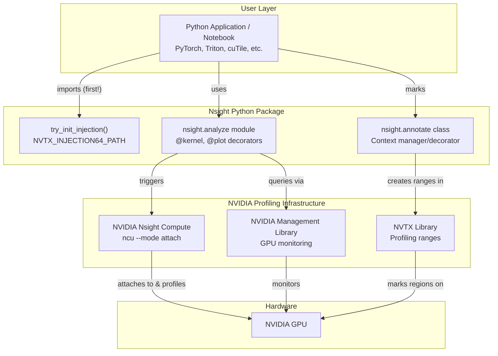

**Diagram: Nsight Python as an Orchestration Layer**

Nsight Python acts as a high-level manager for NVIDIA's low-level profiling tools. A critical change in v1.0.0 is the `try_init_injection()` call at import time, which sets up the environment for `ncu --mode attach`. This allows the profiler to hook into the existing process rather than restarting it.

**Key Distinction**: Nsight Python does **not** replace NVIDIA Nsight Compute—it automates and orchestrates it. It requires `ncu` (version 2026.2.1+ or CUDA Toolkit 13.3 Update 1+) to be available on the system path.

**Sources**: [DESCRIPTION.rst:8](), [docs/source/overview/introduction.rst:6](), [nsight/__init__.py:8-12](), [docs/source/installation/runtime_requirements.rst:7-19]()

## Core Components and Code Entities

```mermaid
graph TB
    subgraph "Public API: nsight package"
        AnalyzeModule["nsight.analyze<br/>module"]
        AnnotateModule["nsight.annotate<br/>class"]
        Injection["try_init_injection()<br/>Injection Setup"]
    end
    
    subgraph "Decorators and Contexts"
        KernelDecorator["@analyze.kernel<br/>Function decorator"]
        PlotDecorator["@analyze.plot<br/>Function decorator"]
        AnnotateContext["annotate(...)<br/>Context manager"]
    end
    
    subgraph "Collection Layer: nsight.collection"
        NCUCollector["collection.ncu.NCUCollector<br/>ncu --mode attach"]
        ProfilingHooks["begin_profiling() / end_profiling()"]
    end
    
    subgraph "Processing Layers"
        Extraction["nsight.extraction<br/>extract_df_from_report"]
        Transformation["nsight.transformation<br/>aggregate_data & Units"]
        Visualization["nsight.visualization<br/>matplotlib / row_panel / col_panel"]
    end
    
    subgraph "Utilities"
        Thermovision["nsight.thermovision<br/>ThermalController (NVML)"]
        Verbosity["VerbosityLevel<br/>SILENT/INFO/DEBUG"]
    end
    
    AnalyzeModule --> KernelDecorator
    AnalyzeModule --> PlotDecorator
    AnnotateModule --> AnnotateContext
    
    KernelDecorator --> NCUCollector
    NCUCollector --> ProfilingHooks
    ProfilingHooks --> Extraction
    Extraction --> Transformation
    Transformation --> Visualization
    
    KernelDecorator -.."thermal_device"..-> Thermovision
    KernelDecorator -.."verbosity"..-> Verbosity
```

**Diagram: Core Code Components and Their Relationships**

The architecture is built around a pipeline that starts with the `analyze.kernel` decorator. It configures the `NCUCollector`, which manages the `begin_profiling()` and `end_profiling()` lifecycle. Data flows from raw reports through extraction and transformation (where units and derived metrics are handled) into the visualization layer.

**Sources**: [nsight/__init__.py:6-16](), [docs/source/overview/introduction.rst:8-9](), [docs/source/release_notes/topics/updates-in-nsight-python-0.9.5.rst:19-31]()

## Primary API Entry Points

| API Component | Type | Purpose | Key Updates (v1.0.0) |
|---------------|------|---------|----------------------|
| `@nsight.analyze.kernel` | Function decorator | Profile a function across multiple configurations | Injection-based (no relaunch), `thermal_device`, `verbosity` |
| `@nsight.analyze.plot` | Function decorator | Generate visualizations from results | Support for `row_panel` and `col_panel` |
| `nsight.annotate` | Context manager/decorator | Mark code regions with NVTX ranges | Required for identifying kernels in the report |
| `nsight.analyze.ignore_failures` | Context manager | Suppress profiling errors | Requires `cuda-core` dependency |

The `@analyze.kernel` decorator now supports keyword-only parameters and default value padding for complex configuration spaces. It also introduces `VerbosityLevel` to control output detail.

For details, see [Key Features and Capabilities](#1.2).

**Sources**: [nsight/__init__.py:6-16](), [docs/source/overview/introduction.rst:26]()

## Three-Phase Processing Pipeline

Nsight Python processes profiling data through three distinct phases:

### Phase 1: Collection
- **Injection**: `try_init_injection()` is called at import to set `NVTX_INJECTION64_PATH`.
- **Execution**: The user function runs. `NCUCollector` triggers `ncu --mode attach`.
- **Annotation**: `nsight.annotate` creates NVTX ranges that the profiler uses to filter data.
- **Thermal Control**: `ThermalController` monitors a specific `thermal_device` via NVML to prevent throttling.

### Phase 2: Extraction and Transformation
- **Parsing**: `extract_df_from_report` parses `.ncu-rep` files.
- **Unit Handling**: Results now include a `Unit` column for all metrics.
- **Derivation**: `derive_metric` functions calculate complex values (like TFLOPs), returning `(value, unit)` tuples.
- **Normalization**: Results can be normalized against a "baseline" annotation.

### Phase 3: Visualization and Output
- **Plotting**: `nsight.visualization` uses matplotlib to create multi-panel figures.
- **DataFrames**: Results are returned as `ProfileResults` containing a structured pandas DataFrame.
- **Formats**: Supports CSV export for both raw and aggregated data.

For details, see [High-Level Architecture](#1.1).

**Sources**: [docs/source/overview/introduction.rst:8](), [nsight/__init__.py:12](), [docs/source/installation/runtime_requirements.rst:9-19]()

## Typical Workflow

1. **Import First**: `import nsight` must occur before any CUDA initialization (e.g., `import torch`).
2. **Annotate**: Wrap GPU kernel invocations with `nsight.annotate`.
3. **Decorate**: Apply `@nsight.analyze.kernel` with desired `configs` and `metrics`.
4. **Execute**: Run the script or cell. The profiler attaches and collects data in-process.
5. **Analyze**: Inspect the returned DataFrame or generated CSVs.

```python
import nsight # MUST BE FIRST
import torch

@nsight.analyze.kernel(
    configs=[(16,), (32,)], # Parameter sweep
    metric=["sm__throughput.avg.pct_of_peak_sustained_elapsed", "gpu__time.avg"],
    verbosity=nsight.VerbosityLevel.INFO
)
def train_step(block_size):
    with nsight.annotate("forward_pass"):
        # GPU operations here
        pass
```

For a complete walkthrough, see [Quick Start Tutorial](#3.1).

**Sources**: [docs/source/installation/runtime_requirements.rst:9-19](), [docs/source/overview/introduction.rst:8-9]()

## System Requirements

- **Python**: 3.10 or later (v1.0.0 update).
- **NVIDIA Nsight Compute**: Version 2026.2.1.0 (CUDA Toolkit 13.3 Update 1) or later.
- **CUDA**: `cuda-core` and `cuda-bindings` are now required dependencies.
- **Frameworks**: Compatible with PyTorch, Triton, and cuTile.

For complete details, see [Dependencies and Requirements](#2.3).

**Sources**: [README.md:26-46](), [docs/source/installation/runtime_requirements.rst:7-8]()

## License and Support

Nsight Python is licensed under the **Apache License 2.0**. Support is provided via the [Nsight Python Developer Forum](https://forums.developer.nvidia.com/c/developer-tools/nsight-python/749).

**Sources**: [README.md:60-62](), [docs/source/feedback.rst:7]()

---

# Page: High-Level Architecture

# High-Level Architecture

<details>
<summary>Relevant source files</summary>

The following files were used as context for generating this wiki page:

- [docs/source/overview/architecture.rst](docs/source/overview/architecture.rst)
- [nsight/analyze.py](nsight/analyze.py)
- [nsight/collection/core.py](nsight/collection/core.py)
- [nsight/visualization.py](nsight/visualization.py)

</details>


## Purpose and Scope

This document provides a high-level overview of nsight-python's system architecture, explaining how components relate to each other and how data flows through the system. As of version 1.0.0, the architecture has transitioned to an **injection-based attach model**, eliminating the need for script relaunches and enabling profiling in interactive environments like Jupyter and Google Colab.

- The three-phase pipeline (Collection, Extraction, Visualization)
- Core API surface and internal modules
- Integration points with NVIDIA profiling tools via the new attach mode
- Data flow from user code to analysis results

**Sources**: [docs/source/index.rst:1-72](), [docs/source/overview/architecture.rst:1-76]()

---

## System Overview: Orchestration Layer

nsight-python functions as a **Python-based orchestration layer** that bridges user code with NVIDIA's GPU profiling infrastructure. Instead of relaunching the script, it now uses `ncu --mode attach` to profile the current running process by injecting a profiling library at runtime.

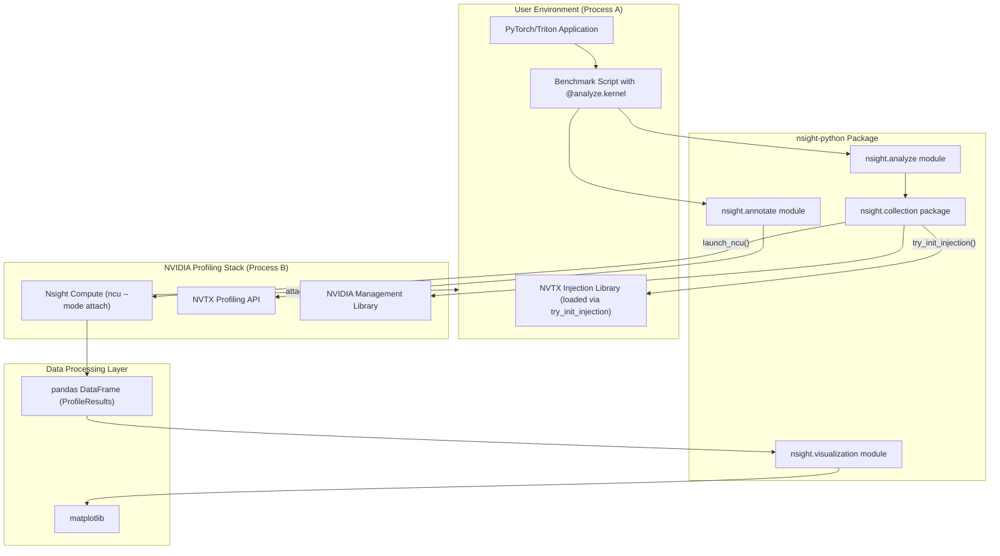

### Key Architectural Characteristics

| Characteristic | Description |
|----------------|-------------|
| **Injection Pattern** | Uses `ncu --mode attach` to profile the existing process without relaunching [nsight/collection/ncu.py:168-175](). |
| **Python-Native** | All APIs are Python-first; outputs are `ProfileResults` containing pandas DataFrames [nsight/collection/core.py:1928-1945](). |
| **Non-Invasive** | Uses decorators and context managers; supports Jupyter/Colab since v1.0.0. |
| **Interactive Support** | No script relaunch means global state and imported modules are preserved across profiling runs. |

**Sources**: [nsight/collection/ncu.py:155-210](), [nsight/collection/core.py:1920-1950]()

---

## Three-Phase Pipeline Architecture

nsight-python implements a classic **ETL (Extract-Transform-Load) pattern** for GPU profiling data. The system processes data through three distinct phases:

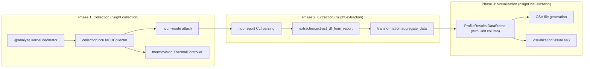

### Phase 1: Collection

The Collection phase orchestrates GPU kernel profiling using the new injection approach:

- **Injection Initialization**: Upon importing `nsight.collection.ncu`, the system calls `try_init_injection()` to load the Nsight Compute injection library into the current process [nsight/collection/ncu.py:155-165]().
- **NCU Attach**: Instead of running the script *under* ncu, `NCUCollector` calls `launch_ncu()` which starts `ncu --mode attach` as a background process targeting the current PID [nsight/collection/ncu.py:175-205]().
- **Profiling Triggers**: The `begin_profiling()` and `end_profiling()` functions signal to the attached `ncu` process when to start and stop data collection for specific NVTX ranges [nsight/collection/ncu.py:212-240]().
- **Thermal Management**: The `ThermalController` [nsight/thermovision.py:48-65]() monitors GPU temperature via NVML to prevent thermal throttling, now supporting a specific `thermal_device` [nsight/analyze.py:83]().

### Phase 2: Extraction

The Extraction phase parses and transforms raw profiling data:

- **Report Parsing**: Raw `.ncu-rep` files are parsed using the `ncu-report` CLI tool [nsight/extraction.py:10-50]().
- **Metric Association**: The `extraction` module associates collected metrics with user-defined annotations and configuration tuples, now including a dedicated `Unit` column [nsight/collection/core.py:1940-1945]().
- **Derived Metrics**: The `transformation` module computes derived metrics. In v1.0.0, `derive_metric` functions should return `(value, unit)` tuples to populate the results correctly [nsight/analyze.py:142-152]().

### Phase 3: Visualization

The Visualization phase structures and presents results:

- **DataFrame Construction**: Results are organized into a `ProfileResults` object [nsight/collection/core.py:1928-1950]().
- **Unit Tracking**: The new `Unit` column ensures that metrics like TFLOPS and Latency are clearly labeled in both DataFrames and plots [nsight/collection/core.py:1942]().
- **Plot Generation**: The `visualization.visualize()` function [nsight/visualization.py:22-42]() generates plots, supporting subplots via `row_panels` and `col_panels` [nsight/visualization.py:95-107]().

**Sources**: [nsight/collection/core.py:1920-1960](), [nsight/analyze.py:61-155](), [nsight/collection/ncu.py:150-250]()

---

## Core API Surface

nsight-python exposes a minimal, focused public API through `nsight.analyze` and `nsight.annotate`.

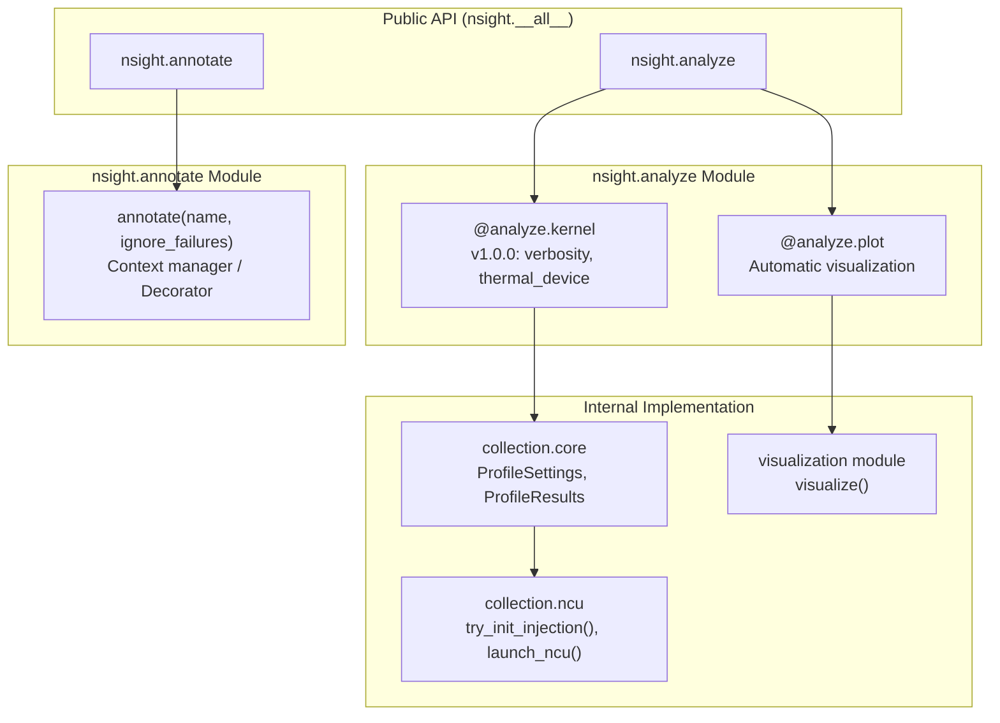

### API Module Responsibilities

| Module | Primary Class/Function | Responsibility |
|--------|------------------------|----------------|
| `nsight.analyze` | `@analyze.kernel()` | Orchestrates profiling workflow, manages config matrix, supports keyword-only params [nsight/analyze.py:61-90](). |
| `nsight.analyze` | `VerbosityLevel` | New enum for controlling output (SILENT, INFO, DEBUG) [nsight/utils.py:20](). |
| `nsight.annotate` | `annotate` class | Creates NVTX ranges; now thread-local and prevents nested annotations [nsight/annotation.py:15-40](). |

**Sources**: [nsight/analyze.py:22-90](), [nsight/annotation.py:1-60](), [nsight/utils.py:1-30]()

---

## Internal Component Structure

The internal architecture follows a **layered abstraction pattern** updated for the injection-based model.

### Core Abstractions (`collection.core`)

1. **`ProfileSettings`**: Encapsulates all profiling configuration. In v1.0.0, this includes `thermal_device` for multi-GPU systems and `verbosity` [nsight/collection/core.py:1750-1800]().
2. **`ProfileResults`**: Container for results. It now includes the `Unit` column by default to improve data clarity [nsight/collection/core.py:1942]().
3. **`NsightProfiler`**: Abstract base class defining the `profile()` interface [nsight/collection/core.py:1820-1840]().

### Concrete Implementation: `NCUCollector`

The `NCUCollector` class [nsight/collection/ncu.py:115-145]() is the concrete implementation that:
- Uses `try_init_injection()` to prepare the Python process for profiling [nsight/collection/ncu.py:155]().
- Manages the lifecycle of the `ncu --mode attach` background process [nsight/collection/ncu.py:175]().
- Calls `begin_profiling()` and `end_profiling()` around the targeted code regions [nsight/collection/ncu.py:212-240]().

**Sources**: [nsight/collection/core.py:1740-1950](), [nsight/collection/ncu.py:110-250]()

---

## Data Flow and Execution Model (v1.0.0+)

The execution model has shifted from a relaunch pattern to an **attach-and-run pattern**.

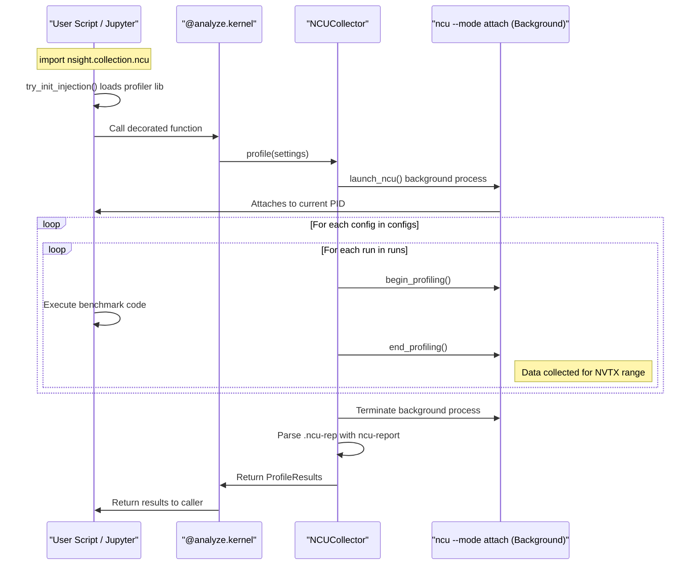

### Configuration Matrix Execution

The system handles configuration padding and binding automatically. If a config tuple is shorter than the function signature, nsight-python pads it with the function's default parameter values [nsight/collection/core.py:49-71]().

### Injection and Threading

- **Injection**: `try_init_injection()` must succeed for profiling to work. It checks for the presence of the Nsight Compute injection library [nsight/collection/ncu.py:155-165]().
- **Thread Locality**: NVTX ranges are thread-local. Kernels launched from threads other than the one calling the `@analyze.kernel` function will not be captured [nsight/annotation.py:35-45]().

**Sources**: [nsight/collection/ncu.py:155-240](), [nsight/collection/core.py:49-108](), [nsight/annotation.py:15-50]()

---

# Page: Key Features and Capabilities

# Key Features and Capabilities

<details>
<summary>Relevant source files</summary>

The following files were used as context for generating this wiki page:

- [DESCRIPTION.rst](DESCRIPTION.rst)
- [docs/source/_templates/version.html](docs/source/_templates/version.html)
- [docs/source/analyze.rst](docs/source/analyze.rst)
- [docs/source/annotation.rst](docs/source/annotation.rst)
- [docs/source/feedback.rst](docs/source/feedback.rst)
- [docs/source/overview/core_concepts.rst](docs/source/overview/core_concepts.rst)
- [docs/source/overview/introduction.rst](docs/source/overview/introduction.rst)
- [docs/source/overview/quickstart.rst](docs/source/overview/quickstart.rst)
- [docs/source/release_notes/topics/updates-in-nsight-python-0.9.5.rst](docs/source/release_notes/topics/updates-in-nsight-python-0.9.5.rst)

</details>


## Purpose and Scope

This page describes the main features and capabilities of Nsight Python v1.0.0, explaining what the system can do and how these capabilities are implemented in the codebase. Nsight Python is a Python kernel profiling interface that automates performance analysis across multiple kernel configurations using NVIDIA Nsight Tools [DESCRIPTION.rst:8-9]().

## Overview

Nsight Python provides core capabilities that enable automated, large-scale GPU kernel profiling from Python, now including support for Jupyter and Google Colab through a new injection-based attach mechanism [docs/source/overview/introduction.rst:6-10]().

| Capability | Primary Component | User-Facing API |
|-----------|-------------------|-----------------|
| Decorator-based profiling | `nsight.analyze` | `@analyze.kernel` |
| NVTX code annotation | `nsight.annotate` | `nsight.annotate(...)` context |
| Multi-configuration execution | `collection.core.ProfileSettings` | `configs` parameter |
| Hardware metric collection | `collection.ncu.NCUCollector` | `metric` parameter |
| Thermal throttling prevention | `thermovision` | `thermal_control` / `thermal_device` |
| Custom derived metrics | `extraction.compute_derived_metric` | `derive_metric` parameter |
| Baseline normalization | `transformation.normalize_results` | `normalize_against` parameter |
| Publication-quality plots | `visualization.visualize` | `@analyze.plot` |

**Sources:** [docs/source/overview/introduction.rst:20-30](), [docs/source/overview/core_concepts.rst:7-12]()

---

## Injection-Based Profiling (New in v1.0.0)

Starting with v1.0.0, Nsight Python uses an injection-based approach. Instead of re-launching the entire script under `ncu`, the profiler attaches to the currently running process using `ncu --mode attach`.

### Feature Diagram: Injection and Attach Flow

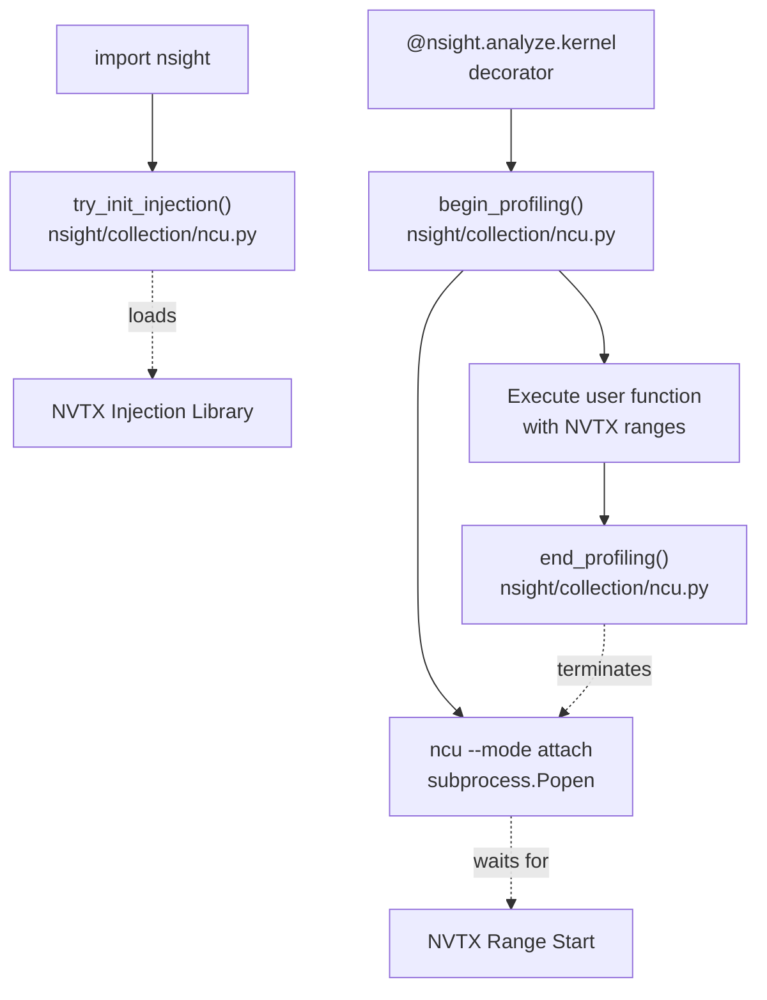

**Key Implementation Details:**
- **Jupyter/Colab Support:** Because it attaches to a running process, it works in interactive environments where script re-execution is not possible.
- **Library Loading:** `try_init_injection()` is called at import time to prepare the environment for Nsight Compute attachment.
- **Process Management:** The `NCUCollector` manages the `ncu` lifecycle using `subprocess.Popen` without restarting the Python interpreter.

**Sources:** [docs/source/overview/quickstart.rst:7-34](), [docs/source/overview/introduction.rst:8-10]()

---

## NVTX Annotation System

The `nsight.annotate` class provides dual-mode operation as both a decorator and context manager for marking GPU kernel regions with NVTX ranges [docs/source/overview/core_concepts.rst:26-39]().

### Feature Diagram: Annotation Mechanism

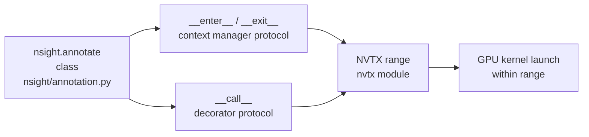

**Annotation Capabilities:**
- **Context Manager:** `with nsight.annotate("label"):` wraps specific code blocks [docs/source/overview/core_concepts.rst:21-22]().
- **Decorator:** `@nsight.annotate("label")` annotates entire functions [docs/source/overview/core_concepts.rst:32-33]().
- **Unit Tracking:** v1.0.0 introduces the `Unit` column in results, tracking the measurement units (e.g., `ns`, `cycle`) for every metric [docs/source/overview/quickstart.rst:32-34]().

**Sources:** [docs/source/overview/core_concepts.rst:26-45](), [docs/source/annotation.rst:1-13]()

---

## Multi-Configuration Benchmarking

The `configs` parameter enables systematic profiling across parameter spaces. It supports regular parameters, keyword-only parameters, and default value padding [docs/source/overview/core_concepts.rst:47-60]().

### Configuration Processing Flow

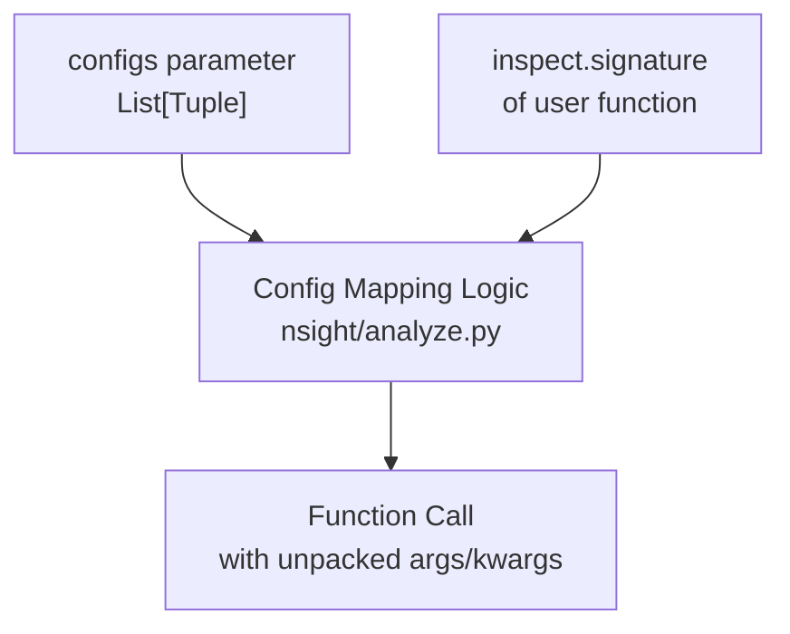

**Configuration Features:**
- **Keyword-Only Support:** Config values are automatically passed to keyword-only parameters (after `*` in signature) [docs/source/overview/core_concepts.rst:65-66]().
- **Default Values:** If a config tuple is shorter than the function signature, trailing parameters with defaults are filled automatically [docs/source/overview/core_concepts.rst:67-68]().
- **Scalar Configs:** Single-argument functions can accept scalar configs instead of tuples [docs/source/release_notes/topics/updates-in-nsight-python-0.9.5.rst:13-14]().

**Sources:** [docs/source/overview/core_concepts.rst:47-82](), [docs/source/release_notes/topics/updates-in-nsight-python-0.9.5.rst:13-14]()

---

## Thermal Throttling Prevention

The `thermovision` subsystem prevents GPU throttling by monitoring temperature via NVML and enforcing cooling periods [docs/source/overview/introduction.rst:27]().

**Thermal Control Features:**
- **Adaptive Monitoring:** Checks temperature before each run.
- **Thermal Device Pinning:** Use `thermal_device` (new in v1.0.0) to specify which CUDA device index to monitor.
- **Throttling Prevention:** Delays execution until the GPU temperature drops below a safe threshold derived from `get_gpu_tlimit()`.

**Sources:** [docs/source/overview/introduction.rst:27](), [docs/source/analyze.rst:14]() (via `thermal_device` parameter reference)

---

## Derived Metrics and Normalization

Nsight Python supports computing new metrics from raw counters and normalizing results against a baseline [docs/source/overview/introduction.rst:28-29]().

**Derived Metric Capabilities:**
- **Custom Functions:** `derive_metric` accepts a callable. In v1.0.0, it is recommended to return a `(value, unit)` tuple to populate the `Unit` column.
- **TFLOPs Example:** Commonly used to calculate throughput from cycle counts and instruction counts.

**Normalization Features:**
- **Baseline Selection:** `normalize_against` takes an annotation name.
- **Relative Performance:** Automatically calculates speedup relative to the baseline.

**Sources:** [docs/source/overview/introduction.rst:28-29](), [docs/source/release_notes/topics/updates-in-nsight-python-0.9.5.rst:20-21]()

---

## Publication-Quality Visualization

The `@analyze.plot` decorator automates visualization using matplotlib [docs/source/overview/core_concepts.rst:83-84]().

| Feature | Description |
|---------|-------------|
| **Multi-Panel Plots** | Automatically generates subplots for multiple metrics. |
| **Data Export** | Generates both PNG plots and structured CSV files. |
| **Unit Awareness** | Uses the new `Unit` column to label axes correctly (e.g., "Runtime (ns)"). |
| **Customization** | Supports `row_panels` and `col_panels` for complex grids. |

**Sources:** [docs/source/overview/core_concepts.rst:83-92](), [docs/source/analyze.rst:16]()

---

## Framework-Agnostic Design

Nsight Python works with any Python framework that launches CUDA kernels because it profiles at the driver/NVTX level [docs/source/overview/introduction.rst:23]().

- **PyTorch:** Fully supported [docs/source/overview/quickstart.rst:11-26]().
- **Triton:** Fully supported [docs/source/overview/introduction.rst:23]().
- **cuTile:** Support added in v1.0.0.

**Sources:** [docs/source/overview/introduction.rst:23](), [docs/source/overview/quickstart.rst:11-26]()

---

# Page: Installation

# Installation

<details>
<summary>Relevant source files</summary>

The following files were used as context for generating this wiki page:

- [README.md](README.md)
- [docs/source/index.rst](docs/source/index.rst)
- [docs/source/installation/runtime_requirements.rst](docs/source/installation/runtime_requirements.rst)
- [nsight/thermovision.py](nsight/thermovision.py)
- [pyproject.toml](pyproject.toml)

</details>


This page documents the installation methods for `nsight-python`, including PyPI installation, source installation, and dependency requirements. As of version 1.0.0, the installation process has been updated to reflect that `cuda-core` is now a required dependency rather than an optional one. For getting started with your first profiling workflow after installation, see [Getting Started](#3).

## Installation Overview

The `nsight-python` package is distributed via PyPI and can be installed using `pip`. The package requires Python ≥3.10 and has mandatory runtime dependencies. The `cu12` and `cu13` optional extras are now used to select specific versions of the required `cuda-core` dependency.

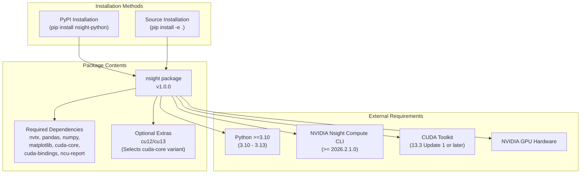

**Sources:** [pyproject.toml:8-42](), [README.md:10-20](), [docs/source/installation/runtime_requirements.rst:7-8]()

## Installing from PyPI

### Basic Installation

Install the latest stable version from PyPI:

```bash
pip install nsight-python
```

This installs the `nsight` package with all required dependencies listed in [pyproject.toml:18-27]():
- `nvtx`: NVTX Python bindings for annotating code regions.
- `pandas`: DataFrame operations for structured profiling results.
- `numpy`: Numerical operations for metric calculations.
- `matplotlib`: Plotting and visualization.
- `cuda-core`: (Required) Core CUDA functionality, including NVML for thermal monitoring in `nsight.thermovision.ThermalController`.
- `cuda-bindings`: (Required) Bindings for CUDA driver and runtime APIs.
- `ncu-report`: (Required) Parser for Nsight Compute report files.
- `deepdiff`: Used for internal configuration comparisons.

### Installation with Specific CUDA Support

While `cuda-core` is now required, you can specify the CUDA version variant using optional extras. This ensures compatibility with your installed CUDA Toolkit.

**For CUDA 12.x systems:**
```bash
pip install nsight-python[cu12]
```
This selects the `cuda-core[cu12]` variant as defined in [pyproject.toml:41]().

**For CUDA 13.x systems:**
```bash
pip install nsight-python[cu13]
```
This selects the `cuda-core[cu13]` variant as defined in [pyproject.toml:42]().

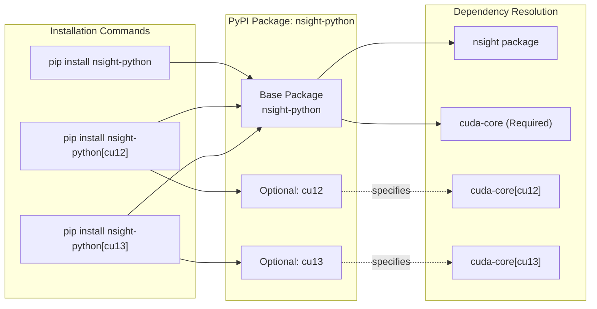

**Sources:** [pyproject.toml:18-42](), [nsight/thermovision.py:21-29]()

## Installing from Source

### Developer Installation

Clone the repository and install in editable mode for development:

```bash
git clone https://github.com/NVIDIA/nsight-python.git
cd nsight-python
pip install -e .
```

The `-e` flag creates an editable installation where changes to the source code in the `nsight/` directory are immediately reflected. For development, you may also want to install the `cu12` or `cu13` extras: `pip install -e .[cu12]`.

### Installation Without Dependencies

To manage dependencies manually (useful for containerized or highly controlled environments), use the `--no-deps` flag:

```bash
pip install -e . --no-deps
```

**Sources:** [README.md:14-23]()

## Dependencies and Requirements

### Python Version Requirements

The package requires Python ≥3.10 as specified in [pyproject.toml:13](). Supported versions include 3.10, 3.11, 3.12, and 3.13 [pyproject.toml:34-37]().

### Mandatory Runtime Dependencies

| Package | Minimum Version | Purpose |
| :--- | :--- | :--- |
| `cuda-core` | `1.0.1` | **Required.** NVML monitoring and CUDA system interaction [nsight/thermovision.py:21-22](). |
| `cuda-bindings` | `12.9.6` | **Required.** Bindings for CUDA driver/runtime. |
| `ncu-report` | `2026.2.0` | **Required.** Parsing Nsight Compute report files. |
| `nvtx` | - | Instrumentation of code regions [nsight/thermovision.py:18-19](). |
| `pandas` | - | Data analysis and DataFrame output. |
| `numpy` | - | Numerical computations. |
| `matplotlib` | - | Visualization and plotting. |

**Sources:** [pyproject.toml:18-27]()

### External Requirements

| Requirement | Version | Details |
| :--- | :--- | :--- |
| **NVIDIA Nsight Compute** | `2026.2.1.0+` | Must be in `PATH`. Provides the `ncu` CLI tool used for collection [docs/source/installation/runtime_requirements.rst:7-8](). |
| **CUDA Toolkit** | `13.3 Update 1+` | Required for the latest profiling features and `ncu` compatibility. |
| **NVIDIA GPU** | Pascal+ | Compute Capability 6.0 or higher is required for Nsight Compute. |

### Important: Import Ordering

`import nsight` must occur **before** CUDA initialization (e.g., `torch.cuda.init()`) or any NVTX API calls. This allows the tool to correctly set `NVTX_INJECTION64_PATH` and prepare for the injection-based attach mode.

**Sources:** [docs/source/installation/runtime_requirements.rst:9-19]()

## Build System

The package uses `hatchling` as its build backend [pyproject.toml:4-6](). Development environments are managed via `hatch`, including specific test environments for different CUDA versions.

| Environment | Command | Purpose |
| :--- | :--- | :--- |
| `docs` | `hatch run docs:build` | Build Sphinx documentation [pyproject.toml:79-82](). |
| `lint` | `hatch run lint:check` | Run Black, Isort, and Mypy [pyproject.toml:91-96](). |
| `test_cu12` | `hatch run test_cu12:run` | Run tests with CUDA 12 dependencies [pyproject.toml:114-116](). |
| `test_cu13` | `hatch run test_cu13:run` | Run tests with CUDA 13 dependencies [pyproject.toml:118-120](). |

**Sources:** [pyproject.toml:4-6, 70-121]()

## Verification

Verify the installation by checking the version and ensuring the `cuda.core` (provided by `cuda-core`) is available:

```python
import nsight
from cuda import core
print(f"Nsight Python version: {nsight.__version__}")
print(f"CUDA Core available: {nsight.thermovision.CUDA_CORE_AVAILABLE}")
```

**Sources:** [nsight/thermovision.py:20-26](), [pyproject.toml:10]()

---

# Page: Installing from PyPI

# Installing from PyPI

<details>
<summary>Relevant source files</summary>

The following files were used as context for generating this wiki page:

- [docs/source/installation/installation_from_pypi.rst](docs/source/installation/installation_from_pypi.rst)
- [nsight/thermovision.py](nsight/thermovision.py)
- [pyproject.toml](pyproject.toml)

</details>


## Purpose and Scope

This page documents how to install `nsight-python` from the Python Package Index (PyPI). As of version 1.0.0, the installation process has been updated to include `cuda-core` as a required dependency to support enhanced thermal management and error handling. This page covers the basic installation command, the use of CUDA-version-specific extras, and the package structure. For source-based installation, see [Installing from Source](#2.2). For detailed runtime requirements, see [Dependencies and Requirements](#2.3).

## Basic Installation

The `nsight-python` package is distributed via PyPI. The basic installation command installs the core package along with all mandatory dependencies, including the base `cuda-core` package.

```bash
pip install nsight-python
```

In version 1.0.0, `cuda-core` is no longer optional [pyproject.toml:25](). This change ensures that features like `nsight.thermovision` can reliably monitor GPU temperatures and T.limit using NVML [nsight/thermovision.py:11-17]().

**Sources:** [pyproject.toml:9-27](), [docs/source/installation/installation_from_pypi.rst:9-18]()

## Package Structure and Dependencies

The installation provides the `nsight` package and its required runtime ecosystem. The build process uses `hatchling` and `hatch-vcs` for dynamic versioning [pyproject.toml:4-10]().

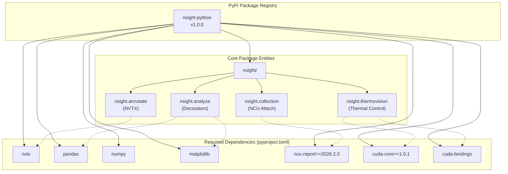

**Diagram: Package Installation Structure**

The mandatory dependencies in `v1.0.0` serve the following roles:

| Dependency | Purpose | Implementation Reference |
|------------|---------|-------------------------|
| `nvtx` | Instrumentation for profiling ranges | `nsight.annotate` |
| `pandas` | Results representation and CSV export | `nsight.analyze` |
| `numpy` | Array operations for metrics | `nsight.extraction` |
| `matplotlib` | Generation of performance plots | `nsight.visualization` |
| `ncu-report` | Parsing of `.ncu-rep` files | `nsight.collection.ncu` |
| `cuda-core` | NVML access for thermal monitoring | `nsight.thermovision` |
| `cuda-bindings` | Python bindings for CUDA/NVML | `nsight.thermovision` |
| `deepdiff` | Configuration comparison | Internal utilities |

**Sources:** [pyproject.toml:18-27](), [nsight/thermovision.py:20-26]()

## CUDA Version Specific Extras

While `cuda-core` is required, users should use "extras" to install the variant of `cuda-core` that matches their installed CUDA Toolkit version. This ensures binary compatibility for thermal monitoring and error handling.

### CUDA Toolkit 12 Support
To install with CUDA 12 optimized core components:
```bash
pip install nsight-python[cu12]
```
This selects the `cuda-core[cu12]` variant [pyproject.toml:41]().

### CUDA Toolkit 13 Support
To install with CUDA 13 optimized core components:
```bash
pip install nsight-python[cu13]
```
This selects the `cuda-core[cu13]` variant [pyproject.toml:42]().

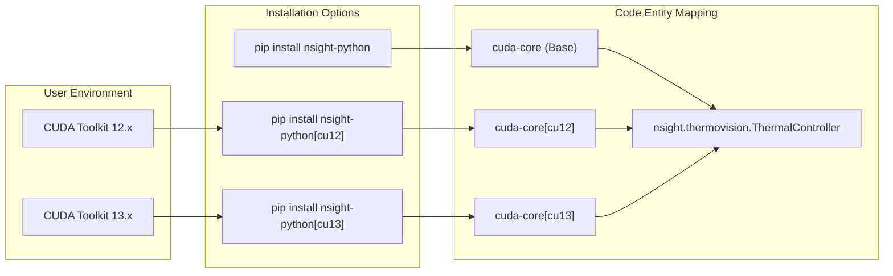

**Diagram: Mapping CUDA Environments to Installation Extras**

**Sources:** [pyproject.toml:40-42](), [nsight/thermovision.py:111-129]()

## Python Version Requirements

`nsight-python` requires Python 3.10 or later [pyproject.toml:13](). Supported versions include:
*   Python 3.10
*   Python 3.11
*   Python 3.12
*   Python 3.13

**Sources:** [pyproject.toml:34-37]()

## Build System and Metadata

The package utilizes `hatchling` with the `vcs` versioning source, meaning the version is derived from Git tags during the build process [pyproject.toml:60-61](). The wheel target is configured to only include the `nsight` source directory [pyproject.toml:48-49]().

| Metadata Field | Value |
|----------------|-------|
| Name | `nsight-python` |
| License | Apache-2.0 |
| Repository | `https://github.com/NVIDIA/nsight-python` |
| Build Backend | `hatchling.build` |

**Sources:** [pyproject.toml:4-14](), [pyproject.toml:44-46]()

## Installation Verification

To verify the installation and the availability of the now-required `cuda-core` components:

```python
import nsight
from nsight.thermovision import ThermalController

# Check version (dynamic from VCS)
print(f"Version: {nsight.__version__}")

# Verify ThermalController can initialize (requires cuda-core)
tc = ThermalController(thermal_mode="off")
if tc.init():
    print("cuda-core initialized successfully for thermal monitoring.")
else:
    print("Thermal monitoring limited (check cuda-core installation).")
```

**Sources:** [nsight/thermovision.py:44-59](), [nsight/thermovision.py:111-120]()

## Next Steps

- **Dependencies:** Review the full list of system requirements in [Dependencies and Requirements](#2.3).
- **First Profile:** Follow the [Quick Start Tutorial](#3.1) to run your first profile using the new injection-based attach mode.
- **Thermal Setup:** Learn how to use the required thermal features in [Thermal Management](#6.1).

---

# Page: Installing from Source

# Installing from Source

<details>
<summary>Relevant source files</summary>

The following files were used as context for generating this wiki page:

- [docs/source/installation/installation_from_source.rst](docs/source/installation/installation_from_source.rst)
- [nsight/thermovision.py](nsight/thermovision.py)
- [pyproject.toml](pyproject.toml)

</details>


This document describes how to install `nsight-python` from source code by cloning the GitHub repository. This installation method is primarily intended for developers who want to modify the package, contribute changes, or test unreleased features. For standard usage, see [Installing from PyPI](2.1).

## Purpose and Scope

Installing from source enables:
- **Development workflow**: Make code changes and test them immediately without reinstalling.
- **Contribution preparation**: Set up the codebase for submitting pull requests.
- **Pre-release access**: Use features not yet available on PyPI.
- **Dependency control**: Manage required components like `cuda-core` and `cuda-bindings` manually if needed.

For information about runtime dependencies and system requirements, see [Dependencies and Requirements](2.3).

---

## Prerequisites

Before installing from source, ensure you have:

| Requirement | Description |
|-------------|-------------|
| **Git** | Version control system for cloning the repository. |
| **Python** | Python 3.10 or higher [pyproject.toml:13-13](). |
| **pip** | Python package installer (usually bundled with Python). |
| **Hatch** | (Optional) Recommended build tool for managing environments [pyproject.toml:4-6](). |

**Sources**: [pyproject.toml:13-13](), [docs/source/installation/installation_from_source.rst:1-12]()

---

## Installation Steps

### Step 1: Clone the Repository

Clone the `nsight-python` repository from GitHub:

```bash
git clone https://github.com/NVIDIA/nsight-python.git
cd nsight-python
```

This creates a local copy of the entire source tree, including:
- Package source code (`nsight/` directory).
- Tests (`tests/` directory).
- Examples (`examples/` directory).
- Documentation source (`docs/` directory).
- Build configuration (`pyproject.toml`).

### Step 2: Install in Editable Mode

Install the package using pip's editable mode. As of v1.0.0, `cuda-core` is a mandatory dependency [pyproject.toml:25-25](). You should specify your CUDA version using extras to ensure the correct `cuda-core` variant is pulled:

```bash
# For CUDA 12.x
pip install -e ".[cu12]"

# For CUDA 13.x
pip install -e ".[cu13]"
```

The `-e` flag (editable mode) creates a symbolic link between your Python environment and the source directory, allowing code changes to take effect immediately without reinstallation.

**Sources**: [pyproject.toml:25-27](), [pyproject.toml:40-42](), [docs/source/installation/installation_from_source.rst:7-11]()

---

## Installation Workflow Diagram

The following diagram illustrates how the `pip install -e .` command interacts with the project configuration to set up the development environment.

**Source to Code Entity Mapping: Installation Process**

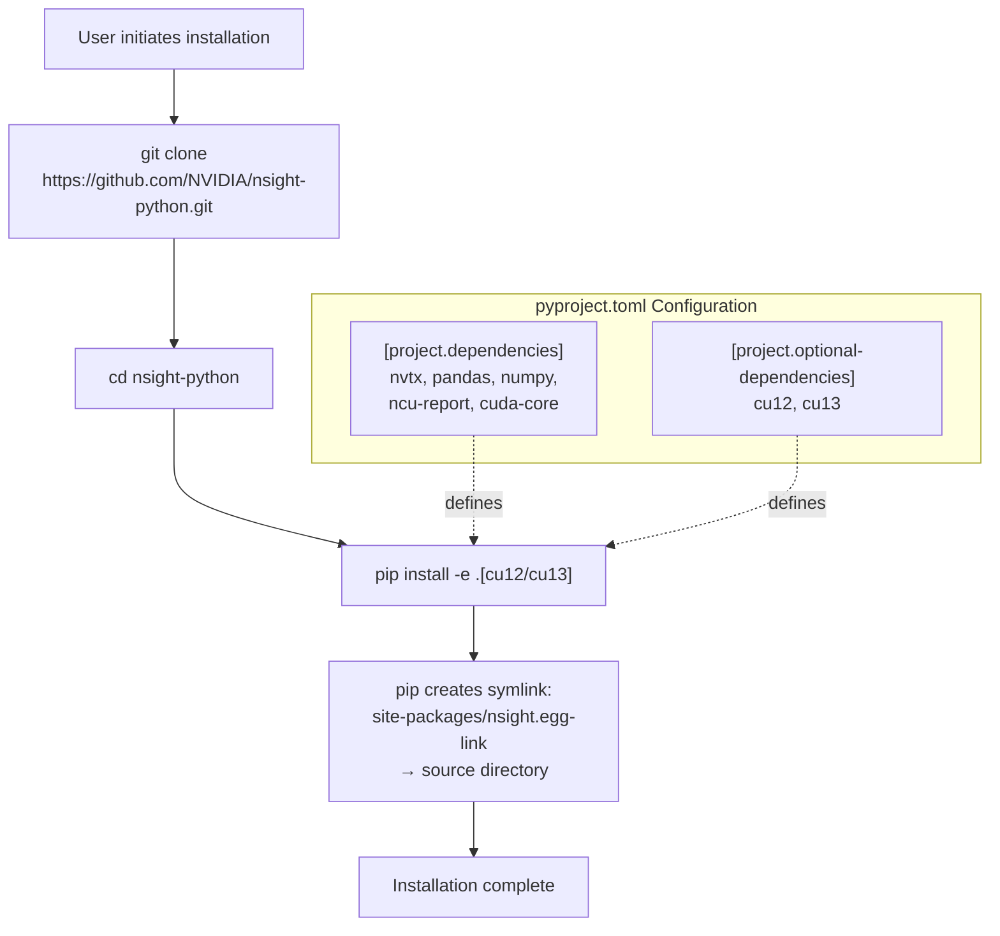

**Sources**: [pyproject.toml:18-27](), [pyproject.toml:40-42](), [docs/source/installation/installation_from_source.rst:7-11]()

---

## Understanding Editable Installation

Editable installation (also called "development mode") differs from standard installation:

| Installation Type | Behavior | Use Case |
|-------------------|----------|----------|
| **Standard** (`pip install .`) | Copies package files to `site-packages` | Production use |
| **Editable** (`pip install -e .`) | Creates symlink to source directory | Development |

### Code Structure Mapping

When you modify files in the source directory, changes are immediately reflected when you `import nsight` because Python follows the symlink to the source code.

**Source to Code Entity Mapping: Package Entry Points**

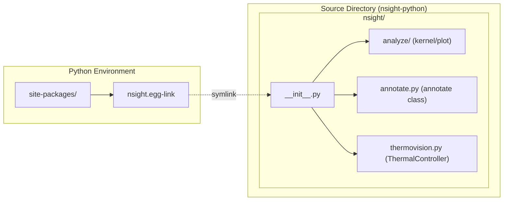

**Sources**: [pyproject.toml:48-49](), [nsight/thermovision.py:44-51]()

---

## Managing Dependencies

### Automatic Dependency Installation

By default, `pip install -e .` installs all runtime dependencies specified in `pyproject.toml` [pyproject.toml:18-27]():
- `nvtx`: For code instrumentation.
- `pandas`: For result processing and DataFrames.
- `numpy`: For numerical operations.
- `matplotlib`: For visualization.
- `ncu-report`: For parsing Nsight Compute results.
- `cuda-core` & `cuda-bindings`: For low-level CUDA and NVML interaction.

### Using Hatch for Development

The project uses `hatch` as its build backend [pyproject.toml:4-6](). For development tasks, you can use the predefined environments:

```bash
# Run linting
hatch run lint:check

# Run tests in a specific CUDA environment
hatch run test_cu12:run
```

**Sources**: [pyproject.toml:91-120]()

---

## Verification

After installation, verify the package is correctly installed:

```bash
python -c "import nsight; print(nsight.__version__)"
```

### Testing the Installation

To further verify functionality, run the test suite using `pytest`. The tests cover core components like the profiler, data transformation, and thermal control:

```bash
# Run tests (requires NVIDIA Nsight Compute in PATH)
pytest tests -v
```

Tests include [tests/test_profiler.py](), [tests/test_thermovision.py](), and [tests/test_api_params.py]().

**Sources**: [pyproject.toml:103-112](), [nsight/thermovision.py:1-17]()

---

## Post-Installation File Structure

After cloning and installing, your directory structure will be:

```
nsight-python/
├── nsight/                    # Package source (linked to site-packages)
│   ├── __init__.py           # Package entry point
│   ├── analyze/              # kernel and plot decorators
│   ├── annotate.py           # annotate context manager
│   ├── collection/           # NCUCollector and NsightProfiler
│   ├── visualization/        # Plotting subsystem
│   └── thermovision.py       # ThermalController (NVML/GPU monitoring)
├── tests/                     # Test suite (test_profiler.py, etc.)
├── examples/                  # Usage examples (00_minimal.py, etc.)
├── docs/                      # Documentation source (Sphinx/Furo)
├── pyproject.toml            # Build configuration and dependencies
└── LICENSE                   # Apache 2.0 License
```

**Sources**: [pyproject.toml:48-49](), [nsight/thermovision.py:11-17]()

---

## Next Steps

After installing from source:

1. **Verify dependencies**: Ensure `cuda-core` and `cuda-bindings` are correctly installed for your environment [pyproject.toml:25-27]().
2. **Explore examples**: Review usage patterns in the `examples/` directory.
3. **Run tests**: Validate your installation by running `pytest tests`.
4. **Read contributing guidelines**: See [Contributing Guidelines](10.3) for coding standards (Black/Isort) and DCO requirements.

**Sources**: [pyproject.toml:51-56](), [pyproject.toml:84-101]()

---

# Page: Dependencies and Requirements

# Dependencies and Requirements

<details>
<summary>Relevant source files</summary>

The following files were used as context for generating this wiki page:

- [README.md](README.md)
- [docs/source/index.rst](docs/source/index.rst)
- [docs/source/installation/runtime_requirements.rst](docs/source/installation/runtime_requirements.rst)
- [nsight/thermovision.py](nsight/thermovision.py)
- [pyproject.toml](pyproject.toml)

</details>


This page documents all dependencies and system requirements needed to use nsight-python. It covers Python version requirements, core runtime dependencies, mandatory CUDA integration packages, external tool requirements, and development dependencies for testing and contributing.

As of version 1.0.0, nsight-python has transitioned to an **injection-based attach mode**, which introduces new mandatory dependencies like `cuda-core` and requires specific versions of NVIDIA Nsight Compute to support the `--mode attach` workflow.

---

## Python Version Requirements

nsight-python requires **Python 3.10 or later**. The package is tested and supported on the following Python versions:

| Python Version | Support Status |
|----------------|----------------|
| 3.10           | ✓ Supported    |
| 3.11           | ✓ Supported    |
| 3.12           | ✓ Supported    |
| 3.13           | ✓ Supported    |

The Python version requirement is specified in [pyproject.toml:13]() with `requires-python = ">=3.10"`.

**Sources:** [pyproject.toml:13](), [pyproject.toml:33-37]()

---

## Core Runtime Dependencies

nsight-python has several core runtime dependencies that are automatically installed. Note that in v1.0.0, `cuda-core` and `cuda-bindings` are now **required** dependencies, not optional extras.

### Dependency Overview

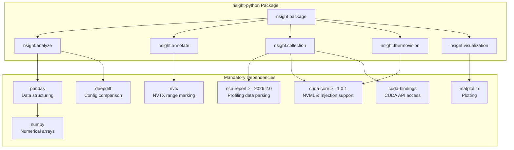

### Individual Dependencies

#### cuda-core (Required)
- **Purpose**: Provides NVIDIA Management Library (NVML) access and the NVTX injection library required for the "attach" profiling mode.
- **Used by**: `nsight.thermovision` ([nsight/thermovision.py:21-25]()) and `nsight.collection.ncu`.
- **Functionality**: Replaces the previous `nvidia-ml-py` dependency. It is used for GPU temperature monitoring and to load the injection library that allows `ncu` to attach to a running Python process without a script relaunch.

#### cuda-bindings (Required)
- **Purpose**: Provides Pythonic bindings to the CUDA Driver and Runtime APIs.
- **Used by**: `nsight.collection` and `nsight.annotate`.
- **Functionality**: Essential for managing CUDA contexts and handling error suppression when using the `ignore_failures` parameter.

#### ncu-report
- **Purpose**: Parses NVIDIA Nsight Compute profiling reports (`.ncu-rep` files).
- **Used by**: `nsight.collection` and data extraction logic.
- **Requirement**: Must be version **2026.2.0** or later to support the latest report formats.

#### nvtx
- **Purpose**: Creates NVTX (NVIDIA Tools Extension) profiling ranges.
- **Used by**: `nsight.annotate` class.
- **Functionality**: Marks code regions that `ncu` should profile. nsight-python updates `NVTX_INJECTION64_PATH` at import time to enable its custom injection logic.

#### pandas, numpy, & matplotlib
- **Purpose**: Data processing and visualization.
- **Functionality**: `pandas` structures results into DataFrames (including the new `Unit` column); `matplotlib` generates the plots for the `@plot` decorator.

**Sources:** [pyproject.toml:18-27](), [nsight/thermovision.py:21-26](), [docs/source/installation/runtime_requirements.rst:18-19]()

---

## Optional Dependency Extras

While `cuda-core` is required, you can specify the CUDA major version via extras to ensure the correct variant is installed for your environment.

| Extra | Package Variant | Use Case |
|-------|-----------------|----------|
| `cu12` | `cuda-core[cu12]` | Systems running CUDA 12.x |
| `cu13` | `cuda-core[cu13]` | Systems running CUDA 13.x |

Install with an extra:
```bash
pip install nsight-python[cu12]
```

**Sources:** [pyproject.toml:40-42]()

---

## External System Requirements

The most critical requirement for nsight-python v1.0.0+ is a modern version of the Nsight Compute CLI.

### NVIDIA Nsight Compute

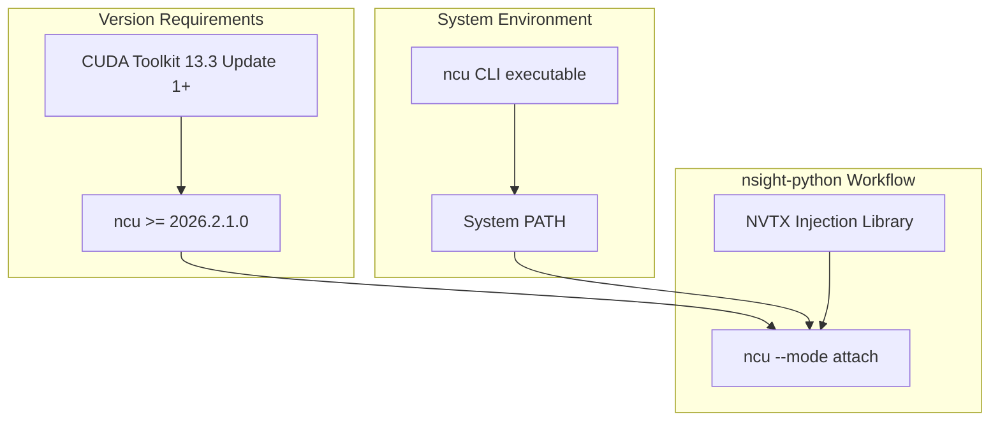

#### Requirements
- **Nsight Compute Version**: **2026.2.1.0** or later. This is typically bundled with **CUDA Toolkit 13.3 Update 1**.
- **Path**: The `ncu` executable must be in your system `PATH`.
- **Capability**: Must support `--mode attach`. This allows nsight-python to profile a running process (including Jupyter/Colab notebooks) without needing to relaunch the entire script.

#### Import Ordering Requirement
Due to the way Nsight Compute attaches via injection, `import nsight` **must** occur before:
1. **CUDA Initialization**: Any call like `torch.cuda.init()` or creating CUDA tensors.
2. **NVTX API calls**: Any other library using NVTX.

Failure to import `nsight` first will result in `NV_INJ_ERROR_NOT_INITIALIZED` or missing profiling ranges.

**Sources:** [docs/source/installation/runtime_requirements.rst:7-19]()

---

## Development and Testing Dependencies

### Testing Environment
Tests require `pytest` and a functional GPU environment with PyTorch.

```bash
pip install pytest pytest-cov
# Install PyTorch matching your CUDA version
pip install torch --index-url https://download.pytorch.org/whl/cu130 
```

### Hatch Environments
The project uses `hatch` to manage development tasks:

- **lint**: Includes `black`, `isort`, and `mypy` for code quality.
- **test_cu12 / test_cu13**: Specific environments to test against different CUDA core versions.
- **docs**: Uses `sphinx`, `furo`, and `nvidia-sphinx-theme` to build the documentation.

**Sources:** [pyproject.toml:69-120](), [README.md:28-54]()

---

## Dependency Installation Summary

| Component | Requirement |
|-----------|-------------|
| **Python** | 3.10, 3.11, 3.12, or 3.13 |
| **Nsight Compute** | >= 2026.2.1.0 (CUDA 13.3U1+) |
| **cuda-core** | >= 1.0.1 (Required) |
| **ncu-report** | >= 2026.2.0 |
| **GPU Framework** | PyTorch (recommended for most use cases) |

**Sources:** [pyproject.toml:13-27](), [docs/source/installation/runtime_requirements.rst:7-8]()

---

# Page: Getting Started

# Getting Started

<details>
<summary>Relevant source files</summary>

The following files were used as context for generating this wiki page:

- [docs/source/analyze.rst](docs/source/analyze.rst)
- [docs/source/annotation.rst](docs/source/annotation.rst)
- [docs/source/overview/core_concepts.rst](docs/source/overview/core_concepts.rst)
- [docs/source/overview/quickstart.rst](docs/source/overview/quickstart.rst)

</details>


This page provides an introduction to using Nsight Python for GPU kernel profiling. It covers the minimal setup required to profile your first kernel and introduces the core concepts you'll need to understand. **Note: As of v1.0.0, Nsight Python uses an injection-based approach that attaches to the running process, eliminating the need for script relaunches and supporting Jupyter/Colab environments.**

## Purpose and Scope

This Getting Started guide is designed to help new users quickly begin profiling GPU kernels with Nsight Python. You will learn:

- How to apply the `@nsight.analyze.kernel` decorator to profile functions.
- How to mark specific code regions using `nsight.annotate` context managers.
- The fundamental primitives: Annotations, Configurations, and Plots.
- The basic execution flow from decoration to results collection using the new injection mode.

By the end of this guide, you should be able to profile a simple GPU kernel and understand the fundamental workflow.

**Sources**: [docs/source/overview/quickstart.rst:1-37](), [docs/source/overview/core_concepts.rst:1-12]()

---

## Minimal Example

The simplest way to profile a GPU kernel is to add two elements to your code: the `@nsight.analyze.kernel` decorator on your benchmark function and a `nsight.annotate()` context manager around the kernel you want to profile. Both are required for successful collection [docs/source/overview/core_concepts.rst:7-12]().

```python
import torch
import nsight

@nsight.analyze.kernel
def benchmark_matmul(n):
    """
    The simplest possible benchmark.
    We create two matrices and multiply them.
    """
    # Create two NxN matrices on GPU
    a = torch.randn(n, n, device="cuda")
    b = torch.randn(n, n, device="cuda")

    # Mark the kernel we want to profile
    with nsight.annotate("matmul"):
        c = a @ b

if __name__ == "__main__":
    # Run the benchmark
    result = benchmark_matmul(1024)
    print(result.to_dataframe())
```

When you run this script, Nsight Python will:
1. Initialize the injection library to allow `ncu --mode attach` to hook into the process.
2. Execute the function; when it reaches the `nsight.annotate` block, it signals the profiler.
3. Collect GPU performance metrics for the annotated region.
4. Return a `ProfileResults` object which can be converted to a pandas DataFrame.

**Sources**: [docs/source/overview/quickstart.rst:1-37](), [docs/source/overview/core_concepts.rst:7-12]()

---

## Key Components and Their Roles

The following diagram shows the primary code entities and how they bridge natural language concepts to the codebase:

**Component Interaction Diagram**

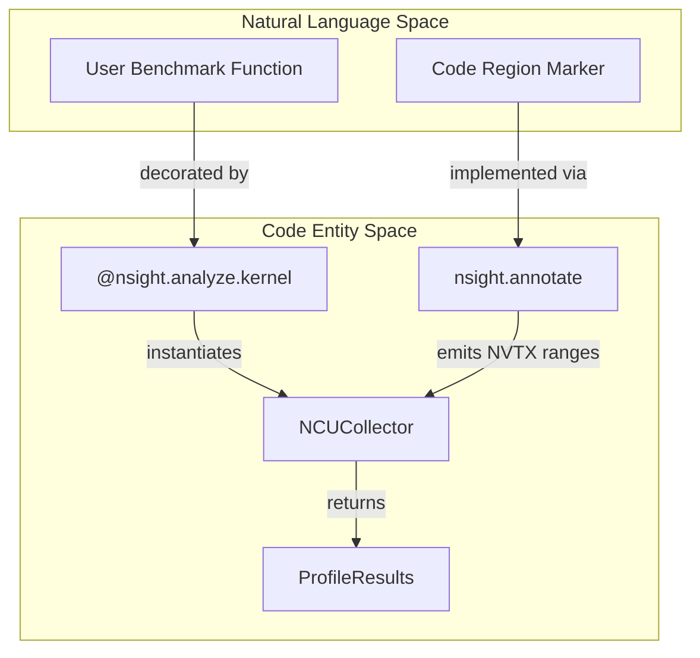

| Component | Code Entity | Purpose |
|-----------|--------|---------|
| **Kernel Analysis** | `@nsight.analyze.kernel` | Decorator that controls the profiling session and manages iterations [docs/source/overview/core_concepts.rst:47-52](). |
| **Annotation** | `nsight.annotate` | Context manager/decorator that tags GPU kernels for the profiler [docs/source/overview/core_concepts.rst:26-28](). |
| **Collector** | `NCUCollector` | Internal class that manages the `ncu` attach process and data collection. |
| **Results** | `ProfileResults` | Object containing metrics, convertible to a pandas DataFrame [docs/source/analyze.rst:11-12](). |

**Sources**: [docs/source/overview/core_concepts.rst:1-92](), [docs/source/analyze.rst:1-19](), [docs/source/annotation.rst:1-13]()

---

## Profiling Workflow

Nsight Python v1.0.0 uses an injection-based approach. The workflow is streamlined to support interactive environments like Jupyter.

**Profiling Execution Flow**

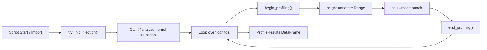

### Execution Steps

1. **Injection Initialization**: At import or session start, the system attempts to load the NVTX injection library.
2. **Configuration Iteration**: The decorator loops through provided `configs`. Config values map to function parameters in declaration order [docs/source/overview/core_concepts.rst:61-62]().
3. **Attach Signal**: `begin_profiling()` is called to allow the Nsight Compute profiler to attach to the current process.
4. **NVTX Annotation**: The `nsight.annotate()` block executes, emitting a named NVTX range that `ncu` filters for.
5. **Metric Collection**: Metrics are collected only for kernels within that specific range.
6. **Results Transformation**: Data is parsed and returned as a `ProfileResults` object, which includes a `Unit` column for metric clarity.

**Sources**: [docs/source/overview/core_concepts.rst:47-82](), [docs/source/analyze.rst:7-12]()

---

## Core Concepts at a Glance

For a deeper dive into these topics, see [Core Concepts](#3.2).

| Concept | Description | Code Implementation |
|---------|-------------|-------------|
| **Annotation** | A named marker for a code region. Can wrap single or multiple kernels [docs/source/overview/core_concepts.rst:26-45](). | `nsight.annotate("name")` |
| **Configuration** | A tuple of parameters. Supports positional, keyword-only, and default values [docs/source/overview/core_concepts.rst:61-71](). | `configs=[(1024, "fast")]` |
| **Metric** | Hardware counters or derived values (e.g., TFLOPs). | `metric` arg in `@analyze.kernel` |
| **Plotting** | Automated visualization of collected results [docs/source/overview/core_concepts.rst:83-92](). | `@nsight.analyze.plot` |
| **Attach Mode** | The v1.0.0 mechanism where `ncu` attaches to a running process via injection. | Internal `ncu --mode attach` |

---

## What's Next

- **Quick Start Tutorial**: [Quick Start Tutorial](#3.1) of a profiling session.
- **Core Concepts**: Detailed explanation of [Core Concepts](#3.2).
- **Basic Profiling Workflow**: Deep dive into the [Basic Profiling Workflow](#3.3).
- **User Guide**: Comprehensive documentation on [User Guide](#4).

**Sources**: [docs/source/overview/core_concepts.rst:1-92](), [docs/source/overview/quickstart.rst:1-37]()

---

# Page: Quick Start Tutorial

# Quick Start Tutorial

<details>
<summary>Relevant source files</summary>

The following files were used as context for generating this wiki page:

- [docs/source/analyze.rst](docs/source/analyze.rst)
- [docs/source/annotation.rst](docs/source/annotation.rst)
- [docs/source/overview/quickstart.rst](docs/source/overview/quickstart.rst)
- [examples/00_minimal.py](examples/00_minimal.py)
- [examples/07_triton_minimal.py](examples/07_triton_minimal.py)

</details>


This tutorial walks through a minimal working example to help you start profiling GPU kernels with `nsight-python`. As of **v1.0.0**, the profiling mechanism has shifted to an **injection-based attach mode**. This means the profiler attaches to the currently running process without requiring a script relaunch, enabling seamless profiling in environments like Jupyter Notebooks and Google Colab.

You will learn how to apply the `@nsight.analyze.kernel` decorator, mark code regions with `nsight.annotate()`, and interpret the profiling results.

**Sources:** [docs/source/overview/quickstart.rst:1-37](), [examples/00_minimal.py:1-47]()

---

## Prerequisites

Before starting this tutorial, ensure you have:

- **NVIDIA GPU** with CUDA support.
- **NVIDIA Nsight Compute** installed (>= 2026.2.1.0 / CUDA Toolkit 13.3 Update 1) and `ncu` available in your `PATH`.
- **nsight-python** installed via pip: `pip install nsight-python`. Note that `cuda-core` is now a required dependency.
- **PyTorch**, **Triton**, or another GPU framework installed.

**Sources:** [docs/source/overview/quickstart.rst:1-10]()

---

## Minimal Working Example

Here is the complete minimal example that demonstrates the core profiling workflow. This script can be run directly or within an interactive cell.

```python
import torch
import nsight

@nsight.analyze.kernel
def benchmark_matmul(n: int) -> torch.Tensor:
    """Profile a simple matrix multiplication."""
    # Create two NxN matrices on GPU
    a = torch.randn(n, n, device="cuda")
    b = torch.randn(n, n, device="cuda")
    
    # Mark the kernel we want to profile
    with nsight.annotate("matmul"):
        c = a @ b
    
    return c

if __name__ == "__main__":
    # Run the benchmark
    result = benchmark_matmul(1024)
    # Display key columns including the new Unit column (v1.0.0)
    print(result.to_dataframe()[["Annotation", "n", "Metric", "Unit", "AvgValue", "NumRuns"]])
```

**Sources:** [examples/00_minimal.py:1-47](), [docs/source/overview/quickstart.rst:9-34]()

---

## Step-by-Step Breakdown

### Step 1: Import and Initialization
When you `import nsight`, the library attempts to initialize the injection environment via `try_init_injection()`. This prepares the process so that Nsight Compute can attach to it later.

**Sources:** [nsight/collection/ncu.py:22-45]()

### Step 2: Apply the Decorator
The `@nsight.analyze.kernel` decorator transforms your function into a profiling harness. In v1.0.0, the `output` parameter was replaced by `verbosity` (using `VerbosityLevel`).

```python
@nsight.analyze.kernel
def benchmark_matmul(n: int) -> torch.Tensor:
```

**Sources:** [nsight/analyze.py:48-241]()

### Step 3: Mark Code Regions
The `nsight.annotate("matmul")` context manager marks a specific code region. It creates an NVTX range named `"matmul"`. Only GPU kernels launched within this context are captured.

**Sources:** [examples/00_minimal.py:30-31](), [docs/source/overview/quickstart.rst:24-26]()

### Step 4: Execute and Attach
When you call the decorated function:
1. The profiler initiates `ncu --mode attach` in a background process.
2. The `begin_profiling()` call triggers the injection library to start capturing.
3. Your code executes; kernels inside the `annotate` block are profiled.
4. `end_profiling()` signals the end of collection.

**Sources:** [nsight/collection/ncu.py:200-260](), [nsight/analyze.py:79-85]()

---

## Execution Flow (v1.0.0 Injection Mode)

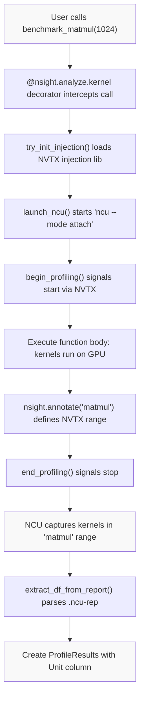

**Diagram:** Injection-based profiling flow (no script relaunch)

**Sources:** [nsight/collection/ncu.py:110-260](), [nsight/analyze.py:48-241]()

---

## Code Entity Mapping

```mermaid
graph TB
    subgraph "User Interface"
        BenchFunc["benchmark_matmul(n)"]
        AnnotCtx["nsight.annotate('matmul')"]
        DecoratorUse["@nsight.analyze.kernel"]
    end
    
    subgraph "Collection Subsystem"
        NCUColl["NCUCollector<br/>[nsight/collection/ncu.py]"]
        TryInit["try_init_injection()<br/>[nsight/collection/ncu.py]"]
        LaunchNCU["launch_ncu()<br/>[nsight/collection/ncu.py]"]
    end
    
    subgraph "Data Processing"
        Extract["extract_df_from_report()<br/>[nsight/extraction.py]"]
        Results["ProfileResults<br/>[nsight/collection/core.py]"]
    end
    
    DecoratorUse --> NCUColl
    NCUColl --> TryInit
    NCUColl --> LaunchNCU
    BenchFunc --> AnnotCtx
    AnnotCtx -. captured by .-> NCUColl
    NCUColl --> Extract
    Extract --> Results
    Results --> BenchFunc
```

**Diagram:** Association between code entities and the collection/extraction pipeline.

**Sources:** [nsight/collection/ncu.py:110-260](), [nsight/analyze.py:1-242](), [nsight/collection/core.py:1-100]()

---

## Understanding the v1.0.0 Output

The `ProfileResults.to_dataframe()` output now includes a dedicated **Unit** column to ensure clarity in measurement (e.g., distinguishing between `nsecond` and `cycle`).

| Column | Description | Example |
|--------|-------------|---------|
| `Annotation` | Label from `nsight.annotate()` | `"matmul"` |
| `Metric` | Hardware counter name | `"gpu__time_duration.sum"` |
| `Unit` | Measurement unit (v1.0.0+) | `"nsecond"` |
| `AvgValue` | Mean across `runs` | `12345.6` |
| `GPU` | Targeted GPU device | `"NVIDIA H100"` |

**Sources:** [examples/00_minimal.py:38-41](), [nsight/collection/core.py:80-120]()

---

## Default Configuration Values

| Parameter | Default Value | Purpose |
|-----------|---------------|---------|
| `runs` | `1` | Number of profiling iterations |
| `metric` | `"gpu__time_duration.sum"` | Default performance counter |
| `thermal_control` | `True` | Prevents thermal throttling |
| `thermal_device` | `0` | GPU index to monitor for thermals (v1.0.0) |
| `verbosity` | `VerbosityLevel.INFO` | Replaces `output` parameter (v1.0.0) |
| `replay_mode` | `"kernel"` | Replay strategy |

**Sources:** [nsight/analyze.py:34-64](), [nsight/utils.py:15-30]()

---

## Next Steps

1.  **Parameter Sweeps:** Pass a list of tuples to `configs` to profile multiple sizes. See [Profiling Configurations](#4.3).
2.  **Visualization:** Use `@nsight.analyze.plot` to generate comparison charts. See [Visualization and Plotting](#4.5).
3.  **Triton/cuTile:** Explore [Example 7: Triton Minimal](examples/07_triton_minimal.py) to see how to profile non-PyTorch kernels.

**Sources:** [examples/07_triton_minimal.py:1-146]()

---

# Page: Core Concepts

# Core Concepts

<details>
<summary>Relevant source files</summary>

The following files were used as context for generating this wiki page:

- [docs/source/overview/core_concepts.rst](docs/source/overview/core_concepts.rst)
- [docs/source/release_notes/topics/updates-in-nsight-python-1.0.0.rst](docs/source/release_notes/topics/updates-in-nsight-python-1.0.0.rst)
- [nsight/annotation.py](nsight/annotation.py)

</details>


This page introduces the fundamental concepts and primitives of nsight-python. Understanding these concepts is essential for effective GPU kernel profiling. For end-to-end workflow details, see [Basic Profiling Workflow](#3.3). For detailed API documentation, see [API Reference](#7).

---

## Annotations

**Annotations** are code markers that identify specific regions of code containing GPU kernel launches. They enable nsight-python to attribute profiling metrics to named implementations or configurations. The `nsight.annotate` class provides annotation functionality.

### Usage Modes

Annotations can be used in two ways:

**Context Manager:**
```python
with nsight.annotate("torch"):
    torch_implementation()
```

**Decorator:**
```python
@nsight.annotate("triton")
def triton_implementation():
    ...
```

[nsight/annotation.py:91-137]()

### NVTX Domain and Thread Locality

Internally, all annotations create NVTX (NVIDIA Tools Extension) ranges under the `"nsight-python"` domain [nsight/annotation.py:124-127](). This domain name ensures that nsight-python's annotations are grouped separately from other NVTX instrumentation in the application.

Annotations use thread-local storage to track state, preventing conflicts in multi-threaded scenarios [nsight/annotation.py:14-17]().

```mermaid
graph LR
    AnnotateCall["nsight.annotate('impl_name')"]
    NVTXRange["NVTX Range Creation"]
    Domain["Domain: 'nsight-python'"]
    NCU["Nsight Compute Profiler"]
    TLS["Thread Local Storage Check"]
    
    AnnotateCall --> TLS
    TLS --> NVTXRange
    NVTXRange --> Domain
    Domain --> NCU
```

**Sources:** [nsight/annotation.py:14-17](), [nsight/annotation.py:124-127](), [docs/source/overview/core_concepts.rst:26-45]()

### Constraints and Failure Handling

- **Single Kernel Expectation**: By default, each annotation is expected to contain a single kernel launch [docs/source/overview/core_concepts.rst:27-28]().
- **No Nesting**: Nested annotations are not supported and will raise a `ValueError` [nsight/annotation.py:152-157]().
- **Unique Names**: Annotation names must be unique within a single profiling run [nsight/annotation.py:159-164]().
- **Ignore Failures**: If `ignore_failures=True`, exceptions within the annotation are caught, a dummy kernel is launched to maintain profiler state, and metrics are set to `NaN` [nsight/annotation.py:169-181]().

**Sources:** [nsight/annotation.py:108-137](), [docs/source/overview/core_concepts.rst:40-45]()

---

## Configurations

**Configurations** define parameter sets for benchmarking. The `configs` parameter accepts a list of tuples, where each tuple represents one configuration to profile.

### Configuration Structure

```mermaid
graph TD
    ConfigsList["configs = [(m1, n1, k1), (m2, n2, k2)]"]
    Tuple1["Configuration 1: (1024, 1024, 64)"]
    Tuple2["Configuration 2: (2048, 2048, 128)"]
    
    ConfigsList --> Tuple1
    ConfigsList --> Tuple2
    
    Tuple1 --> Exec1["Execute benchmark(1024, 1024, 64)"]
    Tuple2 --> Exec2["Execute benchmark(2048, 2048, 128)"]
```

**Sources:** [docs/source/overview/core_concepts.rst:47-60]()

### Parameter Mapping (v1.0.0+)

Nsight Python automatically maps config tuples to function signatures:
- **Keyword-only parameters**: Supported (defined after `*` or `*args`) [docs/source/release_notes/topics/updates-in-nsight-python-1.0.0.rst:31-33]().
- **Default values**: Configs can omit trailing parameters that have defaults; these are padded automatically [docs/source/release_notes/topics/updates-in-nsight-python-1.0.0.rst:34-35]().
- **Variadic arguments**: `*args` and `**kwargs` are tolerated but ignored [docs/source/release_notes/topics/updates-in-nsight-python-1.0.0.rst:36-37]().

**Sources:** [docs/source/overview/core_concepts.rst:61-82](), [docs/source/release_notes/topics/updates-in-nsight-python-1.0.0.rst:28-38]()

---

## Metrics and the Unit Column

**Metrics** are the quantitative measurements collected during profiling.

### Default and Custom Metrics

The default metric is `gpu__time_duration.sum`. Users can specify any Nsight Compute metric via the `metric` parameter.

### Derived Metrics and Units (v1.0.0+)

Derived metrics are computed from base metrics and config parameters. As of v1.0.0, `derive_metric` functions should return a `(value, unit)` tuple to populate the new **Unit column** in the results DataFrame [docs/source/release_notes/topics/updates-in-nsight-python-1.0.0.rst:20-27]().

```python
def tflops(t, m, n, k):
    # Returns (value, unit)
    val = 2 * m * n * k / (t / 1e9) / 1e12
    return val, "TFLOP/s"
```

**Metric Flow Diagram:**

```mermaid
graph TD
    BaseMetric["Base Metric<br/>(from NCU Report)"]
    UnitCol["Unit Column<br/>(Parsed from NCU)"]
    Config["Configuration<br/>(m, n, k)"]
    DeriveFunc["derive_metric(...)"]
    DerivedValue["(Value, Unit)"]
    
    BaseMetric --> DeriveFunc
    Config --> DeriveFunc
    DeriveFunc --> DerivedValue
    UnitCol --> Results["ProfileResults DataFrame"]
    DerivedValue --> Results
```

**Sources:** [docs/source/release_notes/topics/updates-in-nsight-python-1.0.0.rst:20-27]()

---

## Injection-Based Profiling Workflow (v1.0.0+)

Starting with version 1.0.0, nsight-python no longer relaunches the Python script for each configuration. Instead, it uses an **injection-based attach mode**.

### The Attach Mechanism

1. **Import Time**: The profiler dynamically loads Nsight Compute's CUDA injection library [docs/source/release_notes/topics/updates-in-nsight-python-1.0.0.rst:10-14]().
2. **Execution**: When the decorated function is called, the system launches `ncu --mode attach` [docs/source/release_notes/topics/updates-in-nsight-python-1.0.0.rst:14]().
3. **Profiling**: The profiler attaches to the currently running process, enabling support for interactive environments like Jupyter and Google Colab [docs/source/release_notes/topics/updates-in-nsight-python-1.0.0.rst:17-18]().

```mermaid
graph TD
    Process["Running Python Process<br/>(Jupyter/Script)"]
    Import["import nsight"]
    LoadLib["Load NCU Injection Lib"]
    CallDecorated["Call @analyze.kernel Function"]
    NCUAttach["ncu --mode attach"]
    Collect["Collect Metrics via NVTX Range"]
    
    Import --> LoadLib
    LoadLib --> CallDecorated
    CallDecorated --> NCUAttach
    NCUAttach --> Collect
    Collect --> Process
```

**Sources:** [docs/source/release_notes/topics/updates-in-nsight-python-1.0.0.rst:10-18]()

---

## Thermal Management and Device Selection

### Thermal Control

Nsight Python monitors GPU temperature via NVML to prevent thermal throttling. If the temperature exceeds a threshold, the profiler waits for a cooldown period before proceeding with the next run.

### Thermal Device Selection (v1.0.0+)

The `thermal_device` parameter allows pinning monitoring to a specific CUDA device ordinal [docs/source/release_notes/topics/updates-in-nsight-python-1.0.0.rst:49-51](). If unset, the system automatically maps the current CUDA context to its underlying NVML device UUID, respecting `CUDA_VISIBLE_DEVICES` [docs/source/release_notes/topics/updates-in-nsight-python-1.0.0.rst:51-55]().

**Sources:** [docs/source/release_notes/topics/updates-in-nsight-python-1.0.0.rst:46-55]()

---

## Verbosity Levels

The `output` parameter has been replaced by `verbosity` using the `VerbosityLevel` enum [docs/source/release_notes/topics/updates-in-nsight-python-1.0.0.rst:57-60]():

| Level | Description |
|-------|-------------|
| `VerbosityLevel.SILENT` | No console output. |
| `VerbosityLevel.INFO` | Default. Shows progress bars and report paths. |
| `VerbosityLevel.DEBUG` | Prints full NCU CLI commands and verbose NCU output. |

**Sources:** [docs/source/release_notes/topics/updates-in-nsight-python-1.0.0.rst:57-67]()

---

## Summary of Core Concepts

| Concept | Implementation Entity | Role |
|---------|-----------------------|------|
| **Annotation** | `nsight.annotate` | Marks code regions via NVTX ranges. |
| **Configuration** | `configs` parameter | Defines the parameter sweep space. |
| **Attach Mode** | `ncu --mode attach` | Profiles without script relaunch (v1.0.0+). |
| **Metrics** | `metric` / `derive_metric` | Quantifies performance; now includes Units. |
| **Thermovision** | `thermal_control` | Prevents throttling; supports device pinning. |
| **Verbosity** | `VerbosityLevel` | Controls CLI output feedback levels. |

**Sources:** [docs/source/overview/core_concepts.rst](), [nsight/annotation.py](), [docs/source/release_notes/topics/updates-in-nsight-python-1.0.0.rst]()

---

# Page: Basic Profiling Workflow

# Basic Profiling Workflow

<details>
<summary>Relevant source files</summary>

The following files were used as context for generating this wiki page:

- [nsight/analyze.py](nsight/analyze.py)
- [nsight/collection/core.py](nsight/collection/core.py)
- [nsight/collection/ncu.py](nsight/collection/ncu.py)

</details>


## Purpose and Scope

This page describes the end-to-end workflow for profiling GPU kernels with `nsight-python`. As of version 1.0.0, the system uses an injection-based approach where the profiler attaches to the running process. This eliminates script relaunches and enables seamless profiling in interactive environments like Jupyter and Google Colab.

The workflow covers five main steps: decorator application, configuration definition, execution with injection-based attachment, data collection, and results access.

---

## Workflow Overview

The basic profiling workflow consists of five sequential steps:

```mermaid
graph LR
    Step1["1. Apply @nsight.analyze.kernel<br/>decorator to function"]
    Step2["2. Define configurations<br/>(parameter tuples)"]
    Step3["3. Call decorated function<br/>(triggers injection)"]
    Step4["4. System collects data<br/>(ncu --mode attach)"]
    Step5["5. Access ProfileResults<br/>(DataFrame with Unit column)"]
    
    Step1 --> Step2
    Step2 --> Step3
    Step3 --> Step4
    Step4 --> Step5
```

**Sources**: [nsight/analyze.py:61-90](), [nsight/collection/ncu.py:178-210]()

---

## Step 1: Decorator Application

The `@nsight.analyze.kernel` decorator marks a function for profiling. The decorator creates a `NsightProfiler` instance [nsight/analyze.py:228-232]() which orchestrates the collection process.

### Decorator Implementation Flow

```mermaid
graph TB
    UserFunc["User function<br/>(def benchmark)"]
    Decorator["@nsight.analyze.kernel<br/>decorator applied"]
    CreateProfiler["_create_profiler()<br/>instantiates NsightProfiler"]
    ProfileSettings["ProfileSettings<br/>(runs, derive_metric, thermal_device)"]
    NCUCollector["NCUCollector<br/>(metrics, clock_control, replay_mode)"]
    NsightProfiler["NsightProfiler<br/>(orchestrates collection)"]
    WrappedFunc["Wrapped function<br/>returns ProfileResults"]
    
    UserFunc --> Decorator
    Decorator --> CreateProfiler
    CreateProfiler --> ProfileSettings
    CreateProfiler --> NCUCollector
    ProfileSettings --> NsightProfiler
    NCUCollector --> NsightProfiler
    NsightProfiler --> WrappedFunc
```

The decorator creates the profiling infrastructure by:
1. Creating `ProfileSettings` with user parameters (runs, derive_metric, thermal_device, verbosity) [nsight/analyze.py:212-227]().
2. Creating `NCUCollector` with instrumentation parameters (metrics, clock_control, cache_control, replay_mode) [nsight/analyze.py:228-235]().
3. Combining both into a `NsightProfiler` instance [nsight/analyze.py:236]().

**Sources**: [nsight/analyze.py:61-87](), [nsight/analyze.py:212-241]()

---

## Step 2: Configuration Definition

Configurations define the parameter combinations to profile. `nsight-python` v1.0.0 supports positional and keyword-only parameters, as well as automatic padding with default values [nsight/collection/core.py:49-71]().

### Configuration Specification Methods

| Method | Code Example | Description |
|--------|--------------|-------------|
| **Decorator-time** | `@nsight.analyze.kernel(configs=[(512, 64), (1024, 128)])` | Configs specified at decoration [nsight/analyze.py:118-125]() |
| **Call-time** | `benchmark(configs=[(512, 64)])` | Configs passed at call-time [nsight/analyze.py:101-105]() |
| **Automatic Padding** | `benchmark(configs=[(512,)])` | Missing values filled from function defaults [nsight/collection/core.py:49-71]() |

**Sources**: [nsight/collection/core.py:49-107](), [nsight/analyze.py:118-132]()

---

## Step 3: Execution and Injection

Unlike previous versions, v1.0.0 uses an injection-based approach. At import time, the library attempts to load the Nsight Compute injection library (`libcuda-injection.so`) via `try_init_injection()` [nsight/collection/ncu.py:127-175]().

### Injection Attachment Flow

```mermaid
graph TB
    UserScript["User calls<br/>decorated function"]
    TryInit["try_init_injection()<br/>Loads libcuda-injection.so"]
    LaunchNCU["launch_ncu()<br/>Starts 'ncu --mode attach'"]
    BeginProf["begin_profiling_symbol()<br/>Signals NCU to start"]
    ExecuteFunc["Execute function<br/>(Profiled kernels)"]
    EndProf["end_profiling_symbol()<br/>Signals NCU to stop"]
    WaitNCU["Wait for NCU process<br/>to finalize report"]
    
    UserScript --> TryInit
    TryInit --> LaunchNCU
    LaunchNCU --> BeginProf
    BeginProf --> ExecuteFunc
    ExecuteFunc --> EndProf
    EndProf --> WaitNCU
```

When the decorated function is called, the `NCUCollector` launches `ncu` in attach mode [nsight/collection/ncu.py:178-210](). The library then uses `ctypes` to call `nvInjBeginProfiling` and `nvInjEndProfiling` within the current process to scope the profiling [nsight/collection/ncu.py:28-29](), [nsight/collection/ncu.py:155-156]().

**Sources**: [nsight/collection/ncu.py:127-175](), [nsight/collection/ncu.py:178-210](), [nsight/collection/ncu.py:236-258]()

---

## Step 4: Data Collection Loop

The collection phase executes the function for every configuration and run. 

### Collection Loop Structure

```mermaid
graph TD
    Start["Start collection"]
    ConfigLoop["For each config in configs"]
    RunLoop["For each run in runs"]
    ThermalCheck{"thermal_mode<br/>enabled?"}
    CheckTemp["Check GPU temperature<br/>via NVML (thermal_device)"]
    ExecuteFunc["Execute function<br/>(Inside NVTX range)"]
    NCUAttach["NCU profiles via<br/>injection symbols"]
    ParseReport["Parse .ncu-rep<br/>via extract_df_from_report"]
    Associate["Map metrics to<br/>(Config, Annotation, Unit)"]
    NextRun{"More runs?"}
    NextConfig{"More configs?"}
    Aggregate["Aggregate data<br/>(mean, std, CI)"]
    
    Start --> ConfigLoop
    ConfigLoop --> RunLoop
    RunLoop --> ThermalCheck
    ThermalCheck -->|Yes| CheckTemp
    CheckTemp --> ExecuteFunc
    ThermalCheck -->|No| ExecuteFunc
    ExecuteFunc --> NCUAttach
    NCUAttach --> ParseReport
    ParseReport --> Associate
    Associate --> NextRun
    NextRun -->|No| NextConfig
    NextConfig -->|No| Aggregate
```

### New v1.0.0 Features in Collection
*   **Thermal Device**: The `thermal_device` parameter allows pinning temperature monitoring to a specific GPU index [nsight/analyze.py:83]().
*   **Unit Column**: The extraction process now captures the unit for every metric (e.g., `msec`, `Gbyte/second`), storing it in a dedicated `Unit` column [nsight/extraction.py:53-70]().

**Sources**: [nsight/collection/core.py:155-187](), [nsight/analyze.py:79-84](), [nsight/extraction.py:53-70]()

---

## Step 5: Results Access

The workflow concludes by returning a `ProfileResults` object. This object encapsulates a pandas DataFrame containing the processed data.

### DataFrame Structure (v1.0.0)

| Column | Description |
|--------|-------------|
| `Annotation` | Name from `nsight.annotate` [nsight/annotation.py:15-30]() |
| `Metric` | The NCU metric name (e.g., `gpu__time_duration.sum`) |
| `AvgValue` | Aggregated mean across runs |
| `Unit` | **New in v1.0.0**: The physical unit of the metric [nsight/extraction.py:65-70]() |
| `<param_name>` | Columns for each function parameter |

### Accessing Results

```python
@nsight.analyze.kernel(configs=[(512, 1024)], runs=5)
def my_kernel(m, n):
    with nsight.annotate("compute"):
        # GPU work here
        pass

results = my_kernel()
df = results.to_dataframe() # Returns pandas DataFrame
print(df[["Annotation", "AvgValue", "Unit"]])
```

**Sources**: [nsight/analyze.py:99-108](), [nsight/collection/core.py:236-241](), [nsight/extraction.py:53-70]()

---

# Page: User Guide

# User Guide

<details>
<summary>Relevant source files</summary>

The following files were used as context for generating this wiki page:

- [examples/01_compare_throughput.py](examples/01_compare_throughput.py)
- [examples/02_parameter_sweep.py](examples/02_parameter_sweep.py)
- [examples/README.md](examples/README.md)
- [examples/test_examples.py](examples/test_examples.py)
- [nsight/analyze.py](nsight/analyze.py)

</details>


This guide provides comprehensive documentation for using `nsight-python` to profile GPU kernels. It covers the two primary APIs (`nsight.analyze` and `nsight.annotate`), configuration options, metric collection, and visualization capabilities. As of version 1.0.0, `nsight-python` uses an injection-based approach where the profiler attaches to the running process, supporting environments like Jupyter and Google Colab without script relaunching.

For installation instructions, see [Installation](#2). For a quick introduction to basic concepts, see [Getting Started](#3). For detailed architectural information, see [Architecture Deep Dive](#5).

---

## Profiling Workflow Overview

The `nsight-python` profiling workflow consists of three main steps: code instrumentation, configuration, and execution. 

### End-to-End Profiling Flow

```mermaid
graph TB
    subgraph "Step 1: Code Instrumentation"
        UserCode["User Function<br/>(GPU kernel launcher)"]
        KernelDec["@nsight.analyze.kernel<br/>decorator"]
        AnnotateCtx["nsight.annotate<br/>context manager"]
        
        UserCode -->|"decorate with"| KernelDec
        UserCode -->|"contains"| AnnotateCtx
    end
    
    subgraph "Step 2: Configuration"
        Configs["configs parameter<br/>Iterable[Any]"]
        Runs["runs parameter<br/>int"]
        MetricParam["metrics parameter<br/>Sequence[str]"]
        DeriveMetric["derive_metric parameter<br/>Callable"]
        NormalizeParam["normalize_against parameter<br/>str (annotation name)"]
        
        Configs -->|"passed to"| KernelDec
        Runs -->|"passed to"| KernelDec
        MetricParam -->|"passed to"| KernelDec
        DeriveMetric -->|"passed to"| KernelDec
        NormalizeParam -->|"passed to"| KernelDec
    end
    
    subgraph "Step 3: Execution (v1.0.0 Injection)"
        FuncCall["wrapped_function(...)"]
        NCUAttach["ncu --mode attach<br/>(via try_init_injection)"]
        Results["ProfileResults object"]
        DataFrame["pandas DataFrame<br/>with 'Unit' column"]
        
        FuncCall -->|"triggers"| NCUAttach
        NCUAttach -->|"returns"| Results
        Results -->|"converts to"| DataFrame
    end
    
    KernelDec -->|"creates"| FuncCall
    AnnotateCtx -->|"marks NVTX ranges<br/>domain='nsight-python'"| NCUAttach
    
    style KernelDec fill:#f0f0f0
    style AnnotateCtx fill:#f0f0f0
    style Results fill:#f0f0f0
```

**Sources**: [nsight/analyze.py:61-116](), [nsight/analyze.py:118-191]()

---

## Core API Components

The `nsight-python` package exposes two primary modules in its public API: `nsight.analyze` and `nsight.annotate`.

### API Surface and Code Entities

```mermaid
graph TB
    subgraph "nsight package exports"
        AnalyzeModule["nsight.analyze module"]
        AnnotateClass["nsight.annotate class"]
    end
    
    subgraph "nsight.analyze decorators"
        KernelDec["@analyze.kernel<br/>Main profiling decorator"]
        PlotDec["@analyze.plot<br/>Visualization decorator"]
        IgnoreContext["analyze.ignore_failures()<br/>Context manager"]
    end
    
    subgraph "nsight.annotate usage"
        AsDecorator["@annotate('name')<br/>Function decorator"]
        AsContext["with annotate('name'):<br/>Context manager"]
    end
    
    subgraph "Internal Orchestration"
        NsightProfiler["collection.core.NsightProfiler<br/>Orchestrates runs"]
        NCUCollector["collection.ncu.NCUCollector<br/>Manages ncu attach"]
        ProfileResults["collection.core.ProfileResults<br/>Results container"]
        Extraction["extract_df_from_report<br/>Parses .ncu-rep"]
    end
    
    AnalyzeModule --> KernelDec
    AnalyzeModule --> PlotDec
    AnalyzeModule --> IgnoreContext
    
    AnnotateClass --> AsDecorator
    AnnotateClass --> AsContext
    
    KernelDec -->|"instantiates"| NsightProfiler
    NsightProfiler -->|"uses"| NCUCollector
    NCUCollector -->|"produces"| Extraction
    Extraction -->|"populates"| ProfileResults
    
    PlotDec -->|"consumes"| ProfileResults
    
    style KernelDec fill:#f0f0f0
    style AnnotateClass fill:#f0f0f0
    style ProfileResults fill:#f0f0f0
```

**Sources**: [nsight/analyze.py:61-90](), [examples/01_compare_throughput.py:23-27](), [examples/01_compare_throughput.py:50-51]()

---

## Using the @nsight.analyze.kernel Decorator

The `@nsight.analyze.kernel` decorator is the primary interface for profiling. It executes your function multiple times across different configurations. In v1.0.0, it supports improved keyword-only parameter handling and default value padding for configurations.

### Decorator Syntax Options

| Pattern | Syntax | Use Case |
|---------|--------|----------|
| **No parentheses** | `@nsight.analyze.kernel` | Quick profiling with defaults |
| **With parameters** | `@nsight.analyze.kernel(configs=..., runs=10)` | Custom configuration |

### Key Parameters (v1.0.0)

| Parameter | Type | Default | Description |
|-----------|------|---------|-------------|
| `configs` | `Iterable[Any]` | `None` | Arguments for the decorated function. Supports scalars or sequences. |
| `runs` | `int` | `1` | Number of repetitions per configuration. |
| `metrics` | `Sequence[str]` | `["gpu__time_duration.sum"]` | NCU metrics to collect. |
| `derive_metric` | `Callable` | `None` | Function to transform metrics. Must return `(value, unit)` in v1.0.0. |
| `verbosity` | `VerbosityLevel` | `VerbosityLevel.INFO` | Replaces the old `output` parameter. |
| `thermal_device`| `int` | `None` | Pin thermal monitoring to a specific GPU device. |
| `output_csv` | `bool` | `False` | Enable CSV output of results. |

For details, see [Using nsight.analyze.kernel](#4.1).

**Sources**: [nsight/analyze.py:61-86](), [nsight/analyze.py:118-154]()

---

## Using nsight.annotate for Code Regions

The `nsight.annotate` class marks specific code regions for profiling by creating NVTX ranges. It is thread-local; kernels launched from other threads will not be associated with the annotation.

### Usage Example
```python
@nsight.annotate("torch.einsum")
def my_func(a, b):
    return torch.einsum("ij,jk->ik", a, b)

with nsight.annotate("matmul-region"):
    _ = a @ b
```

**Important**: Nested annotations are not supported. For details, see [Using nsight.annotate](#4.2).

**Sources**: [examples/01_compare_throughput.py:23-26](), [examples/01_compare_throughput.py:50-51]()

---

## Profiling Configurations

Configurations define the parameter space. Version 1.0.0 supports:
- **Scalar Configs**: `configs=[1, 2, 3]` for single-argument functions.
- **Multi-dimensional Configs**: Using `itertools.product` for parameter sweeps.
- **Default Value Padding**: If a config provides fewer values than parameters, missing values are filled from function defaults.

For details, see [Profiling Configurations](#4.3).

**Sources**: [nsight/analyze.py:118-132](), [examples/02_parameter_sweep.py:21-21]()

---

## Working with Metrics

Nsight-python v1.0.0 introduces a dedicated `Unit` column in results.
- **Default Metric**: `gpu__time_duration.sum`.
- **Custom Metrics**: Defined via `derive_metric`. To populate the `Unit` column, the function should return a tuple: `(value, "UnitName")`.
- **Multiple Metrics**: You can pass a list of metrics to the `metrics` parameter.

For details, see [Working with Metrics](#4.4).

**Sources**: [nsight/analyze.py:134-152](), [examples/03_custom_metrics.py:73-77]()

---

## Visualization and Plotting

The `@nsight.analyze.plot` decorator generates publication-quality visualizations from `ProfileResults`.

### Visualization Features
- **Plot Types**: Supports `line` and `bar` charts.
- **Subplots**: Use `row_panels` and `col_panels` to organize multi-dimensional sweeps.
- **DataFrames**: The `.to_dataframe()` method exports the full result set including statistical confidence intervals (CI95) and the `Unit` column.

For details, see [Visualization and Plotting](#4.5).

**Sources**: [nsight/analyze.py:244-255](), [examples/05_subplots.py:34-36]()

---

## Related Pages

- [Using nsight.analyze.kernel](#4.1) — Detailed documentation of the decorator and v1.0.0 parameters.
- [Using nsight.annotate](#4.2) — NVTX marking and thread-locality behavior.
- [Profiling Configurations](#4.3) — Parameter sweeps and default value support.
- [Working with Metrics](#4.4) — Collection, derivation, and the Unit column.
- [Visualization and Plotting](#4.5) — Customizing plots and DataFrames.

---

# Page: Using nsight.analyze.kernel

# Using nsight.analyze.kernel

<details>
<summary>Relevant source files</summary>

The following files were used as context for generating this wiki page:

- [docs/source/analyze.rst](docs/source/analyze.rst)
- [docs/source/annotation.rst](docs/source/annotation.rst)
- [docs/source/overview/quickstart.rst](docs/source/overview/quickstart.rst)
- [nsight/analyze.py](nsight/analyze.py)
- [tests/test_profiler.py](tests/test_profiler.py)

</details>


The `@nsight.analyze.kernel` decorator is the primary interface for profiling GPU kernels in Nsight Python. It orchestrates the collection of GPU performance metrics using NVIDIA Nsight Compute, executes benchmarks across multiple configurations and repetitions, and returns structured profiling results.

As of version 1.0.0, the decorator utilizes an injection-based approach where the profiler attaches to the running process via `ncu --mode attach`. This eliminates the need for script relaunches and enables seamless profiling in interactive environments like Jupyter and Google Colab.

## Basic Usage Patterns

The `@nsight.analyze.kernel` decorator supports three invocation patterns, all defined in [nsight/analyze.py:61-241]():

**Pattern 1: Decorator without parentheses**
```python
@nsight.analyze.kernel
def benchmark_func(n: int):
    with nsight.annotate("operation"):
        # code to profile
```

**Pattern 2: Decorator with empty parentheses (default settings)**
```python
@nsight.analyze.kernel()
def benchmark_func(n: int):
    with nsight.annotate("operation"):
        # code to profile
```

**Pattern 3: Decorator with parameters**
```python
from nsight.utils import VerbosityLevel

@nsight.analyze.kernel(
    runs=10,
    metrics=["dram__throughput.avg.pct_of_peak_sustained_elapsed"],
    verbosity=VerbosityLevel.INFO
)
def benchmark_func(n: int):
    with nsight.annotate("operation"):
        # code to profile
```

### Decorated Function Signature

After decoration, the function signature changes to accept configurations and return `ProfileResults`:

```python
def wrapped_function(*args, configs=None, **kwargs) -> ProfileResults
```

- `*args`: Original positional arguments (when providing a single configuration).
- `configs`: Optional iterable of configurations that overrides decorator-time configs.
- `**kwargs`: Original keyword arguments.
- Returns: `ProfileResults` object containing profiling data.

**Note on Parameters**: As of v1.0.0, the decorator supports improved keyword-only parameter handling and default value padding. If a config provides fewer values than the function signature requires, missing values are filled from the function's defaults [nsight/analyze.py:128-130]().

**Sources:** [nsight/analyze.py:22-58](), [nsight/analyze.py:91-115](), [tests/test_profiler.py:50-101]()

## Decorator Usage Flow

```mermaid
graph TB
    User["User calls benchmark_func()"]
    Decorator["@kernel decorator (nsight/analyze.py:61)"]
    CreateProfiler["_create_profiler() (nsight/analyze.py:193)"]
    Settings["ProfileSettings (nsight/collection/core.py)"]
    NCUCollector["NCUCollector (nsight/collection/ncu.py)"]
    Profiler["NsightProfiler (nsight/collection/core.py)"]
    Injection["try_init_injection() (nsight/collection/ncu.py)"]
    Execute["Execute benchmark (configs × runs)"]
    Results["ProfileResults returned to user"]
    
    User --> Decorator
    Decorator --> CreateProfiler
    CreateProfiler --> Settings
    CreateProfiler --> NCUCollector
    Settings --> Profiler
    NCUCollector --> Profiler
    Profiler --> Injection
    Injection --> Execute
    Execute --> Results
    Results --> User
    
    Settings -.contains.-> ConfigList["configs, runs, derive_metric, normalize_against"]
    NCUCollector -.contains.-> NCUParams["metrics, clock_control, cache_control, replay_mode, verbosity"]
```

**Sources:** [nsight/analyze.py:193-241](), [nsight/collection/ncu.py:214-230]()

## Parameters Reference

The decorator accepts the following parameters, grouped by functionality:

### Execution Control Parameters

| Parameter | Type | Default | Description |
|-----------|------|---------|-------------|
| `configs` | `Iterable[Any]` or `None` | `None` | Configurations to test. Can be sequences of arguments or scalar values for single-argument functions [nsight/analyze.py:118-126](). |
| `runs` | `int` | `1` | Number of times each configuration is executed [nsight/analyze.py:133](). |
| `thermal_mode` | `"auto"`, `"manual"`, or `"off"` | `"auto"` | Thermal management mode. `"auto"` (default) prevents thermal throttling [nsight/analyze.py:79](). |
| `thermal_device` | `int` or `None` | `None` | **New in v1.0.0**: Specific CUDA device index to monitor for thermal control [nsight/analyze.py:83](). |

### Metric Configuration Parameters

| Parameter | Type | Default | Description |
|-----------|------|---------|-------------|
| `metrics` | `Sequence[str]` | `["gpu__time_duration.sum"]` | List of GPU metrics to collect. Use `ncu --query-metrics` to list available metrics [nsight/analyze.py:74](). |
| `derive_metric` | `Callable` or `None` | `None` | Function to transform metrics. In v1.0.0, should return `(value, unit)` tuples for proper Unit column tracking [nsight/analyze.py:134-152](). |
| `normalize_against` | `str` or `None` | `None` | Annotation name to use as baseline for normalization [nsight/analyze.py:155-158](). |

### Hardware Control Parameters

| Parameter | Type | Default | Description |
|-----------|------|---------|-------------|
| `clock_control` | `"base"` or `"none"` | `"none"` | GPU clock frequency control. `"base"` locks clocks to base frequency [nsight/analyze.py:76](). |
| `cache_control` | `"all"` or `"none"` | `"all"` | GPU cache flush behavior. `"all"` flushes caches before each replay [nsight/analyze.py:77](). |
| `replay_mode` | `"kernel"` or `"range"` | `"kernel"` | Replay mechanism. `"kernel"` replays individual kernels; `"range"` replays annotated ranges [nsight/analyze.py:78](). |

### Output Control Parameters

| Parameter | Type | Default | Description |
|-----------|------|---------|-------------|
| `verbosity` | `VerbosityLevel` | `VerbosityLevel.INFO` | **New in v1.0.0**: Replaces `output`. Controls logging and progress bar [nsight/analyze.py:73](). |
| `output_prefix` | `str` or `None` | `None` | File path prefix for output files. If `None`, uses temporary directory [nsight/analyze.py:85](). |
| `output_csv` | `bool` | `False` | Whether to generate CSV files with raw and processed data [nsight/analyze.py:86](). |

**Sources:** [nsight/analyze.py:61-86](), [nsight/analyze.py:117-191]()

## Execution Model

The decorator implements a nested loop execution model. Unlike previous versions, v1.0.0 uses an injection library to enable/disable profiling dynamically without restarting the process.

```mermaid
graph LR
    subgraph "Execution Matrix"
        Start["Start profiling"]
        Init["try_init_injection()"]
        ConfigLoop["For each config"]
        RunLoop["For each run"]
        ThermalCheck["ThermalController.wait()"]
        ProfileStart["begin_profiling()"]
        KernelExec["Execute annotated function"]
        ProfileEnd["end_profiling()"]
        
        Start --> Init
        Init --> ConfigLoop
        ConfigLoop --> RunLoop
        RunLoop --> ThermalCheck
        ThermalCheck --> ProfileStart
        ProfileStart --> KernelExec
        KernelExec --> ProfileEnd
        ProfileEnd --> RunLoop
    end
    
    ProfileEnd --> Aggregate["Aggregate stats + Unit column"]
    Aggregate --> Return["Return ProfileResults"]
```

### Total Executions

For a decorated function with `N` configurations and `R` runs, the function body executes **N × R** times.

**Sources:** [nsight/collection/ncu.py:214-230](), [nsight/collection/core.py:108-142]()

## Working with Configurations

Configurations can be passed as a list of tuples or, for single-parameter functions, a list of scalars.

### Keyword-Only and Default Parameters

v1.0.0 introduced robust support for keyword-only parameters and default value padding:

```python
@nsight.analyze.kernel(
    configs=[
        (1024,),        # size=1024, dtype="float32" (default)
        (2048, "half"), # size=2048, dtype="half"
    ]
)
def benchmark(size: int, *, dtype: str = "float32"):
    with nsight.annotate("op"):
        # implementation
        pass
```

**Sources:** [nsight/analyze.py:109-115](), [tests/test_profiler.py:120-132]()

## ProfileResults and the Unit Column

The `ProfileResults` object returned by the decorated function includes a `Unit` column in its DataFrame, which is essential for tracking metric scales (e.g., `msecond`, `Gbyte/second`).

```python
result = benchmark_func()
df = result.to_dataframe()

# Columns include:
# - Annotation, AvgValue, Unit, StdDev, MinValue, MaxValue
# - Configuration parameters (as columns)
# - Normalized (if normalize_against was used)
```

**Sources:** [nsight/collection/core.py:41-76](), [nsight/analyze.py:152]()

## Integration with nsight.annotate

The `@nsight.analyze.kernel` decorator requires at least one `nsight.annotate` context within the decorated function to mark which code regions should be measured. Multiple annotations within one function will result in multiple rows in the output DataFrame.

```python
@nsight.analyze.kernel()
def mixed_ops(n):
    a = torch.randn(n, n, device="cuda")
    with nsight.annotate("add"):
        c = a + a
    with nsight.annotate("mul"):
        d = a * a
```

**Sources:** [docs/source/analyze.rst:7-12](), [tests/test_profiler.py:37-43]()

## Important Behavior Notes (v1.0.0+)

### Injection-Based Attach
Nsight Python no longer relaunches your script. It uses an injection library loaded at import time via `try_init_injection()`. This allows profiling in environments where subprocess management is restricted (Jupyter, Colab) [nsight/collection/ncu.py:214-230]().

### Thread Locality
Profiling is thread-local. Only kernels launched from the same thread that called the `@analyze.kernel` decorated function will be captured by the NVTX ranges [nsight/collection/ncu.py:30-40]().

### Thermal Management
The `thermal_device` parameter allows pinning thermal monitoring to a specific GPU, which is critical in multi-GPU systems to ensure the correct device is being checked for throttling [nsight/analyze.py:83]().

**Sources:** [nsight/analyze.py:73-86](), [nsight/collection/ncu.py:214-230]()

---

# Page: Using nsight.annotate

# Using nsight.annotate

<details>
<summary>Relevant source files</summary>

The following files were used as context for generating this wiki page:

- [docs/source/release_notes/topics/updates-in-nsight-python-1.0.0.rst](docs/source/release_notes/topics/updates-in-nsight-python-1.0.0.rst)
- [nsight/annotation.py](nsight/annotation.py)
- [tests/test_annotate.py](tests/test_annotate.py)

</details>


This page documents the `nsight.annotate` class, which provides a context manager and decorator interface for marking code regions to be profiled. Annotations create NVTX ranges that are used by NVIDIA Nsight Compute to identify and isolate kernel launches during profiling.

For information about the complete profiling workflow and decorator-based orchestration, see [Using nsight.analyze.kernel](#4.1). For advanced configuration options that control how annotated regions are profiled, see [Advanced Configuration Options](#6.4).

---

## Purpose and Design

The `nsight.annotate` class serves as a lightweight marking mechanism that identifies specific code regions for GPU kernel profiling. It creates named NVTX (NVIDIA Tools Extension) ranges that enable Nsight Compute to associate performance metrics with user-defined annotations.

### Design Philosophy

```mermaid
graph LR
    subgraph "User Code"
        CodeRegion["Code region<br/>containing kernel launch"]
    end
    
    subgraph "nsight.annotate"
        Wrapper["annotate wrapper<br/>(context manager or decorator)"]
        NVTXRange["NVTX range creation<br/>domain: 'nsight-python'"]
    end
    
    subgraph "NVIDIA Tools"
        NCU["NVIDIA Nsight Compute<br/>kernel profiler"]
        NVTXLib["NVTX Library<br/>range tracking"]
    end
    
    CodeRegion --> Wrapper
    Wrapper --> NVTXRange
    NVTXRange --> NVTXLib
    NCU --> NVTXLib
    NCU --> CodeRegion
```

**Diagram: nsight.annotate in the profiling pipeline**

The `annotate` class acts as an intermediary that bridges user code with NVIDIA's profiling infrastructure. It does not perform profiling itself—instead, it marks regions for external profiling tools.

**Sources:** [nsight/annotation.py:91-137](), [nsight/annotation.py:140-148]()

---

## Class Definition and Inheritance

```mermaid
graph TB
    nvtx_annotate["nvtx.annotate<br/>(base class from nvtx package)"]
    nsight_annotate["nsight.annotation.annotate<br/>(inherits from nvtx.annotate)"]
    
    nvtx_annotate -->|"inherits"| nsight_annotate
    
    subgraph "nsight.annotate additions"
        domain["Fixed domain:<br/>'nsight-python'"]
        ignore["ignore_failures parameter<br/>with dummy kernel handling"]
        dual["Dual usage pattern:<br/>context manager + decorator"]
        thread["Thread-local state tracking<br/>(_thread_local_storage)"]
    end
    
    nsight_annotate --> domain
    nsight_annotate --> ignore
    nsight_annotate --> dual
    nsight_annotate --> thread
```

**Diagram: annotate class inheritance and features**

The `annotate` class extends `nvtx.annotate` from the `nvtx` package with several key enhancements:
1. **Fixed domain**: All annotations use the `"nsight-python"` domain for consistent filtering [nsight/annotation.py:147]().
2. **Error handling**: Optional `ignore_failures` parameter for fault-tolerant profiling [nsight/annotation.py:111-115]().
3. **State Tracking**: Uses `threading.local()` to maintain thread-specific annotation state, preventing conflicts in multi-threaded scenarios [nsight/annotation.py:17-18]().

**Sources:** [nsight/annotation.py:91-148]()

---

## Constructor Parameters

| Parameter | Type | Default | Description |
|-----------|------|---------|-------------|
| `name` | `str` | (required) | Name of the annotation used to identify the profiling region in results |
| `ignore_failures` | `bool` | `False` | Whether to suppress exceptions within the annotated region and continue profiling |

### Parameter Details

#### `name`
The annotation name serves as the primary identifier in profiling results. This name appears in the output DataFrames under the `"annotation"` column. Names must be unique within a single profiling run to ensure unambiguous results [nsight/annotation.py:109-110]().

#### `ignore_failures`
When set to `True`, exceptions raised within the annotated region are caught and suppressed. The profiling workflow continues, and the measured metric for this run will be set to `NaN` [nsight/annotation.py:111-115]().

**Requirements:** The `ignore_failures=True` parameter requires the `cuda-core` package. If not installed, an `ImportError` is raised [nsight/annotation.py:144-145]().

**Sources:** [nsight/annotation.py:139-148](), [nsight/exceptions.py:12]()

---

## Usage Patterns

The `annotate` class supports two distinct usage patterns: as a context manager and as a decorator.

### Context Manager Pattern

```python
import torch
import nsight

def benchmark_function(n: int) -> None:
    data = torch.randn(n, n, device="cuda")
    
    # Context manager wraps specific code blocks
    with nsight.annotate("matrix_add"):
        result = data + data
```

This pattern is ideal for fine-grained control over annotation boundaries within a larger function [nsight/annotation.py:99-101]().

### Decorator Pattern

```python
import torch
import nsight

@nsight.annotate("einsum_op")
def annotated_op(a: torch.Tensor, b: torch.Tensor) -> torch.Tensor:
    return torch.einsum("ij,jk->ik", a, b)
```

The decorator pattern is implemented via `__call__`, which wraps the target function in a `with self:` block [nsight/annotation.py:182-188]().

**Sources:** [nsight/annotation.py:91-107](), [nsight/annotation.py:182-188](), [tests/test_annotate.py:29-30](), [tests/test_annotate.py:36-38]()

---

## State Management and Thread Locality

`nsight.annotate` uses `threading.local()` to ensure that annotation state is isolated to the current thread.

### Thread-Local Functions

| Function | Role |
|----------|------|
| `_is_in_annotation()` | Checks if the current thread is already inside an annotation context [nsight/annotation.py:20-29](). |
| `add_active_annotation(name)` | Marks a specific name as used in the current profiling run for the thread [nsight/annotation.py:42-55](). |
| `clear_active_annotations()` | Resets the thread's annotation state. Automatically called by `nsight.analyze.kernel` before each run [nsight/annotation.py:58-73](). |
| `is_active_annotation(name)` | Verifies if a name has already been used to prevent duplicates [nsight/annotation.py:75-88](). |

**Sources:** [nsight/annotation.py:17-88]()

---

## Error Handling with ignore_failures

The `ignore_failures` parameter enables fault-tolerant profiling.

### Implementation Flow

```mermaid
graph TD
    Enter["__enter__"]
    Execute["Execute annotated code"]
    Exception{"Exception<br/>raised?"}
    IgnoreFlag{"ignore_failures<br/>== True?"}
    DummyKernel["Launch dummy kernel<br/>utils.launch_dummy_kernel_module()"]
    Exit["__exit__"]
    Propagate["Propagate exception (return False)"]
    Suppress["Suppress exception (return True)"]
    
    Enter --> Execute
    Execute --> Exception
    Exception -->|No| Exit
    Exception -->|Yes| IgnoreFlag
    IgnoreFlag -->|Yes| DummyKernel
    IgnoreFlag -->|No| Exit
    DummyKernel --> Exit
    Exit -->|If ignored| Suppress
    Exit -->|If not ignored| Propagate
```

**Diagram: Error handling flow in annotate.__exit__**

When an exception occurs and `ignore_failures=True`, the system calls `utils.launch_dummy_kernel_module()` [nsight/annotation.py:171-172](). This ensures that Nsight Compute captures at least one kernel launch within the range, allowing it to generate a report even if the primary kernel failed.

**Sources:** [nsight/annotation.py:169-180](), [tests/test_annotate.py:77-84]()

---

## Limitations and Restrictions

### Nested Annotations Not Supported
Attempting to enter an annotation context while another is active on the same thread raises a `ValueError` [nsight/annotation.py:152-156]().

### Duplicate Annotation Names
Using the same annotation name twice within a single profiling run (even sequentially) raises a `ValueError` [nsight/annotation.py:159-163](). This ensures results are unambiguous.

### Thread Locality
Because NVTX ranges are thread-local, kernels launched from threads other than the one where `nsight.annotate` was called will not be associated with that annotation [nsight/annotation.py:15-18]().

**Sources:** [nsight/annotation.py:118-122](), [nsight/annotation.py:152-163](), [tests/test_annotate.py:148-151](), [tests/test_annotate.py:172-175]()

---

## Code Entity Mapping

```mermaid
classDiagram
    class annotate {
        +str name
        +bool ignore_failures
        +__enter__()
        +__exit__()
        +__call__(func)
    }
    class ThreadLocalStorage {
        +bool in_annotation
        +set used_annotation_names
    }
    class Utils {
        +str NVTX_DOMAIN
        +launch_dummy_kernel_module()
    }
    
    annotate ..> ThreadLocalStorage : uses _thread_local_storage
    annotate ..> Utils : uses NVTX_DOMAIN
    annotate ..> Utils : calls launch_dummy_kernel_module()
```

**Diagram: Association between annotation entities and utility modules**

**Sources:** [nsight/annotation.py:17-18](), [nsight/annotation.py:147](), [nsight/annotation.py:172]()

---

# Page: Profiling Configurations

# Profiling Configurations

<details>
<summary>Relevant source files</summary>

The following files were used as context for generating this wiki page:

- [examples/04_multi_parameter.py](examples/04_multi_parameter.py)
- [examples/05_subplots.py](examples/05_subplots.py)
- [tests/test_profiler.py](tests/test_profiler.py)

</details>


## Purpose and Scope

This page explains how to define and use profiling configurations with `@nsight.analyze.kernel`. Configurations allow you to profile a kernel across multiple parameter values in a single profiling run, enabling automated parameter sweeps and comparative analysis. 

As of version **1.0.0**, the configuration system has been enhanced to support **keyword-only parameters** and **default value padding**, ensuring better compatibility with standard Python function signatures.

For information about the `@nsight.analyze.kernel` decorator itself, see [4.1 Using nsight.analyze.kernel](). For information about working with the collected metric data, see [4.4 Working with Metrics]().

---

## Configuration Basics

### What is a Configuration?

A configuration is a tuple of values that represents a specific set of input parameters for your benchmark function. The `configs` parameter of `@nsight.analyze.kernel` accepts a list of configuration tuples, and the profiler executes your kernel once for each configuration (multiplied by the number of `runs`).

```python
@nsight.analyze.kernel(configs=[(512,), (1024,), (2048,)])
def benchmark(size: int) -> None:
    # size will be 512, then 1024, then 2048
    pass
```

**Sources:** [nsight/analyze.py:280-305](), [tests/test_profiler.py:127-129]()

### Configuration Format Requirements

| Requirement | Description | Example |
|-------------|-------------|---------|
| **Type** | List of tuples | `[(512,), (1024,)]` |
| **Element Type** | Any Python object | `[(512, torch.float32), (1024, torch.float16)]` |
| **Tuple Length** | Must match benchmark function parameters | 2-parameter function needs 2-element tuples |
| **Consistency** | All tuples must have same length | All tuples must be 2-element or all 3-element |

### Configuration Execution Model

```mermaid
graph TB
    subgraph "Natural Language Space"
        NL_Space["User defines parameter sweep<br/>for specific GPU kernels"]
    end

    subgraph "Code Entity Space"
        ConfigList["configs = [(a1, b1), (a2, b2)]<br/>runs = 3"]
        Settings["nsight.collection.core.ProfileSettings"]
        Profiler["nsight.collection.core.NsightProfiler"]
        ExecLoop["_run_profile_loop()"]
        Results["nsight.collection.core.ProfileResults"]
    end
    
    NL_Space -.-> ConfigList
    ConfigList --> Settings
    Settings --> Profiler
    Profiler --> ExecLoop
    
    ExecLoop -->|"Execute config (a1, b1) x 3"| Results
    ExecLoop -->|"Execute config (a2, b2) x 3"| Results
    
    linkStyle default stroke-width:2px
```

**Configuration × Runs Execution Matrix:** Each configuration is executed multiple times (determined by `runs` parameter), creating a combinatorial execution matrix. The `NsightProfiler` iterates through these in a nested loop.

**Sources:** [nsight/collection/core.py:166-180](), [nsight/collection/core.py:440-455]()

---

## Advanced Configuration Features (v1.0.0+)

### Keyword-Only Parameters
Starting in version 1.0.0, the profiler supports functions with keyword-only arguments. The configuration tuples are still provided positionally in the `configs` list, and the system maps them to the function's parameters, including those marked as keyword-only.

```python
@nsight.analyze.kernel(configs=[(1024, 0.5)])
def benchmark_kwarg(size: int, *, dropout: float) -> None:
    # size=1024, dropout=0.5
    pass
```

**Sources:** [nsight/analyze.py:355-365](), [tests/test_api_params.py:100-115]()

### Default Value Padding
If a configuration tuple is shorter than the function's signature, the profiler will attempt to "pad" the call using the function's defined default values. This allows you to sweep one parameter while keeping others at their defaults without explicitly including them in every tuple.

```python
@nsight.analyze.kernel(configs=[(512,), (1024,)])
def benchmark_defaults(size: int, dtype=torch.float32) -> None:
    # Call 1: size=512, dtype=torch.float32
    # Call 2: size=1024, dtype=torch.float32
    pass
```

**Sources:** [nsight/analyze.py:360-375](), [tests/test_api_params.py:120-135]()

---

## Multi-Parameter Configurations

### Using itertools.product for Cartesian Products

The `itertools.product` function is the recommended way to generate all combinations of parameter values, creating a Cartesian product for multi-dimensional sweeps.

```python
import itertools
import torch
import nsight

sizes = [2048, 4096, 8192]
dtypes = [torch.float32, torch.float16]

# Create all combinations: [(2048, float32), (2048, float16), ...]
configs = list(itertools.product(sizes, dtypes))

@nsight.analyze.kernel(configs=configs, runs=10)
def benchmark_multi_param(n: int, dtype: torch.dtype) -> None:
    a = torch.randn(n, n, device="cuda", dtype=dtype)
    b = torch.randn(n, n, device="cuda", dtype=dtype)
    with nsight.annotate("matmul"):
        _ = a @ b
```

**Sources:** [examples/04_multi_parameter.py:25-30](), [examples/04_multi_parameter.py:57-60]()

### Parameter Unpacking Flow

```mermaid
graph LR
    subgraph "Input Space"
        UserConfigs["configs = [(512, 64), (1024, 128)]"]
    end

    subgraph "Internal Processing"
        Settings["nsight.collection.core.ProfileSettings"]
        Unpacker["nsight.analyze._kernel_wrapper"]
    end

    subgraph "Kernel Execution"
        Call1["benchmark(512, 64)"]
        Call2["benchmark(1024, 128)"]
    end
    
    UserConfigs --> Settings
    Settings --> Unpacker
    Unpacker --> Call1
    Unpacker --> Call2
    
    linkStyle default stroke-width:2px
```

**Sources:** [nsight/analyze.py:355-380](), [nsight/collection/core.py:175-185]()

---

## Working with Custom Metrics and Configurations

When using the `derive_metric` parameter, the derived metric function receives the configuration values. This allows for calculations that depend on input sizes (e.g., TFLOPs).

### Flexible Argument Handling with `*conf`

Using `*conf` in your derivation function allows it to handle any number of configuration parameters without needing to update the signature when your benchmark parameters change.

```python
def compute_tflops(time_ns: float, *conf: Any) -> dict[str, tuple[float, str]]:
    """
    - time_ns: The measured metric (passed automatically)
    - *conf: Captures all config parameters (size, dtype, etc.)
    """
    n: int = conf[0]  # Extract size from the first position
    flops = 2 * n * n * n
    tflops: float = flops / (time_ns / 1e9) / 1e12
    return {"TFLOPS": (tflops, "TFLOPS")}
```

**Sources:** [examples/04_multi_parameter.py:32-48](), [examples/05_subplots.py:31-36]()

---

## Configuration Best Practices

### ✅ Recommended Patterns
- **Trailing Commas:** For single-parameter sweeps, ensure you use a trailing comma: `configs=[(512,), (1024,)]`. Without the comma, Python treats `(512)` as an integer.
- **Subplots for Multi-Param:** When sweeping multiple parameters, use `row_panels` and `col_panels` in `@nsight.analyze.plot` to organize results.
- **Validation:** Test your benchmark function with a single configuration manually before launching a large-scale profiling sweep.

### ❌ Anti-Patterns
- **Manual Loops:** Do not wrap the `@nsight.analyze.kernel` call in a Python `for` loop. Instead, pass the full list to the `configs` parameter so the profiler can optimize the collection process and generate a unified report.
- **Mixed Tuple Lengths:** All tuples in the `configs` list must have the same length to ensure consistent mapping to the function signature.

**Sources:** [examples/05_subplots.py:44-46](), [tests/test_profiler.py:100-101](), [nsight/analyze.py:355-360]()

---

# Page: Working with Metrics

# Working with Metrics

<details>
<summary>Relevant source files</summary>

The following files were used as context for generating this wiki page:

- [examples/03_custom_metrics.py](examples/03_custom_metrics.py)
- [examples/08_multiple_metrics.py](examples/08_multiple_metrics.py)
- [examples/09_advanced_metric_custom.py](examples/09_advanced_metric_custom.py)
- [examples/10_combine_kernel_metrics.py](examples/10_combine_kernel_metrics.py)
- [nsight/extraction.py](nsight/extraction.py)

</details>


This page explains how metrics are collected, transformed, and normalized in `nsight-python`. It covers default metric collection, selecting custom metrics, computing derived metrics (e.g., TFLOPs), and the new **Unit** column introduced in v1.0.0.

---

## Default Metric Collection

By default, the `@nsight.analyze.kernel` decorator collects the `gpu__time_duration.sum` metric, which reports kernel execution time in nanoseconds. This metric is automatically collected for each annotated region across all configurations and runs.

**Default Metric**: `"gpu__time_duration.sum"` (nanoseconds)

The default metric is specified in [nsight/analyze.py:35](). This value represents the total GPU time for the kernel(s) within each annotated region, as reported by NVIDIA Nsight Compute.

**Sources**: [nsight/analyze.py:35](), [nsight/analyze.py:103]()

---

## Selecting Custom Metrics

To collect different or multiple metrics, specify the `metrics` parameter (formerly `metric` in older versions, now supporting a sequence) when decorating your function:

```python
@nsight.analyze.kernel(
    metrics=[
        "smsp__sass_inst_executed_op_shared_ld.sum",
        "smsp__sass_inst_executed_op_shared_st.sum"
    ]
)
def benchmark(...):
    ...
```

### Important v1.0.0 Changes
- **Multiple Metrics**: You can pass a list/tuple of strings to `metrics`. All results are merged into one `ProfileResults` object, with a `Metric` column indicating each specific metric [examples/08_multiple_metrics.py:22-38]().
- **Visualization Limitation**: The `@nsight.analyze.plot` decorator can only visualize one metric at a time. If multiple metrics are collected without a `derive_metric` function to consolidate them, `@plot` will raise an error [examples/08_multiple_metrics.py:68-74]().

**Sources**: [nsight/analyze.py:35](), [examples/08_multiple_metrics.py:22-38](), [examples/08_multiple_metrics.py:68-74]()

---

## Derived Metrics

Derived metrics enable computation of custom values from the collected metrics and function parameters. In v1.0.0, derived metrics are expected to return both a value and a unit to populate the **Unit** column.

### Metric Transformation Patterns

```mermaid
graph LR
    subgraph "Input Space"
        CollectedMetric["Collected Metrics<br/>(e.g., time_ns, inst_count)"]
        FunctionParams["Function Parameters<br/>(e.g., n, batch_size)"]
    end
    
    subgraph "Logic: derive_metric"
        DeriveMetricFunc["derive_metric Callable<br/>[extraction.py:99]"]
    end
    
    subgraph "Output Space"
        TransformedValue["(Value, Unit) Tuple<br/>[extraction.py:33]"]
        DictMetrics["Dictionary of (Value, Unit)<br/>[extraction.py:34]"]
    end
    
    CollectedMetric --> DeriveMetricFunc
    FunctionParams --> DeriveMetricFunc
    DeriveMetricFunc --> TransformedValue
    DeriveMetricFunc --> DictMetrics
```

### Pattern 1: Returning a Single Scalar with Unit
The function must return a `tuple[float, str]`. The `metric` parameter in `@plot` must match the **function name** of the derived metric [examples/03_custom_metrics.py:43-76]().

```python
def compute_tflops(time_ns: float, n: int) -> tuple[float, str]:
    flops = 2 * n**3
    tflops = flops / (time_ns / 1e9) / 1e12
    return (tflops, "TFLOPS") # (Value, Unit)
```

### Pattern 2: Returning a Dictionary of Metrics
Useful for computing multiple related metrics (e.g., TFLOPs and Arithmetic Intensity). The `metric` parameter in `@plot` must match a **key** in the returned dictionary [examples/03_custom_metrics.py:108-151]().

```python
def compute_stats(time_ns: float, n: int) -> dict[str, tuple[float, str]]:
    # ... logic ...
    return {
        "TFLOPS": (tflops, "TFLOPS"),
        "ArithIntensity": (intensity, "FLOP/byte")
    }
```

### Pattern 3: Advanced Multi-Metric Derivation
If `@kernel(metrics=[...])` specifies multiple raw metrics, the `derive_metric` function receives them as the first N arguments in the order they were listed [examples/09_advanced_metric_custom.py:21-64]().

**Sources**: [nsight/extraction.py:32-41](), [examples/03_custom_metrics.py:43-151](), [examples/09_advanced_metric_custom.py:21-82]()

---

## The Unit Column (New in v1.0.0)

Every `ProfileResults` object and resulting DataFrame now includes a `Unit` column. This column is populated as follows:
1. **Raw Metrics**: Units are extracted directly from the Nsight Compute report (e.g., `nsecond`, `cycle`, `byte`) [nsight/extraction.py:67-75]().
2. **Derived Metrics**: Populated from the second element of the returned `(value, unit)` tuple.
3. **Legacy/Missing Units**: If a `derive_metric` returns only a scalar, a warning is issued and `np.nan` is placed in the Unit column [nsight/extraction.py:37-41]().

**Sources**: [nsight/extraction.py:37-41](), [nsight/extraction.py:67-75](), [nsight/extraction.py:126]()

---

## Normalization and Baselines

The `normalize_against` parameter computes relative performance against a baseline annotation.

- **Speedup**: If the metric is "higher is better" (like TFLOPs), a value of 2.0 means the kernel is 2x faster than the baseline.
- **Overhead**: If the metric is "lower is better" (like time), a value of 0.5 means the kernel takes 50% of the baseline's time.

The results are stored in a `Normalized` column in the output DataFrame.

**Sources**: [nsight/analyze.py:100-102]()

---

## Combining Multiple Kernel Metrics

If an annotated region contains multiple kernel launches (e.g., a library call like `torch.matmul` that decomposes into several kernels), you must provide a `combine_kernel_metrics` function [examples/10_combine_kernel_metrics.py:28-35]().

```python
@nsight.analyze.kernel(
    combine_kernel_metrics=lambda x, y: x + y, # Sum metrics from all kernels
    metrics=["sm__cycles_elapsed.avg"]
)
def benchmark_multiple_kernels(n: int):
    with nsight.annotate("test"):
        _ = a @ b # Kernel 1
        _ = a @ b # Kernel 2
```

The aggregation is performed during the extraction phase using the provided lambda [nsight/extraction.py:88-101]().

**Sources**: [nsight/extraction.py:88-101](), [examples/10_combine_kernel_metrics.py:28-35]()

---

## Code Entity Mapping: Metric Subsystem

```mermaid
graph TD
    subgraph "Natural Language Space"
        MetricDef["'The Metric'<br/>(What we measure)"]
        DerivedDef["'Derived Metric'<br/>(Calculated value)"]
        AggrDef["'Combined Metric'<br/>(Multiple kernels)"]
    end

    subgraph "Code Entity Space"
        NCUActionData["class NCUActionData<br/>[utils.py]"]
        ExtractFunc["extract_ncu_action_data()<br/>[extraction.py:44]"]
        ReportParser["extract_df_from_report()<br/>[extraction.py:79]"]
        ProfileResults["class ProfileResults<br/>[collection/core.py]"]
    end

    MetricDef --- NCUActionData
    MetricDef --- ExtractFunc
    DerivedDef --- ReportParser
    AggrDef --- ReportParser
    NCUActionData --- ProfileResults
```

**Sources**: [nsight/extraction.py:44-76](), [nsight/extraction.py:79-134](), [nsight/utils.py:112-124]()

---

## CSV Output Reference

### Processed Data CSV (`processed_data-*.csv`)
This file aggregates statistics across the `runs` specified in the decorator.

| Column | Description |
|--------|-------------|
| `Annotation` | Name of the `nsight.annotate` block. |
| `AvgValue` | Arithmetic mean of the metric across runs. |
| `Unit` | The unit of measurement (e.g., `TFLOPS`, `nsecond`). |
| `Metric` | The name of the raw or derived metric. |
| `StableMeasurement`| `True` if `RelativeStdDevPct` < 2%. |
| `CI95_Lower/Upper` | 95% Confidence Interval bounds. |

**Sources**: [nsight/extraction.py:14-16](), [nsight/extraction.py:121-134]()

---

# Page: Visualization and Plotting

# Visualization and Plotting

<details>
<summary>Relevant source files</summary>

The following files were used as context for generating this wiki page:

- [docs/source/overview/architecture.rst](docs/source/overview/architecture.rst)
- [examples/04_multi_parameter.py](examples/04_multi_parameter.py)
- [examples/05_subplots.py](examples/05_subplots.py)
- [examples/06_plot_customization.py](examples/06_plot_customization.py)
- [nsight/visualization.py](nsight/visualization.py)

</details>


## Purpose and Scope

This document covers the visualization and plotting capabilities of nsight-python, focusing on the `@nsight.analyze.plot` decorator and its integration with the profiling pipeline. It explains how to generate publication-quality plots from profiling results, customize visualizations, and export data in various formats including the structured DataFrame with the `Unit` column.

For information about the underlying data collection process, see [Using nsight.analyze.kernel](4.1). For details on derived metrics and normalization that affect what gets plotted, see [Working with Metrics](4.4).

## Overview of Visualization System

The visualization system operates as the final phase of the profiling pipeline, transforming `ProfileResults` objects into matplotlib figures and optionally exporting data to CSV files. The system is designed to produce publication-quality visualizations with minimal configuration while supporting extensive customization for advanced users.

**Visualization Pipeline Flow**

```mermaid
graph LR
    KernelDec["@analyze.kernel<br/>Decorator"]
    PlotDec["@analyze.plot<br/>Decorator"]
    ProfileResults["ProfileResults<br/>Object"]
    DataFrame["pandas.DataFrame<br/>via to_dataframe()"]
    Visualize["visualization.visualize()<br/>Function"]
    MatplotlibFig["matplotlib.figure.Figure"]
    OutputPNG["PNG File<br/>(filename parameter)"]
    OutputCSV["CSV Files<br/>(output_csv parameter)"]
    
    KernelDec --> ProfileResults
    PlotDec --> KernelDec
    ProfileResults --> DataFrame
    DataFrame --> Visualize
    Visualize --> MatplotlibFig
    MatplotlibFig --> OutputPNG
    ProfileResults -.optional.-> OutputCSV
    
    style ProfileResults fill:#f9f9f9
    style DataFrame fill:#f9f9f9
    style Visualize fill:#e8e8e8
```

Sources: [nsight/analyze.py:244-346](), [examples/05_subplots.py:39-61](), [examples/06_plot_customization.py:31-84]()

## The @plot Decorator

The `@nsight.analyze.plot` decorator wraps functions already decorated with `@nsight.analyze.kernel` to automatically generate visualizations from profiling results. It intercepts the `ProfileResults` return value, generates plots as a side effect, and returns the original results unchanged.

### Basic Usage Pattern

```python
@nsight.analyze.plot(filename="performance.png", title="My Benchmark")
@nsight.analyze.kernel(configs=configs, runs=10)
def my_benchmark(size: int) -> None:
    # Benchmark implementation
    pass
```

The decorator chain must follow this order: `@plot` must be applied **before** (outside) `@kernel`. The resulting function maintains the same signature as the underlying `@kernel`-decorated function and returns `ProfileResults`.

Sources: [nsight/analyze.py:265-276]()

### Decorator Parameters

| Parameter | Type | Default | Description |
|-----------|------|---------|-------------|
| `filename` | `str` | `"plot.png"` | Output filename for the generated plot |
| `title` | `str` | `"Nsight Analyze Kernel Plot Results"` | Plot title |
| `ylabel` | `str \| None` | `None` | Y-axis label. If `None`, uses `f'{metric} (avg: {runs} runs)'` |
| `annotate_points` | `bool` | `False` | Whether to annotate data points with their numeric values |
| `show_aggregate` | `str \| None` | `None` | Show aggregate statistic: `"avg"` or `"geomean"` |
| `plot_type` | `str` | `"line"` | Plot type: `"line"` or `"bar"` |
| `plot_width` | `int` | `6` | Plot width in inches |
| `plot_height` | `int` | `4` | Plot height in inches |
| `row_panels` | `Sequence[str] \| None` | `None` | Function parameters to use for subplot rows |
| `col_panels` | `Sequence[str] \| None` | `None` | Function parameters to use for subplot columns |
| `x_keys` | `Sequence[str] \| None` | `None` | Function parameters to use for X-axis. Defaults to all parameters not in panels |
| `print_data` | `bool` | `False` | Whether to print the plotted data to stdout |
| `variant_fields` | `Sequence[str] \| None` | `None` | Config fields to use as variant dimensions (separate lines) |
| `variant_annotations` | `Sequence[str] \| None` | `None` | Annotation names to split into variants |
| `plot_callback` | `Callable[[matplotlib.figure.Figure], None] \| None` | `None` | Custom callback for advanced matplotlib customization |

Sources: [nsight/analyze.py:244-264]()

## Plot Customization

### Plot Types

The `plot_type` parameter controls the visualization style:

- **`"line"`** (default): Generates line plots with markers, suitable for continuous parameter sweeps.
- **`"bar"`**: Generates bar charts, suitable for categorical comparisons.

Example using bar chart:

```python
@nsight.analyze.plot(
    filename="bar_chart.png",
    plot_type="bar",
    annotate_points=True
)
@nsight.analyze.kernel(configs=configs, runs=10)
def benchmark(size: int) -> None:
    # Implementation
    pass
```

Sources: [examples/06_plot_customization.py:31-47](), [nsight/visualization.py:65]()

### Point Annotation and Aggregates

The `annotate_points` parameter adds numeric labels to data points, useful for reading exact values from plots.

The `show_aggregate` parameter (internally mapping to `show_avg` and `show_geomean` in the `visualize` function) displays aggregate statistics across all data series:
- `show_aggregate="avg"`: Shows average value.
- `show_aggregate="geomean"`: Shows geometric mean.

Sources: [nsight/analyze.py:288-292](), [nsight/analyze.py:313-314](), [nsight/visualization.py:32-37]()

### Titles and Labels

Plot aesthetics are controlled through dedicated parameters:

```python
@nsight.analyze.plot(
    title="Matrix Multiplication Performance",
    ylabel="TFLOPs/s",
    plot_width=10,
    plot_height=6
)
@nsight.analyze.kernel(...)
def benchmark(...) -> None:
    pass
```

If `ylabel` is not specified, the system generates a default label based on the metric name and number of runs. The visualization logic also automatically appends hardware information (GPU model and Host) to the plot subtitle.

Sources: [nsight/analyze.py:285-296](), [nsight/visualization.py:142-145]()

## Subplot Layouts

The visualization system supports creating subplot grids for multi-dimensional parameter comparisons using panel parameters.

**Panel Layout Architecture**

```mermaid
graph TB
    ConfigParams["Configuration Parameters<br/>(function arguments)"]
    RowPanels["row_panels<br/>Horizontal subplot dimension"]
    ColPanels["col_panels<br/>Vertical subplot dimension"]
    XKeys["x_keys<br/>X-axis dimension"]
    VariantFields["variant_fields<br/>Multiple lines per subplot"]
    
    SubplotGrid["Subplot Grid<br/>(rows × cols)"]
    IndividualPlot["Individual Subplot<br/>(x_axis vs metric)"]
    Lines["Multiple Lines<br/>(variants)"]
    
    ConfigParams --> RowPanels
    ConfigParams --> ColPanels
    ConfigParams --> XKeys
    ConfigParams --> VariantFields
    
    RowPanels --> SubplotGrid
    ColPanels --> SubplotGrid
    SubplotGrid --> IndividualPlot
    XKeys --> IndividualPlot
    VariantFields --> Lines
    Lines --> IndividualPlot
    
    style SubplotGrid fill:#f9f9f9
    style IndividualPlot fill:#e8e8e8
```

### Row and Column Panels

The `row_panels` and `col_panels` parameters create subplot grids by partitioning the configuration space:

- **`row_panels`**: Creates a separate row of subplots for each unique value of the specified parameters.
- **`col_panels`**: Creates a separate column of subplots for each unique value of the specified parameters.

Example with 2×2 subplot grid:

```python
@nsight.analyze.plot(
    row_panels=["dtype"],        # One row per dtype (float32, float16)
    col_panels=["transpose"]     # One column per transpose (False, True)
)
@nsight.analyze.kernel(configs=configs, runs=10)
def benchmark(n: int, dtype: torch.dtype, transpose: bool) -> None:
    # This creates 2×2 = 4 subplots
    pass
```

Sources: [examples/05_subplots.py:39-48](), [nsight/visualization.py:167-178]()

### X-Axis Selection

The `x_keys` parameter specifies which configuration parameters appear on the X-axis. By default, the system uses all function parameters **except** those specified in `row_panels` and `col_panels`.

Sources: [nsight/analyze.py:305-307](), [nsight/visualization.py:56-58]()

### Variant Fields and Annotations

The `variant_fields` parameter creates multiple lines within each subplot by splitting on specified configuration parameters. The `variant_annotations` parameter splits on annotation names (from `nsight.annotate`).

When both are provided, the visualization logic expands the data into separate lines while keeping shared x-ticks.

Sources: [nsight/analyze.py:310-311](), [nsight/visualization.py:86-140]()

## Advanced Customization

### The plot_callback Parameter

The `plot_callback` parameter accepts a function that receives the matplotlib `Figure` object after initial rendering, enabling arbitrary customization:

```python
def custom_style(fig: matplotlib.figure.Figure) -> None:
    """Callback for advanced plot customization."""
    fig.suptitle("Custom Styled Plot", fontsize=16, fontweight="bold")
    ax = fig.get_axes()[0]
    for line in ax.get_lines():
        line.set_linewidth(2)
        line.set_marker("o")

@nsight.analyze.plot(plot_callback=custom_style)
@nsight.analyze.kernel(...)
def benchmark(...) -> None:
    pass
```

Sources: [examples/06_plot_customization.py:49-74](), [nsight/visualization.py:41]()

## Data Output Formats

### DataFrame Structure and the Unit Column

The `ProfileResults.to_dataframe()` method returns a pandas DataFrame. A critical addition in v1.0.0 is the `Unit` column, which tracks the physical unit of the collected or derived metric.

| Column Category | Columns | Description |
|----------------|---------|-------------|
| **Identifiers** | `Annotation` | Name of the annotated region (`nsight.annotate` name) |
| **Config Parameters** | `<param_name>` | One column per function parameter |
| **Aggregated Metrics** | `AvgValue`, `StdDev`, `MinValue`, `MaxValue` | Statistical summary across runs |
| **Unit Info** | `Unit` | The unit of the metric (e.g., "ns", "TFLOPS", "GB/s") |
| **Stability Indicators** | `RelativeStdDevPct`, `StableMeasurement` | Measurement variance metrics |
| **Metadata** | `NumRuns`, `Metric`, `GPU`, `Host`, `ComputeClock`, `MemoryClock` | Execution context |

Sources: [nsight/analyze.py:171-191](), [nsight/visualization.py:93-107]()

### CSV Output Options

CSV output is controlled by the `output_csv` parameter in the `@kernel` decorator:

```python
@nsight.analyze.kernel(configs=configs, runs=10, output_csv=True)
def benchmark(...) -> None:
    pass
```

This generates two CSV files:
1. **Raw Data CSV** (`profiled_data-*.csv`): One row per run per configuration.
2. **Processed Data CSV** (`processed_data-*.csv`): Aggregated statistics matching the DataFrame structure, including the `Unit` column.

Sources: [nsight/analyze.py:155-191]()

### Conditional Visualization

Visualization is automatically bypassed during the internal collection phase (when `NSPY_NCU_PROFILE` is set) and only executes during the final data aggregation phase.

Sources: [nsight/analyze.py:321-340]()

---

# Page: Architecture Deep Dive

# Architecture Deep Dive

<details>
<summary>Relevant source files</summary>

The following files were used as context for generating this wiki page:

- [nsight/analyze.py](nsight/analyze.py)
- [nsight/collection/core.py](nsight/collection/core.py)

</details>


## Purpose and Scope

This page provides a detailed technical overview of nsight-python's internal architecture, explaining how components interact to orchestrate GPU profiling and data processing. It focuses on the system's core abstractions, data flow patterns, and module organization, mapping high-level concepts to specific code entities (classes, modules, functions).

As of v1.0.0, the architecture has transitioned to an **injection-based attach mode**. Instead of relaunching the entire script, the system now injects a profiling library into the running process at import time and attaches the Nsight Compute profiler dynamically.

For detailed information about specific subsystems:
- Three-phase pipeline mechanics: see [Three-Phase Pipeline](#5.1)
- Collection system implementation: see [Collection System](#5.2)
- Extraction and processing logic: see [Extraction and Processing](#5.3)
- Visualization layer details: see [Visualization Layer](#5.4)

---

## System Architecture Overview

nsight-python implements a **three-layer architecture** that separates concerns between user-facing APIs, profiling orchestration, and backend tool integration.

```mermaid
graph TB
    subgraph "Layer 1: User API"
        KernelDec["@analyze.kernel decorator<br/>[nsight/analyze.py]"]
        PlotDec["@analyze.plot decorator<br/>[nsight/analyze.py]"]
        AnnotateClass["annotate class<br/>[nsight/annotate.py]"]
    end
    
    subgraph "Layer 2: Profiling Orchestration"
        ProfileSettings["ProfileSettings<br/>[nsight/collection/core.py]"]
        ProfileResults["ProfileResults<br/>[nsight/collection/core.py]"]
        NsightProfiler["NsightProfiler abstract class<br/>[nsight/collection/core.py]"]
    end
    
    subgraph "Layer 3: Backend Integration"
        NCUCollector["NCUCollector<br/>[nsight/collection/ncu.py]"]
        NCUAttach["ncu --mode attach<br/>subprocess execution"]
        NVTX["NVTX API<br/>cuda.core.experimental"]
        NVML["pynvml library<br/>[nsight/thermovision.py]"]
        Injection["try_init_injection<br/>[nsight/collection/ncu.py]"]
    end
    
    subgraph "Supporting Subsystems"
        ThermoInit["thermovision.init<br/>[nsight/thermovision.py]"]
        Extract["extraction module<br/>[nsight/extraction.py]"]
        Transform["transformation module<br/>[nsight/transformation.py]"]
        Visualize["visualization module<br/>[nsight/visualization.py]"]
    end
    
    KernelDec --> ProfileSettings
    PlotDec --> Visualize
    AnnotateClass --> NVTX
    
    ProfileSettings --> NsightProfiler
    NsightProfiler --> NCUCollector
    NCUCollector --> NCUAttach
    NCUCollector --> Injection
    
    NCUCollector --> Extract
    Extract --> Transform
    Transform --> ProfileResults
    ProfileResults --> Visualize
    
    KernelDec --> ThermoInit
    ThermoInit --> NVML
```

**Diagram 1: Three-Layer Architecture with Code Entity Mapping**

**Sources:** [nsight/analyze.py:61-90](), [nsight/collection/core.py:189-215](), [nsight/collection/ncu.py:166-180]()

---

## Core Abstractions and Class Hierarchy

The system is built on several key abstractions that define how profiling data flows through the pipeline.

### Profiling Configuration Classes

| Class | Module | Purpose |
|-------|--------|---------|
| `ProfileSettings` | `nsight/collection/core.py` | Encapsulates all profiling parameters: configs, runs, metrics, normalization, thermal control. [nsight/collection/core.py:189-215]() |
| `ProfileResults` | `nsight/collection/core.py` | Container for profiling data as pandas DataFrame with metadata and Unit tracking. [nsight/collection/core.py:228-245]() |
| `NsightProfiler` | `nsight/collection/core.py` | Abstract base class defining profiler interface. [nsight/collection/core.py:248-257]() |
| `NCUCollector` | `nsight/collection/ncu.py` | Concrete implementation using NVIDIA Nsight Compute `--mode attach`. [nsight/collection/ncu.py:166-180]() |

```mermaid
graph TB
    subgraph "Abstract Layer"
        NsightProfiler["NsightProfiler (ABC)<br/>nsight/collection/core.py"]
        ProfileSettingsABC["ProfileSettings dataclass<br/>nsight/collection/core.py"]
        ProfileResultsABC["ProfileResults dataclass<br/>nsight/collection/core.py"]
    end
    
    subgraph "Concrete Implementation"
        NCUCollector["NCUCollector<br/>nsight/collection/ncu.py"]
        NCUSettings["NCU-specific settings:<br/>clock_control<br/>cache_control<br/>replay_mode"]
    end
    
    subgraph "Data Structures"
        DataFrame["pandas.DataFrame<br/>columns: annotation, config, run, metric, Unit"]
    end
    
    NsightProfiler --> NCUCollector
    ProfileSettingsABC --> NCUCollector
    NCUCollector --> NCUSettings
    
    NCUCollector --> ProfileResultsABC
    ProfileResultsABC --> DataFrame
```

**Diagram 2: Class Hierarchy and Data Structures**

**Sources:** [nsight/collection/core.py:189-257](), [nsight/collection/ncu.py:166-210]()

---

## Module Organization and Responsibilities

nsight-python follows a modular design where each module has a single, well-defined responsibility.

### Package Structure

```mermaid
graph LR
    subgraph "nsight package"
        Analyze["analyze.py<br/>Decorator implementations"]
        Annotate["annotate.py<br/>NVTX range management"]
        
        subgraph "collection/"
            CollCore["core.py<br/>Abstract interfaces"]
            CollNCU["ncu.py<br/>NCU injection & collection"]
        end
        
        Extract["extraction.py<br/>Parse .ncu-rep output"]
        Transform["transformation.py<br/>Metric derivation & normalization"]
        Vis["visualization.py<br/>matplotlib plotting"]
        Thermo["thermovision.py<br/>GPU thermal monitoring"]
    end
    
    Analyze --> CollCore
    CollCore --> CollNCU
    
    CollNCU --> Extract
    Extract --> Transform
    Transform --> Vis
    
    Analyze --> Thermo
```

**Diagram 3: Module Dependency Graph**

| Module | Primary Classes/Functions | Responsibility |
|--------|--------------------------|----------------|
| `analyze.py` | `kernel()`, `plot()` | User-facing decorators for analysis and visualization. [nsight/analyze.py:61-90]() |
| `annotate.py` | `annotate` class | Context manager/decorator for NVTX ranges. [nsight/annotate.py:21-45]() |
| `collection/core.py` | `ProfileSettings`, `ProfileResults` | Core data structures and logic for config sanitization. [nsight/collection/core.py:109-154]() |
| `collection/ncu.py` | `try_init_injection()`, `NCUCollector` | Handles NVTX injection and `ncu` CLI interaction. [nsight/collection/ncu.py:53-85]() |
| `extraction.py` | `extract_df_from_report()` | Parses `.ncu-rep` files into structured DataFrames. |
| `transformation.py` | `aggregate_data()` | Handles derived metrics and normalization. |
| `thermovision.py` | `ThermalController` | GPU temperature monitoring via NVML. [nsight/thermovision.py:102-125]() |

**Sources:** [nsight/analyze.py:17-20](), [nsight/collection/ncu.py:1-50](), [nsight/collection/core.py:19-21]()

---

## Data Flow Through the System

The system implements a **pipeline architecture** where data undergoes multiple transformations from user code to final visualization.

```mermaid
graph TD
    subgraph "Phase 1: Execution and Collection"
        UserFunc["User benchmark function<br/>decorated with @analyze.kernel"]
        InitInject["try_init_injection()<br/>Load NVTX library at import"]
        NCUAttach["ncu --mode attach<br/>Attach to current PID"]
        RunLoop["Run loop<br/>begin_profiling() / end_profiling()"]
        NCUOutput[".ncu-rep output files"]
    end
    
    subgraph "Phase 2: Parsing and Association"
        ExtractDF["extract_df_from_report()<br/>Parse report to DataFrame"]
        UnitTrack["Populate 'Unit' column<br/>from ncu-report metadata"]
    end
    
    subgraph "Phase 3: Transformation and Output"
        DeriveMetric["transformation.apply_derived_metric()<br/>Returns (value, unit) tuples"]
        Normalize["transformation.normalize_against_baseline()"]
        FinalDF["ProfileResults.df<br/>Final DataFrame"]
        PlotOut["visualization.visualize()"]
    end
    
    UserFunc --> InitInject
    InitInject --> NCUAttach
    NCUAttach --> RunLoop
    RunLoop --> NCUOutput
    
    NCUOutput --> ExtractDF
    ExtractDF --> UnitTrack
    UnitTrack --> DeriveMetric
    DeriveMetric --> Normalize
    Normalize --> FinalDF
    FinalDF --> PlotOut
```

**Diagram 4: End-to-End Data Flow Pipeline**

**Sources:** [nsight/collection/ncu.py:53-85](), [nsight/collection/ncu.py:114-148](), [nsight/analyze.py:134-154]()

---

## Injection-Based Profiling Pattern

Unlike previous versions that used a script relaunch, v1.0.0 uses an **injection-based attach pattern**. This allows the profiler to attach to an already running process, supporting environments like Jupyter and Colab.

### Execution Flow

1. **Import Time**: `try_init_injection()` attempts to load the NVTX injection library into the Python process. [nsight/collection/ncu.py:53-85]()
2. **Decorator Call**: `analyze.kernel()` is invoked.
3. **Profiler Attachment**: `NCUCollector` launches `ncu --mode attach` targeting the current PID. [nsight/collection/ncu.py:114-148]()
4. **Range Control**: `begin_profiling()` and `end_profiling()` markers signal to the attached `ncu` when to start and stop capturing. [nsight/collection/ncu.py:149-163]()

```mermaid
sequenceDiagram
    participant Process as Python Process
    participant Injection as Injection Lib
    participant NCU as Nsight Compute (CLI)
    
    Process->>Injection: try_init_injection() (at import)
    Process->>NCU: ncu --mode attach --pid $PID
    NCU->>Process: Attach to process
    
    loop For each config/run
        Process->>Injection: begin_profiling()
        Note over Process: Execute Kernel
        Process->>Injection: end_profiling()
        NCU->>NCU: Capture metrics for range
    end
    
    NCU->>Process: Write .ncu-rep
```

**Diagram 5: Injection-Based Execution Sequence**

**Sources:** [nsight/collection/ncu.py:53-163](), [nsight/collection/core.py:440-475]()

---

## NVTX Integration and Annotation System

The `annotate` class creates NVTX ranges that mark GPU execution regions, allowing the profiler to associate hardware metrics with specific code blocks.

### Annotation Mechanism

```mermaid
graph TB
    subgraph "User Code"
        WithStmt["with annotate('name'):<br/>    kernel()"]
        DecStmt["@annotate('name')<br/>def func():"]
    end
    
    subgraph "annotate Class"
        Enter["__enter__()<br/>nvtx.start_range()"]
        Exit["__exit__()<br/>nvtx.end_range()"]
    end
    
    subgraph "NVTX Backend"
        NVTXDomain["Domain: 'nsight-python'"]
        RangePush["nvtx.RangePush"]
        RangePop["nvtx.RangePop"]
    end
    
    WithStmt --> Enter
    DecStmt --> Enter
    Enter --> RangePush
    Exit --> RangePop
    RangePush --> NVTXDomain
```

**Diagram 6: NVTX Annotation Flow**

**Sources:** [nsight/annotate.py:21-45](), [nsight/annotate.py:84-118]()

---

## Configuration Matrix Execution

The system executes a **cartesian product** of configurations and runs. It also supports padding short configs with default values from the function signature.

### Configuration Handling

- **Padding**: `_pad_config_with_defaults` ensures all config tuples match the function signature length. [nsight/collection/core.py:49-71]()
- **Binding**: `_bind_config_to_signature` splits configs into positional and keyword-only arguments for execution. [nsight/collection/core.py:74-106]()

**Sources:** [nsight/collection/core.py:49-106](), [nsight/collection/core.py:440-475]()

---

## Summary

The nsight-python architecture is structured around several key principles:

1. **Injection-Based Attach**: Uses `ncu --mode attach` and NVTX injection for zero-relaunch profiling.
2. **Unified Data Model**: `ProfileResults` tracks metrics, units, and normalization state in a single pandas-based container.
3. **Thermal Awareness**: `ThermalController` prevents hardware throttling during benchmarks.
4. **Flexible Configurations**: Supports scalar configs, tuples, and automatic default value padding.
5. **Metric Derivation**: Supports complex derived metrics that return value/unit pairs for consistent reporting.

**Sources:** [nsight/collection/ncu.py:53-85](), [nsight/collection/core.py:189-245](), [nsight/thermovision.py:102-125]()

---

# Page: Three-Phase Pipeline

# Three-Phase Pipeline

<details>
<summary>Relevant source files</summary>

The following files were used as context for generating this wiki page:

- [nsight/analyze.py](nsight/analyze.py)
- [nsight/collection/ncu.py](nsight/collection/ncu.py)
- [nsight/extraction.py](nsight/extraction.py)

</details>


## Purpose and Scope

This document explains the internal architecture of Nsight Python's data processing pipeline, which transforms user-defined benchmark functions into profiling data and visualizations. Starting with version 1.0.0, the pipeline utilizes an **injection-based attach** approach, eliminating the need for script relaunch. The pipeline consists of three sequential phases: **Collection**, **Extraction**, and **Visualization**. Each phase performs specific transformations on the profiling data as it flows through the system.

This page focuses on the overall pipeline architecture and data flow. For detailed information about specific subsystems, see:
- Collection system implementation: [5.2]()
- Extraction and processing details: [5.3]()
- Visualization layer: [5.4]()

## Pipeline Overview

The three-phase pipeline implements an ETL (Extract-Transform-Load) pattern for GPU profiling data. Each decorated function execution triggers this pipeline:

```mermaid
graph LR
    subgraph Phase1["Phase 1: Collection"]
        UserCode["User Function<br/>+ @analyze.kernel"]
        Injection["Injection Library<br/>try_init_injection()"]
        NCU["ncu --mode attach<br/>Subprocess"]
        RawData["Raw .ncu-rep<br/>Files"]
    end
    
    subgraph Phase2["Phase 2: Extraction"]
        NCUReport["ncu_report.load_report<br/>Parsing"]
        Association["Metric-Annotation<br/>Association"]
        Derivation["Derived Metric<br/>Computation"]
        RawDF["Raw DataFrame<br/>(with Unit column)"]
    end
    
    subgraph Phase3["Phase 3: Visualization"]
        Aggregation["Statistical<br/>Aggregation"]
        Normalization["Baseline<br/>Normalization"]
        ProcessedDF["Processed<br/>DataFrame"]
        Outputs["CSV Files<br/>+ Plots"]
    end
    
    UserCode --> Injection
    Injection --> NCU
    NCU --> RawData
    
    RawData --> NCUReport
    NCUReport --> Association
    Association --> Derivation
    Derivation --> RawDF
    
    RawDF --> Aggregation
    Aggregation --> Normalization
    Normalization --> ProcessedDF
    ProcessedDF --> Outputs
```

**Sources**: [nsight/analyze.py:91-108](), [nsight/collection/ncu.py:127-176](), [nsight/extraction.py:79-110]()

## Phase 1: Collection

The collection phase orchestrates the execution of user code under NVIDIA Nsight Compute profiling using a dynamic injection mechanism. This phase is responsible for:

1. **Injection Initialization**: Loading the Nsight Compute injection library via `try_init_injection()` at import time [nsight/collection/ncu.py:127-176]().
2. **NCU Attach**: Launching the `ncu` CLI in attach mode as a background process [nsight/collection/ncu.py:178-208]().
3. **Configuration Matrix Execution**: Running the benchmark function for each configuration × run combination.
4. **Profiling Control**: Triggering hardware counters via `begin_profiling_symbol()` and `end_profiling_symbol()` [nsight/collection/ncu.py:236-251]().
5. **Thermal Control**: Monitoring GPU temperature via the `thermal_device` [nsight/analyze.py:83]().

### Collection Execution Flow

```mermaid
graph TB
    Decorator["@analyze.kernel<br/>decorator"]
    Wrapper["NsightProfiler.__call__<br/>wrapper function"]
    TryInit["try_init_injection<br/>ncu.py:127"]
    LaunchNCU["launch_ncu<br/>ncu.py:178"]
    
    subgraph ConfigLoop["Config × Run Loop"]
        ConfigIter["For each config"]
        RunIter["For each run"]
        BeginProf["begin_profiling<br/>ncu.py:236"]
        FuncExec["func(*config)"]
        EndProf["end_profiling<br/>ncu.py:246"]
    end
    
    Decorator --> Wrapper
    Wrapper --> TryInit
    TryInit --> LaunchNCU
    LaunchNCU --> ConfigLoop
    
    ConfigLoop --> ConfigIter
    ConfigIter --> RunIter
    RunIter --> BeginProf
    BeginProf --> FuncExec
    FuncExec --> EndProf
    EndProf --> RunIter
```

The `NCUCollector` handles the specifics of invoking Nsight Compute via the `--mode attach` command [nsight/collection/ncu.py:204]().

**Key Classes and Functions**:

| Entity | Location | Role |
|--------|----------|------|
| `try_init_injection` | [nsight/collection/ncu.py:127-176]() | Loads `libcuda-injection.so` and sets environment variables |
| `launch_ncu` | [nsight/collection/ncu.py:178-226]() | Spawns `ncu --mode attach` with specified metrics and replay mode |
| `begin_profiling` | [nsight/collection/ncu.py:236-244]() | Calls `nvInjBeginProfiling` to start counter collection |
| `end_profiling` | [nsight/collection/ncu.py:246-254]() | Calls `nvInjEndProfiling` to stop counter collection |
| `NCUCollector` | [nsight/collection/ncu.py:257-306]() | Orchestrates the high-level collection process |

**Sources**: [nsight/collection/ncu.py:127-306]()

## Phase 2: Extraction

The extraction phase uses the `ncu-report` Python bindings to parse the generated `.ncu-rep` files. This phase performs:

1. **Report Loading**: Utilizing `ncu_report.load_report(report_path)` [nsight/extraction.py:114]().
2. **NVTX State Inspection**: Iterating through ranges and actions to find the `nsight-python` NVTX domain [nsight/extraction.py:152-160]().
3. **Metric Extraction**: Reading raw metric values and their associated **Units** [nsight/extraction.py:67-75]().
4. **Derived Metric Computation**: Applying `derive_metric` functions which must now return `(value, unit)` tuples [nsight/extraction.py:32-41]().

### Extraction Data Flow

```mermaid
graph TB
    NCUFiles[".ncu-rep Files<br/>Binary profiling data"]
    NCULoad["ncu_report.load_report<br/>extraction.py:114"]
    ActionIter["Iterate Actions<br/>extraction.py:150"]
    
    subgraph ActionData["Action Data Extraction"]
        GetNVTX["action.nvtx_state()<br/>Filter by domain"]
        GetMetrics["action[metric].value()<br/>action[metric].unit()"]
        BuildObj["NCUActionData<br/>utils.py"]
    end
    
    subgraph Transform["Transformation"]
        CheckDerive{"derive_metric<br/>specified?"}
        ApplyDerive["Apply derive_metric<br/>Returns (val, unit)"]
        PopulateDF["Populate DataFrame<br/>incl. Unit column"]
    end
    
    NCUFiles --> NCULoad
    NCULoad --> ActionIter
    ActionIter --> GetNVTX
    GetNVTX --> GetMetrics
    GetMetrics --> BuildObj
    BuildObj --> CheckDerive
    CheckDerive -->|Yes| ApplyDerive
    ApplyDerive --> PopulateDF
    CheckDerive -->|No| PopulateDF
```

The `extract_df_from_report` function is the primary entry point for this phase [nsight/extraction.py:79-110](). It handles the mapping of NVTX annotations to the specific kernel actions captured by NCU.

**Sources**: [nsight/extraction.py:44-76](), [nsight/extraction.py:79-170]()

### Unit Column and Derived Metrics

In version 1.0.0, the pipeline explicitly tracks units. If a `derive_metric` function returns only a scalar, a warning is issued and `np.nan` is placed in the `Unit` column [nsight/extraction.py:37-41]().

**Sources**: [nsight/extraction.py:32-41](), [nsight/analyze.py:141-152]()

## Phase 3: Visualization

The visualization phase aggregates the raw data and prepares it for output.

### Aggregation and Unit Handling

Aggregation computes statistics (Mean, StdDev, etc.) across the `runs` for each configuration. The `Unit` column is preserved during this process to ensure that plots and CSVs reflect the correct measurement scales.

```mermaid
graph TD
    RawDF["Raw DataFrame<br/>(Multiple runs per config)"]
    Aggr["Statistical Aggregation<br/>(Mean, StdDev, CI95)"]
    UnitConsensus["Unit Preservation<br/>(Carry unit to result)"]
    FinalDF["ProfileResults DataFrame"]
    
    RawDF --> Aggr
    Aggr --> UnitConsensus
    UnitConsensus --> FinalDF
```

### Visualization Outputs

The `ProfileResults` object generated at the end of the pipeline provides access to the final DataFrame and integrates with the `@nsight.analyze.plot` decorator for generating visualizations.

| Feature | Description |
|---------|-------------|
| **CSV Export** | Triggered by `output_csv=True` in `@kernel` [nsight/analyze.py:86](). |
| **Matplotlib** | The `@plot` decorator uses the aggregated DataFrame to generate figures [nsight/analyze.py:18](). |
| **Verbosity** | Controls logging detail via `VerbosityLevel` [nsight/analyze.py:73](). |

**Sources**: [nsight/analyze.py:61-86](), [nsight/collection/core.py:241-287]()

## End-to-End Data Transformation (Injection Model)

The following diagram traces the data flow specifically for the new injection-based approach:

```mermaid
graph TB
    subgraph Process["Python Process"]
        App["User Script"]
        InjLib["libcuda-injection.so<br/>(Loaded at import)"]
        App -- "begin_profiling()" --> InjLib
        App -- "Kernel Launch" --> GPU
        App -- "end_profiling()" --> InjLib
    end
    
    subgraph NCU_Proc["NCU Subprocess"]
        NCU_CLI["ncu --mode attach"]
        NCU_CLI -- "Listen for signals" --> InjLib
        NCU_CLI -- "Collect Metrics" --> GPU
        NCU_CLI -- "Write Report" --> RepFile[".ncu-rep"]
    end
    
    RepFile --> Extraction["extraction.py<br/>ncu_report parsing"]
    Extraction --> Results["ProfileResults<br/>(DataFrame + Units)"]
```

**Sources**: [nsight/collection/ncu.py:178-226](), [nsight/collection/ncu.py:236-254]()

## Key Code Entities

| Concept | Code Entity | Location |
|---------|-------------|----------|
| Injection Loading | `try_init_injection()` | [nsight/collection/ncu.py:127]() |
| NCU Background Process | `launch_ncu()` | [nsight/collection/ncu.py:178]() |
| Profiling Trigger | `begin_profiling()` / `end_profiling()` | [nsight/collection/ncu.py:236, 246]() |
| Report Parsing | `ncu_report.load_report()` | [nsight/extraction.py:114]() |
| Action Extraction | `extract_ncu_action_data()` | [nsight/extraction.py:44]() |
| Data Aggregation | `extract_df_from_report()` | [nsight/extraction.py:79]() |
| Result Container | `ProfileResults` | [nsight/collection/core.py:241]() |

**Sources**: [nsight/collection/ncu.py:1-254](), [nsight/extraction.py:1-170]()

---

# Page: Collection System

# Collection System

<details>
<summary>Relevant source files</summary>

The following files were used as context for generating this wiki page:

- [nsight/collection/core.py](nsight/collection/core.py)
- [nsight/collection/ncu.py](nsight/collection/ncu.py)
- [tests/test_collection.py](tests/test_collection.py)

</details>


The Collection System is the first phase of nsight-python's three-phase profiling pipeline. It is responsible for orchestrating the execution of user functions under the NVIDIA Nsight Compute profiler, managing hardware state (thermal control, clock control), coordinating multiple profiling runs across different configurations, and producing raw profiling data for downstream processing.

As of v1.0.0, the system uses an **injection-based attach mechanism** (`ncu --mode attach`). This allows profiling to occur within the current process (including Jupyter/Colab) without the script relaunch mechanism used in previous versions.

**Sources:** [nsight/collection/core.py:1-400](), [nsight/collection/ncu.py:1-269]()

## System Purpose and Scope

The Collection System provides:

1.  **Abstraction layer** for profiling backends (currently NVIDIA Nsight Compute).
2.  **Configuration management** for validating, padding, and binding user-provided configurations to function signatures.
3.  **Execution orchestration** for running functions multiple times across parameter spaces.
4.  **Injection management**: Loading the NCU injection library (`try_init_injection`) and controlling profiling state via `begin_profiling`/`end_profiling`.
5.  **State management** during profiling (thermal throttling prevention via `thermovision`, progress tracking).

The system is implemented in the `nsight.collection` package, with `core` handling abstractions and `ncu` handling Nsight Compute-specific implementation.

**Sources:** [nsight/collection/core.py:1-20](), [nsight/collection/ncu.py:1-10]()

## Core Abstractions

### Architecture Overview

```mermaid
classDiagram
    class ProfileSettings {
        +Sequence configs
        +int runs
        +VerbosityLevel verbosity
        +Callable derive_metric
        +str normalize_against
        +bool thermal_control
        +int thermal_device
        +str output_prefix
        +bool output_csv
    }
    
    class ProfileResults {
        -DataFrame _results
        +to_dataframe() DataFrame
    }
    
    class NsightCollector {
        <<abstract>>
        +collect(func, configs, settings)* DataFrame
    }
    
    class NsightProfiler {
        +ProfileSettings settings
        +NsightCollector collector
        +__call__(func) Callable
    }
    
    class NCUCollector {
        +Sequence metrics
        +Sequence ignore_kernel_list
        +Callable combine_kernel_metrics
        +Literal clock_control
        +Literal cache_control
        +Literal replay_mode
        +collect(func, configs, settings) DataFrame
    }
    
    NsightProfiler --> ProfileSettings : uses
    NsightProfiler --> NsightCollector : delegates to
    NsightProfiler --> ProfileResults : returns
    NCUCollector --|> NsightCollector : implements
    
    note for NsightProfiler "Decorator class that wraps\nuser functions with\nprofiling logic"
    note for NCUCollector "Manages ncu attach process\nand injection library symbols"
```

**Diagram: Core Collection System Class Hierarchy**

The Collection System uses a **strategy pattern** to separate profiling orchestration (`NsightProfiler`) from backend-specific collection logic (`NsightCollector` implementations).

**Sources:** [nsight/collection/core.py:182-400](), [nsight/collection/ncu.py:125-269]()

### ProfileSettings Dataclass

`ProfileSettings` encapsulates configuration for a profiling session. It is defined at [nsight/collection/core.py:182-239]().

| Field | Type | Purpose |
|-------|------|---------|
| `configs` | `Sequence[Any] \| None` | List of configuration tuples/scalars |
| `runs` | `int` | Number of times each configuration is executed |
| `verbosity` | `VerbosityLevel` | Controls output detail (SILENT, INFO, DEBUG) |
| `derive_metric` | `Callable \| None` | Function to transform metrics (must return `(value, unit)`) |
| `thermal_control` | `bool` | Whether to enable thermal throttling prevention |
| `thermal_device` | `int` | CUDA device index to monitor for thermal control |

**Sources:** [nsight/collection/core.py:182-239]()

### NsightProfiler Class

`NsightProfiler` is the core orchestrator. It wraps user functions and coordinates the workflow at [nsight/collection/core.py:311-400]().

```mermaid
sequenceDiagram
    participant User as "User Code"
    participant Wrapper as "NsightProfiler.__call__"
    participant Sanitize as "_sanitize_configs"
    participant Collector as "NCUCollector.collect"
    participant NCU as "ncu --mode attach"
    participant Inj as "Injection Lib"
    
    User->>Wrapper: Call decorated function
    Wrapper->>Sanitize: Validate/Normalize configs
    Sanitize-->>Wrapper: list[tuple]
    Wrapper->>Collector: collect(func, configs, settings)
    
    Collector->>NCU: launch_ncu() (Subprocess)
    NCU-->>Collector: Popen object
    
    Collector->>Inj: begin_profiling()
    Note over Collector: run_profile_session()
    loop for each config x runs
        Collector->>User: func(*args, **kwargs)
    end
    Collector->>Inj: end_profiling()
    
    Collector->>NCU: wait for report
    Collector-->>Wrapper: raw_df
    Wrapper-->>User: ProfileResults(processed_df)
```

**Diagram: NsightProfiler and Injection Flow**

Key responsibilities:
1.  **Function wrapping**: Intercepts calls at [nsight/collection/core.py:337-399]().
2.  **Configuration sanitization**: Normalizes inputs via `_sanitize_configs`.
3.  **Collection delegation**: Calls the collector's `collect` method.
4.  **Run ID tracking**: Maintains `func._nspy_ncu_run_id` to allow multiple profiling sessions on one function.

**Sources:** [nsight/collection/core.py:311-400]()

## Configuration Handling

The system performs extensive signature matching to support flexible configuration inputs, including default values and keyword-only parameters.

1.  **`_sanitize_configs`**: Validates that configurations provided at decoration or runtime are consistent [nsight/collection/core.py:109-180]().
2.  **`_pad_config_with_defaults`**: If a config tuple is shorter than the function signature, it fills trailing parameters with their default values defined in the function signature [nsight/collection/core.py:49-71]().
3.  **`_bind_config_to_signature`**: Splits the final config tuple into `positional_args` and `keyword_args` based on the function's `inspect.Signature` [nsight/collection/core.py:74-106]().

**Sources:** [nsight/collection/core.py:49-180]()

## NCU Injection System

As of v1.0.0, nsight-python uses Nsight Compute's injection library to profile the current process.

### Library Loading (`try_init_injection`)

At import time, `try_init_injection()` attempts to locate and load the NCU injection library [nsight/collection/ncu.py:127-175]().
- It queries the library path using `ncu --list-injection-path-64` [nsight/collection/ncu.py:96-112]().
- It sets required environment variables: `NVTX_INJECTION64_PATH`, `NV_COMPUTE_PROFILER_PERFWORKS_DIR`, and `NV_COMPUTE_PROFILER_IN_PROCESS="1"` [nsight/collection/ncu.py:149-151]().
- It loads `libcuda-injection.so` and retrieves symbols for `nvInjBeginProfiling` and `nvInjEndProfiling` [nsight/collection/ncu.py:153-161]().

### Profiling Control

Profiling is toggled using the loaded symbols:
- **`begin_profiling()`**: Calls `nvInjBeginProfiling` with a `ProfilingParams` struct [nsight/collection/ncu.py:272-286]().
- **`end_profiling()`**: Calls `nvInjEndProfiling` [nsight/collection/ncu.py:289-301]().

**Sources:** [nsight/collection/ncu.py:127-301]()

## NCU Collector Implementation

### NCUCollector.collect

The `NCUCollector` manages the lifecycle of an `ncu` attach session [nsight/collection/ncu.py:185-269]():
1.  Checks if the injection library was successfully loaded via `injection_load_error` [nsight/collection/ncu.py:200-201]().
2.  Launches the NCU CLI in `attach` mode using `launch_ncu()` [nsight/collection/ncu.py:214-222]().
3.  Calls `begin_profiling()` to enable the injection library [nsight/collection/ncu.py:227]().
4.  Executes the workload via `run_profile_session()` [nsight/collection/ncu.py:228-235]().
5.  Calls `end_profiling()` and waits for the NCU process to finalize the report [nsight/collection/ncu.py:237-241]().

### launch_ncu Function

The `launch_ncu` function constructs the CLI command for Nsight Compute [nsight/collection/ncu.py:178-228]().

**Command Structure:**
```bash
ncu --mode attach --process-id {PID} --nvtx-include {REGEX} --metrics {METRICS} -f -o {REPORT}
```
- **`--mode attach`**: Directs NCU to attach to the running process [nsight/collection/ncu.py:214]().
- **`--process-id`**: Targets the current Python process [nsight/collection/ncu.py:216]().
- **`--nvtx-include`**: Uses a regex to capture only NVTX ranges matching the `nsight-python` domain and current function [nsight/collection/ncu.py:217-218]().

**Sources:** [nsight/collection/ncu.py:178-269]()

## Execution Session Management

### run_profile_session

The `run_profile_session` function at [nsight/collection/core.py:103-180]() orchestrates the nested loops of configurations and runs.

1.  **Thermal Control**: If enabled, it calls `thermovision.throttle_guard()` before every execution to ensure the GPU is within safe temperature limits [nsight/collection/core.py:139-141]().
2.  **Binding**: It uses `_pad_config_with_defaults` and `_bind_config_to_signature` to prepare the exact arguments for the function call [nsight/collection/core.py:144-150]().
3.  **Progress Tracking**: It updates a progress bar with ETA calculations based on the duration of previous runs [nsight/collection/core.py:152-169]().

**Sources:** [nsight/collection/core.py:103-180]()

## Integration with Nsight Compute CLI

The system relies on specific NCU versions and capabilities:
- **Minimum Version**: NCU 2026.2.1.0 (CUDA 13.3 Update 1) is required for the injection-based attach features [nsight/collection/ncu.py:30]().
- **Version Check**: `check_ncu_version` parses the output of `ncu --version` to ensure compatibility [nsight/collection/ncu.py:61-85]().
- **Error Parsing**: If NCU fails, `NCULogParser` (from `utils`) is used to extract meaningful error messages from the `.log` file generated by NCU [nsight/collection/ncu.py:254-263]().

**Sources:** [nsight/collection/ncu.py:30-85](), [nsight/collection/ncu.py:254-263]()

---

# Page: Extraction and Processing

# Extraction and Processing

<details>
<summary>Relevant source files</summary>

The following files were used as context for generating this wiki page:

- [nsight/extraction.py](nsight/extraction.py)
- [nsight/transformation.py](nsight/transformation.py)
- [tests/test_transformation.py](tests/test_transformation.py)

</details>


This document describes the second phase of the nsight-python profiling pipeline: extracting raw performance data from NVIDIA Nsight Compute reports and transforming it into structured pandas DataFrames. This phase bridges the gap between binary profiling data collected by NCU and the final aggregated results ready for visualization, including the management of the `Unit` column introduced in v1.0.0.

For information about the data collection phase that precedes this, see [5.2 Collection System](). For information about how the processed data is visualized, see [5.4 Visualization Layer]().

## Overview

The extraction and processing phase consists of two major stages:

1. **Extraction**: Parsing `.ncu-rep` binary report files to extract raw metric values, associating them with user-defined annotations, and handling multiple-kernel scenarios.
2. **Transformation**: Aggregating repeated measurements, computing statistical measures, applying derived metrics, and normalizing against baselines.

The entire pipeline is implemented across two modules:
- `nsight/extraction.py`: Report parsing and initial DataFrame construction. [nsight/extraction.py:4-16]()
- `nsight/transformation.py`: Statistical aggregation and normalization. [nsight/transformation.py:4-9]()

**Sources**: [nsight/extraction.py:4-16](), [nsight/transformation.py:4-9]()

## Extraction Pipeline Architecture

```mermaid
graph TB
    subgraph "Input"
        NCURep["NCU Report File<br/>.ncu-rep"]
    end
    
    subgraph "Report Structure (ncu_report library)"
        Report["ncu_report.IContext<br/>load_report()"]
        Ranges["ncu_report.IRange<br/>report.range_by_idx()"]
        Actions["ncu_report.IAction<br/>range.action_by_idx()"]
        NVTXState["ncu_report.INvtxState<br/>action.nvtx_state()"]
        Domain["ncu_report.INvtxDomainInfo<br/>state.domain_by_id()"]
    end
    
    subgraph "Filtering"
        DomainCheck["Filter by NVTX_DOMAIN<br/>'nsight-python'"]
        IgnoreList["Filter by<br/>ignore_kernel_list"]
    end
    
    subgraph "Data Extraction"
        ExtractFunc["extract_ncu_action_data()<br/>action, metrics"]
        NCUData["utils.NCUActionData<br/>name, values, units, clocks, gpu"]
    end
    
    subgraph "Association"
        AnnotMap["profiling_data dict<br/>annotation -> List[NCUActionData]"]
        ConfigMatch["Match actions to configs<br/>configs_repeated"]
    end
    
    subgraph "Output"
        RawDF["Raw pandas DataFrame<br/>per-run measurements"]
    end
    
    NCURep --> Report
    Report --> Ranges
    Ranges --> Actions
    Actions --> NVTXState
    NVTXState --> Domain
    
    Domain --> DomainCheck
    DomainCheck --> IgnoreList
    
    IgnoreList --> ExtractFunc
    ExtractFunc --> NCUData
    
    NCUData --> AnnotMap
    AnnotMap --> ConfigMatch
    ConfigMatch --> RawDF
```

**Diagram: Extraction pipeline from NCU report to initial DataFrame**

This diagram shows the complete flow through the `extract_df_from_report()` function, which processes binary NCU reports into structured pandas DataFrames.

**Sources**: [nsight/extraction.py:79-224](), [nsight/extraction.py:44-76]()

## Report Loading and Structure Navigation

The extraction process begins by loading the binary `.ncu-rep` file using the `ncu_report` Python library. If the file is missing, a `ProfilerException` is raised suggesting the use of `VerbosityLevel.DEBUG`. [nsight/extraction.py:113-119]()

NCU reports have a hierarchical structure:
- **Report**: Top-level container (`ncu_report.IContext`). [nsight/extraction.py:114-114]()
- **Ranges**: Logical groupings of profiling sessions (`ncu_report.IRange`). [nsight/extraction.py:149-149]()
- **Actions**: Individual kernel launches within a range (`ncu_report.IAction`). [nsight/extraction.py:151-151]()
- **NVTX State**: Annotation metadata attached to each action (`ncu_report.INvtxState`). [nsight/extraction.py:152-152]()

The extraction loop iterates through all ranges and actions to find kernels marked by the `nsight-python` domain. [nsight/extraction.py:148-151]()

**Sources**: [nsight/extraction.py:113-119](), [nsight/extraction.py:148-152]()

## NVTX Domain Filtering

Not all kernel launches in an NCU report are relevant. The system filters actions to only those within the `"nsight-python"` NVTX domain. [nsight/extraction.py:158-159]()

This filtering ensures that only kernels launched within `nsight.annotate` context managers or `@analyze.kernel` decorated functions are processed. The `NVTX_DOMAIN` constant is defined in `nsight/utils.py`.

Additionally, users can specify an `ignore_kernel_list` to exclude specific kernel names (e.g., initialization kernels) from analysis. [nsight/extraction.py:161-162]()

**Sources**: [nsight/extraction.py:158-162]()

## Metric Extraction from Actions

For each relevant action, the `extract_ncu_action_data()` function extracts the requested metrics along with hardware context. [nsight/extraction.py:44-76]()

```mermaid
graph LR
    subgraph "Input"
        Action["action<br/>ncu_report.IAction"]
        MetricNames["metrics<br/>Sequence[str]"]
    end
    
    subgraph "extract_ncu_action_data()"
        CheckMetrics["Validate metric existence"]
        ExtractName["action.name()"]
        ExtractValues["action[metric].value()"]
        ExtractUnits["action[metric].unit()"]
        ExtractClocks["device__attribute_clock_rate"]
        ExtractGPU["device__attribute_display_name"]
    end
    
    subgraph "Output"
        NCUData["utils.NCUActionData<br/>(NamedTuple)"]
        Fields["name: str<br/>values: NDArray<br/>units: List[str]<br/>compute_clock: int<br/>memory_clock: int<br/>gpu: str"]
    end
    
    Action --> CheckMetrics
    MetricNames --> CheckMetrics
    CheckMetrics --> ExtractName
    CheckMetrics --> ExtractValues
    CheckMetrics --> ExtractUnits
    CheckMetrics --> ExtractClocks
    CheckMetrics --> ExtractGPU
    
    ExtractName --> NCUData
    ExtractValues --> NCUData
    ExtractUnits --> NCUData
    ExtractClocks --> NCUData
    ExtractGPU --> NCUData
    
    NCUData --> Fields
```

**Diagram: Data extraction from NCU action objects**

The function returns a `utils.NCUActionData` namedtuple containing:
- `name`: Kernel name string. [nsight/extraction.py:70-70]()
- `values`: A numpy array of metric values. [nsight/extraction.py:71-71]()
- `units`: A list of unit strings corresponding to the metrics. [nsight/extraction.py:75-75]()
- `compute_clock`: GPU compute clock rate. [nsight/extraction.py:72-72]()
- `memory_clock`: GPU memory clock rate. [nsight/extraction.py:73-73]()
- `gpu`: GPU display name. [nsight/extraction.py:74-74]()

**Sources**: [nsight/extraction.py:44-76]()

## Annotation Association and Multiple Kernels

Extracted action data is grouped by annotation name into a dictionary. [nsight/extraction.py:167-169]()

After extraction, the system calculates how many kernels were launched per annotation run. [nsight/extraction.py:183-183]() If multiple kernels are detected (e.g., a function that launches a setup kernel and a compute kernel), a `combine_kernel_metrics` function must be provided to merge them (typically by summation). [nsight/extraction.py:190-195]()

The system uses `functools.reduce` with `NCUActionData.combine()` to merge metrics across multiple kernels in a single annotation run. [nsight/extraction.py:202-206]()

**Sources**: [nsight/extraction.py:167-169](), [nsight/extraction.py:183-206]()

## Derived Metrics and the Unit Column

In v1.0.0, derived metrics support returning units. If a `derive_metric` function is provided, it can return either a raw value or a `(value, unit)` tuple. [nsight/extraction.py:32-34]()

```python
# Extraction logic for derived metrics
if derive_metric is not None:
    # ... bind args ...
    derived_result = derive_metric(val, **bound_args.arguments)
    if isinstance(derived_result, tuple):
        derived_val, derived_unit = derived_result
    else:
        derived_val = derived_result
        derived_unit = np.nan # Warning issued if unit missing
```

If a derived metric returns only a value, a warning `DERIVED_METRIC_MISSING_UNIT_WARNING` is issued, and the `Unit` column is populated with `np.nan`. [nsight/extraction.py:37-41]()

**Sources**: [nsight/extraction.py:32-41](), [nsight/extraction.py:236-258]()

## Aggregation Pipeline

The `aggregate_data()` function in `nsight/transformation.py` performs statistical aggregation. [nsight/transformation.py:21-38]()

### Grouping with Unhashable Types
A key challenge in aggregation is that kernel configurations can include unhashable types like `dict` or `list`. To handle this, `aggregate_data` detects non-groupable columns and creates temporary stringified sort keys. [nsight/transformation.py:105-128]()

```python
def _is_groupable(series: pd.Series) -> bool:
    # Checks if values are hashable and sortable
    # ...
```

The original objects (like dicts) are recovered using a `first` aggregation to ensure the output DataFrame preserves the original Python objects rather than their string representations. [nsight/transformation.py:124-124]()

### Statistical Measures
The aggregation computes the following for each group:
- `AvgValue`: Mean of the measurements. [nsight/transformation.py:60-60]()
- `StdDev`: Standard deviation. [nsight/transformation.py:61-61]()
- `CI95_Lower/Upper`: 95% confidence intervals (1.96 * SEM). [nsight/transformation.py:138-143]()
- `StableMeasurement`: Boolean flag; `True` if `RelativeStdDevPct` < 2%. [nsight/transformation.py:151-151]()

**Sources**: [nsight/transformation.py:58-151](), [nsight/transformation.py:105-128]()

## Normalization and Geometric Mean

When `normalize_against` is specified, the `AvgValue` of each configuration is divided by the `AvgValue` of the baseline annotation for that same configuration. [nsight/transformation.py:163-189]()

```python
# Normalize the AvgValue by the values of the normalization annotation
agg_df["AvgValue"] = agg_df["AvgValue"] / agg_df["NormalizationValue"]
```

The system also calculates a **Geometric Mean** (`Geomean`) for each metric/annotation group across all configurations. [nsight/transformation.py:191-193]() This is particularly useful for summarizing speedups across a parameter sweep.

**Sources**: [nsight/transformation.py:163-193]()

## Final DataFrame Structure

The final processed DataFrame returned to the user (and the visualization layer) contains:

| Column | Description |
|--------|-------------|
| `Annotation` | The name provided in `@analyze.kernel` or `nsight.annotate`. |
| `Metric` | The NCU metric name or derived metric name. |
| `AvgValue` | The mean measurement (or normalized ratio). |
| `Unit` | The unit string (e.g., `msec`, `Gbyte/second`, `TFLOPs`). |
| `StdDev` | Standard deviation of the runs. |
| `NumRuns` | Number of iterations profiled. |
| `StableMeasurement` | Whether the variance was low enough for reliable analysis. |
| `Kernel` | The name of the CUDA kernel. |
| `GPU` | The GPU hardware model. |
| `Normalized` | Indicates if the row is normalized against a baseline. |
| `...` | One column for each parameter in the profiled function's signature. |

**Sources**: [nsight/transformation.py:58-161](), [nsight/extraction.py:269-303](), [tests/test_transformation.py:19-29]()

---

# Page: Visualization Layer

# Visualization Layer

<details>
<summary>Relevant source files</summary>

The following files were used as context for generating this wiki page:

- [docs/source/overview/architecture.rst](docs/source/overview/architecture.rst)
- [docs/source/visualization.rst](docs/source/visualization.rst)
- [nsight/visualization.py](nsight/visualization.py)

</details>


## Purpose and Scope

The Visualization Layer is the final phase in nsight-python's three-phase pipeline, responsible for transforming structured profiling results into publication-quality plots and CSV files. This layer receives aggregated DataFrames from the Extraction and Processing phase (see [5.3]()) and generates matplotlib-based visualizations with configurable subplot layouts, annotation grouping, and metric displays.

This page documents the internal architecture of the visualization subsystem. For user-facing documentation on using the `@analyze.plot` decorator, see [4.5](). For the complete three-phase pipeline overview, see [5.1]().

---

## Overview

The Visualization Layer is implemented primarily in the `nsight.visualization` module and provides a single public function `visualize()` that orchestrates all plotting operations. The layer integrates tightly with pandas DataFrames, matplotlib figures, and numpy arrays to produce customizable multi-panel plots.

```mermaid
graph TB
    subgraph "Input"
        CSV["CSV File<br/>(aggregated data)"]
        DataFrame["pandas.DataFrame<br/>(ProfileResults)"]
    end
    
    subgraph "nsight.visualization"
        Visualize["visualize()<br/>[nsight/visualization.py:22]"]
        ConfigBuild["Configuration Field Builder<br/>[nsight/visualization.py:102-107]"]
        VariantExpand["Variant Annotation Expander<br/>[nsight/visualization.py:110-139]"]
        SubplotGrid["Subplot Grid Generator<br/>[nsight/visualization.py:173-184]"]
        PlotEngine["Plot Rendering Engine<br/>[nsight/visualization.py:278-324]"]
    end
    
    subgraph "matplotlib Integration"
        Figure["matplotlib.figure.Figure"]
        Axes["matplotlib.axes.Axes array"]
        Savefig["fig.savefig()<br/>[nsight/visualization.py:462]"]
    end
    
    subgraph "Output"
        PNG["PNG/image file"]
        OutputDF["Processed DataFrame"]
    end
    
    CSV --> Visualize
    DataFrame --> Visualize
    
    Visualize --> ConfigBuild
    ConfigBuild --> VariantExpand
    VariantExpand --> SubplotGrid
    SubplotGrid --> PlotEngine
    
    SubplotGrid --> Figure
    SubplotGrid --> Axes
    PlotEngine --> Axes
    Figure --> Savefig
    Savefig --> PNG
    Visualize --> OutputDF
```

**Sources**: [nsight/visualization.py:1-471]()

---

## Core Function: `visualize()`

The `visualize()` function [nsight/visualization.py:22-470]() is the primary entry point for all visualization operations. It accepts either a DataFrame or CSV file path, along with configuration parameters that control subplot layout, plot appearance, and data grouping.

### Function Signature and Parameters

| Parameter | Type | Purpose |
|-----------|------|---------|
| `agg_df` | `str \| pd.DataFrame` | Aggregated profiling data or path to CSV file [nsight/visualization.py:23]() |
| `metric` | `str \| None` | Specific metric to plot (e.g., `gpu__time_duration.sum`) [nsight/visualization.py:24]() |
| `row_panels` | `Sequence[str] \| None` | Fields whose unique values create vertical subplot grid [nsight/visualization.py:25]() |
| `col_panels` | `Sequence[str] \| None` | Fields whose unique values create horizontal subplot grid [nsight/visualization.py:26]() |
| `x_keys` | `Sequence[str] \| None` | Fields to use for x-axis (defaults to non-panel config fields) [nsight/visualization.py:27]() |
| `variant_fields` | `Sequence[Any] \| None` | Config fields to split into separate lines per annotation [nsight/visualization.py:39]() |
| `variant_annotations` | `Sequence[Any] \| None` | Annotation names to apply variant splitting [nsight/visualization.py:40]() |
| `plot_type` | `str` | `"line"` or `"bar"` [nsight/visualization.py:34]() |
| `plot_width` | `int` | Width per subplot in inches [nsight/visualization.py:35]() |
| `plot_height` | `int` | Height per subplot in inches [nsight/visualization.py:36]() |
| `annotate_points` | `bool` | Whether to label data points with values [nsight/visualization.py:32]() |
| `show_avg` | `bool` | Whether to add "Avg" column with mean values [nsight/visualization.py:33]() |
| `show_geomean` | `bool` | Whether to add "Geomean" column [nsight/visualization.py:37]() |
| `show_grid` | `bool` | Whether to display grid lines [nsight/visualization.py:38]() |
| `title` | `str` | Main plot title [nsight/visualization.py:29]() |
| `ylabel` | `str` | Y-axis label (typically the metric name) [nsight/visualization.py:31]() |
| `filename` | `str` | Output filename for saved plot [nsight/visualization.py:30]() |
| `print_data` | `bool` | Whether to print aggregated data to stdout [nsight/visualization.py:28]() |
| `plot_callback` | `Callable[[Figure], None] \| None` | Custom callback for figure manipulation [nsight/visualization.py:41]() |

The function returns a `pd.DataFrame` containing the processed aggregated data [nsight/visualization.py:42]().

**Sources**: [nsight/visualization.py:22-42]()

---

## Panel-Based Subplot Layout System

The visualization layer uses a grid-based layout system where subplots are organized by `row_panels` and `col_panels` parameters. Each unique combination of row and column panel values creates a separate subplot.

```mermaid
graph TB
    subgraph "Panel Configuration"
        RowPanels["row_panels<br/>[nsight/visualization.py:25]"]
        ColPanels["col_panels<br/>[nsight/visualization.py:26]"]
    end
    
    subgraph "Unique Value Extraction"
        UniqueRows["unique_rows DataFrame<br/>[nsight/visualization.py:156-160]"]
        UniqueCols["unique_cols DataFrame<br/>[nsight/visualization.py:161-165]"]
    end
    
    subgraph "Grid Calculation"
        GridSize["nrows = len(unique_rows)<br/>ncols = len(unique_cols)<br/>[nsight/visualization.py:167]"]
        FigSize["fig_width = plot_width * ncols<br/>fig_height = plot_height * nrows<br/>[nsight/visualization.py:171-172]"]
    end
    
    subgraph "Subplot Creation"
        PlotSubplots["plt.subplots(nrows, ncols)<br/>[nsight/visualization.py:173-178]"]
        AxesArray["2D numpy array of Axes<br/>[nsight/visualization.py:180-183]"]
    end
    
    RowPanels --> UniqueRows
    ColPanels --> UniqueCols
    UniqueRows --> GridSize
    UniqueCols --> GridSize
    GridSize --> FigSize
    FigSize --> PlotSubplots
    PlotSubplots --> AxesArray
```

### Layout Logic

1. **Extract Unique Values**: For each panel field, extract unique values from the DataFrame [nsight/visualization.py:156-165]().
2. **Calculate Grid Dimensions**: `nrows` and `ncols` are derived from the length of unique panel combinations [nsight/visualization.py:167]().
3. **Determine Figure Size**: Total figure size scales with the number of subplots using minimum per-subplot dimensions (`plot_width`, `plot_height`) [nsight/visualization.py:169-172]().
4. **Create Subplots**: Call `plt.subplots()` with `constrained_layout=True` for automatic spacing [nsight/visualization.py:173-178]().
5. **Normalize Axes Array**: Expand dimensions to ensure a 2D array even with a single row or column [nsight/visualization.py:180-183]().

### Data Filtering Per Subplot

For each subplot at position `(row_idx, col_idx)`, the data is filtered to match the row and column panel values:

```python
# [nsight/visualization.py:188-196]()
subplot_df = agg_df
if row_panels:
    subplot_df = subplot_df[(subplot_df[row_panels] == row_values).all(axis=1)]
if col_panels:
    subplot_df = subplot_df[(subplot_df[col_panels] == col_values).all(axis=1)]
```

**Sources**: [nsight/visualization.py:156-196]()

---

## Configuration Field Construction

The visualization layer constructs a `Configuration` field that represents x-axis labels by combining non-panel configuration parameters into comma-separated strings.

```mermaid
graph LR
    subgraph "Field Identification"
        AllFields["All DataFrame columns<br/>before 'AvgValue'<br/>[nsight/visualization.py:93-94]"]
        SubplotFields["row_panels + col_panels<br/>[nsight/visualization.py:95]"]
        VariantFields["variant_fields<br/>[nsight/visualization.py:86]"]
    end
    
    subgraph "Field Filtering"
        NonPanel["non_panel_fields =<br/>fields NOT IN<br/>(subplot + variant)<br/>[nsight/visualization.py:96-100]"]
    end
    
    subgraph "Configuration Building"
        ConfigField["Configuration column<br/>field1=value1, field2=value2<br/>[nsight/visualization.py:102-107]"]
    end
    
    AllFields --> NonPanel
    SubplotFields --> NonPanel
    VariantFields --> NonPanel
    NonPanel --> ConfigField
```

The construction happens in two locations:

1. **Global Configuration**: Built for the entire DataFrame at the start [nsight/visualization.py:102-107]().
2. **Per-Subplot Configuration**: Rebuilt for each subplot's filtered data, potentially with custom `x_keys` [nsight/visualization.py:200-228]().

The configuration string format is: `"field1=value1, field2=value2, ..."` where fields are joined in order [nsight/visualization.py:103-105]().

### X-Keys Validation

When `x_keys` is specified, the function validates that:
1. All `x_keys` fields exist in the `non_panel_fields` list [nsight/visualization.py:148-154]().
2. No `x_keys` overlap with `row_panels`, `col_panels`, or `variant_fields` [nsight/visualization.py:207-211]().

**Sources**: [nsight/visualization.py:86-228]()

---

## Variant Annotation Expansion

The variant system allows splitting a single annotation into multiple lines based on configuration field values. This is useful when comparing different parameter combinations within the same annotation.

```mermaid
graph TB
    subgraph "Input"
        OrigAnnot["Original Annotation<br/>e.g., 'triton_kernel'"]
        VarFields["variant_fields<br/>[nsight/visualization.py:39]"]
    end
    
    subgraph "Expansion Process [nsight/visualization.py:110-139]"
        Mask["Filter rows for annotation<br/>[nsight/visualization.py:114]"]
        UniqueCombos["Extract unique combinations<br/>of variant_fields<br/>[nsight/visualization.py:119]"]
        CreateVariants["For each combination:<br/>Create new annotation label<br/>'triton_kernel block_size=128'<br/>[nsight/visualization.py:124-130]"]
        RemoveOrig["Remove original annotation rows<br/>[nsight/visualization.py:134]"]
    end
    
    subgraph "Output"
        ExpandedDF["DataFrame with expanded<br/>annotation variants<br/>[nsight/visualization.py:137-138]"]
    end
    
    OrigAnnot --> Mask
    VarFields --> UniqueCombos
    Mask --> UniqueCombos
    UniqueCombos --> CreateVariants
    CreateVariants --> RemoveOrig
    RemoveOrig --> ExpandedDF
```

### Expansion Algorithm

1. **Filter by Annotation**: Select rows matching the target annotation name [nsight/visualization.py:114]().
2. **Find Unique Combinations**: Extract unique combinations of variant field values [nsight/visualization.py:119]().
3. **Create Variant Labels**: For each combination, create a new annotation label by appending variant field values [nsight/visualization.py:124-131]().
4. **Remove Original Rows**: Delete the original annotation rows from the DataFrame [nsight/visualization.py:134]().
5. **Concatenate**: Combine remaining data with all new variant rows [nsight/visualization.py:137]().

This expansion occurs both globally (once at the start) and per-subplot (for local data filtering) [nsight/visualization.py:231-259]().

**Sources**: [nsight/visualization.py:110-139](), [nsight/visualization.py:231-259]()

---

## Plot Rendering Engine

The rendering engine iterates through each subplot and annotation, creating line or bar plots with the NVIDIA color palette.

### NVIDIA Color Scheme

The visualization layer uses a predefined NVIDIA color palette [nsight/visualization.py:262-277]().

### Plot Type Rendering

```mermaid
graph TB
    subgraph "Plot Type Selection"
        PlotType{"plot_type parameter<br/>[nsight/visualization.py:34]"}
    end
    
    subgraph "Line Plot [nsight/visualization.py:307-314]"
        LinePlot["ax.plot()<br/>marker='o'<br/>label=annotation<br/>color=color"]
    end
    
    subgraph "Bar Plot [nsight/visualization.py:315-322]"
        BarOffset["x_positions += offset<br/>for grouped bars"]
        BarPlot["ax.bar()<br/>width=width<br/>label=annotation<br/>color=color"]
    end
    
    subgraph "Point Annotation [nsight/visualization.py:325-334]"
        TextAnnot["ax.text()<br/>Display value at each point"]
    end
    
    PlotType -->|"line"| LinePlot
    PlotType -->|"bar"| BarOffset
    BarOffset --> BarPlot
    LinePlot --> TextAnnot
    BarPlot --> TextAnnot
```

### Rendering Loop Structure

1. **Iterate Annotations**: For each unique annotation in the subplot data [nsight/visualization.py:288]().
2. **Assign Color**: Use NVIDIA color palette with wraparound [nsight/visualization.py:288]().
3. **Map X-Positions**: Map configuration labels to x-axis positions [nsight/visualization.py:298-299]().
4. **Adjust for Grouped Bars**: If multiple annotations with bar plot, offset x-positions [nsight/visualization.py:302-305]().
5. **Render Plot**: Call `ax.plot()` or `ax.bar()` [nsight/visualization.py:307-322]().
6. **Annotate Points**: If enabled (`annotate_points=True`), add text labels at each data point [nsight/visualization.py:325-334]().

**Sources**: [nsight/visualization.py:261-334]()

---

## Average and Geometric Mean Display

The visualization layer optionally displays average and geometric mean values as additional columns after the main data.

### Average Column Logic

When `show_avg=True` [nsight/visualization.py:336]():
1. Add vertical separator line at `sep_index = len(unique_configs)` [nsight/visualization.py:338-344]().
2. For each annotation, compute mean of valid (non-NaN) values [nsight/visualization.py:293-294]().
3. Plot bar at offset position [nsight/visualization.py:351]().
4. Annotate with formatted value [nsight/visualization.py:355-364]().

### Geometric Mean Column Logic

When `show_geomean=True` [nsight/visualization.py:366]():
1. Add vertical separator line [nsight/visualization.py:368]().
2. Extract precomputed `Geomean` value from DataFrame [nsight/visualization.py:379-381]().
3. Plot bar at offset position [nsight/visualization.py:386-388]().
4. Annotate with formatted value [nsight/visualization.py:389-398]().

**Sources**: [nsight/visualization.py:336-413]()

---

## Subplot Formatting and Layout

Each subplot receives consistent formatting including titles, labels, legends, and grid settings.

### Title Generation

Subplot titles combine row and column panel values [nsight/visualization.py:427-440]().

### Y-Axis Labeling

Only the leftmost subplot in each row displays the y-axis label [nsight/visualization.py:423-424]():

```python
if col_idx == 0:
    ax.set_ylabel(f"{ylabel} (avg: {agg_df['NumRuns'].max()} runs)")
```

### X-Axis Label Management

For multi-row layouts, only the bottom row displays x-axis labels [nsight/visualization.py:456-463]().

### Legend Placement

Each subplot gets an independent legend positioned automatically [nsight/visualization.py:443-449]().

**Sources**: [nsight/visualization.py:415-463]()

---

## Hardware Information and Main Title

The visualization layer automatically extracts GPU and host information from the DataFrame and incorporates it into the main title.

1. **Hardware Info Extraction**: `gpu_model` and `host` are extracted from unique values in the DataFrame [nsight/visualization.py:142-143]().
2. **Title Construction**: A hardware info subtitle is appended to the provided title [nsight/visualization.py:144-145]().
3. **Figure Title**: Set using `fig.suptitle()` with `y=1.08` to position it above the subplots [nsight/visualization.py:466]().

**Sources**: [nsight/visualization.py:142-145](), [nsight/visualization.py:466]()

---

## Output Generation and Callbacks

### File Output

The figure is saved using `fig.savefig()` with `bbox_inches="tight"` to prevent clipping [nsight/visualization.py:472]().

### Plot Callback System

Users can provide a custom `plot_callback` function that receives the matplotlib `Figure` object before saving [nsight/visualization.py:468-469]().

### Console Output

When `print_data=True`, the aggregated DataFrame is printed to stdout with formatted values [nsight/visualization.py:474-477]().

### DataFrame Return

The function returns the processed DataFrame, allowing programmatic access to the aggregated data [nsight/visualization.py:480]().

**Sources**: [nsight/visualization.py:468-480]()

---

# Page: Advanced Topics

# Advanced Topics

<details>
<summary>Relevant source files</summary>

The following files were used as context for generating this wiki page:

- [nsight/analyze.py](nsight/analyze.py)
- [tests/run_api_params.py](tests/run_api_params.py)
- [tests/test_api_params.py](tests/test_api_params.py)
- [tests/test_thermal_control.py](tests/test_thermal_control.py)

</details>


This page covers advanced features and configuration options in nsight-python for power users who need fine-grained control over GPU profiling behavior, custom metric computations, and data processing. These features extend the basic profiling workflow described in [Basic Profiling Workflow](#3.3) with capabilities for thermal management, metric transformations, performance normalization, and low-level profiling controls.

The advanced topics are organized into four subsections:
- [Thermal Management](#6.1): GPU temperature monitoring and throttling prevention, including the new `thermal_device` pinning.
- [Custom Derived Metrics](#6.2): Transforming raw metrics into domain-specific measurements with proper unit tracking.
- [Normalization and Baselines](#6.3): Computing relative performance and speedup.
- [Advanced Configuration Options](#6.4): Low-level profiling controls (clock/cache control, replay modes, kernel filtering) and the new `VerbosityLevel` system.

For information about the core profiling decorators and basic usage, see [Using nsight.analyze.kernel](#4.1) and [Using nsight.annotate](#4.2).

**Sources**: [nsight/analyze.py:1-20]()

---

## Overview of Advanced Parameters

The `@nsight.analyze.kernel` decorator exposes several configurable parameters for fine-tuning collection and extraction behavior.

### Parameter Classification

The following table categorizes the advanced parameters by their function:

| Category | Parameters | Purpose |
|----------|-----------|---------|
| **Thermal Management** | `thermal_mode`, `thermal_wait`, `thermal_cont`, `thermal_timeout`, `thermal_device` | GPU temperature monitoring, cooling wait, and device pinning |
| **Metric Transformation** | `derive_metric`, `normalize_against` | Custom metric computation and performance comparison |
| **Hardware Control** | `clock_control`, `cache_control` | GPU clock and cache state management |
| **Profiling Behavior** | `replay_mode`, `ignore_kernel_list`, `combine_kernel_metrics` | Kernel replay strategy and multi-kernel handling |
| **Output Control** | `verbosity`, `output_prefix`, `output_csv` | Logging verbosity (replaces `output`) and file generation |

**Sources**: [nsight/analyze.py:61-86]()

---

## Advanced Parameter Data Flow

The following diagram shows how advanced parameters flow through the profiling pipeline and which components consume them. It bridges the natural language configuration to the internal code entities.

```mermaid
graph TB
    subgraph "User API Layer [nsight/analyze.py]"
        KernelDec["@nsight.analyze.kernel decorator"]
        UserParams["Advanced Parameters:<br/>thermal_mode<br/>derive_metric<br/>normalize_against<br/>clock_control<br/>cache_control<br/>replay_mode<br/>ignore_kernel_list<br/>combine_kernel_metrics"]
    end
    
    subgraph "Configuration Layer [nsight/collection/core.py]"
        ProfileSettings["ProfileSettings class<br/>(thermal_mode<br/>derive_metric<br/>normalize_against)"]
        NCUCollector["NCUCollector class<br/>(clock_control<br/>cache_control<br/>replay_mode<br/>ignore_kernel_list<br/>combine_kernel_metrics)"]
    end
    
    subgraph "Execution Layer [nsight/thermovision.py & NCU]"
        ThermalCheck["Thermal Control:<br/>ThermalController.get_gpu_temp()<br/>ThermalController.get_gpu_tlimit()"]
        NCUProcess["NCU Profiling via launch_ncu():<br/>--clock-control<br/>--cache-control<br/>--replay-mode"]
    end
    
    subgraph "Processing Layer [nsight/extraction.py]"
        MetricTransform["Metric Transformation:<br/>apply derive_metric()"]
        Normalize["Normalization:<br/>compute against baseline"]
    end
    
    KernelDec --> UserParams
    UserParams --> ProfileSettings
    UserParams --> NCUCollector
    
    ProfileSettings --> ThermalCheck
    ProfileSettings --> MetricTransform
    ProfileSettings --> Normalize
    
    NCUCollector --> NCUProcess
    
    ThermalCheck --> NCUProcess
    NCUProcess --> MetricTransform
    MetricTransform --> Normalize
```

**Diagram**: Advanced Parameter Flow Through Profiling Pipeline

**Sources**: [nsight/analyze.py:61-86](), [nsight/collection/ncu.py:1-50]()

---

## Thermal Management System

The thermal management system prevents GPU thermal throttling during profiling by monitoring GPU temperature via NVML and enforcing cooling periods. This ensures stable clock frequencies and reproducible measurements.

### Thermal Control Parameterization

The system has been updated in v1.0.0 to support more granular control:
- `thermal_mode`: Options include `"auto"`, `"manual"`, or `"off"`. [nsight/analyze.py:79]()
- `thermal_device`: Pins monitoring to a specific CUDA device index. [nsight/analyze.py:83]()
- `thermal_wait`/`thermal_cont`: Configures the target temperatures for waiting and continuing. [nsight/analyze.py:80-81]()

For details, see [Thermal Management](#6.1).

**Sources**: [nsight/analyze.py:79-83](), [tests/test_thermal_control.py:14-19]()

---

## Derived Metrics System

The `derive_metric` parameter enables transformation of raw profiling metrics into custom measurements like TFLOPs. 

### v1.0.0 Requirements
As of v1.0.0, the `derive_metric` function should return a tuple of `(value, unit)` to ensure the `Unit` column in the resulting DataFrame is correctly populated. [nsight/analyze.py:134-152]()

```python
def my_derive_metric(time_ns, M, N, K):
    tflops = (2 * M * N * K) / (time_ns * 1e-9) / 1e12
    return (tflops, "TFLOPS")
```

For details, see [Custom Derived Metrics](#6.2).

**Sources**: [nsight/analyze.py:134-154]()

---

## Normalization System

The `normalize_against` parameter enables computing relative performance metrics by establishing a baseline configuration. This is commonly used for speedup calculations.

### Normalization Workflow

The normalization process identifies the baseline configuration by matching annotation names (set via `nsight.annotate(name="baseline")`), extracts its metric value, and divides all other metrics by this baseline value, populating the `Normalized` column. [nsight/analyze.py:155-161]()

For details, see [Normalization and Baselines](#6.3).

**Sources**: [nsight/analyze.py:155-161]()

---

## Advanced Configuration Options

The `@nsight.analyze.kernel` decorator provides low-level controls for GPU hardware behavior and profiling strategy.

### Hardware and Replay Controls

| Parameter | Values | Purpose |
|-----------|--------|---------|
| `clock_control` | `"base"`, `"none"` | Lock GPU clocks to base frequency to reduce variance. [nsight/analyze.py:76]() |
| `cache_control` | `"all"`, `"none"` | Flush GPU caches between replays. [nsight/analyze.py:77]() |
| `replay_mode` | `"kernel"`, `"range"` | Replay individual kernels or entire NVTX ranges. [nsight/analyze.py:78]() |

### Multi-Kernel Aggregation

If an annotation contains multiple kernels, `combine_kernel_metrics` must be provided to define how to aggregate them (e.g., `lambda x, y: x + y`). [nsight/analyze.py:84]()

### Verbosity Levels

In v1.0.0, the `output` parameter is replaced by `verbosity`, which uses the `VerbosityLevel` enum:
- `VerbosityLevel.SILENT` (0)
- `VerbosityLevel.INFO` (3)
- `VerbosityLevel.DEBUG` (4)

**Sources**: [nsight/analyze.py:73-84](), [nsight/utils.py:19-23]()

---

## Code Entity Association

The following diagram associates natural language advanced concepts with their specific implementation classes and functions in the codebase.

```mermaid
classDiagram
    class KernelDecorator["@nsight.analyze.kernel"] {
        +derive_metric: Callable
        +normalize_against: str
        +verbosity: VerbosityLevel
    }
    class ThermalController["ThermalController [nsight/thermovision.py]"] {
        +get_gpu_temp(device_id)
        +get_gpu_tlimit(device_id)
        +wait_for_cooldown()
    }
    class NCUCollector["NCUCollector [nsight/collection/ncu.py]"] {
        +launch_ncu()
        +clock_control: str
        +replay_mode: str
    }
    class DataExtraction["Extraction Logic [nsight/extraction.py]"] {
        +extract_df_from_report()
        +apply_derived_metrics()
        +apply_normalization()
    }

    KernelDecorator --> ThermalController : uses thermal_mode/device
    KernelDecorator --> NCUCollector : configures hardware behavior
    KernelDecorator --> DataExtraction : passes derive_metric/normalize_against
```

**Diagram**: Code Entity Association for Advanced Features

For details on all advanced flags, see [Advanced Configuration Options](#6.4).

**Sources**: [nsight/analyze.py:61-86](), [tests/test_api_params.py:150-160]()

---

# Page: Thermal Management

# Thermal Management

<details>
<summary>Relevant source files</summary>

The following files were used as context for generating this wiki page:

- [nsight/thermovision.py](nsight/thermovision.py)
- [pyproject.toml](pyproject.toml)
- [tests/run_api_params.py](tests/run_api_params.py)
- [tests/test_api_params.py](tests/test_api_params.py)
- [tests/test_thermal_control.py](tests/test_thermal_control.py)
- [tests/test_thermovision.py](tests/test_thermovision.py)

</details>


## Purpose and Scope

This document describes the thermal management subsystem (**thermovision**) in nsight-python, which prevents GPU thermal throttling from affecting profiling measurements. The system monitors GPU temperature and thermal margin via the `cuda-core` (NVML) library, automatically delaying kernel execution when the GPU is too hot.

As of version **1.0.0**, the subsystem features an **adaptive cooling algorithm** that learns optimal thresholds based on workload intensity and supports pinning monitoring to a specific CUDA device via the `thermal_device` parameter.

**Sources**: [nsight/thermovision.py:10-17](), [nsight/thermovision.py:51-84]()

---

## Overview

### Why Thermal Management is Necessary

GPU profiling workloads generate sustained compute load that can elevate GPU temperature to levels that trigger thermal throttling. When thermal throttling occurs, the GPU automatically reduces clock speeds to prevent overheating, which:

- Introduces **measurement variability** between profiling runs.
- Makes **performance comparisons invalid** across different thermal states.
- Produces **misleading benchmark results** that don't reflect true kernel performance.

The thermovision subsystem addresses this by monitoring the GPU's thermal state and enforcing cooling periods before profiling begins.

### Key Concepts

| Concept | Description |
|---------|-------------|
| **T.limit (Thermal Margin)** | Temperature headroom before throttling (°C). Lower values indicate the GPU is closer to throttling. |
| **GPU Temperature** | Current GPU core temperature (°C) measured via NVML. |
| **Adaptive Mode** | Automatically adjusts cooling thresholds based on how many iterations a kernel completes before reaching the thermal limit. |
| **Thermal Headroom** | The difference between the current temperature and the throttle point. |

**Sources**: [nsight/thermovision.py:31-41](), [nsight/thermovision.py:60-84]()

---

## Architecture

### System Components

```mermaid
graph TB
    subgraph "User Code"
        Decorator["@analyze.kernel<br/>(thermal_mode='auto')"]
    end
    
    subgraph "nsight.thermovision.ThermalController"
        Init["init()<br/>Resolve NVML Device"]
        ThrottleGuard["throttle_guard()<br/>Adaptive Wait Logic"]
        GetTLimit["_get_gpu_tlimit()<br/>Query thermal margin"]
        GetTemp["_get_gpu_temp()<br/>Query temperature"]
        Resolve["_resolve_device()<br/>Map CUDA to NVML"]
    end
    
    subgraph "cuda.core (NVML)"
        CudaDev["CudaDevice(ordinal)"]
        SysDev["to_system_device()"]
        GetMargin["system.Device.get_temperature_threshold()"]
        GetCoreTemp["system.Device.get_temperature()"]
    end
    
    subgraph "Hardware"
        GPU["NVIDIA GPU<br/>Sensors"]
    end
    
    Decorator --> Init
    Init --> Resolve
    Resolve --> CudaDev
    CudaDev --> SysDev
    
    Decorator --> ThrottleGuard
    ThrottleGuard --> GetTLimit
    ThrottleGuard --> GetTemp
    
    GetTLimit --> GetMargin
    GetTemp --> GetCoreTemp
    
    GetMargin --> GPU
    GetCoreTemp --> GPU
```

**Diagram: Thermovision Component Architecture**

**Sources**: [nsight/thermovision.py:44-59](), [nsight/thermovision.py:111-129](), [nsight/thermovision.py:144-173]()

---

### Integration with Profiling Pipeline

```mermaid
graph LR
    subgraph "analyze.kernel Decorator"
        ParseParams["Parse thermal_mode,<br/>thermal_device"]
    end
    
    subgraph "Pre-Profiling Phase"
        ThermalInit["ThermalController.init()"]
        RunGuard["throttle_guard()<br/>Wait if needed"]
    end
    
    subgraph "Profiling Phase"
        ExecNCU["Execute kernel<br/>under ncu attach"]
    end
    
    subgraph "Post-Profiling Phase"
        Adapt["Adapt thresholds<br/>(if auto)"]
    end
    
    ParseParams --> ThermalInit
    ThermalInit --> RunGuard
    RunGuard --> ExecNCU
    ExecNCU --> Adapt
```

**Diagram: Thermal Management in Profiling Flow**

**Sources**: [nsight/thermovision.py:111-129](), [nsight/thermovision.py:230-264]()

---

## Thermal Control Mechanism

### Adaptive Throttle Guard

The `ThermalController` implements an adaptive state machine. Unlike fixed thresholds, the **Adaptive Mode** (`thermal_mode="auto"`) monitors how many iterations the GPU performs between cooling cycles.

- **If iterations < 5**: The GPU is heating up too fast. The `thermal_cont` (continue threshold) is **increased** by 3°C to force more cooling.
- **If iterations > 50**: The GPU is running cool/slowly. The `thermal_cont` is **decreased** by 3°C to reduce unnecessary wait time.

```mermaid
stateDiagram-v2
    [*] --> CheckTLimit: throttle_guard()
    CheckTLimit --> Normal: T.limit > thermal_wait
    CheckTLimit --> Waiting: T.limit <= thermal_wait
    
    Normal --> [*]: Increment iterations
    
    Waiting --> PollStatus: Sleep 0.5s
    PollStatus --> CheckRecovery: Query T.limit
    CheckRecovery --> Waiting: T.limit < thermal_cont
    CheckRecovery --> Recovered: T.limit >= thermal_cont
    
    Recovered --> AdaptThresholds: Cycle Complete
    AdaptThresholds --> [*]
    
    note right of AdaptThresholds
        If iter < 5: thermal_cont += 3
        If iter > 50: thermal_cont -= 3
    end note
```

**Diagram: Adaptive Throttle Guard State Machine**

**Sources**: [nsight/thermovision.py:37-41](), [nsight/thermovision.py:230-264](), [tests/test_thermovision.py:98-144]()

---

## Usage

### Parameters in `@analyze.kernel`

| Parameter | Default | Description |
|-----------|---------|-------------|
| `thermal_mode` | `"auto"` | `"auto"` (adaptive), `"manual"` (fixed), or `"off"`. |
| `thermal_wait` | `10` | Thermal headroom (°C) to trigger cooling. |
| `thermal_cont` | `20` | Thermal headroom (°C) to resume after cooling. |
| `thermal_timeout`| `180` | Max seconds to wait for cooling before raising `CoolingTimeoutError`. |
| `thermal_device` | `None` | CUDA device ordinal to monitor. Honors `CUDA_VISIBLE_DEVICES`. |

**Sources**: [nsight/thermovision.py:51-84](), [nsight/thermovision.py:32-34]()

### Example: Pinning to a Specific Device

In multi-GPU environments, you can ensure the controller monitors the exact device being profiled:

```python
@nsight.analyze.kernel(
    configs=[(1024, 1024)],
    thermal_mode="auto",
    thermal_device=0, # Explicitly monitor CUDA:0
    verbosity=nsight.VerbosityLevel.INFO
)
def my_kernel(n, m):
    ...
```

**Sources**: [nsight/thermovision.py:144-173](), [tests/test_thermovision.py:191-207]()

---

## Implementation Details

### Device Resolution and Mapping

The controller maps CUDA ordinals to NVML system devices using UUIDs. This ensures that even if `CUDA_VISIBLE_DEVICES` remaps `0` to a different physical GPU, the monitor follows the correct hardware.

1. **Resolution**: `_resolve_device()` is called during `init()`.
2. **Mapping**: It creates a `cuda.core.Device` object and calls `to_system_device()` to get the NVML-backed system handle.
3. **Fallback**: If the requested `thermal_device` cannot be resolved, it falls back to the first available physical GPU to maintain safety.

**Sources**: [nsight/thermovision.py:131-142](), [nsight/thermovision.py:144-173]()

### Dependency Management

The module depends on `cuda-core` (part of the `nvidia-cuda-python` bindings).

- **Availability Check**: `CUDA_CORE_AVAILABLE` flag guards all NVML operations.
- **Graceful Degradation**: If `cuda-core` is missing, a warning is issued and thermal control is disabled, but profiling proceeds.

**Sources**: [nsight/thermovision.py:20-29](), [nsight/thermovision.py:120-129]()

---

## Testing

### Mocked Thermal Scenarios

The test suite validates the adaptive logic and device resolution without requiring a physical GPU to overheat:

| Test Case | Purpose |
|-----------|---------|
| `test_thermovision_module_with_thermal_waiting` | Verifies `time.sleep` is called when T.limit is low. |
| `test_adaptive_thermal_control_increase` | Verifies `thermal_cont` increases when iterations are < 5. |
| `test_adaptive_thermal_control_decrease` | Verifies `thermal_cont` decreases when iterations are > 50. |
| `test_resolve_device_uses_current_cuda_device` | Validates that `None` maps to the current context. |

**Sources**: [tests/test_thermovision.py:34-73](), [tests/test_thermovision.py:98-144](), [tests/test_thermovision.py:147-189]()

---

## API Reference: ThermalController

### `init() -> bool`
Resolves the NVML device handle. Returns `True` if temperature retrieval is supported.
**Sources**: [nsight/thermovision.py:111-129]()

### `throttle_guard() -> None`
The main entry point called before kernel execution. Checks thermal headroom and enters a sleep loop if `T.limit < thermal_wait`.
**Sources**: [nsight/thermovision.py:230-264]()

### `_resolve_device() -> Any`
Maps the `thermal_device` ordinal to a physical NVML device.
**Sources**: [nsight/thermovision.py:144-173]()

---
**Sources**: [nsight/thermovision.py:1-264](), [tests/test_thermovision.py:1-207]()

---

# Page: Custom Derived Metrics

# Custom Derived Metrics

<details>
<summary>Relevant source files</summary>

The following files were used as context for generating this wiki page:

- [examples/03_custom_metrics.py](examples/03_custom_metrics.py)
- [examples/09_advanced_metric_custom.py](examples/09_advanced_metric_custom.py)
- [nsight/extraction.py](nsight/extraction.py)

</details>


This page documents how to define and use custom derived metrics in nsight-python. Derived metrics are user-defined transformations of raw profiling data that enable computing application-specific performance measures like TFLOPs, bandwidth utilization, or efficiency ratios that cannot be directly collected by NVIDIA Nsight Compute.

Starting with **v1.0.0**, derived metrics must return a `(value, unit)` tuple to properly populate the **Unit** column in the resulting DataFrames and plots.

---

## Purpose of Derived Metrics

The NVIDIA Nsight Compute profiler collects hardware counters and timing data from GPU kernels. However, application-level performance metrics often require additional computation. For example:

| Raw Metric | Derived Metric | Transformation Required | Unit (v1.0.0+) |
|------------|----------------|------------------------|----------------|
| `gpu__time_duration.sum` (ns) | TFLOPs/s | `(operation_count / time) / 1e12` | `"TFLOPS"` |
| `dram__bytes.sum` (bytes) | Bandwidth (GB/s) | `(bytes / time) / 1e9` | `"GB/s"` |
| `smsp__sass_inst_executed.sum` | Instructions per SM | `inst_count / sm_count` | `"inst/SM"` |

Derived metrics enable expressing profiling results in domain-specific units that are meaningful for performance analysis and optimization.

**Sources:** [nsight/extraction.py:32-41](), [examples/03_custom_metrics.py:8-28]()

---

## The `derive_metric` Parameter

The `@nsight.analyze.kernel` decorator accepts a `derive_metric` parameter that specifies a transformation function to apply to collected metrics.

### Parameter Specification

```python
@nsight.analyze.kernel(
    derive_metric: Callable[..., Any] | None = None
)
```

- **Type:** Optional callable that returns a `(value, unit)` tuple or a `dict[str, (value, unit)]`.
- **Default:** `None` (no transformation applied).
- **Behavior:** When specified, the function is called for each profiling measurement to compute the derived value. If it returns a scalar without a unit, a warning is issued and `np.nan` is stored in the Unit column [nsight/extraction.py:37-41]().

**Sources:** [nsight/analyze.py:32](), [nsight/extraction.py:85-89]()

---

## Metric Function Signature Requirements

### Standard Signature

A derived metric function must follow this signature pattern:

```python
def metric_function(raw_metric_1, raw_metric_2, ..., *function_args) -> tuple[float, str] | dict:
```

#### Diagram: Metric Function Parameter Mapping

```mermaid
graph LR
    subgraph "DecoratedFunction"
        DFunc["benchmark_tflops(n: int)"]
    end
    
    subgraph "MetricFunctionSignature"
        MFunc["compute_tflops(time_ns: float, n: int)"]
    end
    
    subgraph "AutomaticBinding"
        Raw["time_ns<br/>(raw metric value)"]
        Param1["n<br/>(from function arg)"]
    end
    
    DFunc -->|"parameter 'n'"| Param1
    Raw -->|"first parameter"| MFunc
    Param1 -->|"remaining parameters"| MFunc
```

**Key Requirements:**

1. **First N parameters** receive the raw metric values in the order they are defined in the `metrics` list of the `@kernel` decorator. If no `metrics` list is provided, the first parameter receives the default `gpu__time_duration.sum` [examples/09_advanced_metric_custom.py:27-39]().
2. **Remaining parameters** must match the decorated function's signature exactly (names and order) [examples/03_custom_metrics.py:49-52]().
3. **Return type (v1.0.0):** Should be a tuple of `(value, unit_string)` or a dictionary mapping metric names to such tuples [nsight/extraction.py:32-35]().

**Sources:** [examples/03_custom_metrics.py:43-63](), [examples/09_advanced_metric_custom.py:21-53]()

---

## Example: Computing TFLOPs

The following example demonstrates computing TFLOPs/s from matrix multiplication timing data using the v1.0.0 tuple return pattern.

#### Diagram: TFLOPs Calculation Flow

```mermaid
graph TD
    subgraph "InputData"
        Time["gpu__time_duration.sum<br/>(nanoseconds)"]
        N["Matrix size (n)"]
    end
    
    subgraph "MetricFunction_compute_tflops"
        CalcFlops["flops = 2 * n³"]
        Convert["seconds = time_ns / 1e9"]
        CalcTFlops["tflops = flops / seconds / 1e12"]
    end
    
    subgraph "OutputTuple"
        Val["Value: tflops"]
        Unit["Unit: 'TFLOPS'"]
    end
    
    Time --> CalcTFlops
    N --> CalcFlops
    CalcFlops --> CalcTFlops
    Convert --> CalcTFlops
    CalcTFlops --> Val
```

### Code Structure

1. **Metric Function Definition** [examples/03_custom_metrics.py:43-71]()
   ```python
   def compute_tflops(time_ns: float, n: int) -> tuple[float, str]:
       flops = 2 * n * n * n
       tflops = flops / (time_ns / 1e9) / 1e12
       return (tflops, "TFLOPS") # Return value and unit
   ```

2. **Decorator Configuration** [examples/03_custom_metrics.py:80-82]()
   ```python
   @nsight.analyze.kernel(
       configs=sizes, derive_metric=compute_tflops
   )
   ```

**Sources:** [examples/03_custom_metrics.py:43-82]()

---

## Metric Composition (Multiple Metrics)

Derived metrics can be composed from multiple raw Nsight Compute counters. The order of arguments in the `derive_metric` function must match the `metrics` list provided to the `@kernel` decorator.

```python
@nsight.analyze.kernel(
    metrics=["smsp__sass_inst_executed_op_shared_ld.sum", "launch__sm_count"],
    derive_metric=compute_insts_per_sm
)
def benchmark_kernel(n: int):
    ...

def compute_insts_per_sm(ld_insts: int, sm_count: int, n: int) -> tuple[float, str]:
    return (ld_insts / sm_count, "inst/SM")
```

**Sources:** [examples/09_advanced_metric_custom.py:21-82]()

---

## Data Flow and Extraction

### Diagram: Derived Metric Processing Pipeline

```mermaid
graph TB
    subgraph "CollectionPhase"
        NCU["NCUCollector<br/>ncu --mode attach"]
        Report[".ncu-rep file"]
    end
    
    subgraph "ExtractionPhase"
        Parser["extraction.py<br/>extract_df_from_report"]
        Check{"derive_metric<br/>provided?"}
        Apply["Execute derive_metric<br/>(value, unit)"]
    end
    
    subgraph "DataRepresentation"
        DF["pandas.DataFrame"]
        ColVal["Column: Value"]
        ColUnit["Column: Unit"]
    end
    
    NCU --> Report
    Report --> Parser
    Parser --> Check
    Check -->|"Yes"| Apply
    Apply --> ColVal
    Apply --> ColUnit
    ColVal --> DF
    ColUnit --> DF
```

### Implementation Details

The transformation occurs during the extraction phase within `extract_df_from_report`:

1. **Metric Extraction:** Raw values and units are extracted from the `.ncu-rep` using `extract_ncu_action_data` [nsight/extraction.py:44-76]().
2. **Signature Inspection:** The system uses `inspect.signature(func)` to map configuration arguments to the metric function [nsight/extraction.py:136-144]().
3. **Dictionary Handling:** If `derive_metric` returns a dictionary, each key becomes a new metric row in the DataFrame [nsight/extraction.py:214-228]().
4. **Unit Population:** The second element of the returned tuple is placed in the `Unit` column. If a dictionary is returned, the unit is extracted from each dictionary value's tuple [nsight/extraction.py:214-228]().

**Sources:** [nsight/extraction.py:171-240]()

---

## Plotting with Derived Metrics

When using `derive_metric`, the `@nsight.analyze.plot` decorator requires an explicit `metric` parameter to identify which value to visualize:

- **Single Tuple Return:** Use the function name as the metric string (e.g., `metric="compute_tflops"`) [examples/03_custom_metrics.py:76]().
- **Dictionary Return:** Use the dictionary key as the metric string (e.g., `metric="ArithIntensity"`) [examples/03_custom_metrics.py:151]().

**Sources:** [examples/03_custom_metrics.py:17-28]()

---

# Page: Normalization and Baselines

# Normalization and Baselines

<details>
<summary>Relevant source files</summary>

The following files were used as context for generating this wiki page:

- [nsight/analyze.py](nsight/analyze.py)
- [nsight/transformation.py](nsight/transformation.py)
- [tests/test_transformation.py](tests/test_transformation.py)

</details>


This page documents the normalization feature in nsight-python, which enables computing relative performance metrics (such as speedup) by comparing profiled results against a designated baseline. For information about collecting raw metrics, see [Working with Metrics](4.4). For information about transforming metrics using custom functions, see [Custom Derived Metrics](6.2).

## Purpose and Scope

Normalization allows users to express performance metrics relative to a baseline implementation rather than as absolute values. This is particularly useful when:

- Comparing multiple implementations of the same algorithm.
- Measuring the performance impact of optimizations.
- Computing speedup factors or efficiency ratios.
- Generating performance comparison plots with normalized axes.

The normalization feature operates during the post-processing phase of the profiling pipeline, specifically within the `aggregate_data` function in [nsight/transformation.py:21-196]().

## Concept Overview

In GPU profiling workflows, raw metrics (execution time, throughput, memory bandwidth) provide absolute measurements. However, performance analysis often requires **relative comparisons**: "How much faster is implementation B compared to implementation A?"

Normalization in nsight-python works by:

1. Designating one annotated code region as the **baseline**.
2. Collecting metrics for all annotated regions (including the baseline).
3. Dividing each region's metric by the baseline's corresponding metric.
4. Producing normalized values where the baseline equals 1.0.

For example, if the baseline implementation takes 100ms and an optimized implementation takes 50ms, the normalized value would be 0.5, immediately showing a 2× speedup.

**Sources**: [nsight/transformation.py:4-9](), [nsight/analyze.py:155-156]()

## The normalize_against Parameter

The `normalize_against` parameter is specified in the `@nsight.analyze.kernel` decorator and accepts a string that must match an annotation name defined using `nsight.annotate`.

### Parameter Specification

```python
@nsight.analyze.kernel(
    normalize_against="baseline_implementation"
)
def benchmark_function(n: int):
    with nsight.annotate("baseline_implementation"):
        # Baseline code here
        baseline_algorithm(n)
    
    with nsight.annotate("optimized_implementation"):
        # Optimized code here
        optimized_result = optimized_algorithm(n)
```

### Type Signature and Location

| Component | Details |
|-----------|---------|
| Parameter Name | `normalize_against` |
| Type | `str | None` |
| Default Value | `None` (no normalization) |
| Location | [nsight/analyze.py:72]() |
| Passed To | `aggregate_data` at [nsight/analyze.py:346]() |

**Sources**: [nsight/analyze.py:42,72,155-156,346]()

## Implementation and Data Flow

The normalization logic is implemented in the `aggregate_data` function within `nsight/transformation.py`.

```mermaid
graph TB
    UserCode["User Code:<br/>@nsight.analyze.kernel(normalize_against='baseline')"]
    KernelDec["kernel() decorator<br/>[nsight/analyze.py:61]"]
    AggData["aggregate_data()<br/>[nsight/transformation.py:21]"]
    
    subgraph "Data Processing [nsight/transformation.py]"
        RawDF["Raw DataFrame<br/>(Value, Metric, Annotation)"]
        Group["Groupby [Annotation, Metric, Config]<br/>[nsight/transformation.py:134]"]
        Agg["Aggregated DataFrame<br/>(AvgValue, StdDev, etc)"]
        NormCheck{"normalize_against<br/>is not None?"}
        FilterBase["Filter for Baseline Annotation<br/>[nsight/transformation.py:174]"]
        Merge["Merge on Metric/Config<br/>[nsight/transformation.py:182]"]
        Divide["AvgValue = AvgValue / NormalizationValue<br/>[nsight/transformation.py:185]"]
    end
    
    UserCode --> KernelDec
    KernelDec -->|"Calls via ProfileResults"| AggData
    RawDF --> Group
    Group --> Agg
    Agg --> NormCheck
    NormCheck -->|"Yes"| FilterBase
    FilterBase --> Merge
    Merge --> Divide
    Divide -->|"Set Normalized column"| FinalDF["Final DataFrame"]
```

**Diagram: Normalization Data Flow in transformation.py**

The normalization step occurs after the data has been grouped and aggregated. This ensures that:

1. Statistics (Avg, StdDev, Min, Max) are computed for the raw runs first [nsight/transformation.py:59-69]().
2. Normalization operates on the `AvgValue` of the aggregated groups [nsight/transformation.py:185]().
3. The `Normalized` column is updated to reflect the baseline name [nsight/transformation.py:188]().

**Sources**: [nsight/transformation.py:163-189](), [nsight/analyze.py:343-348]()

## Normalization Algorithm

The normalization process follows this algorithm within `aggregate_data`:

1. **Existence Check**: It asserts that the `normalize_against` string exists in the `Annotation` column of the aggregated data [nsight/transformation.py:165-167]().
2. **Baseline Extraction**: It creates a `normalization_df` containing only rows where the annotation matches the baseline [nsight/transformation.py:174-176]().
3. **Alignment**: It merges the original aggregated DataFrame with the baseline DataFrame using the configuration fields and the metric name as keys (`merge_on = [*func_field_keys, "Metric"]`) [nsight/transformation.py:171-182]().
4. **Division**: It divides the `AvgValue` of all rows by the `NormalizationValue` (the `AvgValue` from the baseline) [nsight/transformation.py:185]().

### Configuration-Aware Normalization

When profiling with multiple configurations (via the `configs` parameter), normalization matches each configuration to its corresponding baseline value. This ensures that comparisons are made within the same parameter space (e.g., comparing Implementation A vs Baseline at size 1024, then Implementation A vs Baseline at size 2048).

**Sources**: [nsight/transformation.py:171-182]()

## The Normalized Column

Every DataFrame produced by `aggregate_data` contains a `Normalized` column for consistency [nsight/transformation.py:161]().

- If `normalize_against` is `None`, this column is set to `False` [nsight/transformation.py:161]().
- If normalization is performed, this column is set to the name of the baseline annotation (the string passed to `normalize_against`) [nsight/transformation.py:188]().

This allows downstream visualization tools (like the `@nsight.analyze.plot` decorator) to detect if the data is relative or absolute.

**Sources**: [nsight/transformation.py:160-162,187-188]()

## Interaction with derive_metric

The normalization step occurs **after** the `derive_metric` transformation.

```mermaid
graph LR
    Raw["Raw Metric<br/>from NCU"]
    Derived["Derived Metric<br/>(derive_metric applied)"]
    Aggregated["Aggregated Metric<br/>(AvgValue)"]
    Normalized["Normalized Metric<br/>(AvgValue / Baseline)"]
    
    Raw -->|"nsight/analyze.py:330"| Derived
    Derived -->|"nsight/transformation.py:60"| Aggregated
    Aggregated -->|"nsight/transformation.py:185"| Normalized
```

**Diagram: Metric Processing Sequence**

This ordering allows complex workflows such as:

1. Collect raw execution time.
2. Transform to TFLOPs using `derive_metric`.
3. Normalize to compute relative TFLOPs vs. baseline.

**Sources**: [nsight/analyze.py:330-341](), [nsight/transformation.py:163-189]()

## Practical Considerations

### Stability and Statistics
Normalization is applied to the `AvgValue`. The system also calculates a `StableMeasurement` flag (boolean) based on whether the `RelativeStdDevPct` is less than 2.0% [nsight/transformation.py:151](). When analyzing normalized data, it is important to verify the stability of both the target and the baseline, as instability in the baseline will propagate to all normalized results.

### Unhashable Configs
If configurations include unhashable types like `dict` or `list`, `aggregate_data` creates temporary stringified sort keys to perform the grouping and merging required for normalization [nsight/transformation.py:105-128](). This ensures that normalization works even for complex parameter sweeps.

**Sources**: [nsight/transformation.py:105-128,151](), [tests/test_transformation.py:32-47]()

## Summary

The normalization feature in nsight-python provides:

| Feature | Implementation |
|---------|---------------|
| **Parameter** | `normalize_against` in `@nsight.analyze.kernel` [nsight/analyze.py:72]() |
| **Logic Location** | `nsight/transformation.py:aggregate_data` |
| **Input** | String matching an annotation name |
| **Alignment** | Matches by Configuration and Metric [nsight/transformation.py:171]() |
| **Output Column** | `Normalized` column in DataFrame [nsight/transformation.py:161]() |
| **Primary Use Case** | Computing speedup and relative performance metrics |

**Sources**: [nsight/transformation.py:21-196](), [nsight/analyze.py:61-156]()

---

# Page: Advanced Configuration Options

# Advanced Configuration Options

<details>
<summary>Relevant source files</summary>

The following files were used as context for generating this wiki page:

- [examples/11_output_csv.py](examples/11_output_csv.py)
- [nsight/collection/ncu.py](nsight/collection/ncu.py)

</details>


This page documents advanced configuration parameters for the `@nsight.analyze.kernel` decorator that provide fine-grained control over GPU profiling behavior, hardware state, and data collection strategies. These parameters enable power users to optimize profiling for specific scenarios, handle complex kernel execution patterns, and manage profiling overhead.

For basic profiling workflow, see [Getting Started](3). For thermal control configuration, see [Thermal Management](6.1). For custom metrics and normalization, see [Custom Derived Metrics](6.2) and [Normalization and Baselines](6.3).

## Parameter Categories and Configuration Flow

The `@nsight.analyze.kernel` decorator accepts configuration parameters that are distributed across internal components: `ProfileSettings` for execution control and `NCUCollector` for hardware instrumentation control via the Nsight Compute (ncu) CLI.

**Configuration Parameter Flow**

```mermaid
graph TB
    subgraph "User API: @nsight.analyze.kernel"
        Verbosity["verbosity (VerbosityLevel)"]
        OutputPrefix["output_prefix"]
        OutputCSV["output_csv"]
        Configs["configs"]
        Runs["runs"]
        
        ClockCtrl["clock_control"]
        CacheCtrl["cache_control"]
        ReplayMode["replay_mode"]
        Metric["metrics"]
        IgnoreList["ignore_kernel_list"]
        CombineMetrics["combine_kernel_metrics"]
    end
    
    subgraph "ProfileSettings (nsight/collection/core.py)"
        PSVerbosity["verbosity"]
        PSPrefix["output_prefix"]
        PSCSV["output_csv"]
        PSConfigs["configs"]
        PSRuns["runs"]
    end
    
    subgraph "NCUCollector (nsight/collection/ncu.py)"
        NCUClock["clock_control"]
        NCUCache["cache_control"]
        NCUReplay["replay_mode"]
        NCUMetric["metrics"]
        NCUIgnore["ignore_kernel_list"]
        NCUCombine["combine_kernel_metrics"]
    end
    
    Verbosity --> PSVerbosity
    OutputPrefix --> PSPrefix
    OutputCSV --> PSCSV
    Configs --> PSConfigs
    Runs --> PSRuns
    
    ClockCtrl --> NCUClock
    CacheCtrl --> NCUCache
    ReplayMode --> NCUReplay
    Metric --> NCUMetric
    IgnoreList --> NCUIgnore
    CombineMetrics --> NCUCombine
```

Sources: [nsight/analyze.py:201-240](), [nsight/collection/core.py:34-73]()

## GPU Clock and Cache Control

These parameters control GPU hardware behavior during profiling to improve measurement reproducibility and consistency.

### clock_control Parameter

The `clock_control` parameter locks GPU clock frequencies during profiling to reduce variance caused by dynamic frequency scaling (DVFS).

| Value | Behavior | Use Case |
|-------|----------|----------|
| `"none"` | No frequency changes during profiling | Default mode; reflects real application behavior |
| `"base"` | GPC and memory clocks locked to base frequency | Improves reproducibility across runs |

**Implementation Details:**
- When set to `"base"`, the `NCUCollector` passes the `--clock-control base` flag to the `ncu` process [nsight/collection/ncu.py:221-222]().
- Thermal throttling can still occur even with clock locking if the GPU hits temperature limits.
- Actual clock stability depends on driver support and GPU architecture.

Sources: [nsight/analyze.py:117-122](), [nsight/collection/ncu.py:221-222]()

### cache_control Parameter

The `cache_control` parameter determines whether GPU caches are flushed between profiling iterations.

| Value | Behavior | Use Case |
|-------|----------|----------|
| `"all"` | Flush all GPU caches before each replay iteration | Default mode; ensures most reproducible results |
| `"none"` | No cache flushing during profiling | Better reflects application behavior if data reuse is expected |

**Cache Control Trade-offs:**

```mermaid
graph LR
    subgraph "cache_control='all'"
        FlushCache["Flush GPU Caches"]
        ReplayA1["Replay Pass 1"]
        ReplayA2["Replay Pass 2"]
        
        FlushCache --> ReplayA1
        FlushCache --> ReplayA2
    end
    
    subgraph "cache_control='none'"
        NoFlush["No Cache Flushing"]
        ReplayB1["Replay Pass 1<br/>(cold cache)"]
        ReplayB2["Replay Pass 2<br/>(warm cache)"]
        
        NoFlush --> ReplayB1
        ReplayB1 --> ReplayB2
    end
    
    subgraph "Results"
        ResultA["Consistent metrics"]
        ResultB["Variable metrics"]
    end
    
    ReplayA2 --> ResultA
    ReplayB2 --> ResultB
```

Sources: [nsight/analyze.py:123-128](), [nsight/collection/ncu.py:220-221]()

## Replay Mode Configuration

The `replay_mode` parameter controls how Nsight Compute replays kernel launches to collect metrics.

### Replay Mode Comparison

| Mode | Description | Granularity | API Restrictions |
|------|-------------|-------------|------------------|
| `"kernel"` | Replay individual kernel launches | Per-kernel | None |
| `"range"` | Replay entire NVTX ranges | Per-annotated-range | Limited CUDA API support |

**Implementation Details:**
- `replay_mode="range"` uses the `--replay-mode range` flag in `ncu` [nsight/collection/ncu.py:223-224]().
- **Note:** `replay_mode="range"` is incompatible with certain CUDA features like cooperative groups or dynamic parallelism [nsight/analyze.py:133-135]().

Sources: [nsight/analyze.py:130-135](), [nsight/collection/ncu.py:223-224]()

## Multi-Kernel Handling

When profiling code that launches multiple kernels within an annotated range, these parameters control how metrics are collected and combined.

### ignore_kernel_list Parameter

The `ignore_kernel_list` parameter excludes specific kernels from profiling by name.

**Example:**
```python
@nsight.analyze.kernel(
    ignore_kernel_list=["cudaMemcpyAsync", "my_cleanup_kernel"],
    runs=10
)
```

**Implementation:**
- The list is passed to `NCUCollector` and then to `ncu` using the `--ignore-kernel-name` flag [nsight/collection/ncu.py:225-226]().

Sources: [nsight/analyze.py:107-109](), [nsight/collection/ncu.py:225-226]()

### combine_kernel_metrics Parameter

By default, Nsight Python expects exactly one kernel per annotation. If multiple kernels are detected, it raises an error unless `combine_kernel_metrics` is provided.

**Function Signature:**
`combine_kernel_metrics: Callable[[float, float], float] | None`

**Example - Summing Runtime:**
```python
@nsight.analyze.kernel(
    metric="gpu__time_duration.sum",
    combine_kernel_metrics=lambda x, y: x + y,  # Sum all kernel times
)
```

Sources: [nsight/analyze.py:110-116](), [nsight/extraction.py:110-120]()

## Output and Verbosity Control

### verbosity Parameter

The `verbosity` parameter (replacing the legacy `output` parameter) controls console output using the `VerbosityLevel` enum.

| Level | Enum | Description |
|-------|------|-------------|
| **SILENT** | `VerbosityLevel.SILENT` | No console output. `ncu` is run with `--quiet`. |
| **INFO** | `VerbosityLevel.INFO` | Shows progress bars and basic status. |
| **DEBUG** | `VerbosityLevel.DEBUG` | Maximum detail, including full `ncu` command lines and verbose `ncu` logs. |

**Implementation:**
- `VerbosityLevel.SILENT` triggers the `--quiet` flag in `ncu` [nsight/collection/ncu.py:218-219]().
- `VerbosityLevel.DEBUG` triggers the `--verbose` flag in `ncu` [nsight/collection/ncu.py:216-217]().

Sources: [nsight/utils.py:41-45](), [nsight/collection/ncu.py:215-219](), [nsight/analyze.py:138-142]()

### output_prefix and output_csv

- **`output_prefix`**: Controls the file path and naming for intermediate artifacts (`.ncu-rep`, `.log`, and `.csv` files) [nsight/analyze.py:144-156]().
- **`output_csv`**: If `True`, exports both raw (`profiled_data`) and aggregated (`processed_data`) results to CSV files [nsight/analyze.py:158-199]().

**Example - File Generation:**
```python
@nsight.analyze.kernel(output_prefix="./results/test_", output_csv=True)
def my_kernel(): ...
```
This generates:
1. `./results/test_profiled_data-my_kernel-0.csv` (Raw metrics)
2. `./results/test_processed_data-my_kernel-0.csv` (Aggregated stats)

Sources: [nsight/analyze.py:144-199](), [examples/11_output_csv.py:31-40]()

## Advanced Parameter Summary Table

| Parameter | Type | Default | Description |
|-----------|------|---------|-------------|
| `clock_control` | `Literal["none", "base"]` | `"none"` | Locks GPU clocks to base frequency. |
| `cache_control` | `Literal["none", "all"]` | `"all"` | Flushes L2/System caches between replays. |
| `replay_mode` | `Literal["kernel", "range"]` | `"kernel"` | NCU replay granularity. |
| `ignore_kernel_list` | `list[str]` | `None` | Kernel names to skip during collection. |
| `combine_kernel_metrics` | `Callable` | `None` | Reduction function for multi-kernel ranges. |
| `verbosity` | `VerbosityLevel` | `VerbosityLevel.INFO` | Console output level. |
| `output_csv` | `bool` | `False` | Enable CSV export of results. |

Sources: [nsight/analyze.py:36-199]()

---

# Page: API Reference

# API Reference

<details>
<summary>Relevant source files</summary>

The following files were used as context for generating this wiki page:

- [docs/source/analyze.rst](docs/source/analyze.rst)
- [docs/source/annotation.rst](docs/source/annotation.rst)
- [docs/source/overview/quickstart.rst](docs/source/overview/quickstart.rst)
- [nsight/__init__.py](nsight/__init__.py)

</details>


This document provides complete API documentation for all public and internal interfaces in the `nsight-python` package. The public API surface is focused on ease of use, consisting primarily of the `nsight.analyze` module and `nsight.annotate` class.

For architectural context on how these APIs fit into the overall system, see [Architecture Deep Dive](#5).

## Public API Overview

The `nsight-python` package exports a minimal public API. As of version 1.0.0, the package automatically initializes the Nsight Compute injection library upon import to support "attach" mode profiling without script relaunching.

**Diagram: Public API Exports and Module Structure**

```mermaid
graph TB
    nsight["nsight package<br/>(__init__.py)"]
    
    analyze["nsight.analyze<br/>(module)"]
    annotate["nsight.annotate<br/>(class)"]
    col_panel["nsight.col_panel<br/>(function)"]
    row_panel["nsight.row_panel<br/>(function)"]
    try_init_injection["try_init_injection<br/>(internal init)"]
    
    kernel["@analyze.kernel<br/>(decorator)"]
    plot["@analyze.plot<br/>(decorator)"]
    ignore_failures["analyze.ignore_failures<br/>(context manager)"]
    
    nsight -->|"__all__[0]"| analyze
    nsight -->|"__all__[1]"| annotate
    nsight -->|utility| col_panel
    nsight -->|utility| row_panel
    nsight -->|initialization| try_init_injection
    
    analyze --> kernel
    analyze --> plot
    analyze --> ignore_failures
    
    annotate -.->|"dual use"| decorator_usage["decorator usage"]
    annotate -.->|"dual use"| context_usage["context manager usage"]
```

**Sources**: [nsight/__init__.py:6-16]()

## Top-Level Package Exports

### nsight.__version__

**Type**: `str`

The semantic version string for the package. Version 1.0.0 introduces the injection-based attach mode.

### nsight.annotate

**Type**: `class`

The primary interface for marking code regions. See [nsight.annotate Class](#7.2) for details.

### nsight.analyze

**Type**: `module`

The primary interface for profiling execution. See [nsight.analyze Module](#7.1) for details.

**Sources**: [nsight/__init__.py:6-16]()

## nsight.analyze Module

The `analyze` module provides the profiling interface through decorators. In v1.0.0, it supports `VerbosityLevel` for logging control and `thermal_device` for multi-GPU systems.

**Diagram: nsight.analyze Module API Components**

```mermaid
graph LR
    subgraph "nsight.analyze"
        kernel["@analyze.kernel"]
        plot["@analyze.plot"]
        ignore_failures["analyze.ignore_failures"]
    end
    
    subgraph "nsight.collection.core"
        ProfileSettings["ProfileSettings"]
        ProfileResults["ProfileResults"]
    end
    
    subgraph "nsight.collection.ncu"
        NCUCollector["NCUCollector"]
        launch_ncu["launch_ncu()"]
    end
    
    kernel -->|creates| ProfileSettings
    kernel -->|uses| NCUCollector
    kernel -->|returns| ProfileResults
    NCUCollector -->|executes| launch_ncu
```

**Sources**: [docs/source/analyze.rst:14-18](), [nsight/__init__.py:6]()

### @analyze.kernel

**Function Signature (v1.0.0)**:
```python
def kernel(
    func: Optional[Callable] = None,
    *,
    configs: Optional[List[Tuple]] = None,
    runs: int = 1,
    metric: Union[str, List[str]] = "gpu__time_duration.sum",
    derive_metric: Optional[Callable] = None,
    normalize_against: Optional[str] = None,
    thermal_control: bool = False,
    thermal_device: int = 0,
    clock_control: Optional[str] = None,
    cache_control: Optional[str] = None,
    replay_mode: str = "range",
    verbosity: VerbosityLevel = VerbosityLevel.INFO,
    **kwargs
) -> Union[Callable, ProfileResults]
```

#### Key Parameters (v1.0.0 Updates)

| Parameter | Type | Default | Description |
|-----------|------|---------|-------------|
| `metric` | `Union[str, List[str]]` | `"gpu__time_duration.sum"` | Supports a single string or a list of metrics. |
| `verbosity` | `VerbosityLevel` | `VerbosityLevel.INFO` | Replaces the old `output`/`verbose` parameters. |
| `thermal_device` | `int` | `0` | Specifies which CUDA device index to monitor for thermal throttling. |
| `derive_metric` | `Callable` | `None` | In v1.0.0, must return `(value, unit)` to populate the Unit column. |

For full details, see [nsight.analyze Module](#7.1).

**Sources**: [docs/source/analyze.rst:14-15](), [nsight/__init__.py:9]()

## nsight.annotate Class

Used to mark code regions for profiling. It is thread-local and creates NVTX ranges.

**Diagram: annotate Class Dual-Use Pattern**

```mermaid
graph TB
    annotate_class["nsight.annotation.annotate"]
    
    subgraph "Usage Patterns"
        dec_usage["@nsight.annotate('name')"]
        ctx_usage["with nsight.annotate('name'):"]
    end
    
    subgraph "Backend Logic"
        nvtx_push["nvtx.range_push()"]
        nvtx_pop["nvtx.range_pop()"]
        domain["Domain: 'nsight-python'"]
    end
    
    annotate_class --> dec_usage
    annotate_class --> ctx_usage
    dec_usage --> nvtx_push
    ctx_usage --> nvtx_push
    nvtx_push --> domain
```

For constraints on nested annotations and thread-locality, see [nsight.annotate Class](#7.2).

**Sources**: [docs/source/annotation.rst:12](), [nsight/__init__.py:7]()

## nsight.collection Package

The `collection` package handles the interface with the Nsight Compute (`ncu`) CLI and the injection-based attach mechanism.

### Key Components

- **`ProfileSettings`**: Dataclass containing the profiling configuration.
- **`ProfileResults`**: Dataclass containing the results, including the `Unit` column.
- **`NCUCollector`**: Manages the lifecycle of an `ncu --mode attach` session.
- **`try_init_injection()`**: Loads the NVTX injection library at import time.

For details on how the profiler attaches to the running process, see [nsight.collection Package](#7.3).

**Sources**: [nsight/__init__.py:8-12](), [docs/source/analyze.rst:11-12]()

## Internal Utilities

The `nsight-python` codebase includes several utility modules for parsing, thermal management, and visualization.

- **`nsight.utils`**: Includes `VerbosityLevel`, `NCULogParser`, and panel helpers.
- **`nsight.thermovision`**: Manages GPU temperature monitoring via NVML.
- **`nsight.extraction`**: Handles parsing `.ncu-rep` files into DataFrames.

For internal API details, see [Internal Utilities](#7.4).

**Sources**: [nsight/__init__.py:9]()

## Child Pages

- [nsight.analyze Module](#7.1) — Detailed reference for `@kernel`, `@plot`, and `ignore_failures`.
- [nsight.annotate Class](#7.2) — Reference for the `annotate` class and NVTX integration.
- [nsight.collection Package](#7.3) — Core profiling abstractions and NCU interaction.
- [Internal Utilities](#7.4) — Documentation for utility modules like `thermovision` and `utils`.

---

# Page: nsight.analyze Module

# nsight.analyze Module

<details>
<summary>Relevant source files</summary>

The following files were used as context for generating this wiki page:

- [nsight/analyze.py](nsight/analyze.py)

</details>


This page provides complete API reference documentation for the `nsight.analyze` module, which contains the primary user-facing decorators and utilities for GPU kernel profiling. This module orchestrates profiling data collection, execution control, and result generation.

**Scope**: This page documents the public API of `nsight.analyze`: the `kernel` decorator, `plot` decorator, and `ignore_failures` context manager. It reflects updates in v1.0.0 including the injection-based attach mode, `VerbosityLevel` support, and `thermal_device` pinning.

---

## Module Structure

The `nsight.analyze` module exports three public interfaces:

```mermaid
graph TB
    subgraph "nsight.analyze Module"
        kernel["@kernel decorator<br/>[lines 61-277]"]
        plot["@plot decorator<br/>[lines 280-388]"]
        ignore["ignore_failures()<br/>[lines 394-405]"]
    end
    
    subgraph "Dependencies"
        collection["nsight.collection"]
        visualization["nsight.visualization"]
        utils["nsight.utils"]
    end
    
    subgraph "Core Types"
        ProfileResults["ProfileResults"]
        NsightProfiler["NsightProfiler"]
        ProfileSettings["ProfileSettings"]
        VerbosityLevel["VerbosityLevel"]
    end
    
    kernel -->|creates| NsightProfiler
    kernel -->|returns| ProfileResults
    kernel -->|uses| ProfileSettings
    kernel -->|uses| VerbosityLevel
    
    plot -->|calls| visualization
    plot -->|returns| ProfileResults
    
    kernel -->|imports from| collection
    kernel -->|imports from| utils
    plot -->|imports from| visualization
    
    style kernel fill:#f9f9f9
    style plot fill:#f9f9f9
    style ignore fill:#f9f9f9
```

**Sources**: [nsight/analyze.py:1-405]()

---

## kernel Decorator

The `kernel` decorator is the primary interface for profiling GPU kernels. In v1.0.0, it uses an injection-based approach where Nsight Compute attaches to the running process, supporting Jupyter and Colab environments without script relaunching.

### Decorator Signatures

The decorator supports two usage patterns with distinct type signatures:

**Pattern 1: Without Parentheses**
```python
@nsight.analyze.kernel
def my_function(param1, param2):
    ...
```

**Pattern 2: With Parentheses (optional parameters)**
```python
@nsight.analyze.kernel(configs=[(1, 2), (3, 4)], runs=5, verbosity=VerbosityLevel.DEBUG)
def my_function(param1, param2):
    ...
```

The implementation uses function overloads to support both patterns [nsight/analyze.py:22-57]():

| Overload | When Used | Signature |
|----------|-----------|-----------|
| Overload 1 | Without parentheses | `(_func: Callable) -> Callable[..., ProfileResults]` |
| Overload 2 | With parentheses | `(_func: None, *, **params) -> Callable[[Callable], Callable[..., ProfileResults]]` |

**Sources**: [nsight/analyze.py:22-57]()

---

### Wrapped Function Signature

After decoration, the wrapped function has the following signature:

```python
def wrapped_function(*args, configs=None, **kwargs) -> ProfileResults
```

**Note on Parameter Handling**:
- **Keyword-only Support**: The decorator now supports functions with keyword-only parameters [nsight/analyze.py:111-112]().
- **Default Value Padding**: If `configs` provide fewer values than the function has parameters, missing values are automatically filled from the function's default values [nsight/analyze.py:113-115]().
- **Variadic Arguments**: `*args` and `**kwargs` are tolerated in the signature but will remain empty during profiling [nsight/analyze.py:112-113]().

**Sources**: [nsight/analyze.py:99-115]()

---

### Parameters Reference

The `kernel` decorator accepts the following parameters (mostly keyword-only):

#### Execution Configuration

| Parameter | Type | Default | Description |
|-----------|------|---------|-------------|
| `configs` | `Iterable[Any] \| None` | `None` | List of configurations. Can be sequences of arguments or scalars if the function takes one argument [nsight/analyze.py:118-132](). |
| `runs` | `int` | `1` | Number of executions per configuration for statistical aggregation. |

#### Metric Configuration

| Parameter | Type | Default | Description |
|-----------|------|---------|-------------|
| `metrics` | `Sequence[str]` | `["gpu__time_duration.sum"]` | List of Nsight Compute metrics to collect. |
| `derive_metric` | `Callable[...] \| None` | `None` | Function to transform metrics. Must return `(value, unit)` tuples for proper `Unit` column population [nsight/analyze.py:142-145](). |
| `normalize_against` | `str \| None` | `None` | Annotation name to use as baseline for normalization. |

#### Hardware & Thermal Control

| Parameter | Type | Default | Description |
|-----------|------|---------|-------------|
| `clock_control` | `Literal["base", "none"]` | `"none"` | Locks clocks to base frequency if set to `"base"`. |
| `cache_control` | `Literal["all", "none"]` | `"all"` | Flushes caches before replay if set to `"all"`. |
| `replay_mode` | `Literal["kernel", "range"]` | `"kernel"` | Replay mechanism for metric collection. |
| `thermal_mode` | `Literal["auto", "manual", "off"]` | `"auto"` | Thermal throttling prevention mode [nsight/analyze.py:177](). |
| `thermal_device` | `int \| None` | `None` | **New in v1.0.0**: Specific CUDA device ID to monitor for thermal status [nsight/analyze.py:182](). |

#### Output & Verbosity

| Parameter | Type | Default | Description |
|-----------|------|---------|-------------|
| `verbosity` | `VerbosityLevel` | `VerbosityLevel.INFO` | **New in v1.0.0**: Replaces `output`. Controls logging detail (`SILENT`, `INFO`, `DEBUG`) [nsight/analyze.py:166](). |
| `output_prefix` | `str \| None` | `None` | Path prefix for generated report and CSV files. |
| `output_csv` | `bool` | `False` | If `True`, exports raw and processed data to CSV. |

**Sources**: [nsight/analyze.py:61-191]()

---

### Parameter Flow and Profiler Creation

The following diagram shows how decorator parameters flow into the internal profiling system via the `_create_profiler` helper:

```mermaid
graph TB
    subgraph "Decorator Parameters"
        exec_params["configs, runs"]
        metric_params["metrics, derive_metric,<br/>normalize_against"]
        kernel_params["ignore_kernel_list,<br/>combine_kernel_metrics"]
        hw_params["clock_control, cache_control,<br/>replay_mode"]
        thermal_params["thermal_mode, thermal_device,<br/>thermal_wait, thermal_timeout"]
        output_params["verbosity, output_prefix,<br/>output_csv"]
    end
    
    subgraph "_create_profiler() [lines 228-266]"
        settings_create["ProfileSettings creation"]
        ncu_create["NCUCollector creation"]
        profiler_create["NsightProfiler creation"]
    end
    
    subgraph "Internal Objects"
        ProfileSettings["ProfileSettings<br/>nsight.collection.core"]
        NCUCollector["NCUCollector<br/>nsight.collection.ncu"]
        NsightProfiler["NsightProfiler<br/>nsight.collection.core"]
    end
    
    exec_params --> settings_create
    metric_params --> settings_create
    thermal_params --> settings_create
    output_params --> settings_create
    
    metric_params --> ncu_create
    kernel_params --> ncu_create
    hw_params --> ncu_create
    
    settings_create --> ProfileSettings
    ncu_create --> NCUCollector
    
    ProfileSettings --> profiler_create
    NCUCollector --> profiler_create
    profiler_create --> NsightProfiler
    
    style settings_create fill:#f9f9f9
    style ncu_create fill:#f9f9f9
    style profiler_create fill:#f9f9f9
```

**Implementation Details**:
The `_create_profiler()` helper function [nsight/analyze.py:228-266]():
- Sets up output paths (temporary directory or user-specified prefix).
- Instantiates `ProfileSettings` with execution, thermal, and verbosity parameters [nsight/analyze.py:247-257]().
- Instantiates `NCUCollector` with metric and hardware control settings [nsight/analyze.py:258-265]().
- Returns an `NsightProfiler` which orchestrates the injection and collection [nsight/analyze.py:266]().

**Sources**: [nsight/analyze.py:228-266]()

---

## plot Decorator

The `plot` decorator generates visualizations from the `ProfileResults` returned by a `@kernel` function.

### Usage Pattern

The decorator is stacked above `@kernel`:

```python
@nsight.analyze.plot(filename="throughput.png", plot_type="bar", row_panels=["batch_size"])
@nsight.analyze.kernel(configs=itertools.product([128, 256], [1024]))
def my_kernel(batch_size, feature_dim):
    ...
```

### Parameters Reference

| Parameter | Type | Default | Description |
|-----------|------|---------|-------------|
| `filename` | `str` | `"plot.png"` | Output file path. |
| `row_panels` | `Sequence[str] \| None` | `None` | Parameters to split into horizontal subplot rows [nsight/analyze.py:333](). |
| `col_panels` | `Sequence[str] \| None` | `None` | Parameters to split into vertical subplot columns [nsight/analyze.py:334](). |
| `x_keys` | `Sequence[str] \| None` | `None` | Parameters to use for the X-axis [nsight/analyze.py:335](). |
| `variant_fields` | `Sequence[str] \| None` | `None` | Parameters to use as legend variants (different lines/bars) [nsight/analyze.py:338](). |
| `plot_type` | `str` | `"line"` | Supports `"line"` or `"bar"` [nsight/analyze.py:328](). |

**Sources**: [nsight/analyze.py:280-353]()

---

## ignore_failures Context Manager

A utility context manager used to suppress exceptions. It is commonly used for warmup runs where hardware initialization or kernel compilation might throw transient errors that should not halt the profiling pipeline.

### Implementation

```python
@contextlib.contextmanager
def ignore_failures() -> Iterable[None]:
    try:
        yield
    except Exception:
        pass
```

**Sources**: [nsight/analyze.py:394-405]()

---

## Data Flow: From Collection to Visualization

The following diagram bridges the high-level API calls to the internal entity space:

```mermaid
graph LR
    subgraph "Natural Language Space"
        UserCode["User's Decorated Function"]
        Results["Profiling Results"]
        Visualization["Plots / CSVs"]
    end

    subgraph "Code Entity Space"
        kernel_dec["@nsight.analyze.kernel"]
        plot_dec["@nsight.analyze.plot"]
        prof_results["nsight.collection.core.ProfileResults"]
        ncu_coll["nsight.collection.ncu.NCUCollector"]
        viz_mod["nsight.visualization.visualize"]
    end

    UserCode -- "decorated by" --> kernel_dec
    kernel_dec -- "invokes" --> ncu_coll
    ncu_coll -- "produces" --> prof_results
    prof_results -- "wrapped by" --> plot_dec
    plot_dec -- "passes DF to" --> viz_mod
    viz_mod -- "outputs" --> Visualization
    prof_results -- "exposes" --> Results

    style kernel_dec fill:#f9f9f9
    style plot_dec fill:#f9f9f9
    style prof_results fill:#f9f9f9
```

**Key Data Transitions**:
1. **`@kernel` execution**: Triggers `NsightProfiler.profile()`, which executes the function across `configs` and `runs` [nsight/analyze.py:269-277]().
2. **Result Generation**: Returns a `ProfileResults` object. This object contains the raw and aggregated data, including the v1.0.0 `Unit` column [nsight/analyze.py:107-108]().
3. **`@plot` execution**: The wrapper checks if the environment is in profiling mode (via `NSPY_NCU_PROFILE`). If not, it calls `nsight.visualization.visualize()` using the DataFrame from `ProfileResults` [nsight/analyze.py:363-382]().

**Sources**: [nsight/analyze.py:269-382]()

---

## Sources
- [nsight/analyze.py:1-405]()
- [nsight/utils.py:1-32]() (for `VerbosityLevel`)
- [nsight/collection/core.py:1-100]() (for `ProfileResults` and `ProfileSettings`)

---

# Page: nsight.annotate Class

# nsight.annotate Class

<details>
<summary>Relevant source files</summary>

The following files were used as context for generating this wiki page:

- [docs/source/release_notes/topics/updates-in-nsight-python-1.0.0.rst](docs/source/release_notes/topics/updates-in-nsight-python-1.0.0.rst)
- [nsight/annotation.py](nsight/annotation.py)

</details>


This document provides the API reference for the `nsight.annotate` class, which is used to mark code regions for GPU profiling. It details the class implementation, its interaction with NVTX, and specific constraints like thread-locality and nesting restrictions.

## Overview

The `nsight.annotate` class is a hybrid decorator/context-manager used to mark specific code regions for profiling. It inherits from `nvtx.annotate` and extends it to integrate with the Nsight Python collection pipeline [nsight/annotation.py:91-95](). All annotations created by this class are automatically associated with the NVTX domain `"nsight-python"` [nsight/annotation.py:124-126](), which allows the `NCUCollector` to filter and identify relevant profiling ranges.

**Key Features:**
*   **Dual Usage**: Supports both `@nsight.annotate` decorator and `with nsight.annotate` context manager syntax [nsight/annotation.py:97-106]().
*   **Unique Identification**: Requires unique names within a profiling run to ensure unambiguous metric association [nsight/annotation.py:109-110]().
*   **Failure Resilience**: Optional suppression of exceptions to prevent profiling failures from crashing the main application [nsight/annotation.py:111-115]().
*   **Thread Isolation**: Uses thread-local storage to track active annotations, preventing conflicts in multi-threaded environments [nsight/annotation.py:14-17]().

---

## Class Definition

```python
class nsight.annotate(name: str, ignore_failures: bool = False)
```
[nsight/annotation.py:91-137]()

### Parameters

| Parameter | Type | Default | Description |
|-----------|------|---------|-------------|
| `name` | `str` | *required* | The label for the annotated region. Must be unique within a single profiling run [nsight/annotation.py:109-110](). |
| `ignore_failures` | `bool` | `False` | If `True`, exceptions raised within the context are suppressed. The measured metric for failed runs is set to `NaN` [nsight/annotation.py:111-115](). |

### Implementation Details
*   **Domain**: Automatically sets `domain=utils.NVTX_DOMAIN` (which is `"nsight-python"`) during initialization [nsight/annotation.py:147]().
*   **Dependency**: If `ignore_failures` is `True`, the class verifies that `cuda-core` is available, as it is required for dummy kernel launches during error recovery [nsight/annotation.py:143-145]().

**Sources**: [nsight/annotation.py:91-148]()

---

## Data Flow and Code Entities

The following diagrams illustrate how the `annotate` class bridges the gap between Python user code and the NVTX/NCU profiling subsystems.

### Diagram: Annotation Lifecycle and State Management
This diagram shows how `nsight.annotate` manages thread-local state to enforce uniqueness and prevent nesting.

```mermaid
graph TD
    subgraph "Thread Local Storage (_thread_local_storage)"
        State["in_annotation (bool)"]
        UsedNames["used_annotation_names (set)"]
    end

    UserCode["User Code"] --> Enter["annotate.__enter__()"]
    
    Enter --> CheckNested{"_is_in_annotation()?"}
    CheckNested -- "Yes" --> Error1["ValueError: Nested not supported"]
    
    CheckNested -- "No" --> CheckDup{"is_active_annotation(name)?"}
    CheckDup -- "Yes" --> Error2["ValueError: Duplicate name"]
    
    CheckDup -- "No" --> Setup["add_active_annotation(name)<br/>_set_in_annotation(True)"]
    
    Setup --> NVTXPush["nvtx.annotate.__enter__()<br/>(nvtxRangePushEx)"]
    
    NVTXPush --> Body["Context Body / Decorated Func"]
    
    Body --> Exit["annotate.__exit__()"]
    Exit --> NVTXPop["nvtx.annotate.__exit__()<br/>(nvtxRangePop)"]
    NVTXPop --> Cleanup["_set_in_annotation(False)"]
```
**Sources**: [nsight/annotation.py:17-88](), [nsight/annotation.py:149-181]()

### Diagram: System Component Interaction
This diagram maps natural language concepts to the specific code entities responsible for them.

```mermaid
graph LR
    subgraph "nsight.annotation Module"
        AnnotClass["annotate Class"]
        TLS["_thread_local_storage"]
    end

    subgraph "nsight.utils Module"
        Domain["NVTX_DOMAIN ('nsight-python')"]
        Dummy["launch_dummy_kernel_module()"]
    end

    subgraph "External Dependencies"
        NVTX["nvtx (Python Bindings)"]
        NCU["ncu --mode attach"]
    end

    AnnotClass -- "Checks state in" --> TLS
    AnnotClass -- "Uses" --> Domain
    AnnotClass -- "Calls on failure" --> Dummy
    AnnotClass -- "Inherits/Wraps" --> NVTX
    NVTX -- "Creates Ranges for" --> NCU
```
**Sources**: [nsight/annotation.py:9-11](), [nsight/annotation.py:91](), [nsight/annotation.py:147](), [nsight/annotation.py:172]()

---

## Detailed Behavior

### Thread-Locality Constraints
Annotations are strictly thread-local [nsight/annotation.py:14-17]().
1.  **Isolation**: An annotation started in Thread A is not visible to Thread B.
2.  **NCU Limitation**: Because NVTX ranges are thread-local, NVIDIA Nsight Compute will only capture kernels launched from the *same thread* that entered the `nsight.annotate` context. Kernels launched from background threads or subprocesses will not be associated with the annotation.

### Nesting and Uniqueness
*   **No Nesting**: The `__enter__` method calls `_is_in_annotation()` and raises a `ValueError` if a range is already active [nsight/annotation.py:152-157](). This is because the collection system expects a 1:1 mapping between an NVTX range and a set of metrics.
*   **Name Uniqueness**: The class tracks `used_annotation_names` in thread-local storage [nsight/annotation.py:53-55](). Reusing a name within the same profiling run (before `clear_active_annotations()` is called) results in a `ValueError` [nsight/annotation.py:159-164]().

### Failure Handling (`ignore_failures`)
If an exception occurs within an `annotate` block and `ignore_failures=True`:
1.  The exception is caught in `__exit__` [nsight/annotation.py:171]().
2.  `utils.launch_dummy_kernel_module()` is called [nsight/annotation.py:172](). This ensures the profiler still sees a kernel launch within the NVTX range, allowing it to complete the report without crashing the NCU collection logic.
3.  The `__exit__` method returns `True`, suppressing the exception from propagating to the user's script [nsight/annotation.py:180]().

**Sources**: [nsight/annotation.py:14-88](), [nsight/annotation.py:149-181]()

---

## Usage Examples

### Context Manager
```python
import nsight
import torch

with nsight.annotate("linear_layer", ignore_failures=True):
    x = torch.randn(1024, 1024, device="cuda")
    w = torch.randn(1024, 1024, device="cuda")
    y = torch.matmul(x, w)
```
[nsight/annotation.py:99-101]()

### Decorator
```python
@nsight.annotate("custom_kernel")
def run_my_kernel(data):
    # Kernel logic here
    pass
```
[nsight/annotation.py:104-106]()

### Multi-Implementation Comparison
```python
@nsight.analyze.kernel(configs=[("fast",), ("slow",)])
def compare(mode):
    if mode == "fast":
        with nsight.annotate("impl_fast"):
            # call fast kernel
            pass
    else:
        with nsight.annotate("impl_slow"):
            # call slow kernel
            pass
```
*Note: `nsight.analyze.kernel` automatically calls `clear_active_annotations()` before each configuration run to allow reuse of names across different config iterations [nsight/annotation.py:66-68]().*

**Sources**: [nsight/annotation.py:97-106](), [nsight/annotation.py:66-72]()

---

# Page: nsight.collection Package

# nsight.collection Package

<details>
<summary>Relevant source files</summary>

The following files were used as context for generating this wiki page:

- [docs/source/collection/core.rst](docs/source/collection/core.rst)
- [nsight/collection/core.py](nsight/collection/core.py)
- [nsight/collection/ncu.py](nsight/collection/ncu.py)

</details>


## Purpose and Scope

The `nsight.collection` package provides the internal collection infrastructure for nsight-python's profiling system. It defines core abstractions for profiling settings, results, and collectors, along with a concrete implementation that integrates with NVIDIA Nsight Compute (NCU) using a non-relaunching injection-based approach.

As of version 1.0.0, the collection system no longer relaunches the user's script. Instead, it uses `ncu --mode attach` and an injection library to profile the current process in-place. This enables profiling in interactive environments like Jupyter and Colab.

**Sources:** [nsight/collection/core.py:1-400](), [nsight/collection/ncu.py:1-269]()

---

## Package Structure

The `nsight.collection` package consists of two modules:

| Module | Purpose | Key Classes/Functions |
|--------|---------|----------------------|
| `collection.core` | Core abstractions and orchestration logic | `ProfileSettings`, `ProfileResults`, `NsightCollector`, `NsightProfiler` |
| `collection.ncu` | NVIDIA Nsight Compute integration via injection | `NCUCollector`, `try_init_injection()`, `launch_ncu()`, `begin_profiling()`, `end_profiling()` |

```mermaid
graph TB
    subgraph "nsight.collection Package"
        Core["collection.core<br/>Core Abstractions"]
        NCU["collection.ncu<br/>NCU Integration"]
    end
    
    subgraph "Core Module Classes"
        Settings["ProfileSettings<br/>Configuration"]
        Results["ProfileResults<br/>Results Container"]
        Collector["NsightCollector<br/>Abstract Collector"]
        Profiler["NsightProfiler<br/>Orchestrator"]
    end
    
    subgraph "NCU Module Classes"
        NCUImpl["NCUCollector<br/>NCU Implementation"]
        InitInj["try_init_injection()<br/>Load Injection Lib"]
        LaunchNCU["launch_ncu()<br/>NCU Attach Launcher"]
        ProfCtrl["begin_profiling() / end_profiling()<br/>Symbol Wrappers"]
    end
    
    Core --> Settings
    Core --> Results
    Core --> Collector
    Core --> Profiler
    
    NCU --> NCUImpl
    NCU --> InitInj
    NCU --> LaunchNCU
    NCU --> ProfCtrl
    
    NCUImpl -.implements.-> Collector
    Profiler --> Collector
    Profiler --> Settings
    Profiler --> Results
```

**Sources:** [nsight/collection/core.py:1-400](), [nsight/collection/ncu.py:1-269]()

---

## Core Abstractions

### ProfileSettings

`ProfileSettings` is a dataclass that encapsulates all configuration parameters for a profiling session. It is defined at [nsight/collection/core.py:224-290]().

**Key Attributes:**

| Attribute | Type | Description |
|-----------|------|-------------|
| `configs` | `Sequence[tuple[Any, ...]]` | List of configuration tuples to profile. |
| `runs` | `int` | Number of times to execute each configuration. |
| `verbosity` | `VerbosityLevel` | Controls log detail (SILENT, INFO, DEBUG). |
| `derive_metric` | `Callable` | Function returning `(value, unit)` tuples for custom metrics. |
| `normalize_against` | `str` | Annotation name to normalize metrics against. |
| `thermal_control` | `bool` | Enable thermal throttling prevention. |
| `thermal_device` | `int` | CUDA device index to monitor for thermal status. |
| `output_prefix` | `str` | Prefix for intermediate profiler files. |
| `output_csv` | `bool` | Export raw and processed data to CSV files. |

**Sources:** [nsight/collection/core.py:224-290]()

---

### ProfileResults

`ProfileResults` is a wrapper class around a pandas DataFrame containing processed profiling results, including the `Unit` column introduced in v1.0.0. It is defined at [nsight/collection/core.py:293-338]().

**Key Method:**

- **`to_dataframe() -> pd.DataFrame`** - Returns the processed profiling data as a pandas DataFrame.

**Sources:** [nsight/collection/core.py:293-338]()

---

### NsightCollector

`NsightCollector` is an abstract base class defining the interface for profiling data collectors. It is defined at [nsight/collection/core.py:341-360]().

```mermaid
classDiagram
    class NsightCollector {
        <<abstract>>
        +collect(func, configs, settings)* DataFrame
    }
    
    class NCUCollector {
        +str metric
        +Sequence ignore_kernel_list
        +Callable combine_kernel_metrics
        +str clock_control
        +str cache_control
        +str replay_mode
        +collect(func, configs, settings) DataFrame
    }
    
    NsightCollector <|-- NCUCollector
```

**Sources:** [nsight/collection/core.py:341-360]()

---

### NsightProfiler

`NsightProfiler` coordinates the profiling workflow. It validates configurations, invokes the collector, and processes the results. Defined at [nsight/collection/core.py:363-468]().

**Decorator Workflow:**

1. **Configuration Sanitization** - Validates and normalizes inputs via `_sanitize_configs()` [nsight/collection/core.py:109-154](). It handles padding configs with default values using `_pad_config_with_defaults()` [nsight/collection/core.py:49-71]().
2. **Data Collection** - Delegates to `collector.collect()`.
3. **Data Processing** - Transforms raw data using `transformation.aggregate_data()`.
4. **CSV Export** - Optionally saves data to CSV files [nsight/collection/core.py:437-460]().

**Sources:** [nsight/collection/core.py:363-468]()

---

## NCU Collector Implementation

### Injection System

Version 1.0.0 uses an injection-based approach to attach Nsight Compute to the running process.

- **`try_init_injection()`**: Called at import time. It finds the NCU injection library (`libcuda-injection.so`), sets environment variables like `NV_COMPUTE_PROFILER_IN_PROCESS=1`, and loads symbols for starting/stopping the profiler [nsight/collection/ncu.py:127-176]().
- **`begin_profiling()` / `end_profiling()`**: Wrappers for the `nvInjBeginProfiling` and `nvInjEndProfiling` symbols that signal NCU to start/stop the profiling session [nsight/collection/ncu.py:255-276]().

**Sources:** [nsight/collection/ncu.py:127-176](), [nsight/collection/ncu.py:255-276]()

---

### NCU Execution Flow

The `NCUCollector.collect()` method coordinates the attachment of the NCU CLI to the current process. Defined at [nsight/collection/ncu.py:279-373]().

```mermaid
sequenceDiagram
    participant User as User Script
    participant Collector as NCUCollector
    participant NCU_CLI as launch_ncu()
    participant Inj as Injection Library
    participant Extract as extraction module
    
    User->>Collector: collect(func, configs, settings)
    Collector->>NCU_CLI: launch_ncu(report_path, ...)
    Note over NCU_CLI: ncu --mode attach --pid <pid>
    NCU_CLI-->>Collector: Popen handle
    
    Collector->>Inj: begin_profiling()
    Note over Collector: run_profile_session() loop
    Collector->>Inj: end_profiling()
    
    NCU_CLI-->>Collector: Terminate & wait
    Collector->>Extract: extract_df_from_report()
    Extract-->>Collector: Raw DataFrame
    Collector-->>User: DataFrame
```

**Key Steps:**
1. **Launch NCU**: `launch_ncu()` starts `ncu` in `--mode attach` targeting the current PID [nsight/collection/ncu.py:178-252]().
2. **Signal Profiling**: `begin_profiling()` is called to notify the attached NCU to begin data collection [nsight/collection/ncu.py:339]().
3. **Execute Session**: `run_profile_session()` iterates through all configurations and runs [nsight/collection/core.py:157-221]().
4. **Stop Profiling**: `end_profiling()` is called, and the NCU process is terminated to flush the report [nsight/collection/ncu.py:348-356]().

**Sources:** [nsight/collection/ncu.py:279-373](), [nsight/collection/core.py:157-221]()

---

### launch_ncu() Function

The `launch_ncu()` function constructs the command to attach NCU to the current process. Defined at [nsight/collection/ncu.py:178-252]().

**Command Structure:**
```bash
ncu --mode attach --pid <current_pid>
    --cache-control <cache_control>
    --clock-control <clock_control>
    --replay-mode <replay_mode>
    --metrics <metric>
    --nvtx --nvtx-include "regex:nsight-python@.+/"
    -f -o <report_path>
```

**Sources:** [nsight/collection/ncu.py:214-228]()

---

## Configuration Mapping

The system supports mapping configuration tuples to complex function signatures, including keyword-only arguments and default values.

| Function | Purpose |
|----------|---------|
| `_pad_config_with_defaults` | Fills in missing trailing arguments in a config tuple using function defaults [nsight/collection/core.py:49-71](). |
| `_bind_config_to_signature` | Splits a config tuple into `*args` and `**kwargs` based on `inspect.Parameter.kind` [nsight/collection/core.py:74-106](). |

```mermaid
graph LR
    Config["Config Tuple: (10, 'fast')"] --> Pad["_pad_config_with_defaults"]
    Pad --> Padded["Padded Tuple: (10, 'fast', 0.001)"]
    Padded --> Bind["_bind_config_to_signature"]
    Bind --> Call["func(10, 'fast', threshold=0.001)"]
```

**Sources:** [nsight/collection/core.py:49-106]()

---

# Page: Internal Utilities

# Internal Utilities

<details>
<summary>Relevant source files</summary>

The following files were used as context for generating this wiki page:

- [docs/source/utils.rst](docs/source/utils.rst)
- [nsight/extraction.py](nsight/extraction.py)
- [nsight/transformation.py](nsight/transformation.py)
- [nsight/utils.py](nsight/utils.py)
- [tests/test_transformation.py](tests/test_transformation.py)

</details>


This page documents the internal utility modules that support the nsight-python profiling infrastructure. These utilities are not part of the public API but provide essential functionality for display formatting, error handling, data processing, and system integration.

For documentation of the public-facing APIs, see [nsight.analyze Module]() and [nsight.annotate Class](). For the core profiling abstractions, see [nsight.collection Package]().

---

## Overview of Utility Systems

The nsight-python package includes several internal utility systems that support the profiling workflow:

| Utility System | Module | Primary Purpose |
|----------------|--------|-----------------|
| Core Utilities | `nsight.utils` | CUDA integration, formatting, progress display, error handling |
| Thermal Management | `nsight.thermovision` | GPU temperature monitoring via NVML |
| Extraction | `nsight.extraction` | Parsing and extracting data from Nsight Compute reports |
| Transformation | `nsight.transformation` | Data normalization, metric derivation, association |
| Visualization | `nsight.visualization` | Plot generation and DataFrame formatting |

**Sources:** [nsight/utils.py:1-321](), [nsight/extraction.py:1-110](), [nsight/transformation.py:1-191]()

---

## Utility System Architecture

```mermaid
graph TB
    subgraph "nsight.utils Module"
        CUDACore["CUDA Core Integration<br/>Device, Program, LaunchConfig"]
        Display["Display Utilities<br/>Colors, print_header, print_progress_bar"]
        Data["Data Structures<br/>NCUActionData, row_panel, col_panel"]
        Verbosity["VerbosityLevel<br/>SILENT, INFO, DEBUG"]
        Helpers["Helper Functions<br/>format_time, batched, print_config"]
    end
    
    subgraph "nsight.thermovision"
        ThermalController["ThermalController"]
        GetTemp["get_gpu_temp()"]
        GetLimit["get_gpu_tlimit()"]
    end
    
    subgraph "Data Processing Pipeline"
        Extraction["nsight.extraction<br/>extract_df_from_report"]
        Transformation["nsight.transformation<br/>aggregate_data"]
        Visualization["nsight.visualization<br/>visualize"]
    end
    
    subgraph "Collection System"
        NCUCollector["collection.ncu.NCUCollector"]
        ProfileSettings["collection.core.ProfileSettings"]
    end
    
    NCUCollector --> CUDACore
    NCUCollector --> ThermalController
    
    ProfileSettings --> Display
    ProfileSettings --> Helpers
    
    Extraction --> Data
    Transformation --> Data
    
    Extraction --> Transformation
    Transformation --> Visualization
```

**Sources:** [nsight/utils.py:42-51](), [nsight/extraction.py:79-110](), [nsight/transformation.py:21-38]()

---

## Core Utilities (nsight.utils)

The `nsight.utils` module provides foundational utilities used throughout the profiling system.

### CUDA Core Integration

```mermaid
graph LR
    subgraph "CUDA Core Conditional Import"
        TryImport["Try import cuda.core"]
        Available["CUDA_CORE_AVAILABLE = True"]
        NotAvailable["CUDA_CORE_AVAILABLE = False<br/>All symbols = None"]
    end
    
    subgraph "Exposed Symbols"
        Device["Device"]
        LaunchConfig["LaunchConfig"]
        Program["Program"]
        ProgramOptions["ProgramOptions"]
        launch["launch"]
    end
    
    subgraph "Dummy Kernel System"
        GetDummy["get_dummy_kernel_module()"]
        LaunchDummy["launch_dummy_kernel_module()"]
        CheckAvailable{"CUDA_CORE_AVAILABLE?"}
    end
    
    TryImport -->|success| Available
    TryImport -->|ImportError| NotAvailable
    
    Available --> Device
    Available --> LaunchConfig
    Available --> Program
    Available --> ProgramOptions
    Available --> launch
    
    GetDummy --> CheckAvailable
    LaunchDummy --> CheckAvailable
    CheckAvailable -->|False| RaiseError["Raise ImportError<br/>CUDA_CORE_UNAVAILABLE_MSG"]
    CheckAvailable -->|True| CompileDummy["Compile dummy_kernel_failure"]
```

**Key Components:**

| Component | Type | Purpose |
|-----------|------|---------|
| `CUDA_CORE_AVAILABLE` | bool | Flag indicating if cuda-core package is installed [nsight/utils.py:30]() |
| `get_dummy_kernel_module()` | Function | Returns compiled dummy kernel for error handling scenarios [nsight/utils.py:86-103]() |
| `launch_dummy_kernel_module()` | Function | Launches dummy kernel when provider fails [nsight/utils.py:106-123]() |
| `NVTX_DOMAIN` | str constant | Domain name `"nsight-python"` for NVTX ranges [nsight/utils.py:39]() |

The CUDA core integration is optional but required for robust profiling. When available, it enables launching dummy kernels during profiling failures to maintain consistent kernel counts in reports [nsight/utils.py:88-93]().

**Sources:** [nsight/utils.py:27-40](), [nsight/utils.py:86-123]()

---

### Display and Formatting Utilities

**Verbosity Control:**
The `VerbosityLevel` IntEnum defines three levels: `SILENT` (0), `INFO` (3), and `DEBUG` (4) [nsight/utils.py:42-51]().

**Display Functions:**

| Function | Signature | Purpose |
|----------|-----------|---------|
| `purple(msg: str) -> str` | [nsight/utils.py:77-79]() | Wraps message in purple ANSI codes |
| `format_time(seconds: float) -> str` | [nsight/utils.py:125-129]() | Converts seconds to `HH:MM:SS` format |
| `print_header(*lines: str) -> None` | [nsight/utils.py:133-139]() | Prints boxed header with purple borders |
| `print_progress_bar(...)` | [nsight/utils.py:174-212]() | Dynamic progress bar with time estimate |
| `print_config(...)` | [nsight/utils.py:214-233]() | Prints current configuration being profiled |

**Progress Display Behavior:**
The `overwrite_output` parameter controls display mode. When `True`, it uses ANSI escape codes (`\033[1A`, `\033[2K\r`) to update the terminal line in-place [nsight/utils.py:200-206]().

**Sources:** [nsight/utils.py:42-79](), [nsight/utils.py:125-233]()

---

### Data Structures

#### Panel Classes
Panel classes are empty marker types used by the visualization system to distinguish between row-wise and column-wise plot layouts.
- `row_panel`: [nsight/utils.py:54-55]()
- `col_panel`: [nsight/utils.py:58-59]()

#### NCUActionData
```mermaid
classDiagram
    class NCUActionData {
        +str name
        +NDArray values
        +int compute_clock
        +int memory_clock
        +str gpu
        +list units
        +combine(value_reduce_op) NCUActionData$
    }
```
**NCUActionData Dataclass:** [nsight/utils.py:141-149]()
Stores profiling data from Nsight Compute actions. It includes a `combine` static method that creates a closure to merge two `NCUActionData` objects using a reduction operator, provided the GPU and clock context match [nsight/utils.py:150-171]().

**Sources:** [nsight/utils.py:54-59](), [nsight/utils.py:141-171]()

---

## Extraction Utilities (nsight.extraction)

The `nsight.extraction` module handles parsing `.ncu-rep` files and converting them into structured DataFrames.

**Key Function: `extract_df_from_report`** [nsight/extraction.py:79-110]()
This function orchestrates the extraction process:
1. Loads the report using `ncu_report.load_report(report_path)` [nsight/extraction.py:114]().
2. Iterates through ranges and actions, filtering for the `nsight-python` NVTX domain [nsight/extraction.py:148-159]().
3. Associates kernel actions with user-defined annotations [nsight/extraction.py:164-169]().
4. Extracts raw metric values and units using `extract_ncu_action_data` [nsight/extraction.py:44-76]().
5. Applies the `derive_metric` function if provided to create calculated metrics [nsight/extraction.py:99]().

**Sources:** [nsight/extraction.py:44-110](), [nsight/extraction.py:114-176]()

---

## Transformation Utilities (nsight.transformation)

The `nsight.transformation` module performs data aggregation and normalization.

**Key Function: `aggregate_data`** [nsight/transformation.py:21-38]()
Processes raw DataFrames into aggregated results:
1. **Grouping:** Groups by "Annotation", "Metric", and function configuration parameters [nsight/transformation.py:72-128]().
2. **Aggregation:** Computes mean, std, min, max, and count (`NumRuns`) for each group [nsight/transformation.py:59-69]().
3. **Statistical Analysis:** Calculates 95% Confidence Intervals (`CI95_Lower`, `CI95_Upper`) and relative standard deviation [nsight/transformation.py:137-148]().
4. **Stability Check:** Flags measurements as stable if relative standard deviation is < 2% [nsight/transformation.py:151]().
5. **Normalization:** If `normalize_against` is specified, it divides values by the baseline annotation's average [nsight/transformation.py:163-189]().
6. **Geometric Mean:** Calculates the geometric mean of values for each annotation/metric group [nsight/transformation.py:191]().

**Handling Unhashable Configs:**
The utility handles dict- or list-valued config parameters by creating a temporary stringified sort key, grouping on it, and then recovering the original objects using a "first" aggregation [nsight/transformation.py:100-128]().

**Sources:** [nsight/transformation.py:21-191](), [tests/test_transformation.py:32-47]()

---

## Thermal Management (nsight.thermovision)

The `nsight.thermovision` module provides the `ThermalController` (managed via `init()`) to prevent thermal throttling.

**Functionality:**
- **Initialization:** Sets up NVML to monitor GPU state.
- **Monitoring:** Queries current temperature (`get_gpu_temp`) and the thermal limit (`get_gpu_tlimit`).
- **Control:** Used by the profiler to pause execution until the GPU cools down if it exceeds the `thermal_limit` or a calculated threshold.

**Sources:** [nsight/utils.py:Diagram 3 (Architecture Reference)]()

---

# Page: Examples

# Examples

<details>
<summary>Relevant source files</summary>

The following files were used as context for generating this wiki page:

- [examples/01_compare_throughput.py](examples/01_compare_throughput.py)
- [examples/02_parameter_sweep.py](examples/02_parameter_sweep.py)
- [examples/README.md](examples/README.md)
- [examples/test_examples.py](examples/test_examples.py)

</details>


This page provides an overview of the practical examples available in the `examples/` directory and walks through key patterns demonstrated across different use cases. Each example builds on concepts from the previous ones, progressing from minimal setup to advanced features like custom metrics, multi-parameter sweeps, and framework integration.

For detailed API documentation of the decorators and functions used in these examples, see [API Reference](#7). For conceptual background on the profiling workflow, see [Basic Profiling Workflow](#3.3).

## Example Directory Organization

The examples are numbered sequentially by complexity, with each file demonstrating specific features of `nsight-python`. All examples require PyTorch installed with CUDA support, except `07_triton_minimal.py` (requires Triton) and `12_cutile.py` (requires cuTile).

**Example Progression:**

| Example File | Focus Area | Key Features Demonstrated |
|--------------|-----------|--------------------------|
| `00_minimal.py` | Basic profiling | `@nsight.analyze.kernel`, `nsight.annotate` context manager |
| `01_compare_throughput.py` | Multiple implementations | Multiple annotations, NSight Compute metrics, `@nsight.annotate` as decorator |
| `02_parameter_sweep.py` | Configuration spaces | Multiple config values, visualization across problem sizes |
| `03_custom_metrics.py` | Derived metrics | `derive_metric` parameter, computing TFLOPs from time |
| `04_multi_parameter.py` | Multi-dimensional configs | `itertools.product()`, flexible metric functions |
| `05_subplots.py` | Subplot organization | `row_panels`, `col_panels` for multi-dimensional visualization |
| `06_plot_customization.py` | Advanced plotting | `plot_callback`, custom styling, annotations |
| `07_triton_minimal.py` | Framework integration | Triton kernels, `variant_fields`, `normalize_against` |
| `08_multiple_metrics.py` | Metric Collection | Sequence of metric names, "Metric" column in DataFrame |
| `09_advanced_metric_custom.py` | Advanced Derivation | Computing custom metrics from multiple raw metrics |
| `10_multiple_kernels_combine.py` | Kernel Aggregation | `combine_kernel_metrics` to sum consecutive kernel executions |
| `11_output_csv.py` | Data Export | `output_csv` and `output_prefix` parameters |
| `12_cutile.py` | cuTile Integration | Profiling cuTile kernels against PyTorch baselines |

**Sources:** [examples/README.md:1-119](), [examples/test_examples.py:9-72]()

## Example Workflow Patterns

The examples demonstrate a common profiling workflow that progresses through increasing levels of sophistication. In v1.0.0, this workflow uses the **Injection-based Attach** mode, meaning the profiler attaches to the existing process without a script relaunch.

```mermaid
graph TD
    subgraph "Phase 1: Basic Setup"
        A["@nsight.analyze.kernel<br/>decorator"]
        B["nsight.annotate()<br/>context manager"]
        C["Single configuration"]
    end
    
    subgraph "Phase 2: Comparison"
        D["Multiple annotations<br/>for variants"]
        E["NSight Compute metrics<br/>(metrics parameter)"]
        F["print_data=True<br/>for inspection"]
    end
    
    subgraph "Phase 3: Configuration Spaces"
        G["configs parameter<br/>with multiple values"]
        H["itertools.product()<br/>for combinations"]
        I["Multi-parameter tuples"]
    end
    
    subgraph "Phase 4: Advanced Analysis"
        J["derive_metric<br/>for custom calculations"]
        K["normalize_against<br/>for speedup"]
        L["plot_callback<br/>for customization"]
    end
    
    A --> D
    B --> D
    C --> G
    D --> G
    E --> J
    F --> J
    G --> H
    H --> I
    J --> K
    K --> L
```

**Sources:** [examples/README.md:44-119]()

## Minimal Example Pattern

The minimal example demonstrates the core profiling workflow using the simplest possible setup.

### Code Structure

```mermaid
graph LR
    subgraph "benchmark_matmul_sizes function"
        Decorator["@nsight.analyze.kernel<br/>[02_parameter_sweep.py:25]"]
        Function["benchmark_matmul_sizes(n: int)<br/>[02_parameter_sweep.py:26]"]
        Setup["Tensor creation<br/>[02_parameter_sweep.py:31-32]"]
        Annotate["with nsight.annotate('matmul')<br/>[02_parameter_sweep.py:34]"]
        Kernel["_ = a @ b<br/>[02_parameter_sweep.py:35]"]
    end
    
    subgraph "main function"
        Call["benchmark_matmul_sizes()<br/>[02_parameter_sweep.py:40]"]
        Result["result.to_dataframe()<br/>[02_parameter_sweep.py:41]"]
    end
    
    Decorator --> Function
    Function --> Setup
    Setup --> Annotate
    Annotate --> Kernel
    Call --> Result
```

### Key Components

The minimal pattern uses two primary constructs:

1. **`@nsight.analyze.kernel` decorator**: Applied to the benchmark function to enable profiling. As of v1.0.0, this decorator initiates profiling via `ncu --mode attach` injection.
2. **`nsight.annotate()` context manager**: Marks specific code regions for profiling. Creates an NVTX range that Nsight Compute uses to identify which kernels to profile.

**Sources:** [examples/00_minimal.py:1-47](), [examples/02_parameter_sweep.py:20-46](), [examples/README.md:47-51]()

## Comparing Multiple Implementations

Example `01_compare_throughput.py` demonstrates profiling multiple code variants within a single benchmark function.

### Multi-Annotation Pattern

```mermaid
graph TD
    subgraph "benchmark_matmul_throughput function"
        Decorator["@nsight.analyze.kernel<br/>metrics=['dram__throughput...']<br/>[01_compare_throughput.py:33-37]"]
        
        Variant1["with nsight.annotate('@-operator')<br/>[01_compare_throughput.py:50]"]
        Kernel1["_ = a @ b"]
        
        Variant2["with nsight.annotate('torch.matmul')<br/>[01_compare_throughput.py:53]"]
        Kernel2["_ = torch.matmul(a, b)"]
        
        Variant3["@nsight.annotate('torch.einsum')<br/>[01_compare_throughput.py:23]"]
        Kernel3["einsum_matmul(a, b)"]
    end
    
    Decorator --> Variant1
    Decorator --> Variant2
    Decorator --> Variant3
    Variant1 --> Kernel1
    Variant2 --> Kernel2
    Variant3 --> Kernel3
```

### Custom Metrics and Results

The decorator specifies a custom Nsight Compute metric:

```python
@nsight.analyze.kernel(
    runs=10,
    metrics=["dram__throughput.avg.pct_of_peak_sustained_elapsed"],
)
```

The resulting DataFrame contains a **Unit** column (new in v1.0.0) alongside the metric values. For details on comparing implementations, see [Comparing Implementations](#8.2).

**Sources:** [examples/01_compare_throughput.py:22-65](), [examples/README.md:63-68]()

## Parameter Sweep Patterns

Example `02_parameter_sweep.py` demonstrates sweeping across multiple configuration values.

### Configuration Specification

The `configs` parameter accepts a list of tuples. Each tuple element maps positionally to the benchmark function parameters.

```python
sizes = [(2**i,) for i in range(11, 14)] # [(2048,), (4096,), (8192,)]

@nsight.analyze.kernel(configs=sizes, runs=10)
def benchmark_matmul_sizes(n: int) -> None:
    ...
```

For more complex sweeps involving multiple parameters (e.g., `m, n, k`), `itertools.product()` is commonly used. For details, see [Parameter Sweeps](#8.3).

**Sources:** [examples/02_parameter_sweep.py:20-37](), [examples/README.md:69-72]()

## Custom Metric Derivation

Example `03_custom_metrics.py` demonstrates computing derived metrics like TFLOPs from raw profiling data.

### Derive Metric Function Signature

The `derive_metric` parameter accepts a callable. In v1.0.0, it is recommended that this function returns a `(value, unit)` tuple to populate the **Unit** column in results.

```mermaid
graph LR
    RawMetric["Raw Metric<br/>time_ns"] --> ConvertTime["time_s = time_ns / 1e9"]
    ConfigParam["Config param<br/>n"] --> CalcOps["ops = 2 * n^3"]
    ConvertTime --> CalcTFLOPs["tflops = ops / time_s / 1e12"]
    CalcOps --> CalcTFLOPs
    CalcTFLOPs --> DerivedValue["(tflops, 'TFLOP/s')"]
```

For details, see [Custom Metrics and Visualization](#8.4).

**Sources:** [examples/README.md:73-77](), [examples/03_custom_metrics.py:1-20]()

## Triton and cuTile Integration

The framework supports profiling kernels from other libraries like Triton and cuTile.

### Integration Pattern

```mermaid
graph TD
    subgraph "External Kernel Integration"
        Triton["examples/07_triton_minimal.py"]
        CuTile["examples/12_cutile.py"]
    end
    
    subgraph "Key Features"
        NF["normalize_against<br/>(Baseline comparison)"]
        VF["variant_fields<br/>(Configuration selection)"]
    end
    
    Triton --> NF
    Triton --> VF
    CuTile --> NF
    CuTile --> VF
```

For details, see [Triton and cuTile Integration](#8.5).

**Sources:** [examples/07_triton_minimal.py:1-20](), [examples/12_cutile.py:1-20](), [examples/README.md:94-99,117-119]()

## Running Examples

All examples require a CUDA-capable GPU and Nsight Compute.

### Python Package Dependencies

| Package | Required For | Installation |
|---------|--------------|--------------|
| `nsight` | All examples | `pip install nsight-python` |
| `torch` | Most examples | `pip install torch --index-url https://download.pytorch.org/whl/cuXXX` |
| `triton` | `07_triton_minimal.py` | `pip install triton` |
| `cutile` | `12_cutile.py` | See [cuTile Docs](https://docs.nvidia.com/cuda/cutile-python/quickstart.html) |

**Sources:** [examples/README.md:1-42]()

---

# Page: Minimal Example

# Minimal Example

<details>
<summary>Relevant source files</summary>

The following files were used as context for generating this wiki page:

- [examples/00_minimal.py](examples/00_minimal.py)
- [examples/07_triton_minimal.py](examples/07_triton_minimal.py)

</details>


## Purpose and Scope

This page walks through the simplest possible example of using `nsight-python` to profile a GPU kernel. The minimal example demonstrates the two core components required for profiling: the `@nsight.analyze.kernel` decorator and the `nsight.annotate` context manager. 

As of version 1.0.0, this example also demonstrates the new **injection-based profiling** approach. Unlike previous versions, the script no longer relaunches itself. Instead, the profiler attaches to the running process via injection, enabling seamless profiling in environments like Jupyter and Colab.

**Sources:** [examples/00_minimal.py:4-12]()

---

## Complete Example Overview

The minimal example is implemented in [examples/00_minimal.py](). The example profiles a simple matrix multiplication operation using PyTorch on GPU. The complete workflow consists of three parts:

1. A benchmark function decorated with `@nsight.analyze.kernel`.
2. A kernel region marked with `nsight.annotate()` context manager.
3. A main function that executes the benchmark and prints results.

**Sources:** [examples/00_minimal.py:1-47]()

---

## Code Structure and Component Mapping

The following diagram maps the conceptual components to their actual implementations in the minimal example:

**Diagram: Minimal Example Code Entity Mapping**

```mermaid
graph TB
    subgraph "Imports"
        TorchImport["import torch"]
        NsightImport["import nsight"]
    end
    
    subgraph "Profiled Function"
        Decorator["@nsight.analyze.kernel<br/>[line 19]"]
        FuncDef["def benchmark_matmul(n: int)"]
        SetupCode["a = torch.randn(n, n, device='cuda')<br/>b = torch.randn(n, n, device='cuda')"]
        AnnotateCtx["with nsight.annotate('matmul')<br/>[line 30]"]
        KernelOp["c = a @ b"]
    end
    
    subgraph "Execution Entry Point"
        MainFunc["def main()"]
        CallBench["result = benchmark_matmul(1024)"]
        AccessDF["result.to_dataframe()"]
        PrintOutput["print selected columns"]
    end
    
    Decorator --> FuncDef
    FuncDef --> SetupCode
    SetupCode --> AnnotateCtx
    AnnotateCtx --> KernelOp
    
    MainFunc --> CallBench
    CallBench --> AccessDF
    AccessDF --> PrintOutput
    
    NsightImport -.provides.-> Decorator
    NsightImport -.provides.-> AnnotateCtx
    TorchImport -.provides.-> SetupCode
    TorchImport -.provides.-> KernelOp
```

**Sources:** [examples/00_minimal.py:14-47]()

---

## Anatomy of the Example

### The Decorator: `@nsight.analyze.kernel`

The `@nsight.analyze.kernel` decorator at [examples/00_minimal.py:19]() transforms `benchmark_matmul` into a profiling function. In version 1.0.0, this decorator orchestrates the following:

- Invokes the `NCUCollector` to prepare for profiling.
- Triggers `ncu --mode attach` via an injection mechanism to capture kernels.
- Collects GPU performance metrics for regions wrapped in `nsight.annotate`.
- Returns a `ProfileResults` object containing the collected data.

The decorator in this example uses default settings:
- **Default metric**: `"sm__warps_launched.avg"`.
- **Unit**: Version 1.0.0 introduces a dedicated `Unit` column in the output.
- **Verbosity**: Uses the new `verbosity` parameter (replacing the old `output` parameter) set to default info levels.

**Sources:** [examples/00_minimal.py:19](), [examples/00_minimal.py:38-40]()

### The Annotation: `nsight.annotate()`

The `nsight.annotate("matmul")` context manager at [examples/00_minimal.py:30]() marks the specific code region to profile. This creates an NVTX (NVIDIA Tools Extension) range with the label `"matmul"` under the `"nsight-python"` domain. 

The annotated region contains only the matrix multiplication operation `c = a @ b` at [examples/00_minimal.py:31](). The setup code that creates the input matrices executes outside the annotation and is not profiled, ensuring that metrics reflect only the computation of interest.

**Sources:** [examples/00_minimal.py:26-31]()

### The Main Function and Output

The `main()` function at [examples/00_minimal.py:34-42]() demonstrates the basic execution pattern:

```python
result = benchmark_matmul(1024)
```

The `result` is a `ProfileResults` object containing profiling data. The example prints a subset of columns, including the new `Unit` column:

| Column | Description |
|--------|-------------|
| `Annotation` | The NVTX range name (`"matmul"`) |
| `n` | The function parameter captured as configuration |
| `Metric` | The collected metric name |
| `Unit` | The measurement unit (e.g., `warp`, `cycle`, `second`) |
| `AvgValue` | The average metric value across runs |
| `NumRuns` | Number of profiling repetitions (default: 3) |
| `GPU` | The GPU device name |

**Sources:** [examples/00_minimal.py:34-42]()

---

## Execution Flow

The following diagram illustrates the version 1.0.0 injection-based execution flow:

**Diagram: Minimal Example Execution Flow (Injection Mode)**

```mermaid
sequenceDiagram
    participant User as User Code<br/>(main)
    participant Decorator as @analyze.kernel<br/>decorator
    participant NCU as NCUCollector<br/>(ncu --mode attach)
    participant GPU as GPU Hardware
    participant Parser as ncu-report<br/>Parser
    participant Results as ProfileResults<br/>DataFrame
    
    User->>Decorator: benchmark_matmul(1024)
    Note over Decorator: Decorator intercepts call
    
    Decorator->>NCU: launch_ncu() in attach mode
    Note over NCU: metric="sm__warps_launched.avg"<br/>runs=3 (default)
    
    loop For each run (3 times)
        Decorator->>GPU: Execute benchmark_matmul
        Note over GPU: NCU attaches via injection<br/>Profile "matmul" NVTX range
        GPU-->>NCU: Raw profiling data (.ncu-rep)
    end
    
    NCU->>Parser: extract_df_from_report()
    Parser->>Parser: Associate metrics with<br/>annotation="matmul", n=1024
    Parser->>Results: Create DataFrame with columns:<br/>Annotation, n, Metric, Unit, AvgValue, ...
    
    Results-->>User: Return ProfileResults object
    User->>Results: result.to_dataframe()
    Results-->>User: pandas DataFrame
    User->>User: Print selected columns
```

**Sources:** [examples/00_minimal.py:36](), [examples/00_minimal.py:38-41]()

---

## Understanding the Output Structure

The `ProfileResults` object returned by `benchmark_matmul(1024)` contains a pandas DataFrame with the following structure:

**Diagram: ProfileResults DataFrame Schema**

```mermaid
graph LR
    subgraph "Index Columns (Configuration)"
        AnnotCol["Annotation<br/>(str)<br/>'matmul'"]
        ParamN["n<br/>(int)<br/>1024"]
    end
    
    subgraph "Metric Columns"
        MetricName["Metric<br/>(str)<br/>'sm__warps_launched.avg'"]
        UnitCol["Unit<br/>(str)<br/>'warp'"]
        AvgVal["AvgValue<br/>(float)<br/>Average across runs"]
    end
    
    subgraph "Execution Metadata"
        NumRuns["NumRuns<br/>(int)<br/>3"]
        GPU["GPU<br/>(str)<br/>Device name"]
    end
    
    AnnotCol --> MetricName
    ParamN --> MetricName
    MetricName --> UnitCol
    UnitCol --> AvgVal
    AvgVal --> NumRuns
    NumRuns --> GPU
```

Each row in the DataFrame represents one metric for one configuration (annotation + parameters). 

**Sources:** [examples/00_minimal.py:38-40]()

---

## Key Concepts Demonstrated

| Concept | Implementation | Purpose |
|---------|---------------|---------|
| **Profiling Scope** | `@nsight.analyze.kernel` | Defines which function to profile. |
| **Measurement Region** | `nsight.annotate("matmul")` | Marks specific code region for metric collection. |
| **Parameter Capture** | Function argument `n: int` | Automatically captured as configuration dimension. |
| **Injection Mode** | `ncu --mode attach` | Profiles without script relaunch (supports Jupyter). |
| **Metric Units** | `Unit` column | Provides context for the numerical values (new in v1.0.0). |

**Sources:** [examples/00_minimal.py:19-31](), [examples/00_minimal.py:38-40]()

---

## Running the Example

To execute the minimal example:

```bash
python examples/00_minimal.py
```

The script will:
1. Initialize the Nsight injection library.
2. Launch `ncu` in attach mode.
3. Execute the benchmark 3 times.
4. Print a summary table.

**Expected output format:**
```
  Annotation     n                   Metric  Unit  AvgValue  NumRuns         GPU
0     matmul  1024  sm__warps_launched.avg  warp  524288.0        3  NVIDIA ...
Benchmark complete!
```

**Sources:** [examples/00_minimal.py:34-46]()

---

## What Happens Behind the Scenes

1. **Collection Phase**: The `@nsight.analyze.kernel` decorator uses `try_init_injection()` to load the NVTX injection library. It then calls `begin_profiling()` to signal `ncu` to start capturing.
2. **Extraction Phase**: `NCUCollector` parses the resulting `.ncu-rep` files using `extract_df_from_report`.
3. **Visualization Phase**: The extraction phase produces a `ProfileResults` object. The `to_dataframe()` method provides structured data access.

**Sources:** [examples/00_minimal.py:1-47]()

---

## Next Steps

- [Comparing Implementations](#8.2) - Profile multiple implementations and compare performance.
- [Parameter Sweeps](#8.3) - Profile across parameter spaces using the `configs` parameter.
- [Triton and cuTile Integration](#8.5) - See [examples/07_triton_minimal.py]() for profiling Triton kernels with variants and `normalize_against`.

**Sources:** [examples/07_triton_minimal.py:101-108]()

---

# Page: Comparing Implementations

# Comparing Implementations

<details>
<summary>Relevant source files</summary>

The following files were used as context for generating this wiki page:

- [examples/01_compare_throughput.py](examples/01_compare_throughput.py)
- [examples/02_parameter_sweep.py](examples/02_parameter_sweep.py)
- [examples/README.md](examples/README.md)
- [examples/test_examples.py](examples/test_examples.py)

</details>


## Purpose and Scope

This page demonstrates how to compare different implementations of the same operation using nsight-python's annotation and profiling capabilities. It covers techniques for marking multiple code regions, selecting appropriate metrics, and analyzing the resulting structured data.

For information about basic profiling setup, see [Quick Start Tutorial](3.1). For details on visualization options, see [Visualization and Plotting](4.5). For advanced normalization features, see [Normalization and Baselines](6.3).

---

## Comparison Pattern Overview

The core pattern for comparing implementations involves:
1. Defining a benchmark function decorated with `@nsight.analyze.kernel`.
2. Using multiple `nsight.annotate()` blocks or decorators to mark different implementation regions.
3. Each annotation creates a distinct measurement region (NVTX range) in the profiling data.
4. Results are automatically collected by the `NCUCollector` and associated with annotation labels.

### Code to Entity Mapping: Comparison Workflow

```mermaid
graph TB
    BenchFunc["@nsight.analyze.kernel<br/>benchmark_matmul_throughput"]
    
    subgraph "Implementation Regions (Annotations)"
        Annot1["nsight.annotate('@-operator')<br/>Context Manager"]
        Annot2["nsight.annotate('torch.matmul')<br/>Context Manager"]
        Annot3["@nsight.annotate('torch.einsum')<br/>einsum_matmul() Decorator"]
    end
    
    subgraph "Collection Subsystem"
        NCU["NCUCollector<br/>Captures metrics per NVTX range"]
        RawData["ncu-report (.ncu-rep)<br/>Raw metrics + NVTX labels"]
    end
    
    subgraph "Data Processing"
        Extract["extract_df_from_report()<br/>Transforms raw data"]
        Results["ProfileResults Object<br/>Holds structured DataFrame"]
    end
    
    BenchFunc --> Annot1
    BenchFunc --> Annot2
    BenchFunc --> Annot3
    
    Annot1 --> NCU
    Annot2 --> NCU
    Annot3 --> NCU
    
    NCU --> RawData
    RawData --> Extract
    Extract --> Results
```

**Sources:** [examples/01_compare_throughput.py:23-58](), [nsight/collection/ncu.py:25-30]()

---

## Annotation Methods

Nsight-python provides two syntactic patterns for creating annotations, both producing identical profiling behavior by creating NVTX ranges.

### Context Manager Pattern

The context manager syntax wraps code blocks with profiling markers. This is useful for profiling specific lines within a larger function.

```python
with nsight.annotate("implementation-name"):
    # Code to profile
    result = operation()
```

This pattern is demonstrated in [examples/01_compare_throughput.py:50-55](), where two implementations are marked:
- **Line 50-51:** `"@-operator"` annotation wrapping `a @ b`.
- **Line 54-55:** `"torch.matmul"` annotation wrapping `torch.matmul(a, b)`.

### Decorator Pattern

The decorator syntax applies annotations to entire functions. This is ideal for modular code where different implementations are defined in separate functions.

```python
@nsight.annotate("implementation-name")
def implementation_function(args):
    # Entire function body is profiled
    return result
```

This pattern is demonstrated in [examples/01_compare_throughput.py:23-26](), where the `einsum_matmul` function is decorated with `@nsight.annotate("torch.einsum")`.

### Comparison of Patterns

| Pattern | Code Entity | Use Case | Example Location |
|---------|-------------|----------|------------------|
| **Context Manager** | `nsight.annotate.__enter__` | Profile specific code blocks | [01_compare_throughput.py:50-55]() |
| **Decorator** | `nsight.annotate.__call__` | Profile entire function | [01_compare_throughput.py:23-26]() |

**Sources:** [examples/01_compare_throughput.py:23-58](), [nsight/annotate.py:10-25]()

---

## Selecting Comparison Metrics

### Default Metric: Execution Time

By default, `@nsight.analyze.kernel` measures kernel execution time. In version 1.0.0, this is reported with a dedicated `Unit` column in the output DataFrame.

### Custom Metrics via `metrics` Parameter

The `metrics` parameter allows selection of specific Nsight Compute (NCU) metrics. While the default is time, comparing implementations often requires looking at hardware utilization or throughput.

| Metric Name | Description | Use Case |
|--------|-------------|----------|
| `sm__cycles_elapsed.avg` | Execution time (cycles) | General speed comparison |
| `dram__throughput.avg.pct_of_peak_sustained_elapsed` | DRAM bandwidth utilization | Memory-bound analysis |
| `sm__inst_executed.avg` | Instruction count | Algorithmic efficiency |
| `gpu__time_duration.sum` | Wall clock time | Total latency |

### Example: Comparing DRAM Throughput

The example in [examples/01_compare_throughput.py:33-37]() demonstrates custom metric selection:

```python
@nsight.analyze.kernel(
    runs=10,
    # Collect DRAM throughput as percentage of peak instead of time
    metrics=["dram__throughput.avg.pct_of_peak_sustained_elapsed"],
)
def benchmark_matmul_throughput(n: int) -> None:
    ...
```

This configuration:
- Measures DRAM throughput instead of execution time [examples/01_compare_throughput.py:36]().
- Performs 10 runs to ensure statistical stability [examples/01_compare_throughput.py:34]().

**Sources:** [examples/01_compare_throughput.py:33-37](), [nsight/analyze.py:45-55]()

---

## Data Flow and Result Structure

### ProfileResults DataFrame

After profiling, the `ProfileResults.to_dataframe()` method returns a pandas DataFrame. In v1.0.0, this DataFrame includes a `Unit` column to clarify the scale of the collected metrics.

| Column | Description |
|--------|-------------|
| `Annotation` | The label provided to `nsight.annotate` (e.g., `"torch.matmul"`) |
| `Metric` | The value of the collected NCU metric |
| `Unit` | The unit of measurement (e.g., `msec`, `pct`, `cycle`) |
| `Run` | The iteration index (0 to `runs-1`) |

### Code Entity Space: Result Extraction

```mermaid
graph LR
    subgraph "Extraction Logic"
        NCUReport[".ncu-rep file"]
        Extract["extract_df_from_report()"]
        Agg["aggregate_data()"]
    end
    
    subgraph "User Facing"
        DF["pandas.DataFrame"]
        UnitCol["'Unit' Column"]
    end
    
    NCUReport --> Extract
    Extract --> Agg
    Agg --> DF
    DF --> UnitCol
```

**Sources:** [nsight/extraction.py:15-40](), [nsight/transformation.py:20-35](), [examples/01_compare_throughput.py:62-63]()

---

## Complete Example Walkthrough

The following walkthrough analyzes [examples/01_compare_throughput.py]().

### 1. Function Decorator with Annotation
[Lines 23-26]() define a function with an annotation decorator. This creates a reusable implementation labeled `"torch.einsum"` that can be called from the benchmark.

### 2. Benchmark Function Setup
[Lines 29-37]() configure the profiling parameters. The `@nsight.analyze.plot` decorator is used to generate a bar chart (`plot_type="bar"`) comparing the different annotations.

### 3. Implementation Regions
[Lines 50-58]() define three implementations to compare:
1. **Context Manager: `@-operator`** (lines 50-51).
2. **Context Manager: `torch.matmul`** (lines 54-55).
3. **Decorated Function: `torch.einsum`** (line 58).

### 4. Result Access
[Lines 62-63]() demonstrate accessing the comparison results:
```python
result = benchmark_matmul_throughput(2048)
print(result.to_dataframe())
```
The `ProfileResults` object returned by the decorated function provides the `to_dataframe()` method for programmatic analysis.

**Sources:** [examples/01_compare_throughput.py:1-70]()

---

## Best Practices for Comparisons

1. **Statistical Significance:** Always use the `runs` parameter (e.g., `runs=10`) to account for GPU performance variability [examples/01_compare_throughput.py:34]().
2. **Warmup:** Nsight Python handles internal warmups, but ensure your benchmark function initializes data (like `torch.randn`) outside the annotated regions to avoid profiling allocation overhead [examples/01_compare_throughput.py:46-47]().
3. **Metric Relevance:** Use `ncu --query-metrics` to find metrics relevant to your bottleneck (e.g., compute-bound vs. memory-bound) [examples/01_compare_throughput.py:65]().
4. **Naming:** Use unique and descriptive strings for `nsight.annotate` as these become the primary keys in your resulting plots and DataFrames.

**Sources:** [examples/01_compare_throughput.py:1-70](), [nsight/analyze.py:30-50]()

---

# Page: Parameter Sweeps

# Parameter Sweeps

<details>
<summary>Relevant source files</summary>

The following files were used as context for generating this wiki page:

- [examples/01_compare_throughput.py](examples/01_compare_throughput.py)
- [examples/02_parameter_sweep.py](examples/02_parameter_sweep.py)
- [examples/04_multi_parameter.py](examples/04_multi_parameter.py)
- [examples/05_subplots.py](examples/05_subplots.py)
- [examples/README.md](examples/README.md)
- [examples/test_examples.py](examples/test_examples.py)

</details>


## Purpose and Scope

This page demonstrates how to profile GPU kernels across multiple configurations using parameter sweeps. Parameter sweeps enable systematic exploration of how performance varies with different input parameters, such as problem sizes, data types, and algorithm variants. 

For basic profiling setup, see [Quick Start Tutorial](3.1). For comparing different implementations, see [Comparing Implementations](8.2). For custom metric computation, see [Custom Metrics and Visualization](8.4).

**Sources**: [examples/02_parameter_sweep.py:1-47](), [examples/04_multi_parameter.py:1-77]()

---

## Overview

Parameter sweeps are configured through the `configs` parameter of the `@nsight.analyze.kernel` decorator. Each configuration is a tuple of parameters that will be passed to the benchmark function. The profiler executes the benchmark function once for each configuration (repeated `runs` times), collecting metrics for every combination.

### Configuration Data Flow

```mermaid
graph TB
    ConfigDef["configs parameter<br/>List[Tuple[...]]"]
    Decorator["@nsight.analyze.kernel"]
    Matrix["Config × Runs Matrix"]
    Execution["Benchmark Function<br/>Receives config parameters"]
    Annotation["nsight.annotate context"]
    NCU["NCU Profiling<br/>Collects metrics"]
    Results["ProfileResults<br/>DataFrame with config columns"]
    
    ConfigDef --> Decorator
    Decorator --> Matrix
    Matrix --> Execution
    Execution --> Annotation
    Annotation --> NCU
    NCU --> Results
    
    Matrix -.."For each config".-> Execution
    Execution -.."runs times".-> NCU
```

**Diagram**: Configuration parameter flow from decorator to profiling results.

**Sources**: [examples/02_parameter_sweep.py:21-26](), [examples/04_multi_parameter.py:28-56]()

---

## Single-Parameter Sweeps

Single-parameter sweeps test performance across one dimension (e.g., problem size). Each configuration is a **single-element tuple**.

### Example: Matrix Size Sweep

The example at [examples/02_parameter_sweep.py:1-44]() demonstrates sweeping over matrix sizes:

```python
# Define configurations as single-element tuples
sizes = [(2**i,) for i in range(11, 14)]  # [(2048,), (4096,), (8192,)]

@nsight.analyze.plot("02_parameter_sweep.png")
@nsight.analyze.kernel(configs=sizes, runs=10)
def benchmark_matmul_sizes(n: int) -> None:
    """Benchmark receives n from each config tuple."""
    a = torch.randn(n, n, device="cuda")
    b = torch.randn(n, n, device="cuda")
    
    with nsight.annotate("matmul"):
        _ = a @ b
```

**Key details**:
- Configurations must be tuples: `[(2048,)]`, not `[2048]` [examples/02_parameter_sweep.py:21]().
- Benchmark function signature matches config tuple: `def benchmark(n: int)` [examples/02_parameter_sweep.py:26]().
- Function is called without arguments: `benchmark_matmul_sizes()` [examples/02_parameter_sweep.py:40]().
- Parameters are automatically unpacked from configs during execution.

### Single-Parameter Configuration Structure

```mermaid
graph LR
    subgraph "Configuration Definition"
        List["sizes = [(2048,), (4096,), (8192,)]"]
    end
    
    subgraph "Execution Sequence"
        Call1["benchmark_matmul_sizes(2048)"]
        Call2["benchmark_matmul_sizes(4096)"]
        Call3["benchmark_matmul_sizes(8192)"]
    end
    
    subgraph "Results"
        DF["ProfileResults DataFrame"]
        Col1["Column: 'n' → [2048, 4096, 8192]"]
        Col2["Column: 'metric' → [time1, time2, time3]"]
    end
    
    List --> Call1
    List --> Call2
    List --> Call3
    
    Call1 --> DF
    Call2 --> DF
    Call3 --> DF
    
    DF --> Col1
    DF --> Col2
```

**Diagram**: Single-parameter sweep execution and result structure.

**Sources**: [examples/02_parameter_sweep.py:21-26]()

---

## Multi-Parameter Sweeps

Multi-parameter sweeps test performance across multiple dimensions simultaneously. Use `itertools.product` to generate all combinations.

### Example: Size and Data Type Sweep

The example at [examples/04_multi_parameter.py:1-77]() demonstrates sweeping over matrix size and data type:

```python
import itertools

# Define parameter ranges
sizes = [2048, 4096, 8192]
dtypes = [torch.float32, torch.float16]

# Generate all combinations
configs = list(itertools.product(sizes, dtypes))
# Result: [(2048, float32), (2048, float16), (4096, float32), ...]

@nsight.analyze.kernel(configs=configs, runs=10, derive_metric=compute_tflops)
def benchmark_multi_param(n: int, dtype: torch.dtype) -> None:
    """Benchmark receives both n and dtype from config tuples."""
    a = torch.randn(n, n, device="cuda", dtype=dtype)
    b = torch.randn(n, n, device="cuda", dtype=dtype)
    
    with nsight.annotate("matmul"):
        _ = a @ b
```

**Key details**:
- `itertools.product(sizes, dtypes)` creates Cartesian product [examples/04_multi_parameter.py:29]().
- Benchmark function signature matches config tuple structure: `def benchmark(n: int, dtype: torch.dtype)` [examples/04_multi_parameter.py:58-59]().
- Function is called without arguments: `benchmark_multi_param()` [examples/04_multi_parameter.py:72]().

### Multi-Parameter Execution Matrix

```mermaid
graph TD
    subgraph "Parameter Spaces"
        Sizes["sizes = [2048, 4096, 8192]"]
        DTypes["dtypes = [float32, float16]"]
    end
    
    subgraph "itertools.product"
        Product["list(itertools.product(sizes, dtypes))"]
    end
    
    subgraph "Generated Configurations"
        C1["(2048, float32)"]
        C2["(2048, float16)"]
        C3["(4096, float32)"]
        C4["(4096, float16)"]
        C5["(8192, float32)"]
        C6["(8192, float16)"]
    end
    
    subgraph "Execution"
        E1["benchmark_multi_param(2048, float32)"]
        E2["benchmark_multi_param(2048, float16)"]
        E3["benchmark_multi_param(4096, float32)"]
        Dots["..."]
    end
    
    Sizes --> Product
    DTypes --> Product
    
    Product --> C1
    Product --> C2
    Product --> C3
    Product --> C4
    Product --> C5
    Product --> C6
    
    C1 --> E1
    C2 --> E2
    C3 --> E3
    C4 --> Dots
```

**Diagram**: Multi-parameter sweep using `itertools.product` to generate configuration matrix.

**Sources**: [examples/04_multi_parameter.py:24-29](), [examples/04_multi_parameter.py:56-68]()

---

## Configuration Patterns

The following table summarizes common configuration patterns:

| Pattern | Configuration Definition | Benchmark Signature | Use Case |
|---------|-------------------------|---------------------|----------|
| Single parameter | `[(256,), (512,), (1024,)]` | `def bench(n: int)` | Problem size sweep |
| Two parameters | `list(itertools.product(sizes, dtypes))` | `def bench(n: int, dtype: torch.dtype)` | Size × type sweep |
| Three parameters | `list(itertools.product(m, n, k))` | `def bench(m: int, n: int, k: int)` | 3D parameter space |
| Named tuples | `[("small", 256), ("medium", 512)]` | `def bench(name: str, size: int)` | Named configurations |
| Derived configs | `[(2**i, 2**(i+1)) for i in range(8, 12)]` | `def bench(m: int, n: int)` | Related parameters |

**Sources**: [examples/02_parameter_sweep.py:21](), [examples/04_multi_parameter.py:24-29]()

---

## Accessing Configuration in Metric Functions

Custom metric functions need access to configuration parameters to compute derived metrics. Two approaches are available:

### Explicit Parameters

Match the benchmark function signature:

```python
def compute_tflops(time_ns: float, n: int, dtype: torch.dtype) -> dict[str, tuple[float, str]]:
    """Explicitly list all config parameters."""
    flops = 2 * n * n * n
    tflops = flops / (time_ns / 1e9) / 1e12
    return {"TFLOPS": (tflops, "TFLOPS")}
```

### Variadic Parameters with `*conf`

Use `*conf` to capture all configuration parameters as a tuple [examples/04_multi_parameter.py:32-48]():

```python
def compute_tflops(time_ns: float, *conf: Any) -> dict[str, tuple[float, str]]:
    """
    More flexible signature:
    - time_ns: The measured metric (first argument)
    - *conf: All config parameters as tuple
    """
    n: int = conf[0]  # First config parameter (size)
    # dtype = conf[1]  # Second parameter (if needed)
    
    flops = 2 * n * n * n
    tflops: float = flops / (time_ns / 1e9) / 1e12
    return {"TFLOPS": (tflops, "TFLOPS")}
```

**Advantages of `*conf` approach**:
- Function works with varying numbers of configuration parameters [examples/04_multi_parameter.py:40]().
- Can extract only needed parameters [examples/04_multi_parameter.py:43]().
- More maintainable when adding/removing config parameters.

### Metric Function Parameter Mapping

```mermaid
graph LR
    subgraph "Configuration"
        Config["config = (2048, float16)"]
    end
    
    subgraph "Profiled Metric"
        Metric["time_ns = 123456.78"]
    end
    
    subgraph "Metric Function Call"
        Explicit["compute_tflops(123456.78, 2048, float16)"]
        Variadic["compute_tflops(123456.78, *(2048, float16))"]
    end
    
    subgraph "Function Body Access"
        ExplicitAccess["n: int<br/>dtype: torch.dtype"]
        VariadicAccess["conf[0] → 2048<br/>conf[1] → float16"]
    end
    
    Config --> Explicit
    Metric --> Explicit
    
    Config --> Variadic
    Metric --> Variadic
    
    Explicit --> ExplicitAccess
    Variadic --> VariadicAccess
```

**Diagram**: Two approaches for accessing configuration parameters in metric functions.

**Sources**: [examples/04_multi_parameter.py:32-48]()

---

## Faceting with Subplots

When sweeping over three or more parameters, visualizing the data in a single plot becomes difficult. Nsight Python supports faceting through `row_panels` and `col_panels` [examples/05_subplots.py:44-45]().

```python
@nsight.analyze.plot(
    filename="05_subplots.png",
    metric="TFLOPS",
    row_panels=["dtype"],      # Create row for each dtype
    col_panels=["transpose"],  # Create column for each transpose setting
)
@nsight.analyze.kernel(configs=configs, runs=10, derive_metric=compute_tflops)
def benchmark_with_subplots(n: int, dtype: torch.dtype, transpose: bool) -> None:
    ...
```

**Sources**: [examples/05_subplots.py:24-49]()

---

## Best Practices

### Configuration Organization

1. **Use descriptive parameter names**: Function signatures should clearly indicate what each parameter represents [examples/04_multi_parameter.py:58-59]().
2. **Single-element tuples**: Always use tuples for configs, even with one parameter: `[(256,)]` not `[256]` [examples/02_parameter_sweep.py:21]().
3. **Cartesian products**: Use `itertools.product` for multi-parameter sweeps rather than manual nested loops [examples/04_multi_parameter.py:29]().
4. **Powers of 2**: For size sweeps, use powers of 2 for consistent GPU occupancy patterns [examples/02_parameter_sweep.py:21]().

### Performance Considerations

| Configuration Size | Execution Time Estimate | Recommendation |
|-------------------|------------------------|----------------|
| 10 configs × 10 runs | ~100 kernel executions | Suitable for development |
| 50 configs × 10 runs | ~500 kernel executions | Production benchmarks |
| 100 configs × 50 runs | ~5000 kernel executions | Comprehensive analysis, use thermal control |

**Sources**: [examples/02_parameter_sweep.py:21-25](), [examples/04_multi_parameter.py:25-29](), [examples/05_subplots.py:24-28]()

---

# Page: Custom Metrics and Visualization

# Custom Metrics and Visualization

<details>
<summary>Relevant source files</summary>

The following files were used as context for generating this wiki page:

- [examples/03_custom_metrics.py](examples/03_custom_metrics.py)
- [examples/06_plot_customization.py](examples/06_plot_customization.py)
- [examples/08_multiple_metrics.py](examples/08_multiple_metrics.py)
- [examples/09_advanced_metric_custom.py](examples/09_advanced_metric_custom.py)
- [examples/10_combine_kernel_metrics.py](examples/10_combine_kernel_metrics.py)

</details>


## Purpose and Scope

This page provides practical examples demonstrating how to compute custom derived metrics and customize plot output in nsight-python. It covers the `derive_metric` parameter for computing custom performance indicators (like TFLOPs/s or arithmetic intensity), subplot organization with `row_panels` and `col_panels`, plot type selection, and advanced customization using `plot_callback`.

For conceptual information about metrics and normalization, see [Working with Metrics](#4.4). For API reference documentation, see [nsight.analyze Module](#7.1) and [nsight.analyze Module](#7.1). For advanced metric composition techniques, see [Custom Derived Metrics](#6.2).

## Custom Metric Functions

### Metric Function Signature

Custom metric functions transform raw profiling measurements into domain-specific performance indicators. The function signature must follow a specific pattern to ensure correct data flow from the profiler and the decorated benchmark function.

**Return Type Patterns:**
1.  **Single Tuple:** Returns `(value, unit)` (e.g., `(12.5, "TFLOPS")`). [examples/03_custom_metrics.py:18-18]()
2.  **Dictionary:** Returns a mapping of metric names to `(value, unit)` tuples. [examples/03_custom_metrics.py:19-20]()
3.  **Warning Note:** Returning scalars without units will issue warnings and store `np.nan` in the `Unit` column. [examples/03_custom_metrics.py:21-21]()

**Signature Matching Diagram**

```mermaid
graph LR
    subgraph "Decorated_Function"
        BenchFunc["benchmark_avg_insts(n: int)"]
    end
    
    subgraph "Metric_Function"
        MetricFunc["compute_insts_statistics(ld, st, sm, n)"]
        FirstArgs["ld, st, sm<br/>Ordered measurements"]
        RestArgs["n<br/>Matches benchmark param"]
    end
    
    subgraph "analyze_kernel_Decorator"
        DeriveParam["derive_metric=compute_insts_statistics"]
        MetricsArg["metrics=['...shared_ld', '...shared_st', 'launch__sm_count']"]
    end
    
    BenchFunc -->|"parameter signature"| RestArgs
    MetricsArg -->|"measured values"| FirstArgs
    DeriveParam -->|"invokes"| MetricFunc
    
    FirstArgs -.part_of.-> MetricFunc
    RestArgs -.part_of.-> MetricFunc
```

**Sources:** [examples/03_custom_metrics.py:17-21](), [examples/09_advanced_metric_custom.py:21-45]()

### TFLOPs and Arithmetic Intensity Example

Derived metrics can be used to calculate hardware-specific performance. When `derive_metric` returns a dictionary, the `@plot` decorator's `metric` parameter must match one of the dictionary keys. [examples/03_custom_metrics.py:117-118]()

| Component | Example Value | Description |
|-----------|-------|-------------|
| **Input Metric** | `time_ns` | Kernel execution time in nanoseconds |
| **FLOP Count** | `2 * n³` | Total operations for matrix multiplication |
| **Arithmetic Intensity** | `FLOPs / Bytes` | Ratio of compute to memory access |
| **Unit Tracking** | `"FLOP/byte"` | Stored in DataFrame "Unit" column |

**Implementation (Dictionary Pattern):**

```python
def compute_tflops_and_arithmetic_intensity(time_ns: float, n: int) -> dict[str, tuple[float, str]]:
    flops = 2 * n * n * n
    tflops = flops / (time_ns / 1e9) / 1e12
    memory_bytes = (n * n + n * n + n * n) * 4 # Float32
    arithmetic_intensity = flops / memory_bytes

    return {
        "TFLOPS": (tflops, "TFLOPS"),
        "ArithIntensity": (arithmetic_intensity, "FLOP/byte"),
    }
```

**Sources:** [examples/03_custom_metrics.py:108-146]()

### Advanced Multi-Metric Composition

You can collect multiple raw hardware metrics and combine them in a single derived function. The order of arguments in the `derive_metric` function must match the order in the `metrics` list provided to the `@kernel` decorator. [examples/09_advanced_metric_custom.py:28-29]()

```python
@nsight.analyze.kernel(
    configs=sizes,
    derive_metric=compute_insts_statistics,
    metrics=[
        "smsp__sass_inst_executed_op_shared_ld.sum", # ld_insts
        "smsp__sass_inst_executed_op_shared_st.sum", # st_insts
        "launch__sm_count",                          # launch_sm_count
    ],
)
def benchmark_avg_insts(n: int):
    ...
```

**Sources:** [examples/09_advanced_metric_custom.py:73-82]()

## Plot Customization Options

### Basic Plot Parameters

The `@analyze.plot` decorator provides several parameters for customizing output. Note that when multiple metrics exist (either via `metrics` list or `derive_metric` dictionary), the `metric` parameter **must** be explicitly specified. [examples/03_custom_metrics.py:24-24]()

| Parameter | Type | Default | Description |
|-----------|------|---------|-------------|
| `filename` | `str` | `"profile_results.png"` | Output file path |
| `metric` | `str` | `None` | Key from derived dict or function name for tuple returns |
| `ylabel` | `str` | `"Metric Value"` | Y-axis label |
| `annotate_points` | `bool` | `False` | Display values on data points |
| `plot_type` | `str` | `"line"` | Visualization style: `"line"` or `"bar"` |

**Sources:** [examples/03_custom_metrics.py:74-82](), [examples/06_plot_customization.py:32-39]()

### Plot Type Selection

The `plot_type` parameter controls the visualization style:

*   **Line plot (default):** Best for showing trends across continuous parameters.
*   **Bar chart:** Best for comparing discrete configurations. [examples/06_plot_customization.py:37-37]()

```python
@nsight.analyze.plot(
    filename="06_bar_chart.png",
    metric="TFLOPS",
    plot_type="bar",  # Use bar chart instead of line plot
    annotate_points=True,
)
```

**Sources:** [examples/06_plot_customization.py:32-39]()

## Subplot Organization

### Row and Column Panels

For multi-dimensional parameter sweeps, use `row_panels` and `col_panels` to create subplot grids. Each unique combination of panel values creates a separate subplot.

**Panel Configuration Logic:**

```mermaid
graph TB
    subgraph "Parameter_Space"
        Sizes["sizes = [2048, 4096]"]
        Dtypes["dtypes = [float32, float16]"]
        Trans["transpose = [False, True]"]
        Product["configs = product(sizes, dtypes, transpose)"]
    end
    
    subgraph "Panel_Mapping"
        RowPanel["row_panels=['dtype']<br/>Rows split by data type"]
        ColPanel["col_panels=['transpose']<br/>Cols split by transpose state"]
    end
    
    subgraph "Visualization_Output"
        Grid["Grid Layout"]
        XAxis["X-axis: size"]
        YAxis["Y-axis: TFLOPs/s"]
    end
    
    Product --> RowPanel
    Product --> ColPanel
    RowPanel --> Grid
    ColPanel --> Grid
    Grid --> XAxis
    Grid --> YAxis
```

**Sources:** [examples/05_subplots.py:23-46]()

## Advanced Customization with Plot Callback

### Callback Function Signature

For fine-grained control over plot appearance, use `plot_callback` to receive the matplotlib figure object after initial rendering. [examples/06_plot_customization.py:49-50]()

```python
def custom_style(fig: Any) -> None:
    # Modify the figure
    fig.suptitle("Custom Styled Plot", fontsize=16, fontweight="bold")
    fig.set_figwidth(10)
    
    # Modify the axes
    ax = fig.get_axes()[0]
    ax.set_ylabel("Performance (TFLOPs/s)", fontsize=12)
    ax.grid(True, alpha=0.3)
    
    # Customize line appearance
    for line in ax.get_lines():
        line.set_linewidth(2)
        line.set_marker("o")
```

**Sources:** [examples/06_plot_customization.py:50-68]()

## Metric Aggregation and Limitations

### Multiple Metrics Limitation
The `@nsight.analyze.plot` decorator cannot visualize multiple metrics simultaneously. If a `@kernel` function collects a list of metrics, `@plot` will raise an error unless a single `metric` is specified. [examples/08_multiple_metrics.py:68-76]()

### Combining Kernel Metrics
When multiple kernels are launched within a single annotation, `combine_kernel_metrics` can be used to aggregate their results (e.g., summing total cycles). [examples/10_combine_kernel_metrics.py:11-12]()

```python
@nsight.analyze.kernel(
    configs=sizes,
    combine_kernel_metrics=lambda x, y: x + y,  # Sum metrics from multiple kernels
    metrics=["sm__cycles_elapsed.avg"],
)
def benchmark_multiple_kernels(n: int):
    with nsight.annotate("test"):
        _ = a @ b  # Kernel 1
        _ = a @ b  # Kernel 2
```

**Sources:** [examples/08_multiple_metrics.py:68-76](), [examples/10_combine_kernel_metrics.py:28-35]()

## Summary of Visualization Parameters

| Parameter | Type | Default | Purpose |
|-----------|------|---------|---------|
| `derive_metric` | `Callable` | `None` | Transform raw metrics to custom values (returns tuple or dict) |
| `filename` | `str` | `"profile_results.png"` | Output file path |
| `metric` | `str` | `None` | Required if >1 metric exists; matches function name or dict key |
| `plot_type` | `str` | `"line"` | `"line"` or `"bar"` |
| `row_panels` | `List[str]` | `None` | Parameter names to split into subplot rows |
| `col_panels` | `List[str]` | `None` | Parameter names to split into subplot columns |
| `plot_callback` | `Callable` | `None` | Matplotlib function for advanced styling |

**Sources:** [examples/03_custom_metrics.py:17-27](), [examples/05_subplots.py:39-46](), [examples/06_plot_customization.py:71-75]()

---

# Page: Triton and cuTile Integration

# Triton and cuTile Integration

<details>
<summary>Relevant source files</summary>

The following files were used as context for generating this wiki page:

- [examples/00_minimal.py](examples/00_minimal.py)
- [examples/07_triton_minimal.py](examples/07_triton_minimal.py)
- [examples/12_cutile.py](examples/12_cutile.py)

</details>


## Purpose and Scope

This document explains how to use `nsight-python` to profile Triton and cuTile GPU kernels. Both frameworks allow for writing custom GPU kernels in Python, and `nsight-python` provides specialized support for profiling these implementations alongside standard frameworks like PyTorch. This page covers Triton-specific profiling patterns, cuTile integration (new in v1.0.0), parameter sweeps across kernel configurations (such as block sizes), and comparison workflows for evaluating custom kernels against baseline implementations.

For general profiling setup and configuration concepts, see [Core Concepts](#3.2) and [Profiling Configurations](#4.3). For information on visualization features, see [Visualization and Plotting](#4.5).

---

## Triton and cuTile Kernel Profiling Workflow

Profiling Triton and cuTile kernels follows the same decorator-based pattern as other GPU operations. The workflow consists of defining a kernel using the respective framework's JIT or kernel decorator, wrapping kernel launches in `nsight.annotate` contexts, and using the `@nsight.analyze.kernel` decorator to orchestrate profiling runs.

```mermaid
graph TB
    subgraph "Kernel Definitions"
        TritonJIT["@triton.jit"]
        CuTileKernel["@ct.kernel"]
    end
    
    subgraph "Kernel Launch Wrappers"
        TritonHelper["triton_add(x, y, block_size)"]
        CuTileHelper["vec_add_1d(x, y)"]
        TritonLaunch["add_kernel[grid](..., BLOCK_SIZE=block_size)"]
        CuTileLaunch["ct.launch(stream, grid, kernel, args)"]
    end
    
    subgraph "Nsight Profiling Integration"
        Configs["configs = sizes or product(sizes, block_sizes)"]
        Decorator["@nsight.analyze.kernel(configs=configs)"]
        Annotate["with nsight.annotate('triton' OR 'cuTile')"]
        Execute["_ = kernel_wrapper(...)"]
    end
    
    subgraph "Visualization & Metrics"
        VariantFields["variant_fields=['block_size']"]
        Derive["derive_metric=speedup"]
        Normalize["normalize_against='torch'"]
    end
    
    TritonJIT --> TritonLaunch
    CuTileKernel --> CuTileLaunch
    TritonHelper --> TritonLaunch
    CuTileHelper --> CuTileLaunch
    
    Configs --> Decorator
    Decorator --> Annotate
    Annotate --> Execute
    Execute --> TritonHelper
    Execute --> CuTileHelper
    
    VariantFields --> Decorator
    Derive --> Decorator
    Normalize --> Decorator
```

**Sources:** [examples/07_triton_minimal.py:1-132](), [examples/12_cutile.py:1-121]()

---

## Triton Integration

Triton kernels utilize `triton.language` (typically imported as `tl`) for low-level GPU operations. A key feature is the use of `tl.constexpr` for compile-time constants like block sizes, which can be swept using `nsight-python` configurations.

### Triton Kernel Definition and Launch

[examples/07_triton_minimal.py:27-58]() demonstrates the standard pattern:

```python
@triton.jit
def add_kernel(..., BLOCK_SIZE: tl.constexpr):
    # Kernel logic using BLOCK_SIZE
    ...

def triton_add(x, y, block_size):
    grid = lambda meta: (triton.cdiv(n_elements, meta["BLOCK_SIZE"]),)
    add_kernel[grid](x, y, output, n_elements, BLOCK_SIZE=block_size)
```

### Profiling with Variants

When comparing multiple Triton configurations (e.g., different block sizes) against a single baseline (e.g., PyTorch), use `variant_fields` and `variant_annotations`.

*   **`variant_fields`**: Creates separate visualization lines for each unique value of specified configuration fields (e.g., `["block_size"]`). [examples/07_triton_minimal.py:95]()
*   **`variant_annotations`**: Restricts the variant behavior to specific annotations. This prevents the profiler from trying to find a "block_size" variant for the PyTorch baseline. [examples/07_triton_minimal.py:99]()

**Sources:** [examples/07_triton_minimal.py:87-100]()

---

## cuTile Integration

New in v1.0.0, `nsight-python` supports profiling kernels written with `cuda.tile` (cuTile). cuTile provides a tiled programming model that maps well to GPU hardware structures.

### cuTile Kernel Definition

[examples/12_cutile.py:23-61]() shows a 1D vector addition kernel:

```python
@ct.kernel
def vec_add_kernel_1d(a, b, c, TILE: ct.Constant[int]):
    bid = ct.bid(0)
    a_tile = ct.load(a, index=(bid,), shape=(TILE,))
    b_tile = ct.load(b, index=(bid,), shape=(TILE,))
    sum_tile = a_tile + b_tile
    ct.store(c, index=(bid,), tile=sum_tile)
```

The kernel uses `ct.load` and `ct.store` to move data between global memory and registers/shared memory based on the `TILE` constant.

### cuTile Launch and Profiling

Launching cuTile kernels requires an explicit `ct.launch` call. In a profiling context, this launch is wrapped in an annotation:

[examples/12_cutile.py:80-83]()
```python
ct.launch(
    torch.cuda.current_stream(), grid, vec_add_kernel_1d, (x, y, output, TILE)
)
```

[examples/12_cutile.py:116-117]()
```python
with nsight.annotate("cuTile"):
    _ = vec_add_1d(x, y)
```

**Sources:** [examples/12_cutile.py:23-117]()

---

## Comparing Custom Kernels Against Baselines

A primary use case for custom kernels is achieving higher performance than standard library operators. `nsight-python` facilitates this through normalization and derived metrics.

### Speedup Calculation

To visualize speedup (where higher is better) instead of normalized time (where lower is better), use a custom `derive_metric` function to take the reciprocal of the normalized value.

[examples/07_triton_minimal.py:69-84]()
```python
def speedup(metric: float, n: int, block_size: int) -> tuple[float, str]:
    # With normalize_against, metric = current / baseline
    # Speedup = 1 / (current / baseline) = baseline / current
    return (1.0 / metric, "x")

@nsight.analyze.kernel(
    ...,
    normalize_against="torch",
    derive_metric=speedup,
)
```

### Component Mapping for Custom Kernels

| Component | Code Entity (Triton) | Code Entity (cuTile) | Purpose |
|-----------|----------------------|----------------------|---------|
| Kernel Def | `@triton.jit` [07:29]() | `@ct.kernel` [12:23]() | Define GPU execution logic |
| Constants | `tl.constexpr` [07:35]() | `ct.Constant[int]` [12:25]() | Compile-time parameters |
| Launch | `kernel[grid](...)` [07:56]() | `ct.launch(...)` [12:80]() | Invoke kernel on GPU |
| Annotation | `nsight.annotate("triton")` [07:127]() | `nsight.annotate("cuTile")` [12:116]() | Mark region for NCU collection |

**Sources:** [examples/07_triton_minimal.py:29-127](), [examples/12_cutile.py:23-116]()

---

## Execution Flow for Custom Kernels

The following diagram illustrates how `nsight-python` manages the profiling of custom kernels across multiple configurations.

```mermaid
sequenceDiagram
    participant User
    participant Decorator as "@analyze.kernel"
    participant BenchFunc as "benchmark_function"
    participant CustomRT as "Triton/cuTile Runtime"
    participant NCU as "NCUCollector"
    
    User->>Decorator: Call decorated function
    Decorator->>Decorator: Setup configurations (e.g., sizes)
    
    loop For each config in configs
        loop For each run in runs
            Decorator->>NCU: begin_profiling()
            Decorator->>BenchFunc: Execute with config
            
            BenchFunc->>BenchFunc: Enter annotate("torch")
            BenchFunc->>BenchFunc: PyTorch Op (Baseline)
            BenchFunc->>BenchFunc: Exit annotate("torch")
            
            BenchFunc->>BenchFunc: Enter annotate("custom")
            BenchFunc->>CustomRT: Launch Kernel
            CustomRT->>CustomRT: JIT Compile (if needed)
            CustomRT->>CustomRT: Execute GPU Kernel
            BenchFunc->>BenchFunc: Exit annotate("custom")
            
            Decorator->>NCU: end_profiling()
        end
    end
    
    NCU->>Decorator: Parse .ncu-rep files
    Decorator->>User: Return ProfileResults DataFrame
```

**Sources:** [examples/07_triton_minimal.py:101-132](), [examples/12_cutile.py:96-121]()

---

## Best Practices

1.  **Warm-up and JIT**: Triton and cuTile both involve JIT compilation. `nsight-python` handles multiple runs (`runs=10`), but ensure the number of runs is sufficient to amortize the initial compilation cost in the average values. [examples/07_triton_minimal.py:103]()
2.  **Precise Annotation**: Wrap only the helper function or the specific kernel launch in `nsight.annotate`. Avoid including large tensor allocations or CPU-side preprocessing inside the annotation to ensure the collected metrics reflect kernel execution. [examples/12_cutile.py:112-117]()
3.  **Variant Filtering**: When using `variant_fields` for a custom kernel parameter (like `block_size`), always use `variant_annotations` to exclude the baseline annotation if that baseline does not support the same parameter. [examples/07_triton_minimal.py:95-99]()
4.  **Unit Consistency**: When using `derive_metric`, return a tuple `(value, unit)` to ensure the `Unit` column in the resulting DataFrame is correctly populated (e.g., returning `"x"` for speedup). [examples/07_triton_minimal.py:84]()

**Sources:** [examples/07_triton_minimal.py:69-109](), [examples/12_cutile.py:100-118]()

---

# Page: Known Issues and Limitations

# Known Issues and Limitations

<details>
<summary>Relevant source files</summary>

The following files were used as context for generating this wiki page:

- [docs/source/release_notes/known_issues.rst](docs/source/release_notes/known_issues.rst)

</details>


This page documents known issues, limitations, and API restrictions in `nsight-python`. Understanding these constraints is essential for designing effective profiling workflows and avoiding common pitfalls. As of version 1.0.0, the system has moved to an injection-based attach mode, which resolves previous script relaunch issues but introduces specific multi-threading and API considerations.

## Scope and Purpose

This document covers:
- **Annotation restrictions** for NVTX range usage and thread-locality.
- **Process and thread limitations** affecting kernel profiling coverage.
- **API restrictions** imposed by NVIDIA Nsight Compute replay modes.
- **Argument handling** in decorated function signatures.

---

## Annotation Restrictions

The `nsight.annotate` context manager and decorator are the primary tools for marking code regions for profiling. However, they have specific structural and thread-based limitations.

### Nested Annotations
Nested annotations (using `nsight.annotate` within another `nsight.annotate` context) are **not supported**. The profiling pipeline's extraction logic expects flat, non-overlapping ranges to accurately associate metrics with specific configurations. Using nested contexts will cause `nsight-python` to error out. [docs/source/release_notes/known_issues.rst:10-10]()

### Thread-Locality of Ranges
`nsight.annotate` marks a region with a **thread-local NVTX push/pop range**. Because NVTX ranges are tied to the thread that created them, kernels launched from any other thread fall outside the range that `ncu` targets. Consequently, those kernels will not be profiled. [docs/source/release_notes/known_issues.rst:8-8]()

For more details on these restrictions, see [Annotation Restrictions](#9.1).

**Sources:** [docs/source/release_notes/known_issues.rst:8-10](), [nsight/annotation.py:46-48]()

---

## Subprocess and Thread Limitations

The architectural design of the `NCUCollector` and the underlying Nsight Compute attach mechanism impose restrictions on how processes and threads are handled.

### Subprocess Isolation
Kernels launched from a **subprocess** created within an annotated region will not be profiled. NVIDIA Nsight Compute instruments the process it attaches to; it does not automatically follow forks or child processes created via `subprocess.Popen` or `multiprocessing`. [docs/source/release_notes/known_issues.rst:7-7]()

### Multi-Thread Calling Restriction
Calling functions decorated with `@nsight.analyze.kernel` from **multiple threads is not supported**. This restriction applies whether the threads run sequentially or concurrently. The profiling orchestration assumes a single-threaded execution flow for the coordination of the `ncu` attach process. [docs/source/release_notes/known_issues.rst:12-12]()

```mermaid
graph TD
    subgraph "Unsupported Patterns"
        T1["Thread 1"] --> Call1["@analyze.kernel function"]
        T2["Thread 2"] --> Call2["@analyze.kernel function"]
        Subproc["Main Process"] --> Child["Subprocess"]
        Child --> K["Kernel Launch"]
    end

    subgraph "Profiling Result"
        Call1 -.-> Error["Thread Error / Collision"]
        Call2 -.-> Error
        K -.-> Missing["Not Profiled"]
    end
```
**Diagram: Process and Thread Limitations**

For details on process isolation and thread constraints, see [Subprocess and Thread Limitations](#9.2).

**Sources:** [docs/source/release_notes/known_issues.rst:7-12]()

---

## API Compatibility Issues

### `replay_mode="range"` Restrictions
When using the `replay_mode="range"` option in the `@nsight.analyze.kernel` decorator, only a **subset of CUDA APIs** are supported within the annotated range. If an unsupported API call (such as certain graph APIs or specific memory management calls) is detected, an error will be reported. [docs/source/release_notes/known_issues.rst:9-9]()

| Replay Mode | Scope | API Support |
| :--- | :--- | :--- |
| `kernel` | Individual kernel launches | Full CUDA API support |
| `range` | Entire NVTX range | Restricted (see Nsight Compute Profiling Guide) |

### Argument Handling (`*args` and `**kwargs`)
In decorated function signatures, `*args` and `**kwargs` are **tolerated but ignored**. They will always appear as empty collections within the profiling logic and will not be included in the profiling output or configuration matrices. [docs/source/release_notes/known_issues.rst:11-11]()

```mermaid
graph LR
    Func["def my_kernel(grid, *args, **kwargs)"]
    Decorator["@nsight.analyze.kernel"]
    Extraction["Extraction Logic"]
    Output["Profiling DataFrame"]

    Func --> Decorator
    Decorator --> Extraction
    Extraction -- "Ignore args/kwargs" --> Output
```
**Diagram: Argument Handling Flow**

For details on API compatibility and parameter behavior, see [API Compatibility Issues](#9.3).

**Sources:** [docs/source/release_notes/known_issues.rst:9-11](), [nsight/analyze.py:27-50]()

---

## Summary Table of Limitations

| Feature | Limitation | Workaround |
| :--- | :--- | :--- |
| **Annotations** | No nesting allowed | Use sequential annotations |
| **Multi-threading** | No multi-thread calls to decorated functions | Call from main thread only |
| **Subprocesses** | Child process kernels not captured | Launch kernels in the main process |
| **Replay Mode** | `range` mode restricts CUDA APIs | Switch to `replay_mode="kernel"` |
| **Function Signatures** | `*args` and `**kwargs` are ignored | Use explicit named parameters |

**Sources:** [docs/source/release_notes/known_issues.rst:7-13]()

---

# Page: Annotation Restrictions

# Annotation Restrictions

<details>
<summary>Relevant source files</summary>

The following files were used as context for generating this wiki page:

- [docs/source/release_notes/known_issues.rst](docs/source/release_notes/known_issues.rst)
- [docs/source/release_notes/topics/updates-in-nsight-python-1.0.0.rst](docs/source/release_notes/topics/updates-in-nsight-python-1.0.0.rst)
- [nsight/annotation.py](nsight/annotation.py)

</details>


## Purpose and Scope

This document describes important limitations and behavioral constraints of the `nsight.annotate` context manager and the `@nsight.analyze.kernel` decorator. As of version 1.0.0, nsight-python has moved to an injection-based attach model, which eliminates script relaunching but introduces specific thread-locality and nesting restrictions that are critical for correct profiling results.

---

## Nested Annotation Limitation

### Overview

The `nsight.annotate` context manager **does not support nesting**. Attempting to enter an `nsight.annotate` context while another is already active will raise a `ValueError` [nsight/annotation.py:152-156](). This restriction exists because the underlying NVTX range mechanism used by nsight-python expects a flat annotation hierarchy to properly associate metrics with specific code regions.

### Unsupported Pattern

The following code pattern is **not supported**:

```python
import nsight

@nsight.analyze.kernel(configs=configs)
def my_benchmark():
    with nsight.annotate("outer"):
        # Some setup code
        
        with nsight.annotate("inner"):  # ❌ Raises ValueError
            # Kernel launch
            result = model(input)
```

**Sources:** [docs/source/release_notes/known_issues.rst:10](), [nsight/annotation.py:152-156]()

### Technical Implementation

The `annotate` class [nsight/annotation.py:91-137]() inherits from `nvtx.annotate` and uses thread-local storage to track state.

```mermaid
graph TB
    subgraph "nsight.annotation State Management"
        TLS["_thread_local_storage<br/>(annotation.py:17)"]
        IsIn["_is_in_annotation()<br/>(annotation.py:20)"]
        SetIn["_set_in_annotation()<br/>(annotation.py:32)"]
        ActiveAnn["is_active_annotation()<br/>(annotation.py:75)"]
    end
    
    subgraph "annotate.__enter__ (annotation.py:149)"
        CheckNested["Check _is_in_annotation()"]
        CheckDup["Check is_active_annotation()"]
        PushNVTX["super().__enter__()<br/>(nvtx.push_range)"]
    end
    
    CheckNested -->|True| Error1["ValueError: Nested annotations<br/>not supported"]
    CheckNested -->|False| CheckDup
    CheckDup -->|True| Error2["ValueError: Duplicate<br/>annotation name"]
    CheckDup -->|False| PushNVTX
    
    TLS --- IsIn
    TLS --- SetIn
    TLS --- ActiveAnn
```

**Title:** Annotation Entry Logic and State Validation

The `annotate` class creates NVTX ranges under a dedicated domain `"nsight-python"` [nsight/annotation.py:147](). Nested annotations are discouraged because each annotation is expected to contain a single kernel launch [nsight/annotation.py:129-131](). Calling `nvtx.pop_range()` (implicitly or explicitly) inside a nested context could pop the wrong range, corrupting the profiling report.

**Sources:** [nsight/annotation.py:17-40](), [nsight/annotation.py:149-167](), [docs/source/release_notes/known_issues.rst:10]()

---

## Duplicate Annotation Names

### Restriction

Annotation names must be **unique within a single profiling run** [nsight/annotation.py:109-110](). If a name is reused within the same iteration, a `ValueError` is raised [nsight/annotation.py:159-163]().

### State Management

The profiler tracks used names in `_thread_local_storage.used_annotation_names` [nsight/annotation.py:53-55](). This state is cleared at the start of each profiling iteration by `clear_active_annotations()` [nsight/annotation.py:58-72](), allowing names to be reused across different configurations or runs, but not within the same execution of the decorated function.

**Sources:** [nsight/annotation.py:42-55](), [nsight/annotation.py:159-163]()

---

## Thread-Locality and Multi-Threading Restrictions

### Thread-Local NVTX Ranges

`nsight.annotate` marks regions using thread-local NVTX push/pop ranges [docs/source/release_notes/known_issues.rst:8](). Because Nsight Compute (`ncu`) targets ranges on the thread that created them, **kernels launched from a different thread than the one entering the annotation context will not be profiled** [docs/source/release_notes/known_issues.rst:8]().

### Multi-Threaded Call Restriction

Calling a function decorated with `@nsight.analyze.kernel` from multiple threads is **not supported**, whether those calls occur sequentially or concurrently [docs/source/release_notes/known_issues.rst:12]().

```mermaid
sequenceDiagram
    participant T1 as Thread 1 (Main)
    participant T2 as Thread 2 (Worker)
    participant NCU as Nsight Compute (Attach Mode)

    T1->>T1: Enter @analyze.kernel
    T1->>T1: Enter nsight.annotate("K1")
    Note over T1: NVTX Push (Thread 1)
    T1->>T2: Spawn Thread
    T2->>T2: Launch GPU Kernel
    Note right of T2: ❌ Kernel falls outside<br/>Thread 1's NVTX range
    NCU-->>T1: Captures nothing for "K1"
    T1->>T1: Exit nsight.annotate
    Note over T1: NVTX Pop (Thread 1)
```

**Title:** Thread-Locality Limitation in NVTX Range Targeting

**Sources:** [docs/source/release_notes/known_issues.rst:8-12](), [nsight/annotation.py:15-17]()

---

## Subprocess Limitations

Kernels launched from a **subprocess** created within an annotated region will not be profiled [docs/source/release_notes/known_issues.rst:7](). Since the Nsight Compute profiler attaches to the specific PID of the Python process via injection [docs/source/release_notes/topics/updates-in-nsight-python-1.0.0.rst:10-14](), it does not automatically follow forks or child processes for kernel capture.

**Sources:** [docs/source/release_notes/known_issues.rst:7](), [docs/source/release_notes/topics/updates-in-nsight-python-1.0.0.rst:10-16]()

---

## Argument Handling Restrictions

### `*args` and `**kwargs`

While the `@nsight.analyze.kernel` decorator tolerates `*args` and `**kwargs` in the signature of the decorated function, they are **ignored during profiling** [docs/source/release_notes/known_issues.rst:11](). They will always appear as empty in the profiling logic and will not be included as columns in the resulting output DataFrame [docs/source/release_notes/topics/updates-in-nsight-python-1.0.0.rst:36-37]().

### Supported Parameter Types

As of version 1.0.0, the system supports:
*   **Keyword-only parameters**: Parameters defined after `*` in a signature are correctly mapped from configurations [docs/source/release_notes/topics/updates-in-nsight-python-1.0.0.rst:31-33]().
*   **Default values**: Configs can omit trailing parameters if the function signature provides defaults [docs/source/release_notes/topics/updates-in-nsight-python-1.0.0.rst:34-35]().

**Sources:** [docs/source/release_notes/known_issues.rst:11](), [docs/source/release_notes/topics/updates-in-nsight-python-1.0.0.rst:28-37]()

---

# Page: Subprocess and Thread Limitations

# Subprocess and Thread Limitations

<details>
<summary>Relevant source files</summary>

The following files were used as context for generating this wiki page:

- [docs/source/release_notes/known_issues.rst](docs/source/release_notes/known_issues.rst)

</details>


## Purpose and Scope

This page documents the architectural limitations of nsight-python regarding process and thread boundaries. Specifically, it explains why GPU kernels launched from subprocesses or different threads than the annotation context cannot be profiled. It also documents the restriction against calling `@nsight.analyze.kernel`-decorated functions from multiple threads.

For information about other annotation restrictions such as nested annotations, see [Annotation Restrictions](9.1). For general API compatibility issues with different replay modes, see [API Compatibility Issues](9.3).

## The Core Limitations

There are three primary limitations regarding execution context in nsight-python:

1.  **Subprocess Isolation**: GPU kernels launched from a subprocess created within an `nsight.annotate` context or `@nsight.analyze.kernel` decorated function will not be profiled [docs/source/release_notes/known_issues.rst:7-7]().
2.  **Thread Locality**: Kernels launched from a different thread than the one that created the `nsight.annotate` region will not be profiled [docs/source/release_notes/known_issues.rst:8-8]().
3.  **Multi-Threaded Decorator Calls**: Calling a function decorated with `@nsight.analyze.kernel` from multiple threads (sequentially or concurrently) is not supported [docs/source/release_notes/known_issues.rst:12-12]().

## Subprocess Limitations

### Why Subprocesses Are Not Profiled
The limitation stems from how NVIDIA Nsight Compute (`ncu`) instruments processes. As of version 1.0.0, nsight-python uses an injection-based attach mode where the profiler attaches to the running process [docs/source/release_notes/known_issues.rst:9-9](). 

*   **Process Isolation**: Operating system process isolation means child processes (created via `multiprocessing` or `subprocess`) run in separate memory spaces with their own CUDA contexts.
*   **Injection Scope**: The injection library initialized via `try_init_injection` [nsight/collection/ncu.py:34-60]() is active within the current process. It does not automatically propagate to child processes.
*   **CUDA Context Separation**: `ncu` captures kernel launches from the specific CUDA context it is monitoring. Subprocesses initialize their own independent CUDA runtimes and contexts which fall outside the monitored scope.

### Process Hierarchy Diagram

```mermaid
graph TB
    subgraph "Main Process (Profiled)"
        direction TB
        Main["Main Python Process"]
        Init["try_init_injection()"]
        Start["begin_profiling()"]
        Annotate["nsight.annotate<br/>(NVTX Range)"]
        Kernel1["GPU Kernel Launch<br/>✓ Profiled"]
        Stop["end_profiling()"]
    end
    
    subgraph "Subprocess (Not Profiled)"
        direction TB
        SubCreate["multiprocessing.Process()"]
        SubKernel["GPU Kernel Launch<br/>✗ Not Profiled"]
    end
    
    Main --> Init
    Init --> Start
    Start --> Annotate
    Annotate --> Kernel1
    Annotate -. "os.fork() / spawn" .-> SubCreate
    SubCreate --> SubKernel
    Kernel1 --> Stop

    style SubKernel stroke-dasharray: 5 5
```
**Sources:** [docs/source/release_notes/known_issues.rst:7-8](), [nsight/collection/ncu.py:34-118]()

## Thread Limitations

### NVTX Thread-Locality
The `nsight.annotate` class marks regions using NVTX (NVIDIA Tools Extension) push/pop ranges [nsight/annotation.py:15-81](). NVTX ranges are inherently **thread-local**.

*   **Range Targeting**: When `ncu` profiles in `replay_mode="range"`, it targets specific NVTX ranges.
*   **The Mismatch**: If Thread A creates the NVTX range via `nsight.annotate`, but Thread B launches the GPU kernel, the kernel launch occurs outside the NVTX range defined on Thread A's stack. Consequently, `ncu` ignores these kernels.

### Multi-Threaded Call Restriction
Calling an `@nsight.analyze.kernel` decorated function from multiple threads is explicitly unsupported [docs/source/release_notes/known_issues.rst:12-12](). This is because the internal state of the `NsightProfiler` [nsight/collection/core.py:155-223]() and the underlying `NCUCollector` [nsight/collection/ncu.py:121-224]() are designed for a single control flow per profiling session.

### Thread Interaction Diagram

```mermaid
sequenceDiagram
    participant T1 as Main Thread (Thread A)
    participant T2 as Worker Thread (Thread B)
    participant GPU as GPU / NCU

    Note over T1: @nsight.analyze.kernel
    T1->>T1: nsight.annotate.push()
    Note right of T1: NVTX Range Start (Thread A)
    
    T1->>T2: Spawn/Signal Task
    T2->>GPU: Launch Kernel
    Note over GPU: Kernel not in Thread A's NVTX range
    
    T1->>GPU: Launch Kernel
    Note over GPU: Kernel ✓ Captured
    
    T1->>T1: nsight.annotate.pop()
    Note right of T1: NVTX Range End (Thread A)
```
**Sources:** [docs/source/release_notes/known_issues.rst:8-8](), [nsight/annotation.py:63-78]()

## Symptoms and Identification

These limitations often result in **silent data absence** rather than explicit crashes.

| Symptom | Cause |
| :--- | :--- |
| **Empty Results** | Kernels were launched in a subprocess or a different thread; the profiler saw the NVTX range but no kernels inside it. |
| **Missing Configurations** | If using `itertools.product` for configs in a multi-threaded way, the profiler may fail to associate results with the correct metadata. |
| **`ncu` Error: "No kernels profiled"** | The targeted NVTX range was found, but it contained zero intercepted CUDA kernel launches. |

**Sources:** [docs/source/release_notes/known_issues.rst:7-12](), [nsight/collection/ncu.py:195-210]()

## Workarounds

### For Subprocesses
*   **Refactor to Synchronous Calls**: Move logic from subprocesses into the main process during profiling.
*   **Independent Profiling**: Apply the decorator inside the target function that the subprocess executes, so the subprocess becomes the "Main Process" for its own profiling session.

### For Threads
*   **Single-Threaded Benchmarking**: Ensure the thread that enters the `nsight.annotate` context is the same thread that invokes the GPU kernels (e.g., the thread running PyTorch or Triton commands).
*   **Avoid Concurrent Decorator Calls**: Ensure only one thread at a time interacts with functions decorated with `@nsight.analyze.kernel`.

**Sources:** [docs/source/release_notes/known_issues.rst:8-12]()

---

# Page: API Compatibility Issues

# API Compatibility Issues

<details>
<summary>Relevant source files</summary>

The following files were used as context for generating this wiki page:

- [docs/source/release_notes/known_issues.rst](docs/source/release_notes/known_issues.rst)
- [nsight/collection/ncu.py](nsight/collection/ncu.py)

</details>


This page documents API compatibility limitations when using `replay_mode='range'` with the `@nsight.analyze.kernel` decorator, as well as behavior regarding function signatures and multi-threaded calls.

## Overview

When profiling GPU kernels with Nsight Python, the choice of `replay_mode` significantly impacts API compatibility. While kernel replay mode supports all CUDA APIs, range replay mode has strict restrictions that can cause profiling failures if unsupported APIs are used within annotated regions. Additionally, certain Python-level calling patterns and argument types have specific behaviors or limitations.

**Sources**: [docs/source/release_notes/known_issues.rst:9-12]()

---

## Replay Mode Fundamentals

### Kernel Replay Mode vs Range Replay Mode

```mermaid
graph TB
    subgraph "replay_mode='kernel' (Default)"
        KM_Annotate["nsight.annotate context"]
        KM_Launch1["Kernel Launch 1"]
        KM_Launch2["Kernel Launch 2"]
        KM_Other["Other CUDA API calls"]
        KM_Replay1["NCU replays Launch 1"]
        KM_Replay2["NCU replays Launch 2"]
        
        KM_Annotate --> KM_Launch1
        KM_Annotate --> KM_Other
        KM_Annotate --> KM_Launch2
        KM_Launch1 -.replayed individually.-> KM_Replay1
        KM_Launch2 -.replayed individually.-> KM_Replay2
        KM_Other -.not replayed.-> KM_Other
    end
    
    subgraph "replay_mode='range'"
        RM_Annotate["nsight.annotate context"]
        RM_Launch1["Kernel Launch 1"]
        RM_Launch2["Kernel Launch 2"]
        RM_Other["Other CUDA API calls<br/>(must be supported)"]
        RM_Replay["NCU replays entire range"]
        
        RM_Annotate --> RM_Launch1
        RM_Annotate --> RM_Other
        RM_Annotate --> RM_Launch2
        RM_Annotate -.replays everything.-> RM_Replay
    end
    
    KernelMode["kernel mode:<br/>Replays individual kernel launches<br/>All CUDA APIs supported"]
    RangeMode["range mode:<br/>Replays entire NVTX range<br/>Limited CUDA API support"]
    
    KernelMode -.describes.-> KM_Replay1
    RangeMode -.describes.-> RM_Replay
```

**Kernel Replay Mode** (`replay_mode="kernel"`):
- Replays each kernel launch individually within the annotated range.
- All CUDA API calls between kernels execute normally without replay.
- No restrictions on which CUDA APIs can be used.
- This is the default mode for the `@nsight.analyze.kernel` decorator.

**Range Replay Mode** (`replay_mode="range"`):
- Replays the entire NVTX-annotated range multiple times to collect metrics.
- All CUDA API calls within the range are replayed.
- Only a subset of CUDA APIs are supported within replayed ranges.

**Sources**: [nsight/analyze.py:39](), [docs/source/release_notes/known_issues.rst:9]()

---

## API Restrictions in Range Replay Mode

### Supported and Unsupported APIs

When using `replay_mode="range"`, NVIDIA Nsight Compute can only replay CUDA API calls that it explicitly supports. The following diagram illustrates the data flow and error path:

```mermaid
graph TD
    AnnotatedRange["nsight.annotate context<br/>with replay_mode='range'"]
    
    SupportedAPI["Supported CUDA API<br/>(e.g., cudaMemcpy,<br/>cudaLaunchKernel)"]
    UnsupportedAPI["Unsupported CUDA API<br/>(e.g., host functions,<br/>certain callbacks)"]
    
    ReplaySuccess["Range replayed<br/>successfully"]
    ReplayError["NCU reports error:<br/>'Unsupported API call<br/>detected'"]
    ProfilingFails["Profiling fails<br/>No metrics collected"]
    
    AnnotatedRange --> SupportedAPI
    AnnotatedRange --> UnsupportedAPI
    
    SupportedAPI --> ReplaySuccess
    UnsupportedAPI --> ReplayError
    ReplayError --> ProfilingFails
```

Common unsupported API categories in range mode include:

| API Category | Support Status | Notes |
|-------------|---------------|-------|
| Basic kernel launches | ✓ Supported | `cudaLaunchKernel`, cooperative launches |
| Memory operations | ✓ Supported | `cudaMemcpy`, `cudaMemset`, async variants |
| Host callbacks | ✗ Unsupported | `cudaLaunchHostFunc`, `cudaStreamAddCallback` |
| Advanced Graph APIs | ⚠ Partial | Limited support for specific CUDA graph operations |

If an unsupported API is detected, the profiler will report an error. In such cases, the user must either switch to `replay_mode="kernel"` or modify the code to exclude the unsupported API from the annotated range.

**Sources**: [docs/source/release_notes/known_issues.rst:9]()

---

## Argument and Threading Restrictions

### Variadic Arguments (*args and **kwargs)

In the `@nsight.analyze.kernel` decorator, `*args` and `**kwargs` in decorated function signatures are tolerated but ignored. They will always be empty and will not appear in the profiling output or configuration space.

**Sources**: [docs/source/release_notes/known_issues.rst:11]()

### Multi-threaded Calling Restrictions

Calling `@nsight.analyze.kernel`-decorated functions from multiple threads is not supported. This restriction applies regardless of whether the threads run sequentially or concurrently. Profiling state is managed globally per process, and multi-threaded entry into decorated functions can lead to undefined behavior or corrupted profiling reports.

**Sources**: [docs/source/release_notes/known_issues.rst:12]()

---

## Code Entity Reference

The following code entities implement and enforce these compatibility rules:

| Entity | Type | Role | Location |
|--------|------|------|----------|
| `kernel` | decorator | Entry point; defines `replay_mode` parameter. | [nsight/analyze.py:48]() |
| `launch_ncu` | function | Constructs the `ncu` command with `--replay-mode`. | [nsight/collection/ncu.py:178]() |
| `NCUCollector` | class | High-level interface for NCU collection. | [nsight/collection/ncu.py:293]() |
| `NCUErrorContext` | context manager | Handles and reports NCU-specific errors, including API issues. | [nsight/exceptions.py:126]() |

### System Integration Diagram

This diagram shows how the `replay_mode` selected in the `nsight.analyze` module is passed down to the `NCUCollector` and finally to the `ncu` CLI.

```mermaid
graph LR
    UserCode["@nsight.analyze.kernel(replay_mode='range')"]
    AnalyzeMod["nsight.analyze.kernel<br/>(analyze.py:48)"]
    NCUColl["NCUCollector.collect()<br/>(ncu.py:293)"]
    LaunchNCU["launch_ncu()<br/>(ncu.py:178)"]
    NCUBinary["ncu --replay-mode range"]

    UserCode --> AnalyzeMod
    AnalyzeMod -->|"passes replay_mode"| NCUColl
    NCUColl -->|"calls"| LaunchNCU
    LaunchNCU -->|"executes"| NCUBinary
```

**Sources**: [nsight/analyze.py:48](), [nsight/collection/ncu.py:178](), [nsight/collection/ncu.py:293]()

---

## Summary of Workarounds

1.  **API Compatibility**: If range mode fails, switch to `replay_mode='kernel'` in the decorator parameters [nsight/analyze.py:39]().
2.  **Signature Compatibility**: Use explicit named parameters in decorated functions instead of `*args` or `**kwargs` to ensure they are captured in profiling results [docs/source/release_notes/known_issues.rst:11]().
3.  **Thread Safety**: Ensure all calls to decorated profiling functions occur on the main thread [docs/source/release_notes/known_issues.rst:12]().

**Sources**: [docs/source/release_notes/known_issues.rst:9-12](), [nsight/analyze.py:39]()

---

# Page: Development and Contributing

# Development and Contributing

<details>
<summary>Relevant source files</summary>

The following files were used as context for generating this wiki page:

- [Contributing.md](Contributing.md)
- [nsight/thermovision.py](nsight/thermovision.py)
- [pyproject.toml](pyproject.toml)

</details>


This page provides guidance for developers who want to contribute to nsight-python. It covers the development environment setup, build system, code quality standards, testing procedures, and the contribution workflow. For detailed information on specific topics, see:
- Project structure and organization: [Project Structure](#10.1)
- Build tools and environments: [Build System and Development Tools](#10.2)
- Formal contribution process: [Contributing Guidelines](#10.3)
- Test organization and execution: [Testing](#10.4)
- Documentation building: [Documentation System](#10.5)

---

## Overview

nsight-python uses modern Python development practices centered around the **Hatch** build system [pyproject.toml:4-6](). The project maintains isolated environments for different development tasks (`docs`, `lint`, `test`), enforces code quality through automated formatting and type checking, and requires all contributions to follow the Developer Certificate of Origin (DCO) sign-off process [Contributing.md:68-82]().

As of v1.0.0, the project requires `cuda-core` and `cuda-bindings` as core dependencies to support the injection-based profiling mechanism [pyproject.toml:25-26]().

**Sources**: [pyproject.toml:1-121](), [Contributing.md:1-121]()

---

## Development Environment Architecture

The following diagram shows the relationship between development environments, tools, and outputs:

```mermaid
graph TB
    subgraph "Source Repository"
        PyProject["pyproject.toml<br/>Build & Env Config"]
        SrcCode["nsight/<br/>Source Code"]
        Tests["tests/<br/>Unit Tests"]
        Examples["examples/<br/>Example Scripts"]
        DocSource["docs/source/<br/>RST/Markdown Docs"]
    end
    
    subgraph "Hatch Environments"
        DefaultEnv["hatch env: test<br/>Pytest + Coverage"]
        DocsEnv["hatch env: docs<br/>Sphinx + Themes"]
        LintEnv["hatch env: lint<br/>Black + Isort + Mypy"]
        CU12Env["hatch env: test_cu12<br/>CUDA 12 Extras"]
        CU13Env["hatch env: test_cu13<br/>CUDA 13 Extras"]
    end
    
    subgraph "Development Tools"
        Black["black<br/>Code Formatter"]
        Isort["isort<br/>Import Sorter"]
        Mypy["mypy<br/>Type Checker"]
        Pytest["pytest<br/>Test Runner"]
        Sphinx["sphinx<br/>Doc Generator"]
        Hatchling["hatchling<br/>Build Backend"]
    end
    
    subgraph "Outputs"
        Wheel["nsight-python wheel<br/>Target: nsight/"]
        HTMLDocs["HTML Documentation<br/>nvidia-sphinx-theme"]
        JUnit["report.xml<br/>Test Results"]
    end
    
    PyProject --> DefaultEnv
    PyProject --> DocsEnv
    PyProject --> LintEnv
    PyProject --> CU12Env
    PyProject --> CU13Env
    
    SrcCode --> Black
    SrcCode --> Isort
    SrcCode --> Mypy
    SrcCode --> Hatchling
    
    Tests --> Pytest
    
    DocSource --> Sphinx
    
    DefaultEnv --> Pytest
    LintEnv --> Black
    LintEnv --> Isort
    LintEnv --> Mypy
    DocsEnv --> Sphinx
    
    Hatchling --> Wheel
    Sphinx --> HTMLDocs
    Pytest --> JUnit
```

**Sources**: [pyproject.toml:4-6](), [pyproject.toml:48-49](), [pyproject.toml:69-121]()

---

## Development Environments

nsight-python defines several Hatch environments in [pyproject.toml:69-121]():

| Environment | Purpose | Dependencies | Commands |
|------------|---------|--------------|----------|
| `lint` | Code quality checks | `black`, `isort`, `mypy` | `hatch run lint:check`, `hatch run lint:format` |
| `docs` | Documentation building | `sphinx`, `furo`, `nvidia-sphinx-theme` | `hatch run docs:build` |
| `test` | Base testing env | `pytest`, `pytest-cov` | `hatch run test:run` |
| `test_cu12` | CUDA 12 testing | `cuda-core[cu12]` | `hatch run test_cu12:run` |
| `test_cu13` | CUDA 13 testing | `cuda-core[cu13]` | `hatch run test_cu13:run` |

### Using Hatch Environments

```bash
# Auto-format code according to project standards
hatch run lint:format

# Run type checking and linting
hatch run lint:check

# Build documentation locally
hatch run docs:build

# Run tests with CUDA 12 support
hatch run test_cu12:run
```

**Sources**: [pyproject.toml:79-121]()

---

## Code Quality Pipeline

The following diagram shows the code quality enforcement pipeline for contributors:

```mermaid
graph LR
    subgraph "Developer Actions"
        CodeChange["Code<br/>Modification"]
        Commit["git commit -s"]
    end
    
    subgraph "Pre-Submit Checks"
        BlackCheck["black --check .<br/>Line length: 88"]
        IsortCheck["isort --check .<br/>Profile: black"]
        MypyCheck["mypy --strict<br/>--ignore-missing-imports"]
        PytestRun["python -m pytest<br/>--junitxml=report.xml"]
    end
    
    subgraph "Quality Gates"
        NoWarnings["Clean Build Log<br/>No Warnings/Errors"]
        AllTestsPass["All tests<br/>pass"]
        DCOSign["DCO Sign-off<br/>Signed-off-by:"]
    end
    
    CodeChange --> BlackCheck
    CodeChange --> IsortCheck
    CodeChange --> MypyCheck
    CodeChange --> PytestRun
    
    BlackCheck --> NoWarnings
    IsortCheck --> NoWarnings
    MypyCheck --> NoWarnings
    PytestRun --> AllTestsPass
    
    Commit --> DCOSign
    
    NoWarnings --> CreatePR["Create Pull Request"]
    AllTestsPass --> CreatePR
    DCOSign --> CreatePR
```

**Sources**: [pyproject.toml:84-112](), [Contributing.md:9-42](), [Contributing.md:68-82]()

---

## Code Quality Standards

### Formatting Requirements

- **black**: Automatic code formatting with 88-character line length [pyproject.toml:51-52]().
- **isort**: Import statement organization using the black profile [pyproject.toml:54-55]().
- **mypy**: Strict type checking with `--strict` and `--ignore-missing-imports` [pyproject.toml:95]().

### Configuration Details

| Tool | Configuration | Location |
|------|--------------|----------|
| `black` | `line-length = 88` | [pyproject.toml:51-52]() |
| `isort` | `profile = "black"` | [pyproject.toml:54-55]() |
| `mypy` | `--strict` | [pyproject.toml:95]() |
| `pytest` | Filters `SwigPy` and `swigvarlink` deprecation warnings | [pyproject.toml:63-68]() |

**Sources**: [pyproject.toml:51-68](), [pyproject.toml:84-101]()

---

## Testing

### Test Organization

The project organizes tests into specific functional areas to ensure coverage of the profiling pipeline:

- `tests/test_profiler.py`: Core `NsightProfiler` and `NCUCollector` logic.
- `tests/test_annotate.py`: `nsight.annotate` context manager and decorator behavior.
- `tests/test_thermovision.py`: `ThermalController` logic and NVML integration [nsight/thermovision.py:44-110]().
- `tests/test_api_params.py`: Validation of `@analyze.kernel` parameters.
- `tests/test_cuda_init_before_nsight.py`: Verifies injection works even if CUDA is initialized before the profiler.

### Running Tests

Tests are executed using `pytest`. The `test` environment is configured to use system packages to allow access to CUDA drivers and Nsight Compute binaries [pyproject.toml:108]().

```bash
# Run all tests in the default hatch test environment
hatch run test:run

# Run a specific test file
hatch run test:run tests/test_thermovision.py
```

**Sources**: [pyproject.toml:103-121](), [nsight/thermovision.py:1-110]()

---

## Contribution Workflow

### Issue Tracking
All enhancement, bugfix, or change requests must begin with an **Issue Request** on GitHub [Contributing.md:3-6]().

### Pull Request Process
1. **Fork and Clone**: Fork the repository and clone your fork [Contributing.md:48-54]().
2. **Implement**: Create a branch and implement changes following the coding guidelines.
3. **Sign-off**: Every commit must be signed with `git commit -s` to certify the Developer Certificate of Origin (DCO) [Contributing.md:68-82]().
4. **Submit**: Create a Pull Request (PR). Ensure the commit title uses the format `#<Issue Number> - <Title>` [Contributing.md:25-30]().
5. **Review**: Nsight Python engineers will review the PR. At least one review is required for acceptance [Contributing.md:63-64]().

**Sources**: [Contributing.md:1-82]()

---

## Documentation System

The documentation is built using **Sphinx** with the **Furo** and **NVIDIA Sphinx Theme** [pyproject.toml:70-77]().

### Building Docs Locally

```bash
# Build HTML documentation in the html/ directory
hatch run docs:build
```

The build process uses `sphinx-build -W` to treat warnings as errors, ensuring documentation integrity [pyproject.toml:81]().

**Sources**: [pyproject.toml:70-82]()

---

## Key Files Reference

| File | Purpose |
|------|---------|
| `pyproject.toml` | Defines build system (`hatchling`), dependencies, and dev environments [pyproject.toml:1-121]() |
| `nsight/thermovision.py` | Thermal monitoring and throttling prevention using NVML [nsight/thermovision.py:11-49]() |
| `Contributing.md` | Detailed guidelines on PRs, DCO, and coding standards [Contributing.md:1-121]() |
| `nsight/` | Main package source code [pyproject.toml:49]() |

**Sources**: [pyproject.toml:1-121](), [nsight/thermovision.py:1-49](), [Contributing.md:1-121]()

---

# Page: Project Structure

# Project Structure

<details>
<summary>Relevant source files</summary>

The following files were used as context for generating this wiki page:

- [nsight/__init__.py](nsight/__init__.py)
- [nsight/collection/__init__.py](nsight/collection/__init__.py)

</details>


## Purpose and Scope

This document describes the organization of the `nsight-python` repository, including the directory layout, Python package structure, and module hierarchy. It provides a map from the repository's physical structure to its logical components, helping developers understand where different functionality resides and how modules relate to each other.

As of version 1.0.0, the project architecture has shifted to an **injection-based attach mode**, where Nsight Compute (NCU) attaches to the running process without requiring a script relaunch. This change is reflected in the package initialization and collection logic.

**Sources:** [nsight/__init__.py:1-17](), [nsight/collection/ncu.py:1-20]()

---

## Repository Layout

The `nsight-python` repository follows a standard Python project structure with clear separation between source code, tests, documentation, and examples.

### Directory Structure

```mermaid
graph TB
    Root["nsight-python/"]
    
    Root --> PyProject["pyproject.toml<br/>(build config)"]
    Root --> License["LICENSE"]
    Root --> Readme["README.md"]
    
    Root --> NSight["nsight/<br/>(main package)"]
    Root --> Tests["tests/<br/>(unit & integration tests)"]
    Root --> Docs["docs/<br/>(Sphinx documentation)"]
    Root --> Examples["examples/<br/>(usage examples)"]
    
    NSight --> NSightInit["__init__.py<br/>(entry point)"]
    NSight --> Analyze["analyze.py<br/>(decorators)"]
    NSight --> Annotation["annotation.py<br/>(NVTX management)"]
    NSight --> Collection["collection/"]
    NSight --> Utils["utils.py<br/>(helpers)"]
    NSight --> Thermo["thermovision.py<br/>(thermal control)"]
    NSight --> Transform["transformation.py<br/>(data processing)"]
    NSight --> Extract["extraction.py<br/>(report parsing)"]
    NSight --> Visual["visualization.py<br/>(plotting)"]
    
    Collection --> CorePy["core.py<br/>(abstractions)"]
    Collection --> NCU["ncu.py<br/>(injection & CLI)"]
    
    Docs --> Source["source/"]
    Source --> Conf["conf.py<br/>(Sphinx config)"]
    
    Tests --> TestProfiler["test_profiler.py"]
    Tests --> TestAnnotate["test_annotate.py"]
```

**Sources:** [nsight/__init__.py:1-17](), [nsight/collection/__init__.py:1-11]()

---

## Package Structure

The `nsight` package is organized into a public API layer and internal implementation modules. A critical feature in v1.0.0 is the automatic initialization of the injection library upon package import.

### Module Hierarchy

```mermaid
graph TB
    subgraph "Public API Surface"
        Init["nsight.__init__"]
        AnalyzeModule["nsight.analyze"]
        AnnotateClass["nsight.annotate"]
    end
    
    subgraph "Core Implementation"
        AnalyzePy["nsight.analyze.py"]
        AnnotationPy["nsight.annotation.py"]
    end
    
    subgraph "Collection Subsystem"
        CollectionCore["nsight.collection.core"]
        CollectionNCU["nsight.collection.ncu"]
    end
    
    subgraph "Data Processing"
        Extraction["nsight.extraction"]
        Transformation["nsight.transformation"]
        Visualization["nsight.visualization"]
    end
    
    subgraph "Utilities"
        Utils["nsight.utils"]
        Thermovision["nsight.thermovision"]
    end
    
    Init -->|calls| TryInit["try_init_injection()"]
    Init -->|exports| AnalyzeModule
    Init -->|exports| AnnotateClass
    Init -->|exports| Utils
    
    AnalyzeModule -->|implements| AnalyzePy
    AnnotateClass -->|implements| AnnotationPy
    
    AnalyzePy -->|uses| CollectionCore
    CollectionCore -->|subclass| CollectionNCU
    
    AnalyzePy -->|uses| Thermovision
    AnalyzePy -->|uses| Extraction
    AnalyzePy -->|uses| Transformation
    AnalyzePy -->|uses| Visualization
    
    CollectionNCU -->|provides| TryInit
```

**Sources:** [nsight/__init__.py:4-16](), [nsight/collection/__init__.py:6-8]()

---

## Package Entry Point and Public API

The package's public interface is defined in `nsight/__init__.py`. It handles the crucial task of loading NVTX injection symbols to support NCU's attach mode.

### Public Exports

| Symbol | Type | Source | Purpose |
|--------|------|--------|---------|
| `analyze` | Module | `nsight.analyze` | Profiling decorators (`@kernel`, `@plot`) |
| `annotate` | Class | `nsight.annotation` | NVTX range marking context/decorator |
| `VerbosityLevel` | Enum | `nsight.utils` | Controls output detail (SILENT, INFO, DEBUG) |
| `col_panel` | Function | `nsight.utils` | Layout utility for visualization subplots |
| `row_panel` | Function | `nsight.utils` | Layout utility for visualization subplots |

Upon import, the package calls `try_init_injection()` [nsight/__init__.py:12](), which attempts to load the necessary libraries for Nsight Compute to intercept GPU activities without restarting the Python process.

```mermaid
graph LR
    User["User Code"]
    Init["nsight.__init__"]
    NCU["nsight.collection.ncu"]
    
    User -->|"import nsight"| Init
    Init -->|"calls"| NCU_Init["try_init_injection()"]
    NCU_Init -->|"loads"| Lib["Injection Library"]
    
    Init -->|"exports"| Analyze["nsight.analyze"]
    Init -->|"exports"| Annotate["nsight.annotate"]
```

**Sources:** [nsight/__init__.py:6-16](), [nsight/collection/ncu.py:8-12]()

---

## Module Organization and Responsibilities

### Core Modules

The `nsight` package contains several modules with distinct responsibilities that form the three-phase pipeline (Collection, Extraction, Visualization):

```mermaid
graph TB
    subgraph "User-Facing Layer"
        Analyze["analyze.py<br/>@kernel, @plot<br/>Orchestration"]
        Annotate["annotation.py<br/>annotate class<br/>NVTX management"]
    end
    
    subgraph "Collection Layer"
        CoreModule["collection/core.py<br/>ProfileSettings<br/>ProfileResults"]
        NCUModule["collection/ncu.py<br/>NCUCollector<br/>Injection logic"]
    end
    
    subgraph "Data Pipeline"
        Extract["extraction.py<br/>Parse .ncu-rep<br/>Metric association"]
        Transform["transformation.py<br/>Derived metrics<br/>Normalization"]
        Visualize["visualization.py<br/>Matplotlib integration"]
    end
    
    subgraph "Utilities"
        UtilsModule["utils.py<br/>VerbosityLevel<br/>Logging/Progress"]
        ThermoModule["thermovision.py<br/>NVML monitoring<br/>Thermal management"]
    end
    
    Analyze -->|configures| CoreModule
    Analyze -->|monitors| ThermoModule
    Analyze -->|invokes| NCUModule
    NCUModule -->|outputs| Extract
    Extract -->|feeds| Transform
    Transform -->|feeds| Visualize
```

**Sources:** [nsight/__init__.py:6-12](), [nsight/collection/__init__.py:6-8]()

---

## Collection Subsystem Architecture

The `nsight.collection` package abstracts the profiling backend. It is responsible for the transition from Natural Language Space (user configurations) to Code Entity Space (CLI commands and library calls).

### Collection Package Structure

| File | Entity | Responsibility |
|------|--------|----------------|
| `core.py` | `ProfileSettings` | Stores user-defined metrics, configs, and replay modes. |
| `core.py` | `NsightProfiler` | Abstract Base Class defining the `run()` interface. |
| `ncu.py` | `NCUCollector` | Concrete implementation using Nsight Compute. |
| `ncu.py` | `try_init_injection` | Loads symbols for `ncu --mode attach`. |
| `ncu.py` | `begin_profiling` | Signals NCU to start capturing a range. |

```mermaid
graph TB
    subgraph "nsight.collection.core"
        PS["ProfileSettings<br/>(Data Object)"]
        NP["NsightProfiler<br/>(ABC)"]
    end
    
    subgraph "nsight.collection.ncu"
        NCU["NCUCollector"]
        Inj["try_init_injection()"]
        Begin["begin_profiling()"]
        End["end_profiling()"]
    end
    
    NCU --|> NP
    NCU -->|"uses"| PS
    NCU -->|"invokes"| Begin
    NCU -->|"invokes"| End
```

**Sources:** [nsight/collection/__init__.py:6-10](), [nsight/collection/ncu.py:1-20]()

---

## Dependency Management

The project requirements have evolved in v1.0.0 to ensure better compatibility with the injection-based approach.

### Dependency Categories

| Category | Dependencies | Purpose |
|----------|--------------|---------|
| **Runtime** | `nvtx`, `pandas`, `numpy`, `matplotlib`, `nvidia-ml-py`, `ncu-report` | Core functionality and data processing. |
| **CUDA Core** | `cuda-core` (Required) | Required for CUDA context management and `ignore_failures`. |
| **Extras** | `cu12`, `cu13` | Selects specific `cuda-core` variants for CUDA 12.x or 13.x. |

**Sources:** [nsight/__init__.py:4-14](), [nsight/collection/ncu.py:8-12]()

---

## Summary

The `nsight-python` repository is structured to support a seamless profiling experience:

- **`nsight/__init__.py`**: Acts as the gatekeeper, initializing the injection environment and exposing the public API.
- **`nsight/analyze.py`**: The primary orchestrator that coordinates between collection, thermal management, and visualization.
- **`nsight/collection/`**: Encapsulates the complexity of interacting with Nsight Compute, specifically the new injection-based attach mechanism.
- **`nsight/utils.py`**: Provides cross-cutting concerns like verbosity control and UI helpers.

This modularity allows for the "Three-Phase Pipeline" (Collection → Extraction → Visualization) to operate efficiently, even within restricted environments like Jupyter or Google Colab.

**Sources:** [nsight/__init__.py:1-17](), [nsight/collection/__init__.py:1-11]()

---

# Page: Build System and Development Tools

# Build System and Development Tools

<details>
<summary>Relevant source files</summary>

The following files were used as context for generating this wiki page:

- [.github/copy-pr-bot.yaml](.github/copy-pr-bot.yaml)
- [.github/workflows/ci.yaml](.github/workflows/ci.yaml)
- [nsight/thermovision.py](nsight/thermovision.py)
- [pyproject.toml](pyproject.toml)

</details>


## Purpose and Scope

This page documents the build system and development tools used in the `nsight-python` project. It covers the build configuration, package structure, development environments, code quality tools, and testing infrastructure. As of version 1.0.0, the build system has transitioned to a VCS-based versioning scheme and expanded its environment definitions to support multi-version CUDA testing.

**Sources:** [pyproject.toml:1-121](), [.github/workflows/ci.yaml:1-63]()

---

## Build System Architecture

The `nsight-python` project uses **Hatch** as its build orchestrator and **Hatchling** as its build backend [pyproject.toml:4-6](). This approach provides isolated environments and reproducible builds through `pyproject.toml`.

### Build System Components

```mermaid
graph TB
    subgraph "Build_Configuration"
        PyProject["pyproject.toml<br/>[build-system]<br/>[project]<br/>[tool.hatch.*]"]
        VCS["Git VCS<br/>Tags/Commits"]
        License["LICENSE"]
        Readme["DESCRIPTION.rst"]
    end
    
    subgraph "Build_Backend"
        Hatchling["hatchling.build<br/>PEP 517 build backend"]
        HatchVCS["hatch-vcs<br/>Dynamic Versioning"]
        WheelBuilder["hatch.build.targets.wheel<br/>Include: nsight/"]
    end
    
    subgraph "Build_Outputs"
        Wheel["nsight_python-*.whl<br/>Distribution wheel"]
        SDist["nsight-python-*.tar.gz<br/>Source distribution"]
    end
    
    PyProject -->|"requires"| Hatchling
    PyProject -->|"requires"| HatchVCS
    PyProject -->|"readme"| Readme
    PyProject -->|"license"| License
    
    Hatchling --> HatchVCS
    Hatchling --> WheelBuilder
    
    HatchVCS -->|"dynamic version"| Wheel
    WheelBuilder --> Wheel
    Hatchling --> SDist
```

**Diagram: Build System Component Flow**

The build system is configured in several key sections:
- **`[build-system]`**: Specifies `hatchling` and `hatch-vcs` as requirements [pyproject.toml:4-6]().
- **`[tool.hatch.version]`**: Uses the `vcs` source to determine the version from Git tags [pyproject.toml:60-61]().
- **`[tool.hatch.build.targets.wheel]`**: Explicitly includes only the `nsight` package directory [pyproject.toml:48-49]().

**Sources:** [pyproject.toml:4-6](), [pyproject.toml:48-49](), [pyproject.toml:60-61]()

---

## Package Configuration

### Project Metadata and Dependencies

| Field | Value | Description |
|-------|-------|-------------|
| `name` | `nsight-python` | Package name [pyproject.toml:9]() |
| `requires-python` | `>=3.10` | Minimum Python version [pyproject.toml:13]() |
| `dependencies` | `nvtx`, `pandas`, `numpy`, `matplotlib`, `ncu-report`, `cuda-core`, `cuda-bindings`, `deepdiff` | Core runtime requirements [pyproject.toml:18-27]() |

**Sources:** [pyproject.toml:8-27]()

### Dependency Management (v1.0.0+)

As of v1.0.0, `cuda-core` and `cuda-bindings` are mandatory dependencies [pyproject.toml:25-26](). The project provides optional extras to select specific CUDA-version-optimized variants:

```toml
[project.optional-dependencies]
cu12 = ["cuda-core[cu12]"]
cu13 = ["cuda-core[cu13]"]
```

**Sources:** [pyproject.toml:40-42]()

---

## Development Environments

Hatch manages isolated environments for linting, documentation, and testing across different CUDA versions.

```mermaid
graph LR
    subgraph "Hatch_Environments"
        LintEnv["lint<br/>black, isort, mypy"]
        DocsEnv["docs<br/>sphinx, furo, nvidia-theme"]
        TestEnv["test<br/>pytest, pytest-cov"]
        TestCU12["test_cu12<br/>Inherits test + cu12"]
        TestCU13["test_cu13<br/>Inherits test + cu13"]
    end
    
    subgraph "Execution_Scripts"
        Check["hatch run lint:check"]
        Format["hatch run lint:format"]
        BuildDocs["hatch run docs:build"]
        RunTests["hatch run test_cu13:run"]
    end

    LintEnv --> Check
    LintEnv --> Format
    DocsEnv --> BuildDocs
    TestCU12 --> RunTests
    TestCU13 --> RunTests
```

**Diagram: Hatch Environment Hierarchy**

### Code Quality (Lint)
The `lint` environment enforces strict formatting and typing:
- **Black**: Standardized formatting with line-length 88 [pyproject.toml:51-52]().
- **Isort**: Import sorting using the `black` profile [pyproject.toml:54-55]().
- **Mypy**: Strict static type checking [pyproject.toml:95]().

### Documentation (Docs)
The `docs` environment builds the Sphinx documentation using the `nvidia-sphinx-theme` and `furo` [pyproject.toml:74-75]().
- **Command**: `hatch run docs:build` [pyproject.toml:80-82]().

### Testing (Test)
Testing is split into CUDA-specific environments to ensure compatibility with different toolkit versions:
- `test_cu12`: Uses the `cu12` feature [pyproject.toml:114-117]().
- `test_cu13`: Uses the `cu13` feature [pyproject.toml:118-121]().

**Sources:** [pyproject.toml:70-121]()

---

## Continuous Integration (CI)

The project uses GitHub Actions for automated validation. The CI pipeline ensures code quality and functional correctness on actual GPU hardware.

### CI Workflow Jobs

1.  **Lint**: Runs `hatch run lint:check` on `ubuntu-latest` [.github/workflows/ci.yaml:13-23]().
2.  **Build Docs**: Runs `hatch run docs:build` to verify documentation integrity [.github/workflows/ci.yaml:25-35]().
3.  **Test**: Runs functional tests on GPU runners (H100 and L4) using a PyTorch container [.github/workflows/ci.yaml:37-49]().

### Hardware Testing Matrix
The CI utilizes specialized runners to test against different architectures:
- **linux-amd64-gpu-h100-latest-1**: x86_64 architecture [.github/workflows/ci.yaml:43-44]().
- **linux-arm64-gpu-l4-latest-1**: sbsa architecture [.github/workflows/ci.yaml:45-46]().

The tests specifically install Nsight Compute 2026.2.1.0 (CUDA 13.3 Update 1) before execution [.github/workflows/ci.yaml:52-58]().

**Sources:** [.github/workflows/ci.yaml:13-63]()

---

## Development Workflow Summary

| Task | Command | Environment |
|------|---------|-------------|
| **Format Code** | `hatch run lint:format` | `lint` |
| **Check Quality** | `hatch run lint:check` | `lint` |
| **Build Docs** | `hatch run docs:build` | `docs` |
| **Run Tests (CU13)** | `hatch run test_cu13:run` | `test_cu13` |
| **Clean Install** | `pip install -e .[cu13]` | Local |

### Thermal Monitoring in Development
During testing and development, the `ThermalController` in `nsight/thermovision.py` is utilized to prevent hardware damage or throttling. It supports `auto`, `manual`, and `off` modes [nsight/thermovision.py:53-58]().

**Sources:** [pyproject.toml:91-121](), [nsight/thermovision.py:44-59]()

---

# Page: Contributing Guidelines

# Contributing Guidelines

<details>
<summary>Relevant source files</summary>

The following files were used as context for generating this wiki page:

- [Contributing.md](Contributing.md)
- [docs/source/contributing.rst](docs/source/contributing.rst)

</details>


## Purpose and Scope

This page documents the process and requirements for contributing code to the nsight-python project. It covers issue creation, coding standards, pull request workflow, and developer certification requirements. For information about the build system and development tools used in the project, see [10.2 Build System and Development Tools](). For details on running tests, see [10.4 Testing]().

All contributions to nsight-python must follow the guidelines outlined on this page to ensure code quality, maintainability, and legal compliance.

**Sources:** [Contributing.md:1-121]()

---

## Contribution Workflow Overview

The following diagram illustrates the complete contribution workflow from issue creation to code merge:

```mermaid
graph TD
    ["Create GitHub Issue<br/>github.com/nvidia/nsight-python/issues"] --> ["Issue reviewed by<br/>Nsight Python engineers"]
    ["Issue reviewed by<br/>Nsight Python engineers"] --> ["Issue approved"]
    ["Issue approved"] --> ["Fork upstream repository<br/>github.com/nvidia/nsight-python"]
    ["Fork upstream repository<br/>github.com/nvidia/nsight-python"] --> ["git clone forked repository"]
    ["git clone forked repository"] --> ["Create feature branch"]
    ["Create feature branch"] --> ["Implement changes"]
    ["Implement changes"] --> ["Run 'hatch run lint:check'<br/>black + isort formatting"]
    ["Run 'hatch run lint:check'<br/>black + isort formatting"] --> ["Run tests<br/>pytest"]
    ["Run tests<br/>pytest"] --> ["git commit -s<br/>DCO sign-off required"]
    ["git commit -s<br/>DCO sign-off required"] --> ["git push to fork"]
    ["git push to fork"] --> ["Create Pull Request"]
    ["Create Pull Request"] --> ["Code review by<br/>Nsight Python engineer"]
    ["Code review by<br/>Nsight Python engineer"] --> ["Address review comments"]
    ["Address review comments"] --> ["Testing (CI/CD or manual)"]
    ["Testing (CI/CD or manual)"] --> ["PR accepted and merged"]
    ["PR accepted and merged"] --> ["Issue closed"]
```

**Sources:** [Contributing.md:3-67]()

---

## Issue Tracking Process

All changes to nsight-python must begin with a GitHub issue. This ensures that proposed changes are reviewed and approved before development work begins.

### Requirements

| Requirement | Description |
|------------|-------------|
| **Issue Creation** | Create an issue at [github.com/nvidia/nsight-python/issues](https://github.com/nvidia/nsight-python/issues) before starting work [Contributing.md:5-5]() |
| **Engineer Review** | Issue must be reviewed by Nsight Python engineers [Contributing.md:6-6]() |
| **Approval** | Issue must be approved prior to code review [Contributing.md:6-6]() |
| **Issue Types** | All enhancements, bugfixes, or change requests require an issue [Contributing.md:5-5]() |

The issue should clearly describe:
- The problem or enhancement being proposed
- The motivation for the change
- The proposed approach (if applicable)
- Any dependencies or related issues

**Sources:** [Contributing.md:3-6]()

---

## Coding Standards

All source code contributions must adhere to strict formatting and quality guidelines to maintain consistency and readability across the codebase.

### Code Formatting Tools

The project uses automated formatting tools to enforce style consistency:

```mermaid
graph LR
    ["Python Source Files<br/>nsight/*.py"] --> ["hatch run lint:check"]
    ["hatch run lint:check"] --> ["black<br/>Code formatting"]
    ["hatch run lint:check"] --> ["isort<br/>Import sorting"]
    ["black<br/>Code formatting"] --> ["Formatted Code<br/>Style-compliant"]
    ["isort<br/>Import sorting"] --> ["Formatted Code<br/>Style-compliant"]
```

### Formatting Commands

To check code formatting, run:

```bash
hatch run lint:check
```

This command applies the project's formatting rules and checks for compliance with `black` and `isort` requirements [Contributing.md:13-17]().

**Sources:** [Contributing.md:9-17]()

### Code Quality Guidelines

Beyond automated formatting, contributors must follow these quality principles:

| Guideline | Description |
|-----------|-------------|
| **Consistency** | Follow existing conventions in the relevant file, submodule, or module [Contributing.md:15-15]() |
| **Simplicity** | Avoid introducing unnecessary complexity [Contributing.md:19-19]() |
| **Maintainability** | Preserve readability for future maintenance [Contributing.md:19-19]() |
| **Clean Logs** | Ensure build logs contain no warnings or errors [Contributing.md:32-32]() |
| **Test Coverage** | All changes must pass existing tests [Contributing.md:34-34]() |
| **Documentation** | All OSS components must include documentation describing functionality, dependencies, and known issues [Contributing.md:36-36]() |
| **Testing** | All OSS components must have accompanying tests [Contributing.md:38-38]() |

**Sources:** [Contributing.md:11-38]()

---

## Pull Request Guidelines

Pull requests must be structured to facilitate efficient code review and maintain project quality.

### PR Structure Requirements

The following diagram shows the relationship between code quality checks and PR acceptance:

```mermaid
graph TB
    subgraph "Quality Checks"
        ["black formatting check"]
        ["isort import check"]
        ["pytest: all tests pass"]
        ["Build log: no warnings/errors"]
        ["Documentation included"]
        ["Tests included"]
    end
    
    subgraph "Review Process"
        ["Nsight Python engineer assigned"]
        ["Code review"]
        ["Comments addressed"]
    end
    
    subgraph "Validation"
        ["Adequate testing (CI/CD or manual)"]
    end

    ["Pull Request Created"] --> ["black formatting check"]
    ["Pull Request Created"] --> ["isort import check"]
    ["Pull Request Created"] --> ["pytest: all tests pass"]
    ["Pull Request Created"] --> ["Build log: no warnings/errors"]
    ["Pull Request Created"] --> ["Documentation included"]
    ["Pull Request Created"] --> ["Tests included"]
    
    ["black formatting check"] --> ["Nsight Python engineer assigned"]
    ["isort import check"] --> ["Nsight Python engineer assigned"]
    ["pytest: all tests pass"] --> ["Nsight Python engineer assigned"]
    ["Build log: no warnings/errors"] --> ["Nsight Python engineer assigned"]
    ["Documentation included"] --> ["Nsight Python engineer assigned"]
    ["Tests included"] --> ["Nsight Python engineer assigned"]
    
    ["Nsight Python engineer assigned"] --> ["Code review"]
    ["Code review"] --> ["Comments addressed"]
    ["Comments addressed"] --> ["Adequate testing (CI/CD or manual)"]
    ["Adequate testing (CI/CD or manual)"] --> ["PR Accepted"]
    ["PR Accepted"] --> ["Corresponding issue closed"]
```

**Sources:** [Contributing.md:21-42](), [Contributing.md:60-66]()

### PR Best Practices

To ensure efficient code review:

- **Keep PRs concise**: Each PR should address a single concern when possible [Contributing.md:23-23]().
- **Avoid commented-out code**: Remove all dead code before submitting [Contributing.md:22-22]().
- **Complex changes**: Break into multiple PRs with dependencies indicated in descriptions [Contributing.md:23-23]().
- **Clean commits**: No unnecessary commits or merge artifacts [Contributing.md:25-30]().

**Sources:** [Contributing.md:21-23]()

---

## Commit Message Format

Commits must follow a specific format to maintain a clear project history [Contributing.md:25-30]().

### Format Template

```
#<Issue Number> - <Commit Title>

<Commit Body>
```

### Commit Title Rules

Follow [imperative mood conventions](https://chris.beams.io/posts/git-commit):

- Use imperative mood (e.g., "Add feature" not "Added feature") [Contributing.md:25-25]().
- Reference the issue number [Contributing.md:25-25]().
- Keep title concise and descriptive.

### Example

```bash
git commit -s -m "#42 - Add thermal control support for multi-GPU systems

Extends thermovision module to monitor temperature across all available
GPUs. Adds support for GPU index selection in thermal_control parameter."
```

**Sources:** [Contributing.md:25-30]()

---

## Fork and Clone Workflow

Contributors must work from a personal fork of the upstream repository [Contributing.md:49-49]().

### Step-by-Step Process

1. **Fork the upstream repository**: Navigate to [github.com/nvidia/nsight-python](https://github.com/nvidia/nsight-python) and create a fork [Contributing.md:49-49]().

2. **Clone your fork**:
```bash
git clone https://github.com/YOUR_USERNAME/YOUR_FORK.git nsight-python
```
[Contributing.md:54-54]()

3. **Create a feature branch**:
```bash
cd nsight-python
git checkout -b feature-branch-name
```

4. **Make changes and commit** (with DCO sign-off):
```bash
git commit -s -m "#123 - Add feature description"
```
[Contributing.md:74-77]()

5. **Push to your fork**:
```bash
git push -u origin feature-branch-name
```
[Contributing.md:57-57]()

6. **Create Pull Request**: From your fork on GitHub, create a PR targeting the appropriate upstream branch [Contributing.md:60-60]().

### Branch Selection

When creating a PR:
- **Target branch**: Select the appropriate upstream branch. Versioned releases are posted to `release/` branches [Contributing.md:62-62]().
- **Source branch**: Your feature branch from your fork.

**Sources:** [Contributing.md:49-62]()

---

## Developer Certificate of Origin (DCO)

All commits must include a DCO sign-off to certify legal compliance for contributions [Contributing.md:70-70]().

### Sign-Off Requirement

Every commit must be signed off using the `--signoff` (or `-s`) flag:

```bash
git commit -s -m "Add cool feature."
```
[Contributing.md:74-77]()

This appends the following to your commit message:

```
Signed-off-by: Your Name <your@email.com>
```
[Contributing.md:79-81]()

### Enforcement

| Policy | Details |
|--------|---------|
| **Required for all commits** | Every commit in a PR must include DCO sign-off [Contributing.md:72-72]() |
| **No exceptions** | PRs containing unsigned commits will not be accepted [Contributing.md:72-72]() |
| **Certification** | Sign-off certifies you have rights to submit the contribution [Contributing.md:70-70]() |

**Sources:** [Contributing.md:68-82]()

### DCO Certification

The DCO sign-off certifies that:

```mermaid
graph TB
    subgraph "DCO Certification (a-d)"
        ["(a) Created by you<br/>with right to submit"]
        ["(b) Based on previous work<br/>under compatible license"]
        ["(c) Provided by another<br/>with certification"]
        ["(d) Understand contribution<br/>is public record"]
    end
    
    ["Your Contribution"] --> ["(a) Created by you<br/>with right to submit"]
    ["Your Contribution"] --> ["(b) Based on previous work<br/>under compatible license"]
    ["Your Contribution"] --> ["(c) Provided by another<br/>with certification"]
    ["Your Contribution"] --> ["(d) Understand contribution<br/>is public record"]
    
    ["(a) Created by you<br/>with right to submit"] --> ["Public Record<br/>Maintained indefinitely"]
    ["(b) Based on previous work<br/>under compatible license"] --> ["Public Record<br/>Maintained indefinitely"]
    ["(c) Provided by another<br/>with certification"] --> ["Public Record<br/>Maintained indefinitely"]
    ["(d) Understand contribution<br/>is public record"] --> ["Public Record<br/>Maintained indefinitely"]
```

The full DCO text (Version 1.1) certifies that:

- **(a)** The contribution was created in whole or in part by you and you have the right to submit it under the open source license indicated in the file [Contributing.md:99-101]().
- **(b)** The contribution is based upon previous work covered under an appropriate open source license and you have the right to submit modifications under the same or compatible license [Contributing.md:103-110]().
- **(c)** The contribution was provided directly to you by someone who certified (a), (b), or (c) and you have not modified it [Contributing.md:111-114]().
- **(d)** You understand the contribution is public and that a record (including all personal information) is maintained indefinitely and may be redistributed [Contributing.md:115-120]().

**Sources:** [Contributing.md:83-120]()

---

## Code Review Process

Once a PR is created, it enters the code review process.

### Review Assignment

- At least one Nsight Python engineer will be assigned to review the PR [Contributing.md:64-64]().
- The engineer will evaluate code quality, adherence to guidelines, and functionality.

### Acceptance Criteria

A PR is accepted only when:

1. All reviewer comments have been addressed [Contributing.md:66-66]().
2. Code meets formatting standards (`hatch run lint:check` passes) [Contributing.md:17-17]().
3. All tests pass [Contributing.md:34-34]().
4. Build log is clean (no warnings or errors) [Contributing.md:32-32]().
5. Documentation is included for new features [Contributing.md:36-36]().
6. Tests are included for new functionality [Contributing.md:38-38]().
7. Adequate testing has been completed (CI/CD or manual) [Contributing.md:66-66]().
8. All commits include DCO sign-off [Contributing.md:72-72]().

**Sources:** [Contributing.md:1-121]()

---

## Summary Table: Contribution Checklist

| Step | Requirement | Command/Action |
|------|-------------|----------------|
| 1 | Create issue | Create at [github.com/nvidia/nsight-python/issues](https://github.com/nvidia/nsight-python/issues) |
| 2 | Wait for approval | Reviewed and approved by engineers |
| 3 | Fork repository | Fork from [github.com/nvidia/nsight-python](https://github.com/nvidia/nsight-python) |
| 4 | Clone fork | `git clone https://github.com/YOUR_USERNAME/YOUR_FORK.git` |
| 5 | Create branch | `git checkout -b feature-branch` |
| 6 | Make changes | Implement logic, docs, and tests |
| 7 | Format code | `hatch run lint:check` |
| 8 | Run tests | `pytest` (see [10.4 Testing]()) |
| 9 | Commit with DCO | `git commit -s -m "#<issue> - <title>"` |
| 10 | Push to fork | `git push -u origin feature-branch` |
| 11 | Create PR | Create from fork on GitHub |
| 12 | Address review | Respond to all review comments |
| 13 | Verify testing | Ensure CI/CD passes or manual testing complete |

**Sources:** [Contributing.md:1-121]()

---

# Page: Testing

# Testing

<details>
<summary>Relevant source files</summary>

The following files were used as context for generating this wiki page:

- [.github/copy-pr-bot.yaml](.github/copy-pr-bot.yaml)
- [.github/workflows/ci.yaml](.github/workflows/ci.yaml)
- [tests/run_api_params.py](tests/run_api_params.py)
- [tests/test_api_params.py](tests/test_api_params.py)
- [tests/test_profiler.py](tests/test_profiler.py)
- [tests/test_thermal_control.py](tests/test_thermal_control.py)

</details>


This document covers the test infrastructure for nsight-python, including test organization, prerequisites, running tests, and patterns used in the test suite. For information about the build system and development tools, see [Build System and Development Tools]().

## Purpose and Scope

The nsight-python test suite validates profiler functionality, configuration handling, and integration with NVIDIA Nsight Compute. Tests are organized into two main categories: unit tests in the `tests/` directory and example-based integration tests in the `examples/` directory. The test suite requires PyTorch for GPU operations and NVIDIA Nsight Compute to be installed and available in the system PATH.

---

## Test Organization

The codebase uses `pytest` for testing, with specialized modules targeting different subsystems.

```mermaid
graph TB
    subgraph "Test Suite Structure"
        TestsDir["tests/<br/>Unit & Integration Tests"]
        ExamplesDir["examples/<br/>Workflow Tests"]
    end
    
    subgraph "Unit Test Modules"
        TestCollection["test_collection.py<br/>NCU launch & subprocess"]
        TestProfiler["test_profiler.py<br/>Profiler functionality"]
        TestThermo["test_thermal_control.py<br/>Thermovision & Cooling"]
        TestParams["test_api_params.py<br/>Input Validation"]
    end
    
    subgraph "Test Dependencies"
        Pytest["pytest<br/>Test runner"]
        PyTorch["torch<br/>GPU operations"]
        NCU["ncu CLI<br/>Nsight Compute"]
        CUDA["CUDA Runtime / cuda-core"]
    end
    
    TestsDir --> TestCollection
    TestsDir --> TestProfiler
    TestsDir --> TestThermo
    TestsDir --> TestParams
    
    TestProfiler --> PyTorch
    TestProfiler --> NCU
    TestParams --> PyTorch
    
    PyTorch --> CUDA
    NCU --> CUDA
```

**Sources**: [tests/test_profiler.py:1-18](), [tests/test_api_params.py:1-15](), [tests/test_thermal_control.py:1-12]()

---

## Test Categories

The test suite is divided into distinct categories based on functionality and testing approach:

| Category | Location | Purpose | Key Symbols |
|----------|----------|---------|-------------|
| **Profiler Core** | `tests/test_profiler.py` | Test decorator syntax, config handling, and kernel execution. | `decorator_without_parens`, `_simple_kernel_impl` |
| **API Validation** | `tests/test_api_params.py` | Validate error handling for invalid configs, arg counts, and runtime errors. | `TEST_SCENARIOS`, `create_benchmark` |
| **Thermal Control** | `tests/test_thermal_control.py` | Stress test GPU to trigger thermovision cooling mechanisms. | `heavy_gemm_kernel`, `thermal_mode="auto"` |
| **Collection** | `tests/test_collection.py` | Validate NCU launcher, subprocess management, and environment variables. | `test_launch_ncu_runs_with_ncu_available` |
| **Integration** | `examples/` | End-to-end profiling workflows and real-world scenarios. | `examples/00_minimal.py` |

**Sources**: [tests/test_profiler.py:1-12](), [tests/test_api_params.py:20-68](), [tests/test_thermal_control.py:14-19]()

---

## Prerequisites and System Requirements

Tests are executed within a CI environment using specific NVIDIA Pytorch containers and GPU hardware.

### CI Environment (GitHub Actions)
The CI pipeline utilizes the following hardware and software stack:
- **Runners**: `linux-amd64-gpu-h100-latest-1` and `linux-arm64-gpu-l4-latest-1`. [ .github/workflows/ci.yaml:43-46 ]()
- **Container**: `nvcr.io/nvidia/pytorch:26.06-py3` with `--cap-add=SYS_ADMIN --gpus all`. [ .github/workflows/ci.yaml:48-49 ]()
- **Nsight Compute**: NCU 2026.2.1.0 (CUDA 13.3 Update 1). [ .github/workflows/ci.yaml:52-58 ]()

### Required Dependencies
- **pytest**: Test runner.
- **cuda-core**: Required for GPU bindings.
- **PyTorch**: Used for launching kernels in tests.

**Sources**: [ .github/workflows/ci.yaml:37-63 ](), [tests/test_profiler.py:12-14]()

---

## Running Tests with Hatch

The project uses `hatch` to manage test environments and dependencies.

```bash
# Run tests for CUDA 12 environment
hatch run test_cu12:run

# Run tests for CUDA 13 environment
hatch run test_cu13:run

# Run specific test file manually with pytest
pytest tests/test_api_params.py -v
```

**Sources**: [ .github/workflows/ci.yaml:62 ]()

---

## Test Structure and Patterns

### API Parameter Validation
The `test_api_params.py` module uses a scenario-driven approach to validate that the profiler raises correct exceptions for invalid inputs.

```mermaid
graph LR
    subgraph "Natural Language Space"
        Scenario["Scenario: 'mismatched_lengths'"]
        Expected["Expected: 'All configs must have the same number of arguments'"]
    end
    
    subgraph "Code Entity Space"
        ScenDict["TEST_SCENARIOS dict"]
        CreateBench["create_benchmark()"]
        AssertExc["pytest.raises(Exception)"]
    end
    
    Scenario --> ScenDict
    Expected --> AssertExc
    ScenDict --> CreateBench
    CreateBench --> AssertExc
```

**Implementation Details**:
- **Scenarios**: `TEST_SCENARIOS` defines cases like `no_configs`, `empty_configs`, `both_configs`, and `wrong_arg_count`. [tests/test_api_params.py:20-68]()
- **Validation**: `test_config_validation_errors` iterates through these scenarios, calling `create_benchmark` and asserting that `pytest.raises` catches the expected error message. [tests/test_api_params.py:135-190]()

**Sources**: [tests/test_api_params.py:20-190]()

---

### Thermal Management Testing
The `test_thermal_control.py` module contains a "heavy" kernel designed to trigger thermal throttling and verify the `thermovision` subsystem.

- **Kernel**: `heavy_gemm_kernel` performs extreme computation (12288x12288 matrices, 20 matrix multiplications per iteration). [tests/test_thermal_control.py:20-52]()
- **Settings**: Uses `thermal_mode="auto"` and `verbosity=nsight.VerbosityLevel.DEBUG` to monitor cooling cycles. [tests/test_thermal_control.py:16-18]()

**Sources**: [tests/test_thermal_control.py:14-56]()

---

### Profiler Functionality Patterns
The `test_profiler.py` suite validates the core `@nsight.analyze.kernel` decorator.

| Test Feature | Code Entity | Purpose |
|--------------|-------------|---------|
| **No Parentheses** | `decorator_without_parens` | Ensures `@nsight.analyze.kernel` works without `()`. [tests/test_profiler.py:50-59]() |
| **Empty Parentheses** | `decorator_with_empty_parens` | Validates `@nsight.analyze.kernel()`. [tests/test_profiler.py:64-72]() |
| **Positional Configs** | `test_config_at_call_time_positional` | Tests passing configs directly to the function call. [tests/test_profiler.py:113-116]() |
| **No Arguments** | `test_no_args_function_with_parens` | Tests profiling a function that takes no parameters. [tests/test_profiler.py:187-206]() |

**Sources**: [tests/test_profiler.py:50-206]()

---

## CLI Test Tools
For manual QA, `tests/run_api_params.py` provides a CLI wrapper around the validation scenarios.

- **List Scenarios**: `python run_api_params.py --list-scenarios` [tests/run_api_params.py:27-39]()
- **Run Specific Scenario**: `python run_api_params.py --scenario inconsistent_kernel_counts` [tests/run_api_params.py:192-197]()
- **Parameter Resolution**: Uses `resolve_all_params` to prioritize scenario overrides over CLI arguments. [tests/run_api_params.py:50-84]()

**Sources**: [tests/run_api_params.py:1-197]()

---

# Page: Documentation System

# Documentation System

<details>
<summary>Relevant source files</summary>

The following files were used as context for generating this wiki page:

- [docs/Makefile](docs/Makefile)
- [docs/source/conf.py](docs/source/conf.py)
- [docs/source/release_notes/topics/updates-in-nsight-python-0.9.6.rst](docs/source/release_notes/topics/updates-in-nsight-python-0.9.6.rst)

</details>


This page documents the Sphinx-based documentation build system for nsight-python, including configuration, extensions, themes, and build processes. For information about contributing to documentation content, see [Contributing Guidelines](#10.3). For details on the overall build system and development tools, see [Build System and Development Tools](#10.2).

## Purpose and Scope

The nsight-python documentation system uses Sphinx to generate HTML documentation from reStructuredText (RST) and Markdown source files, combined with automatic API documentation extracted from Python docstrings. The system integrates with Hatch for build orchestration and uses the NVIDIA-branded theme for consistent styling across NVIDIA documentation products.

**Sources:** [docs/source/conf.py:1-33](), [docs/Makefile:1-24]()

## Documentation Architecture

The documentation system follows a standard Sphinx architecture with source files in `docs/source/`, built outputs in `build/html/`, and configuration in `docs/source/conf.py`:

```mermaid
graph TB
    subgraph "Source Files"
        RSTFiles["RST Files<br/>docs/source/*.rst"]
        MDFiles["Markdown Files<br/>*.md"]
        Docstrings["Python Docstrings<br/>nsight/**/*.py"]
        StaticAssets["Static Assets<br/>docs/source/_static/"]
    end
    
    subgraph "Build Configuration"
        ConfPy["conf.py<br/>Sphinx configuration"]
        Makefile["docs/Makefile<br/>Sphinx Makefile"]
    end
    
    subgraph "Sphinx Core"
        SphinxBuild["sphinx-build<br/>-M html"]
        AutodocExt["sphinx.ext.autodoc<br/>Extract API docs"]
        NapoleonExt["sphinx.ext.napoleon<br/>Parse Google-style docstrings"]
        IntersphinxExt["sphinx.ext.intersphinx<br/>Link external docs"]
    end
    
    subgraph "Processing Pipeline"
        MDInclude["sphinx_mdinclude<br/>Markdown conversion"]
        AutodocTypehints["sphinx_autodoc_typehints<br/>Type hint formatting"]
    end
    
    subgraph "Output"
        HTMLFiles["HTML Documentation<br/>build/html/index.html"]
        NvidiaTheme["nvidia_sphinx_theme<br/>NVIDIA Theme"]
    end
    
    RSTFiles --> SphinxBuild
    MDFiles --> MDInclude
    MDInclude --> SphinxBuild
    Docstrings --> AutodocExt
    AutodocExt --> NapoleonExt
    NapoleonExt --> AutodocTypehints
    AutodocTypehints --> SphinxBuild
    
    ConfPy --> SphinxBuild
    Makefile --> SphinxBuild
    
    SphinxBuild --> HTMLFiles
    NvidiaTheme --> HTMLFiles
    StaticAssets --> HTMLFiles
    
    IntersphinxExt --> SphinxBuild
```

**Documentation Build Pipeline**

The system processes multiple input formats (RST, Markdown, Python docstrings) through Sphinx extensions, applies the NVIDIA theme, and produces HTML output with cross-references to external documentation.

**Sources:** [docs/source/conf.py:27-33](), [docs/Makefile:9-23]()

## Sphinx Configuration

The Sphinx configuration is defined in `docs/source/conf.py` and controls all aspects of documentation generation:

| Configuration | Value | Purpose |
|--------------|-------|---------|
| `project` | `"nsight-python"` | Project name displayed in documentation |
| `release` | `importlib.metadata.version("nsight-python")` | Dynamic version from installed package |
| `html_theme` | `"nvidia_sphinx_theme"` | NVIDIA-branded theme |
| `sys.path.insert(0, ...)` | `../../` | Enable autodoc to import nsight package |

### Project Metadata

The configuration extracts project metadata dynamically:

```python
# Line 13: Add nsight package to Python path for autodoc
sys.path.insert(0, os.path.abspath("../../"))

# Lines 19-22: Project metadata
project = "nsight-python"
copyright = "2025-2026, NVIDIA"
author = "NVIDIA"
release = importlib.metadata.version("nsight-python")
```

This approach ensures the documentation always displays the correct version number from the installed package metadata rather than requiring manual updates.

**Sources:** [docs/source/conf.py:13-22]()

## Sphinx Extensions

The documentation system uses five primary Sphinx extensions to enable various features:

```mermaid
graph LR
    subgraph "Core Extensions"
        Autodoc["sphinx.ext.autodoc<br/>API doc generation"]
        Napoleon["sphinx.ext.napoleon<br/>Google/NumPy docstrings"]
        Intersphinx["sphinx.ext.intersphinx<br/>External doc links"]
    end
    
    subgraph "Enhancement Extensions"
        Typehints["sphinx_autodoc_typehints<br/>Type annotation display"]
        MDInclude["sphinx_mdinclude<br/>Markdown support"]
    end
    
    subgraph "Input Sources"
        PyCode["Python Source<br/>nsight/**/*.py"]
        Docstrings["Docstrings"]
        TypeAnno["Type Annotations"]
        MDDocs["Markdown Files"]
        ExternalDocs["External Projects:<br/>python, pandas, matplotlib"]
    end
    
    PyCode --> Autodoc
    Docstrings --> Napoleon
    TypeAnno --> Typehints
    MDDocs --> MDInclude
    ExternalDocs --> Intersphinx
    
    Napoleon --> Autodoc
    Typehints --> Autodoc
```

**Extension Configuration and Data Flow**

### Extension Purposes

| Extension | Purpose | Configuration |
|-----------|---------|---------------|
| `sphinx.ext.autodoc` | Extract API documentation from Python docstrings | `autodoc_default_options` dict |
| `sphinx.ext.napoleon` | Parse Google-style and NumPy-style docstrings | Enabled by default |
| `sphinx.ext.intersphinx` | Create links to Python, pandas, matplotlib docs | `intersphinx_mapping` dict |
| `sphinx_autodoc_typehints` | Format type hints in documentation | `autodoc_typehints = "description"` |
| `sphinx_mdinclude` | Include Markdown files in RST documents | No specific config |

**Sources:** [docs/source/conf.py:27-33](), [docs/source/conf.py:54-63]()

## Autodoc Configuration

The autodoc extension configuration controls how Python API documentation is automatically generated:

```python
# Lines 54-59: Autodoc default options
autodoc_default_options = {
    "members": True,           # Document all class/module members
    "undoc-members": True,     # Include members without docstrings
    "show-inheritance": True,  # Display class inheritance
    "fullname": True,          # Use fully qualified names
}

# Lines 61-63: Type hints configuration
autodoc_typehints = "description"  # Show type hints in descriptions
typehints_use_rtype = True         # Show return types
typehints_use_signature = True     # Show types in signatures
```

This configuration ensures comprehensive API documentation with type information displayed both in function signatures and parameter descriptions.

**Sources:** [docs/source/conf.py:54-63]()

## Intersphinx Mapping

Intersphinx enables cross-references to external documentation, allowing links from nsight-python docs to Python standard library, pandas, and matplotlib documentation:

```python
# Lines 41-45: External documentation links
intersphinx_mapping = {
    "python": ("https://docs.python.org/3", None),
    "pandas": ("https://pandas.pydata.org/docs/", None),
    "matplotlib": ("https://matplotlib.org/stable/", None),
}
```

This allows documentation to reference types like `pandas.DataFrame` or `matplotlib.figure.Figure` with automatic hyperlinks to their respective documentation sites.

**Sources:** [docs/source/conf.py:41-45]()

## Build System Integration

The documentation build is integrated with Hatch's environment management system, providing isolated dependencies and reproducible builds.

### Build Command

To build documentation locally using the Hatch environment:

```bash
hatch run docs:build
```

This command triggers the `docs:build` script which internally uses the Sphinx Makefile logic. The Makefile defines standard targets:

```makefile
# docs/Makefile:22-23
%: Makefile
	@$(SPHINXBUILD) -M $@ "$(SOURCEDIR)" "$(BUILDDIR)" $(SPHINXOPTS) $(O)
```

**Sources:** [docs/Makefile:9-23]()

## Theme Configuration

The documentation uses the NVIDIA-branded Sphinx theme with custom configuration for version switching:

```python
# Line 51: Theme selection
html_theme = "nvidia_sphinx_theme"

# Lines 67-72: Theme options for version switcher
html_theme_options = {
    "switcher": {
        "json_url": "https://docs.nvidia.com/nsight-python/_static/switcher.json",
        "version_match": release,
    }
}
```

The theme integrates with `furo` as a base but provides NVIDIA specific styling.

**Sources:** [docs/source/conf.py:51-72]()

## Release Notes and Updates

The documentation system includes historical release notes and updates for specific versions, such as version 0.9.6, which introduced multiple derived metrics and adaptive thermovision.

### Key Documentation Topics (v0.9.6)
*   **Multiple Derived Metrics**: Documenting the `derive_metric` parameter in `nsight.analyze.kernel`.
*   **Metric Selection**: Documentation for the `metric` parameter in `nsight.analyze.plot`.
*   **Adaptive Thermovision**: Parameters like `thermal_mode`, `thermal_wait`, `thermal_cont`, and `thermal_timeout`.

**Sources:** [docs/source/release_notes/topics/updates-in-nsight-python-0.9.6.rst:10-25]()

## Local Development Workflow

For documentation development, the typical workflow is:

1.  **Edit source files** in `docs/source/` (RST files) or update Python docstrings in the `nsight/` directory.
2.  **Build documentation**: Execute `hatch run docs:build`.
3.  **View locally**: Open `docs/build/html/index.html` in a web browser.
4.  **Check Output**: Sphinx will report any broken references or syntax errors during the build process.

**Sources:** [docs/Makefile:1-24](), [docs/source/conf.py:1-33]()

## Configuration Summary

The complete documentation configuration chain:

```mermaid
graph LR
    subgraph "Configuration Files"
        ConfPy["docs/source/conf.py<br/>Sphinx configuration"]
        Makefile["docs/Makefile<br/>Build instructions"]
    end
    
    subgraph "Build Inputs"
        RSTSources["docs/source/*.rst"]
        PySources["nsight/**/*.py"]
        StaticFiles["docs/source/_static/*"]
    end
    
    subgraph "Build Process"
        SphinxBuild["sphinx-build"]
    end
    
    subgraph "Build Outputs"
        HTMLOutput["docs/build/html/**/*.html"]
        IndexOutput["docs/build/html/genindex.html"]
        ModuleIndex["docs/build/html/py-modindex.html"]
    end
    
    ConfPy --> SphinxBuild
    Makefile --> SphinxBuild
    
    RSTSources --> SphinxBuild
    PySources --> SphinxBuild
    StaticFiles --> SphinxBuild
    
    SphinxBuild --> HTMLOutput
    SphinxBuild --> IndexOutput
    SphinxBuild --> ModuleIndex
```

**Documentation Build Configuration Flow**

All configuration is declarative, with Sphinx handling the documentation generation through its extensive extension system and the NVIDIA theme providing the final presentation layer.

**Sources:** [docs/source/conf.py:1-72](), [docs/Makefile:1-24]()

---

# Page: Release Information

# Release Information

<details>
<summary>Relevant source files</summary>

The following files were used as context for generating this wiki page:

- [LICENSE](LICENSE)
- [docs/source/_static/switcher.json](docs/source/_static/switcher.json)
- [docs/source/release_notes/release_notes.rst](docs/source/release_notes/release_notes.rst)

</details>


This page documents release management, versioning, licensing, and support resources for `nsight-python`. It covers the transition to version 1.0.0, the new injection-based profiling architecture, distribution channels, and how to access support.

For detailed installation instructions, see [Installation](#2). For detailed release history and change logs, see [Release Notes](#11.2).

## Release Overview

As of version **1.0.0**, `nsight-python` has transitioned from a script-relaunch model to an **injection-based attach mode**. This allows the profiler to attach to an active process (including Jupyter and Colab) without restarting the Python script.

### Versioning and Distribution

```mermaid
graph LR
    subgraph "Build System"
        HatchVCS["hatch-vcs<br/>Dynamic Versioning"]
        PyProject["pyproject.toml<br/>[tool.hatch.version]"]
    end

    subgraph "Distribution"
        PyPI["PyPI: nsight-python"]
        Wheel["nsight_python-1.0.0.whl"]
    end

    subgraph "Versions"
        V100["1.0.0 (Latest)"]
        V096["0.9.6"]
        V095["0.9.5"]
    end

    HatchVCS -->|"extracts from VCS"| PyProject
    PyProject -->|"builds"| Wheel
    Wheel -->|"published to"| PyPI
    PyPI -.-> V100
    PyPI -.-> V096
    PyPI -.-> V095
```

**Version Management**: The project uses `hatch-vcs` for dynamic versioning based on Git tags. The `switcher.json` file tracks available documentation versions.

**Sources**: [docs/source/_static/switcher.json:1-22](), [pyproject.toml:59-60]()

## License Information

`nsight-python` is licensed under the **Apache License 2.0**. This is a permissive license that allows for use, reproduction, and distribution of the software.

| Property | Value |
|----------|-------|
| License Type | Apache License 2.0 |
| SPDX Identifier | `Apache-2.0` |
| License File | `LICENSE` in repository root |
| Copyright | Copyright (c) 2025 NVIDIA CORPORATION & AFFILIATES |

For details, see [Version and License](#11.1).

**Sources**: [LICENSE:1-200](), [pyproject.toml:14]()

## Release History Highlights

The following table summarizes the evolution of the package through its major release milestones:

| Version | Key Changes |
|---------|-------------|
| **1.0.0** | **Injection-based attach** (no relaunch), Jupyter/Colab support, `Unit` column in results, `thermal_device` pinning, `verbosity` parameter. |
| **0.9.6** | Multiple derived metrics support, adaptive thermovision improvements. |
| **0.9.5** | Support for multiple metrics and scalar configurations. |

For a full summary of changes, see [Release Notes](#11.2).

**Sources**: [docs/source/release_notes/release_notes.rst:1-13]()

## Support and Resources

NVIDIA provides several channels for support, feedback, and documentation.

### Support Infrastructure

```mermaid
graph TD
    User["User"] --> Docs["Documentation Site<br/>docs.nvidia.com/nsight-python"]
    User --> GitHub["GitHub Repository<br/>NVIDIA/nsight-python"]
    
    subgraph "Feedback Loop"
        GitHub --> Issues["Issue Tracker<br/>Bug Reports & Features"]
        GitHub --> Discussions["GitHub Discussions<br/>Community Support"]
    end

    subgraph "Direct Support"
        Email["Email Support<br/>nsight-python-support@nvidia.com"]
    end

    User --> Email
```

**Support Resources**:
- **Documentation**: Hosted on the NVIDIA documentation portal.
- **Issue Tracking**: GitHub is the primary location for bug reports.
- **Direct Feedback**: Users can reach the team at `nsight-python-support@nvidia.com`.

For details, see [Support and Resources](#11.3).

**Sources**: [pyproject.toml:43-45]()

## Child Pages

Detailed release information is organized into the following sub-pages:

*   **[Version and License](#11.1)**: Deep dive into the Apache 2.0 license, `hatch-vcs` versioning scheme, and the full version history from 0.9.4 to 1.0.0.
*   **[Release Notes](#11.2)**: Comprehensive list of new features, bug fixes, and breaking changes for each version, specifically focusing on the 1.0.0 architectural shift.
*   **[Support and Resources](#11.3)**: Detailed links to the GitHub repository, issue tracker, and community feedback channels.

---

# Page: Version and License

# Version and License

<details>
<summary>Relevant source files</summary>

The following files were used as context for generating this wiki page:

- [LICENSE](LICENSE)
- [docs/source/_static/switcher.json](docs/source/_static/switcher.json)
- [docs/source/release_notes/release_notes.rst](docs/source/release_notes/release_notes.rst)
- [nsight/thermovision.py](nsight/thermovision.py)
- [pyproject.toml](pyproject.toml)

</details>


## Purpose and Scope

This document specifies the versioning strategy, current release information, and licensing terms for `nsight-python`. It details the transition to the 1.0.0 release, the adoption of `hatch-vcs` for version management, and the legal framework under the Apache 2.0 license.

---

## Current Version

`nsight-python` is currently at version **1.0.0**.

Unlike previous versions where the version was hardcoded in `nsight/__init__.py`, version 1.0.0 uses dynamic versioning [pyproject.toml:10](). The build system leverages Version Control System (VCS) tags to determine the version string at build time [pyproject.toml:60-61]().

**Sources**: [pyproject.toml:9-10](), [pyproject.toml:60-61]()

---

## Versioning Scheme

### VCS-Based Versioning

The project has transitioned to `hatch-vcs` for version management [pyproject.toml:5](). This ensures that the version metadata in the distributed package always matches the Git tags in the repository.

```mermaid
graph TB
    subgraph "Git Repository"
        Tag["Git Tag: v1.0.0"]
        Commit["Commit Hash"]
    end

    subgraph "Build System (Hatchling)"
        VCS["hatch-vcs plugin"]
        Metadata["Dynamic Version Metadata"]
    end

    subgraph "Distribution"
        Wheel["nsight_python-1.0.0-py3-none-any.whl"]
        Sdist["nsight-python-1.0.0.tar.gz"]
    end

    Tag --> VCS
    Commit --> VCS
    VCS -->|"generates"| Metadata
    Metadata -->|"injects into"| Wheel
    Metadata -->|"injects into"| Sdist
```

**Diagram**: Dynamic Versioning Flow via `hatch-vcs`

### Version History

The following table tracks the progression of `nsight-python` leading up to the 1.0.0 milestone:

| Version | Key Changes |
|:---|:---|
| **1.0.0** | Major release: Injection-based attach (no script relaunch), Jupyter/Colab support, `Unit` column in results, keyword-only parameters, `thermal_device` pinning. |
| **0.9.6** | Support for multiple derived metrics, adaptive `thermovision` cooling thresholds. |
| **0.9.5** | Support for multiple raw metrics, scalar configuration inputs. |
| **0.9.4** | Initial beta release series. |

**Sources**: [docs/source/_static/switcher.json:1-22](), [docs/source/release_notes/release_notes.rst:10-13]()

---

## License Information

### License Type

`nsight-python` is licensed under the **Apache License 2.0**, a permissive license that allows for broad use, modification, and distribution.

### License Implementation

The license is applied through several mechanisms in the codebase:

1.  **Project Metadata**: The license is explicitly referenced in the project definition [pyproject.toml:14]() and categorized via PyPI classifiers [pyproject.toml:30]().
2.  **File Headers**: Every source file contains a standard SPDX header [nsight/thermovision.py:1-2]().
3.  **Legal Text**: The full license text is included in the `LICENSE` file at the repository root [LICENSE:1-132]().

```mermaid
graph LR
    subgraph "Legal Foundation"
        LFile["LICENSE File<br/>(Apache 2.0)"]
    end

    subgraph "Code Identification"
        SPDX["SPDX-License-Identifier<br/>Apache-2.0"]
        Header["SPDX-FileCopyrightText<br/>NVIDIA CORPORATION"]
    end

    subgraph "Metadata"
        PyProj["pyproject.toml"]
        Class["OSI Approved :: Apache Software License"]
    end

    LFile --> PyProj
    SPDX --> Header
    Header -->|"included in"| AllFiles[".py source files"]
    PyProj -->|"specifies"| LFile
    PyProj -->|"declares"| Class
```

**Diagram**: License Association with Code Entities

**Sources**: [pyproject.toml:1-2](), [pyproject.toml:14](), [pyproject.toml:30](), [nsight/thermovision.py:1-2](), [LICENSE:1-132]()

---

## Python and Environment Support

### Supported Python Versions

The project targets modern Python environments, requiring version 3.10 or higher [pyproject.toml:13]().

| Environment | Support Status |
|:---|:---|
| **Python 3.10** | Supported [pyproject.toml:34]() |
| **Python 3.11** | Supported [pyproject.toml:35]() |
| **Python 3.12** | Supported [pyproject.toml:36]() |
| **Python 3.13** | Supported [pyproject.toml:37]() |

### Core Dependencies

As of version 1.0.0, the dependency on `cuda-core` is mandatory to support the new injection-based profiling and thermal management features [pyproject.toml:25]().

*   **CUDA Bindings**: `cuda-bindings>=12.9.6` [pyproject.toml:26]()
*   **Thermal Monitoring**: Requires `cuda.core` (part of `cuda-core`) for NVML access [nsight/thermovision.py:21-26]()
*   **Data Analysis**: `pandas`, `numpy` [pyproject.toml:20-21]()
*   **Reporting**: `ncu-report>=2026.2.0` [pyproject.toml:23]()

**Sources**: [pyproject.toml:13-27](), [nsight/thermovision.py:21-26]()

---

## Build System Integration

The project uses `hatchling` as the build backend [pyproject.toml:6](). It defines several specialized environments for development and testing:

*   **docs**: For building Sphinx documentation [pyproject.toml:70-77]().
*   **lint**: For code quality checks (black, isort, mypy) [pyproject.toml:84-89]().
*   **test_cu12 / test_cu13**: Specialized test environments for different CUDA versions [pyproject.toml:114-120]().

**Sources**: [pyproject.toml:4-6](), [pyproject.toml:70-120]()

---

# Page: Release Notes

# Release Notes

<details>
<summary>Relevant source files</summary>

The following files were used as context for generating this wiki page:

- [docs/source/_static/switcher.json](docs/source/_static/switcher.json)
- [docs/source/release_notes/release_notes.rst](docs/source/release_notes/release_notes.rst)
- [docs/source/release_notes/topics/updates-in-nsight-python-1.0.0.rst](docs/source/release_notes/topics/updates-in-nsight-python-1.0.0.rst)
- [nsight/annotation.py](nsight/annotation.py)

</details>


This page summarizes the key changes, enhancements, and bug fixes across the release history of `nsight-python`. It provides technical details on how new features are implemented and how the API has evolved from early beta versions to the current stable release.

## Purpose and Scope

The release notes serve as a technical record of the project's evolution. They document:
- **Major Architectural Shifts**: Such as the move from script relaunching to injection-based attaching.
- **API Changes**: Transitions in parameter names, types, and supported function signatures.
- **Data Model Updates**: Changes to the `ProfileResults` structure, including the addition of units and normalization.
- **New Integrations**: Support for new kernel types (e.g., Triton, cuTile) and environments (e.g., Jupyter, Colab).

## Version 1.0.0

Version 1.0.0 represents a major milestone, transitioning the project from a relaunch-based tool to a dynamic injection-based profiler.

### Injection-Based Attach (No Script Relaunch)
The most significant change in v1.0.0 is the elimination of per-decorator Python script relaunches. Previously, `nsight-python` would relaunch the entire script for every configuration to allow `ncu` to wrap the process.

**Implementation Detail:**
- `nsight-python` now dynamically loads the Nsight Compute CUDA injection library at import time using `try_init_injection()` [nsight/collection/ncu.py:28-63]().
- The profiler uses `ncu --mode attach` to connect to the already running Python process [docs/source/release_notes/topics/updates-in-nsight-python-1.0.0.rst:10-18]().
- This enables support for interactive environments like **Jupyter Notebook** and **Google Colab** [docs/source/release_notes/topics/updates-in-nsight-python-1.0.0.rst:17-18]().

### Metric Units Support
The `ProfileResults` DataFrame now includes a dedicated `Unit` column [docs/source/release_notes/topics/updates-in-nsight-python-1.0.0.rst:20-27]().
- **NCU Metrics**: Units are parsed directly from the `.ncu-rep` files.
- **Derived Metrics**: The `derive_metric` function signature now supports returning a `(value, unit)` tuple.

### Parameter Handling Improvements
- **Keyword-Only Parameters**: Config values are now correctly mapped to function parameters defined after a `*` in the signature [docs/source/release_notes/topics/updates-in-nsight-python-1.0.0.rst:31-33]().
- **Default Values**: Config tuples can now omit trailing parameters if the function signature provides defaults; `nsight-python` fills these in automatically [docs/source/release_notes/topics/updates-in-nsight-python-1.0.0.rst:34-35]().
- **Variadic Arguments**: `*args` and `**kwargs` are now ignored during parameter counting and validation [docs/source/release_notes/topics/updates-in-nsight-python-1.0.0.rst:36-37]().

### API Changes
- **Thermal Device Selection**: Added `thermal_device` to `@nsight.analyze.kernel` to pin monitoring to a specific GPU ordinal [docs/source/release_notes/topics/updates-in-nsight-python-1.0.0.rst:46-55]().
- **Verbosity Parameter**: The `output` string parameter was replaced by the `verbosity` parameter using the `VerbosityLevel` enum (`SILENT`, `INFO`, `DEBUG`) [docs/source/release_notes/topics/updates-in-nsight-python-1.0.0.rst:57-67]().

**Sources:** [docs/source/release_notes/topics/updates-in-nsight-python-1.0.0.rst:1-87](), [nsight/collection/ncu.py:28-63]()

## Version 0.9.6

Version 0.9.6 focused on expanding the flexibility of derived metrics and improving the robustness of the thermal management system.

### Multiple Derived Metrics
- Support was added for `derive_metric` to return a dictionary, allowing a single post-processing function to generate multiple metrics (e.g., both "GFLOPS" and "Arithmetic Intensity") from the same raw data.

### Adaptive Thermovision
- The `ThermalController` was updated to handle adaptive wait times, ensuring the GPU returns to a stable idle temperature before the next profiling run, even if the ambient temperature or cooling performance fluctuates.

**Sources:** [docs/source/release_notes/release_notes.rst:11](), [docs/source/release_notes/topics/updates-in-nsight-python-0.9.6.rst]() *(implied by structure)*

## Version 0.9.5

Version 0.9.5 introduced core features for comparing different performance metrics and simplifying configuration definitions.

### Multiple Metrics Collection
- Support for passing a list of metrics to the `metric` parameter in `@analyze.kernel`.
- The extraction logic was updated to handle multi-metric CSV exports from Nsight Compute.

### Scalar Configurations
- Introduced support for "scalar configs," allowing users to pass a simple list of values (e.g., `configs=[128, 256, 512]`) when the profiled function only takes a single argument, rather than requiring a list of 1-element tuples.

**Sources:** [docs/source/release_notes/release_notes.rst:12](), [docs/source/release_notes/topics/updates-in-nsight-python-0.9.5.rst]() *(implied by structure)*

## Data Flow Evolution

The following diagram illustrates how the profiling workflow changed between v0.9.4 and v1.0.0.

### Workflow Comparison: Relaunch vs. Injection

```mermaid
graph TD
    subgraph "v0.9.4 (Legacy Relaunch)"
        A1["Execute Python Script"] --> B1["Hit @analyze.kernel"]
        B1 --> C1["Subprocess: ncu python script.py"]
        C1 --> D1["Entire Script Reruns"]
        D1 --> E1["Data Collected"]
    end

    subgraph "v1.0.0 (Current Injection)"
        A2["Execute Python Script / Jupyter Cell"] --> B2["import nsight"]
        B2 --> C2["try_init_injection() loads NCU lib"]
        C2 --> D2["Hit @analyze.kernel"]
        D2 --> E2["ncu --mode attach"]
        E2 --> F2["Profiling in same process"]
        F2 --> G2["Data Collected"]
    end
```

**Diagram:** Transition from the heavy subprocess relaunch model to the lightweight injection-based attach model.

**Sources:** [docs/source/release_notes/topics/updates-in-nsight-python-1.0.0.rst:10-18](), [nsight/collection/ncu.py:28-63]()

## Summary of Key API Transitions

| Feature | v0.9.4 (Beta) | v1.0.0 (Stable) |
| :--- | :--- | :--- |
| **Execution** | Script Relaunch | Process Injection / Attach |
| **Environments** | CLI Only | CLI, Jupyter, Google Colab |
| **Output Control** | `output="verbose"` | `verbosity=VerbosityLevel.DEBUG` |
| **Result Data** | Values only | Values + `Unit` column |
| **Function Params** | Positional only | Positional + Keyword-only |
| **Thermal Pinning** | Physical GPU 0 only | `thermal_device` ordinal |

**Sources:** [docs/source/release_notes/topics/updates-in-nsight-python-1.0.0.rst:1-87](), [nsight/annotation.py:139-148]()

---

# Page: Support and Resources

# Support and Resources

<details>
<summary>Relevant source files</summary>

The following files were used as context for generating this wiki page:

- [DESCRIPTION.rst](DESCRIPTION.rst)
- [docs/source/_templates/version.html](docs/source/_templates/version.html)
- [docs/source/feedback.rst](docs/source/feedback.rst)
- [docs/source/overview/introduction.rst](docs/source/overview/introduction.rst)
- [docs/source/release_notes/support.rst](docs/source/release_notes/support.rst)
- [docs/source/release_notes/topics/updates-in-nsight-python-0.9.5.rst](docs/source/release_notes/topics/updates-in-nsight-python-0.9.5.rst)

</details>


This page provides information about support channels, documentation resources, and community feedback mechanisms for Nsight Python. Users can find help through official documentation, GitHub resources, and specialized developer forums.

## Official Documentation

The primary documentation site is hosted at `https://docs.nvidia.com/nsight-python/`, providing comprehensive guides and API references.

### Documentation Site

```mermaid
graph TB
    DocSite["Documentation Site<br/>docs.nvidia.com/nsight-python"]
    
    subgraph "Documentation Sections"
        Install["Installation Guide<br/>/installation/"]
        GettingStarted["Getting Started<br/>Quick tutorials"]
        UserGuide["User Guide<br/>Detailed usage"]
        APIRef["API Reference<br/>Function signatures"]
        Examples["Example Walkthroughs<br/>Use cases"]
        ReleaseNotes["Release Notes<br/>/release_notes/"]
    end
    
    DocSite --> Install
    DocSite --> GettingStarted
    DocSite --> UserGuide
    DocSite --> APIRef
    DocSite --> Examples
    DocSite --> ReleaseNotes
    
    Install --> PyPIInstall["PyPI Installation<br/>installation_from_pypi.html"]
    Install --> SourceInstall["Source Installation<br/>installation_from_source.html"]
    
    ReleaseNotes --> Support["Platform Support<br/>support.rst"]
    ReleaseNotes --> Updates["Version Updates<br/>updates-in-nsight-python-x.x.x.rst"]
```

**Sources**: [DESCRIPTION.rst:10-22](), [docs/source/release_notes/support.rst:1-22](), [docs/source/release_notes/topics/updates-in-nsight-python-0.9.5.rst:1-5]()

### Documentation Build System

The documentation is generated using Sphinx from reStructuredText and Markdown sources. The current version of the documentation is managed through a template system.

| Component | Location | Purpose |
|-----------|----------|---------|
| Sphinx Configuration | `docs/source/conf.py` | Build settings, theme, extensions |
| RST Sources | `docs/source/` | Primary documentation content |
| Version Template | `docs/source/_templates/version.html` | Displays the current release version |
| Theme | `nvidia_sphinx_theme` | NVIDIA branding and styling |

**Sources**: [DESCRIPTION.rst:10](), [docs/source/release_notes/support.rst:1-5](), [docs/source/_templates/version.html:1]()

## GitHub Repository

The project is hosted on GitHub at `https://github.com/NVIDIA/nsight-python`, providing access to source code, examples, and issue tracking.

### Repository Resources

```mermaid
graph LR
    Repo["GitHub Repository<br/>github.com/NVIDIA/nsight-python"]
    
    subgraph "Code Resources"
        Source["Source Code<br/>/nsight/"]
        Examples["Examples Directory<br/>/examples/"]
        Tests["Test Suite<br/>/tests/"]
    end
    
    subgraph "Community Resources"
        Issues["Issue Tracker<br/>/issues"]
        Forum["Developer Forum<br/>forums.developer.nvidia.com"]
    end
    
    subgraph "Documentation Files"
        README["README.md<br/>Quick overview"]
        Desc["DESCRIPTION.rst<br/>PyPI Description"]
    end
    
    Repo --> Source
    Repo --> Examples
    Repo --> Tests
    
    Repo --> Issues
    Repo --> Forum
    
    Repo --> README
    Repo --> Desc
```

**Sources**: [DESCRIPTION.rst:11-12](), [docs/source/feedback.rst:7]()

### Examples Directory

The repository includes practical examples demonstrating various features like `nsight.analyze.kernel` and `nsight.annotate`. These examples are located at `/examples/` in the repository.

| Example Type | Description | Location |
|--------------|-------------|----------|
| Basic Usage | Minimal profiling setup | `examples/` directory |
| Parameter Sweeps | Configuration comparison | `examples/` directory |
| Custom Metrics | Derived metric definitions | `examples/` directory |

**Sources**: [DESCRIPTION.rst:11](), [docs/source/release_notes/topics/updates-in-nsight-python-0.9.5.rst:20-21]()

## Supported Platforms and Requirements

### Platform Support

Nsight Python supports modern Python environments and NVIDIA GPU architectures.

| Category | Supported Versions/Architectures |
|----------|----------------------------------|
| **Python Versions** | 3.10, 3.11, 3.12, 3.13 |
| **Operating Systems** | Linux (x86_64), Linux (aarch64) |
| **GPU Architectures** | Turing and later (compute capability ≥ 7.5) |

**Sources**: [docs/source/release_notes/support.rst:7-21]()

### System Requirements Diagram

```mermaid
graph TB
    subgraph "Runtime Requirements"
        Python["Python 3.10-3.13"]
        Linux["Linux OS<br/>x86_64 or aarch64"]
        GPU["NVIDIA GPU<br/>Compute Capability ≥ 7.5"]
    end
    
    subgraph "Core Components"
        Frameworks["Python Frameworks<br/>PyTorch, Triton, etc."]
        NCU["NVIDIA Nsight Compute<br/>ncu CLI tool"]
        NVML["NVML<br/>Thermal Monitoring"]
    end
    
    Python --> Frameworks
    Linux --> NCU
    GPU --> NVML
```

**Sources**: [docs/source/release_notes/support.rst:7-21](), [docs/source/overview/introduction.rst:23-27]()

## Feedback and Support Channels

### Nsight Python Developer Forum

For questions, suggestions, or general discussion, users are encouraged to use the official NVIDIA Developer Forum.

* **URL**: `https://forums.developer.nvidia.com/c/developer-tools/nsight-python/749`

**Sources**: [docs/source/feedback.rst:7]()

### Issue Tracking and Bug Reports

Users should report bugs or request features through the GitHub issue tracker. Recent updates have addressed community-reported issues such as:

* **Issue #2**: Function argument requirements.
* **Issue #4**: Scalar configuration support for single-argument functions.
* **Issue #8**: Support for collecting multiple metrics.

**Sources**: [docs/source/release_notes/topics/updates-in-nsight-python-0.9.5.rst:10-21]()

### Support Channels by Use Case

| Use Case | Recommended Channel |
|----------|---------------------|
| Bug Reports | GitHub Issues |
| Feature Requests | GitHub Issues |
| General Questions | Nsight Python Developer Forum |
| Documentation Clarification | Developer Forum or GitHub Issues |

**Sources**: [docs/source/feedback.rst:7](), [docs/source/release_notes/topics/updates-in-nsight-python-0.9.5.rst:10-21]()

## Related NVIDIA Resources

Nsight Python orchestrates several NVIDIA technologies to provide a high-level profiling interface.

| Tool/Library | Role in Nsight Python |
|--------------|-----------------------|
| **NVIDIA Nsight Compute** | Backend engine for metric collection |
| **NVTX** | Used via `nsight.annotate` for region marking |
| **NVML** | Used for real-time temperature monitoring to prevent throttling |

**Sources**: [docs/source/overview/introduction.rst:6-8](), [docs/source/overview/introduction.rst:27]()

## Quick Reference Links

### Essential URLs

| Resource | URL |
|----------|-----|
| **Documentation** | `https://docs.nvidia.com/nsight-python/` |
| **GitHub Repository** | `https://github.com/NVIDIA/nsight-python` |
| **Developer Forum** | `https://forums.developer.nvidia.com/c/developer-tools/nsight-python/749` |
| **PyPI Package** | `https://pypi.org/project/nsight-python/` |

**Sources**: [DESCRIPTION.rst:8-11](), [docs/source/feedback.rst:7]()

---

# Page: Glossary

# Glossary

<details>
<summary>Relevant source files</summary>

The following files were used as context for generating this wiki page:

- [docs/source/release_notes/topics/updates-in-nsight-python-1.0.0.rst](docs/source/release_notes/topics/updates-in-nsight-python-1.0.0.rst)
- [nsight/annotation.py](nsight/annotation.py)
- [nsight/collection/ncu.py](nsight/collection/ncu.py)
- [nsight/extraction.py](nsight/extraction.py)
- [nsight/thermovision.py](nsight/thermovision.py)
- [nsight/transformation.py](nsight/transformation.py)
- [nsight/utils.py](nsight/utils.py)
- [pyproject.toml](pyproject.toml)
- [tests/test_transformation.py](tests/test_transformation.py)

</details>


This page provides definitions and technical details for codebase-specific terms, jargon, and abbreviations used in `nsight-python`.

## Core Components and Tools

### NCU (Nsight Compute)
The NVIDIA Nsight Compute command-line interface (`ncu`) used for profiling CUDA kernels. The codebase interacts with it via `subprocess` to collect hardware metrics [nsight/collection/ncu.py:178-185](). It requires a minimum version of 2026.2.1.0 [nsight/collection/ncu.py:30-30]().

### NVTX (NVIDIA Tools Extension)
A C-based API for annotating events, code ranges, and resources in applications. `nsight-python` uses the `nvtx` Python package to create ranges that `ncu` uses to filter profiling data [nsight/annotation.py:124-126]().

### Injection Library
A shared library (`libcuda-injection.so`) provided by Nsight Compute. `nsight-python` dynamically loads this library at import time to enable "attach mode" profiling without restarting the Python script [nsight/collection/ncu.py:144-153]().

### NVML (NVIDIA Management Library)
Used via `cuda.core.system` to monitor GPU health, specifically temperature and thermal limits (`T.Limit`), for thermal management [nsight/thermovision.py:11-17]().

---

## Profiling Concepts

### Annotation
A named code region marked using the `nsight.annotate` context manager or decorator. It maps to an NVTX range under the `nsight-python` domain [nsight/annotation.py:91-110]().
*   **Implementation**: Inherits from `nvtx.annotate` [nsight/annotation.py:91-91]().
*   **Restriction**: Nested annotations are not supported [nsight/annotation.py:152-156]().

### Config (Configuration)
A set of parameters passed to the kernel function being profiled. Configurations can be scalars, tuples, or dictionaries [nsight/transformation.py:101-104]().

### Metric
A hardware counter or performance indicator collected by NCU (e.g., `gpu__time_duration.sum`). Default metrics are often used if none are specified [nsight/extraction.py:44-54]().

### Derived Metric
A user-defined metric calculated from raw NCU metrics and configuration parameters. 
*   **Implementation**: A `Callable` that should return a `(value, unit)` tuple [nsight/extraction.py:32-41]().

### Replay Mode
Determines how NCU handles multiple passes for metric collection.
*   **Kernel Replay**: Replays individual kernels.
*   **Range Replay**: Replays the entire NVTX range. Note that some NCU APIs restrict the use of `range` mode [nsight/collection/ncu.py:183-183]().

---

## Data Structures and Classes

### NsightProfiler
The high-level orchestrator that manages the profiling lifecycle, including thermal checks and data collection [nsight/collection/core.py:125-140]().

### NCUCollector
The component responsible for the low-level interaction with the `ncu` binary and the injection library [nsight/collection/ncu.py:133-176]().

### ProfileSettings
A dataclass containing the configuration for a profiling run, such as metrics to collect, iterations, and hardware control settings [nsight/collection/core.py:15-35]().

### ProfileResults
A container for the raw data collected during profiling, which can be converted into a pandas `DataFrame` [nsight/collection/core.py:58-85]().

### NCUActionData
A dataclass used during the extraction phase to store metrics, clock rates, and GPU metadata for a specific kernel execution [nsight/utils.py:141-149]().

### VerbosityLevel
An `IntEnum` defining the output detail: `SILENT` (0), `INFO` (3), and `DEBUG` (4) [nsight/utils.py:42-51]().

---

## Thermal Management (Thermovision)

### Thermovision
The internal name for the `ThermalController` subsystem that prevents thermal throttling [nsight/thermovision.py:44-49]().

### T.Limit (Thermal Limit)
The temperature at which the GPU will begin to throttle performance. `nsight-python` monitors the "headroom" (distance from this limit) [nsight/thermovision.py:14-16]().

### Thermal Headroom
The difference between the current GPU temperature and its `T.Limit`. 
*   **thermal_wait**: The headroom threshold (in °C) that triggers a cooling pause [nsight/thermovision.py:68-70]().
*   **thermal_cont**: The headroom threshold required to resume execution after cooling [nsight/thermovision.py:71-73]().

### Adaptive Mode
In `auto` mode, the `ThermalController` adjusts `thermal_cont` based on how quickly the GPU heats up during iterations [nsight/thermovision.py:63-67]().

---

## Statistical and Transformation Terms

### StableMeasurement
A boolean flag in the output DataFrame indicating if the `RelativeStdDevPct` is less than 2.0% [nsight/transformation.py:150-151]().

### CI95
The 95% Confidence Interval (Lower and Upper) calculated for the `AvgValue` of a metric [nsight/transformation.py:138-143]().

### Geomean (Geometric Mean)
Calculated for `AvgValue` across groups to provide a central tendency less sensitive to outliers [nsight/transformation.py:191-193]().

### Sortkey
Internal stringified version of unhashable config parameters (like dicts or lists) used to allow pandas `groupby` operations while preserving the original object type in the final output [nsight/transformation.py:114-128]().

---

## Logic and Flow Diagrams

### Data Extraction and Aggregation Flow
This diagram shows how raw NCU data is transformed into the final results.

```mermaid
graph TD
    subgraph "Extraction Space (nsight/extraction.py)"
        A["ncu_report.load_report"] --> B["extract_ncu_action_data"]
        B --> C["NCUActionData Object"]
        C --> D["Raw pandas DataFrame"]
    end

    subgraph "Transformation Space (nsight/transformation.py)"
        D --> E["aggregate_data()"]
        E --> F{"Is Config Hashable?"}
        F -- "No (Dict/List)" --> G["Create __sortkey__"]
        F -- "Yes" --> H["Group by Config"]
        G --> H
        H --> I["Calculate Avg, StdDev, CI95"]
        I --> J["Final ProfileResults DataFrame"]
    end
```
**Sources:** [nsight/extraction.py:113-134](), [nsight/transformation.py:21-72](), [nsight/transformation.py:105-135]()

### Injection and Profiling Lifecycle
This diagram bridges the natural language "Attach Mode" to the code entities that implement it.

```mermaid
graph LR
    subgraph "Initialization (nsight/collection/ncu.py)"
        Start["try_init_injection()"] --> Load["ctypes.CDLL(libcuda-injection.so)"]
        Load --> Sym["Lookup BEGIN_SYMBOL / STOP_SYMBOL"]
    end

    subgraph "Execution (nsight/collection/core.py)"
        Prof["NsightProfiler.profile()"] --> Launch["launch_ncu(mode='attach')"]
        Launch --> Loop["Iteration Loop"]
        Loop --> Begin["begin_profiling_symbol()"]
        Begin --> Annotate["nsight.annotate context"]
        Annotate --> End["end_profiling_symbol()"]
        End --> Loop
    end
```
**Sources:** [nsight/collection/ncu.py:127-162](), [nsight/collection/core.py:125-140](), [nsight/collection/ncu.py:178-185]()

## Miscellaneous

### Dummy Kernel
A minimal CUDA kernel (`dummy_kernel_failure`) launched when `ignore_failures=True` and a user kernel fails. This ensures NCU still finds an "action" in the report to maintain alignment with expected iterations [nsight/utils.py:86-105]().

### combine_kernel_metrics
A user-provided function used when an annotation contains multiple kernel launches. It defines how to aggregate metrics (e.g., `sum` or `max`) across those kernels [nsight/extraction.py:88-88]().

### normalize_against
The name of an annotation used as a baseline. All other annotation results are divided by this baseline's values to compute speedup [nsight/transformation.py:163-189]().