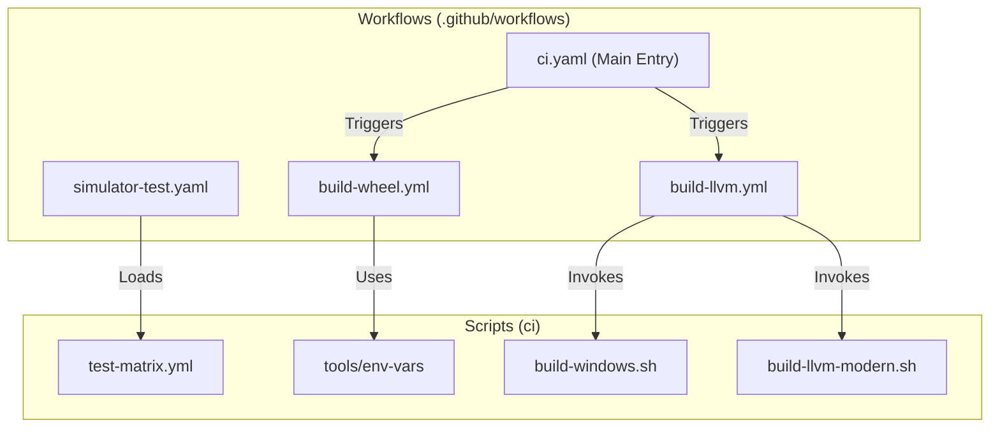
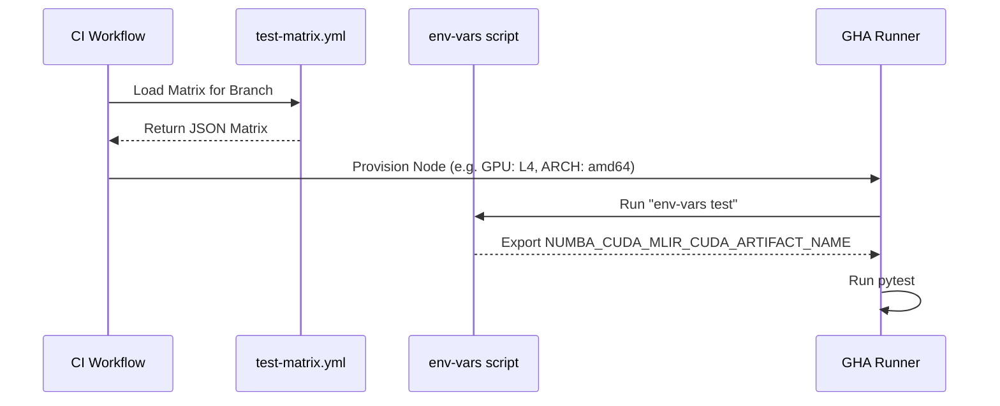

<!-- source: DeepWiki mcp.deepwiki.com · repo NVIDIA/numba-cuda-mlir · page 9 CI/CD and Build Infrastructure · fetched 2026-10-26 -->

# CI/CD and Build Infrastructure

Relevant source files

The following files were used as context for generating this wiki page:

- [.github/workflows/bandit.yml](.github/workflows/bandit.yml)
- [.github/workflows/build-wheel.yml](.github/workflows/build-wheel.yml)
- [.github/workflows/ci.yaml](.github/workflows/ci.yaml)
- [.github/workflows/codeql.yml](.github/workflows/codeql.yml)
- [.github/workflows/simulator-test.yaml](.github/workflows/simulator-test.yaml)
- [.github/workflows/test-numbast-mlir-linux.yml](.github/workflows/test-numbast-mlir-linux.yml)
- [ci/build-windows.sh](ci/build-windows.sh)
- [ci/test-matrix.yml](ci/test-matrix.yml)
- [ci/tools/env-vars](ci/tools/env-vars)
- [setup.py](setup.py)

This page provides an overview of the automation and build systems used to develop, verify, and distribute `numba-cuda-mlir`. The infrastructure is primarily built on GitHub Actions and custom shell scripts to manage the complex requirements of building multiple versions of LLVM and MLIR across different hardware architectures and operating systems.

## System Overview

The CI/CD system handles three main categories of tasks:
1.  **LLVM/MLIR Toolchain Provisioning**: Building and caching the heavy C++ dependencies (LLVM 7 and modern LLVM/MLIR) required for the compiler.
2.  **Wheel Production**: Compiling the Python C extensions and bundling them into distributable `.whl` files for Linux (x86_64, aarch64) and Windows.
3.  **Testing and Validation**: Running a multi-dimensional test matrix across various Python versions, CUDA versions, and physical GPU hardware.

### Code-to-System Mapping

The following diagram maps the logical CI components to their corresponding implementation files in the repository.

**CI Infrastructure Map**

Sources: [.github/workflows/ci.yaml:65-164](), [.github/workflows/build-wheel.yml:95-100](), [ci/test-matrix.yml:1-11]()

---

## Wheel Build and Release Pipeline

The wheel build process is orchestrated by `build-wheel.yml` and utilizes `cibuildwheel` to produce manylinux-compatible and Windows wheels. A critical aspect of the build is the restoration of pre-built LLVM artifacts, as building LLVM from source during every wheel build would be prohibitively slow.

Key features of the pipeline include:
*   **Multi-Platform Support**: Matrix builds for `linux-64`, `linux-aarch64`, and `win-64` [.github/workflows/build-wheel.yml:37-39]().
*   **Python Matrix**: Support for Python 3.11 through 3.14, including experimental "t" (freethreading) builds [.github/workflows/build-wheel.yml:28-35]().
*   **Symbol Isolation Verification**: The build includes a step to compile `fake_mlir_shim.so` to verify that `RTLD_DEEPBIND` correctly isolates the MLIR symbols at runtime [.github/workflows/build-wheel.yml:166-171]().
*   **Windows Patching**: The `setup.py` script includes a `_windows_dll_search_patch` to ensure the runtime can locate bundled DLLs on Windows using `os.add_dll_directory` [setup.py:17-47]().

For details, see [Wheel Build and Release Pipeline](#9.1).

Sources: [.github/workflows/build-wheel.yml:1-175](), [setup.py:110-165]()

---

## LLVM Build Scripts

`numba-cuda-mlir` requires two distinct LLVM environments: a modern LLVM/MLIR for the primary lowering engine and a legacy LLVM 7.0 for compatibility with `libnvvm`.

The build infrastructure manages these via:
*   **Automated Source Builds**: Scripts like `ci/build-windows.sh` handle the complexities of MSVC configuration, static CRT linking (`/MT`), and generating `LLVM-C.dll` exports for the legacy version [ci/build-windows.sh:152-212]().
*   **Artifact Caching**: LLVM builds are uploaded as GitHub artifacts and restored during wheel builds to ensure consistency across the pipeline [.github/workflows/build-wheel.yml:89-94]().
*   **Modern MLIR Integration**: The build system locates MLIR components using the `MLIR_DIR` environment variable, which points to the CMake configuration files within the modern LLVM install [setup.py:154-165]().

For details, see [LLVM Build Scripts](#9.2).

Sources: [ci/build-windows.sh:1-230](), [setup.py:54-91]()

---

## Test Matrix and CI Execution

Testing is performed across a wide range of hardware and software configurations defined in `ci/test-matrix.yml`.

### Test Infrastructure Components
| Component | Responsibility |
| :--- | :--- |
| **`test-matrix.yml`** | Centralized YAML configuration defining [ARCH, PY_VER, CUDA_VER, GPU] combinations [ci/test-matrix.yml:11-15](). |
| **`simulator-test.yaml`** | Runs tests in CPU-only environments using the CUDA simulator, managed via `pixi` environments [.github/workflows/simulator-test.yaml:100-113](). |
| **Integration Tests** | The `test-numbast-mlir-linux.yml` workflow runs external integration tests against the `numbast` repository to ensure cross-project compatibility [.github/workflows/test-numbast-mlir-linux.yml:73-81](). |
| **Static Analysis** | Automated security scans using Bandit (via Ruff) and CodeQL [.github/workflows/bandit.yml:49-52](), [.github/workflows/codeql.yml:38-44](). |

**Execution Flow: Matrix to Runner**

Sources: [ci/test-matrix.yml:17-41](), [ci/tools/env-vars:48-68](), [.github/workflows/test-numbast-mlir-linux.yml:32-45]()

For details, see [Test Matrix and CI Execution](#9.3).

---
Sources:
- [.github/workflows/ci.yaml:1-164]()
- [.github/workflows/build-wheel.yml:1-175]()
- [.github/workflows/simulator-test.yaml:1-126]()
- [.github/workflows/test-numbast-mlir-linux.yml:1-167]()
- [ci/test-matrix.yml:1-80]()
- [ci/tools/env-vars:1-75]()
- [ci/build-windows.sh:1-230]()
- [setup.py:1-186]()

---

