# Page: Overview

# Overview

<details>
<summary>Relevant source files</summary>

The following files were used as context for generating this wiki page:

- [CONTRIBUTING.md](CONTRIBUTING.md)
- [INSTALL.md](INSTALL.md)
- [README.md](README.md)
- [docs/source/user/installation.rst](docs/source/user/installation.rst)
- [docs/versions.json](docs/versions.json)
- [pyproject.toml](pyproject.toml)
- [src/numba_cuda_mlir/VERSION](src/numba_cuda_mlir/VERSION)
- [src/numba_cuda_mlir/cuda/libdevice.pyi](src/numba_cuda_mlir/cuda/libdevice.pyi)
- [src/numba_cuda_mlir/errors.py](src/numba_cuda_mlir/errors.py)
- [src/numba_cuda_mlir/py.typed](src/numba_cuda_mlir/py.typed)

</details>


`numba-cuda-mlir` is a high-performance Python compiler that provides a programming model similar to CUDA C++, evolved from the original [Numba-CUDA](https://github.com/NVIDIA/numba-cuda) project [README.md:3-5](). It is designed to be compatible with existing Numba-CUDA kernels while leveraging the **Multi-Level Intermediate Representation (MLIR)** framework for code generation instead of direct LLVM IR emission [README.md:58-61]().

The project aims to interoperate with existing Python data science stacks (like NumPy) while providing experts with granular control over GPU code generation [README.md:7-9]().

### System Context Diagram

The following diagram illustrates how the `numba-cuda-mlir` system bridges the gap between Python source code and the CUDA hardware execution environment.

**Natural Language to Code Entity Mapping**
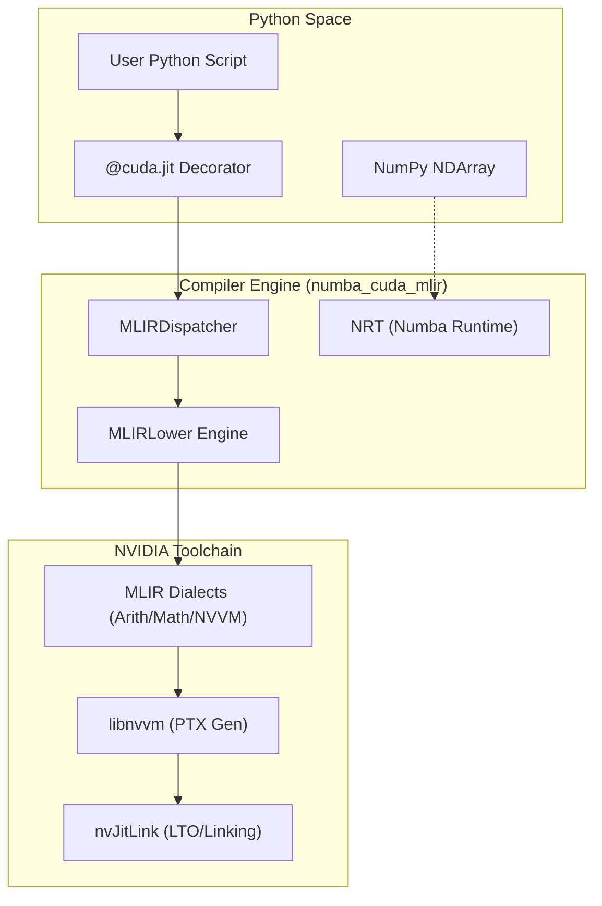
Sources: [README.md:25-30](), [src/numba_cuda_mlir/errors.py:43-48](), [pyproject.toml:31-54]()

---

## Key Capabilities

*   **Numba-CUDA Compatibility**: Most existing Numba-CUDA kernels can be migrated by simply changing the import from `from numba import cuda` to `from numba_cuda_mlir import cuda` [README.md:42-55]().
*   **Modern MLIR Pipeline**: Replaces the legacy Numba LLVM lowering with a modern MLIR-based infrastructure, allowing for more sophisticated optimizations and better dialect-level abstractions [README.md:58-61]().
*   **Broad Type Support**: Includes support for standard NumPy dtypes, CUDA vector types (e.g., `float2`), and reduced-precision formats like `bf16`, `tf32`, and `fp8` [src/numba_cuda_mlir/cuda/libdevice.pyi:4-12]().
*   **Advanced Linking**: Utilizes `nvJitLink` for LTO-aware linking and support for modern CUDA features [pyproject.toml:35-41]().

---

## Major Subsystems

The codebase is organized into several functional areas that manage the lifecycle of a CUDA kernel:

### 1. Compilation and Dispatch
The entry point for users is the `@cuda.jit` decorator. This triggers a pipeline that transforms Python AST into Numba IR, which is then lowered to MLIR operations. The `MLIRDispatcher` manages the specialized versions of kernels for different input types.
*   For details, see [Architecture Overview](#1.2).

### 2. Lowering and Dialects
The core of the compiler is the `MLIRLower` engine. It translates Numba IR instructions into specific MLIR dialects such as `arith`, `math`, and eventually the `nvvm` dialect for NVIDIA-specific operations.
*   For details, see [Compilation Pipeline](#2).

### 3. Runtime and Driver
The project includes a Numba Runtime (NRT) implementation for device-side memory management (e.g., atomic reference counting) and a Python-level abstraction for the CUDA Driver (Contexts, Streams, and Memory).
*   For details, see [Memory Management and Runtime](#5).

### 4. Compatibility and Symbol Isolation
To handle the complexities of loading multiple versions of LLVM/MLIR within the same process, the project uses `RTLD_DEEPBIND` for symbol isolation and a specialized C++ extension to downgrade modern LLVM IR for compatibility with `libnvvm`.
*   For details, see [Symbol Isolation and LLVM Compatibility](#7).

---

## Component Relationship Diagram

This diagram maps specific code entities and files to the high-level compilation flow.

**Code Entity Interaction Map**
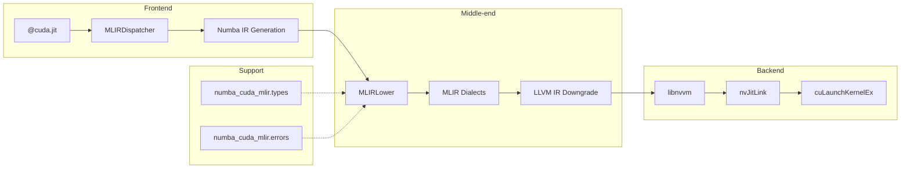
Sources: [src/numba_cuda_mlir/errors.py:43-80](), [README.md:25-39](), [pyproject.toml:47-53]()

---

## Getting Started
To begin using `numba-cuda-mlir`, ensure you have a compatible NVIDIA GPU (Compute Capability 7.0+) and the appropriate CUDA Toolkit (12.x or 13.x) [README.md:64-74]().

```bash
pip install numba-cuda-mlir[cu13]
```
For detailed installation instructions, environment setup, and a quick-start guide, see [Getting Started](#1.1).

---

## Architecture Deep Dive
The compilation pipeline is a multi-stage process involving Python AST transforms, type inference, MLIR lowering, and final translation to PTX/CUBIN via `libnvvm`.
*   For a bird's-eye view of the pipeline, see [Architecture Overview](#1.2).
*   For technical details on each stage, see [Compilation Pipeline](#2).

Sources:
- [README.md:1-125]()
- [INSTALL.md:1-154]()
- [pyproject.toml:1-207]()
- [src/numba_cuda_mlir/errors.py:1-130]()

---

# Page: Getting Started

# Getting Started

<details>
<summary>Relevant source files</summary>

The following files were used as context for generating this wiki page:

- [CONTRIBUTING.md](CONTRIBUTING.md)
- [INSTALL.md](INSTALL.md)
- [README.md](README.md)
- [docs/source/user/installation.rst](docs/source/user/installation.rst)
- [pyproject.toml](pyproject.toml)
- [src/numba_cuda_mlir/cuda/libdevice.pyi](src/numba_cuda_mlir/cuda/libdevice.pyi)
- [src/numba_cuda_mlir/errors.py](src/numba_cuda_mlir/errors.py)
- [src/numba_cuda_mlir/numba_cuda/__init__.py](src/numba_cuda_mlir/numba_cuda/__init__.py)
- [src/numba_cuda_mlir/numba_cuda/core/config.py](src/numba_cuda_mlir/numba_cuda/core/config.py)
- [src/numba_cuda_mlir/numba_cuda/cudadrv/__init__.py](src/numba_cuda_mlir/numba_cuda/cudadrv/__init__.py)
- [src/numba_cuda_mlir/numba_cuda/decorators.py](src/numba_cuda_mlir/numba_cuda/decorators.py)
- [src/numba_cuda_mlir/numba_cuda/random.py](src/numba_cuda_mlir/numba_cuda/random.py)
- [src/numba_cuda_mlir/py.typed](src/numba_cuda_mlir/py.typed)
- [tests/numba_cuda_tests/cudadrv/test_nvvm_driver.py](tests/numba_cuda_tests/cudadrv/test_nvvm_driver.py)

</details>


Numba-CUDA-MLIR provides a high-performance Python programming model for NVIDIA GPUs, evolving from the original Numba-CUDA project by replacing the LLVM-IR generation path with an MLIR-based pipeline [README.md:1-9](). This page covers the requirements, installation procedures, and basic usage patterns for the compiler.

## Prerequisites

To use Numba-CUDA-MLIR, the following environment specifications must be met:

### Software Requirements
*   **Python**: Version 3.11 or greater [README.md:66]().
*   **NumPy**: Version 1.22 or greater [README.md:68]().
*   **CUDA Toolkit**: Components including CUDA Runtime, NVCC, NVRTC, nvJitLink, and CCCL must be present [README.md:69-70]().
*   **CUDA Python**: The `cuda.core` and `cuda-bindings` packages are required at import time [README.md:67](), [src/numba_cuda_mlir/numba_cuda/__init__.py:24-30]().

### Hardware Requirements
*   **NVIDIA GPU**: Compute Capability 7.0 (Volta) or greater [README.md:71]().
*   **Drivers**:
    *   For CUDA 12.x: Driver version >= r525 [README.md:72]().
    *   For CUDA 13.x: Driver version >= r580 [README.md:73]().

**Sources:** [README.md:64-75](), [INSTALL.md:15-25](), [src/numba_cuda_mlir/numba_cuda/__init__.py:24-30]()

---

## Installation Options

The project supports three primary installation methods depending on whether you are a user or a contributor.

### Option 1: Pip Installation (Recommended for Users)
The easiest way to install is via `pip` using optional extras to pull in the correct CUDA dependencies:

```bash
# For CUDA 12
pip install numba-cuda-mlir[cu12]

# For CUDA 13
pip install numba-cuda-mlir[cu13]
```
[README.md:16](), [INSTALL.md:37-41]()

### Option 2: Editable Install (Recommended for Contributors)
Contributors typically use pre-built LLVM artifacts provided by CI to avoid long compilation times.

1.  **Download Artifacts**: Obtain `llvm-modern-install` and `llvm7-install` from the latest successful GitHub Action run [INSTALL.md:83-97]().
2.  **Install**:
    ```shell
    MLIR_DIR=$PWD/llvm-modern-install/lib/cmake/mlir \
    LIBLLVM7=$PWD/llvm7-install/lib/libLLVM-7.so \
      pip install -e '.[cu13]' --group dev --config-settings editable_mode=compat
    ```
    [INSTALL.md:107-109]()

### Option 3: Build from Source
If modifying the compiler's underlying C++ layers or LLVM/MLIR itself, use the provided build scripts:
*   `ci/build-llvm-modern.sh`: Builds the modern LLVM/MLIR stack [INSTALL.md:121]().
*   `ci/build-llvm7.sh`: Builds the legacy LLVM 7 shared library required for `libnvvm` compatibility [INSTALL.md:124]().

**Sources:** [README.md:11-17](), [INSTALL.md:1-131](), [pyproject.toml:30-54]()

---

## Quick Start Workflow

Numba-CUDA-MLIR is designed to be a drop-in replacement for `numba.cuda`. To migrate existing code, update the import statement from `from numba import cuda` to `from numba_cuda_mlir import cuda` [README.md:42-56]().

### Basic Kernel Example
The following example demonstrates a vector addition kernel using the `@cuda.jit` decorator.

```python
import numpy as np
from numba_cuda_mlir import cuda

@cuda.jit
def vector_add(a, b, out):
    # Determine absolute thread position in the 1D grid
    i = cuda.grid(1)
    
    # Guard against out-of-bounds access
    if i < out.shape[0]:
        out[i] = a[i] + b[i]

n = 1_000_000
a = np.ones(n, dtype=np.float32)
b = np.ones(n, dtype=np.float32)
out = np.zeros(n, dtype=np.float32)

threads_per_block = 256
blocks = (n + threads_per_block - 1) // threads_per_block

# Launch kernel with [grid_size, block_size] configuration
vector_add[blocks, threads_per_block](a, b, out)
```
[README.md:21-39]()

### Environment Configuration
The compiler behavior can be adjusted using environment variables or a `.numba_config.yaml` file [src/numba_cuda_mlir/numba_cuda/core/config.py:28-30](). Key settings are processed by the `_EnvReloader` class [src/numba_cuda_mlir/numba_cuda/core/config.py:124-125]().

| Variable | Description |
| :--- | :--- |
| `NUMBA_OPT` | Set optimization level (0, 1, 2, 3, or 'max') [src/numba_cuda_mlir/numba_cuda/core/config.py:112-121](). |
| `NUMBA_CUDA_DEFAULT_PTX_CC` | Default compute capability (defaults to 7.5) [src/numba_cuda_mlir/numba_cuda/__init__.py:55-58](). |

**Sources:** [README.md:19-61](), [src/numba_cuda_mlir/numba_cuda/core/config.py:124-165](), [src/numba_cuda_mlir/numba_cuda/__init__.py:48-59]()

---

## Code Entity Mapping

The following diagrams illustrate how user-facing decorators and installation configurations map to internal code entities.

### Installation and Dependency Mapping
This diagram shows how the `pyproject.toml` configuration drives the installation of specific CUDA and LLVM components.

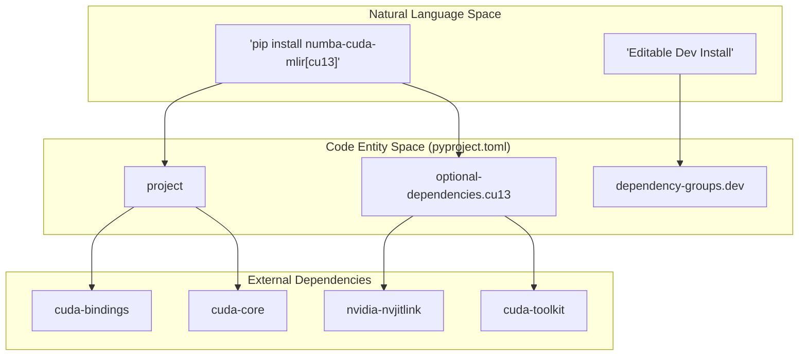
**Sources:** [pyproject.toml:12-73](), [INSTALL.md:31-54]()

### JIT Entry Point and Execution Flow
This diagram maps the high-level `@cuda.jit` usage to the primary dispatcher and compiler components.

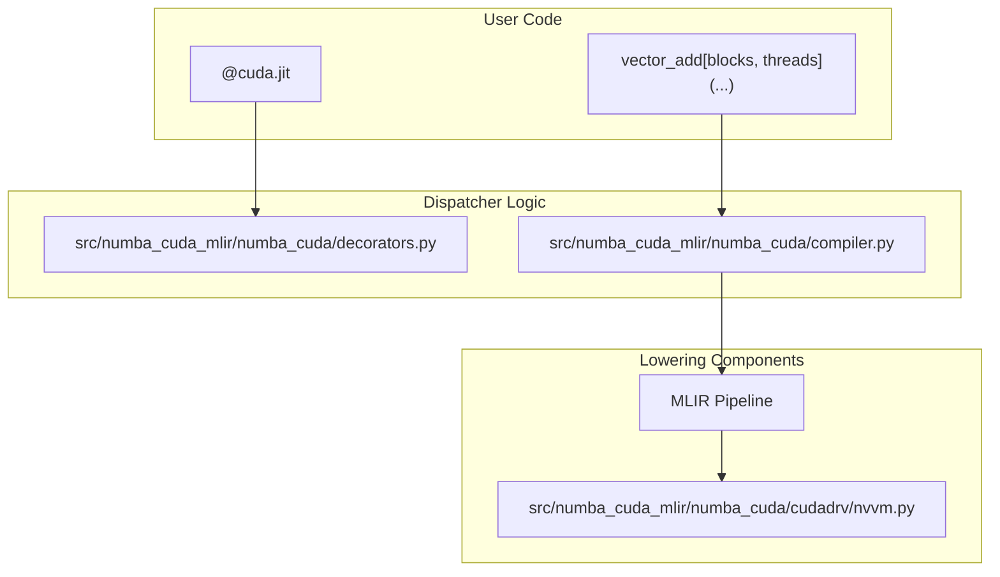
**Sources:** [src/numba_cuda_mlir/numba_cuda/decorators.py](), [src/numba_cuda_mlir/numba_cuda/compiler.py:35-41](), [src/numba_cuda_mlir/numba_cuda/cudadrv/nvvm.py:7]()

---

## Debugging Your First Kernel

If a kernel fails to compile or execute as expected, use the following decorator options to inspect the intermediate representations:

*   **Dump IR**: Use `@cuda.jit(dump=True)` to print Numba IR and MLIR to stderr [CONTRIBUTING.md:60]().
*   **Help**: Use `@cuda.jit(help=True)` to see all available debug and configuration options [CONTRIBUTING.md:61]().
*   **Internal Errors**: If a compiler bug is triggered, the system raises a `UserFacingInternalCompilerError` and saves a full traceback to a temporary log file [src/numba_cuda_mlir/errors.py:34-79]().

**Sources:** [CONTRIBUTING.md:58-62](), [src/numba_cuda_mlir/errors.py:34-79]()

---

# Page: Architecture Overview

# Architecture Overview

<details>
<summary>Relevant source files</summary>

The following files were used as context for generating this wiki page:

- [src/numba_cuda_mlir/caching.py](src/numba_cuda_mlir/caching.py)
- [src/numba_cuda_mlir/decorators.py](src/numba_cuda_mlir/decorators.py)
- [src/numba_cuda_mlir/descriptor.py](src/numba_cuda_mlir/descriptor.py)
- [src/numba_cuda_mlir/linker.py](src/numba_cuda_mlir/linker.py)
- [src/numba_cuda_mlir/mlir_compiler.py](src/numba_cuda_mlir/mlir_compiler.py)
- [src/numba_cuda_mlir/mlir_lowering.py](src/numba_cuda_mlir/mlir_lowering.py)
- [src/numba_cuda_mlir/mlir_optimization.py](src/numba_cuda_mlir/mlir_optimization.py)
- [src/numba_cuda_mlir/numba_cuda/cudadrv/driver.py](src/numba_cuda_mlir/numba_cuda/cudadrv/driver.py)
- [tests/test_cuda_array_interface_launch_cache.py](tests/test_cuda_array_interface_launch_cache.py)
- [tests/test_descriptor_launch_config.py](tests/test_descriptor_launch_config.py)
- [tests/test_kernel_exceptions.py](tests/test_kernel_exceptions.py)
- [tests/test_tuple.py](tests/test_tuple.py)

</details>


The `numba-cuda-mlir` compiler pipeline transforms Python source code into high-performance CUDA kernels using MLIR as the primary intermediate representation. This architecture replaces the traditional Numba NVVM backend with a modern, multi-dialect MLIR lowering engine that supports advanced features like LTO (Link Time Optimization), structured data types, and unified memory management.

## Compilation Pipeline Overview

The compilation process is a multi-stage transformation that bridges the gap between Python's high-level AST and the low-level PTX/CUBIN executed on NVIDIA GPUs.

### 1. Frontend and IR Generation
The process begins when a function decorated with `@cuda.jit` or `@mlir_jit` is called.
*   **AST Transforms**: Before Numba IR generation, the Python AST is modified by `apply_ast_transforms` [src/numba_cuda_mlir/mlir_compiler.py:58-58](). This stage handles compile-time constant evaluation (`consteval`), constant-if pruning, and loop unrolling [src/numba_cuda_mlir/ast_transforms.py:1-10]().
*   **Numba IR**: The transformed AST is lowered to standard Numba IR.
*   **Type Inference**: The `MLIRTypeInference` pass [src/numba_cuda_mlir/mlir_compiler.py:67-114]() resolves types across the IR. It uses a specialized `MLIRTypingContext` to handle CUDA-specific types like vector types (e.g., `float4`) and reduced precision types (`bf16`, `fp8`).

### 2. MLIR Lowering
The core of the system is `MLIRLower` [src/numba_cuda_mlir/mlir_lowering.py:129-132](), which translates Numba IR into MLIR operations.
*   **Dialect Usage**: The engine emits a mix of dialects including `arith`, `math`, `memref`, `scf`, `gpu`, and `nvvm` [src/numba_cuda_mlir/mlir_lowering.py:59-72]().
*   **Data Layout**: Numba types are converted to MLIR types via `to_mlir_type` [src/numba_cuda_mlir/mlir_lowering.py:23-26](). Structured types (NumPy Records) are lowered to LLVM structs, while arrays become `memref` descriptors.
*   **SSA and Spilling**: The lowering engine manages SSA values and handles "spilling" for variables that cross block boundaries or require memory-backed storage [src/numba_cuda_mlir/mlir_lowering.py:129-200]().

### 3. Optimization and Target Translation
Once the MLIR module is constructed, it passes through the `PassManager` [src/numba_cuda_mlir/mlir_optimization.py:9-12]().
*   **Optimization Pipeline**: The `get_base_pipeline` [src/numba_cuda_mlir/mlir_optimization.py:45-96]() defines the transformation sequence:
    1.  `one-shot-bufferize`: Converts tensor-like operations to memrefs.
    2.  `convert-linalg-to-parallel-loops`: Lowers high-level NumPy-like operations.
    3.  `gpu-kernel-outlining`: Separates the device code into a `gpu.module`.
    4.  `convert-nvvm-to-llvm`: Prepares the IR for final translation.
*   **LLVM Downgrade**: For GPUs older than Blackwell (sm_100), the modern MLIR LLVM dialect is downgraded to an LLVM 7-compatible form via the `llvm_downgrade.cpp` C++ extension to support `libnvvm` [src/numba_cuda_mlir/mlir_optimization.py:99-107]().

### 4. Linking and Execution
The final binary is produced by the `Linker` [src/numba_cuda_mlir/linker.py:94-94]().
*   **JIT Linking**: The system uses `nvJitLink` to combine the generated PTX/LTOIR with external libraries or device functions [src/numba_cuda_mlir/linker.py:45-91]().
*   **Kernel Launch**: The `MLIRDispatcher` [src/numba_cuda_mlir/descriptor.py:234-240]() uses `_ArgMarshaller` [src/numba_cuda_mlir/descriptor.py:13-13]() to prepare Python/NumPy arguments for the CUDA driver. Launch is performed via `cuLaunchKernelEx` through the C++ `KernelDispatcher`.

## Data Flow Diagram

The following diagram illustrates the transformation of a kernel from Python source to executable machine code.

### High-Level Compilation Flow
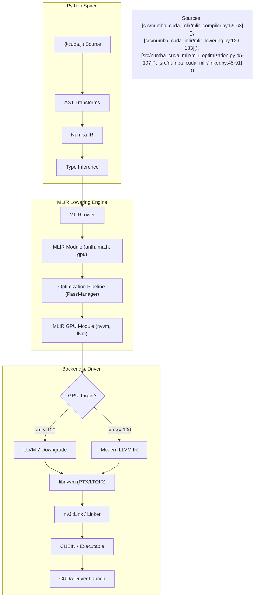

## System Entity Map

This diagram maps conceptual stages to the specific classes and functions responsible for their implementation.

### Code Entity Association
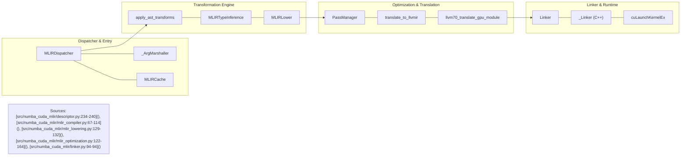

## Key Architectural Components

| Component | Responsibility | Key File/Class |
| :--- | :--- | :--- |
| **Dispatcher** | Manages JIT compilation triggers, argument marshalling, and caching. | `MLIRDispatcher` [src/numba_cuda_mlir/descriptor.py:234]() |
| **Lowering Engine** | Translates typed Numba IR into MLIR operations across multiple dialects. | `MLIRLower` [src/numba_cuda_mlir/mlir_lowering.py:129]() |
| **Optimization** | Executes MLIR pass pipelines for bufferization and hardware-specific lowering. | `PassManager` [src/numba_cuda_mlir/mlir_optimization.py:9]() |
| **LLVM Bridge** | Handles compatibility between modern MLIR and legacy `libnvvm` (LLVM 7). | `_get_llvm70_capi` [src/numba_cuda_mlir/mlir_optimization.py:122]() |
| **Linker** | Orchestrates `nvJitLink` for LTO and external symbol resolution. | `Linker` [src/numba_cuda_mlir/linker.py:94]() |
| **Runtime (NRT)** | Implements device-side memory management and reference counting. | `emit_nrt_functions` [src/numba_cuda_mlir/mlir_lowering.py:82]() |

## Data Flow Details

1.  **Input**: The user provides a Python function and arguments.
2.  **Dispatch**: `MLIRDispatcher` checks the `MLIRCache` [src/numba_cuda_mlir/caching.py:109-111](). If a cache miss occurs, it triggers the compiler.
3.  **Frontend**: `apply_ast_transforms` [src/numba_cuda_mlir/ast_transforms.py:1-10]() cleans up the Python source. Numba's `type_inference_stage` [src/numba_cuda_mlir/mlir_compiler.py:82-90]() determines variable types.
4.  **Lowering**: `MLIRLower` iterates over Numba IR blocks [src/numba_cuda_mlir/mlir_lowering.py:137-138](), emitting MLIR ops for every instruction.
5.  **Optimization**: The `PassManager` applies the `get_base_pipeline` [src/numba_cuda_mlir/mlir_optimization.py:45-96](), resulting in an optimized `gpu.module`.
6.  **Translation**: The module is translated to LLVM IR. If `sm < 100`, it uses the `llvm70_translate` path [src/numba_cuda_mlir/mlir_optimization.py:183-203]().
7.  **Binary Generation**: `libnvvm` compiles LLVM IR to PTX or LTOIR. The `Linker` invokes `nvJitLink` to produce the final CUBIN.
8.  **Execution**: The CUDA driver loads the CUBIN and launches the kernel using the grid/block dimensions provided by the `LaunchConfiguration` [src/numba_cuda_mlir/descriptor.py:54-54]().

Sources: `src/numba_cuda_mlir/mlir_compiler.py`, `src/numba_cuda_mlir/mlir_lowering.py`, `src/numba_cuda_mlir/mlir_optimization.py`, `src/numba_cuda_mlir/linker.py`, `src/numba_cuda_mlir/descriptor.py`.

---

# Page: Compilation Pipeline

# Compilation Pipeline

<details>
<summary>Relevant source files</summary>

The following files were used as context for generating this wiki page:

- [src/numba_cuda_mlir/caching.py](src/numba_cuda_mlir/caching.py)
- [src/numba_cuda_mlir/decorators.py](src/numba_cuda_mlir/decorators.py)
- [src/numba_cuda_mlir/linker.py](src/numba_cuda_mlir/linker.py)
- [src/numba_cuda_mlir/mlir_compiler.py](src/numba_cuda_mlir/mlir_compiler.py)
- [src/numba_cuda_mlir/mlir_lowering.py](src/numba_cuda_mlir/mlir_lowering.py)
- [src/numba_cuda_mlir/mlir_optimization.py](src/numba_cuda_mlir/mlir_optimization.py)
- [src/numba_cuda_mlir/numba_cuda/cudadrv/driver.py](src/numba_cuda_mlir/numba_cuda/cudadrv/driver.py)
- [tests/test_kernel_exceptions.py](tests/test_kernel_exceptions.py)
- [tests/test_tuple.py](tests/test_tuple.py)

</details>


The `numba-cuda-mlir` compilation pipeline is an end-to-end JIT process that transforms Python source code into high-performance CUDA kernels using MLIR (Multi-Level Intermediate Representation) as the primary optimization and lowering framework. Unlike the standard Numba CUDA target which lowers Numba IR directly to LLVM IR, this pipeline introduces MLIR dialects to perform high-level optimizations like bufferization, loop transformations, and structured memory management before reaching the LLVM layer.

### Pipeline Stages Overview

The compilation process is orchestrated through several distinct stages, moving from high-level Python semantics to low-level machine code:

1.  **Frontend & Dispatch**: Entry through `@cuda.jit` or `@mlir_jit`, where the `MLIRDispatcher` manages specialization based on argument types and handles the transition from Python to the compiler [src/numba_cuda_mlir/mlir_compiler.py:57-57]().
2.  **AST & Numba IR**: Python source is parsed into an AST, transformed (e.g., constant evaluation), and lowered to Numba IR [src/numba_cuda_mlir/mlir_compiler.py:58-58]().
3.  **MLIR Lowering**: The `MLIRLower` engine translates Numba IR into a mix of MLIR dialects (Arith, Math, MemRef, SCF, GPU, and NVVM) [src/numba_cuda_mlir/mlir_lowering.py:129-132]().
4.  **MLIR Optimization**: A specialized `PassManager` executes a pipeline of transformations, including bufferization and lowering structured loops to the NVVM dialect [src/numba_cuda_mlir/mlir_optimization.py:45-96]().
5.  **Target Translation**: The optimized MLIR is translated to LLVM IR. For older GPUs (pre-Blackwell), a compatibility path downgrades the IR to LLVM 7.0 for `libnvvm` consumption [src/numba_cuda_mlir/mlir_optimization.py:99-107]().
6.  **Assembly & Linking**: `libnvvm` generates PTX or LTO-IR, which is then linked with external libraries using `nvJitLink` or the CUDA Driver API [src/numba_cuda_mlir/linker.py:94-113]().

### High-Level Flow Diagram

The following diagram illustrates the flow of data and control through the major code entities of the pipeline.

**System Data Flow: Python to Kernel**
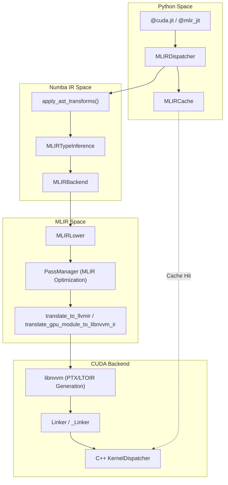
Sources: [src/numba_cuda_mlir/mlir_compiler.py:50-145](), [src/numba_cuda_mlir/mlir_optimization.py:45-96](), [src/numba_cuda_mlir/linker.py:94-135]()

---

### 2.1 Decorators and Dispatchers
The entry point to the pipeline is the `MLIRDispatcher`, which is registered as the handler for `@cuda.jit` when the MLIR backend is enabled. It handles lazy compilation, argument type inference, and result caching. The `MLIRDispatcher` uses an `_ArgMarshaller` to prepare Python/NumPy objects for the device.

For details, see [Decorators and Dispatchers](#2.1).
Sources: [src/numba_cuda_mlir/mlir_compiler.py:57-57](), [src/numba_cuda_mlir/caching.py:109-118]()

### 2.2 AST Transforms and Numba IR
Before Numba IR is generated, the pipeline applies custom AST transformations. These include `consteval` for compile-time loop unrolling and constant-if pruning. Once Numba IR is produced, `MLIRTypeInference` resolves types using a context tailored for MLIR-compatible types.

For details, see [AST Transforms and Numba IR](#2.2).
Sources: [src/numba_cuda_mlir/mlir_compiler.py:58-96](), [src/numba_cuda_mlir/numbair_transforms.py:50-53]()

### 2.3 MLIR Lowering Engine
The `MLIRLower` class is the heart of the frontend-to-MLIR transition. It iterates through Numba IR blocks and emits MLIR operations. Key responsibilities include managing the `mlir_loc` for debug info, handling SSA value mapping, and lowering complex structures like NumPy arrays into MLIR `MemRef` types.

For details, see [MLIR Lowering Engine](#2.3).
Sources: [src/numba_cuda_mlir/mlir_lowering.py:129-203](), [src/numba_cuda_mlir/mlir_lowering.py:116-122]()

### 2.4 MLIR Optimization and Target Translation
The MLIR `PassManager` runs a sequence of passes such as `one-shot-bufferize`, `convert-linalg-to-parallel-loops`, and `gpu-kernel-outlining`. For compatibility with `libnvvm`, the pipeline can branch into an `LLVM70` path, which uses a C++ bridge to downgrade modern MLIR/LLVM constructs to a format compatible with older CUDA toolkits.

For details, see [MLIR Optimization and Target Translation](#2.4).
Sources: [src/numba_cuda_mlir/mlir_optimization.py:45-96](), [src/numba_cuda_mlir/mlir_optimization.py:99-107](), [src/numba_cuda_mlir/mlir_optimization.py:183-205]()

### 2.5 Linking and Kernel Launch
The final stage involves the `Linker` class, which aggregates PTX, LTO-IR, and object files. It supports LTO-aware linking via `nvJitLink`. Once linked, the binary is passed to a C++ `KernelDispatcher` which uses the CUDA Driver API (e.g., `cuLaunchKernelEx`) to execute the code on the GPU.

For details, see [Linking and Kernel Launch](#2.5).
Sources: [src/numba_cuda_mlir/linker.py:94-135](), [src/numba_cuda_mlir/linker.py:45-91]()

### Pipeline Summary Table

| Stage | Input | Output | Key Entity |
| :--- | :--- | :--- | :--- |
| **Frontend** | Python Function | Specialized Signature | `MLIRDispatcher` |
| **Analysis** | Python AST | Numba IR | `apply_ast_transforms` |
| **Lowering** | Numba IR | MLIR (GPU/SCF/Arith) | `MLIRLower` |
| **Optimization**| MLIR Dialects | MLIR (NVVM/LLVM) | `PassManager` |
| **Translation** | MLIR | LLVM IR / PTX | `translate_to_llvmir` |
| **Backend** | PTX / LTOIR | CUBIN / Executable | `Linker` |

Sources: [src/numba_cuda_mlir/mlir_compiler.py:139-205](), [src/numba_cuda_mlir/mlir_optimization.py:45-96](), [src/numba_cuda_mlir/linker.py:28-42]()

---

# Page: Decorators and Dispatchers

# Decorators and Dispatchers

<details>
<summary>Relevant source files</summary>

The following files were used as context for generating this wiki page:

- [src/numba_cuda_mlir/caching.py](src/numba_cuda_mlir/caching.py)
- [src/numba_cuda_mlir/decorators.py](src/numba_cuda_mlir/decorators.py)
- [src/numba_cuda_mlir/descriptor.py](src/numba_cuda_mlir/descriptor.py)
- [src/numba_cuda_mlir/linker.py](src/numba_cuda_mlir/linker.py)
- [src/numba_cuda_mlir/memory_management/__init__.py](src/numba_cuda_mlir/memory_management/__init__.py)
- [src/numba_cuda_mlir/memory_management/nrt.py](src/numba_cuda_mlir/memory_management/nrt.py)
- [src/numba_cuda_mlir/mlir_compiler.py](src/numba_cuda_mlir/mlir_compiler.py)
- [src/numba_cuda_mlir/mlir_optimization.py](src/numba_cuda_mlir/mlir_optimization.py)
- [src/numba_cuda_mlir/numba_cuda/codegen.py](src/numba_cuda_mlir/numba_cuda/codegen.py)
- [src/numba_cuda_mlir/numba_cuda/cudadrv/driver.py](src/numba_cuda_mlir/numba_cuda/cudadrv/driver.py)
- [src/numba_cuda_mlir/numba_cuda/dispatcher.py](src/numba_cuda_mlir/numba_cuda/dispatcher.py)
- [src/numba_cuda_mlir/numba_cuda/memory_management/nrt.py](src/numba_cuda_mlir/numba_cuda/memory_management/nrt.py)
- [tests/test_cuda_array_interface_launch_cache.py](tests/test_cuda_array_interface_launch_cache.py)
- [tests/test_descriptor_launch_config.py](tests/test_descriptor_launch_config.py)

</details>


The `@cuda.jit` and `@mlir_jit` decorators are the entry points for the `numba-cuda-mlir` compilation pipeline. They transform Python functions into `Dispatcher` objects that manage the lifecycle of a kernel: from AST transformation and type inference to MLIR lowering, compilation into PTX/CUBIN, and finally, execution on the GPU.

## The Decorator Entry Points

There are two primary decorators used to define GPU kernels and device functions:

1.  **`@mlir_jit`**: The primary decorator for the MLIR-based pipeline. It initializes an `MLIRDispatcher` which uses the MLIR lowering engine [src/numba_cuda_mlir/decorators.py:101-200]().
2.  **`@cuda.jit`**: A compatibility wrapper. In `numba-cuda-mlir`, this is typically aliased to `@mlir_jit` or provides a similar interface to ensure existing Numba CUDA code works with the MLIR backend [src/numba_cuda_mlir/decorators.py:10-10]().

### Configuration Options
Both decorators accept a variety of `targetoptions` via the `MLIRJITOption` schema [src/numba_cuda_mlir/decorators.py:18-33](). Key options include:
*   `opt_level`: Optimization level (0-3) [src/numba_cuda_mlir/decorators.py:103-109]().
*   `chip`: Target GPU compute capability (e.g., `"sm_80"`) [src/numba_cuda_mlir/decorators.py:136-141]().
*   `inline`: Inlining strategy (`"always"`, `"never"`, `"auto"`) [src/numba_cuda_mlir/decorators.py:117-122]().
*   `debug`/`lineinfo`: Generation of DWARF debug info or line mapping [src/numba_cuda_mlir/decorators.py:202-213]().

## Dispatcher Architecture

The `MLIRDispatcher` is responsible for specialized compilation. When a decorated function is called, the dispatcher inspects the types of the arguments and either retrieves a previously compiled kernel from its cache or triggers a new compilation [src/numba_cuda_mlir/numba_cuda/dispatcher.py:84-123]().

### Specialized Compilation Path
The dispatcher orchestrates the following flow:
1.  **Type Inference**: Resolves the Numba types of the input arguments [src/numba_cuda_mlir/mlir_compiler.py:67-112]().
2.  **MLIR Backend**: Invokes `MLIRLower` to translate Numba IR to MLIR [src/numba_cuda_mlir/mlir_compiler.py:139-195]().
3.  **Optimization**: Runs the MLIR pass pipeline (e.g., `one-shot-bufferize`, `gpu-kernel-outlining`) [src/numba_cuda_mlir/mlir_optimization.py:45-96]().
4.  **Translation**: Converts MLIR to LLVM IR (or LLVM 7 IR for older GPUs) and then to PTX via `libnvvm` [src/numba_cuda_mlir/mlir_optimization.py:99-107]().

### Kernel Launch Configuration
Kernels are configured using the `[grid, block]` syntax. This returns an `_ArgMarshaller` object [src/numba_cuda_mlir/descriptor.py:13-14]().

**Entity Relationship: Dispatcher to Execution**
Title: Dispatcher and Marshaller Entity Mapping
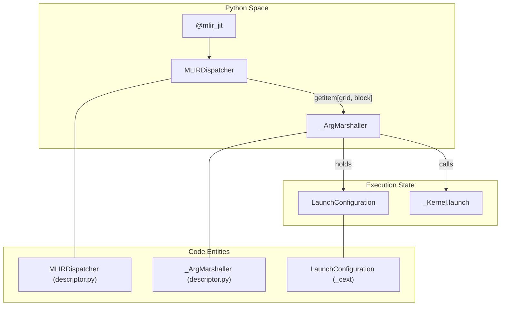
Sources: [src/numba_cuda_mlir/descriptor.py:39-54](), [src/numba_cuda_mlir/numba_cuda/dispatcher.py:84-123]()

## Argument Marshalling and the `_ArgMarshaller`

The `_ArgMarshaller` is a transient object created for a specific kernel launch. Its primary role is to prepare Python objects (like NumPy arrays or CuPy arrays) for the C++ kernel launcher [src/numba_cuda_mlir/descriptor.py:80-100]().

### The Execution Path
When the `_ArgMarshaller` is called:
1.  **Thread-Local Storage**: It stores the `LaunchConfiguration` in a thread-local variable `_compile_arg_types.launch_config`. This allows the compiler to access launch-time constants (like block size) if needed during JIT [src/numba_cuda_mlir/descriptor.py:59-60](), [tests/test_descriptor_launch_config.py:80-103]().
2.  **Array Handling**: It detects `__cuda_array_interface__` (CAI) providers. It synchronizes streams if required by the CAI version [src/numba_cuda_mlir/descriptor.py:136-162]().
3.  **NRT Management**: If the kernel uses the Numba Runtime (NRT), the marshaller ensures the `TheMSys` device global is initialized via a post-load callback [src/numba_cuda_mlir/mlir_optimization.py:29-38]().
4.  **C++ Dispatch**: It passes the flattened, cleaned arguments to the C++ `LaunchConfiguration` object, which performs the actual `cuLaunchKernel` call [src/numba_cuda_mlir/descriptor.py:54-54]().

### Signature Caching
To avoid expensive type inference on every launch, the marshaller maintains an `_array_sig_cache`. This cache tracks metadata like `dtype`, `ndim`, and `readonly` status for CAI-compatible objects [tests/test_cuda_array_interface_launch_cache.py:33-44]().

## Compilation and Linking

The dispatcher uses the `Linker` class to manage PTX and LTO-IR (Link Time Optimization Intermediate Representation) [src/numba_cuda_mlir/linker.py:94-135]().

### Resolved Link Plan
Before linking, the system resolves a `ResolvedLinkPlan` to determine if it should produce PTX or LTO-IR based on the presence of external libraries or requested optimization levels [src/numba_cuda_mlir/linker.py:28-91]().

**Data Flow: Compilation to CUBIN**
Title: Compilation Data Flow
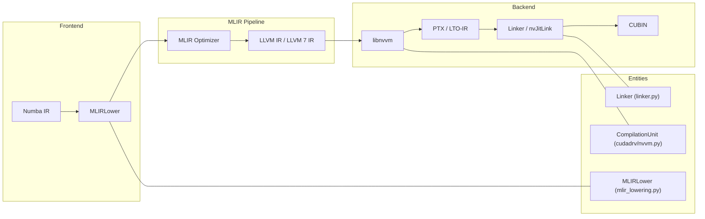
Sources: [src/numba_cuda_mlir/mlir_compiler.py:183-188](), [src/numba_cuda_mlir/mlir_optimization.py:45-96](), [src/numba_cuda_mlir/linker.py:94-135]()

## Caching Mechanisms

The `numba-cuda-mlir` system employs two levels of caching:
1.  **Dispatcher Cache**: An in-memory cache within `MLIRDispatcher` that maps argument types to `_Kernel` objects [src/numba_cuda_mlir/numba_cuda/dispatcher.py:21-48]().
2.  **Persistent MLIR Cache**: Controlled by `MLIRCache`, this persists compiled artifacts to disk to speed up subsequent executions of the same process [src/numba_cuda_mlir/descriptor.py:48-48]().

If `NullCache` is used, every unique signature will trigger a full compilation from Python source [src/numba_cuda_mlir/descriptor.py:48-48]().

Sources:
- [src/numba_cuda_mlir/decorators.py:18-213]()
- [src/numba_cuda_mlir/descriptor.py:13-162]()
- [src/numba_cuda_mlir/linker.py:28-135]()
- [src/numba_cuda_mlir/mlir_compiler.py:67-195]()
- [src/numba_cuda_mlir/mlir_optimization.py:29-107]()
- [src/numba_cuda_mlir/numba_cuda/dispatcher.py:21-123]()
- [tests/test_descriptor_launch_config.py:80-103]()
- [tests/test_cuda_array_interface_launch_cache.py:33-44]()

---

# Page: AST Transforms and Numba IR

# AST Transforms and Numba IR

<details>
<summary>Relevant source files</summary>

The following files were used as context for generating this wiki page:

- [src/numba_cuda_mlir/caching.py](src/numba_cuda_mlir/caching.py)
- [src/numba_cuda_mlir/decorators.py](src/numba_cuda_mlir/decorators.py)
- [src/numba_cuda_mlir/linker.py](src/numba_cuda_mlir/linker.py)
- [src/numba_cuda_mlir/mlir_compiler.py](src/numba_cuda_mlir/mlir_compiler.py)
- [src/numba_cuda_mlir/mlir_optimization.py](src/numba_cuda_mlir/mlir_optimization.py)
- [src/numba_cuda_mlir/numba_cuda/core/typed_passes.py](src/numba_cuda_mlir/numba_cuda/core/typed_passes.py)
- [src/numba_cuda_mlir/numba_cuda/cudadrv/driver.py](src/numba_cuda_mlir/numba_cuda/cudadrv/driver.py)
- [tests/ast_transforms/test_ast_transform_examples.py](tests/ast_transforms/test_ast_transform_examples.py)
- [tests/ast_transforms/test_device_func.py](tests/ast_transforms/test_device_func.py)

</details>


The `numba-cuda-mlir` compilation pipeline begins with a series of pre-compilation Python AST (Abstract Syntax Tree) transformations. These transformations enable compile-time evaluation and specialized code generation before the code is converted into Numba IR. Once in IR form, the compiler performs type inference and additional optimizations before lowering to MLIR.

## AST Transformation Pipeline

Before the standard Numba compilation process takes over, `numba-cuda-mlir` applies several experimental AST-level passes. These passes are primarily used to implement compile-time features that are difficult to express in standard Numba IR, such as loop unrolling of `range` objects and conditional compilation based on compile-time constants.

### Key Transformation Passes
The entry point for these transforms is `apply_ast_transforms` [src/numba_cuda_mlir/ast_transforms.py:1-5]().

1.  **Consteval (Compile-time Evaluation):** Evaluates expressions wrapped in `consteval()` at compile time. This allows for meta-programming where Python logic executes during compilation to generate the final kernel code [tests/ast_transforms/test_ast_transform_examples.py:8-40]().
2.  **Constant-If Elimination:** Resolves `if` statements where the condition is a compile-time constant (often resulting from a `consteval` check). The branch not taken is pruned from the AST [tests/ast_transforms/test_device_func.py:34-41]().
3.  **Comprehension Unrolling:** Expands list or generator comprehensions into explicit loops or static sequences if the bounds are known at compile time.
4.  **Loop Unrolling:** Specifically targets `for i in consteval(range(N))` patterns, replacing the loop with N repeated blocks of code [tests/ast_transforms/test_ast_transform_examples.py:30-31]().

### AST Transformation Flow
The following diagram illustrates how the Python source code is mutated before reaching the Numba Interpreter.

**Title: AST Pre-processing Pipeline**
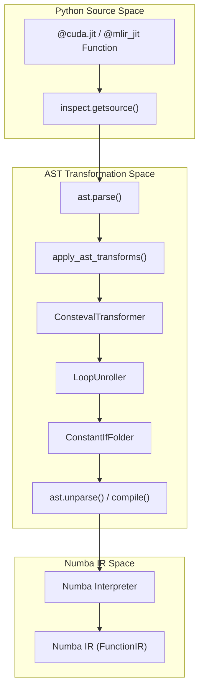
Sources: [src/numba_cuda_mlir/mlir_compiler.py:58-58](), [src/numba_cuda_mlir/decorators.py:191-195]()

## Numba IR Generation

After AST transformations, the code is passed to the Numba Interpreter to generate Numba IR. This IR is a linear, block-based representation of the function's control flow.

### Custom IR Passes
The `MLIRBackend` class manages the transition from Numba IR to MLIR. Before lowering, it can invoke specialized IR-level passes [src/numba_cuda_mlir/mlir_compiler.py:139-144]().

*   **NumbaCudaMlirLiteralUnroll:** A specialized version of Numba's literal unrolling tailored for MLIR compatibility [src/numba_cuda_mlir/mlir_compiler.py:50-51]().
*   **NumbaCudaMlirInlineInlinables:** Handles inlining of functions marked as inlinable, ensuring that device-side calls are resolved before MLIR lowering [src/numba_cuda_mlir/mlir_compiler.py:52-53]().

## Type Inference Customizations

The compiler uses a specialized `MLIRTypeInference` pass [src/numba_cuda_mlir/mlir_compiler.py:66-68](). This pass extends the standard Numba type inference to handle CUDA-specific requirements and MLIR-based lowering constraints.

### Type Inference Stage
The core logic resides in `type_inference_stage`, which performs the following:
1.  **Seed Arguments:** Maps input Python types to Numba types [numba_cuda_mlir/numba_cuda/core/typed_passes.py:98-99]().
2.  **Constraint Building:** Generates type constraints based on IR operations [numba_cuda_mlir/numba_cuda/core/typed_passes.py:109-109]().
3.  **Propagation:** Iteratively resolves types until a fixed point is reached [numba_cuda_mlir/numba_cuda/core/typed_passes.py:111-111]().
4.  **Legalization:** Ensures that the resulting types are valid for the MLIR backend (e.g., rejecting function object returns in nopython mode) [src/numba_cuda_mlir/mlir_compiler.py:98-112]().

**Title: Type Inference and IR Legalization**
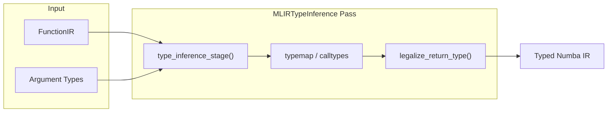
Sources: [src/numba_cuda_mlir/mlir_compiler.py:66-112](), [numba_cuda_mlir/numba_cuda/core/typed_passes.py:78-114]()

## Data Flow: From Source to Typed IR

The data flow involves capturing the function metadata, applying AST transforms, generating IR, and performing type inference.

| Stage | Entity | Role |
| :--- | :--- | :--- |
| **AST Transform** | `apply_ast_transforms` | Mutates Python AST for compile-time logic [src/numba_cuda_mlir/mlir_compiler.py:58-58]() |
| **IR Generation** | `Numba Interpreter` | Translates transformed AST to `FunctionIR` |
| **Type Inference** | `MLIRTypeInference` | Populates `typemap` and `calltypes` [src/numba_cuda_mlir/mlir_compiler.py:67-68]() |
| **Backend Entry** | `MLIRBackend` | Prepares `fndesc` and initiates MLIR lowering [src/numba_cuda_mlir/mlir_compiler.py:139-140]() |

### IR Inspection and Debugging
Users can inspect the state of the Numba IR and the associated type map by setting the `dump_numba_ir` or `dump` options in the `@cuda.jit` decorator [src/numba_cuda_mlir/mlir_compiler.py:175-180](). This outputs the linear IR and the inferred types for every variable to `stderr`.

Sources: [src/numba_cuda_mlir/mlir_compiler.py:1-200](), [src/numba_cuda_mlir/decorators.py:101-165](), [numba_cuda_mlir/numba_cuda/core/typed_passes.py:1-120]()

---

# Page: MLIR Lowering Engine

# MLIR Lowering Engine

<details>
<summary>Relevant source files</summary>

The following files were used as context for generating this wiki page:

- [src/numba_cuda_mlir/mlir_debuginfo.py](src/numba_cuda_mlir/mlir_debuginfo.py)
- [src/numba_cuda_mlir/mlir_lowering.py](src/numba_cuda_mlir/mlir_lowering.py)
- [src/numba_cuda_mlir/numba_cuda/datamodel/models.py](src/numba_cuda_mlir/numba_cuda/datamodel/models.py)
- [tests/test_debuginfo.py](tests/test_debuginfo.py)
- [tests/test_kernel_exceptions.py](tests/test_kernel_exceptions.py)
- [tests/test_tuple.py](tests/test_tuple.py)

</details>


The MLIR Lowering Engine is the core component responsible for transforming Numba Intermediate Representation (IR) into MLIR operations. This process involves mapping Python-level semantics, captured by Numba's type system and IR, into structured MLIR dialects such as `arith`, `memref`, `scf`, and `llvm`. The engine handles complex tasks including SSA variable management, shared memory allocation, exception propagation via error codes, and the generation of DWARF-compatible debug information.

## MLIRLower Implementation

The primary entry point for the lowering process is the `MLIRLower` class [src/numba_cuda_mlir/mlir_lowering.py:129-132](). It orchestrates the translation by iterating through Numba IR blocks and emitting corresponding MLIR operations into a target module.

### Core Components and Data Flow

The lowering engine maintains several internal registries and state objects to track the translation progress:

*   **SSA Variable Mapping**: The `varmap` dictionary tracks the mapping between Numba IR variables and their corresponding MLIR `Value` objects [src/numba_cuda_mlir/mlir_lowering.py:241-241]().
*   **Block Mapping**: The `blockmap` associates Numba IR block labels with MLIR `Block` objects [src/numba_cuda_mlir/mlir_lowering.py:242-242]().
*   **Builder**: An instance of `numba_cuda_mlir.annotations.Builder` is used to emit operations into the current MLIR block [src/numba_cuda_mlir/mlir_lowering.py:237-237]().

### Lowering Workflow Diagram

The following diagram illustrates how the `MLIRLower` engine processes Numba IR to produce MLIR.

**Numba IR to MLIR Translation Flow**
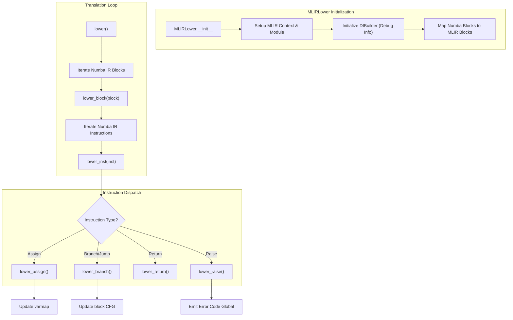
Sources: [src/numba_cuda_mlir/mlir_lowering.py:129-245](), [src/numba_cuda_mlir/mlir_lowering.py:534-554](), [src/numba_cuda_mlir/mlir_lowering.py:612-635]()

## SSA Spilling and Variable Management

Unlike LLVM IR, which often relies on `alloca` for mutable variables, the MLIR lowering engine attempts to maintain values in SSA form as much as possible. However, certain Python semantics require "spilling" or specialized handling:

1.  **Phi Nodes**: When multiple Numba IR blocks converge, the engine handles variable merging by passing values as block arguments in MLIR, effectively implementing SSA Phi nodes [src/numba_cuda_mlir/mlir_lowering.py:644-668]().
2.  **Global/Static Variables**: Constants and globals are lowered using `arith.constant` or `llvm.mlir.addressof` for global symbols [src/numba_cuda_mlir/mlir_lowering.py:1016-1044]().

## Shared Memory Management

Shared memory in CUDA kernels is managed through `cuda.shared.array`. The lowering engine translates these into MLIR `memref` allocations with specific address spaces.

*   **Static Shared Memory**: If the size is known at compile time, it is lowered to a `memref.alloca` or a global `memref` with `memory_space = 3` (CUDA Shared Memory) [src/numba_cuda_mlir/mlir_lowering.py:116-122]().
*   **Type Validation**: The engine ensures that `memref` element types are valid MLIR builtin types; LLVM-specific types (like pointers or structs) are rejected for direct `memref` usage and must use LLVM dialect operations instead [src/numba_cuda_mlir/mlir_lowering.py:116-122]().

## Exception Handling and Error Codes

Since GPU hardware does not support standard CPU-style exceptions, `numba-cuda-mlir` implements an "Error Code" mechanism.

*   **Global Error State**: A global variable named `__numba_cuda_mlir_error_code` is defined in the module [src/numba_cuda_mlir/mlir_lowering.py:87-87]().
*   **Error Mapping**: Python exceptions are mapped to specific integer codes (e.g., `AssertionError: 1`, `IndexError: 2`) [src/numba_cuda_mlir/mlir_lowering.py:88-94]().
*   **Lowering `raise`**: When a `raise` instruction is encountered, the engine emits an atomic update to the global error code (if it is currently 0) and then terminates the thread or returns early [src/numba_cuda_mlir/mlir_lowering.py:1260-1286]().
*   **Host-Side Check**: After kernel launch, the runtime checks this global variable to re-raise the appropriate Python exception [tests/test_kernel_exceptions.py:21-37]().

**Exception Lowering Logic**
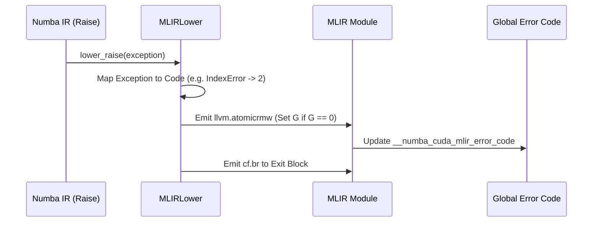
Sources: [src/numba_cuda_mlir/mlir_lowering.py:87-94](), [src/numba_cuda_mlir/mlir_lowering.py:1260-1286](), [tests/test_kernel_exceptions.py:52-61]()

## Debug Information Emission

The engine supports DWARF debug info generation via the `DIBuilder` class [src/numba_cuda_mlir/mlir_debuginfo.py:201-205]().

### Debug Levels
*   **Full Debug (`debug=True`)**: Emits `Full` emission kind, including local variables, type metadata, and subprogram descriptors [tests/test_debuginfo.py:35-49]().
*   **Line Info (`lineinfo=True`)**: Emits only `DebugDirectivesOnly`, providing file and line mappings without variable inspection [tests/test_debuginfo.py:52-62]().

### Type Mapping to DWARF
The `mlir_debuginfo` module maps Numba types to DWARF basic types:
*   **Integers/Floats**: Mapped to `DW_ATE_signed`, `DW_ATE_unsigned`, or `DW_ATE_float` with appropriate bitwidths [src/numba_cuda_mlir/mlir_debuginfo.py:34-39]().
*   **Complex Numbers**: Lowered as a `DICompositeType` (struct) with `real` and `imag` members [src/numba_cuda_mlir/mlir_debuginfo.py:65-82]().
*   **Boolean Workaround**: Boolean arguments use `llvm.intr.dbg.value` instead of `dbg.declare` to avoid specific NVVM translation issues [tests/test_debuginfo.py:202-217]().

## Key Functions and Classes

| Entity | Role | Source |
| :--- | :--- | :--- |
| `MLIRLower` | Main class for lowering Numba IR to MLIR. | [src/numba_cuda_mlir/mlir_lowering.py:129]() |
| `lower()` | Top-level method to trigger lowering of all blocks. | [src/numba_cuda_mlir/mlir_lowering.py:534]() |
| `lower_inst()` | Dispatches individual Numba IR instructions to specific handlers. | [src/numba_cuda_mlir/mlir_lowering.py:612]() |
| `DIBuilder` | Helper for creating MLIR debug information attributes. | [src/numba_cuda_mlir/mlir_debuginfo.py:201]() |
| `to_mlir_type()` | Utility to convert Numba types to MLIR IR types. | [src/numba_cuda_mlir/lowering_utilities/type_conversions.py]() |

Sources: [src/numba_cuda_mlir/mlir_lowering.py:129-1300](), [src/numba_cuda_mlir/mlir_debuginfo.py:1-210]()

---

# Page: MLIR Optimization and Target Translation

# MLIR Optimization and Target Translation

<details>
<summary>Relevant source files</summary>

The following files were used as context for generating this wiki page:

- [cext/launcher/llvm_downgrade.cpp](cext/launcher/llvm_downgrade.cpp)
- [cext/mlir-llvm70/include/llvm70/LLVM70Target.h](cext/mlir-llvm70/include/llvm70/LLVM70Target.h)
- [cext/mlir-llvm70/lib/CAPI.cpp](cext/mlir-llvm70/lib/CAPI.cpp)
- [cext/mlir-llvm70/lib/LLVM70Target.cpp](cext/mlir-llvm70/lib/LLVM70Target.cpp)
- [cext/mlir-modern/ModernBridge.cpp](cext/mlir-modern/ModernBridge.cpp)
- [cext/mlir-modern/ModernBridgeSmoke.cpp](cext/mlir-modern/ModernBridgeSmoke.cpp)
- [cext/mlir-modern/include/ModernBridge.h](cext/mlir-modern/include/ModernBridge.h)
- [ci/tools/run-expensive-tests](ci/tools/run-expensive-tests)
- [ci/tools/run-tests](ci/tools/run-tests)
- [ci/windows-llvm-container-build.ps1](ci/windows-llvm-container-build.ps1)
- [src/numba_cuda_mlir/__init__.py](src/numba_cuda_mlir/__init__.py)
- [src/numba_cuda_mlir/caching.py](src/numba_cuda_mlir/caching.py)
- [src/numba_cuda_mlir/decorators.py](src/numba_cuda_mlir/decorators.py)
- [src/numba_cuda_mlir/linker.py](src/numba_cuda_mlir/linker.py)
- [src/numba_cuda_mlir/lowering_utilities/llvm_utils.py](src/numba_cuda_mlir/lowering_utilities/llvm_utils.py)
- [src/numba_cuda_mlir/mlir_compiler.py](src/numba_cuda_mlir/mlir_compiler.py)
- [src/numba_cuda_mlir/mlir_optimization.py](src/numba_cuda_mlir/mlir_optimization.py)
- [src/numba_cuda_mlir/numba_cuda/cudadrv/driver.py](src/numba_cuda_mlir/numba_cuda/cudadrv/driver.py)
- [tests/data/Makefile](tests/data/Makefile)
- [tests/data/fake_mlir_shim.c](tests/data/fake_mlir_shim.c)
- [tests/test_dynamic_shared_memory.py](tests/test_dynamic_shared_memory.py)
- [tests/test_jit_compat.py](tests/test_jit_compat.py)
- [tests/test_symbol_isolation.py](tests/test_symbol_isolation.py)

</details>


This page describes the MLIR pass pipeline, the translation of MLIR modules to LLVM IR, and the specialized compilation paths required for different NVIDIA GPU architectures, including the legacy LLVM 7 compatibility path for pre-Blackwell hardware.

## MLIR Pass Pipeline

The optimization process transforms high-level MLIR (including `linalg`, `math`, and `gpu` dialects) into the `nvvm` and `llvm` dialects. This is managed by the `PassManager` in `mlir_optimization.py`.

### Pipeline Stages
The pipeline is constructed in `get_base_pipeline()` and follows these key phases:
1.  **Bufferization**: `one-shot-bufferize` converts tensor-based operations to memref-based operations [src/numba_cuda_mlir/mlir_optimization.py:52-52]().
2.  **Linalg Lowering**: `convert-linalg-to-parallel-loops` lowers structured ops to SCF loops [src/numba_cuda_mlir/mlir_optimization.py:56-56]().
3.  **Kernel Outlining**: `gpu-kernel-outlining` identifies code blocks to be moved into a `gpu.module` [src/numba_cuda_mlir/mlir_optimization.py:64-64]().
4.  **Dialect Conversion**:
    *   `convert-nvgpu-to-nvvm` and `convert-math-to-nvvm` target NVIDIA-specific intrinsics [src/numba_cuda_mlir/mlir_optimization.py:59-63]().
    *   `convert-gpu-to-nvvm` transforms the outlined GPU module into the NVVM dialect [src/numba_cuda_mlir/mlir_optimization.py:73-73]().
5.  **LLVM Lowering**: Final conversion of host and device code to the `llvm` dialect via `gpu-to-llvm` and `convert-func-to-llvm` [src/numba_cuda_mlir/mlir_optimization.py:68-88]().

### Pipeline Implementation Flow
The following diagram illustrates how the `PassManager` orchestrates these transformations.

**MLIR Pipeline Execution**
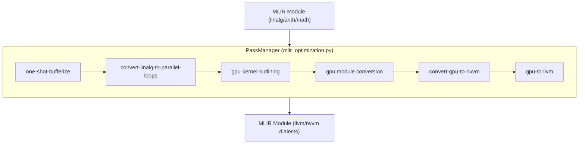
**Sources:** [src/numba_cuda_mlir/mlir_optimization.py:45-96]()

## Target Translation Paths

The compiler chooses between two translation paths based on the target GPU Compute Capability (CC).

| Path | Target CC | Implementation | Description |
| :--- | :--- | :--- | :--- |
| **Modern** | sm_100+ (Blackwell) | `translate_to_llvmir` | Direct translation from MLIR `llvm` dialect to modern LLVM IR [src/numba_cuda_mlir/mlir_optimization.py:102-107](). |
| **Legacy (LLVM 7)** | < sm_100 | `_call_llvm70_capi` | Translates MLIR to LLVM 7 compatible IR for consumption by `libnvvm` versions requiring older IR [src/numba_cuda_mlir/mlir_optimization.py:183-189](). |

### LLVM 7 Compatibility Path
Because `libnvvm` for older architectures expects an IR dialect compatible with LLVM 7.0, the compiler utilizes a specialized C++ extension (`libMLIRToLLVM70.so`).

1.  **Operation Extraction**: The raw `mlir::Operation*` is extracted from the Python capsule [src/numba_cuda_mlir/mlir_optimization.py:174-180]().
2.  **C-API Invocation**: `llvm70_translate_gpu_module_from_op` is called from the `_llvm70_capi` bridge [src/numba_cuda_mlir/mlir_optimization.py:214-230]().
3.  **Manual IR Building**: The `MLIRToLLVM70` class in C++ walks the MLIR module and uses a legacy `LLVM70IRBuilder` to construct LLVM 7 IR [cext/mlir-llvm70/lib/LLVM70Target.cpp:41-45]().
4.  **BFloat16 Emulation**: Since LLVM 7 lacks native `bfloat16` support, `MLIRToLLVM70::bf16ToF32` and `f32ToBf16` implement manual bit-manipulation for these types [cext/mlir-llvm70/lib/LLVM70Target.cpp:136-151]().

**LLVM 7 Translation Architecture**
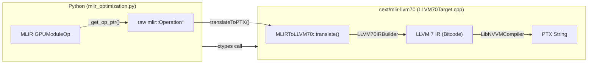
**Sources:** [src/numba_cuda_mlir/mlir_optimization.py:174-230](), [cext/mlir-llvm70/lib/LLVM70Target.cpp:30-46]()

## PTX and LTOIR Generation via libnvvm

Final machine code (PTX) or Link-Time Optimization IR (LTOIR) is generated using `libnvvm`.

### libnvvm Integration
The `CompilationUnit` class in `nvvm.py` interfaces with the NVIDIA NVVM library.
- **PTX Generation**: Default output for standard kernel compilation.
- **LTOIR Generation**: Enabled when `gen_lto=True` is passed to the translation functions. This produces bitcode suitable for `nvJitLink` [cext/mlir-llvm70/lib/LLVM70Target.cpp:104-104]().
- **Verification**: `libnvvm` performs verification of the IR before lowering. Errors are captured and raised as `CudaAPIError` [src/numba_cuda_mlir/numba_cuda/cudadrv/driver.py:140-148]().

### Data Flow to Executable
The translation process ends with a `LinkableCode` object (either `PTXSource` or `LTOIR`) that is passed to the Linker.

**Target Translation Data Flow**
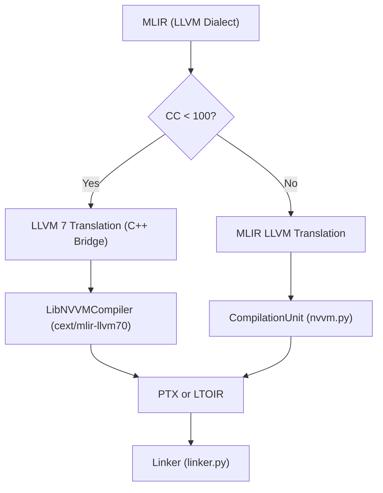
**Sources:** [src/numba_cuda_mlir/mlir_optimization.py:99-107](), [src/numba_cuda_mlir/linker.py:94-135](), [cext/mlir-llvm70/lib/LLVM70Target.cpp:48-108]()

## LLVM Downgrade Subsystem

For the modern path, the `llvm_downgrade.cpp` extension provides runtime semantic patching of LLVM IR to ensure compatibility with `libnvvm`.

- **Atomic Downgrade**: Converts modern `atomicrmw fadd` instructions to compatible forms for older `libnvvm` versions [cext/launcher/llvm_downgrade.cpp:123-124]().
- **Attribute Stripping**: Removes LLVM attributes that `libnvvm` does not recognize, preventing verification failures [cext/launcher/llvm_downgrade.cpp:99-100]().
- **Metadata Injection**: Adds required NVVM metadata, such as `nvvm-reflect-ftz` and kernel calling conventions [cext/launcher/llvm_downgrade.cpp:56-58]().

**Sources:** [cext/launcher/llvm_downgrade.cpp:44-161]()

---

# Page: Linking and Kernel Launch

# Linking and Kernel Launch

<details>
<summary>Relevant source files</summary>

The following files were used as context for generating this wiki page:

- [cext/launcher/cuda_shim.h](cext/launcher/cuda_shim.h)
- [cext/launcher/kernel.cpp](cext/launcher/kernel.cpp)
- [src/numba_cuda_mlir/caching.py](src/numba_cuda_mlir/caching.py)
- [src/numba_cuda_mlir/decorators.py](src/numba_cuda_mlir/decorators.py)
- [src/numba_cuda_mlir/linker.py](src/numba_cuda_mlir/linker.py)
- [src/numba_cuda_mlir/mlir_compiler.py](src/numba_cuda_mlir/mlir_compiler.py)
- [src/numba_cuda_mlir/mlir_optimization.py](src/numba_cuda_mlir/mlir_optimization.py)
- [src/numba_cuda_mlir/numba_cuda/cudadrv/driver.py](src/numba_cuda_mlir/numba_cuda/cudadrv/driver.py)
- [src/numba_cuda_mlir/tools.py](src/numba_cuda_mlir/tools.py)
- [tests/numba_cuda_tests/cudadrv/test_linker.py](tests/numba_cuda_tests/cudadrv/test_linker.py)
- [tests/numba_cuda_tests/cudadrv/test_module_callbacks.py](tests/numba_cuda_tests/cudadrv/test_module_callbacks.py)
- [tests/test_large_smem.py](tests/test_large_smem.py)

</details>


This page describes the final stages of the compilation and execution pipeline: resolving the link plan, performing Just-In-Time (JIT) linking using `nvJitLink`, and launching kernels through the C++ `KernelDispatcher`.

## Linker Infrastructure

The linking process is managed by the `Linker` and `_Linker` classes, which provide a Pythonic interface to the `nvJitLink` library.

### The Linker and _Linker Classes
The `_Linker` class [src/numba_cuda_mlir/numba_cuda/cudadrv/driver.py:236-241]() is the base implementation for managing CUDA object codes (PTX, LTO-IR, and CUBIN). It abstracts the underlying `cuda.core.Linker` from the NVIDIA bindings. 

The subclass `Linker` [src/numba_cuda_mlir/linker.py:94-113]() extends this with MLIR-specific functionality, such as tracking temporary PTX files and managing LTO-IR buffers.

### LTO-Aware Linking
The pipeline supports Link Time Optimization (LTO) through the `LTOIR` object code type. The `resolve_link_plan` function [src/numba_cuda_mlir/linker.py:45-91]() determines whether to compile new inputs as LTO-IR based on:
1.  The `lto` target option.
2.  The presence of existing `.ltoir` or `.cu` source items in the link list [src/numba_cuda_mlir/linker.py:52-64]().
3.  Debug mode requirements (which often disable LTO for better line info) [src/numba_cuda_mlir/linker.py:78-79]().

### Linker Data Flow
The following diagram illustrates how different source types are aggregated into the `Linker` before being finalized into a `CUlibrary` or `CUmodule`.

**Title: Linker Input Aggregation and Finalization**
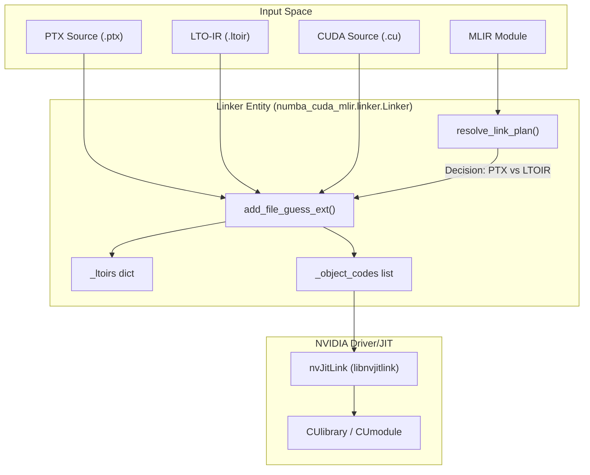
Sources: [src/numba_cuda_mlir/linker.py:45-138](), [src/numba_cuda_mlir/numba_cuda/cudadrv/driver.py:236-241]()

## C++ KernelDispatcher

The `KernelDispatcher` is a C++ extension responsible for the high-performance path of argument marshalling and kernel invocation.

### Argument Classification and Marshalling
Before launch, Python arguments must be converted to a layout compatible with the CUDA ABI. The dispatcher handles:
-   **Scalars**: Mapped to standard C types (int64, float64, etc.) [cext/launcher/kernel.cpp:230-243]().
-   **Arrays**: Supports `__cuda_array_interface__` and `__array_interface__`. It extracts the data pointer, shape, and strides to build a `MemRef` descriptor [cext/launcher/kernel.cpp:33-40]().
-   **DLPack**: Support for interoperability with frameworks like PyTorch and CuPy via `__dlpack__` [cext/launcher/kernel.cpp:39-44]().

### Shared Memory Opt-In
CUDA kernels have a default dynamic shared memory limit (typically 48KB). If a kernel requires more, the dispatcher must explicitly "opt-in" using `cuFuncSetAttribute` with the `CU_FUNC_ATTRIBUTE_MAX_DYNAMIC_SHARED_SIZE_BYTES` flag [cext/launcher/kernel.cpp:161-163](). 

The launcher accounts for both static shared memory (reported by the compiler) and the requested dynamic shared memory to ensure the total does not exceed the device's hardware limit [tests/test_large_smem.py:171-180]().

### Kernel Launch Paths
The dispatcher primarily uses `cuLaunchKernelEx` [cext/launcher/cuda_shim.h:143-144](), which allows passing `CUlaunchConfig` structures containing attributes like cooperative launch flags or cluster dimensions.

**Title: Kernel Launch Execution Path**
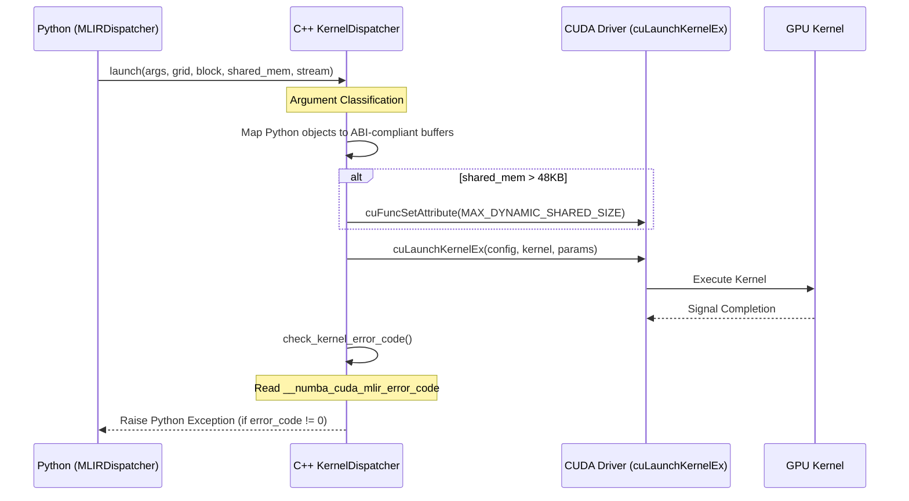
Sources: [cext/launcher/kernel.cpp:117-155](), [cext/launcher/kernel.cpp:168-228](), [cext/launcher/cuda_shim.h:108-120]()

## Module Callbacks and Runtime Integration

The linking process supports `setup_callback` and `teardown_callback` functions [src/numba_cuda_mlir/linker.py:9-12](). These are used to initialize device-side globals immediately after a module is loaded into a context.

### NRT MemSys Setup
A critical use case for callbacks is the Numba Runtime (NRT). The `_nrt_memsys_setup_callback` [src/numba_cuda_mlir/mlir_optimization.py:29-38]() ensures that the kernel's `TheMSys` device global is initialized with the pointer to the host-managed memory system. This allows the GPU to perform reference counting and dynamic allocation that is tracked by the host [src/numba_cuda_mlir/mlir_optimization.py:36-38]().

### Exception Propagation
Kernels compiled via the MLIR pipeline include a global variable named `__numba_cuda_mlir_error_code` [cext/launcher/kernel.cpp:58](). 
1.  **Lowering**: The `MLIRLower` engine inserts checks that write to this global when an exception (e.g., out-of-bounds access) occurs.
2.  **Post-Launch**: After `cuLaunchKernelEx` returns, the C++ dispatcher calls `check_kernel_error_code` [cext/launcher/kernel.cpp:168-170]().
3.  **Synchronization**: The dispatcher synchronizes the context, copies the error code back to the host, and raises the corresponding Python exception (e.g., `IndexError` or `AssertionError`) [cext/launcher/kernel.cpp:198-225]().

Sources: [src/numba_cuda_mlir/mlir_optimization.py:29-38](), [cext/launcher/kernel.cpp:157-166](), [tests/numba_cuda_tests/cudadrv/test_module_callbacks.py:38-66]()

---

# Page: Type System

# Type System

<details>
<summary>Relevant source files</summary>

The following files were used as context for generating this wiki page:

- [src/numba_cuda_mlir/numba_cuda/np/numpy_support.py](src/numba_cuda_mlir/numba_cuda/np/numpy_support.py)
- [src/numba_cuda_mlir/numba_cuda/typeconv/rules.py](src/numba_cuda_mlir/numba_cuda/typeconv/rules.py)
- [src/numba_cuda_mlir/numba_cuda/types/__init__.py](src/numba_cuda_mlir/numba_cuda/types/__init__.py)
- [src/numba_cuda_mlir/numba_cuda/types/abstract.py](src/numba_cuda_mlir/numba_cuda/types/abstract.py)
- [src/numba_cuda_mlir/numba_cuda/typing/npydecl.py](src/numba_cuda_mlir/numba_cuda/typing/npydecl.py)
- [src/numba_cuda_mlir/types.py](src/numba_cuda_mlir/types.py)

</details>


The `numba-cuda-mlir` type system provides a bridge between high-level Python/NumPy types and the low-level MLIR representation required for CUDA kernel generation. It extends the standard Numba type hierarchy to support CUDA-specific hardware features, such as reduced-precision floats and specialized memory layouts.

The system is centered around the `Type` base class [src/numba_cuda_mlir/numba_cuda/types/abstract.py:87-93](), which uses a metaclass-based interning mechanism to ensure type stability and fast matching during dispatch.

### Type Representation and Interning

All types in the system inherit from `Type`. To optimize performance and ensure that type comparisons are efficient, the system employs the `_TypeMetaclass` [src/numba_cuda_mlir/numba_cuda/types/abstract.py:38-44](). This metaclass interns every type instance into a global `_typecache` [src/numba_cuda_mlir/numba_cuda/types/abstract.py:31](), assigning a unique integer `_code` to each distinct type [src/numba_cuda_mlir/numba_cuda/types/abstract.py:63-65]().

#### Type System Entity Mapping
The following diagram illustrates how Python-level types are mapped to internal Numba/MLIR type representations.

```mermaid
graph TD
    subgraph "Python/NumPy Space"
        NP_DTYPE["np.dtype('float32')"]
        PY_FLOAT["float"]
        NP_ARRAY["np.ndarray"]
    end

    subgraph "Code Entity Space (numba_cuda_mlir)"
        NB_TYPE["Type (abstract.py)"]
        NB_FLOAT["Float (scalars.py)"]
        NB_ARRAY["Array (npytypes.py)"]
        METACLASS["_TypeMetaclass"]
        CACHE["_typecache (weakref)"]
    end

    NP_DTYPE -->|from_dtype| NB_FLOAT
    PY_FLOAT -->|inference| NB_FLOAT
    NP_ARRAY -->|inference| NB_ARRAY
    NB_FLOAT --|> NB_TYPE
    NB_ARRAY --|> NB_TYPE
    NB_TYPE -->|managed by| METACLASS
    METACLASS -->|interns into| CACHE
```
**Sources:** [src/numba_cuda_mlir/numba_cuda/types/abstract.py:31-76](), [src/numba_cuda_mlir/numba_cuda/np/numpy_support.py:53-69]()

---

### Core Types and NumPy Support
The compiler supports a wide range of standard Numba types including `Integer`, `Float`, `Complex`, `Array`, and `Record` [src/numba_cuda_mlir/types.py:31-93](). 

Key capabilities include:
*   **DType Mapping:** Conversion between NumPy `dtype` objects and Numba types via `from_dtype` [src/numba_cuda_mlir/numba_cuda/np/numpy_support.py:178-179]().
*   **Type Promotion:** Automatic promotion rules (e.g., `int32` to `int64` or `float32` to `float64`) managed by the `TypeCastingRules` [src/numba_cuda_mlir/numba_cuda/typeconv/rules.py:18-62]().
*   **Ufunc Support:** Logic for matching NumPy ufunc loops to specific type signatures [src/numba_cuda_mlir/numba_cuda/typing/npydecl.py:93-121]().

For details, see [Core Types and NumPy Support](#3.1).

---

### CUDA-Specific Types
To leverage NVIDIA hardware, the type system introduces types that do not exist in standard Python or NumPy:
*   **Reduced Precision:** Support for `bfloat16`, `tf32`, and various `fp8` formats (e.g., `E4M3`, `E5M2`) [src/numba_cuda_mlir/types.py:152-166]().
*   **Opaque CUDA Types:** Types like `CUTensorMap` for Hopper TMA support [src/numba_cuda_mlir/types.py:172-176]().
*   **Type Attributes:** Decorators like `grid_constant` and `alignas` that attach metadata to types for use during MLIR lowering [src/numba_cuda_mlir/types.py:125-136]().

For details, see [CUDA-Specific Types](#3.2).

---

### Typing Infrastructure
The typing infrastructure handles the resolution of function calls and operators. It uses a registry-based system where `FunctionTemplate` and `AbstractTemplate` define how Python functions should be typed based on their arguments [src/numba_cuda_mlir/numba_cuda/typing/npydecl.py:30-41]().

#### Dispatch and Resolution Flow
This diagram shows how the `MLIRTypingContext` interacts with templates to resolve a function signature.

```mermaid
graph LR
    subgraph "Typing Registry"
        REG["Registry (templates.py)"]
        TMPL["AbstractTemplate"]
    end

    subgraph "Resolution Logic"
        CTX["MLIRTypingContext"]
        SIG["Signature"]
    end

    REG -->|stores| TMPL
    CTX -->|looks up| REG
    TMPL -->|generic()| SIG
    SIG -->|returns to| CTX
```
**Sources:** [src/numba_cuda_mlir/numba_cuda/typing/npydecl.py:24-30](), [src/numba_cuda_mlir/numba_cuda/typing/templates.py:7-12]()

For details, see [Typing Infrastructure](#3.3).

---

### Summary of Type Aliases
The system provides numerous aliases to match both C-style and NumPy-style naming conventions:

| Category | Aliases | Source |
| :--- | :--- | :--- |
| **Fixed-width Ints** | `i1`, `i4`, `i8`, `u1`, `u4`, `u8` | [src/numba_cuda_mlir/numba_cuda/types/__init__.py:132-140]() |
| **Floats** | `f2` (f16), `f4` (f32), `f8` (f64) | [src/numba_cuda_mlir/numba_cuda/types/__init__.py:142-144]() |
| **CUDA Specials** | `bf16`, `tf32`, `nvfp4` | [src/numba_cuda_mlir/types.py:152-166]() |
| **Pointers** | `voidptr`, `ptr`, `byval_ptr` | [src/numba_cuda_mlir/types.py:167-169]() |

**Sources:**
* `src/numba_cuda_mlir/types.py`
* `src/numba_cuda_mlir/numba_cuda/types/abstract.py`
* `src/numba_cuda_mlir/numba_cuda/types/__init__.py`
* `src/numba_cuda_mlir/numba_cuda/np/numpy_support.py`
* `src/numba_cuda_mlir/numba_cuda/typeconv/rules.py`

---

# Page: Core Types and NumPy Support

# Core Types and NumPy Support

<details>
<summary>Relevant source files</summary>

The following files were used as context for generating this wiki page:

- [src/numba_cuda_mlir/lowering_utilities/type_conversions.py](src/numba_cuda_mlir/lowering_utilities/type_conversions.py)
- [src/numba_cuda_mlir/models.py](src/numba_cuda_mlir/models.py)
- [src/numba_cuda_mlir/numba_cuda/np/numpy_support.py](src/numba_cuda_mlir/numba_cuda/np/numpy_support.py)
- [src/numba_cuda_mlir/numba_cuda/typeconv/rules.py](src/numba_cuda_mlir/numba_cuda/typeconv/rules.py)
- [src/numba_cuda_mlir/numba_cuda/types/__init__.py](src/numba_cuda_mlir/numba_cuda/types/__init__.py)
- [src/numba_cuda_mlir/numba_cuda/types/abstract.py](src/numba_cuda_mlir/numba_cuda/types/abstract.py)
- [src/numba_cuda_mlir/numba_cuda/typing/npydecl.py](src/numba_cuda_mlir/numba_cuda/typing/npydecl.py)
- [src/numba_cuda_mlir/numba_cuda/typing/typeof.py](src/numba_cuda_mlir/numba_cuda/typing/typeof.py)
- [src/numba_cuda_mlir/types.py](src/numba_cuda_mlir/types.py)
- [src/numba_cuda_mlir/typing/numpy.py](src/numba_cuda_mlir/typing/numpy.py)
- [tests/numba_cuda_tests/cudapy/test_array_methods.py](tests/numba_cuda_tests/cudapy/test_array_methods.py)
- [tests/test_array_methods.py](tests/test_array_methods.py)
- [tests/test_array_view.py](tests/test_array_view.py)
- [tests/test_custom_dtype.py](tests/test_custom_dtype.py)
- [tests/test_type_conversions.py](tests/test_type_conversions.py)

</details>


This page describes the core type system of `numba-cuda-mlir`, including the hierarchy of Numba types, how Python and NumPy values are mapped to these types, and the infrastructure for type interning and promotion.

## Type Hierarchy and Interning

The foundation of the type system is the `Type` class. All types used within the compiler are subclasses of this base. To ensure performance and consistency, types are interned using a metaclass.

### The Type Hierarchy
The hierarchy includes standard scalars, aggregate types, and pointers:
*   **Type**: Base class for all types [src/numba_cuda_mlir/numba_cuda/types/abstract.py:87-89]().
*   **Number**: Base for all numeric types, including `Integer`, `Float`, and `Complex` [src/numba_cuda_mlir/types.py:31-33]().
*   **Array**: Represents NumPy-like buffers with `dtype`, `ndim`, and `layout` [src/numba_cuda_mlir/types.py:83]().
*   **Record**: Represents NumPy structured dtypes (structs) [src/numba_cuda_mlir/types.py:89]().
*   **CPointer / RawPointer**: Low-level pointer types [src/numba_cuda_mlir/types.py:81-82]().

### Type Interning via `_TypeMetaclass`
Types are interned to ensure that only one instance of a specific type exists at runtime. This allows for fast identity checks and stable type codes.

*   **Mechanism**: The `_TypeMetaclass` hooks the `__call__` method of type classes. When a type is instantiated, it is checked against a global `_typecache` [src/numba_cuda_mlir/numba_cuda/types/abstract.py:38-74]().
*   **Weak References**: To prevent memory leaks, the cache uses `weakref.ref` [src/numba_cuda_mlir/numba_cuda/types/abstract.py:31-35]().
*   **Type Codes**: Each unique type instance is assigned a unique integer `_code` [src/numba_cuda_mlir/numba_cuda/types/abstract.py:63-65]().

Sources: [src/numba_cuda_mlir/numba_cuda/types/abstract.py:1-100](), [src/numba_cuda_mlir/types.py:1-93]()

## Type Mapping and Inference

The compiler must map Python objects, NumPy dtypes, and MLIR types into the Numba type system.

### Python to Numba Mapping (`typeof`)
The `typeof` function is the entry point for determining the Numba type of a Python value [src/numba_cuda_mlir/numba_cuda/typing/typeof.py:38-49](). It uses `singledispatch` on `typeof_impl`.

| Python Type | Numba Type | Logic / File |
| :--- | :--- | :--- |
| `bool` | `boolean` | `_typeof_bool` [src/numba_cuda_mlir/numba_cuda/typing/typeof.py:141-143]() |
| `int` | `intp` or `int64` | `_typeof_int` (bit-width dependent) [src/numba_cuda_mlir/numba_cuda/typing/typeof.py:156-169]() |
| `float` | `float64` | `_typeof_float` [src/numba_cuda_mlir/numba_cuda/typing/typeof.py:146-148]() |
| `complex` | `complex128` | `_typeof_complex` [src/numba_cuda_mlir/numba_cuda/typing/typeof.py:151-153]() |
| `np.ndarray` | `Array` | `_typeof_buffer` [src/numba_cuda_mlir/numba_cuda/typing/typeof.py:99-113]() |

### MLIR to Numba Mapping (`to_numba_type`)
During lowering or when processing MLIR-defined kernels, the compiler converts MLIR `ir.Type` objects back to Numba types using `to_numba_type` [src/numba_cuda_mlir/lowering_utilities/type_conversions.py:18-56]().

*   **Integers**: `ir.IntegerType` maps to `int8`, `int16`, etc., based on width [src/numba_cuda_mlir/lowering_utilities/type_conversions.py:68-81]().
*   **MemRefs**: `ir.MemRefType` maps to `Array` [src/numba_cuda_mlir/lowering_utilities/type_conversions.py:60-62]().
*   **LLVM Structs**: `llvm.struct` maps to `AggregateType` via name lookup [src/numba_cuda_mlir/lowering_utilities/type_conversions.py:141-147]().

### Data Flow: Python Value to Numba Type
The following diagram shows how a value passed to a JIT kernel is typed.

```mermaid
graph TD
    subgraph "Natural Language Space"
        Input["Python Object (e.g. np.array)"]
        Result["Numba Type (e.g. types.Array)"]
    end

    subgraph "Code Entity Space"
        Dispatch["typeof(val)"]
        Impl["typeof_impl(val, context)"]
        NP_Support["numpy_support.from_dtype(dtype)"]
        BufProto["bufproto.decode_pep3118_format()"]
        
        Dispatch --> Impl
        Impl -- "if array-like" --> BufProto
        Impl -- "if scalar-like" --> NP_Support
        BufProto --> Result
        NP_Support --> Result
    end
```
Sources: [src/numba_cuda_mlir/numba_cuda/typing/typeof.py:38-113](), [src/numba_cuda_mlir/lowering_utilities/type_conversions.py:54-150]()

## NumPy Support and ufunc Matching

The compiler provides deep integration with NumPy, mapping dtypes and resolving ufunc loops.

### DType Mapping
The `numpy_support` module maintains the `FROM_DTYPE` map for standard NumPy types [src/numba_cuda_mlir/numba_cuda/np/numpy_support.py:53-69]().
*   Special handling is provided for `bfloat16` via `ml_dtypes` [src/numba_cuda_mlir/numba_cuda/np/numpy_support.py:72-78]().
*   Structured dtypes are handled via `from_struct_dtype` [src/numba_cuda_mlir/numba_cuda/np/numpy_support.py:152-153]().

### ufunc Loop Matching
When a NumPy ufunc (e.g., `np.add`) is called, the compiler must find a loop signature that matches the input types.

1.  **Template Registration**: ufuncs are registered in the typing registry via `Numpy_rules_ufunc` [src/numba_cuda_mlir/numba_cuda/typing/npydecl.py:30-92]().
2.  **Input Handling**: `_handle_inputs` extracts dtypes and determines the dimensionality of the resulting array [src/numba_cuda_mlir/numba_cuda/typing/npydecl.py:32-87]().
3.  **Loop Selection**: `ufunc_find_matching_loop` (from `numpy_support`) is called to find the best-fitting implementation loop based on NumPy's casting rules [src/numba_cuda_mlir/numba_cuda/typing/npydecl.py:99-101]().

### NumPy to Numba Entity Mapping
```mermaid
graph LR
    subgraph "NumPy Entities"
        NP_DType["np.dtype('float32')"]
        NP_UFunc["np.add"]
    end

    subgraph "Numba Type System"
        NB_Float32["types.float32"]
        NB_Template["NumpyAddTemplate"]
        NB_Sig["signature(restype, lhs, rhs)"]
    end

    NP_DType -- "numpy_support.from_dtype" --> NB_Float32
    NP_UFunc -- "Registry.register_global" --> NB_Template
    NB_Template -- "generic()" --> NB_Sig
```
Sources: [src/numba_cuda_mlir/numba_cuda/np/numpy_support.py:143-180](), [src/numba_cuda_mlir/typing/numpy.py:161-202](), [src/numba_cuda_mlir/numba_cuda/typing/npydecl.py:93-163]()

## Type Promotion and Unification

Type promotion determines the "common" type when two different types interact (e.g., `int32 + float64`).

### Casting Rules
The `TypeCastingRules` class manages the relationships between types [src/numba_cuda_mlir/numba_cuda/typeconv/rules.py:18-62](). Rules are categorized as:
*   **Promote**: Safe conversion where no precision is lost (e.g., `int16` -> `int32`) [src/numba_cuda_mlir/numba_cuda/typeconv/rules.py:23-30]().
*   **Safe**: Conversion that is generally acceptable but might not be a simple promotion (e.g., `float32` -> `complex64`) [src/numba_cuda_mlir/numba_cuda/typeconv/rules.py:53]().
*   **Unsafe**: Conversion that may lose information (e.g., `int64` -> `float64`) [src/numba_cuda_mlir/numba_cuda/typeconv/rules.py:46]().

### Unification
Unification is the process of finding a single type that can represent two different types. This is implemented via the `unify` method on `Type` subclasses [src/numba_cuda_mlir/numba_cuda/types/abstract.py:140-147](). For numeric types, this typically delegates to the `TypeManager` which uses the rules defined in `rules.py`.

Sources: [src/numba_cuda_mlir/numba_cuda/typeconv/rules.py:1-66](), [src/numba_cuda_mlir/numba_cuda/types/abstract.py:140-162]()

## Data Models and MLIR Representation

While Numba types represent the frontend view, `DataModel` objects define how these types are represented in MLIR/LLVM.

### Data Model Manager
The `mlir_data_manager` (a `ContextAwareDataModelManager`) maps Numba types to their backend representation [src/numba_cuda_mlir/models.py:69-71]().

*   **Context Sensitivity**: Because MLIR types are tied to a specific `ir.Context`, the `mlir_data_manager` invalidates its cache if the active context changes [src/numba_cuda_mlir/models.py:34-66]().
*   **Storage Mapping**: Some types have different value types and storage types. For example, floating-point types like `bf16` may be stored as integers in memory [src/numba_cuda_mlir/models.py:77-131]().

### Struct Models
The `StructModel` handles Numba `Record` and `Tuple` types by mapping them to `llvm.StructType` [src/numba_cuda_mlir/models.py:134-164](). It provides methods to extract and insert values into the struct using `llvm.extractvalue` and `llvm.insertvalue` [src/numba_cuda_mlir/models.py:172-186]().

Sources: [src/numba_cuda_mlir/models.py:1-210]()

---

# Page: CUDA-Specific Types

# CUDA-Specific Types

<details>
<summary>Relevant source files</summary>

The following files were used as context for generating this wiki page:

- [.gitignore](.gitignore)
- [src/numba_cuda_mlir/cuda/__init__.py](src/numba_cuda_mlir/cuda/__init__.py)
- [src/numba_cuda_mlir/cuda/vector_types.py](src/numba_cuda_mlir/cuda/vector_types.py)
- [src/numba_cuda_mlir/lowering/cuda_vector_types.py](src/numba_cuda_mlir/lowering/cuda_vector_types.py)
- [src/numba_cuda_mlir/numba_cuda/np/numpy_support.py](src/numba_cuda_mlir/numba_cuda/np/numpy_support.py)
- [src/numba_cuda_mlir/numba_cuda/stubs.py](src/numba_cuda_mlir/numba_cuda/stubs.py)
- [src/numba_cuda_mlir/numba_cuda/typeconv/rules.py](src/numba_cuda_mlir/numba_cuda/typeconv/rules.py)
- [src/numba_cuda_mlir/numba_cuda/types/__init__.py](src/numba_cuda_mlir/numba_cuda/types/__init__.py)
- [src/numba_cuda_mlir/numba_cuda/types/abstract.py](src/numba_cuda_mlir/numba_cuda/types/abstract.py)
- [src/numba_cuda_mlir/numba_cuda/typing/npydecl.py](src/numba_cuda_mlir/numba_cuda/typing/npydecl.py)
- [src/numba_cuda_mlir/type_defs/vector_types.py](src/numba_cuda_mlir/type_defs/vector_types.py)
- [src/numba_cuda_mlir/types.py](src/numba_cuda_mlir/types.py)
- [src/numba_cuda_mlir/typing/cuda.py](src/numba_cuda_mlir/typing/cuda.py)
- [src/numba_cuda_mlir/typing/cuda_vector_types.py](src/numba_cuda_mlir/typing/cuda_vector_types.py)
- [tests/numba_cuda_tests/cudapy/test_array.py](tests/numba_cuda_tests/cudapy/test_array.py)
- [tests/numba_cuda_tests/cudapy/test_vector_type.py](tests/numba_cuda_tests/cudapy/test_vector_type.py)
- [tests/test_vector_type_complex_cast.py](tests/test_vector_type_complex_cast.py)
- [tests/test_vector_types.py](tests/test_vector_types.py)
- [tests/test_vector_types_ops.py](tests/test_vector_types_ops.py)

</details>


This page details the implementation and integration of CUDA-specific data types within the `numba-cuda-mlir` compiler. These types include hardware-accelerated vector types, reduced-precision floating-point formats, and specialized descriptors like `CUTensorMap`, along with type modifiers for memory alignment and visibility.

## CUDA Vector Types

CUDA vector types (e.g., `float2`, `int4`, `double2`) are represented as first-class objects that map directly to MLIR's `vector` dialect. They provide high-performance SIMD-like operations and vectorized memory access.

### Type Representation and Registration
Vector types are defined in `numba_cuda_mlir.type_defs.vector_types.VectorType` [src/numba_cuda_mlir/type_defs/vector_types.py]() and registered in the typing system via `VectorTypeClass` [src/numba_cuda_mlir/typing/cuda_vector_types.py:27-31]().

The compiler supports:
- **Component Access**: Attributes `.x`, `.y`, `.z`, and `.w` map to vector indices 0, 1, 2, and 3 [src/numba_cuda_mlir/typing/cuda_vector_types.py:56-56]().
- **Flexible Construction**: Constructors support scalar broadcasting, component-wise initialization, and "fancy" mixed-mode construction (e.g., `float4(float2, float, float)`) [src/numba_cuda_mlir/typing/cuda_vector_types.py:62-115]().

### Lowering and Vectorization
Vector operations are lowered using the `vector` and `arith` MLIR dialects.

| Operation | MLIR Implementation | File Reference |
| :--- | :--- | :--- |
| **Construction** | `vector.from_elements` | [src/numba_cuda_mlir/lowering/cuda_vector_types.py:36-51]() |
| **Attribute Access** | `vector.extract` | [src/numba_cuda_mlir/lowering/cuda_vector_types.py:102-112]() |
| **Binary Ops** | `vector.broadcast` + `arith` ops | [src/numba_cuda_mlir/lowering/cuda_vector_types.py:121-156]() |
| **Memory Load** | `vector.transfer_read` | [tests/test_vector_types.py:22-22]() |
| **Memory Store** | `vector.transfer_write` | [tests/test_vector_types.py:23-23]() |

Sources: [src/numba_cuda_mlir/typing/cuda_vector_types.py:1-123](), [src/numba_cuda_mlir/lowering/cuda_vector_types.py:1-176](), [tests/test_vector_types.py:9-24]().

## Reduced-Precision Floats

The compiler supports a wide array of reduced-precision and specialized floating-point types used in deep learning and HPC, mapping them to the `numba_cuda_mlir.type_defs.float_types` hierarchy.

### Supported Formats
- **BFloat16**: `bf16` [src/numba_cuda_mlir/types.py:152-152]().
- **TensorFloat-32**: `tf32` [src/numba_cuda_mlir/types.py:166-166]().
- **FP8 Variants**: Multiple E4M3 and E5M2 variants (including NUZ and B11 versions) [src/numba_cuda_mlir/types.py:158-165]().
- **Experimental**: `nvfp4` [src/numba_cuda_mlir/types.py:153-153]().

### Complex Interoperability
Specialized logic exists to cast between 2-element vector types and complex numbers. For example, `float2` can be cast to `complex64`, and `double2` to `complex128` [tests/test_vector_type_complex_cast.py:16-35](). This is handled during typing by checking if the vector length is 2 [src/numba_cuda_mlir/typing/cuda_vector_types.py:87-88]().

Sources: [src/numba_cuda_mlir/types.py:98-113](), [src/numba_cuda_mlir/types.py:152-166](), [tests/test_vector_type_complex_cast.py:1-106]().

## Specialized Types and Modifiers

### CUTensorMap
`CUTensorMap` is a specialized type for NVIDIA's Tensor Memory Accelerator (TMA). It is implemented as a `byval` pointer to a `CUTensorMapStorage` type, with a mandatory 128-byte alignment [src/numba_cuda_mlir/types.py:172-176]().

### Type Modifiers
Modifiers allow users to attach metadata to types that influence the final NVVM/PTX generation:
- **`grid_constant`**: Marks a kernel parameter with the `nvvm.grid_constant` attribute, indicating the value is constant across the entire grid [src/numba_cuda_mlir/types.py:125-130]().
- **`alignas`**: Sets the `llvm.align` attribute on a type to enforce specific memory alignment [src/numba_cuda_mlir/types.py:132-136]().

Sources: [src/numba_cuda_mlir/types.py:116-136](), [src/numba_cuda_mlir/types.py:172-176]().

## Data Flow: Python to MLIR Vector

The following diagram illustrates how a Python call to a vector constructor is transformed into MLIR operations.

### Vector Construction Data Flow
```mermaid
graph TD
    A["Python: cuda.float2(1.0, 2.0)"] --> B["VectorTypeClass.get_call_type()"]
    B --> C["ConstructorTemplate.generic()"]
    C --> D["MLIRLower._constructor_lowering()"]
    D --> E["lowering_utilities.convert()"]
    E --> F["_build_vector_from_scalars()"]
    F --> G["mlir.dialects.vector.from_elements"]
    
    subgraph "Typing Space"
    B
    C
    end
    
    subgraph "Lowering Space"
    D
    E
    F
    end
```
Sources: [src/numba_cuda_mlir/typing/cuda_vector_types.py:43-44](), [src/numba_cuda_mlir/lowering/cuda_vector_types.py:64-92]().

## System Entity Map

This diagram maps the high-level CUDA type concepts to the specific classes and files that implement them.

### Type System Entity Mapping
```mermaid
classDiagram
    class VectorType {
        <<type_defs.vector_types>>
        +dtype
        +length
    }
    class VectorTypeClass {
        <<typing.cuda_vector_types>>
        +get_call_type()
        +get_impl_key()
    }
    class ConstructorTemplate {
        <<typing.cuda_vector_types>>
        +generic(args, kws)
    }
    class MLIRLower {
        <<mlir_lowering>>
        +load_var()
        +store_var()
    }
    
    VectorTypeClass --|> VectorType : represents
    ConstructorTemplate --* VectorTypeClass : used by
    MLIRLower ..> VectorType : lowers
```
Sources: [src/numba_cuda_mlir/type_defs/vector_types.py](), [src/numba_cuda_mlir/typing/cuda_vector_types.py:27-31](), [src/numba_cuda_mlir/lowering/cuda_vector_types.py:64-64]().

## Summary of Lowering Registrations

The `lowering.cuda_vector_types` module registers handlers for vector operations in the `LoweringRegistry`.

| Entity | Lowering Function | Implementation Detail |
| :--- | :--- | :--- |
| `VectorType` Constructor | `_constructor_lowering` | Extracts scalars from inputs and packs via `vector.from_elements`. |
| `VectorType` Attributes | `_make_attr_lowering` | Uses `vector.extract` with static indices from `ATTR_INDEX`. |
| Binary Operators | `_make_vector_binop_lowering` | Broadcasts scalars to vectors before applying `arith` ops. |
| Unary Operators | `_make_vector_unary_lowering` | Handles negation and absolute value via `arith` and `math` dialects. |

Sources: [src/numba_cuda_mlir/lowering/cuda_vector_types.py:64-156](), [src/numba_cuda_mlir/lowering/cuda_vector_types.py:178-200]().

---

# Page: Typing Infrastructure

# Typing Infrastructure

<details>
<summary>Relevant source files</summary>

The following files were used as context for generating this wiki page:

- [src/numba_cuda_mlir/compiler.py](src/numba_cuda_mlir/compiler.py)
- [src/numba_cuda_mlir/extending/__init__.py](src/numba_cuda_mlir/extending/__init__.py)
- [src/numba_cuda_mlir/lowering/cmath.py](src/numba_cuda_mlir/lowering/cmath.py)
- [src/numba_cuda_mlir/numba_cuda/typing/builtins.py](src/numba_cuda_mlir/numba_cuda/typing/builtins.py)
- [src/numba_cuda_mlir/numba_cuda/typing/collections.py](src/numba_cuda_mlir/numba_cuda/typing/collections.py)
- [src/numba_cuda_mlir/numba_cuda/typing/context.py](src/numba_cuda_mlir/numba_cuda/typing/context.py)
- [src/numba_cuda_mlir/numba_cuda/typing/templates.py](src/numba_cuda_mlir/numba_cuda/typing/templates.py)
- [tests/numba_cuda_tests/cudapy/test_extending.py](tests/numba_cuda_tests/cudapy/test_extending.py)
- [tests/test_complex.py](tests/test_complex.py)
- [tests/test_numba_cuda_mlir_extending.py](tests/test_numba_cuda_mlir_extending.py)

</details>


The typing infrastructure in `numba-cuda-mlir` provides the mechanism for resolving the types of Python expressions, function calls, and attribute accesses within the MLIR-based compilation pipeline. It builds upon the Numba typing concepts—registries, templates, and signatures—while integrating with the `MLIRTypingContext` to support CUDA-specific types and MLIR lowering requirements.

## Core Components

The infrastructure is centered around a registry-based system where Python entities (functions, operators, types) are associated with "Templates" that define how to infer the return type based on input argument types.

### Registry and Templates

The `Registry` class manages the collection of typing declarations. Templates are categorized into three main hierarchies:

*   **`AbstractTemplate`**: Used when the return type must be computed dynamically based on input types (via the `generic` method). [src/numba_cuda_mlir/numba_cuda/typing/templates.py:246-261]()
*   **`ConcreteTemplate`**: Used for functions with a fixed set of supported type signatures (the `cases` attribute). [src/numba_cuda_mlir/numba_cuda/typing/templates.py:231-243]()
*   **`AttributeTemplate`**: Used to resolve type information for attribute access (e.g., `obj.attr`) or method calls. [src/numba_cuda_mlir/numba_cuda/typing/templates.py:644-660]()

### Type Resolution Flow

When the compiler encounters a function call, it uses the `MLIRTypingContext` to find a matching template.

| Step | Action | Description |
| :--- | :--- | :--- |
| 1 | **Lookup** | The context looks up the function key (the Python function object or a string) in the `Registry`. [src/numba_cuda_mlir/numba_cuda/typing/context.py:203-207]() |
| 2 | **Binding** | Arguments are bound to the function's Python signature to handle defaults and keyword arguments. [src/numba_cuda_mlir/numba_cuda/typing/templates.py:196-231]() |
| 3 | **Resolution** | The template's `generic` method or `cases` list is evaluated to find a matching `Signature`. [src/numba_cuda_mlir/numba_cuda/typing/context.py:228-245]() |
| 4 | **Refinement** | If multiple overloads match, the system selects the most specific one using Numba's rating system (preferring promotion over safe conversion). [src/numba_cuda_mlir/numba_cuda/typing/context.py:21-43]() |

**Sources:** `[src/numba_cuda_mlir/numba_cuda/typing/templates.py:1-300]()`, `[src/numba_cuda_mlir/numba_cuda/typing/context.py:134-250]()`

## MLIRTypingContext

The `MLIRTypingContext` is a specialized version of the Numba typing context. It holds the global state of known types and function signatures available to the MLIR pipeline.

### Key Responsibilities
*   **Global Registration**: Maps Python globals to Numba types (e.g., mapping `abs` to a `Function` type containing the `Abs` template). [src/numba_cuda_mlir/numba_cuda/typing/builtins.py:58-64]()
*   **Attribute Resolution**: Uses `AttributeTemplate` to determine the type of fields in structured types like `Complex` or `Array`. [src/numba_cuda_mlir/lowering/cmath.py:103-130]()
*   **Re-entrance Guarding**: Maintains a `CallStack` to prevent infinite recursion during type inference of recursive functions. [src/numba_cuda_mlir/numba_cuda/typing/context.py:45-76]()

**Sources:** `[src/numba_cuda_mlir/numba_cuda/typing/context.py:134-200]()`, `[src/numba_cuda_mlir/descriptor.py:1-50]()`

## Overload Resolution and BoundFunctions

The `@overload` and `@overload_method` decorators allow users and the core library to extend the typing system.

### BoundFunction Dispatch
When a method is accessed (e.g., `ndarray.sum()`), the system creates a `BoundFunction`. This wraps the underlying function template but treats the instance (`self`) as the first argument.

*   **`_OverloadMethodTemplate`**: Specifically handles methods by providing a `generic` implementation that resolves the implementation function based on the type of the instance. [src/numba_cuda_mlir/extending/__init__.py:113-132]()
*   **Resolution**: The `BoundFunction` type contains logic to resolve the call signature by including the `recvr` (receiver) type. [src/numba_cuda_mlir/numba_cuda/typing/templates.py:480-510]()

### System Mapping: Natural Language to Code Entities

The following diagram maps high-level typing concepts to their implementation classes and registry hooks.

**Typing Infrastructure Mapping**
```mermaid
graph TD
    subgraph "Natural Language Concepts"
        A["Function Overloading"]
        B["Attribute Access"]
        C["Method Dispatch"]
        D["Type Inference"]
    end

    subgraph "Code Entity Space (numba_cuda_mlir)"
        A1["@extending.overload"]
        A2["_OverloadFunctionTemplate"]
        
        B1["@registry.register_attr"]
        B2["AttributeTemplate"]
        
        C1["@extending.overload_method"]
        C2["_OverloadMethodTemplate"]
        C3["BoundFunction"]
        
        D1["MLIRTypingContext"]
        D2["Signature"]
    end

    A --> A1
    A1 --> A2
    B --> B1
    B1 --> B2
    C --> C1
    C1 --> C2
    C2 --> C3
    D --> D1
    D1 --> D2
```
**Sources:** `[src/numba_cuda_mlir/extending/__init__.py:133-187]()`, `[src/numba_cuda_mlir/numba_cuda/typing/templates.py:32-168]()`

## Data Flow: From Python to Signature

The following diagram illustrates how the `MLIRTypingContext` processes a function call to produce a concrete `Signature`.

**Type Resolution Data Flow**
```mermaid
sequenceDiagram
    participant P as Python Source
    participant C as MLIRTypingContext
    participant R as Registry
    participant T as Abstract/Concrete Template
    participant S as Signature

    P->>C: resolve_function_type(func, args, kws)
    C->>R: lookup(func)
    R-->>C: returns Template list
    loop For each Template
        C->>T: generic(args, kws) OR match cases
        T->>T: fold_arguments(pysig, args, kws)
        T-->>C: returns Signature(ret_type, args)
    end
    C->>C: Select best match (Rating)
    C-->>P: returns final Signature
```
**Sources:** `[src/numba_cuda_mlir/numba_cuda/typing/context.py:203-240]()`, `[src/numba_cuda_mlir/numba_cuda/typing/templates.py:196-230]()`

## Built-in Typing Registrations

The system includes pre-registered templates for Python built-ins and operators in `numba_cuda_mlir.numba_cuda.typing.builtins`.

| Category | Implementation Class | Supported Types |
| :--- | :--- | :--- |
| **Arithmetic** | `BinOpAdd`, `BinOpSub`, etc. | Integers, Reals, Complex [src/numba_cuda_mlir/numba_cuda/typing/builtins.py:210-225]() |
| **Math** | `Abs`, `Round` | Numeric types [src/numba_cuda_mlir/numba_cuda/typing/builtins.py:58-64]() |
| **Control** | `Range`, `Slice` | `int32`, `int64`, `uint64` [src/numba_cuda_mlir/numba_cuda/typing/builtins.py:87-104]() |
| **Iteration** | `GetIter`, `IterNext` | `IterableType`, `IteratorType` [src/numba_cuda_mlir/numba_cuda/typing/builtins.py:107-127]() |

**Sources:** `[src/numba_cuda_mlir/numba_cuda/typing/builtins.py:1-230]()`

## Extension Mechanism

The `numba_cuda_mlir.extending` module provides the public API for adding new types and functions to the typing infrastructure.

*   **`type_callable(func)`**: Registers a typer function for a specific callable. [src/numba_cuda_mlir/extending/__init__.py:81-110]()
*   **`typeof_impl.register(cls)`**: Defines how a Python class is mapped to a Numba `Type` object. [src/numba_cuda_mlir/numba_cuda/typing/typeof.py:25-35]()
*   **`refresh_registries()`**: Synchronizes the `MLIRTypingContext` with any newly registered templates. This is critical when adding extensions dynamically. [src/numba_cuda_mlir/extending/__init__.py:67-79]()

**Sources:** `[src/numba_cuda_mlir/extending/__init__.py:1-110]()`, `[tests/test_numba_cuda_mlir_extending.py:13-35]()`

---

# Page: Lowering Subsystems

# Lowering Subsystems

<details>
<summary>Relevant source files</summary>

The following files were used as context for generating this wiki page:

- [src/numba_cuda_mlir/lowering/__init__.py](src/numba_cuda_mlir/lowering/__init__.py)
- [src/numba_cuda_mlir/lowering/builtins.py](src/numba_cuda_mlir/lowering/builtins.py)
- [src/numba_cuda_mlir/lowering/ctypes.py](src/numba_cuda_mlir/lowering/ctypes.py)
- [src/numba_cuda_mlir/lowering/math.py](src/numba_cuda_mlir/lowering/math.py)
- [src/numba_cuda_mlir/lowering/record.py](src/numba_cuda_mlir/lowering/record.py)
- [src/numba_cuda_mlir/lowering/vector.py](src/numba_cuda_mlir/lowering/vector.py)
- [src/numba_cuda_mlir/lowering_utilities/__init__.py](src/numba_cuda_mlir/lowering_utilities/__init__.py)
- [tests/numba_cuda_tests/cudapy/test_compiler.py](tests/numba_cuda_tests/cudapy/test_compiler.py)
- [tests/numba_cuda_tests/cudapy/test_cooperative_groups.py](tests/numba_cuda_tests/cudapy/test_cooperative_groups.py)
- [tests/numba_cuda_tests/cudapy/test_operator.py](tests/numba_cuda_tests/cudapy/test_operator.py)
- [tests/test_builtin_broadcasted_binops.py](tests/test_builtin_broadcasted_binops.py)
- [tests/test_lowering_utilities.py](tests/test_lowering_utilities.py)
- [tests/test_ptr_ops.py](tests/test_ptr_ops.py)
- [tests/test_record_dtype.py](tests/test_record_dtype.py)

</details>


The Lowering Subsystems comprise a modular collection of registries and utility functions responsible for translating Numba IR and Python-level constructs into MLIR operations. This stage bridges the gap between the high-level type system and the hardware-specific dialects (such as `nvvm` and `gpu`) or mid-level dialects (such as `arith`, `math`, and `linalg`).

The primary entry point for these subsystems is the `LoweringRegistry`, which allows specialized modules to register handlers for specific Python operators, builtins, and types.

## Lowering Registry and Infrastructure

The lowering process is driven by the `LoweringRegistry` [src/numba_cuda_mlir/lowering_registry.py](), which maintains mappings between Numba types/functions and their corresponding MLIR emission logic. Specialized modules for Math, NumPy, and CUDA intrinsics populate this registry during compiler initialization.

### Lowering Mapping Overview
The following diagram illustrates how Python-space entities are mapped to specific lowering implementations within the codebase.

**Entity Mapping Diagram**
```mermaid
graph TD
    subgraph "Python / Numba IR Space"
        PY_OP["Python Operators (+, -, *, )"]
        PY_MATH["math module (sqrt, sin)"]
        NP_ARR["NumPy Arrays (getitem, setitem)"]
        CU_INT["CUDA Intrinsics (threadIdx)"]
    end

    subgraph "Lowering Logic (Code Entities)"
        LR["LoweringRegistry"]
        MATH_LOW["lowering/math.py"]
        NP_LOW["lowering/numpy.py"]
        CUDA_LOW["lowering/cuda_intrinsics.py"]
        BUILTIN_LOW["lowering/builtins.py"]
    end

    PY_OP --> LR
    PY_MATH --> LR
    NP_ARR --> LR
    CU_INT --> LR

    LR --> MATH_LOW
    LR --> NP_LOW
    LR --> CUDA_LOW
    LR --> BUILTIN_LOW
```
Sources: [src/numba_cuda_mlir/lowering/math.py:16-17](), [src/numba_cuda_mlir/lowering/builtins.py:35-39](), [src/numba_cuda_mlir/lowering/record.py:33-34]().

## Subsystem Modules

The lowering infrastructure is partitioned into several specialized domains:

### 4.1 Lowering Utilities and Type Conversions
The `lowering_utilities` package provides the fundamental building blocks for MLIR emission. It includes `convert()` for type casting, address space management for CUDA memory tiers (Global, Shared, Local), and `memref_to_llvm_ptr` for raw memory access.
*   **Key Entities:** `convert()`, `memref_llvm_address_space`, `GEP_DYNAMIC_INDEX`.
*   **Details:** For details, see [Lowering Utilities and Type Conversions](#4.1).
*   **Sources:** [src/numba_cuda_mlir/lowering_utilities/__init__.py:40-124]().

### 4.2 Math, Operators, and Builtins Lowering
This module handles standard Python operators (e.g., `+`, `-`, `//`) and `math` module functions. It dispatches to `arith`, `math`, or `complex` MLIR dialects based on operand types. For operations not natively supported by MLIR dialects, it generates fallback calls to the CUDA `libdevice` library.
*   **Key Entities:** `OpForType`, `_call_libdevice_unary`, `_operator_mapping`.
*   **Details:** For details, see [Math, Operators, and Builtins Lowering](#4.2).
*   **Sources:** [src/numba_cuda_mlir/lowering/math.py:38-144](), [src/numba_cuda_mlir/lowering/builtins.py:133-166]().

### 4.3 NumPy Array Lowering
Handles the lifecycle and manipulation of NumPy arrays on the device. This includes array creation (`np.empty`, `np.zeros`), indexing (getitem/setitem), and high-level operations like broadcasting and reductions via the `linalg` dialect.
*   **Key Entities:** `linalg.GenericOp`, `linalg.ReduceOp`, `memref_to_tensor`.
*   **Details:** For details, see [NumPy Array Lowering](#4.3).
*   **Sources:** [src/numba_cuda_mlir/lowering_utilities/__init__.py:146-188](), [src/numba_cuda_mlir/lowering/builtins.py:169-195]().

### 4.4 Record, CPointer, and Vector Lowering
Manages complex data layouts including structured dtypes (`Record`), raw pointers (`CPointer`), and fixed-size nested arrays. Structured fields are accessed by calculating byte offsets and using `llvm.getelementptr`. It also handles CUDA vector types (e.g., `float4`).
*   **Key Entities:** `get_record_field_ptr`, `lower_pointer_getitem`, `NestedArray`.
*   **Details:** For details, see [Record, CPointer, and Vector Lowering](#4.4).
*   **Sources:** [src/numba_cuda_mlir/lowering/record.py:46-76](), [src/numba_cuda_mlir/lowering/ctypes.py:122-148]().

### 4.5 CUDA Intrinsics and libdevice Lowering
Provides access to hardware-specific features such as thread/block indices, synchronization primitives (cooperative groups), and atomic operations. It also maps specialized math intrinsics (like half-precision operations) to `nvvm` or `libdevice` calls.
*   **Key Entities:** `cuda.cg.this_grid()`, `nvvm` dialect, `gpu` dialect.
*   **Details:** For details, see [CUDA Intrinsics and libdevice Lowering](#4.5).
*   **Sources:** [src/numba_cuda_mlir/lowering/builtins.py:29-33](), [tests/numba_cuda_tests/cudapy/test_cooperative_groups.py:21-32]().

## Lowering Data Flow

The following diagram shows the data flow from a Python operation through the `MLIRLower` builder to the final MLIR Dialect operations.

**Lowering Data Flow Diagram**
```mermaid
graph LR
    subgraph "Numba IR Input"
        VAR["numba_ir.Var"]
        INST["Numba Instruction"]
    end

    subgraph "Lowering Engine"
        BUILDER["MLIRLower (builder)"]
        UTIL["lowering_utilities.convert"]
        STORAGE["value_to_storage"]
    end

    subgraph "MLIR Output"
        ARITH["arith.addi / arith.addf"]
        LLVM["llvm.getelementptr / llvm.load"]
        NVVM["nvvm.barrier0"]
    end

    INST --> BUILDER
    VAR --> BUILDER
    BUILDER --> UTIL
    UTIL --> STORAGE
    STORAGE --> ARITH
    STORAGE --> LLVM
    BUILDER --> NVVM
```
Sources: [src/numba_cuda_mlir/lowering/record.py:80-125](), [src/numba_cuda_mlir/lowering/ctypes.py:96-120](), [src/numba_cuda_mlir/lowering/math.py:145-180]().

---

# Page: Lowering Utilities and Type Conversions

# Lowering Utilities and Type Conversions

<details>
<summary>Relevant source files</summary>

The following files were used as context for generating this wiki page:

- [cext/mlir-llvm70/lib/CAPI.cpp](cext/mlir-llvm70/lib/CAPI.cpp)
- [cext/mlir-modern/ModernBridge.cpp](cext/mlir-modern/ModernBridge.cpp)
- [cext/mlir-modern/ModernBridgeSmoke.cpp](cext/mlir-modern/ModernBridgeSmoke.cpp)
- [cext/mlir-modern/include/ModernBridge.h](cext/mlir-modern/include/ModernBridge.h)
- [ci/windows-llvm-container-build.ps1](ci/windows-llvm-container-build.ps1)
- [src/numba_cuda_mlir/lowering/ctypes.py](src/numba_cuda_mlir/lowering/ctypes.py)
- [src/numba_cuda_mlir/lowering/record.py](src/numba_cuda_mlir/lowering/record.py)
- [src/numba_cuda_mlir/lowering/vector.py](src/numba_cuda_mlir/lowering/vector.py)
- [src/numba_cuda_mlir/lowering_utilities/__init__.py](src/numba_cuda_mlir/lowering_utilities/__init__.py)
- [src/numba_cuda_mlir/lowering_utilities/llvm_utils.py](src/numba_cuda_mlir/lowering_utilities/llvm_utils.py)
- [src/numba_cuda_mlir/lowering_utilities/type_conversions.py](src/numba_cuda_mlir/lowering_utilities/type_conversions.py)
- [src/numba_cuda_mlir/numba_cuda/typing/typeof.py](src/numba_cuda_mlir/numba_cuda/typing/typeof.py)
- [tests/test_builtin_broadcasted_binops.py](tests/test_builtin_broadcasted_binops.py)
- [tests/test_ptr_ops.py](tests/test_ptr_ops.py)
- [tests/test_record_dtype.py](tests/test_record_dtype.py)
- [tests/test_type_conversions.py](tests/test_type_conversions.py)

</details>


The `lowering_utilities` package provides the foundational infrastructure for translating Numba IR and Python types into MLIR and LLVM representations. It handles address space mapping, memory reference (memref) to pointer conversions, and the bidirectional mapping between Numba types and MLIR/LLVM types.

## Type Conversion System

The system relies on a single-dispatch mechanism to convert between various type representations, primarily centered around the `to_numba_type` and `to_mlir_type` functions.

### Numba and MLIR Type Mapping
The `to_numba_type` function, defined in `src/numba_cuda_mlir/lowering_utilities/type_conversions.py`, converts MLIR values, attributes, and types back into Numba's type system.

| MLIR Type | Numba Type | Source |
| :--- | :--- | :--- |
| `ir.IntegerType(width=1)` | `types.bool` | [src/numba_cuda_mlir/lowering_utilities/type_conversions.py:70-71]() |
| `ir.IntegerType(width=64)` | `types.int64` | [src/numba_cuda_mlir/lowering_utilities/type_conversions.py:78-79]() |
| `ir.FloatType(width=32)` | `types.float32` | [src/numba_cuda_mlir/lowering_utilities/type_conversions.py:116-117]() |
| `ir.MemRefType` | `types.Array` | [src/numba_cuda_mlir/lowering_utilities/type_conversions.py:60-62]() |
| `!llvm.ptr` | `types.CPointer(types.void)` | [src/numba_cuda_mlir/lowering_utilities/type_conversions.py:58-59]() |

### NumPy and CTypes Integration
Utilities also bridge external type systems into the compiler:
*   **NumPy:** `np_dtype_to_numba_dtype` maps NumPy dtypes to Numba types [src/numba_cuda_mlir/lowering_utilities/type_conversions.py:157]().
*   **CTypes:** `ctypes_type_to_numba_type` maps `ctypes.c_int32`, `ctypes.c_float`, etc., to their Numba equivalents [src/numba_cuda_mlir/lowering_utilities/type_conversions.py:161-188]().

### Conversion Logic Flow
The following diagram illustrates how a Python/NumPy entity is resolved into a Numba type and eventually an MLIR type during lowering.

**Diagram: Type Entity Resolution**
```mermaid
graph TD
    subgraph "Python/NumPy Space"
        PY_VAL["Python Value / np.dtype"]
        CTYPES_VAL["ctypes.c_void_p"]
    end

    subgraph "Numba Type Space"
        typeof["typeof()"]
        to_numba_type["to_numba_type()"]
        NB_TYPE["numba.core.types.Type"]
    end

    subgraph "MLIR Type Space"
        to_mlir_type["to_mlir_type()"]
        MLIR_TY["ir.Type"]
    end

    PY_VAL --> typeof
    CTYPES_VAL --> to_numba_type
    typeof --> NB_TYPE
    to_numba_type --> NB_TYPE
    NB_TYPE --> to_mlir_type
    to_mlir_type --> MLIR_TY
```
*Sources: [src/numba_cuda_mlir/numba_cuda/typing/typeof.py:38-48](), [src/numba_cuda_mlir/lowering_utilities/type_conversions.py:17-25]()*

## Memory and Pointer Utilities

The compiler frequently needs to convert high-level MLIR `memref` types (representing arrays) into low-level LLVM pointers for raw memory access or interoperability with `ctypes`.

### Address Space Mapping
CUDA kernels utilize specific address spaces for different memory tiers. `memref_llvm_address_space` maps MLIR memory space attributes to NVVM integers:
*   **Global Memory:** 1 [src/numba_cuda_mlir/lowering_utilities/__init__.py:51]()
*   **Shared/Workgroup Memory:** 3 [src/numba_cuda_mlir/lowering_utilities/__init__.py:56]()
*   **Local/Private Memory:** 5 [src/numba_cuda_mlir/lowering_utilities/__init__.py:58]()

### Memref to LLVM Pointer Conversion
The `memref_to_llvm_ptr` function performs the heavy lifting of converting a potentially strided MLIR memref into a raw LLVM pointer (`!llvm.ptr`).

1.  **Metadata Extraction:** It uses `memref.extract_strided_metadata` to obtain the base pointer and strides [src/numba_cuda_mlir/lowering_utilities/__init__.py:67]().
2.  **Offset Calculation:** `_memref_index_offset` computes the linear element offset based on indices and strides [src/numba_cuda_mlir/lowering_utilities/__init__.py:77-93]().
3.  **GEP Generation:** It emits an `llvm.getelementptr` (GEP) using the constant `GEP_DYNAMIC_INDEX` (-2147483648) to mark dynamic indexing [src/numba_cuda_mlir/lowering_utilities/__init__.py:40, 117-124]().

### Storage Conversions
Certain types require different representations when stored in memory versus when used in registers.
*   **Complex Types:** MLIR `complex` types are lowered to LLVM structures containing two floats [src/numba_cuda_mlir/lowering_utilities/__init__.py:128-130]().
*   **Functions:** `value_to_storage` and `storage_to_value` (via `builder.as_storage` and `builder.from_storage`) ensure types like `bool` (i1) are correctly handled in memory (typically i8) [src/numba_cuda_mlir/lowering/record.py:122, 192]().

## Record and CPointer Lowering

Lowering for structured data (NumPy Records) and raw pointers (`CPointer`) relies on the utilities described above.

### Record Field Access
For NumPy structured dtypes, `get_record_field_ptr` calculates the byte offset of a field using the Numba `Record` type's `offset(field_name)` method [src/numba_cuda_mlir/lowering/record.py:59](). It then emits an `llvm.getelementptr` on an `i8` pointer to reach the field [src/numba_cuda_mlir/lowering/record.py:67-74]().

### Pointer Arithmetic
`CPointer` operations are lowered to LLVM integer arithmetic. `lower_pointer_add` and `lower_pointer_sub` convert the pointer to an `i64`, calculate the byte offset using `storage_itemsize_bytes(ele_ty)`, and cast back to a pointer [src/numba_cuda_mlir/lowering/ctypes.py:150-186]().

**Diagram: Memref to Pointer Lowering Flow**
```mermaid
graph TD
    subgraph "Input"
        MREF["ir.Value (MemRef)"]
        IDXS["list[ir.Value] (Indices)"]
    end

    subgraph "lowering_utilities"
        extract["memref.extract_strided_metadata"]
        offset["_memref_index_offset"]
        addr_space["memref_llvm_address_space"]
        gep["llvm.getelementptr"]
    end

    subgraph "Output"
        PTR["ir.Value (!llvm.ptr)"]
    end

    MREF --> extract
    MREF --> addr_space
    IDXS --> offset
    extract --> offset
    offset --> gep
    addr_space --> gep
    gep --> PTR
```
*Sources: [src/numba_cuda_mlir/lowering_utilities/__init__.py:96-124]()*

## Key Constants and Helpers

*   **`GEP_DYNAMIC_INDEX`**: Set to `-2147483648` (INT32_MIN). Used in `llvm.getelementptr` to indicate that an index is provided as a value rather than a static attribute [src/numba_cuda_mlir/lowering_utilities/__init__.py:40]().
*   **`convert(value, to_type)`**: A robust utility that handles various MLIR type conversions (e.g., `arith.extsi`, `arith.trunc`, `llvm.ptrtoint`) to reach the target type [src/numba_cuda_mlir/lowering_utilities/__init__.py:223]().
*   **`RangeObject`**: A dataclass used during lowering to represent Python range metadata (start, stop, step) in a format suitable for `scf.for` loop generation [src/numba_cuda_mlir/lowering_utilities/__init__.py:530]().

*Sources: [src/numba_cuda_mlir/lowering_utilities/__init__.py](), [src/numba_cuda_mlir/lowering_utilities/type_conversions.py](), [src/numba_cuda_mlir/lowering/record.py](), [src/numba_cuda_mlir/lowering/ctypes.py]()*

---

# Page: Math, Operators, and Builtins Lowering

# Math, Operators, and Builtins Lowering

<details>
<summary>Relevant source files</summary>

The following files were used as context for generating this wiki page:

- [src/numba_cuda_mlir/lowering/__init__.py](src/numba_cuda_mlir/lowering/__init__.py)
- [src/numba_cuda_mlir/lowering/builtins.py](src/numba_cuda_mlir/lowering/builtins.py)
- [src/numba_cuda_mlir/lowering/cmath.py](src/numba_cuda_mlir/lowering/cmath.py)
- [src/numba_cuda_mlir/lowering/math.py](src/numba_cuda_mlir/lowering/math.py)
- [src/numba_cuda_mlir/numba_cuda/typing/builtins.py](src/numba_cuda_mlir/numba_cuda/typing/builtins.py)
- [tests/numba_cuda_tests/cudapy/test_compiler.py](tests/numba_cuda_tests/cudapy/test_compiler.py)
- [tests/numba_cuda_tests/cudapy/test_cooperative_groups.py](tests/numba_cuda_tests/cudapy/test_cooperative_groups.py)
- [tests/numba_cuda_tests/cudapy/test_operator.py](tests/numba_cuda_tests/cudapy/test_operator.py)
- [tests/test_complex.py](tests/test_complex.py)
- [tests/test_lowering_utilities.py](tests/test_lowering_utilities.py)

</details>


This section describes the lowering process for standard Python operators, the `math` and `cmath` modules, and core built-in functions. The system translates high-level Python semantics into MLIR operations, primarily targeting the `arith`, `math`, and `complex` dialects, while falling back to `libdevice` calls for specialized GPU math functions.

## Operator Lowering

Python operators are lowered using a dispatch mechanism defined in `numba_cuda_mlir/lowering/math.py`. The `OpForType` dataclass defines how an operator should be handled based on whether the operand is a float, signed integer, unsigned integer, or complex number.

### Dispatch and Type Handling
The `_operator_mapping` function provides a central registry for mapping Python operators (from the `operator` module) to MLIR dialect operations.

| Python Operator | MLIR Dialect / Operation | Target Types |
| :--- | :--- | :--- |
| `+`, `-`, `*` | `arith.addf`, `arith.addi`, `complex.add`, etc. | Float, Int, Complex |
| `/` (truediv) | `arith.divf` (with float casting), `complex.div` | All (casted to float) |
| `%` (mod) | `arith.remf`, `arith.remsi`, `arith.remui` | Float, Signed, Unsigned |
| `==`, `!=`, `<`, `>` | `arith.cmpf`, `arith.cmpi` | Float, Int |
| `&`, `\|`, `^` | `arith.andi`, `arith.ori`, `arith.xori` | Integer |
| `**` (pow) | `math.ipowi` (ext), `math.powf`, `complex.pow` | Int, Float, Complex |

Sources: `[src/numba_cuda_mlir/lowering/math.py:38-50]()`, `[src/numba_cuda_mlir/lowering/math.py:144-245]()`.

### Data Flow: Operator Lowering
The following diagram illustrates how a binary operator is resolved and lowered to MLIR.

**Binary Operator Lowering Flow**
```mermaid
graph TD
    A["MLIRLower (Numba IR)"] --> B["lower_binop()"]
    B --> C["coerce_numpy_scalars_for_binary_op()"]
    C --> D["_operator_mapping() Lookup"]
    D --> E{"Type Check"}
    E -- "Integer" --> F["arith.addi / subi / etc."]
    E -- "Float" --> G["arith.addf / subf / etc."]
    E -- "Complex" --> H["complex.add / sub / etc."]
    F --> I["Result Value"]
    G --> I
    H --> I
    I --> J["store_var()"]
```
Sources: `[src/numba_cuda_mlir/lowering/math.py:248-290]()`, `[src/numba_cuda_mlir/lowering_utilities/__init__.py:1-50]()`.

## Math and Libdevice Fallback

Functions from the Python `math` module are lowered to the `math` MLIR dialect where possible (e.g., `math.sqrt`, `math.exp`). For functions not natively supported by standard MLIR dialects or requiring high-precision GPU implementations, the compiler generates calls to NVIDIA `libdevice`.

### Libdevice Unary and Binary Calls
The functions `_call_libdevice_unary` and `_call_libdevice_binary` manage the insertion of external function declarations into the MLIR module and generate the corresponding `func.call` operations.

*   **Type Management**: The utility ensures that operands are promoted to at least `f32` or `f64` before calling libdevice, as libdevice typically provides `__nv_` prefixed functions for these widths (e.g., `__nv_sin` for `f64` and `__nv_sinf` for `f32`).
*   **Registration**: Standard math functions like `math.sin`, `math.cos`, and `math.tan` are registered to these libdevice calls.

Sources: `[src/numba_cuda_mlir/lowering/math.py:92-123]()`, `[src/numba_cuda_mlir/lowering/math.py:386-410]()`.

## Complex Number Lowering

Complex numbers are handled via the MLIR `complex` dialect. This includes the `complex()` constructor, attribute access (`.real`, `.imag`), and the `cmath` module.

### Complex Attributes and Methods
*   **`.real` / `.imag`**: Lowered to `complex.re` and `complex.im`.
*   **`.conjugate()`**: Lowered to `complex.conj`.
*   **Constructor**: `complex(r, i)` uses `complex.create`.

### cmath Support
The `cmath` module functions are implemented in `numba_cuda_mlir/lowering/cmath.py`. Some are mapped directly to MLIR (e.g., `cmath.exp` to `complex.exp`), while others are synthesized from real-valued math operations. For example, `cmath.phase(x)` is lowered as `math.atan2(complex.im(x), complex.re(x))`.

Sources: `[src/numba_cuda_mlir/lowering/cmath.py:103-140]()`, `[src/numba_cuda_mlir/lowering/cmath.py:156-167]()`.

## Builtins and Range Lowering

### Range and Iteration
The `range()` builtin is lowered to a `RangeObject` in MLIR.
1.  **Arguments**: The `_get_range_object` utility extracts `start`, `stop`, and `step` values, defaulting `start` to 0 and `step` to 1 if necessary.
2.  **Lowering**: The `lower_range` function creates a `RangeObject` which is later used by the `MLIRLower` engine to generate `scf.for` loops during Numba IR `iternext` processing.

Sources: `[src/numba_cuda_mlir/lowering/builtins.py:50-79]()`, `[src/numba_cuda_mlir/lowering/builtins.py:130-137]()`.

### Tuple Operations
Tuples are often handled as compile-time constants or lowered to MLIR `tensor` or `memref` types if they contain non-constant values.
*   **Concatenation**: `operator.add` for tuples is handled by `lower_tuple_concat`.
*   **Containment**: `operator.contains` (the `in` operator) for tuples is lowered by `tuple_contains_cg`. If values are non-constant, it generates a reduction loop or a series of `arith.cmpi` and `arith.ori` operations to check for the item at runtime.

Sources: `[src/numba_cuda_mlir/lowering/builtins.py:115-128]()`, `[src/numba_cuda_mlir/lowering/builtins.py:139-167]()`.

## Cooperative Groups

Lowering for Cooperative Groups (CG) allows synchronization across the entire grid.
*   **`this_grid()`**: Lowered to a call that retrieves the grid group handle.
*   **`sync()`**: Lowered to a call to `cudaCGGridSync` (or equivalent `libdevice`/`nvvm` intrinsic).
*   **Cooperative Dispatch**: When CG synchronization is detected in a kernel, the `MLIRDispatcher` marks the kernel as `cooperative`. This changes the launch path to use `cuLaunchCooperativeKernel` (or `cuLaunchKernelEx` with cooperative attributes) and ensures the kernel is linked against `cudadevrt`.

Sources: `[tests/numba_cuda_tests/cudapy/test_cooperative_groups.py:21-37]()`, `[src/numba_cuda_mlir/numba_cuda/typing/builtins.py:38-56]()`.

## Code Entity Map

The following diagram bridges the Python-level math/builtin concepts to the specific classes and functions in the lowering subsystem.

**Math and Builtin Entity Mapping**
```mermaid
classDiagram
    class LoweringRegistry {
        lower(key, *types)
        lower_getattr(type, attr)
    }
    class MathLowering {
        _operator_mapping()
        _call_libdevice_unary()
        lower_binop()
    }
    class BuiltinLowering {
        lower_range()
        _get_range_object()
        tuple_contains_cg()
    }
    class CMathLowering {
        complex_real_getattr()
        cmath_phase_cg()
    }

    LoweringRegistry <|-- MathLowering : uses
    LoweringRegistry <|-- BuiltinLowering : uses
    LoweringRegistry <|-- CMathLowering : uses

    MathLowering ..> "arith/math dialects" : emits
    CMathLowering ..> "complex dialect" : emits
    BuiltinLowering ..> RangeObject : creates
```
Sources: `[src/numba_cuda_mlir/lowering/math.py:16-17]()`, `[src/numba_cuda_mlir/lowering/builtins.py:37-41]()`, `[src/numba_cuda_mlir/lowering/cmath.py:25-26]()`.

---

# Page: NumPy Array Lowering

# NumPy Array Lowering

<details>
<summary>Relevant source files</summary>

The following files were used as context for generating this wiki page:

- [ci/tools/run-cudf-source-tests](ci/tools/run-cudf-source-tests)
- [src/numba_cuda_mlir/device_declarations.py](src/numba_cuda_mlir/device_declarations.py)
- [src/numba_cuda_mlir/lowering/numpy.py](src/numba_cuda_mlir/lowering/numpy.py)
- [src/numba_cuda_mlir/memory_management/nrt_mlir.py](src/numba_cuda_mlir/memory_management/nrt_mlir.py)
- [src/numba_cuda_mlir/numba_cuda/api.py](src/numba_cuda_mlir/numba_cuda/api.py)
- [src/numba_cuda_mlir/numba_cuda/api_util.py](src/numba_cuda_mlir/numba_cuda/api_util.py)
- [src/numba_cuda_mlir/numba_cuda/cpython/builtins.py](src/numba_cuda_mlir/numba_cuda/cpython/builtins.py)
- [src/numba_cuda_mlir/numba_cuda/np/arrayobj.py](src/numba_cuda_mlir/numba_cuda/np/arrayobj.py)
- [tests/numba_cuda_tests/cudapy/test_analysis.py](tests/numba_cuda_tests/cudapy/test_analysis.py)
- [tests/numba_cuda_tests/cudapy/test_array_args.py](tests/numba_cuda_tests/cudapy/test_array_args.py)
- [tests/numba_cuda_tests/cudapy/test_sm.py](tests/numba_cuda_tests/cudapy/test_sm.py)
- [tests/test_slicing.py](tests/test_slicing.py)

</details>


This section describes the lowering of NumPy array operations to MLIR. The implementation primarily resides in `src/numba_cuda_mlir/lowering/numpy.py`, which utilizes a specialized `LoweringRegistry` to translate Numba IR array operations into a combination of `memref`, `linalg`, `arith`, and `math` MLIR dialects.

## Overview and Data Flow

The array lowering subsystem handles the lifecycle of an array on the device: from allocation (using the Numba Runtime) to element access, slicing, and complex linear algebra operations. In `numba-cuda-mlir`, arrays are represented as MLIR `memref` types.

### Data Layout Mapping
When a Numba `types.Array` is encountered, the `MLIRLower` engine maps it to a `memref` with a strided layout. This allows the compiler to represent C-contiguous, Fortran-contiguous, and arbitrary slices within the same type system [src/numba_cuda_mlir/lowering/numpy.py:140-151]().

### Lowering Architecture
The following diagram illustrates the relationship between the high-level NumPy calls and the internal MLIR lowering entities.

**Diagram: NumPy Lowering Entity Map**
```mermaid
graph TD
    subgraph "Python/Numba Space"
        NP_ATTR["Array Attributes (.size, .shape)"]
        NP_UFUNC["UFuncs (np.add, np.exp)"]
        NP_LINALG["Linalg (np.dot, np.matmul)"]
        NP_SLICE["Slicing (arr[start:stop])"]
    end

    subgraph "Lowering Logic (numpy.py)"
        REG["LoweringRegistry (registry)"]
        UFUNC_REG["UFuncRegistry (ufunc_registry)"]
        LINALG_UTIL["linalg_lowering utilities"]
    end

    subgraph "MLIR Dialect Target"
        MEMREF["memref (Metadata & Access)"]
        LINALG_OP["linalg.generic / linalg.dot"]
        ARITH["arith / math (Element-wise)"]
    end

    NP_ATTR --> REG
    NP_UFUNC --> UFUNC_REG
    NP_LINALG --> LINALG_UTIL
    NP_SLICE --> REG

    REG --> MEMREF
    UFUNC_REG --> LINALG_OP
    LINALG_UTIL --> LINALG_OP
    LINALG_OP --> ARITH
```
Sources: [src/numba_cuda_mlir/lowering/numpy.py:28-65](), [src/numba_cuda_mlir/lowering/numpy.py:115-127]()

## Array Creation and Initialization

Array creation on the device (e.g., `np.empty`, `np.zeros`) is managed through the Numba Runtime (NRT).

### Zero Initialization
The `_zero_fill_array_method` is lowered to an `llvm.memset` operation. It extracts the raw pointer from the `memref` using `extract_aligned_pointer_as_index` and calculates the total byte size by multiplying the storage item size by all dimensions [src/numba_cuda_mlir/lowering/numpy.py:97-113]().

### Metadata Access
Array attributes like `.size` are computed dynamically by reducing the dimensions of the `memref` using `arith.muli` [src/numba_cuda_mlir/lowering/numpy.py:115-127]().

## Slicing and Views

Slicing is implemented by creating a new `memref` view over the existing data using `memref.reinterpret_cast` or `memref.subview`.

### Complex Array Views (`.real` / `.imag`)
For complex arrays, `.real` and `.imag` attributes return views. Because complex numbers are stored as interleaved pairs `[real, imag, real, imag, ...]`, the lowering logic:
1. Doubles the strides of the original array.
2. For `.imag`, adds an offset of 1 (the size of one float) to the base pointer.
3. Uses `memref.reinterpret_cast` to define the new view [src/numba_cuda_mlir/lowering/numpy.py:129-177]().

**Diagram: Complex Array View Lowering**
```mermaid
sequenceDiagram
    participant B as MLIRLower
    participant N as numpy.py:_lower_array_complex_real_imag
    participant M as memref Dialect

    B->>N: Lower getattr('real')
    N->>M: extract_strided_metadata(complex_array)
    Note over N: Calculate new_strides = strides * 2
    Note over N: Calculate new_offset (offset*2 + 1 if imag)
    N->>M: reinterpret_cast(target_mr_type, ...)
    M-->>B: Return float memref view
```
Sources: [src/numba_cuda_mlir/lowering/numpy.py:129-177]()

## Element-wise Operations (UFuncs)

Element-wise ufuncs (like `np.add` or `np.exp`) are lowered into `linalg.generic` operations.

### The UFunc Registry
The `UFuncRegistry` maps NumPy functions to MLIR operations [src/numba_cuda_mlir/lowering/numpy.py:40-65](). When a ufunc is called:
1. **Broadcasting**: The shapes of inputs are analyzed to determine the iteration space.
2. **Linalg Emission**: A `linalg.generic` op is created with an indexing map for each operand.
3. **Scalar Body**: The actual math (e.g., `arith.addf`) is emitted inside the region of the `linalg.generic` [src/numba_cuda_mlir/lowering/numpy.py:58-63]().

## Reductions and Linear Algebra

High-level linear algebra functions are delegated to `lowering_utilities.linalg_lowering`.

| Function | MLIR Implementation | Source |
| :--- | :--- | :--- |
| `np.dot` | `linalg.dot` | [src/numba_cuda_mlir/lowering/numpy.py:61]() |
| `np.matmul` | `linalg.matmul` | [src/numba_cuda_mlir/lowering/numpy.py:60]() |
| `np.transpose` | `memref.transpose` (metadata view) | [src/numba_cuda_mlir/lowering/numpy.py:62]() |
| `ReduceOp` | `linalg.reduce` | [src/numba_cuda_mlir/lowering/numpy.py:20]() |

## Indexing (Getitem/Setitem)

Indexing is handled by converting Numba IR indices into MLIR values and using `memref.load` and `memref.store`.

### Integer and Slice Indexing
- **Integer Indexing**: If all indices are integers, a single `memref.load` is emitted.
- **Slicing**: If any index is a slice, a `memref.subview` is created to represent the slice, which is then returned as a new array variable [src/numba_cuda_mlir/numba_cuda/np/arrayobj.py:185-208]().

### Error Handling
For out-of-bounds access, the lowering logic uses `set_error_code_if_zero` to trigger kernel exceptions if the index exceeds the dimension size [src/numba_cuda_mlir/lowering/numpy.py:50-57]().

Sources:
- `src/numba_cuda_mlir/lowering/numpy.py` (Primary lowering implementation)
- `src/numba_cuda_mlir/numba_cuda/np/arrayobj.py` (Typing and structural helpers)
- `src/numba_cuda_mlir/lowering_utilities/linalg_lowering.py` (Linalg backend)
- `src/numba_cuda_mlir/mlir_lowering.py` (Kernel error codes)

---

# Page: Record, CPointer, and Vector Lowering

# Record, CPointer, and Vector Lowering

<details>
<summary>Relevant source files</summary>

The following files were used as context for generating this wiki page:

- [.gitignore](.gitignore)
- [src/numba_cuda_mlir/lowering/ctypes.py](src/numba_cuda_mlir/lowering/ctypes.py)
- [src/numba_cuda_mlir/lowering/cuda_vector_types.py](src/numba_cuda_mlir/lowering/cuda_vector_types.py)
- [src/numba_cuda_mlir/lowering/record.py](src/numba_cuda_mlir/lowering/record.py)
- [src/numba_cuda_mlir/lowering/vector.py](src/numba_cuda_mlir/lowering/vector.py)
- [src/numba_cuda_mlir/lowering_utilities/__init__.py](src/numba_cuda_mlir/lowering_utilities/__init__.py)
- [src/numba_cuda_mlir/typing/cuda_vector_types.py](src/numba_cuda_mlir/typing/cuda_vector_types.py)
- [tests/test_builtin_broadcasted_binops.py](tests/test_builtin_broadcasted_binops.py)
- [tests/test_ptr_ops.py](tests/test_ptr_ops.py)
- [tests/test_record_dtype.py](tests/test_record_dtype.py)
- [tests/test_vector_type_complex_cast.py](tests/test_vector_type_complex_cast.py)
- [tests/test_vector_types_ops.py](tests/test_vector_types_ops.py)

</details>


This section describes the lowering mechanisms for NumPy structured dtypes (`Record`), C-style pointers (`CPointer`), and CUDA vector types. These subsystems bridge the gap between high-level Python/NumPy abstractions and low-level MLIR/LLVM operations, specifically handling byte-level memory offsets, nested array data movement, and SIMD vector construction.

## Record (Structured DType) Lowering

NumPy `Record` types represent structured data with named fields of potentially different types. In the MLIR lowering engine, a `Record` is represented as an LLVM pointer to a byte array. Field access is implemented by calculating byte offsets based on the NumPy dtype layout and using LLVM's `getelementptr` (GEP) to resolve the field address.

### Field Access and Pointer Calculation
The core function `get_record_field_ptr` computes the address of a specific field within a record [src/numba_cuda_mlir/lowering/record.py:46-76](). It retrieves the field's byte offset from the Numba `Record` type and emits an `llvm.getelementptr` instruction using an `i8` (byte) base type [src/numba_cuda_mlir/lowering/record.py:59-74]().

### Attribute Lowering
- **`getattr`**: When a field is accessed (e.g., `record.a`), the compiler resolves the field pointer and loads the value. For scalar fields, it uses `llvm.load` followed by a conversion from storage type [src/numba_cuda_mlir/lowering/record.py:112-123](). For complex types, it loads an LLVM struct and converts it to an MLIR complex type [src/numba_cuda_mlir/lowering/record.py:115-119]().
- **`setattr`**: Assigning to a field (e.g., `record.a = value`) triggers a store operation. The value is converted to the field's MLIR type and then to its storage representation before emitting `llvm.store` [src/numba_cuda_mlir/lowering/record.py:181-194]().

### NestedArray Handling
If a record field is a `NestedArray`, the behavior differs:
1. **Loading**: `getattr` returns the raw LLVM pointer to the start of the nested array data within the record [src/numba_cuda_mlir/lowering/record.py:128-144]().
2. **Storing**: Assigning to a nested array field performs a deep copy. The function `_store_nested_array_field` generates an `scf.for` loop to iterate through the source array and copy elements one-by-one into the record's storage [src/numba_cuda_mlir/lowering/record.py:199-206]().

**Record Data Flow**
The following diagram illustrates how a Python record attribute access is translated into MLIR operations.

| Component | Entity in Code |
| :--- | :--- |
| **Lowering Entry** | `lower_record_getattr` [src/numba_cuda_mlir/lowering/record.py:79-125]() |
| **Offset Logic** | `record_type.offset(field_name)` [src/numba_cuda_mlir/lowering/record.py:59]() |
| **Address Calculation** | `llvm.getelementptr` [src/numba_cuda_mlir/lowering/record.py:67-74]() |
| **Data Retrieval** | `llvm.load` [src/numba_cuda_mlir/lowering/record.py:121]() |

```mermaid
graph TD
    subgraph "Numba IR Space"
        A["numba_ir.Var (Record)"] --> B["getattr(attr)"]
    end

    subgraph "Lowering Logic (record.py)"
        B --> C["get_record_field_ptr()"]
        C --> D["record_type.offset(attr)"]
    end

    subgraph "MLIR / LLVM Dialect Space"
        D --> E["arith.constant (offset)"]
        E --> F["llvm.getelementptr (i8 ptr, offset)"]
        F --> G["llvm.load (field_type)"]
    end
    
    G --> H["builder.from_storage()"]
    H --> I["target numba_ir.Var"]
```
Sources: [src/numba_cuda_mlir/lowering/record.py:46-125](), [src/numba_cuda_mlir/lowering/record.py:147-195]()

## CPointer and CTypes Lowering

The `CPointer` type represents raw memory addresses, typically used for interoperability with C-style APIs or `ctypes`.

### Pointer Arithmetic and Casting
- **Casting**: Pointers can be cast to/from integers using `llvm.ptrtoint` and `llvm.inttoptr` [src/numba_cuda_mlir/lowering/ctypes.py:54-73](). Generic `ctypes.cast` is supported for converting between pointer types [src/numba_cuda_mlir/lowering/ctypes.py:75-83]().
- **Arithmetic**: Adding or subtracting an integer from a `CPointer` (e.g., `ptr + 5`) is lowered by converting the pointer to an integer, adding the product of the index and the element's storage size (via `storage_itemsize_bytes`), and converting back to a pointer [src/numba_cuda_mlir/lowering/ctypes.py:150-186]().

### Dereferencing (Getitem/Setitem)
Dereferencing a pointer (e.g., `ptr[i]`) is implemented via `llvm.getelementptr` with a dynamic index [src/numba_cuda_mlir/lowering/ctypes.py:122-148](). The compiler uses `GEP_DYNAMIC_INDEX` (defined as `int32` minimum) to signal to the LLVM dialect that the offset is provided as a runtime value [src/numba_cuda_mlir/lowering_utilities/__init__.py:39-40](), [src/numba_cuda_mlir/lowering/ctypes.py:30-32]().

Sources: [src/numba_cuda_mlir/lowering/ctypes.py:54-186](), [src/numba_cuda_mlir/lowering_utilities/__init__.py:39-40]()

## CUDA Vector Type Lowering

CUDA vector types (e.g., `float4`, `int2`) are mapped to the MLIR `vector` dialect. These types are treated as value types rather than pointers.

### Vector Construction
The vector constructor (e.g., `cuda.float4(x, y, z, w)`) is handled by `_constructor_lowering` [src/numba_cuda_mlir/lowering/cuda_vector_types.py:64-93](). It supports:
- **Broadcasting**: A single scalar argument is replicated to fill all vector lanes [src/numba_cuda_mlir/lowering/cuda_vector_types.py:88-89]().
- **Concatenation**: Mixed scalars and smaller vectors are flattened into a single list of elements [src/numba_cuda_mlir/lowering/cuda_vector_types.py:75-86]().
- **Conversion**: Vectors of the same length but different element types are converted using `vector.from_elements` [src/numba_cuda_mlir/lowering/cuda_vector_types.py:91]().

### Component Extraction
Accessing vector components (attributes `.x`, `.y`, `.z`, `.w`) is lowered to `vector.extract` [src/numba_cuda_mlir/lowering/cuda_vector_types.py:102-118](). The `ATTR_INDEX` map associates component names with integer indices [src/numba_cuda_mlir/lowering/cuda_vector_types.py:26]().

### Vector Operators
Binary operations (e.g., `v1 + v2`) and scalar-vector operations (e.g., `v1 * 2.0`) are supported for standard arithmetic operators [src/numba_cuda_mlir/lowering/cuda_vector_types.py:159-176]().
- **Broadcasting**: If one operand is a scalar, it is broadcast to the vector shape using `vector.broadcast` before the operation [src/numba_cuda_mlir/lowering/cuda_vector_types.py:136-147]().
- **Dispatch**: The lowering dispatches to integer (`arith.addi`, etc.) or floating-point (`arith.addf`, etc.) MLIR operations based on the element type [src/numba_cuda_mlir/lowering/cuda_vector_types.py:149-152]().

**Vector Type Entity Mapping**
This diagram bridges the Python `cuda.vector_types` definitions to the lowering implementations.

```mermaid
graph LR
    subgraph "Python / Typing Space"
        V1["VectorType (float32x4)"]
        V2["VectorTypeClass"]
        V3["ConstructorTemplate"]
    end

    subgraph "Lowering Space (cuda_vector_types.py)"
        L1["_constructor_lowering"]
        L2["_make_attr_lowering"]
        L3["_make_vector_binop_lowering"]
    end

    subgraph "MLIR Dialect Space"
        M1["vector.from_elements"]
        M2["vector.extract"]
        M3["vector.broadcast"]
        M4["arith.addf / arith.addi"]
    end

    V1 -- "handled by" --> L1
    V1 -- ".x, .y, .z, .w" --> L2
    V1 -- "operators (+, -, *)" --> L3
    
    L1 --> M1
    L2 --> M2
    L3 --> M3
    L3 --> M4
```
Sources: [src/numba_cuda_mlir/typing/cuda_vector_types.py:27-115](), [src/numba_cuda_mlir/lowering/cuda_vector_types.py:64-156]()

## Summary of Lowering Utilities
The following utilities are frequently used across these subsystems to manage memory and type conversions:

| Function | Purpose |
| :--- | :--- |
| `memref_to_llvm_ptr` | Converts a strided MLIR memref and indices into a single LLVM pointer via GEP [src/numba_cuda_mlir/lowering_utilities/__init__.py:96-124](). |
| `to_llvm_storable_type` | Returns the LLVM type used for storage (e.g., complex types become structs) [src/numba_cuda_mlir/lowering_utilities/__init__.py:127-130](). |
| `storage_itemsize_bytes` | Computes the byte size of a Numba type for pointer arithmetic [src/numba_cuda_mlir/lowering/ctypes.py:161](). |
| `convert` | Handles implicit type promotion and casting between MLIR types [src/numba_cuda_mlir/lowering/cuda_vector_types.py:17](). |

Sources: [src/numba_cuda_mlir/lowering_utilities/__init__.py:96-130](), [src/numba_cuda_mlir/lowering/ctypes.py:161]()

---

# Page: CUDA Intrinsics and libdevice Lowering

# CUDA Intrinsics and libdevice Lowering

<details>
<summary>Relevant source files</summary>

The following files were used as context for generating this wiki page:

- [docs/source/reference/kernel.rst](docs/source/reference/kernel.rst)
- [docs/source/reference/libdevice.rst](docs/source/reference/libdevice.rst)
- [docs/source/reference/memory.rst](docs/source/reference/memory.rst)
- [docs/source/reference/types.rst](docs/source/reference/types.rst)
- [docs/source/user/index.rst](docs/source/user/index.rst)
- [src/numba_cuda_mlir/cuda/libdevice.py](src/numba_cuda_mlir/cuda/libdevice.py)
- [src/numba_cuda_mlir/lowering/cuda.py](src/numba_cuda_mlir/lowering/cuda.py)
- [src/numba_cuda_mlir/numba_cuda/intrinsics.py](src/numba_cuda_mlir/numba_cuda/intrinsics.py)
- [tests/numba_cuda_tests/cudapy/test_dispatcher.py](tests/numba_cuda_tests/cudapy/test_dispatcher.py)

</details>


This page details the implementation and lowering of CUDA-specific operations within the `numba-cuda-mlir` pipeline. It covers how high-level Python calls to CUDA intrinsics, indexing, shared memory, and math functions are translated into MLIR operations using the `nvvm`, `gpu`, and `arith` dialects.

## Thread, Block, and Grid Indexing

CUDA indexing intrinsics (e.g., `cuda.threadIdx`, `cuda.blockIdx`) are lowered by mapping Python-level attribute access to PTX special register reads via the `nvvm` dialect.

### Implementation Details
The lowering is registered in `src/numba_cuda_mlir/lowering/cuda.py`. For basic indexing, the compiler uses functions like `_lower_threadidx` which emit `nvvm.read_ptx_sreg_tid_*` operations [src/numba_cuda_mlir/lowering/cuda.py:192-201]().

| Python Attribute | MLIR / NVVM Op |
| :--- | :--- |
| `cuda.threadIdx.x/y/z` | `nvvm.read_ptx_sreg_tid_x/y/z` |
| `cuda.blockIdx.x/y/z` | `nvvm.read_ptx_sreg_ctaid_x/y/z` |
| `cuda.blockDim.x/y/z` | `nvvm.read_ptx_sreg_ntid_x/y/z` |
| `cuda.gridDim.x/y/z` | `nvvm.read_ptx_sreg_nctaid_x/y/z` |
| `cuda.laneid` | `nvvm.read_ptx_sreg_laneid` |
| `cuda.warpsize` | `nvvm.read_ptx_sreg_warpsize` |

### High-Level Grid Intrinsics
Functions like `cuda.grid(ndim)` and `cuda.gridsize(ndim)` are composite intrinsics. Their typing is handled in `src/numba_cuda_mlir/numba_cuda/intrinsics.py` [src/numba_cuda_mlir/numba_cuda/intrinsics.py:34-94](), but the actual MLIR emission occurs in `MLIRLower`. For example, `grid(1)` is lowered as `(blockIdx.x * blockDim.x) + threadIdx.x` [docs/source/reference/kernel.rst:141-152]().

**Indexing Data Flow**
```mermaid
graph TD
    subgraph Python_Space ["Python Space"]
        A["cuda.threadIdx.x"]
        B["cuda.grid(1)"]
    end

    subgraph Lowering_Logic ["MLIRLower / lowering/cuda.py"]
        C["_lower_threadidx()"]
        D["_lower_grid()"]
    end

    subgraph MLIR_Dialect ["NVVM Dialect"]
        E["nvvm.read_ptx_sreg_tid_x"]
        F["arith.muli (blockIdx, blockDim)"]
        G["arith.addi (F, threadIdx)"]
    end

    A --> C
    B --> D
    C --> E
    D --> F
    F --> G
```
Sources: [src/numba_cuda_mlir/lowering/cuda.py:192-225](), [src/numba_cuda_mlir/numba_cuda/intrinsics.py:34-94](), [docs/source/reference/kernel.rst:104-168]().

## Memory Management: Shared and Local

CUDA shared and local memory arrays are managed via the `gpu` and `memref` dialects.

### Shared Memory
`cuda.shared.array(shape, dtype)` creates an allocation in address space 3. The compiler handles this by creating a `memref` with a global memory space attribute [docs/source/reference/kernel.rst:172-180]().
- **Static Shared Memory**: The size must be known at compile time.
- **Dynamic Shared Memory**: Supported via the launch configuration, though the MLIR lowering typically handles the pointer retrieval via `nvvm` intrinsics for dynamic shared memory offsets.

### Local Memory
`cuda.local.array(shape, dtype)` allocates memory in the thread-local scope (address space 5). Each thread sees a unique instance [docs/source/reference/kernel.rst:182-189]().

Sources: [docs/source/reference/kernel.rst:169-198](), [src/numba_cuda_mlir/lowering/cuda.py:75-145]().

## Atomic Operations

Atomic operations are lowered to `nvvm.atomic.rmw` or `arith.atomic_rmw` depending on the operand types.

- **`cuda.atomic.add(array, idx, val)`**: Lowered to an atomic read-modify-write operation.
- **Scope**: By default, these are GPU-wide or block-wide depending on the underlying PTX instruction generated during the `convert-to-nvvm` pass.

Sources: [docs/source/reference/kernel.rst:201-203]().

## libdevice Math Intrinsics

Numba-CUDA-MLIR provides exhaustive coverage of the CUDA `libdevice` library. These functions are exposed via the `numba_cuda_mlir.cuda.libdevice` module [src/numba_cuda_mlir/cuda/libdevice.py:1-15]().

### Lowering Path
1. **Python Call**: User calls `cuda.libdevice.sin(x)`.
2. **Type Inference**: The `MLIRTypingContext` identifies the function as a libdevice intrinsic.
3. **MLIR Emission**: The `MLIRLower` engine emits a call to an external function prefixed with `__nv_` (e.g., `__nv_sin`) [docs/source/reference/libdevice.rst:5-14]().
4. **Linking**: During the translation to LLVM IR, these calls are linked against the `libdevice.10.bc` bitcode file provided by the CUDA Toolkit.

| Python Function | CAPI / PTX Mapping |
| :--- | :--- |
| `libdevice.abs(x)` | `__nv_abs` |
| `libdevice.cos(x)` | `__nv_cos` |
| `libdevice.fast_sinf(x)` | `__nv_fast_sinf` |

Sources: [src/numba_cuda_mlir/cuda/libdevice.py:15-300](), [docs/source/reference/libdevice.rst:5-21]().

## Half and Bfloat16 Precision

The compiler supports `float16` and `bfloat16` (Compute Capability 8.0+) via specialized types and intrinsics.

### Bfloat16 Support
Bfloat16 is implemented as a first-class type in the `numba_cuda_mlir.cuda.types` module [docs/source/reference/types.rst:68-82]().
- **Casts**: Handled via `bfloat16(val)` constructors which lower to `arith.truncf` or `arith.extf` [docs/source/reference/types.rst:86-104]().
- **Math**: Specialized intrinsics like `cuda.bf16.hsqrt(b)` map to `nvvm` bfloat16 instructions [docs/source/reference/types.rst:119-145]().

### Arithmetic
Arithmetic operations (`+`, `-`, `*`, `/`) on `bfloat16` are lowered to `arith` dialect operations using the `bf16` type, which are later lowered to `nvvm` instructions like `fadd.bf16` [docs/source/reference/types.rst:106-115]().

Sources: [docs/source/reference/types.rst:65-214]().

## Cooperative Groups and Synchronization

### Barriers
- `cuda.syncthreads()`: Lowered to `nvvm.barrier0` [src/numba_cuda_mlir/numba_cuda/intrinsics.py:121-131]().
- **Predicated Barriers**: `syncthreads_count`, `syncthreads_and`, and `syncthreads_or` are supported and map to `llvm.nvvm.barrier0.popc` and similar intrinsics [src/numba_cuda_mlir/numba_cuda/intrinsics.py:143-175]().

### Warp Shuffles
Warp shuffle intrinsics (`shfl_sync`, `shfl_up_sync`, etc.) are lowered to `nvvm.shfl.sync` operations. The `MLIRLower` handles the bitmasking and mode selection (idx, up, down, bfly) [src/numba_cuda_mlir/numba_cuda/intrinsics.py:193-235]().

**Intrinsic Lowering Pipeline**
```mermaid
graph LR
    subgraph FrontEnd ["Numba IR"]
        NI["numba_ir.Intrinsic(syncthreads)"]
    end

    subgraph Lowering ["MLIRLower Registry"]
        LR["lowering/cuda.py:cuda_syncthreads"]
    end

    subgraph BackEnd ["MLIR Dialects"]
        NV["nvvm.barrier0"]
    end

    NI --> LR
    LR --> NV
```
Sources: [src/numba_cuda_mlir/numba_cuda/intrinsics.py:117-235](), [src/numba_cuda_mlir/lowering/cuda.py:148-180]().

---

# Page: Memory Management and Runtime

# Memory Management and Runtime

<details>
<summary>Relevant source files</summary>

The following files were used as context for generating this wiki page:

- [ci/tools/run-cudf-source-tests](ci/tools/run-cudf-source-tests)
- [src/numba_cuda_mlir/device_declarations.py](src/numba_cuda_mlir/device_declarations.py)
- [src/numba_cuda_mlir/memory_management/__init__.py](src/numba_cuda_mlir/memory_management/__init__.py)
- [src/numba_cuda_mlir/memory_management/nrt.py](src/numba_cuda_mlir/memory_management/nrt.py)
- [src/numba_cuda_mlir/memory_management/nrt_mlir.py](src/numba_cuda_mlir/memory_management/nrt_mlir.py)
- [src/numba_cuda_mlir/numba_cuda/codegen.py](src/numba_cuda_mlir/numba_cuda/codegen.py)
- [src/numba_cuda_mlir/numba_cuda/cpython/builtins.py](src/numba_cuda_mlir/numba_cuda/cpython/builtins.py)
- [src/numba_cuda_mlir/numba_cuda/dispatcher.py](src/numba_cuda_mlir/numba_cuda/dispatcher.py)
- [src/numba_cuda_mlir/numba_cuda/memory_management/nrt.py](src/numba_cuda_mlir/numba_cuda/memory_management/nrt.py)
- [src/numba_cuda_mlir/numba_cuda/np/arrayobj.py](src/numba_cuda_mlir/numba_cuda/np/arrayobj.py)

</details>


This section provides an overview of the memory management infrastructure in `numba-cuda-mlir`, spanning both device-side runtime services and host-side driver abstractions. The system ensures efficient allocation, reference counting, and lifecycle management for GPU memory.

The architecture is divided into two primary subsystems:
1.  **Numba Runtime (NRT)**: A device-side library implemented via MLIR that provides dynamic memory allocation and atomic reference counting directly within CUDA kernels.
2.  **CUDA Driver Abstraction**: A host-side layer that wraps the CUDA Driver API, managing devices, contexts, streams, and integrating with External Memory Management (EMM) plugins.

## 5.1 Numba Runtime (NRT) on Device

The Numba Runtime (NRT) is a critical component for supporting dynamic features like array creation and returning complex objects from kernels. Unlike traditional Numba-CUDA which relied on linking pre-compiled C++ (NVRTC) for runtime support, `numba-cuda-mlir` emits NRT device functions directly as MLIR LLVM dialect operations [src/numba_cuda_mlir/memory_management/nrt_mlir.py:4-10]().

### Core Components
*   **NRT_MemInfo**: The fundamental structure for tracked memory, containing an atomic reference count, destructor pointers, and the raw data pointer [src/numba_cuda_mlir/memory_management/nrt_mlir.py:12-17]().
*   **Atomic Reference Counting**: Increments and decrements are performed using `llvm.atomicrmw` to ensure thread safety across the GPU grid [src/numba_cuda_mlir/memory_management/nrt_mlir.py:227-232]().
*   **TheMSys**: A global singleton on the device that manages the runtime state, including optional allocation statistics [src/numba_cuda_mlir/memory_management/nrt_mlir.py:40-48]().
*   **rtsys**: The host-side manager (singleton `_Runtime`) responsible for compiling the memory system module and initializing `TheMSys` on the device [src/numba_cuda_mlir/numba_cuda/memory_management/nrt.py:95-103]().

### Entity Mapping: NRT Device Implementation
| Code Entity | Role |
| :--- | :--- |
| `NRT_MemInfo` | Struct layout: `(refct, dtor, dtor_info, data, size)` [src/numba_cuda_mlir/memory_management/nrt_mlir.py:63-73]() |
| `NRT_Allocate` | MLIR-emitted function for dynamic device allocation [src/numba_cuda_mlir/memory_management/nrt.py:16-37]() |
| `NRT_incref` / `NRT_decref` | Atomic management of `MemInfo` lifecycle [src/numba_cuda_mlir/memory_management/nrt_mlir.py:35-36]() |
| `rtsys` | Host-side singleton for NRT orchestration [src/numba_cuda_mlir/numba_cuda/memory_management/nrt.py:56-56]() |

For details, see [Numba Runtime (NRT) on Device](#5.1).

---

## 5.2 CUDA Driver Abstraction and EMM

The driver abstraction layer provides a Pythonic interface to the CUDA Driver API, ensuring that resources like `Contexts` and `Streams` are correctly managed and that memory deallocations are synchronized with the device.

### Key Responsibilities
*   **Driver Singleton**: A centralized interface for interacting with `libcuda`, managing function loading and error handling [src/numba_cuda_mlir/numba_cuda/cudadrv/driver.py:13-18]().
*   **Primary Context Management**: Automates the retention and setup of CUDA primary contexts for available devices [src/numba_cuda_mlir/numba_cuda/cudadrv/devices.py:55-56]().
*   **Pending Deallocations**: Implements a mechanism to defer memory freeing until it is safe, preventing race conditions between the host and asynchronous device operations.
*   **EMM Plugin Interface**: Allows external libraries (like `CuPy` or `PyTorch`) to provide their own memory allocators, which Numba can use for its internal allocations.

### Driver and Memory Lifecycle
The following diagram illustrates the relationship between the host-side `Driver` abstraction and the device-side memory entities.

```mermaid
graph TD
    subgraph "Host Space (Python)"
        A["Driver Singleton"] --> B["Device/Context"]
        B --> C["Stream/Event"]
        B --> D["EMM Plugin Interface"]
        D --> E["External Allocator (e.g. CuPy)"]
    end

    subgraph "Device Space (GPU)"
        F["TheMSys (Global)"]
        G["NRT_MemInfo (Struct)"]
        H["Allocated Buffer"]
    end

    B -- "Manages" --> F
    D -- "Allocates" --> H
    G -- "Tracks" --> H
```
Sources: [src/numba_cuda_mlir/numba_cuda/cudadrv/driver.py:13-18](), [src/numba_cuda_mlir/numba_cuda/memory_management/nrt.py:166-167](), [src/numba_cuda_mlir/memory_management/nrt_mlir.py:40-48]().

For details, see [CUDA Driver Abstraction and EMM](#5.2).

---

## Runtime Integration Summary

Memory management is interleaved with the compilation and execution pipeline. When a kernel requires dynamic memory (e.g., creating a new NumPy-like array on the device), the `MLIRLower` engine inserts calls to `NRT_Allocate` [src/numba_cuda_mlir/numba_cuda/memory_management/nrt.py:57-67](). The linker then ensures that the necessary NRT definitions from `nrt_mlir.py` are included in the final executable if the assembly references them [src/numba_cuda_mlir/memory_management/nrt.py:40-42]().

### Runtime Statistics and Configuration
The runtime supports optional tracking of allocation metrics (allocs, frees, etc.) which can be enabled via environment variables:
*   `NUMBA_CUDA_ENABLE_NRT`: Global toggle for runtime support [src/numba_cuda_mlir/numba_cuda/memory_management/nrt.py:40-42]().
*   `NUMBA_CUDA_NRT_STATS`: Enables instrumentation of `TheMSys` to track usage counters [src/numba_cuda_mlir/numba_cuda/memory_management/nrt.py:32-34]().

Sources: `src/numba_cuda_mlir/numba_cuda/memory_management/nrt.py`, `src/numba_cuda_mlir/memory_management/nrt_mlir.py`, `src/numba_cuda_mlir/numba_cuda/cudadrv/driver.py`.

---

# Page: Numba Runtime (NRT) on Device

# Numba Runtime (NRT) on Device

<details>
<summary>Relevant source files</summary>

The following files were used as context for generating this wiki page:

- [ci/tools/run-cudf-source-tests](ci/tools/run-cudf-source-tests)
- [src/numba_cuda_mlir/device_declarations.py](src/numba_cuda_mlir/device_declarations.py)
- [src/numba_cuda_mlir/memory_management/__init__.py](src/numba_cuda_mlir/memory_management/__init__.py)
- [src/numba_cuda_mlir/memory_management/nrt.py](src/numba_cuda_mlir/memory_management/nrt.py)
- [src/numba_cuda_mlir/memory_management/nrt_mlir.py](src/numba_cuda_mlir/memory_management/nrt_mlir.py)
- [src/numba_cuda_mlir/numba_cuda/codegen.py](src/numba_cuda_mlir/numba_cuda/codegen.py)
- [src/numba_cuda_mlir/numba_cuda/cpython/builtins.py](src/numba_cuda_mlir/numba_cuda/cpython/builtins.py)
- [src/numba_cuda_mlir/numba_cuda/dispatcher.py](src/numba_cuda_mlir/numba_cuda/dispatcher.py)
- [src/numba_cuda_mlir/numba_cuda/memory_management/nrt.py](src/numba_cuda_mlir/numba_cuda/memory_management/nrt.py)
- [src/numba_cuda_mlir/numba_cuda/np/arrayobj.py](src/numba_cuda_mlir/numba_cuda/np/arrayobj.py)

</details>


The Numba Runtime (NRT) on device provides the infrastructure for dynamic memory management and reference counting within CUDA kernels. In the `numba-cuda-mlir` implementation, the NRT is implemented as a set of MLIR LLVM dialect operations that are injected into the GPU module during the lowering process [src/numba_cuda_mlir/memory_management/nrt_mlir.py:4-10](). This implementation replaces the legacy path that relied on compiling C++ source via NVRTC [src/numba_cuda_mlir/memory_management/nrt_mlir.py:6-10]().

## NRT_MemInfo Layout

The core data structure for managed memory is the `NRT_MemInfo` struct. Its layout is strictly defined to match the host-side NRT expectations and is represented in MLIR as a literal LLVM struct `!llvm.struct<(i64, ptr, ptr, ptr, i64)>` [src/numba_cuda_mlir/memory_management/nrt_mlir.py:63-73]().

| Field Index | Name | Type | Description |
| :--- | :--- | :--- | :--- |
| 0 | `refct` | `i64` | Atomic reference counter |
| 1 | `dtor` | `ptr` | Pointer to destructor function: `void(ptr, i64, ptr)` |
| 2 | `dtor_info` | `ptr` | Opaque pointer passed to the destructor |
| 3 | `data` | `ptr` | Pointer to the actual data payload |
| 4 | `size` | `i64` | Size of the allocated data in bytes |

Sources: [src/numba_cuda_mlir/memory_management/nrt_mlir.py:12-21](), [src/numba_cuda_mlir/memory_management/nrt_mlir.py:63-73]()

## Atomic Reference Counting

Reference counting is handled via atomic operations to ensure thread safety across the GPU grid. The implementation uses `llvm.atomicrmw` with `monotonic` ordering for performance, as strict sequential consistency is not required for incrementing/decrementing counters that do not trigger immediate side effects until they reach zero [src/numba_cuda_mlir/memory_management/nrt_mlir.py:227-232]().

### Key Reference Counting Functions

*   **`NRT_incref(ptr)`**: Performs an atomic `add` of 1 to the `refct` field (index 0) of the `MemInfo` struct [src/numba_cuda_mlir/memory_management/nrt_mlir.py:13-14](), [src/numba_cuda_mlir/memory_management/nrt_mlir.py:119-130]().
*   **`NRT_decref(ptr)`**: Performs an atomic `sub` of 1. If the resulting value is 1 (meaning the previous value was the last reference), it calls `NRT_dealloc(ptr)` [src/numba_cuda_mlir/memory_management/nrt_mlir.py:28-35]().

Sources: [src/numba_cuda_mlir/memory_management/nrt_mlir.py:12-14](), [src/numba_cuda_mlir/memory_management/nrt_mlir.py:227-232]()

## Memory Allocation and Management

The device-side NRT provides functions for allocating and freeing memory, which are resolved by the linker against the MLIR-emitted definitions [src/numba_cuda_mlir/memory_management/nrt_mlir.py:19-21]().

### Allocation Workflow
1.  **`NRT_Allocate`**: Standard allocation entry point.
2.  **`NRT_MemInfo_new`**: Allocates a new `MemInfo` structure and initializes its fields.
3.  **`NRT_MemInfo_alloc_aligned`**: The primary backend for array allocations, ensuring proper alignment for CUDA data types [src/numba_cuda_mlir/numba_cuda/memory_management/nrt.py:60-63]().

### Deallocation Workflow
1.  **`NRT_dealloc`**: Triggered when a reference count reaches zero.
2.  **`NRT_MemInfo_call_dtor`**: Executes the destructor function pointer stored in the `MemInfo` [src/numba_cuda_mlir/memory_management/nrt.py:21-37]().
3.  **`NRT_Free`**: Releases the underlying memory.

### Code-to-System Mapping: NRT Functions
This diagram maps the high-level NRT functions to their internal MLIR-emitted identifiers used during the linking phase.

Title: NRT Function Resolution Mapping
```mermaid
graph TD
    subgraph "Python API Space"
        A["rtsys (Singleton)"]
        B["intrin_alloc"]
    end

    subgraph "MLIR Codegen Space (nrt_mlir.py)"
        C["NRT_Allocate"]
        D["NRT_MemInfo_new"]
        E["NRT_incref"]
        F["NRT_decref"]
        G["NRT_dealloc"]
    end

    subgraph "LLVM/PTX Space"
        H["llvm.atomicrmw (add)"]
        I["llvm.atomicrmw (sub)"]
        J["func.call @NRT_Free"]
    end

    A -- "Manages" --> C
    B -- "Generates Call to" --> D
    E -- "Uses" --> H
    F -- "Uses" --> I
    F -- "Calls if refct == 0" --> G
    G -- "Calls" --> J
```
Sources: [src/numba_cuda_mlir/memory_management/nrt_mlir.py:21-37](), [src/numba_cuda_mlir/numba_cuda/memory_management/nrt.py:95-105]()

## TheMSys Global and Statistics

The NRT maintains a global state on the device named `TheMSys` [src/numba_cuda_mlir/memory_management/nrt_mlir.py:40](). This global holds the `NRT_MemSys` structure, which primarily tracks allocation statistics if enabled [src/numba_cuda_mlir/memory_management/nrt_mlir.py:76-91]().

### NRT_MemSys Structure
The `NRT_MemSys` structure contains a nested `stats` struct with the following layout:
*   `enabled` (`i8`): Boolean flag to toggle statistics collection.
*   `alloc` (`i64`): Counter for total allocations.
*   `free` (`i64`): Counter for total frees.
*   `mi_alloc` (`i64`): Counter for MemInfo allocations.
*   `mi_free` (`i64`): Counter for MemInfo frees.

### Stats Instrumentation
When `NUMBA_CUDA_NRT_STATS` is enabled, the runtime emits a conditional atomic increment (`_emit_stats_bump`) before allocation and deallocation operations [src/numba_cuda_mlir/memory_management/nrt_mlir.py:200-205]().

Sources: [src/numba_cuda_mlir/memory_management/nrt_mlir.py:40-48](), [src/numba_cuda_mlir/memory_management/nrt_mlir.py:76-91](), [src/numba_cuda_mlir/memory_management/nrt_mlir.py:200-235]()

## The `rtsys` Host-Side Singleton

The `rtsys` (Runtime System) is a host-side singleton of the `_Runtime` class that manages the lifecycle of the device-side NRT [src/numba_cuda_mlir/numba_cuda/memory_management/nrt.py:95-105]().

### Responsibilities
*   **Compilation**: Compiles the memory system module (`memsys.cu`) for the current device's compute capability [src/numba_cuda_mlir/numba_cuda/memory_management/nrt.py:119-130]().
*   **Allocation**: Allocates the global `TheMSys` memory on the device [src/numba_cuda_mlir/numba_cuda/memory_management/nrt.py:149-160]().
*   **Initialization**: Launches a single-threaded kernel (`NRT_MemSys_init`) to initialize the allocator state [src/numba_cuda_mlir/numba_cuda/memory_management/nrt.py:204-210]().
*   **Statistics Retrieval**: Provides methods to read the `_nrt_mstats` from the device and return them as a named tuple to Python [src/numba_cuda_mlir/numba_cuda/memory_management/nrt.py:28]().

### Data Flow: Host-to-Device Initialization
This diagram illustrates how the host-side `rtsys` prepares the device environment.

Title: NRT Host-Device Initialization Flow
```mermaid
sequenceDiagram
    participant H as Host (rtsys singleton)
    participant D as Device Global Memory
    participant K as NRT_MemSys_init (Kernel)

    H->>H: _compile_memsys_module()
    H->>D: cuMemcpyHtoD (memsys_size)
    H->>D: Allocate self._memsys (TheMSys)
    H->>K: _single_thread_launch("NRT_MemSys_init")
    K->>D: Initialize NRT_MemSys fields
    H->>H: set self._initialized = True
```
Sources: [src/numba_cuda_mlir/numba_cuda/memory_management/nrt.py:119-167](), [src/numba_cuda_mlir/numba_cuda/memory_management/nrt.py:194-212]()

---

# Page: CUDA Driver Abstraction and EMM

# CUDA Driver Abstraction and EMM

<details>
<summary>Relevant source files</summary>

The following files were used as context for generating this wiki page:

- [src/numba_cuda_mlir/caching.py](src/numba_cuda_mlir/caching.py)
- [src/numba_cuda_mlir/decorators.py](src/numba_cuda_mlir/decorators.py)
- [src/numba_cuda_mlir/linker.py](src/numba_cuda_mlir/linker.py)
- [src/numba_cuda_mlir/mlir_compiler.py](src/numba_cuda_mlir/mlir_compiler.py)
- [src/numba_cuda_mlir/mlir_optimization.py](src/numba_cuda_mlir/mlir_optimization.py)
- [src/numba_cuda_mlir/numba_cuda/_compat.py](src/numba_cuda_mlir/numba_cuda/_compat.py)
- [src/numba_cuda_mlir/numba_cuda/cudadrv/driver.py](src/numba_cuda_mlir/numba_cuda/cudadrv/driver.py)
- [tests/numba_cuda_tests/cudadrv/test_cuda_driver.py](tests/numba_cuda_tests/cudadrv/test_cuda_driver.py)

</details>


The CUDA Driver Abstraction layer provides a Pythonic, object-oriented interface to the underlying CUDA Driver API. It manages the lifecycle of hardware resources such as devices, contexts, streams, and memory allocations. A critical component of this layer is the **External Memory Management (EMM)** plugin interface, which allows third-party libraries (like PyTorch or CuPy) to manage device memory while integrating seamlessly with the `numba-cuda-mlir` runtime.

## Driver Singleton and API Binding

The `Driver` class acts as a singleton that lazily binds CUDA Driver API functions using `ctypes` or `cuda.bindings`. It handles the discovery of the CUDA shared library (`nvcuda.dll` or `libcuda.so`) across different operating systems.

### Driver Initialization and Resource Safety
The implementation uses a `_PendingDeallocs` mechanism to prevent system crashes during context corruption. Instead of immediately freeing resources in an object's `__del__` method, deallocations are queued and processed when the context is known to be valid `[src/numba_cuda_mlir/numba_cuda/cudadrv/driver.py:8-15]()`.

| Entity | Role | Source |
| :--- | :--- | :--- |
| `Driver` | Singleton for lazy binding of CUDA API functions. | `[src/numba_cuda_mlir/numba_cuda/cudadrv/driver.py:236-241]()` |
| `find_driver()` | Locates and loads the `libcuda` shared library. | `[src/numba_cuda_mlir/numba_cuda/cudadrv/driver.py:196-199]()` |
| `CudaAPIError` | Exception raised when a CUDA Driver API call returns a non-zero status. | `[src/numba_cuda_mlir/numba_cuda/cudadrv/driver.py:140-148]()` |

## Resource Wrappers

The abstraction provides high-level wrappers for core CUDA entities, ensuring proper reference counting and context management.

### Context and Device Management
The `Context` class manages the CUDA execution environment. It supports "Primary Contexts," which are the preferred way to interact with devices to ensure interoperability with other CUDA libraries `[src/numba_cuda_mlir/numba_cuda/cudadrv/driver.py:1080-1100]()`.

### Streams and Events
Streams are wrapped to provide asynchronous execution control. The `Stream` wrapper includes an `auto_synchronize()` context manager to simplify blocking operations `[tests/numba_cuda_tests/cudadrv/test_cuda_driver.py:146-168]()`.

### Driver Abstraction Entity Map
This diagram maps the natural language concepts of CUDA resources to their specific class implementations in the codebase.

```mermaid
graph TD
    subgraph "Natural Language Space"
        A["Hardware Device"]
        B["Execution Context"]
        C["Async Queue"]
        D["Synchronization Point"]
    end

    subgraph "Code Entity Space"
        A1["class Device"]
        B1["class Context"]
        C1["class Stream"]
        D1["class Event"]
    end

    A --- A1
    B --- B1
    C --- C1
    D --- D1

    style A1 stroke-width:2px
    style B1 stroke-width:2px
    style C1 stroke-width:2px
    style D1 stroke-width:2px
```
**Sources:** `[src/numba_cuda_mlir/numba_cuda/cudadrv/driver.py:615-618]()`, `[src/numba_cuda_mlir/numba_cuda/cudadrv/driver.py:1080-1085]()`, `[src/numba_cuda_mlir/numba_cuda/cudadrv/driver.py:1738-1745]()`, `[src/numba_cuda_mlir/numba_cuda/cudadrv/driver.py:2065-2070]()`

## External Memory Management (EMM)

The EMM Plugin interface allows `numba-cuda-mlir` to delegate memory allocation and deallocation to an external manager. This is essential for performance in data-science pipelines where memory is shared between Numba kernels and framework tensors (e.g., `torch.Tensor`).

### Implementation Details
- **Memory Allocation**: When an EMM plugin is active, `Context.memalloc()` redirects to the plugin's allocator.
- **Pending Deallocations**: The `_PendingDeallocs` queue ensures that even memory managed by EMM plugins is cleaned up safely if a context becomes invalid `[src/numba_cuda_mlir/numba_cuda/cudadrv/driver.py:8-15]()`.

## JIT Linking and Module Management

The driver abstraction includes a `Linker` (and its internal counterpart `_Linker`) to handle the Just-In-Time linking of PTX, CUBIN, and LTO-IR.

### Linking Workflow
1. **Input Resolution**: The `resolve_link_plan` function determines if the output should be PTX or LTO-IR based on `targetoptions` `[src/numba_cuda_mlir/linker.py:45-91]()`.
2. **Object Accumulation**: The `Linker` class accumulates `ObjectCode` and `LTOIR` fragments `[src/numba_cuda_mlir/linker.py:94-135]()`.
3. **Module Loading**: Once linked, the resulting binary is loaded into the CUDA context as a `Module`, from which `Function` handles (kernels) are retrieved `[tests/numba_cuda_tests/cudadrv/test_cuda_driver.py:103-104]()`.

### Compilation and Linking Data Flow
This diagram illustrates how code fragments move from the MLIR compiler through the linker into the CUDA Driver runtime.

```mermaid
flowchart LR
    subgraph "MLIR Space"
        M1["MLIR Module"] -->|opt.translate_to_llvmir| L1["LLVM IR"]
    end

    subgraph "Linker Space (Linker class)"
        L1 -->|libnvvm| P1["PTX / LTO-IR"]
        P1 -->|Linker.add_ltoir| LC["_Linker._object_codes"]
        EXT["External .cu / .ptx"] -->|Linker.add_file_guess_ext| LC
    end

    subgraph "Driver Space (Context class)"
        LC -->|Context.create_module_ptx| MOD["class Module"]
        MOD -->|Module.get_function| KERN["class Function"]
    end

    KERN -->|cuda.bindings.launch| GPU["GPU Execution"]
```
**Sources:** `[src/numba_cuda_mlir/mlir_optimization.py:22-25]()`, `[src/numba_cuda_mlir/linker.py:140-152]()`, `[src/numba_cuda_mlir/numba_cuda/cudadrv/driver.py:1434-1440]()`, `[tests/numba_cuda_tests/cudadrv/test_cuda_driver.py:128]()`

## Key Runtime Interactions

The Driver Abstraction is also responsible for setting up the Numba Runtime (NRT) on the device.

- **NRT Setup**: The `_nrt_memsys_setup_callback` is triggered after a library is loaded. It ensures the kernel's `TheMSys` device global points to the correct host-allocated memory system for tracking allocations and reference counts `[src/numba_cuda_mlir/mlir_optimization.py:29-38]()`.
- **Primary Context Management**: The `devices` module (used in `TestCudaDriver`) ensures that a valid context is always active on the current thread before driver operations begin `[tests/numba_cuda_tests/cudadrv/test_cuda_driver.py:90-91]()`.

**Sources:**
- `src/numba_cuda_mlir/numba_cuda/cudadrv/driver.py`
- `src/numba_cuda_mlir/linker.py`
- `src/numba_cuda_mlir/mlir_optimization.py`
- `tests/numba_cuda_tests/cudadrv/test_cuda_driver.py`

---

# Page: Extension API

# Extension API

<details>
<summary>Relevant source files</summary>

The following files were used as context for generating this wiki page:

- [docs/source/extending/high-level.rst](docs/source/extending/high-level.rst)
- [docs/source/extending/index.rst](docs/source/extending/index.rst)
- [docs/source/extending/low-level.rst](docs/source/extending/low-level.rst)
- [docs/source/index.rst](docs/source/index.rst)
- [src/numba_cuda_mlir/compiler.py](src/numba_cuda_mlir/compiler.py)
- [src/numba_cuda_mlir/extending/__init__.py](src/numba_cuda_mlir/extending/__init__.py)
- [src/numba_cuda_mlir/extending/argument_handler.py](src/numba_cuda_mlir/extending/argument_handler.py)
- [src/numba_cuda_mlir/numba_cuda/typing/templates.py](src/numba_cuda_mlir/numba_cuda/typing/templates.py)
- [tests/numba_cuda_tests/cudapy/test_extending.py](tests/numba_cuda_tests/cudapy/test_extending.py)
- [tests/test_numba_cuda_mlir_extending.py](tests/test_numba_cuda_mlir_extending.py)

</details>


The Extension API allows developers to expand the capabilities of `numba-cuda-mlir` by adding support for new Python types, functions, and methods. This enables the compilation of custom logic into device code that would otherwise be unsupported by the base compiler. The API is divided into two primary tiers: a high-level API for implementing extensions using pure Python and a low-level API for direct manipulation of the typing and MLIR lowering systems.

## Extension Architecture Overview

The extension system bridges the gap between Python-level objects and the MLIR-based compilation pipeline. It relies on a set of registries that store typing templates and lowering implementations.

### Extension Logic Flow
The following diagram illustrates how an extension is processed from a Python call within a `@cuda.jit` kernel down to the generated MLIR.

**Extension Resolution Pipeline**
```mermaid
graph TD
    subgraph "Natural Language Space"
        A["Python Source"]
        B["Type Inference"]
        C["Code Generation"]
    end

    subgraph "Code Entity Space"
        A --> D["@cuda.jit Kernel"]
        D --> E["MLIRTypingContext"]
        E --> F["Registry (typing_registry)"]
        F --> G["AbstractTemplate / AttributeTemplate"]
        G --> H["MLIRLower"]
        H --> I["LoweringRegistry"]
        I --> J["MLIR Dialects (arith, cf, llvm)"]
    end
```
Sources: [docs/source/extending/index.rst:10-31](), [src/numba_cuda_mlir/extending/__init__.py:26-33]()

## High-Level Extension API

The High-Level API is the preferred method for extending `numba-cuda-mlir`. It allows authors to write "implementation functions" in pure Python. These functions are themselves compiled by the `numba-cuda-mlir` pipeline, meaning you can use standard Python logic and supported NumPy operations to define how a new function or method should behave on the GPU.

Key features include:
* **`@overload`**: Define implementations for a Python callable based on input types. [src/numba_cuda_mlir/extending/__init__.py:133-187]()
* **`@overload_method`**: Add methods to existing Numba types (e.g., adding a custom method to `types.Array`). [src/numba_cuda_mlir/extending/__init__.py:223-255]()
* **`@overload_attribute`**: Expose read-only properties on Numba types. [src/numba_cuda_mlir/extending/__init__.py:190-221]()
* **`@register_jitable`**: Simply mark a Python function as callable from within a kernel. [src/numba_cuda_mlir/extending/__init__.py:274-298]()

For details, see [High-Level Extension API](#6.1).

## Low-Level Extension API

The Low-Level API provides direct access to the compiler's internal phases: **Typing** and **Lowering**. This is required when the high-level API is insufficient, such as when introducing entirely new data layouts or when specific MLIR instructions must be emitted.

Key components include:
* **`@intrinsic`**: A bridge between high and low levels, allowing a single decorator to handle both typing and custom MLIR code generation via a `codegen` function. [src/numba_cuda_mlir/numba_cuda/extending.py:18-45]()
* **`register_model`**: Defines the physical data layout of a type in MLIR (e.g., mapping a Python class to an `llvm.struct`). [src/numba_cuda_mlir/extending/__init__.py:33-33]()
* **`LoweringRegistry`**: The central store for mapping Numba IR operations to MLIR emission functions. [src/numba_cuda_mlir/lowering_registry.py:11-30]()
* **`ArgumentHandler`**: A protocol for customizing how Python objects are transformed into kernel arguments before launch. [src/numba_cuda_mlir/extending/argument_handler.py:7-11]()

For details, see [Low-Level Extension API](#6.2).

## Extension Registration and Management

Extensions are managed through registries that must be synchronized with the compiler targets. The `refresh_registries()` function is used to ensure that new overloads or models are visible to the `mlir_target` and `cuda_target` before compilation begins.

**Registry Synchronization**
```mermaid
graph LR
    subgraph "Registration"
        Reg1["typing_registry"]
        Reg2["lowering_registry"]
        Reg3["mlir_data_manager"]
    end

    subgraph "Target Contexts"
        T1["mlir_target (MLIRTargetContext)"]
        T2["cuda_target (CUDATargetContext)"]
    end

    Reg1 & Reg2 & Reg3 --> Sync["refresh_registries()"]
    Sync --> T1
    Sync --> T2
```
Sources: [src/numba_cuda_mlir/extending/__init__.py:67-78](), [src/numba_cuda_mlir/descriptor.py:111-135]()

## Experimental Features

The Extension API also hosts several experimental features designed for advanced performance tuning and modern GPU hardware support. This includes:
* **Experimental Structs/Unions**: Low-level memory layouts via `cuda.experimental.struct`.
* **Consteval**: Compile-time evaluation of Python expressions to constants in MLIR.
* **TMA Descriptors**: Support for `tcgen05` Tensor Memory Accelerator descriptors.

For details, see [Experimental Features](#6.3).

Sources:
* [docs/source/extending/index.rst:7-38]()
* [src/numba_cuda_mlir/extending/__init__.py:1-50]()
* [src/numba_cuda_mlir/compiler.py:1-26]()
* [tests/test_numba_cuda_mlir_extending.py:13-26]()

---

# Page: High-Level Extension API

# High-Level Extension API

<details>
<summary>Relevant source files</summary>

The following files were used as context for generating this wiki page:

- [src/numba_cuda_mlir/compiler.py](src/numba_cuda_mlir/compiler.py)
- [src/numba_cuda_mlir/extending/__init__.py](src/numba_cuda_mlir/extending/__init__.py)
- [src/numba_cuda_mlir/numba_cuda/typing/templates.py](src/numba_cuda_mlir/numba_cuda/typing/templates.py)
- [tests/numba_cuda_tests/cudapy/test_extending.py](tests/numba_cuda_tests/cudapy/test_extending.py)
- [tests/test_numba_cuda_mlir_extending.py](tests/test_numba_cuda_mlir_extending.py)

</details>


The High-Level Extension API provides a set of decorators and utilities to extend the compiler's capabilities using Python-level implementations. These tools allow developers to define how Python functions, methods, and attributes should be handled when encountered in code compiled for the MLIR pipeline. This system leverages Numba's "overload" mechanism, adapted to work with the `numba-cuda-mlir` MLIR-based lowering engine.

### Core Concepts and Registration

The extension system relies on a central `Registry` to track custom implementations. Unlike standard Numba, `numba-cuda-mlir` maintains its own `typing_registry` and `lowering_registry` to ensure that extensions are correctly routed through the MLIR compilation pipeline.

| Entity | Role | Source |
| :--- | :--- | :--- |
| `typing_registry` | Stores `Template` objects that define the type-level behavior of functions. | [src/numba_cuda_mlir/extending/__init__.py:30]() |
| `lowering_registry` | Stores the MLIR-specific lowering implementations for builtins and casts. | [src/numba_cuda_mlir/extending/__init__.py:29]() |
| `refresh_registries()` | Synchronizes the compiler's internal contexts with the current state of the registries. | [src/numba_cuda_mlir/extending/__init__.py:67-79]() |

**Sources:** [src/numba_cuda_mlir/extending/__init__.py:29-79](), [src/numba_cuda_mlir/numba_cuda/typing/templates.py:12-17]()

---

### Function Overloading with @overload

The `@overload` decorator allows you to provide a custom implementation for an existing Python function (e.g., a NumPy function or a third-party library function) when called from a `@cuda.jit` kernel.

#### Implementation Flow
1.  **Typer Phase**: The decorated function acts as a "typer." It receives the Numba types of the arguments.
2.  **Implementation Phase**: The typer returns a Python function (the "impl") that contains the actual logic to be compiled.
3.  **Compilation**: The returned implementation is compiled using the `numba-cuda-mlir` MLIR pipeline.

**Example Usage:**
```python
@extending.overload(np.sum, typing_registry=extending.typing_registry)
def sum_overload(a, b):
    def impl(a, b):
        return a + b
    return impl
```
**Sources:** [src/numba_cuda_mlir/extending/__init__.py:133-187](), [tests/test_numba_cuda_mlir_extending.py:57-68]()

---

### Method and Attribute Overloading

These decorators allow extending Numba types with new methods and properties that are only visible during device compilation.

#### @overload_method
Registers a method implementation for a specific Numba type. It dispatches through a `BoundFunction` template.
- **Key Class**: `_NumbaCudaMlirOverloadMethodTemplate` [src/numba_cuda_mlir/extending/__init__.py:231]()
- **Sources**: [tests/test_numba_cuda_mlir_extending.py:104-115]()

#### @overload_attribute
Exposes a read-only property on a Numba type. It automatically registers a `lower_getattr` implementation in the MLIR lowering registry.
- **Key Class**: `_NumbaCudaMlirOverloadAttributeTemplate` [src/numba_cuda_mlir/extending/__init__.py:190]()
- **Sources**: [src/numba_cuda_mlir/extending/__init__.py:205-215]()

---

### JIT-able Function Registration

The `@register_jitable` decorator is a convenience wrapper that makes a plain Python function callable from device code by automatically creating an overload for it.

**Data Flow for @register_jitable:**
1.  The function is wrapped in an `@overload` call.
2.  `strict` is set to `False` to allow fallback behavior if compilation fails.
3.  The implementation is registered in the `typing_registry`.

**Sources:** [src/numba_cuda_mlir/extending/__init__.py:269-286](), [tests/test_numba_cuda_mlir_extending.py:219-223]()

---

### System Architecture: Extension Registration

The following diagram illustrates how high-level decorators interact with the internal registries and the target context.

**Extension Registry Data Flow**
```mermaid
graph TD
    subgraph "User Space"
        A["@overload"] --> D["Implementation Function"]
        B["@overload_method"] --> D
        C["@register_jitable"] --> D
    end

    subgraph "Registration Layer (extending/__init__.py)"
        D --> E["make_overload_template"]
        E --> F["typing_registry.register(template)"]
        F --> G["refresh_registries()"]
    end

    subgraph "Compiler Contexts (descriptor.py)"
        G --> H["mlir_target.refresh_registries()"]
        H --> I["MLIRTypingContext"]
        H --> J["MLIRLoweringContext"]
    end

    I --> K["Type Inference Phase"]
    J --> L["MLIR Generation Phase"]
```
**Sources:** [src/numba_cuda_mlir/extending/__init__.py:169-185](), [src/numba_cuda_mlir/extending/__init__.py:67-79](), [src/numba_cuda_mlir/descriptor.py:20-22]()

---

### Entity Mapping: Natural Language to Code

This table maps extension concepts to the specific classes and functions in the codebase.

| Concept | Code Entity | File Path |
| :--- | :--- | :--- |
| Typing Template | `_OverloadFunctionTemplate` | [src/numba_cuda_mlir/numba_cuda/typing/templates.py:650]() |
| MLIR JIT Decorator | `jit_with_mlir_pipeline` | [src/numba_cuda_mlir/extending/__init__.py:118]() |
| Global Registry | `typing_registry` | [src/numba_cuda_mlir/extending/__init__.py:30]() |
| Lowering Hook | `lower_builtin` | [src/numba_cuda_mlir/extending/__init__.py:32]() |
| Signature Logic | `Signature` | [src/numba_cuda_mlir/numba_cuda/typing/templates.py:32]() |

**Entity Relationship Diagram**
```mermaid
classDiagram
    class Registry {
        +register(template)
        +register_global(func, type)
    }
    class MLIRTarget {
        +typing_context
        +target_context
        +refresh_registries()
    }
    class _OverloadFunctionTemplate {
        +key
        +cases
        +_get_jit_decorator()
    }
    
    Registry "1" --* "n" _OverloadFunctionTemplate : contains
    MLIRTarget "1" -- "1" Registry : syncs with
    _OverloadFunctionTemplate --|> ConcreteTemplate : inherits
```
**Sources:** [src/numba_cuda_mlir/numba_cuda/typing/templates.py:1000-1050](), [src/numba_cuda_mlir/extending/__init__.py:113-131](), [src/numba_cuda_mlir/descriptor.py:20-22]()

### Important Note on Registry Refresh
After using any of the extension decorators, it is mandatory to call `extending.refresh_registries()`. This function triggers a synchronization between the global extension registries and the active `MLIRTarget` contexts. Failure to call this may result in the compiler being unable to find the new implementations during the type inference or lowering stages of kernel compilation.

**Sources:** [src/numba_cuda_mlir/extending/__init__.py:67-79](), [tests/test_numba_cuda_mlir_extending.py:26]()

---

# Page: Low-Level Extension API

# Low-Level Extension API

<details>
<summary>Relevant source files</summary>

The following files were used as context for generating this wiki page:

- [docs/source/extending/high-level.rst](docs/source/extending/high-level.rst)
- [docs/source/extending/index.rst](docs/source/extending/index.rst)
- [docs/source/extending/low-level.rst](docs/source/extending/low-level.rst)
- [docs/source/index.rst](docs/source/index.rst)
- [src/numba_cuda_mlir/compiler.py](src/numba_cuda_mlir/compiler.py)
- [src/numba_cuda_mlir/extending/__init__.py](src/numba_cuda_mlir/extending/__init__.py)
- [src/numba_cuda_mlir/extending/argument_handler.py](src/numba_cuda_mlir/extending/argument_handler.py)
- [src/numba_cuda_mlir/numba_cuda/typing/templates.py](src/numba_cuda_mlir/numba_cuda/typing/templates.py)
- [tests/numba_cuda_tests/cudapy/test_extending.py](tests/numba_cuda_tests/cudapy/test_extending.py)
- [tests/test_numba_cuda_mlir_extending.py](tests/test_numba_cuda_mlir_extending.py)

</details>


The Low-Level Extension API provides direct access to the Numba-CUDA-MLIR compilation pipeline. While the High-Level API allows for Python-based overloads, the low-level interface is required for defining new data layouts, emitting MLIR operations directly, and linking against external libraries.

### Overview of Compilation Phases
Low-level extensions interact with two primary phases:
1.  **Typing**: Resolving Python objects and operations to Numba types using templates and registries [docs/source/extending/low-level.rst:12-15]().
2.  **Lowering**: Translating typed operations into MLIR using the `MLIRLower` builder [docs/source/extending/low-level.rst:16-18]().

---

### Direct MLIR Emission with @intrinsic

The `@intrinsic` decorator acts as a bridge between the high-level Python space and low-level MLIR generation. It allows a function to perform custom type inference and provide a specific "codegen" function that emits MLIR [docs/source/extending/high-level.rst:162-171]().

**Implementation Pattern:**
- The decorated function receives the `typingctx` and the Numba types of the arguments [docs/source/extending/high-level.rst:168-169]().
- It returns a tuple of `(signature, codegen)` [docs/source/extending/high-level.rst:171-171]().
- The `codegen` function receives `(builder, target, args, kwargs)` and uses the `numba_cuda_mlir._mlir` bindings to emit IR [docs/source/extending/high-level.rst:174-175]().

**Example Code Structure:**
[tests/test_numba_cuda_mlir_extending.py:14-24]()

**Entity Mapping: Intrinsic Flow**

| System Name | Code Entity | Role |
| :--- | :--- | :--- |
| **Decorator** | `extending.intrinsic` | Registers the intrinsic in the typing registry [src/numba_cuda_mlir/extending/__init__.py:22-22](). |
| **Typer** | `do_nothing(typingctx, x)` | Logic to determine the return `Signature` [tests/test_numba_cuda_mlir_extending.py:23-24](). |
| **Lowerer** | `codegen(builder, ...)` | Emits `arith` or `cf` dialect operations [tests/test_numba_cuda_mlir_extending.py:14-20](). |
| **Builder** | `MLIRLower` | The `builder` object providing `load_var` and `store_var` [docs/source/extending/high-level.rst:188-191](). |

Sources: [src/numba_cuda_mlir/extending/__init__.py:19-22](), [tests/test_numba_cuda_mlir_extending.py:13-42](), [docs/source/extending/high-level.rst:159-191]()

---

### External Function Linking

Numba-CUDA-MLIR allows calling functions defined outside the current JIT context (e.g., in a separate CUBIN, PTX file, or MLIR library).

#### declare_device()
Used to declare a symbol that exists in the CUDA environment (like a `libdevice` function or a function in a linked archive).
- **Signature**: `cuda.declare_device(name, sig)` [tests/test_numba_cuda_mlir_extending.py:131-131]().
- **Usage**: Returns a callable that can be used inside `@cuda.jit` kernels. If the symbol is not found during the linking phase, a `RuntimeError` is raised [tests/test_numba_cuda_mlir_extending.py:159-162]().

#### declare_mlir_library()
For more complex integrations, `ExternMLIRLibrary` allows bundling multiple MLIR functions and their associated types.
- **Classes**: `ExternMLIRLibrary` and `ExternMLIRLibraryFunction` [src/numba_cuda_mlir/compiler.py:23-26]().
- **Data Flow**: These libraries are integrated into the `ExternalCodeLibrary` during the compilation of the `MLIRDispatcher` [src/numba_cuda_mlir/compiler.py:18-18]().

Sources: [src/numba_cuda_mlir/compiler.py:23-26](), [tests/test_numba_cuda_mlir_extending.py:130-162]()

---

### Data Layout and register_model

Every Numba type requires a "Data Model" to define its physical representation in MLIR (e.g., as a primitive integer, a struct, or a pointer).

- **`register_model(TypeClass)`**: Associates a Numba type with a model class [src/numba_cuda_mlir/extending/__init__.py:33-33]().
- **`PrimitiveModel`**: Maps a type to a single MLIR value (e.g., `i32`, `f64`) [docs/source/extending/low-level.rst:125-135]().
- **`StructModel` / `AggregateTypeModel`**: Maps a type to an LLVM-style struct with multiple members [tests/numba_cuda_tests/cudapy/test_extending.py:102-109]().

**Diagram: Data Layout Registration**

```mermaid
graph TD
    subgraph "Natural Language Space"
        A["Python Object (Interval)"]
        B["Numba Type (IntervalType)"]
        C["MLIR Representation (Struct)"]
    end

    subgraph "Code Entity Space"
        A -- "typeof_impl.register" --> B
        B -- "register_model" --> D["IntervalModel (StructModel)"]
        D -- "be_type" --> C
    end

    style A stroke-dasharray: 5 5
    style B stroke-width: 2px
    style C stroke-width: 2px
```

Sources: [src/numba_cuda_mlir/extending/__init__.py:33-33](), [tests/numba_cuda_tests/cudapy/test_extending.py:88-109](), [docs/source/extending/low-level.rst:117-141]()

---

### Custom Argument Passing with ArgumentHandler

The `ArgumentHandler` protocol allows extension authors to intercept and transform arguments before they are passed to a CUDA kernel. This is essential for types that require host-side preparation or specialized memory management before a launch.

**The Protocol:**
[src/numba_cuda_mlir/extending/argument_handler.py:8-11]()

- **`prepare_args`**: Receives the Numba type `ty` and the Python value `val`. It returns a tuple of `(new_type, new_value)`.
- **`stream`**: The CUDA stream for the current launch.
- **`retr`**: A list used to track objects that must be kept alive for the duration of the kernel execution.

**Execution Flow:**
1. The `MLIRDispatcher` identifies arguments that implement or are associated with an `ArgumentHandler`.
2. Before `cuLaunchKernel`, `prepare_args` is called.
3. The resulting `new_value` is marshalled into the kernel parameters.

Sources: [src/numba_cuda_mlir/extending/argument_handler.py:1-12](), [src/numba_cuda_mlir/extending/__init__.py:27-27]()

---

### Lowering Registries

Lowering is controlled by the `LoweringRegistry`. While internal modules use private registries, extensions should use the shared registry.

**Key Registry Methods:**
- **`lower(callable, *argtys)`**: Registers a implementation for a function call [docs/source/extending/low-level.rst:177-178]().
- **`lower_getattr(type, attr)`**: Registers logic for reading an attribute [src/numba_cuda_mlir/extending/__init__.py:205-206]().
- **`lower_cast(from_ty, to_ty)`**: Defines how to convert one MLIR representation to another [src/numba_cuda_mlir/extending/__init__.py:31-31]().

**Diagram: Extension Registration Pipeline**

```mermaid
graph LR
    subgraph "Input"
        PY["Python Function/Type"]
    end

    subgraph "Typing Registry"
        TR["Registry.register()"]
        TEMP["AbstractTemplate"]
    end

    subgraph "Lowering Registry"
        LR["LoweringRegistry.lower()"]
        COD["MLIR Codegen"]
    end

    PY --> TR
    TR --> TEMP
    PY --> LR
    LR --> COD
    TEMP -- "Signature" --> COD
```

Sources: [src/numba_cuda_mlir/extending/__init__.py:26-33](), [docs/source/extending/low-level.rst:152-160]()

---

# Page: Experimental Features

# Experimental Features

<details>
<summary>Relevant source files</summary>

The following files were used as context for generating this wiki page:

- [cext/mlir-llvm70/lib/LibNVVMCompiler.cpp](cext/mlir-llvm70/lib/LibNVVMCompiler.cpp)
- [src/numba_cuda_mlir/ast_transforms/common.py](src/numba_cuda_mlir/ast_transforms/common.py)
- [src/numba_cuda_mlir/ast_transforms/comprehension.py](src/numba_cuda_mlir/ast_transforms/comprehension.py)
- [src/numba_cuda_mlir/cuda/experimental/__init__.py](src/numba_cuda_mlir/cuda/experimental/__init__.py)
- [src/numba_cuda_mlir/cuda/experimental/struct.py](src/numba_cuda_mlir/cuda/experimental/struct.py)
- [src/numba_cuda_mlir/cuda/experimental/tcgen05_descriptors.py](src/numba_cuda_mlir/cuda/experimental/tcgen05_descriptors.py)
- [src/numba_cuda_mlir/cuda/experimental/union.py](src/numba_cuda_mlir/cuda/experimental/union.py)
- [tests/ast_transforms/test_ast_transform_examples.py](tests/ast_transforms/test_ast_transform_examples.py)
- [tests/ast_transforms/test_device_func.py](tests/ast_transforms/test_device_func.py)

</details>


The `numba-cuda-mlir` compiler includes several experimental features designed to extend the capabilities of CUDA kernels beyond standard Numba functionality. These features include C-style aggregate types (structs and unions), compile-time expression evaluation (`consteval`), and advanced AST transformations for loop unrolling and array initialization.

Experimental features are primarily located in the `numba_cuda_mlir.cuda.experimental` namespace [src/numba_cuda_mlir/cuda/experimental/__init__.py:1-16](). When a kernel's defining module imports from this package, the `@cuda.jit` decorator automatically enables `experimental_ast_transforms=True` [src/numba_cuda_mlir/cuda/experimental/__init__.py:6-9]().

## 1. Aggregate Types: Structs and Unions

The experimental subsystem provides support for mutable `struct` and `union` types that closely mirror C/C++ memory layouts, including support for bitfields and explicit padding.

### 1.1 Structs (`cuda.experimental.struct`)
The `struct` function creates an `AggregateType` that can be used within CUDA kernels. It supports regular fields, bitfields with specified widths, and anonymous padding fields [src/numba_cuda_mlir/cuda/experimental/struct.py:122-173]().

*   **Implementation**: Structs are implemented via a `StructTypeWrapper` which wraps an `AggregateType` [src/numba_cuda_mlir/cuda/experimental/struct.py:86-95]().
*   **Data Flow**: During lowering, the construction of a struct is handled by `_lower_struct_construction_impl` [src/numba_cuda_mlir/cuda/experimental/struct.py:15]().
*   **Field Access**: Fields are accessible via dot notation both at runtime (via `StructInstance`) and within the JIT-compiled MLIR code using GEP (GetElementPtr) operations [src/numba_cuda_mlir/cuda/experimental/struct.py:21-64]().

### 1.2 Unions (`cuda.experimental.union`)
Unions allow multiple variants to share the same memory location, matching C-style union behavior [src/numba_cuda_mlir/cuda/experimental/union.py:22-28]().

*   **Implementation**: Defined via `UnionType`, which inherits from `AggregateType` [src/numba_cuda_mlir/cuda/experimental/union.py:9]().
*   **Bitfield Integration**: If a bitfield struct is placed inside a union, the struct's storage size is automatically adjusted to match the union's total storage bits [src/numba_cuda_mlir/cuda/experimental/union.py:174-177]().

### Aggregate Type System Mapping

| Python Entity | Code Entity Space | Role |
| :--- | :--- | :--- |
| `cuda.experimental.struct` | `StructTypeWrapper` | Factory for creating structured types [src/numba_cuda_mlir/cuda/experimental/struct.py:86]() |
| `cuda.experimental.union` | `UnionTypeWrapper` | Factory for creating overlapping types [src/numba_cuda_mlir/cuda/experimental/union.py:85]() |
| Runtime Instance | `StructInstance` / `UnionInstance` | Host-side container for data before kernel launch [src/numba_cuda_mlir/cuda/experimental/struct.py:21]() |
| Lowering Logic | `_lower_struct_construction_impl` | Translates Python construction to MLIR ops [src/numba_cuda_mlir/cuda/experimental/struct.py:15]() |

Sources: [src/numba_cuda_mlir/cuda/experimental/struct.py:1-173](), [src/numba_cuda_mlir/cuda/experimental/union.py:1-185]()

## 2. Compile-Time Evaluation (`consteval`)

The `consteval` feature allows users to execute Python code at compile time and inject the results directly into the kernel's IR. This is useful for specialization based on GPU architecture or complex configuration dictionaries.

### 2.1 Usage Modes
*   **Expression Evaluation**: `x = consteval(GLOBAL_VAL * 2)` evaluates the expression during the AST transformation phase [src/numba_cuda_mlir/cuda/experimental/__init__.py:48-50]().
*   **Context Manager**: `with consteval():` blocks execute entirely at compile time, allowing for complex setup logic that does not exist in the final PTX [src/numba_cuda_mlir/cuda/experimental/__init__.py:52-57]().
*   **Target Inspection**: `current_target_options()` can be used inside a `consteval` block to query the compute capability (`chip`) or other compiler flags [src/numba_cuda_mlir/cuda/experimental/__init__.py:73-83]().

### 2.2 AST Transformation Pipeline
The `consteval` logic is implemented as an AST-level pass. It identifies `consteval()` calls, evaluates the inner expression using the function's captured globals and closure, and replaces the AST node with a constant [src/numba_cuda_mlir/ast_transforms/common.py:21-34]().

**Data Flow: Consteval Transformation**
```mermaid
graph TD
    "Python_Source" --> "ast.parse()"
    "ast.parse()" --> "ConstevalTransformer"
    "ConstevalTransformer" --> "get_function_context()"
    "get_function_context()" -- "Capture Globals/Closure" --> "eval_at_comptime"
    "eval_at_comptime" -- "Replace Node" --> "Modified_AST"
    "Modified_AST" --> "recompile_function()"
    "recompile_function()" --> "Numba_IR_Generation"
```
Sources: [src/numba_cuda_mlir/cuda/experimental/__init__.py:28-83](), [src/numba_cuda_mlir/ast_transforms/common.py:11-94](), [tests/ast_transforms/test_ast_transform_examples.py:8-40]()

## 3. AST-Level Loop Unrolling and Comprehensions

The compiler supports specialized transformations to handle static loops and array initializations that would otherwise be inefficient in a JIT context.

### 3.1 Loop Unrolling
By wrapping a `range()` in `consteval()`, the AST transformer unrolls the loop into a sequence of statements. This allows each iteration to be specialized with different compile-time constants [tests/ast_transforms/test_device_func.py:49-55]().

### 3.2 `local_array_from`
The `local_array_from` function allows creating a `cuda.local_array` from a generator expression or iterable [src/numba_cuda_mlir/cuda/experimental/__init__.py:86-94]().

The `LocalArrayFromTransformer` converts:
```python
arr = local_array_from((i + 1 for i in indices), dtype=np.float32)
```
into:
1.  A `cuda.local_array` allocation of size `len(indices)` [src/numba_cuda_mlir/ast_transforms/comprehension.py:82-96]().
2.  A generated `for` loop that populates the array [src/numba_cuda_mlir/ast_transforms/comprehension.py:119-128]().

Sources: [src/numba_cuda_mlir/ast_transforms/comprehension.py:10-130](), [tests/ast_transforms/test_device_func.py:43-59]()

## 4. tcgen05 TMA Descriptors

For NVIDIA Blackwell (SM100) and later architectures, the `tcgen05_descriptors` module provides hardware-aligned structures for Tensor Memory Accelerator (TMA) operations [src/numba_cuda_mlir/cuda/experimental/tcgen05_descriptors.py:3-10]().

### 4.1 Descriptor Definitions
*   **InstrDescriptor**: A union containing `InstrDescriptorBitfields` (encoding `m_dim`, `n_dim`, `a_format`, `b_format`, etc.) and a raw `uint32` [src/numba_cuda_mlir/cuda/experimental/tcgen05_descriptors.py:23-51]().
*   **SmemDescriptor**: A union containing `SmemDescriptorBitfields` (encoding `start_address_`, `layout_type_`, `stride_byte_offset_`, etc.) and multiple raw views (`uint64`, `uint32[2]`, `uint16[4]`) [src/numba_cuda_mlir/cuda/experimental/tcgen05_descriptors.py:60-85]().

### 4.2 Helper Functions
The module provides `cuda.jit(device=True)` functions to construct these descriptors from shared memory pointers and dimensions:
*   `tcgen05_build_smem_descriptor()` [src/numba_cuda_mlir/cuda/experimental/tcgen05_descriptors.py:105-135]()
*   `tcgen05_build_idescriptor()` [src/numba_cuda_mlir/cuda/experimental/tcgen05_descriptors.py:138-162]()
*   `tcgen05_update_smem_start_address()` [src/numba_cuda_mlir/cuda/experimental/tcgen05_descriptors.py:165-192]()

**TMA Descriptor Entity Mapping**
```mermaid
graph LR
    subgraph "Python API"
        "tcgen05_build_smem_descriptor"
        "tcgen05_build_idescriptor"
    end

    subgraph "Aggregate Types"
        "SmemDescriptor" --> "SmemDescriptorBitfields"
        "InstrDescriptor" --> "InstrDescriptorBitfields"
    end

    subgraph "Hardware Target"
        "SmemDescriptorBitfields" -- "14-bit" --> "start_address_"
        "SmemDescriptorBitfields" -- "3-bit" --> "layout_type_"
        "InstrDescriptorBitfields" -- "6-bit" --> "n_dim_"
    end

    "tcgen05_build_smem_descriptor" -- "Populates" --> "SmemDescriptor"
    "tcgen05_build_idescriptor" -- "Populates" --> "InstrDescriptor"
```
Sources: [src/numba_cuda_mlir/cuda/experimental/tcgen05_descriptors.py:1-192]()

---

# Page: Symbol Isolation and LLVM Compatibility

# Symbol Isolation and LLVM Compatibility

<details>
<summary>Relevant source files</summary>

The following files were used as context for generating this wiki page:

- [cext/launcher/llvm_downgrade.cpp](cext/launcher/llvm_downgrade.cpp)
- [cext/mlir-llvm70/include/llvm70/LLVM70Target.h](cext/mlir-llvm70/include/llvm70/LLVM70Target.h)
- [cext/mlir-llvm70/lib/LLVM70Target.cpp](cext/mlir-llvm70/lib/LLVM70Target.cpp)
- [ci/tools/run-expensive-tests](ci/tools/run-expensive-tests)
- [ci/tools/run-tests](ci/tools/run-tests)
- [src/numba_cuda_mlir/__init__.py](src/numba_cuda_mlir/__init__.py)
- [tests/data/Makefile](tests/data/Makefile)
- [tests/data/fake_mlir_shim.c](tests/data/fake_mlir_shim.c)
- [tests/test_dynamic_shared_memory.py](tests/test_dynamic_shared_memory.py)
- [tests/test_jit_compat.py](tests/test_jit_compat.py)
- [tests/test_symbol_isolation.py](tests/test_symbol_isolation.py)

</details>


The `numba-cuda-mlir` project operates in a complex environment where multiple versions of LLVM and MLIR may coexist within the same process (e.g., when used alongside other MLIR-based libraries or different versions of Numba). To ensure stability and compatibility with legacy NVIDIA toolchains, the project implements two primary C++ subsystems: one for symbol isolation and another for LLVM IR version bridging.

### System Interaction Overview

The following diagram illustrates how the C++ extensions bridge the gap between the modern MLIR-based frontend and the target-specific backends.

**C++ Extension Bridging Logic**
```mermaid
graph TD
    subgraph "Python Space"
        [numba_cuda_mlir/__init__.py] --> |"RTLD_DEEPBIND"| [CDLL_Handles]
        [MLIRDispatcher] --> |"Target Options"| [LLVM70Options]
    end

    subgraph "Symbol Isolation (C++ Layer)"
        [CDLL_Handles] --> |"Isolate"| [libMLIRPythonCAPI.so]
        [CDLL_Handles] --> |"Isolate"| [libMLIRToLLVM70.so]
    end

    subgraph "LLVM Compatibility (C++ Layer)"
        [MLIRToLLVM70] --> |"Translate"| [LLVM70IRBuilder]
        [LLVM70IRBuilder] --> |"C-API"| [libLLVM-7.so]
        [LLVM70IRBuilder] --> |"Bitcode"| [LibNVVMCompiler]
        [LibNVVMCompiler] --> |"Compile"| [libnvvm.so]
    end

    [libnvvm.so] --> |"Output"| [PTX_LTOIR]
```
Sources: [src/numba_cuda_mlir/__init__.py:7-35](), [cext/mlir-llvm70/include/llvm70/LLVM70Target.h:37-53](), [cext/mlir-llvm70/lib/LLVM70Target.cpp:30-46]()

---

## Symbol Isolation (RTLD_DEEPBIND)

To prevent symbol preemption—where symbols from one version of LLVM/MLIR are mistakenly used by another—`numba-cuda-mlir` uses `RTLD_DEEPBIND` when loading its bundled libraries on Linux. This ensures that the libraries look within their own dependencies first before searching the global scope.

### Key Mechanisms
*   **Preloading**: The `_preload_mlir_libs_with_deepbind` function in `__init__.py` explicitly loads `libMLIRPythonCAPI.so` and related modules using `os.RTLD_DEEPBIND` [src/numba_cuda_mlir/__init__.py:10-35]().
*   **Verification**: The system includes a "poisoning" test using `fake_mlir_shim.c`. This shim defines symbols that would cause an abort if the isolation failed and the global scope was searched instead of the local library scope [tests/data/fake_mlir_shim.c:16-21]().
*   **Leak Prevention**: Tests verify that internal LLVM symbols do not leak into the `RTLD_DEFAULT` scope, ensuring they remain invisible to other parts of the Python process [tests/test_symbol_isolation.py:35-66]().

For details, see [Symbol Isolation (RTLD_DEEPBIND)](#7.1).

---

## LLVM IR Downgrade for libnvvm

NVIDIA's `libnvvm` (the compiler component of the CUDA Toolkit) often requires older LLVM IR versions (specifically LLVM 7.0 compatible IR for many versions). Since the project uses a modern MLIR/LLVM stack, it must "downgrade" the IR to a format `libnvvm` can ingest.

### Compatibility Pipeline

The `MLIRToLLVM70` translator and `LLVM70IRBuilder` handle the conversion of modern MLIR LLVM Dialect operations into legacy LLVM 7.0 C-API calls.

**Entity Mapping for IR Downgrade**
```mermaid
graph LR
    subgraph "MLIR Entities"
        [gpu.GPUModuleOp]
        [LLVM::LLVMFuncOp]
        [LLVM::AtomicRMWOp]
    end

    subgraph "Downgrade Logic (llvm_downgrade.cpp / LLVM70Target.cpp)"
        [MLIRToLLVM70::translate]
        [MLIRToLLVM70::convertType]
        [adapt_for_libnvvm]
    end

    subgraph "Legacy LLVM 7.0 C-API"
        [LLVMAddFunction]
        [LLVMBuildCall2]
        [LLVMSetAtomicRMWBinOp]
    end

    [gpu.GPUModuleOp] --> [MLIRToLLVM70::translate]
    [LLVM::LLVMFuncOp] --> [LLVMAddFunction]
    [LLVM::AtomicRMWOp] --> [LLVMSetAtomicRMWBinOp]
    [adapt_for_libnvvm] --> |"Semantic Patch"| [LLVMBuildCall2]
```
Sources: [cext/mlir-llvm70/lib/LLVM70Target.cpp:157-185](), [cext/launcher/llvm_downgrade.cpp:73-162](), [cext/mlir-llvm70/include/llvm70/LLVM70Target.h:66-74]()

### Core Components
*   **Semantic Patching**: The `adapt_for_libnvvm` logic applies patches for features not directly supported in legacy IR, such as modern barrier synchronizations or specific atomic floating-point additions [cext/launcher/llvm_downgrade.cpp:122-124]().
*   **Type Conversion**: The `convertType` method maps modern MLIR types (including `BFloat16Type`) to their legacy LLVM equivalents, often using `i16` bitcasting for newer types like `bf16` [cext/mlir-llvm70/lib/LLVM70Target.cpp:121-151]().
*   **Target Translation**: The `translateToPTX` entry point orchestrates the full flow: building the legacy IR, linking with `libdevice` bitcode, and finally invoking `libnvvm` to produce PTX or LTOIR [cext/mlir-llvm70/lib/LLVM70Target.cpp:48-108]().

For details, see [LLVM IR Downgrade for libnvvm](#7.2).

---

# Page: Symbol Isolation (RTLD_DEEPBIND)

# Symbol Isolation (RTLD_DEEPBIND)

<details>
<summary>Relevant source files</summary>

The following files were used as context for generating this wiki page:

- [cext/launcher/llvm_downgrade.cpp](cext/launcher/llvm_downgrade.cpp)
- [ci/tools/run-expensive-tests](ci/tools/run-expensive-tests)
- [ci/tools/run-tests](ci/tools/run-tests)
- [src/numba_cuda_mlir/__init__.py](src/numba_cuda_mlir/__init__.py)
- [tests/data/Makefile](tests/data/Makefile)
- [tests/data/fake_mlir_shim.c](tests/data/fake_mlir_shim.c)
- [tests/test_symbol_isolation.py](tests/test_symbol_isolation.py)

</details>


The `numba-cuda-mlir` package bundles its own specific versions of LLVM and MLIR shared libraries. Because Python environments often include other packages that link against different versions of LLVM (e.g., `llvmlite`, `PyTorch`, or `JAX`), symbol collisions are a significant risk. If multiple versions of LLVM are loaded into the same process, the dynamic linker may preempt symbols from one version with another, leading to crashes or undefined behavior.

To solve this, `numba-cuda-mlir` uses Linux-specific dynamic linker flags (`RTLD_DEEPBIND`) to isolate its bundled libraries from the rest of the process.

## Implementation: Preloading with DEEPBIND

The isolation logic is executed immediately upon importing the `numba-cuda-mlir` package. The `_preload_mlir_libs_with_deepbind` function in `src/numba_cuda_mlir/__init__.py` is responsible for this process.

### Mechanism
1.  **Platform Check**: The mechanism is restricted to Linux, as `RTLD_DEEPBIND` is a GLIBC extension [src/numba_cuda_mlir/__init__.py:13-14]().
2.  **Loading Mode**: Libraries are loaded using `ctypes.CDLL` with the following flags:
    *   `os.RTLD_NOW`: Resolve all symbols immediately [src/numba_cuda_mlir/__init__.py:21]().
    *   `os.RTLD_LOCAL`: Symbols are not made available for subsequent library loads [src/numba_cuda_mlir/__init__.py:21]().
    *   `os.RTLD_DEEPBIND`: Instructs the dynamic linker to prefer symbols from the library itself and its dependencies over symbols already present in the global scope [src/numba_cuda_mlir/__init__.py:21]().
3.  **Library Order**: `libMLIRPythonCAPI.so` is loaded first. Because it has no sibling `DT_NEEDED` entries for the other bundled libs, the `DEEPBIND` attribute applies at first load. Subsequent libraries that depend on it reuse the handle [src/numba_cuda_mlir/__init__.py:25-28]().

### Bundled Libraries
The following libraries are explicitly preloaded to ensure isolation:
*   `libMLIRPythonCAPI.so`
*   `libMLIRPythonSupport-numba_cuda_mlir.so`
*   `libMLIRToLLVM70.so`
*   `libMLIRModernToNVVM.so`

**Sources:** [src/numba_cuda_mlir/__init__.py:4-38]()

## Symbol Isolation Verification

The project includes a specialized test suite to verify that symbols remain isolated and do not "leak" into the global process space.

### RTLD_DEFAULT Verification
The test `test_no_llvm_symbol_leak_to_global_scope` verifies that LLVM and MLIR symbols are not visible via `dlsym(RTLD_DEFAULT, ...)`. If a symbol like `LLVMContextCreate` or `mlirModuleCreateEmpty` is found in the global scope after the compiler has run, the test fails [tests/test_symbol_isolation.py:35-66]().

### Poisoning Test (fake_mlir_shim.so)
To ensure that `RTLD_DEEPBIND` is actually effective against preemption, the CI uses a "poisoning shim" [tests/data/fake_mlir_shim.c:1-21]().

1.  **The Shim**: A C library defines a "fake" version of `mlirContextCreateWithThreading`. If called, this fake function prints an error and calls `abort()` [tests/data/fake_mlir_shim.c:16-21]().
2.  **The Test**: The test `test_poisoned_global_mlir_symbol_does_not_break_modern_path` uses `LD_PRELOAD` to force the fake shim into the global symbol table [tests/test_symbol_isolation.py:91-124]().
3.  **Validation**: The test then triggers a compilation. If `RTLD_DEEPBIND` is working, the bundled MLIR libraries will ignore the global shim and use their own internal symbols. If isolation is broken, the process hits the `abort()` in the shim, and the test fails [tests/test_symbol_isolation.py:121-124]().

**Sources:** [tests/test_symbol_isolation.py:35-125](), [tests/data/fake_mlir_shim.c:1-21](), [tests/data/Makefile:1-17]()

## Data Flow: Library Loading and Isolation

The following diagram illustrates how the `_preload_mlir_libs_with_deepbind` function interacts with the Linux dynamic linker to establish a protected symbol space.

**Library Preloading and Isolation Flow**
```mermaid
graph TD
    subgraph "Python Initialization"
        A["__init__.py"] --> B["_preload_mlir_libs_with_deepbind()"]
    end

    subgraph "Isolation Logic"
        B --> C{"Is Linux?"}
        C -- "Yes" --> D["Calculate libs_dir Path"]
        D --> E["Iterate lib_names"]
        E --> F["ctypes.CDLL(lib_path, mode=RTLD_DEEPBIND)"]
        F --> G["Store handle in _mlir_deepbind_handles"]
    end

    subgraph "Linker Resolution"
        F -.-> H["Glibc dlopen()"]
        H --> I["Establish Local Symbol Scope"]
        I --> J["Prefer Internal Symbols (DEEPBIND)"]
    end

    subgraph "Downstream Usage"
        G --> K["MLIR C-API calls"]
        K --> L["libMLIRPythonCAPI.so"]
        L --> M["Internal LLVM/MLIR Symbols"]
    end
```
**Sources:** [src/numba_cuda_mlir/__init__.py:7-38](), [tests/test_symbol_isolation.py:4-29]()

## Relationship: Isolation and LLVM Downgrade

The symbol isolation is critical for the `llvm_downgrade.cpp` extension. This extension uses `dlopen` (or `GetModuleHandle` on Windows) to find the LLVM C-API functions within the already-loaded MLIR libraries, rather than linking against them at compile-time.

Because `libMLIRPythonCAPI.so` is loaded with `RTLD_DEEPBIND`, the `llvm_downgrade.cpp` extension must ensure it is accessing the correct handles to avoid version mismatch [cext/launcher/llvm_downgrade.cpp:72-161]().

**Symbol Resolution in LLVM Downgrade**
```mermaid
graph LR
    subgraph "Process Space"
        SHIM["Global Scope (LD_PRELOAD shim)"]
    end

    subgraph "Isolated Scope (RTLD_DEEPBIND)"
        CAPI["libMLIRPythonCAPI.so"]
        MODERN["libMLIRModernToNVVM.so"]
        LEGACY["libMLIRToLLVM70.so"]
    end

    subgraph "LLVM Downgrade C++ Extension"
        LAUCHER["llvm_downgrade.cpp"]
        LAUCHER -- "dlsym(CAPI_HANDLE, ...)" --> CAPI
        LAUCHER -- "Resolves" --> SYM["LLVMContextCreate"]
    end

    SYM -.-> |"Isolated From"| SHIM
```
**Sources:** [cext/launcher/llvm_downgrade.cpp:72-161](), [src/numba_cuda_mlir/__init__.py:25-35](), [tests/test_symbol_isolation.py:105-113]()

## Summary of Loading Flags

The combination of flags used ensures that the bundled MLIR environment is a "black box" to the rest of the Python process.

| Flag | Purpose | Significance to numba-cuda-mlir |
| :--- | :--- | :--- |
| `RTLD_NOW` | Immediate resolution | Ensures all symbol issues are caught at import time rather than during kernel launch. |
| `RTLD_LOCAL` | Hidden symbols | Prevents other libraries (like a user's own C++ extensions) from accidentally linking against the bundled LLVM. |
| `RTLD_DEEPBIND` | Self-preference | Critical for coexistence with `llvmlite` or `torch`, ensuring the bundled MLIR uses its own internal LLVM logic. |

**Sources:** [src/numba_cuda_mlir/__init__.py:20-22]()

---

# Page: LLVM IR Downgrade for libnvvm

# LLVM IR Downgrade for libnvvm

<details>
<summary>Relevant source files</summary>

The following files were used as context for generating this wiki page:

- [cext/launcher/llvm_downgrade.cpp](cext/launcher/llvm_downgrade.cpp)
- [cext/mlir-llvm70/include/llvm70/LLVM70Target.h](cext/mlir-llvm70/include/llvm70/LLVM70Target.h)
- [cext/mlir-llvm70/lib/CAPI.cpp](cext/mlir-llvm70/lib/CAPI.cpp)
- [cext/mlir-llvm70/lib/LLVM70Target.cpp](cext/mlir-llvm70/lib/LLVM70Target.cpp)
- [cext/mlir-modern/ModernBridge.cpp](cext/mlir-modern/ModernBridge.cpp)
- [cext/mlir-modern/ModernBridgeSmoke.cpp](cext/mlir-modern/ModernBridgeSmoke.cpp)
- [cext/mlir-modern/include/ModernBridge.h](cext/mlir-modern/include/ModernBridge.h)
- [ci/tools/run-expensive-tests](ci/tools/run-expensive-tests)
- [ci/tools/run-tests](ci/tools/run-tests)
- [ci/windows-llvm-container-build.ps1](ci/windows-llvm-container-build.ps1)
- [src/numba_cuda_mlir/__init__.py](src/numba_cuda_mlir/__init__.py)
- [src/numba_cuda_mlir/lowering_utilities/llvm_utils.py](src/numba_cuda_mlir/lowering_utilities/llvm_utils.py)
- [tests/data/Makefile](tests/data/Makefile)
- [tests/data/fake_mlir_shim.c](tests/data/fake_mlir_shim.c)
- [tests/test_dynamic_shared_memory.py](tests/test_dynamic_shared_memory.py)
- [tests/test_jit_compat.py](tests/test_jit_compat.py)
- [tests/test_symbol_isolation.py](tests/test_symbol_isolation.py)

</details>


The `numba-cuda-mlir` compiler pipeline often generates LLVM IR using modern MLIR dialects that exceed the capabilities of the LLVM versions embedded in `libnvvm` (the CUDA compiler library). To maintain compatibility across a wide range of CUDA Toolkit versions, the system employs a sophisticated downgrade mechanism. This subsystem handles semantic patching of intrinsics, version-gated attribute stripping, and a custom translation path for legacy LLVM 7.0 environments.

## Overview and Implementation

The downgrade logic is split between two primary components:
1.  **`llvm_downgrade.cpp`**: A C++ extension that performs in-memory patching of LLVM IR modules using the LLVM C-API. It is loaded dynamically at runtime to avoid hard dependencies on specific LLVM development headers [cext/launcher/llvm_downgrade.cpp:27-31]().
2.  **`MLIRToLLVM70`**: A specialized translator used when targeting older CUDA Toolkits that require LLVM 7.0 compatible IR [cext/mlir-llvm70/lib/LLVM70Target.cpp:41-43]().

### Runtime Symbol Loading
To ensure symbol isolation and prevent conflicts with other LLVM-based libraries in the Python process (like Numba or PyTorch), the compiler pre-loads bundled libraries with `RTLD_DEEPBIND` [src/numba_cuda_mlir/__init__.py:7-35](). `llvm_downgrade.cpp` redeclares necessary LLVM C-API types and function pointers, which are then populated via `dlopen`/`dlsym` from `libMLIRPythonCAPI.so` [cext/launcher/llvm_downgrade.cpp:72-162]().

**Sources:**
- [cext/launcher/llvm_downgrade.cpp:1-162]()
- [src/numba_cuda_mlir/__init__.py:7-35]()
- [cext/mlir-llvm70/lib/LLVM70Target.cpp:1-46]()

---

## Semantic Patches and Adaptations

The `adapt_for_libnvvm` process applies several semantic patches to align modern MLIR-generated LLVM IR with `libnvvm` expectations.

### Barrier Synchronization
Modern MLIR may emit `llvm.nvvm.barrier0`, but `libnvvm` often requires specific intrinsic naming or inline assembly for synchronization. The downgrade pass ensures these are mapped to the correct `llvm.nvvm.barrier0` or `llvm.nvvm.bar.sync` forms based on the target NVVM IR version [cext/mlir-llvm70/lib/LLVM70Target.cpp:106205]().

### Atomic Operations
`libnvvm` has strict requirements for floating-point atomics. The downgrade pass handles:
-   **Atomic FAdd**: Translating `atomicrmw fadd` to the appropriate `llvm.nvvm.atomic.load.add.f32` (or f64) intrinsics [cext/launcher/llvm_downgrade.cpp:45-50]().
-   **CAS Loops**: For types or operations not natively supported as atomics by the hardware, the translator implements a Compare-And-Swap (CAS) loop [cext/mlir-llvm70/include/llvm70/LLVM70Target.h:140-141]().

### Math Intrinsics
Many math functions (e.g., `abs`, `minimum`, `maximum`) are downgraded from modern LLVM intrinsics to `libdevice` calls or NVVM-specific intrinsics that `libnvvm` recognizes [cext/mlir-llvm70/include/llvm70/LLVM70Target.h:145-156]().

**Sources:**
- [cext/launcher/llvm_downgrade.cpp:44-50]()
- [cext/mlir-llvm70/include/llvm70/LLVM70Target.h:139-164]()
- [cext/mlir-llvm70/lib/LLVM70Target.cpp:106205]()

---

## Version-Gated Downgrade Passes

The `llvm_downgrade.cpp` extension implements several passes that are conditionally activated based on the `NvvmIrVersion` [cext/launcher/llvm_downgrade.cpp:18-25]().

| Pass Feature | Description |
| :--- | :--- |
| **Lifetime Intrinsics** | Strips `llvm.lifetime.start` and `llvm.lifetime.end` which can cause issues in older `libnvvm` versions [cext/mlir-llvm70/include/llvm70/LLVM70Target.h:159](). |
| **Attribute Stripping** | Removes modern LLVM attributes (e.g., `willreturn`, `nofree`, `memory(...)`) that were introduced after LLVM 7/8 [cext/launcher/llvm_downgrade.cpp:93-100](). |
| **grid_constant Metadata** | Converts modern `grid_constant` parameter attributes into the specific NVVM metadata nodes required for optimized kernel parameter access [cext/mlir-llvm70/include/llvm70/LLVM70Target.h:47-50](). |
| **BFloat16 Conversion** | Since LLVM 7 lacks native `bf16` support, the `MLIRToLLVM70` translator implements `bf16` as `i16` and provides software conversion routines to/from `f32` [cext/mlir-llvm70/lib/LLVM70Target.cpp:136-151](). |

### Downgrade Logic Flow

The following diagram illustrates how the `MLIRToLLVM70` translator and `LLVM70IRBuilder` interact to produce legacy-compatible IR.

**MLIR to LLVM 7.0 Translation Path**
```mermaid
graph TD
    subgraph "MLIR Space"
        A["gpu.GPUModuleOp"] --> B["MLIRToLLVM70::translate"]
    end

    subgraph "Translation Logic"
        B --> C{"Op Type?"}
        C -- "LLVM::CallOp" --> D["translateCallOp"]
        C -- "LLVM::AtomicRMWOp" --> E["translateAtomicRMWOp"]
        C -- "NVVM::BarrierOp" --> F["translateBarrierOp"]
    end

    subgraph "LLVM 7.0 C-API (via LLVM70IRBuilder)"
        D --> G["LLVMBuildCall2"]
        E --> H["LLVMSetAtomicRMWBinOp"]
        F --> I["LLVMGetInlineAsm"]
    end

    G --> J["libLLVM-7.so"]
    H --> J
    I --> J
    J --> K["Legacy NVVM IR Text"]
```
**Sources:**
- [cext/mlir-llvm70/lib/LLVM70Target.cpp:30-46]()
- [cext/mlir-llvm70/include/llvm70/LLVM70Target.h:116-164]()
- [cext/launcher/llvm_downgrade.cpp:122-135]()

---

## MLIRToLLVM70 Translator

The `MLIRToLLVM70` class is the core of the legacy compatibility layer. It manually traverses the MLIR module and reconstructs an LLVM IR module using the version 7.0 C-API.

### Key Functions and Classes

- **`LLVM70IRBuilder`**: A wrapper around the LLVM 7.0 C-API that provides a stable interface for creating types, values, and instructions [cext/mlir-llvm70/include/llvm70/LLVM70Target.h:17]().
- **`convertType`**: Maps MLIR types (including `IndexType`, `BFloat16Type`, and `LLVMStructType`) to LLVM 7.0 type handles [cext/mlir-llvm70/lib/LLVM70Target.cpp:157-180]().
- **`LibNVVMCompiler`**: Handles the final compilation of the downgraded IR into PTX or LTOIR using the user's local `libnvvm.so` [cext/mlir-llvm70/lib/LLVM70Target.cpp:94-105]().

### Data Flow for PTX Generation

The pipeline from MLIR to PTX via the LLVM 7 path:

**PTX Generation Data Flow**
```mermaid
flowchart LR
    MLIR["gpu.GPUModuleOp"] -- "translateToPTX" --> Translator["MLIRToLLVM70"]
    Translator -- "C-API Calls" --> Builder["LLVM70IRBuilder"]
    Builder -- "Bitcode" --> Buffer["LLVMMemoryBufferRef"]
    Buffer -- "Modules List" --> Compiler["LibNVVMCompiler"]
    LibDevice[".bc (libdevice)"] --> Compiler
    Compiler -- "nvvmCompileProgram" --> PTX["PTX String"]

    style Translator fill:none
    style Builder fill:none
    style Compiler fill:none
```

**Sources:**
- [cext/mlir-llvm70/lib/LLVM70Target.cpp:48-108]()
- [cext/mlir-llvm70/include/llvm70/LLVM70Target.h:37-57]()
- [src/numba_cuda_mlir/lowering_utilities/llvm_utils.py:166-213]()

## Testing and Verification
The downgrade logic is verified through regression tests that force specific paths:
-   `test_symbol_isolation.py`: Uses a `fake_mlir_shim.c` to ensure that `RTLD_DEEPBIND` correctly isolates the LLVM symbols used during downgrade from the rest of the process [tests/test_symbol_isolation.py:34-66]().
-   `test_jit_compat.py`: Validates that kernel options like `opt` levels and `inline` settings are correctly propagated through the downgrade and compilation layers [tests/test_jit_compat.py:27-40]().

**Sources:**
- [tests/test_symbol_isolation.py:34-66]()
- [tests/data/fake_mlir_shim.c:1-21]()
- [tests/test_jit_compat.py:27-40]()

---

# Page: Debugging and Profiling

# Debugging and Profiling

<details>
<summary>Relevant source files</summary>

The following files were used as context for generating this wiki page:

- [docs/source/user/profiling.rst](docs/source/user/profiling.rst)
- [src/numba_cuda_mlir/mlir_debuginfo.py](src/numba_cuda_mlir/mlir_debuginfo.py)
- [src/numba_cuda_mlir/numba_cuda/datamodel/models.py](src/numba_cuda_mlir/numba_cuda/datamodel/models.py)
- [tests/test_debuginfo.py](tests/test_debuginfo.py)

</details>


This page provides an overview of the debugging and profiling capabilities within `numba-cuda-mlir`. The system supports standard CUDA developer workflows, including source-level debugging with `cuda-gdb` and performance analysis with NVIDIA Nsight Compute. These features are powered by a custom DWARF-based debug information builder that integrates with the MLIR pipeline.

## Overview of Debugging Capabilities

Debugging in `numba-cuda-mlir` is controlled via the `debug` and `lineinfo` flags in the `@cuda.jit` decorator or the `compiler.compile_mlir` function [tests/test_debuginfo.py:35-42](). 

The system distinguishes between two levels of debug information:
1.  **Line Information (`lineinfo=True`)**: Emits basic source-to-instruction mapping, allowing profilers to attribute performance metrics to specific Python source lines [tests/test_debuginfo.py:52-56]().
2.  **Full Debug Info (`debug=True`)**: Emits full DWARF metadata, including variable names, types, and scope information, enabling full inspection of state in a debugger [tests/test_debuginfo.py:35-40]().

### Debug Information Architecture
The `mlir_debuginfo.py` module contains the logic for translating Numba types and Python source locations into MLIR `llvm.di_*` attributes. It handles complex mappings for basic types, pointers, and composite structures [src/numba_cuda_mlir/mlir_debuginfo.py:34-134]().

For more details on the DI attribute system and DWARF mapping, see **[Debug Information (DWARF/NVVM)](#8.1)**.

## Inspection and Profiling Tools

`numba-cuda-mlir` provides several methods for inspecting the results of the compilation pipeline and profiling the resulting kernels.

### Kernel Inspection
Dispatchers (like `MLIRDispatcher`) provide methods to view the generated code at various stages:
*   **`inspect_llvm()`**: Shows the LLVM IR before translation to PTX.
*   **`inspect_asm()`**: Shows the generated PTX assembly.
*   **`inspect_sass()`**: Shows the SASS (Streaming Assembler) code executed by the GPU hardware.
*   **`inspect_types()`**: Displays the Numba-inferred types for the kernel arguments and local variables.

### Profiling Workflow
Profiling with **NVIDIA Nsight Compute** is supported. Users can correlate hardware metrics directly with Python source lines when `lineinfo=True` is used [docs/source/user/profiling.rst:10-24]().

For detailed instructions on using `cuda-gdb` and Nsight Compute, see **[Kernel Inspection and Profiling](#8.2)**.

## Debugging and Profiling System Map

The following diagrams illustrate how the debugging infrastructure associates Python-level entities with MLIR and LLVM debug metadata.

### Data Model to DWARF Mapping
This diagram shows how `DataModel` structures from the Numba frontend are transformed into DWARF-compatible attributes in the `mlir_debuginfo` module.

```mermaid
graph TD
    subgraph "Natural Language / Python Space"
        PY_VAR["Python Variable"]
        PY_TYPE["Numba Type (e.g., int32, float64)"]
    end

    subgraph "Code Entity Space (mlir_debuginfo.py)"
        DI_BUILDER["mlir_debuginfo.py"]
        BASIC_DI["_basic_di_type()"]
        COMP_DI["_composite_di_type()"]
        DER_DI["_derived_di_type()"]
        VAR_INFO["_DILocalVarInfo"]
    end

    subgraph "MLIR / LLVM Space"
        LLVM_DI_BASIC["#llvm.di_basic_type"]
        LLVM_DI_VAR["#llvm.di_local_variable"]
        LLVM_DBG_VAL["llvm.intr.dbg.value"]
    end

    PY_VAR --> VAR_INFO
    PY_TYPE --> DI_BUILDER
    DI_BUILDER --> BASIC_DI
    DI_BUILDER --> COMP_DI
    DI_BUILDER --> DER_DI
    
    VAR_INFO --> LLVM_DI_VAR
    BASIC_DI --> LLVM_DI_BASIC
    LLVM_DI_VAR --> LLVM_DBG_VAL
```
**Sources:** [src/numba_cuda_mlir/mlir_debuginfo.py:15-134](), [src/numba_cuda_mlir/numba_cuda/datamodel/models.py:36-62]()

### Debug Level Dispatch
This diagram maps the user-facing compilation flags to the internal MLIR `emissionKind`.

```mermaid
graph LR
    subgraph "User API"
        DEBUG_FLAG["debug=True"]
        LINEINFO_FLAG["lineinfo=True"]
        DEFAULT_FLAG["Default (None)"]
    end

    subgraph "Compiler Logic (compiler.py / mlir_debuginfo.py)"
        EMIT_FULL["emissionKind = Full"]
        EMIT_LINE["emissionKind = DebugDirectivesOnly"]
        EMIT_NONE["No DI Attributes"]
    end

    DEBUG_FLAG --> EMIT_FULL
    LINEINFO_FLAG --> EMIT_LINE
    DEFAULT_FLAG --> EMIT_NONE
```
**Sources:** [tests/test_debuginfo.py:35-76]()

## Comparison of Debug Modes

| Feature | `debug=False` (Default) | `lineinfo=True` | `debug=True` |
| :--- | :--- | :--- | :--- |
| **MLIR Emission Kind** | None | `DebugDirectivesOnly` | `Full` |
| **Source Line Mapping** | No | Yes | Yes |
| **Local Variable Inspection** | No | No | Yes |
| **Type Information** | No | No | Yes |
| **Optimization Level** | Typically `opt=True` | Typically `opt=True` | Recommended `opt=False` |
| **Tool Support** | Basic Profiling | Nsight Compute (Line Info) | `cuda-gdb` |

**Sources:** [tests/test_debuginfo.py:35-62](), [docs/source/user/profiling.rst:10-24]()

## Summary of Child Pages

*   **[Debug Information (DWARF/NVVM)](#8.1)**: Deep dive into how Python types are mapped to DWARF tags (like `DW_TAG_base_type` and `DW_TAG_pointer_type`), and how NVVM-specific constraints (like boolean argument handling) are managed.
*   **[Kernel Inspection and Profiling](#8.2)**: Practical guide to using the `inspect_*` methods and integrating with external NVIDIA profiling and debugging tools.

---

# Page: Debug Information (DWARF/NVVM)

# Debug Information (DWARF/NVVM)

<details>
<summary>Relevant source files</summary>

The following files were used as context for generating this wiki page:

- [docs/source/_static/lineinfo.png](docs/source/_static/lineinfo.png)
- [docs/source/reference/compilation.rst](docs/source/reference/compilation.rst)
- [src/numba_cuda_mlir/mlir_debuginfo.py](src/numba_cuda_mlir/mlir_debuginfo.py)
- [src/numba_cuda_mlir/numba_cuda/datamodel/models.py](src/numba_cuda_mlir/numba_cuda/datamodel/models.py)
- [tests/test_debuginfo.py](tests/test_debuginfo.py)

</details>


The `numba-cuda-mlir` compiler provides a comprehensive Debug Information (DI) system that maps Python source constructs and Numba types to DWARF metadata within the MLIR/LLVM pipeline. This system supports both full source-level debugging (via `debug=True`) and line-number information (via `lineinfo=True`), with specialized handling for NVVM-specific constraints and polymorphic data structures.

## DIBuilder System and Emission Modes

The debug information emission is controlled by the `compile_mlir` function and the `MLIRLower` engine. Depending on the flags provided, the compiler generates different levels of `llvm.di_compile_unit` attributes.

| Mode | Flag | MLIR `emissionKind` | Description |
| :--- | :--- | :--- | :--- |
| **None** | Default | N/A | No DI attributes or `dbg.value` intrinsics are emitted [tests/test_debuginfo.py:65-76](). |
| **Line Info** | `lineinfo=True` | `DebugDirectivesOnly` | Emits line-to-instruction mapping but omits variable and type metadata [tests/test_debuginfo.py:52-62](). |
| **Full Debug** | `debug=True` | `Full` | Emits full DWARF metadata including types, variables, and scopes [tests/test_debuginfo.py:35-49](). |

### Variable Tracking
*   **Arguments**: Function arguments are emitted as `di_local_variable` with an associated `arg` index [tests/test_debuginfo.py:133-149]().
*   **Locals**: Local variables assigned within the function appear as `di_local_variable` without an argument index [tests/test_debuginfo.py:152-167]().
*   **Intrinsics**: The compiler uses `llvm.intr.dbg.declare` for stack-allocated variables and `llvm.intr.dbg.value` for register-resident values [tests/test_debuginfo.py:170-199]().

**Sources:** [tests/test_debuginfo.py:35-200](), [src/numba_cuda_mlir/mlir_debuginfo.py:15-20]()

## Type-to-DWARF Mapping

The `mlir_debuginfo.py` module contains the logic for converting Numba types into MLIR LLVM-dialect DI attributes. It maps Numba's type system to DWARF tags such as `DW_TAG_base_type`, `DW_TAG_pointer_type`, and `DW_TAG_structure_type`.

### Basic and Derived Types
The system maps primitive Numba types to `di_basic_type` using appropriate DWARF encodings (`DW_ATE_signed`, `DW_ATE_float`, `DW_ATE_boolean`).

| Numba Type | DWARF Tag | Encoding |
| :--- | :--- | :--- |
| `int32` / `int64` | `DW_TAG_base_type` | `DW_ATE_signed` |
| `float32` / `float64` | `DW_TAG_base_type` | `DW_ATE_float` |
| `boolean` | `DW_TAG_base_type` | `DW_ATE_boolean` |
| `CPointer` | `DW_TAG_pointer_type` | N/A (Points to base type) |

### Composite Types
Complex structures like `Complex64` or `Complex128` are represented as `di_composite_type` with `DW_TAG_structure_type`. These are composed of `real` and `imag` members with calculated offsets [src/numba_cuda_mlir/mlir_debuginfo.py:65-82]().

### LLVM Entity Mapping
The following diagram illustrates how Python-level types are transformed into MLIR Debug Information entities:

**Type to DI Attribute Mapping**
```mermaid
graph TD
    subgraph "Python / Numba Space"
        T1["types.int32"]
        T2["types.Complex64"]
        T3["types.CPointer(int32)"]
    end

    subgraph "MLIR DI Entity Space"
        D1["#llvm.di_basic_type<name='int32', encoding=DW_ATE_signed>"]
        D2["#llvm.di_composite_type<tag=DW_TAG_structure_type>"]
        D3["#llvm.di_derived_type<tag=DW_TAG_pointer_type>"]
        
        D2_M1["#llvm.di_derived_type<name='real', tag=DW_TAG_member>"]
        D2_M2["#llvm.di_derived_type<name='imag', tag=DW_TAG_member>"]
    end

    T1 --> D1
    T2 --> D2
    D2 --> D2_M1
    D2 --> D2_M2
    T3 --> D3
    D3 --> D1
```
**Sources:** [src/numba_cuda_mlir/mlir_debuginfo.py:34-82](), [tests/test_debuginfo.py:79-112](), [tests/test_debuginfo.py:242-264]()

## Polymorphic Variables and `DW_TAG_variant_part`

For complex Numba types that exhibit polymorphic behavior (such as certain record types or union-like structures), the DI system utilizes `DW_TAG_variant_part`. This allows a single memory location to be interpreted differently based on a discriminator.

*   **Implementation**: `_composite_di_type` supports a `discriminator` parameter [src/numba_cuda_mlir/mlir_debuginfo.py:111-134]().
*   **Layout Calculation**: The system manually calculates bit offsets and alignments using `_llvm_struct_layout_bits` to ensure the DWARF metadata matches the physical memory layout of the generated LLVM IR [src/numba_cuda_mlir/mlir_debuginfo.py:190-205]().

**Sources:** [src/numba_cuda_mlir/mlir_debuginfo.py:111-134](), [src/numba_cuda_mlir/mlir_debuginfo.py:190-205]()

## NVVM-Specific Workarounds

The CUDA/NVVM backend has specific limitations regarding DWARF emission that require workarounds in the MLIR lowering phase.

### Boolean Argument Handling
NVVM often struggles with `dbg.declare` on `i1` (boolean) arguments when they are passed in registers. To ensure visibility in `cuda-gdb`, the compiler forces the use of `llvm.intr.dbg.value` for boolean arguments instead of the standard stack-based `dbg.declare` [tests/test_debuginfo.py:202-217]().

### Enum Member Encoding
Current MLIR toolchains (at the time of implementation) lack a stable `#llvm.di_enumerator` attribute. Additionally, the modern LLVM translation path in `libnvvm` rejects `DW_TAG_enumerator` when encoded via generic `di_derived_type`.
*   **Workaround**: Enums are currently lowered to their underlying scalar DI basic types (e.g., `int32`) with a name string reflecting the Numba enum type to maintain stability in the debug toolchain [src/numba_cuda_mlir/mlir_debuginfo.py:52-62]().

### GridGroup Opaque Type
The CUDA `GridGroup` type (used for cooperative groups) is lowered as an opaque 64-bit unsigned basic type to allow debuggers to inspect the handle without requiring a full definition of the internal CUDA runtime structures [tests/test_debuginfo.py:219-240]().

**Sources:** [tests/test_debuginfo.py:202-217](), [src/numba_cuda_mlir/mlir_debuginfo.py:52-62](), [tests/test_debuginfo.py:219-240]()

## Implementation Data Flow

The flow of debug information from Python source to the final MLIR module is handled during the lowering phase.

**Debug Info Emission Pipeline**
```mermaid
graph LR
    subgraph "Frontend"
        PY["Python Function"]
        NIR["Numba IR + Type Inference"]
    end

    subgraph "mlir_debuginfo.py"
        MAP["_numba_type_to_di_type_str()"]
        LOC["_DILocalVarInfo"]
    end

    subgraph "MLIR Lowering"
        MLIRL["MLIRLower Engine"]
        DB["DIBuilder Attributes"]
    end

    PY --> NIR
    NIR --> MLIRL
    MLIRL -- "Query Type DI" --> MAP
    MLIRL -- "Extract Source Loc" --> LOC
    MAP --> DB
    LOC --> DB
    DB -- "Attach to Ops" --> FINAL["MLIR LLVM Dialect + DI"]
```

**Key Functions:**
*   `_numba_type_to_di_type_str`: Dispatches Numba types to specific DI attribute generators [src/numba_cuda_mlir/mlir_debuginfo.py:236]().
*   `_llvm_type_str`: Maps Numba types to LLVM-compatible type strings for DI size calculations [src/numba_cuda_mlir/mlir_debuginfo.py:141-164]().
*   `_type_size_bits`: Computes the bit-width of types for DWARF `sizeInBits` fields [src/numba_cuda_mlir/mlir_debuginfo.py:208]().

**Sources:** [src/numba_cuda_mlir/mlir_debuginfo.py:1-250](), [src/numba_cuda_mlir/numba_cuda/datamodel/models.py:36-63]()

---

# Page: Kernel Inspection and Profiling

# Kernel Inspection and Profiling

<details>
<summary>Relevant source files</summary>

The following files were used as context for generating this wiki page:

- [ci/tools/run-cuda-gdb-tests](ci/tools/run-cuda-gdb-tests)
- [docs/source/user/profiling.rst](docs/source/user/profiling.rst)
- [src/numba_cuda_mlir/memory_management/__init__.py](src/numba_cuda_mlir/memory_management/__init__.py)
- [src/numba_cuda_mlir/memory_management/nrt.py](src/numba_cuda_mlir/memory_management/nrt.py)
- [src/numba_cuda_mlir/numba_cuda/codegen.py](src/numba_cuda_mlir/numba_cuda/codegen.py)
- [src/numba_cuda_mlir/numba_cuda/dispatcher.py](src/numba_cuda_mlir/numba_cuda/dispatcher.py)
- [src/numba_cuda_mlir/numba_cuda/memory_management/nrt.py](src/numba_cuda_mlir/numba_cuda/memory_management/nrt.py)
- [tests/doc_examples/test_globals.py](tests/doc_examples/test_globals.py)
- [tests/doc_examples/test_laplace.py](tests/doc_examples/test_laplace.py)
- [tests/doc_examples/test_matmul.py](tests/doc_examples/test_matmul.py)
- [tests/doc_examples/test_montecarlo.py](tests/doc_examples/test_montecarlo.py)
- [tests/doc_examples/test_random.py](tests/doc_examples/test_random.py)
- [tests/doc_examples/test_reduction.py](tests/doc_examples/test_reduction.py)
- [tests/doc_examples/test_sessionize.py](tests/doc_examples/test_sessionize.py)
- [tests/test_cuda_gdb.py](tests/test_cuda_gdb.py)

</details>


This page describes the infrastructure for inspecting compiled CUDA kernels, integrating with hardware-level debugging tools like `cuda-gdb`, and utilizing NVIDIA Nsight Compute for performance analysis. It also covers the internal mechanism for exception propagation from device kernels to the host.

## Kernel Inspection Methods

The `_Kernel` and dispatcher classes provide several methods to inspect the various stages of the compilation pipeline. These methods allow developers to view the intermediate representations and final machine code generated for a specific specialization.

### Code Inspection API
On a specialized kernel object (or via the dispatcher), the following methods are available:

| Method | Description | Implementation Source |
| :--- | :--- | :--- |
| `inspect_llvm()` | Returns the LLVM IR string generated after MLIR lowering and optimization. | [src/numba_cuda_mlir/numba_cuda/dispatcher.py:185-185]() |
| `inspect_asm()` | Returns the PTX (Parallel Thread Execution) assembly string. | [src/numba_cuda_mlir/numba_cuda/dispatcher.py:185-185]() |
| `inspect_sass()` | Returns the SASS (Source Automated Scheduling) binary disassembly. | [src/numba_cuda_mlir/numba_cuda/codegen.py:44-48]() |
| `inspect_types()` | Returns a report of the Numba type inference results for the kernel arguments and variables. | [src/numba_cuda_mlir/numba_cuda/dispatcher.py:145-145]() |

### SASS Disassembly via `nvdisasm`
The `inspect_sass()` method utilizes the `nvdisasm` utility from the CUDA Toolkit. The implementation writes the compiled CUBIN to a temporary file and executes `nvdisasm` with specific flags:
- `-gi`: Includes line information to correlate SASS instructions with source code [src/numba_cuda_mlir/numba_cuda/codegen.py:46-47]().
- `-cfg`: Generates a control flow graph (via `disassemble_cubin_for_cfg`) [src/numba_cuda_mlir/numba_cuda/codegen.py:52-53]().

**Sources:**
- `src/numba_cuda_mlir/numba_cuda/dispatcher.py`
- `src/numba_cuda_mlir/numba_cuda/codegen.py`

---

## Debugging with cuda-gdb

`numba-cuda-mlir` supports source-level debugging using `cuda-gdb`. This is enabled by passing `debug=True` to the `@cuda.jit` decorator.

### Debug Workflow Implementation
When `debug=True` is set, the following changes occur in the compilation flow:
1. **DWARF Emission**: The MLIR lowering engine emits DWARF debug information (via `DIBuilder`).
2. **NVVM Options**: The `nvvm_options` dictionary is updated with `{"g": None}` to signal the NVVM compiler to preserve debug symbols [src/numba_cuda_mlir/numba_cuda/dispatcher.py:153-154]().
3. **Optimization**: Optimization is typically disabled (`opt=False`) to ensure a direct mapping between source lines and machine instructions [tests/test_cuda_gdb.py:68-68]().

### Integration Test Logic
The test suite verifies `cuda-gdb` integration by spawning the debugger in batch mode and checking for expected output at kernel breakpoints.

**Kernel Inspection & Debugging Data Flow**
```mermaid
graph TD
    subgraph "Python Space"
        A["@cuda.jit(debug=True)"] --> B["_Kernel Object"]
    end

    subgraph "Compiler Space"
        B --> C["compile_cuda()"]
        C --> D["MLIRLower (DIBuilder)"]
        D --> E["LLVM IR + DWARF"]
        E --> F["libnvvm (ptx + debug)"]
    end

    subgraph "Inspection Space"
        F --> G["inspect_asm()"]
        F --> H["inspect_sass()"]
        H --> I["nvdisasm -gi"]
    end

    subgraph "Tooling Space"
        F --> J["cuda-gdb"]
        J --> K["Breakpoint: info locals"]
    end
```
**Sources:**
- `src/numba_cuda_mlir/numba_cuda/dispatcher.py`
- `tests/test_cuda_gdb.py`

---

## Nsight Compute Benchmarking

Profiling with Nsight Compute (ncu) allows for deep analysis of kernel performance, including occupancy, memory throughput, and instruction pipe utilization.

### Profiling Configuration
To profile a Python script using `numba-cuda-mlir`, the Nsight Compute target should be configured as follows [docs/source/user/profiling.rst:10-21]():
- **Application Executable**: The path to the Python interpreter (e.g., `/usr/bin/python3`).
- **Command Line Arguments**: The script name and its arguments (e.g., `myscript.py --size 1024`).

### Source Correlation
When kernels are compiled with `lineinfo=True` or `debug=True`, Nsight Compute can correlate hardware metrics directly to Python source lines in the "Source" view [docs/source/user/profiling.rst:24-27](). This is achieved by embedding `.loc` directives in the PTX, which map back to the original `.py` file.

**Sources:**
- `docs/source/user/profiling.rst`
- `src/numba_cuda_mlir/numba_cuda/dispatcher.py`

---

## Exception Propagation and Error Codes

Since CUDA kernels execute asynchronously on the device, Python exceptions cannot be raised directly. `numba-cuda-mlir` uses a global error code mechanism to propagate device-side failures back to the host.

### Implementation Details
1. **Global Error Buffer**: A specific memory location is reserved to hold an integer error code.
2. **Device-side Traps**: When an assertion fails or an out-of-bounds access is detected, the kernel writes a non-zero value to the error code global and terminates the thread.
3. **Host-side Check**: After a kernel launch, the dispatcher or the `synchronize()` call checks this global buffer. If a non-zero value is found, Numba maps the error code to a Python exception (e.g., `IndexError`) and raises it on the host.

### Numba Runtime (NRT) Statistics
The Numba Runtime also provides hooks for tracking memory allocation failures on the device.
- `NUMBA_CUDA_NRT_STATS`: Environment variable to enable tracking of `alloc`, `free`, `mi_alloc`, and `mi_free` counts [src/numba_cuda_mlir/numba_cuda/memory_management/nrt.py:32-34]().
- `_nrt_mstats`: A named tuple used to report these statistics back to the host [src/numba_cuda_mlir/numba_cuda/memory_management/nrt.py:28-28]().

**NRT Statistics and Error Flow**
```mermaid
graph LR
    subgraph "Device Execution"
        K["Kernel"] --> E["Error Global / NRT Stats"]
        E --> M["NRT_MemSys"]
    end

    subgraph "Host Runtime"
        D["Dispatcher.launch()"] --> S["cuda.synchronize()"]
        S --> C["_Runtime.memsys_get_stats()"]
        C --> R["_nrt_mstats"]
        S --> Check["Check Error Global"]
        Check --> Raise["Raise Python Exception"]
    end
    
    M -.-> C
```

**Sources:**
- `src/numba_cuda_mlir/numba_cuda/memory_management/nrt.py`
- `src/numba_cuda_mlir/memory_management/__init__.py`
- `src/numba_cuda_mlir/numba_cuda/dispatcher.py`

---

# Page: CI/CD and Build Infrastructure

# CI/CD and Build Infrastructure

<details>
<summary>Relevant source files</summary>

The following files were used as context for generating this wiki page:

- [.github/workflows/bandit.yml](.github/workflows/bandit.yml)
- [.github/workflows/build-wheel.yml](.github/workflows/build-wheel.yml)
- [.github/workflows/ci.yaml](.github/workflows/ci.yaml)
- [.github/workflows/codeql.yml](.github/workflows/codeql.yml)
- [.github/workflows/simulator-test.yaml](.github/workflows/simulator-test.yaml)
- [.github/workflows/test-numbast-mlir-linux.yml](.github/workflows/test-numbast-mlir-linux.yml)
- [ci/build-windows.sh](ci/build-windows.sh)
- [ci/test-matrix.yml](ci/test-matrix.yml)
- [ci/tools/env-vars](ci/tools/env-vars)
- [setup.py](setup.py)

</details>


This page provides an overview of the automation and build systems used to develop, verify, and distribute `numba-cuda-mlir`. The infrastructure is primarily built on GitHub Actions and custom shell scripts to manage the complex requirements of building multiple versions of LLVM and MLIR across different hardware architectures and operating systems.

## System Overview

The CI/CD system handles three main categories of tasks:
1.  **LLVM/MLIR Toolchain Provisioning**: Building and caching the heavy C++ dependencies (LLVM 7 and modern LLVM/MLIR) required for the compiler.
2.  **Wheel Production**: Compiling the Python C extensions and bundling them into distributable `.whl` files for Linux (x86_64, aarch64) and Windows.
3.  **Testing and Validation**: Running a multi-dimensional test matrix across various Python versions, CUDA versions, and physical GPU hardware.

### Code-to-System Mapping

The following diagram maps the logical CI components to their corresponding implementation files in the repository.

**CI Infrastructure Map**
```mermaid
graph TD
    subgraph "Workflows (.github/workflows)"
        W_CI["ci.yaml (Main Entry)"]
        W_WHL["build-wheel.yml"]
        W_LLVM["build-llvm.yml"]
        W_SIM["simulator-test.yaml"]
    end

    subgraph "Scripts (ci)"
        S_MAT["test-matrix.yml"]
        S_ENV["tools/env-vars"]
        S_W64["build-windows.sh"]
        S_L64["build-llvm-modern.sh"]
    end

    W_CI -->|Triggers| W_LLVM
    W_CI -->|Triggers| W_WHL
    W_WHL -->|Uses| S_ENV
    W_SIM -->|Loads| S_MAT
    W_LLVM -->|Invokes| S_W64
    W_LLVM -->|Invokes| S_L64
```
Sources: [.github/workflows/ci.yaml:65-164](), [.github/workflows/build-wheel.yml:95-100](), [ci/test-matrix.yml:1-11]()

---

## Wheel Build and Release Pipeline

The wheel build process is orchestrated by `build-wheel.yml` and utilizes `cibuildwheel` to produce manylinux-compatible and Windows wheels. A critical aspect of the build is the restoration of pre-built LLVM artifacts, as building LLVM from source during every wheel build would be prohibitively slow.

Key features of the pipeline include:
*   **Multi-Platform Support**: Matrix builds for `linux-64`, `linux-aarch64`, and `win-64` [.github/workflows/build-wheel.yml:37-39]().
*   **Python Matrix**: Support for Python 3.11 through 3.14, including experimental "t" (freethreading) builds [.github/workflows/build-wheel.yml:28-35]().
*   **Symbol Isolation Verification**: The build includes a step to compile `fake_mlir_shim.so` to verify that `RTLD_DEEPBIND` correctly isolates the MLIR symbols at runtime [.github/workflows/build-wheel.yml:166-171]().
*   **Windows Patching**: The `setup.py` script includes a `_windows_dll_search_patch` to ensure the runtime can locate bundled DLLs on Windows using `os.add_dll_directory` [setup.py:17-47]().

For details, see [Wheel Build and Release Pipeline](#9.1).

Sources: [.github/workflows/build-wheel.yml:1-175](), [setup.py:110-165]()

---

## LLVM Build Scripts

`numba-cuda-mlir` requires two distinct LLVM environments: a modern LLVM/MLIR for the primary lowering engine and a legacy LLVM 7.0 for compatibility with `libnvvm`.

The build infrastructure manages these via:
*   **Automated Source Builds**: Scripts like `ci/build-windows.sh` handle the complexities of MSVC configuration, static CRT linking (`/MT`), and generating `LLVM-C.dll` exports for the legacy version [ci/build-windows.sh:152-212]().
*   **Artifact Caching**: LLVM builds are uploaded as GitHub artifacts and restored during wheel builds to ensure consistency across the pipeline [.github/workflows/build-wheel.yml:89-94]().
*   **Modern MLIR Integration**: The build system locates MLIR components using the `MLIR_DIR` environment variable, which points to the CMake configuration files within the modern LLVM install [setup.py:154-165]().

For details, see [LLVM Build Scripts](#9.2).

Sources: [ci/build-windows.sh:1-230](), [setup.py:54-91]()

---

## Test Matrix and CI Execution

Testing is performed across a wide range of hardware and software configurations defined in `ci/test-matrix.yml`.

### Test Infrastructure Components
| Component | Responsibility |
| :--- | :--- |
| **`test-matrix.yml`** | Centralized YAML configuration defining [ARCH, PY_VER, CUDA_VER, GPU] combinations [ci/test-matrix.yml:11-15](). |
| **`simulator-test.yaml`** | Runs tests in CPU-only environments using the CUDA simulator, managed via `pixi` environments [.github/workflows/simulator-test.yaml:100-113](). |
| **Integration Tests** | The `test-numbast-mlir-linux.yml` workflow runs external integration tests against the `numbast` repository to ensure cross-project compatibility [.github/workflows/test-numbast-mlir-linux.yml:73-81](). |
| **Static Analysis** | Automated security scans using Bandit (via Ruff) and CodeQL [.github/workflows/bandit.yml:49-52](), [.github/workflows/codeql.yml:38-44](). |

**Execution Flow: Matrix to Runner**
```mermaid
sequenceDiagram
    participant W as CI Workflow
    participant M as test-matrix.yml
    participant E as env-vars script
    participant R as GHA Runner

    W->>M: Load Matrix for Branch
    M-->>W: Return JSON Matrix
    W->>R: Provision Node (e.g. GPU: L4, ARCH: amd64)
    R->>E: Run "env-vars test"
    E-->>R: Export NUMBA_CUDA_MLIR_CUDA_ARTIFACT_NAME
    R->>R: Run pytest
```
Sources: [ci/test-matrix.yml:17-41](), [ci/tools/env-vars:48-68](), [.github/workflows/test-numbast-mlir-linux.yml:32-45]()

For details, see [Test Matrix and CI Execution](#9.3).

---
Sources:
- [.github/workflows/ci.yaml:1-164]()
- [.github/workflows/build-wheel.yml:1-175]()
- [.github/workflows/simulator-test.yaml:1-126]()
- [.github/workflows/test-numbast-mlir-linux.yml:1-167]()
- [ci/test-matrix.yml:1-80]()
- [ci/tools/env-vars:1-75]()
- [ci/build-windows.sh:1-230]()
- [setup.py:1-186]()

---

# Page: Wheel Build and Release Pipeline

# Wheel Build and Release Pipeline

<details>
<summary>Relevant source files</summary>

The following files were used as context for generating this wiki page:

- [.github/workflows/bandit.yml](.github/workflows/bandit.yml)
- [.github/workflows/build-llvm.yml](.github/workflows/build-llvm.yml)
- [.github/workflows/build-wheel.yml](.github/workflows/build-wheel.yml)
- [.github/workflows/codeql.yml](.github/workflows/codeql.yml)
- [.github/workflows/publish.yaml](.github/workflows/publish.yaml)
- [.github/workflows/simulator-test.yaml](.github/workflows/simulator-test.yaml)
- [.github/workflows/test-expensive-linux.yml](.github/workflows/test-expensive-linux.yml)
- [.github/workflows/test-wheel-linux.yml](.github/workflows/test-wheel-linux.yml)
- [.github/workflows/test-wheel-windows.yml](.github/workflows/test-wheel-windows.yml)
- [ci/tools/download-wheels](ci/tools/download-wheels)
- [ci/tools/lookup-run-id](ci/tools/lookup-run-id)
- [ci/tools/validate-release-wheels](ci/tools/validate-release-wheels)

</details>


The `numba-cuda-mlir` build and release pipeline is a multi-stage GitHub Actions infrastructure designed to produce highly optimized, self-contained Python wheels for multiple architectures and Python versions. It manages complex C++ dependencies (LLVM/MLIR), implements robust symbol isolation, and provides a validated release path from main-branch CI to PyPI.

## Build Pipeline Architecture

The core of the build process is defined in `.github/workflows/build-wheel.yml`, which utilizes `cibuildwheel` to manage the build environment across different host platforms and Python versions.

### Build Matrix and Environments
The pipeline supports a matrix of Python versions and platforms:
*   **Python Versions**: 3.11, 3.12, 3.13, 3.14, and 3.14t (freethreading) `[.github/workflows/build-wheel.yml:29-35]()`.
*   **Platforms**:
    *   `linux-64` (AMD64) using `manylinux_2_28` `[.github/workflows/build-wheel.yml:37,123]()`.
    *   `linux-aarch64` (ARM64) using `manylinux_2_28` `[.github/workflows/build-wheel.yml:38,124]()`.
    *   `win-64` (Windows 2022) `[.github/workflows/build-wheel.yml:39]()`.

### LLVM Artifact Restoration
Because building LLVM/MLIR is time-consuming, the wheel build workflow does not compile LLVM from scratch. Instead, it uses a custom action `restore_llvm_artifacts` `[.github/workflows/build-wheel.yml:90-94]()` to fetch pre-built binaries specific to the `host-platform` and `llvm-py-tag` (e.g., `cp312`) `[.github/workflows/build-wheel.yml:81-82]()`.

### Compilation and Caching
*   **sccache**: For Linux builds, `sccache` is installed and configured to use GitHub Actions as a storage backend to speed up C++ compilation `[.github/workflows/build-wheel.yml:52-70]()`.
*   **Compilers**: On Linux, `CC` and `CXX` are wrapped with `sccache` `[.github/workflows/build-wheel.yml:128-129]()`. On Windows, the `msvc-dev-cmd` action sets up the MSVC environment `[.github/workflows/build-wheel.yml:114]()`.

### Dependency Injection
The build environment is injected with paths to the restored LLVM components via environment variables:
*   `MLIR_DIR`: Points to the MLIR CMake configuration `[.github/workflows/build-wheel.yml:126,137]()`.
*   `LIBLLVM7`: Points to the legacy LLVM 7 library required for `libnvvm` compatibility `[.github/workflows/build-wheel.yml:127,138]()`.

**Sources:** `[.github/workflows/build-wheel.yml]()`, `[.github/workflows/build-llvm.yml]()`.

---

## Wheel Repair and Symbol Isolation

The pipeline performs specific "repair" steps to ensure the resulting wheels are portable and do not conflict with other MLIR-based packages (like `mlir-python-bindings`).

### Linux: auditwheel and Exclusion
On Linux, `auditwheel repair` is invoked with specific exclusions:
*   `libMLIRPythonCAPI.so` and `libMLIRPythonSupport-numba_cuda_mlir.so` are excluded from being bundled into the wheel's internal library directory `[.github/workflows/build-wheel.yml:141-142]()`.
*   `libLLVM-7.so` is also excluded `[.github/workflows/build-wheel.yml:143]()`.
*   This exclusion strategy works in tandem with `RTLD_DEEPBIND` loading logic in the C++ extension to prevent symbol preemption.

### Windows: Static CRT and Search Patching
*   **Static Linking**: Windows wheels are built with `/MT` (Static CRT) `[.github/workflows/build-wheel.yml:146]()`.
*   **No Delvewheel**: The workflow explicitly opts out of `delvewheel repair` (setting it to an empty string) to maintain a self-contained structure without external DLL bundling `[.github/workflows/build-wheel.yml:150]()`.

### Isolation Testing
To verify that the symbol isolation mechanism is functioning, the pipeline builds a `fake_mlir_shim.so` `[.github/workflows/build-wheel.yml:166-170]()`. This artifact is shipped alongside the wheel and used in tests to ensure that the internal MLIR symbols remain isolated from the global symbol table.

**Sources:** `[.github/workflows/build-wheel.yml]()`.

---

## Release and Publication Workflow

The publication process (`.github/workflows/publish.yaml`) is triggered by git tags (e.g., `v0.4.0`) `[.github/workflows/publish.yaml:13-16]()`. It follows a "Validated Release" pattern where wheels are not rebuilt on the tag, but rather promoted from a successful CI run on the `main` branch.

### 1. Run Identification
The script `ci/tools/lookup-run-id` resolves the git tag to a commit SHA and searches for the most recent successful CI run on the `main` branch for that specific SHA `[.github/workflows/publish.yaml:43](), [ci/tools/lookup-run-id:51-87]()`.

### 2. Artifact Retrieval
Once the `run-id` is identified, `ci/tools/download-wheels` fetches the wheel artifacts from the validated CI run using the GitHub CLI (`gh run download`) `[.github/workflows/publish.yaml:65](), [ci/tools/download-wheels:35-43]()`.

### 3. Validation
The `ci/tools/validate-release-wheels` script performs safety checks:
*   Ensures the wheel version matches the git tag exactly `[ci/tools/validate-release-wheels:87-92]()`.
*   Rejects any wheels containing `.dev` or `+` (local) version markers `[ci/tools/validate-release-wheels:81-86]()`.
*   Verifies the distribution name is `numba_cuda_mlir` `[ci/tools/validate-release-wheels:72-77]()`.

### 4. Publication
*   **PyPI**: Uses `pypa/gh-action-pypi-publish` with Trusted Publishing (OIDC) `[.github/workflows/publish.yaml:71-74]()`.
*   **GitHub Releases**: Creates a GitHub release and uploads the validated wheels `[.github/workflows/publish.yaml:100-126]()`.

**Sources:** `[.github/workflows/publish.yaml]()`, `[ci/tools/lookup-run-id]()`, `[ci/tools/download-wheels]()`, `[ci/tools/validate-release-wheels]()`.

---

## Pipeline Data Flow Diagrams

### Build and Artifact Flow
This diagram shows how source code and pre-built LLVM artifacts converge in `cibuildwheel` to produce the final wheel.

Title: Wheel Build Data Flow
```mermaid
graph TD
    subgraph "Input Artifacts"
        A["Source Code"]
        B["LLVM Modern Artifacts"]
        C["LLVM 7 Artifacts"]
    end

    subgraph "Build Environment (cibuildwheel)"
        D["Python Matrix (3.11-3.14t)"]
        E["sccache (Linux)"]
        F["MSVC (Windows)"]
    end

    A --> D
    B -- "restore_llvm_artifacts" --> D
    C -- "restore_llvm_artifacts" --> D
    
    D -- "CC/CXX + sccache" --> G["Build C++ Extensions"]
    G --> H["auditwheel repair (Linux)"]
    G --> I["Static CRT /MT (Windows)"]
    
    H --> J["Final Wheel (.whl)"]
    I --> J
    
    J --> K["GitHub Action Artifacts"]
```
**Sources:** `[.github/workflows/build-wheel.yml:28-40, 90-94, 117-150]()`.

### Release Promotion Flow
This diagram maps the logical "Release" process to the specific scripts and entities that handle the promotion of validated artifacts.

Title: Release Promotion Pipeline
```mermaid
sequenceDiagram
    participant User as "Git Tag (v*)"
    participant PRID as "lookup-run-id"
    participant DWN as "download-wheels"
    participant VAL as "validate-release-wheels"
    participant PUB as "pypi-publish"

    User->>PRID: Trigger on Tag Push
    PRID->>PRID: Resolve Tag to SHA
    PRID->>PRID: Find Success Run on 'main'
    PRID-->>DWN: Provide run-id
    DWN->>DWN: gh run download --repo NVIDIA/numba-cuda-mlir
    DWN-->>VAL: Local .whl files
    VAL->>VAL: Check version == tag
    VAL->>VAL: Reject .dev/+ versions
    VAL-->>PUB: Validated Wheels
    PUB->>PyPI: Trusted Publishing (OIDC)
```
**Sources:** `[.github/workflows/publish.yaml:24-75](), [ci/tools/lookup-run-id:1-88](), [ci/tools/download-wheels:1-53](), [ci/tools/validate-release-wheels:1-116]()`.

---

## Testing Integration

Before a wheel is eligible for release, it must pass the test matrix defined in `ci/test-matrix.yml`.

*   **Test Matrix**: Covers various combinations of Python versions, CUDA versions, and GPU architectures (e.g., `amd64`, `arm64`) `[.github/workflows/test-wheel-linux.yml:65-70]()`.
*   **Wheel-Only Testing**: When testing wheels, the pipeline sets `NUMBA_CUDA_MLIR_TEST_WHEEL_ONLY=1` to ensure the installed package is tested rather than the source tree `[.github/workflows/test-wheel-linux.yml:175-179]()`.
*   **Simulator Tests**: For environments without physical GPUs, a simulator test workflow uses `pixi` to manage dependencies and run tests `[.github/workflows/simulator-test.yaml:107-114]()`.

**Sources:** `[.github/workflows/test-wheel-linux.yml]()`, `[.github/workflows/simulator-test.yaml]()`.

---

# Page: LLVM Build Scripts

# LLVM Build Scripts

<details>
<summary>Relevant source files</summary>

The following files were used as context for generating this wiki page:

- [.github/actions/fetch_ctk/action.yml](.github/actions/fetch_ctk/action.yml)
- [.github/actions/restore_llvm_artifacts/action.yml](.github/actions/restore_llvm_artifacts/action.yml)
- [.github/workflows/ci.yaml](.github/workflows/ci.yaml)
- [.github/workflows/test-numbast-mlir-linux.yml](.github/workflows/test-numbast-mlir-linux.yml)
- [CMakeLists.txt](CMakeLists.txt)
- [cext/CMakeLists.txt](cext/CMakeLists.txt)
- [cext/helperlib/CMakeLists.txt](cext/helperlib/CMakeLists.txt)
- [ci/build-llvm-modern.sh](ci/build-llvm-modern.sh)
- [ci/build-llvm7.sh](ci/build-llvm7.sh)
- [ci/build-windows.sh](ci/build-windows.sh)
- [ci/test-matrix.yml](ci/test-matrix.yml)
- [ci/tools/env-vars](ci/tools/env-vars)
- [ci/tools/run-numbast-mlir-tests](ci/tools/run-numbast-mlir-tests)
- [setup.py](setup.py)

</details>


The `numba-cuda-mlir` project relies on two distinct LLVM environments: a **modern LLVM/MLIR** stack (typically LLVM 19+) for the primary compilation pipeline and a **legacy LLVM 7** stack for compatibility with `libnvvm`. Because these specific versions and configurations (e.g., Python bindings isolation, static-linked CRT on Windows) are not available in standard package managers, they are built from source using specialized scripts.

## Build Orchestration

The build process is orchestrated by GitHub Actions, specifically through the `build-llvm.yml` reusable workflow. This workflow executes the platform-specific scripts and uploads the resulting binaries as artifacts for use in the wheel-building and testing stages.

### Build Workflow Data Flow
The following diagram illustrates how the build scripts interact with the CI environment and produce the artifacts required by the downstream `setup.py` and `build-wheel.yml` processes.

**LLVM Artifact Generation and Consumption**
```mermaid
graph TD
    subgraph "CI Build Stage"
        A[".github/workflows/ci.yaml"] -- "calls" --> B[".github/workflows/build-llvm.yml"]
        B -- "linux-64 / linux-aarch64" --> C["ci/build-llvm-modern.sh"]
        B -- "linux-64 / linux-aarch64" --> D["ci/build-llvm7.sh"]
        B -- "win-64" --> E["ci/build-windows.sh"]
    end

    subgraph "Artifacts"
        C --> F["llvm-modern-install"]
        D --> G["llvm7-install"]
        E --> F
        E --> G
    end

    subgraph "Downstream Usage"
        F --> H["setup.py (build_ext)"]
        G --> H
        H --> I["Wheel Artifacts"]
    end
```
**Sources:** [.github/workflows/ci.yaml:66-91](), [ci/build-llvm-modern.sh:5-16](), [ci/build-llvm7.sh:4-17](), [setup.py:112-168]()

---

## Modern LLVM & MLIR Build (`build-llvm-modern.sh`)

The script `ci/build-llvm-modern.sh` builds the modern LLVM project with MLIR and Python bindings enabled. A critical requirement for this project is **symbol isolation** to prevent conflicts with other MLIR-based Python packages (like `torch-mlir` or `jax`).

### Implementation Details
- **Namespace Isolation**: The script uses `MLIR_PYTHON_PACKAGE_PREFIX` set to `numba_cuda_mlir._mlir` [ci/build-llvm-modern.sh:67-68](). This ensures that the generated Python bindings look for `numba_cuda_mlir._mlir.ir` instead of the global `mlir.ir`.
- **Nanobind Domain**: `MLIR_BINDINGS_PYTHON_NB_DOMAIN` is set to `numba_cuda_mlir` to isolate nanobind type identifiers [ci/build-llvm-modern.sh:70]().
- **Stripping**: The script performs a `cmake --install --strip` which removes the static symbol table (`.symtab`), reducing the size of `libMLIRPythonCAPI.so` by approximately 70MB [ci/build-llvm-modern.sh:83-88]().
- **Caching**: Integration with `sccache` is mandatory to speed up repeated CI runs [ci/build-llvm-modern.sh:38-40]().

**Sources:** [ci/build-llvm-modern.sh:38-88]()

---

## Legacy LLVM 7 Build (`build-llvm7.sh`)

The `libnvvm` library used for PTX generation requires LLVM IR that is semantically compatible with LLVM 7.0. The `ci/build-llvm7.sh` script builds a minimal shared library (`libLLVM-7.so`) to support the `MLIRToLLVM70` translation path.

### Build Characteristics
- **Shared Library**: It specifically builds the LLVM dylib (`-DLLVM_BUILD_LLVM_DYLIB=ON`) [ci/build-llvm7.sh:47]().
- **Manual Artifact Creation**: Unlike the modern build, it does not use `cmake --install`. Instead, it manually copies the `.so` and strips it to avoid zip-bloat caused by symlinks in the standard LLVM build directory [ci/build-llvm7.sh:60-69]().
- **Compatibility Patch**: It applies a `sed` patch to `CMakeLists.txt` to set `CMP0051` to `NEW`, allowing the legacy codebase to build with modern CMake versions [ci/build-llvm7.sh:33-35]().

**Sources:** [ci/build-llvm7.sh:33-69]()

---

## Windows Build Infrastructure (`build-windows.sh`)

Windows builds are handled by `ci/build-windows.sh`, which manages the complexities of MSVC, static linking, and DLL export generation.

### LLVM-C.dll Export Generation
LLVM 7 on Windows does not natively export all necessary C-API symbols into a single DLL. The script uses a Python utility, `gen-llvm-c-exports.py`, to create a custom `LLVM-C.dll`.

**LLVM-C.dll Build Pipeline**
```mermaid
graph TD
    subgraph "Static Analysis"
        A["LLVM Static Libs (*.lib)"] -- "dumpbin.exe /SYMBOLS" --> B["ci/tools/gen-llvm-c-exports.py"]
        B -- "filter LLVM* symbols" --> C["LLVM-C.exports"]
        C -- "generate" --> D["LLVM-C.def"]
    end

    subgraph "Linking"
        D -- "/DEF" --> E["link.exe"]
        A -- "input" --> E
        F["llvm-c-stub.obj"] -- "input" --> E
        E -- "output" --> G["LLVM-C.dll"]
        E -- "output" --> H["LLVM-C.lib (Import Lib)"]
    end
```

### Key Functions and Implementations
- **`resolve_msvc_linker`**: Locates `link.exe` by inspecting the `CMakeCache.txt` or searching the system `PATH` [ci/build-windows.sh:72-100]().
- **`resolve_dumpbin_tool`**: Locates `dumpbin.exe`, which is required to extract symbols from static libraries [ci/build-windows.sh:102-126]().
- **Static CRT Linking**: Both LLVM 7 and Modern LLVM are built with `-DCMAKE_MSVC_RUNTIME_LIBRARY=MultiThreaded` (`/MT`). This ensures that the resulting DLLs embed their own C runtime, removing dependencies on specific `msvcp140.dll` versions at runtime [ci/build-windows.sh:163-164]().

**Sources:** [ci/build-windows.sh:72-212](), [setup.py:128-140]()

---

## Environment Configuration

The `ci/tools/env-vars` script acts as the bridge between the build scripts and the GitHub Actions environment. It normalizes paths across Linux and Windows (using `cygpath` for the latter) and sets the following critical variables:

| Variable | Purpose |
| :--- | :--- |
| `LLVM_MODERN_INSTALL_DIR` | Path to the modern LLVM/MLIR installation root [ci/tools/env-vars:44](). |
| `LLVM7_INSTALL_DIR` | Path to the LLVM 7 installation root [ci/tools/env-vars:45](). |
| `NUMBA_CUDA_MLIR_CUDA_ARTIFACT_NAME` | Unique name for the build artifact including the git SHA [ci/tools/env-vars:72](). |

**Sources:** [ci/tools/env-vars:18-75]()

---

# Page: Test Matrix and CI Execution

# Test Matrix and CI Execution

<details>
<summary>Relevant source files</summary>

The following files were used as context for generating this wiki page:

- [.github/workflows/bandit.yml](.github/workflows/bandit.yml)
- [.github/workflows/build-docs.yml](.github/workflows/build-docs.yml)
- [.github/workflows/build-wheel.yml](.github/workflows/build-wheel.yml)
- [.github/workflows/ci.yaml](.github/workflows/ci.yaml)
- [.github/workflows/cleanup-pr-previews.yml](.github/workflows/cleanup-pr-previews.yml)
- [.github/workflows/codeql.yml](.github/workflows/codeql.yml)
- [.github/workflows/simulator-test.yaml](.github/workflows/simulator-test.yaml)
- [.github/workflows/test-cudf-source-linux.yml](.github/workflows/test-cudf-source-linux.yml)
- [.github/workflows/test-numbast-mlir-linux.yml](.github/workflows/test-numbast-mlir-linux.yml)
- [cext/launcher/llvm_downgrade.cpp](cext/launcher/llvm_downgrade.cpp)
- [ci/build-windows.sh](ci/build-windows.sh)
- [ci/test-matrix.yml](ci/test-matrix.yml)
- [ci/tools/env-vars](ci/tools/env-vars)
- [ci/tools/run-cudf-source-tests](ci/tools/run-cudf-source-tests)
- [ci/tools/run-expensive-tests](ci/tools/run-expensive-tests)
- [ci/tools/run-tests](ci/tools/run-tests)
- [setup.py](setup.py)
- [src/numba_cuda_mlir/__init__.py](src/numba_cuda_mlir/__init__.py)
- [src/numba_cuda_mlir/device_declarations.py](src/numba_cuda_mlir/device_declarations.py)
- [src/numba_cuda_mlir/memory_management/nrt_mlir.py](src/numba_cuda_mlir/memory_management/nrt_mlir.py)
- [src/numba_cuda_mlir/numba_cuda/cpython/builtins.py](src/numba_cuda_mlir/numba_cuda/cpython/builtins.py)
- [src/numba_cuda_mlir/numba_cuda/np/arrayobj.py](src/numba_cuda_mlir/numba_cuda/np/arrayobj.py)
- [tests/data/Makefile](tests/data/Makefile)
- [tests/data/fake_mlir_shim.c](tests/data/fake_mlir_shim.c)
- [tests/test_symbol_isolation.py](tests/test_symbol_isolation.py)

</details>


This page describes the multi-dimensional testing infrastructure for `numba-cuda-mlir`, covering the GitHub Actions (GHA) test matrix, specialized execution scripts for local and remote testing, and integration tests with external libraries like cuDF and Numbast.

## CI Matrix and Orchestration

The project utilizes a centralized configuration file at `ci/test-matrix.yml` to define the combinations of Python versions, CUDA versions, and GPU hardware used across CI workflows. This file is parsed by GHA jobs to dynamically generate job matrices.

### Multi-Dimensional Matrix
The matrix typically covers the following dimensions:
*   **Architecture (`ARCH`)**: `amd64` (linux-64) and `arm64` (linux-aarch64) [[ci/test-matrix.yml:19-42]]().
*   **Python Version (`PY_VER`)**: 3.11, 3.12, 3.13, 3.14, and 3.14t (freethreaded) [[ci/test-matrix.yml:23-41]]().
*   **CUDA Version (`CUDA_VER`)**: Spanning from 12.2 to 13.2 [[ci/test-matrix.yml:26-31]]().
*   **Hardware (`GPU`)**: Includes T4, V100, L4, H100, and RTX Pro 6000 [[ci/test-matrix.yml:23-33]]().
*   **CTK Mode (`LOCAL_CTK`)**: Boolean flag (0 or 1) determining if a local CUDA Toolkit is used or if dependencies are pulled from PyPI [[ci/test-matrix.yml:23-25]]().

### CI Workflow Data Flow
The primary CI entry point is `.github/workflows/ci.yaml`, which orchestrates building LLVM artifacts, building Python wheels, and dispatching test jobs [[.github/workflows/ci.yaml:66-151]]().

```mermaid
graph TD
    subgraph "CI Orchestration (.github/workflows/ci.yaml)"
        START["Push / PR Event"] --> CI_VARS["ci-vars job (ci/versions.yml)"]
        CI_VARS --> BUILD_LLVM["build-llvm-*.yml"]
        BUILD_LLVM --> BUILD_WHEEL["build-wheel.yml"]
        BUILD_WHEEL --> TEST_DISPATCH{"Test Dispatcher"}
        
        TEST_DISPATCH --> TEST_LINUX["test-wheel-linux.yml"]
        TEST_DISPATCH --> TEST_WIN["test-wheel-windows.yml"]
        TEST_DISPATCH --> TEST_NUMBAST["test-numbast-mlir-linux.yml"]
        TEST_DISPATCH --> TEST_EXPENSIVE["test-expensive-linux.yml"]
    end

    subgraph "Matrix Configuration"
        TM_YML["ci/test-matrix.yml"] -.-> COMPUTE_MATRIX["compute-matrix job"]
        COMPUTE_MATRIX -.-> TEST_LINUX
    end
```
Sources: [[.github/workflows/ci.yaml:19-201]](), [[ci/test-matrix.yml:1-74]]()

## Test Execution Scripts

Test execution is standardized through shell scripts in `ci/tools/` to ensure parity between local development and CI environments.

### `run-tests`
This script handles the standard test suite execution. It automatically identifies the built wheel in the artifacts directory, installs it with appropriate CUDA extras (e.g., `[cu12]`), and executes `pytest` [[ci/tools/run-tests:11-45]]().
*   **Parallelism**: Uses `pytest-xdist` (`-n auto --dist loadscope`) [[ci/tools/run-tests:25]]().
*   **Coverage**: If `NUMBA_CUDA_MLIR_COVERAGE` is set, it enables `pytest-cov` and generates a markdown summary for GHA [[ci/tools/run-tests:26-29]]().
*   **Isolation**: Ignores benchmarks and symbol isolation tests which require special handling [[ci/tools/run-tests:25]]().

### `run-expensive-tests`
Targets benchmarks and integration tests that require large dependencies (e.g., PyTorch, CuPy, nvmath-python) [[ci/tools/run-expensive-tests:117-127]]().
*   **Environment**: Creates a temporary virtual environment to avoid polluting the CI runner [[ci/tools/run-expensive-tests:86-91]]().
*   **Version Mapping**: Maps `CUDA_VERSION` to specific PyPI packages (e.g., `cupy-cuda12x` for CUDA 12.8) [[ci/tools/run-expensive-tests:17-51]]().

Sources: [[ci/tools/run-tests:1-58]](), [[ci/tools/run-expensive-tests:1-137]]()

## Integration Testing

### cuDF Source Tests
The `ci/tools/run-cudf-source-tests` script clones a specific branch of cuDF to verify that the `numba-cuda-mlir` backend correctly supports cuDF's User Defined Functions (UDFs) [[ci/tools/run-cudf-source-tests:15-16]]().
*   **Conda/Mamba**: Uses a Miniforge installation to manage complex cuDF dependencies [[ci/tools/run-cudf-source-tests:57-64]]().
*   **Verification**: Specifically runs `test_apply.py` (Scalar UDFs), `test_nrt_stats.py` (Numba Runtime stats), and GroupBy UDF tests [[ci/tools/run-cudf-source-tests:114-142]]().

### Numbast MLIR Tests
Numbast integration is handled via `.github/workflows/test-numbast-mlir-linux.yml`. This workflow tests the project's compatibility with the Numbast frontend [[.github/workflows/test-numbast-mlir-linux.yml:4-10]]().
*   **LLVM Dependencies**: Downloads and restores both "Modern LLVM" and "LLVM 7" artifacts to ensure the downgrade path for `libnvvm` is functional [[.github/workflows/test-numbast-mlir-linux.yml:107-123]]().

## Simulator and Static Analysis

### Simulator Testing
The `simulator-test.yaml` workflow utilizes `pixi` environments to run tests in environments without physical GPUs [[.github/workflows/simulator-test.yaml:107-113]](). It uses `yq` and `jq` to filter the test matrix specifically for simulator-compatible configurations [[.github/workflows/simulator-test.yaml:64-67]]().

### Static Analysis
*   **Bandit**: Performed using the `ruff` implementation of Bandit checks (`S` codes). It programmatically extracts ignored codes from `pyproject.toml` to ensure consistency [[.github/workflows/bandit.yml:42-52]]().
*   **CodeQL**: Scans both Python and C/C++ code for security vulnerabilities [[.github/workflows/codeql.yml:28-33]]().

## Symbol Isolation Verification
A critical part of CI is verifying that the MLIR libraries loaded with `RTLD_DEEPBIND` are not preempted by other LLVM versions in the same process.
*   **`fake_mlir_shim.so`**: A dummy library built during CI [[.github/workflows/build-wheel.yml:166-170]]().
*   **`test_symbol_isolation.py`**: Loads the shim and verifies that `numba_cuda_mlir` remains isolated from the shim's symbols [[.github/workflows/build-wheel.yml:165]]().

```mermaid
graph LR
    subgraph "Isolation Test Entity Mapping"
        TEST_FILE["tests/test_symbol_isolation.py"] -- "Triggers" --> SHIM_SRC["tests/data/fake_mlir_shim.c"]
        SHIM_SRC -- "Compiled by" --> MAKE["tests/data/Makefile"]
        MAKE -- "Produces" --> SHIM_SO["fake_mlir_shim.so"]
        SHIM_SO -- "Loaded by" --> DLOPEN["ctypes.CDLL (RTLD_DEEPBIND)"]
        DLOPEN -- "Verified in" --> INIT["src/numba_cuda_mlir/__init__.py"]
    end
```
Sources: [[.github/workflows/build-wheel.yml:166-170]](), [[src/numba_cuda_mlir/__init__.py:7-38]](), [[tests/test_symbol_isolation.py:1-10]]()

Sources:
*   `ci/test-matrix.yml`
*   `.github/workflows/ci.yaml`
*   `.github/workflows/build-wheel.yml`
*   `ci/tools/run-tests`
*   `ci/tools/run-expensive-tests`
*   `ci/tools/run-cudf-source-tests`
*   `.github/workflows/test-numbast-mlir-linux.yml`
*   `.github/workflows/simulator-test.yaml`
*   `.github/workflows/bandit.yml`
*   `.github/workflows/codeql.yml`
*   `src/numba_cuda_mlir/__init__.py`

---

# Page: Glossary

# Glossary

<details>
<summary>Relevant source files</summary>

The following files were used as context for generating this wiki page:

- [CONTRIBUTING.md](CONTRIBUTING.md)
- [INSTALL.md](INSTALL.md)
- [README.md](README.md)
- [cext/launcher/cuda_shim.h](cext/launcher/cuda_shim.h)
- [cext/launcher/kernel.cpp](cext/launcher/kernel.cpp)
- [cext/launcher/llvm_downgrade.cpp](cext/launcher/llvm_downgrade.cpp)
- [cext/mlir-llvm70/include/llvm70/LLVM70Target.h](cext/mlir-llvm70/include/llvm70/LLVM70Target.h)
- [cext/mlir-llvm70/lib/LLVM70Target.cpp](cext/mlir-llvm70/lib/LLVM70Target.cpp)
- [ci/tools/run-expensive-tests](ci/tools/run-expensive-tests)
- [ci/tools/run-tests](ci/tools/run-tests)
- [docs/source/user/installation.rst](docs/source/user/installation.rst)
- [pyproject.toml](pyproject.toml)
- [src/numba_cuda_mlir/__init__.py](src/numba_cuda_mlir/__init__.py)
- [src/numba_cuda_mlir/caching.py](src/numba_cuda_mlir/caching.py)
- [src/numba_cuda_mlir/cuda/libdevice.pyi](src/numba_cuda_mlir/cuda/libdevice.pyi)
- [src/numba_cuda_mlir/decorators.py](src/numba_cuda_mlir/decorators.py)
- [src/numba_cuda_mlir/errors.py](src/numba_cuda_mlir/errors.py)
- [src/numba_cuda_mlir/linker.py](src/numba_cuda_mlir/linker.py)
- [src/numba_cuda_mlir/lowering/ctypes.py](src/numba_cuda_mlir/lowering/ctypes.py)
- [src/numba_cuda_mlir/lowering/record.py](src/numba_cuda_mlir/lowering/record.py)
- [src/numba_cuda_mlir/lowering/vector.py](src/numba_cuda_mlir/lowering/vector.py)
- [src/numba_cuda_mlir/lowering_utilities/__init__.py](src/numba_cuda_mlir/lowering_utilities/__init__.py)
- [src/numba_cuda_mlir/mlir_compiler.py](src/numba_cuda_mlir/mlir_compiler.py)
- [src/numba_cuda_mlir/mlir_lowering.py](src/numba_cuda_mlir/mlir_lowering.py)
- [src/numba_cuda_mlir/mlir_optimization.py](src/numba_cuda_mlir/mlir_optimization.py)
- [src/numba_cuda_mlir/numba_cuda/cudadrv/driver.py](src/numba_cuda_mlir/numba_cuda/cudadrv/driver.py)
- [src/numba_cuda_mlir/numba_cuda/np/numpy_support.py](src/numba_cuda_mlir/numba_cuda/np/numpy_support.py)
- [src/numba_cuda_mlir/numba_cuda/typeconv/rules.py](src/numba_cuda_mlir/numba_cuda/typeconv/rules.py)
- [src/numba_cuda_mlir/numba_cuda/types/__init__.py](src/numba_cuda_mlir/numba_cuda/types/__init__.py)
- [src/numba_cuda_mlir/numba_cuda/types/abstract.py](src/numba_cuda_mlir/numba_cuda/types/abstract.py)
- [src/numba_cuda_mlir/numba_cuda/typing/npydecl.py](src/numba_cuda_mlir/numba_cuda/typing/npydecl.py)
- [src/numba_cuda_mlir/py.typed](src/numba_cuda_mlir/py.typed)
- [src/numba_cuda_mlir/tools.py](src/numba_cuda_mlir/tools.py)
- [src/numba_cuda_mlir/types.py](src/numba_cuda_mlir/types.py)
- [tests/data/Makefile](tests/data/Makefile)
- [tests/data/fake_mlir_shim.c](tests/data/fake_mlir_shim.c)
- [tests/numba_cuda_tests/cudadrv/test_linker.py](tests/numba_cuda_tests/cudadrv/test_linker.py)
- [tests/numba_cuda_tests/cudadrv/test_module_callbacks.py](tests/numba_cuda_tests/cudadrv/test_module_callbacks.py)
- [tests/test_builtin_broadcasted_binops.py](tests/test_builtin_broadcasted_binops.py)
- [tests/test_dynamic_shared_memory.py](tests/test_dynamic_shared_memory.py)
- [tests/test_jit_compat.py](tests/test_jit_compat.py)
- [tests/test_kernel_exceptions.py](tests/test_kernel_exceptions.py)
- [tests/test_large_smem.py](tests/test_large_smem.py)
- [tests/test_ptr_ops.py](tests/test_ptr_ops.py)
- [tests/test_record_dtype.py](tests/test_record_dtype.py)
- [tests/test_symbol_isolation.py](tests/test_symbol_isolation.py)
- [tests/test_tuple.py](tests/test_tuple.py)

</details>


This page provides definitions and technical context for terms, abbreviations, and internal jargon used throughout the `numba-cuda-mlir` codebase. It serves as a reference for onboarding engineers to understand the mapping between CUDA concepts, MLIR dialects, and Python-level abstractions.

## Core Compilation Terms

| Term | Definition |
| :--- | :--- |
| **Numba IR** | The intermediate representation used by Numba after Python bytecode analysis. It consists of basic blocks containing linear sequences of instructions in SSA-like form [src/numba_cuda_mlir/mlir_lowering.py:137-138](). |
| **MLIRLower** | The primary engine responsible for translating Numba IR instructions into MLIR operations across various dialects [src/numba_cuda_mlir/mlir_lowering.py:129-132](). |
| **Dispatcher** | A Python object (e.g., `MLIRDispatcher`) that manages the compilation, caching, and launching of CUDA kernels [src/numba_cuda_mlir/lowering_utilities/__init__.py:4-5](). |
| **PTX** | Parallel Thread Execution; a low-level virtual machine and instruction set architecture (ISA) used by NVIDIA GPUs. |
| **CUBIN** | CUDA Binary; the hardware-specific executable image for a specific GPU architecture. |
| **LTO / LTOIR** | Link Time Optimization. `LTOIR` refers to the bitcode format used for device-side linking via `nvJitLink` [src/numba_cuda_mlir/linker.py:15-18](). |

### Data Flow: Python to PTX
The following diagram shows how high-level Python code is transformed into machine-executable PTX via the internal compiler entities.

**Compiler Entity Pipeline**
```mermaid
graph TD
    subgraph "Python Space"
        A["@cuda.jit Decorator"] --> B["MLIRDispatcher"]
    end

    subgraph "Compiler Internal"
        B --> C["MLIRLower Class"]
        C --> D["MLIR Module (ir.Module)"]
        D --> E["PassManager (Optimization)"]
    end

    subgraph "Target Translation"
        E --> F{"LLVM70 Path?"}
        F -- "Yes (sm < 100)" --> G["LLVM70Target.cpp"]
        F -- "No (sm >= 100)" --> H["Modern LLVM/NVVM"]
        G --> I["libnvvm.so"]
        H --> I
        I --> J["PTX / LTOIR"]
    end

    subgraph "Runtime"
        J --> K["Linker Class"]
        K --> L["CUmodule / CUfunction"]
    end
```
Sources: [src/numba_cuda_mlir/mlir_lowering.py:129-145](), [src/numba_cuda_mlir/mlir_optimization.py:9-25](), [src/numba_cuda_mlir/mlir_optimization.py:99-107](), [src/numba_cuda_mlir/linker.py:94-113]().

---

## MLIR Dialects and Usage

The codebase utilizes several MLIR dialects to represent different levels of abstraction during the lowering process.

*   **`arith`**: Used for standard integer and floating-point arithmetic [src/numba_cuda_mlir/mlir_lowering.py:61]().
*   **`gpu`**: Represents GPU-specific constructs like `gpu.module`, `gpu.func`, and kernel launches [src/numba_cuda_mlir/mlir_lowering.py:69]().
*   **`nvvm`**: The NVIDIA Virtual Machine dialect, providing a near-1:1 mapping to LLVM NVPTX intrinsics [src/numba_cuda_mlir/mlir_lowering.py:68]().
*   **`memref`**: Used to represent buffers and pointers with layout information (strides/offsets) [src/numba_cuda_mlir/mlir_lowering.py:66]().
*   **`scf`**: Structured Control Flow (loops, if-statements) [src/numba_cuda_mlir/mlir_lowering.py:67]().
*   **`llvm`**: The final dialect before translation to LLVM IR [src/numba_cuda_mlir/mlir_lowering.py:60]().

---

## Internal Jargon and Sentinels

### GEP_DYNAMIC_INDEX
A sentinel value (`-2147483648`, representing `INT32_MIN`) used in the `llvm.getelementptr` (GEP) operation to indicate that an index is dynamic (resolved at runtime) rather than a compile-time constant [src/numba_cuda_mlir/lowering_utilities/__init__.py:40](), [src/numba_cuda_mlir/mlir_lowering.py:96]().

### LLVM70 Path
A specialized translation path for GPUs with Compute Capability < 10.0 (pre-Blackwell). Because modern MLIR produces LLVM IR dialects that `libnvvm` (older versions) cannot consume, the `MLIRToLLVM70` translator downgrades the IR to a version compatible with LLVM 7.0 [src/numba_cuda_mlir/mlir_optimization.py:99-107](), [cext/mlir-llvm70/lib/LLVM70Target.cpp:30-46]().

### TheMSys
A device-side global variable used by the Numba Runtime (NRT) to track memory allocations and statistics across the GPU [src/numba_cuda_mlir/mlir_optimization.py:29-38]().

---

## Memory and Linking Concepts

### ResolvedLinkPlan
A dataclass that determines how the JIT linker should handle inputs. It decides whether to compile new inputs (like MLIR modules or `.cu` files) as PTX or LTOIR based on the GPU target and user options [src/numba_cuda_mlir/linker.py:28-43]().

### Address Space Mapping
The compiler maps MLIR memory spaces to NVVM/PTX address spaces:
*   **Space 0**: Generic memory.
*   **Space 1**: Global memory [src/numba_cuda_mlir/lowering_utilities/__init__.py:50-51]().
*   **Space 3**: Shared / Workgroup memory [src/numba_cuda_mlir/lowering_utilities/__init__.py:55-56]().
*   **Space 5**: Local / Private memory [src/numba_cuda_mlir/lowering_utilities/__init__.py:57-58]().

**Memory Lowering Entity Mapping**
```mermaid
graph LR
    subgraph "Python Type"
        PY_ARR["numba.types.Array"]
    end

    subgraph "MLIR Lowering Entities"
        ML_LOWER["MLIRLower"] -- "lowers to" --> MEMREF["ir.MemRefType"]
        MEMREF -- "has" --> SPACE["memory_space"]
    end

    subgraph "LLVM/NVVM Translation"
        SPACE -- "1" --> GLOBAL["Global (AS 1)"]
        SPACE -- "3" --> SHARED["Shared (AS 3)"]
        SPACE -- "5" --> LOCAL["Local (AS 5)"]
    end

    subgraph "Code Entities"
        UT["memref_llvm_address_space()"]
        UT_PTR["memref_to_llvm_ptr()"]
    end

    PY_ARR --> ML_LOWER
    MEMREF --> UT
    UT --> SPACE
    UT_PTR --> MEMREF
```
Sources: [src/numba_cuda_mlir/lowering_utilities/__init__.py:43-60](), [src/numba_cuda_mlir/lowering_utilities/__init__.py:96-124](), [src/numba_cuda_mlir/mlir_lowering.py:129-132]().

---

## Driver and Runtime Symbols

*   **`CUresult`**: The error code returned by CUDA Driver API calls. The `Driver` class maps these to human-readable strings via `ERROR_MAP` [src/numba_cuda_mlir/numba_cuda/cudadrv/driver.py:221-233]().
*   **`PendingDeallocs`**: A mechanism to prevent crashes during resource cleanup by deferring deallocations if the CUDA context is in an unstable state [src/numba_cuda_mlir/numba_cuda/cudadrv/driver.py:8-15]().
*   **`nvjitlink`**: The NVIDIA library used for high-performance, LTO-aware linking of PTX and LTOIR at runtime [src/numba_cuda_mlir/numba_cuda/cudadrv/driver.py:110-129]().
*   **`ERROR_CODE_GLOBAL_NAME`**: The internal name (`__numba_cuda_mlir_error_code`) of the global variable used to propagate kernel-side exceptions (like `IndexError`) back to the host [src/numba_cuda_mlir/mlir_lowering.py:87-94]().

Sources:
- [src/numba_cuda_mlir/mlir_lowering.py:1-129]()
- [src/numba_cuda_mlir/lowering_utilities/__init__.py:1-130]()
- [src/numba_cuda_mlir/numba_cuda/cudadrv/driver.py:1-247]()
- [src/numba_cuda_mlir/linker.py:1-136]()
- [src/numba_cuda_mlir/mlir_optimization.py:1-110]()
- [cext/mlir-llvm70/lib/LLVM70Target.cpp:1-108]()