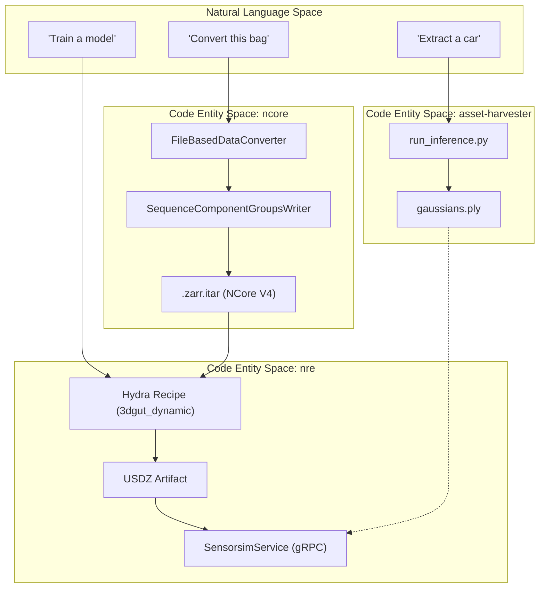
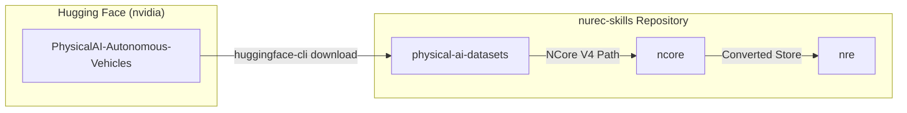

<!-- source: DeepWiki mcp.deepwiki.com · repo NVIDIA/nurec-skills · page 2 nurec-index: The Routing Skill · fetched 2026-10-26 -->

# nurec-index: The Routing Skill

Relevant source files

The following files were used as context for generating this wiki page:

- [skills/asset-harvester/evals/evals.json](skills/asset-harvester/evals/evals.json)
- [skills/ncore/SKILL.md](skills/ncore/SKILL.md)
- [skills/ncore/evals/evals.json](skills/ncore/evals/evals.json)
- [skills/ncore/ncore_template/impl/data_converter/example_converter.py](skills/ncore/ncore_template/impl/data_converter/example_converter.py)
- [skills/nre/evals/evals.json](skills/nre/evals/evals.json)
- [skills/nurec-index/SKILL.md](skills/nurec-index/SKILL.md)
- [skills/nurec-index/evals/evals.json](skills/nurec-index/evals/evals.json)
- [skills/physical-ai-datasets/SKILL.md](skills/physical-ai-datasets/SKILL.md)
- [skills/physical-ai-datasets/evals/evals.json](skills/physical-ai-datasets/evals/evals.json)

The `nurec-index` skill serves as the central dispatch hub for the NVIDIA NuRec (Neural Reconstruction) ecosystem. It is designed to classify user intent and route requests to the appropriate sibling skill within the pipeline, ensuring that complex tasks like sensor conversion, neural training, and asset extraction are handled by the correct specialized tools [skills/nurec-index/SKILL.md:43-55]().

## Purpose and Scope

This skill acts as a hand-curated router to prevent agents from guessing which sub-skill to invoke for a given task. It is a read-only index and does not execute containers, training jobs, or data conversions directly [skills/nurec-index/SKILL.md:68-73]().

**Key Use Cases:**
*   **Disambiguation:** Determining if a request like "render this clip" requires `ncore` (for conversion) or `nre` (for rendering) [skills/nurec-index/SKILL.md:76-79]().
*   **Pipeline Bootstrapping:** Planning multi-stage workflows (e.g., convert → train → render) [skills/nurec-index/SKILL.md:80-84]().
*   **Jargon Translation:** Mapping terms like "3DGUT", "NCore V4", and "USDZ" to their respective functional units [skills/nurec-index/SKILL.md:85-87]().
*   **Teardown Planning:** Managing disk cleanup across multiple skills that can consume 150 GB+ of space [skills/nurec-index/SKILL.md:91-94]().

**Out of Scope:**
*   Tasks outside the NuRec family (e.g., Isaac Sim, CARLA, or generic Cosmos training) [skills/nurec-index/SKILL.md:101-102]().
*   Direct implementation or execution steps [skills/nurec-index/SKILL.md:65-66]().

### Sources:
* [skills/nurec-index/SKILL.md:43-106]()

## Skill Routing Logic

The following table maps user goals to the specific sibling skills. For multi-stage tasks, the skills should be opened in the order indicated by arrows.

| Goal | Primary Sibling Skill |
| :--- | :--- |
| Find or download an existing NVIDIA dataset | `physical-ai-datasets` |
| Convert raw sensor data (LiDAR, Camera, etc.) to NCore V4 | `ncore` |
| Train a 3D reconstruction from an NCore clip | `ncore` → `nre` |
| Render novel views or export USDZ from a trained model | `nre` |
| Extract per-object 3D Gaussians from AV logs | `asset-harvester` |
| Clean up visual artifacts in rendered frames | `nurec-fixer` |

### Sources:
* [skills/nurec-index/SKILL.md:173-187]()

## The NuRec Pipeline Architecture

The NuRec ecosystem bridges the gap between raw physical sensor data and high-fidelity neural reconstructions. The diagram below illustrates how system components and code entities relate across the pipeline.

**NuRec Pipeline: Data Flow and Entity Mapping**

### Sources:
* [skills/nurec-index/SKILL.md:156-166]()
* [skills/ncore/SKILL.md:41-46]()
* [skills/ncore/ncore_template/impl/data_converter/example_converter.py:48-50]()
* [skills/nurec-index/evals/evals.json:1-56]()

## Reference Documentation and Workflows

The `nurec-index` skill relies on three primary reference documents to guide the agent through complex operations. For deep technical details on these logic patterns, see [Routing Logic and Workflow References](#2.1).

*   **Discovery (`references/discovery.md`):** Used to locate sibling skills that may not be present on the local disk [skills/nurec-index/SKILL.md:88-90]().
*   **Workflows (`references/workflows.md`):** Defines seven standardized multi-stage pipelines (A–G) for consistent execution [skills/nurec-index/SKILL.md:80-84]().
*   **Teardown (`references/teardown.md`):** Outlines the order of operations for reclaiming disk space and managing secrets like `NGC_API_KEY` and `HF_TOKEN` [skills/nurec-index/SKILL.md:91-94]().

### Sources:
* [skills/nurec-index/SKILL.md:80-94]()

## Physical AI Datasets

The `physical-ai-datasets` skill provides a catalog of NVIDIA's hosted datasets on Hugging Face. This is the entry point for users who do not have their own sensor data but wish to use NVIDIA-provided clips for reconstruction or robotics tasks. For a full catalog and download patterns, see [Physical AI Datasets Skill](#2.2).

**Dataset Integration Diagram**

### Sources:
* [skills/physical-ai-datasets/SKILL.md:4-14]()
* [skills/physical-ai-datasets/SKILL.md:162-163]()
* [skills/nurec-index/SKILL.md:49-49]()

## Child Pages

*   [Routing Logic and Workflow References](#2.1) — Details how `nurec-index` evaluates user intent and routes to sibling skills; covers discovery, workflows, and teardown documents.
*   [Physical AI Datasets Skill](#2.2) — Documents the `physical-ai-datasets` skill: the catalog of NVIDIA `PhysicalAI-*` Hugging Face datasets, gating, and download patterns.

---

