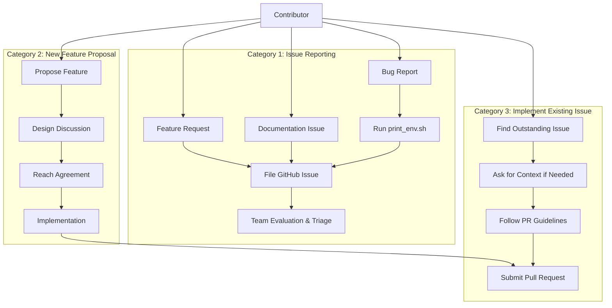
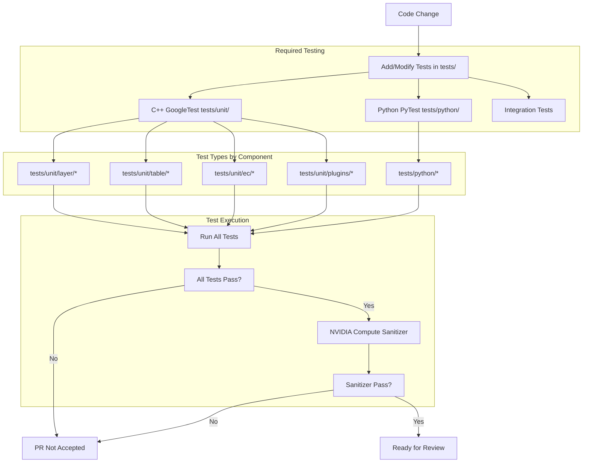

<!-- source: DeepWiki mcp.deepwiki.com · repo NVIDIA/nv-embedding-cache · page 12 Contributing · fetched 2026-10-26 -->

# Contributing

<details>
<summary>Relevant source files</summary>

The following files were used as context for generating this wiki page:

- [CONTRIBUTING.md](CONTRIBUTING.md)
- [README.md](README.md)

</details>


This page provides guidelines for contributing to the NV Embedding Cache SDK. It covers the process for reporting issues, submitting code changes, and participating in code reviews. For information about building the SDK from source, see [Building from Source](#2.2). For details on running tests, see [Testing](#11).

The SDK welcomes contributions from the community. All contributions must follow the guidelines outlined in this document to maintain code quality and ensure smooth integration into the project.

Sources: [CONTRIBUTING.md:1-35]()

## Contribution Categories

The NV Embedding Cache SDK organizes contributions into three distinct categories, each with specific workflows and requirements.



**Contribution Category Overview**

| Category | Entry Point | Key Requirement | Output |
|----------|-------------|-----------------|--------|
| Issue Reporting | GitHub Issues | `print_env.sh` output for bugs | Tracked issue |
| New Feature | GitHub Discussion | Design agreement | Approved implementation |
| Existing Issue | Issue tracker | Follow guidelines | Pull request |

Sources: [CONTRIBUTING.md:1-21]()

## Development Workflow

The standard workflow for contributing code to the SDK follows a structured process from initial development through code review to final merge.

```mermaid
graph LR
    subgraph "Local Development"
        FORK["Fork Repository"]
        CLONE["git clone"]
        SUBMODULES["git submodule update --init --recursive"]
        BRANCH["Create Feature Branch"]
        DEVELOP["Write Code"]
        TEST_LOCAL["Run tests/"]
    end
    
    subgraph "Code Quality Checks"
        ADD_TESTS["Add/Modify tests/"]
        RUN_GTEST["Run GoogleTest Suite"]
        RUN_PYTEST["Run PyTest Suite"]
        COMPUTE_SAN["NVIDIA Compute Sanitizer"]
        UPDATE_DOCS["Update README.md & docs/"]
    end
    
    subgraph "Submission"
        COMMIT_S["git commit -s"]
        PUSH["Push to Fork"]
        CREATE_PR["Create Pull Request to main"]
    end
    
    subgraph "Review Process"
        CI_CHECKS["Automated CI Checks"]
        CODE_REVIEW["Code Review"]
        ADDRESS_FEEDBACK["Address Feedback"]
        APPROVAL["Approval"]
        MERGE["Merge to main"]
    end
    
    FORK --> CLONE
    CLONE --> SUBMODULES
    SUBMODULES --> BRANCH
    BRANCH --> DEVELOP
    DEVELOP --> TEST_LOCAL
    
    TEST_LOCAL --> ADD_TESTS
    ADD_TESTS --> RUN_GTEST
    ADD_TESTS --> RUN_PYTEST
    RUN_GTEST --> COMPUTE_SAN
    RUN_PYTEST --> COMPUTE_SAN
    COMPUTE_SAN --> UPDATE_DOCS
    
    UPDATE_DOCS --> COMMIT_S
    COMMIT_S --> PUSH
    PUSH --> CREATE_PR
    
    CREATE_PR --> CI_CHECKS
    CI_CHECKS --> CODE_REVIEW
    CODE_REVIEW --> ADDRESS_FEEDBACK
    ADDRESS_FEEDBACK --> CODE_REVIEW
    CODE_REVIEW --> APPROVAL
    APPROVAL --> MERGE
```



**Critical Workflow Requirements**

| Stage | Requirement | Reference |
|-------|-------------|-----------|
| Submodules | Must initialize all submodules | [README.md:37]() |
| Commit | Must sign with `-s` or `--signoff` | [CONTRIBUTING.md:33]() |
| Tests | All tests must pass | [CONTRIBUTING.md:27-28]() |
| Sanitizer | Must pass Compute Sanitizer checks | [CONTRIBUTING.md:29-30]() |
| Documentation | Update relevant docs | [CONTRIBUTING.md:31]() |

Sources: [CONTRIBUTING.md:23-34](), [README.md:33-55]()

## Code Organization for Contributors

Understanding where different types of contributions should be placed in the repository structure is essential for maintainability and code organization.

```mermaid
graph TB
    ROOT["Repository Root"]
    
    subgraph "Core Implementation (src)"
        SRC_DIR["src/"]
        LAYER_CPP["src/layer/"]
        TABLE_CPP["src/table/"]
        EC_CPP["src/ec/"]
        UTILS_CPP["src/utility/"]
    end
    
    subgraph "Public API (include)"
        INCLUDE_DIR["include/nve/"]
        LAYER_HPP["include/nve/layer.hpp"]
        TABLE_HPP["include/nve/table.hpp"]
        EC_HPP["include/nve/ec.hpp"]
    end
    
    subgraph "Language Bindings (python)"
        PY_DIR["python/pynve/"]
        PY_BINDINGS["python/pynve/bindings.cpp"]
        PY_SETUP["setup.py"]
    end
    
    subgraph "Storage Plugins (plugins)"
        PLUGIN_DIR["plugins/"]
        NVHM_PLUGIN["plugins/nvhm/"]
        REDIS_PLUGIN["plugins/redis/"]
        ROCKS_PLUGIN["plugins/rocksdb/"]
        ABSEIL_PLUGIN["plugins/abseil/"]
        PHMAP_PLUGIN["plugins/phmap/"]
    end
    
    subgraph "Testing (tests)"
        TEST_DIR["tests/"]
        UNIT_TESTS["tests/unit/"]
        LAYER_TEST["tests/unit/layer/"]
        TABLE_TEST["tests/unit/table/"]
        PY_TEST["tests/python/"]
    end
    
    subgraph "Examples (samples)"
        SAMPLE_DIR["samples/"]
        SIMPLE_CPP["samples/simple_cpp/"]
        LAYER_SAMPLE["samples/layer_sample/"]
        PY_SAMPLES["samples/pytorch/"]
        TRITON_SAMPLE["samples/triton/"]
    end
    
    subgraph "Build System (cmake)"
        CMAKE_ROOT["CMakeLists.txt"]
        THIRD_PARTY_CMAKE["third_party/CMakeLists.txt"]
    end
    
    ROOT --> SRC_DIR
    ROOT --> INCLUDE_DIR
    ROOT --> PY_DIR
    ROOT --> PLUGIN_DIR
    ROOT --> TEST_DIR
    ROOT --> SAMPLE_DIR
    ROOT --> CMAKE_ROOT
    
    SRC_DIR --> LAYER_CPP
    SRC_DIR --> TABLE_CPP
    SRC_DIR --> EC_CPP
    SRC_DIR --> UTILS_CPP
    
    INCLUDE_DIR --> LAYER_HPP
    INCLUDE_DIR --> TABLE_HPP
    INCLUDE_DIR --> EC_HPP
    
    PY_DIR --> PY_BINDINGS
    PY_DIR --> PY_SETUP
    
    PLUGIN_DIR --> NVHM_PLUGIN
    PLUGIN_DIR --> REDIS_PLUGIN
    PLUGIN_DIR --> ROCKS_PLUGIN
    PLUGIN_DIR --> ABSEIL_PLUGIN
    PLUGIN_DIR --> PHMAP_PLUGIN
    
    TEST_DIR --> UNIT_TESTS
    UNIT_TESTS --> LAYER_TEST
    UNIT_TESTS --> TABLE_TEST
    TEST_DIR --> PY_TEST
    
    SAMPLE_DIR --> SIMPLE_CPP
    SAMPLE_DIR --> LAYER_SAMPLE
    SAMPLE_DIR --> PY_SAMPLES
    SAMPLE_DIR --> TRITON_SAMPLE
```



**Code Placement Guidelines**

| Contribution Type | Target Directory | Must Also Update |
|-------------------|------------------|------------------|
| New embedding layer | `src/layer/` | `include/nve/layer.hpp`, `tests/unit/layer/` |
| New table backend | `src/table/` or `plugins/` | `include/nve/table.hpp`, `tests/unit/table/` |
| GPU cache kernel | `src/ec/` | `include/nve/ec.hpp`, `tests/unit/ec/` |
| Python API extension | `python/pynve/bindings.cpp` | `tests/python/`, docs |
| New storage plugin | `plugins/<name>/` | `CMakeLists.txt`, tests |
| Utility function | `src/utility/` | `include/nve/`, tests |
| Bug fix | Relevant source file | Corresponding test file |

Sources: [README.md:58-72](), [CONTRIBUTING.md:27]()

## Reporting Issues

When reporting issues, contributors must provide sufficient context for the development team to reproduce and diagnose problems efficiently.

### Bug Reports

Bug reports require specific environmental information to facilitate reproduction and debugging.

**Required Information for Bug Reports**

| Information Type | How to Obtain | Purpose |
|------------------|---------------|---------|
| Environment details | Run `print_env.sh` script | Captures CUDA, compiler, system info |
| Steps to reproduce | Detailed procedure | Enables reproduction |
| Expected behavior | Description | Establishes correctness criteria |
| Actual behavior | Description + error output | Shows the failure |
| Code snippet | Minimal example | Isolates the issue |

The `print_env.sh` script should be executed and its output included in all bug reports. This script captures critical environmental details including CUDA version, GPU architecture, compiler version, and system configuration.

Sources: [CONTRIBUTING.md:6-11]()

### Feature Requests

Feature requests should clearly articulate the motivation and expected use case for the proposed functionality.

**Feature Request Contents**

1. **Problem Statement**: What limitation or missing capability exists?
2. **Proposed Solution**: High-level description of the desired feature
3. **Use Case**: Concrete example of how the feature would be used
4. **Impact**: Expected performance or usability improvement
5. **Alternatives Considered**: Other approaches evaluated

Sources: [CONTRIBUTING.md:13-17]()

### Documentation Issues

Documentation issues should specify the exact location of unclear, incorrect, or missing documentation.

**Documentation Issue Requirements**

- File path reference (e.g., `docs/overview.md`, `README.md`)
- Section or line number
- Description of the problem (unclear, incorrect, outdated, missing)
- Suggested correction or addition (if applicable)

Sources: [CONTRIBUTING.md:6-11]()

## Pull Request Requirements

Pull requests must meet specific quality standards before they can be merged into the main branch. All PRs target the `main` branch.

### Scope and Clarity

**Pull Request Scope Guidelines**

| Guideline | Description | Rationale |
|-----------|-------------|-----------|
| Limited scope | Each PR addresses one feature or bug | Simplifies review process |
| Concise commits | Individual commits are focused | Facilitates code review |
| Clear messages | Commit messages explain changes | Aids understanding and debugging |

Pull requests should be limited in scope and concise. Each commit message should clearly describe what is being changed and why, facilitating the code review process.

Sources: [CONTRIBUTING.md:24-26]()

### Testing Requirements

All code changes must include appropriate test coverage. The test suite is located in the `tests/` directory.



**Test Coverage Requirements**

| Component Type | Test Location | Test Framework | Additional Validation |
|----------------|---------------|----------------|----------------------|
| Embedding layers | `tests/unit/layer/` | GoogleTest | Compute Sanitizer |
| Tables | `tests/unit/table/` | GoogleTest | Compute Sanitizer |
| GPU cache | `tests/unit/ec/` | GoogleTest | Compute Sanitizer |
| Storage plugins | `tests/unit/plugins/` | GoogleTest | Compute Sanitizer |
| Python API | `tests/python/` | PyTest | - |

All tests must pass before a pull request can be accepted. This includes both functional correctness tests and validation with NVIDIA Compute Sanitizer.

Sources: [CONTRIBUTING.md:27-30]()

### NVIDIA Compute Sanitizer

NVIDIA Compute Sanitizer is a mandatory validation tool for all GPU-related code. It detects memory errors, race conditions, and other issues in CUDA code.

**Compute Sanitizer Validation**

The Compute Sanitizer is included with the CUDA Toolkit and can be run using:

```bash
compute-sanitizer --tool memcheck <test_executable>
compute-sanitizer --tool racecheck <test_executable>
compute-sanitizer --tool initcheck <test_executable>
compute-sanitizer --tool synccheck <test_executable>
```

All tests should pass with clean output from Compute Sanitizer. The Docker environment provided in the repository includes Compute Sanitizer.

Sources: [CONTRIBUTING.md:29-30]()

### Documentation Updates

Documentation must be updated to reflect code changes. The SDK maintains documentation in multiple locations.

**Documentation Update Requirements**

| Change Type | Required Documentation Updates |
|-------------|-------------------------------|
| New public API | `README.md`, `docs/cpp_api.md` or `docs/python_api.md`, inline comments |
| New feature | `README.md`, relevant `docs/*.md`, inline comments |
| Behavior change | Relevant `docs/*.md`, inline comments |
| Bug fix | Inline comments (if clarifying logic) |
| New sample | `docs/samples.md`, sample README |

Documentation updates should include:
- Inline code comments explaining implementation
- Updates to `README.md` for user-facing changes
- Updates to relevant documentation in `docs/` directory
- Addition of new documentation files if introducing major features

Sources: [CONTRIBUTING.md:31]()

### Performance Considerations

Changes that may impact performance should be explicitly noted during code review.

**Performance-Impacting Changes**

Contributors should flag changes that may affect:
- Memory allocation patterns
- Cache hit rates
- Kernel execution time
- Network I/O for distributed storage backends
- CPU-GPU transfer bandwidth

Performance benchmarking scripts are available in the `benchmarks/` directory for validation. See [Benchmarking](#11.2) for details.

Sources: [CONTRIBUTING.md:32]()

## Code Review Guidelines

The NV Embedding Cache SDK encourages active participation in code reviews to maintain code quality and share knowledge across the community.

### Review Participation

All community members are encouraged to participate in code reviews, not just maintainers.

**Review Expectations**

| Participant | Responsibility |
|-------------|----------------|
| PR Author | Respond to feedback promptly, address all comments |
| Reviewers | Provide constructive feedback, test changes locally if needed |
| Maintainers | Final approval, ensure guidelines are followed |

Code review is a collaborative process. Reviewers should focus on:
- Correctness of implementation
- Test coverage adequacy
- Code clarity and maintainability
- Adherence to SDK coding patterns
- Documentation completeness

Sources: [CONTRIBUTING.md:26]()

### Review Criteria

**Code Review Checklist**

| Criterion | Description | Priority |
|-----------|-------------|----------|
| Correctness | Code does what it claims to do | Critical |
| Test coverage | Changes are adequately tested | Critical |
| Performance | No performance regressions | High |
| Documentation | Code is documented | High |
| Style consistency | Follows existing patterns | Medium |
| Scope | PR is focused and concise | Medium |

Sources: [CONTRIBUTING.md:24-34]()

## Developer Certificate of Origin

All commits to the NV Embedding Cache SDK must be signed to certify that the contributor has the right to submit the code under the project's open source license.

### Signing Commits

Commits must be signed using the `-s` or `--signoff` flag:

```bash
git commit -s -m "Add feature X"
```

or

```bash
git commit --signoff -m "Fix bug Y"
```

This adds a "Signed-off-by" line to the commit message, certifying that the contributor agrees to the Developer Certificate of Origin.

Sources: [CONTRIBUTING.md:33](), [CONTRIBUTING.md:36-38]()

### Developer Certificate Text

By signing commits, contributors certify:

1. **(a)** The contribution was created in whole or in part by the contributor and they have the right to submit it under the indicated open source license; or

2. **(b)** The contribution is based upon previous work covered under an appropriate open source license and the contributor has the right to submit it with modifications under the same license; or

3. **(c)** The contribution was provided directly by another person who certified (a), (b), or (c) and the contributor has not modified it; or

4. **(d)** The contributor understands that the contribution and their personal information will be maintained indefinitely as part of the public record.

The complete Developer Certificate of Origin Version 1.1 is included in the repository.

Sources: [CONTRIBUTING.md:36-75]()

## Quick Reference

**Contribution Quick Reference Table**

| Task | Command/Action | Reference |
|------|----------------|-----------|
| Clone repository | `git clone git@github.com:NVIDIA/nv-embedding-cache.git` | [README.md:34-37]() |
| Initialize submodules | `git submodule update --init --recursive` | [README.md:37]() |
| Build for development | `pip install .` or `cmake .. && make` | [README.md:44-54]() |
| Run C++ tests | `make test` from build directory | Testing docs |
| Run Python tests | `pytest tests/python/` | Testing docs |
| Check with sanitizer | `compute-sanitizer <test>` | [CONTRIBUTING.md:29-30]() |
| Sign commit | `git commit -s` | [CONTRIBUTING.md:33]() |
| File issue | GitHub Issues with `print_env.sh` output | [CONTRIBUTING.md:6-9]() |
| Submit PR | Target `main` branch | [CONTRIBUTING.md:24]() |

Sources: [README.md:33-55](), [CONTRIBUTING.md:1-79]()

---

