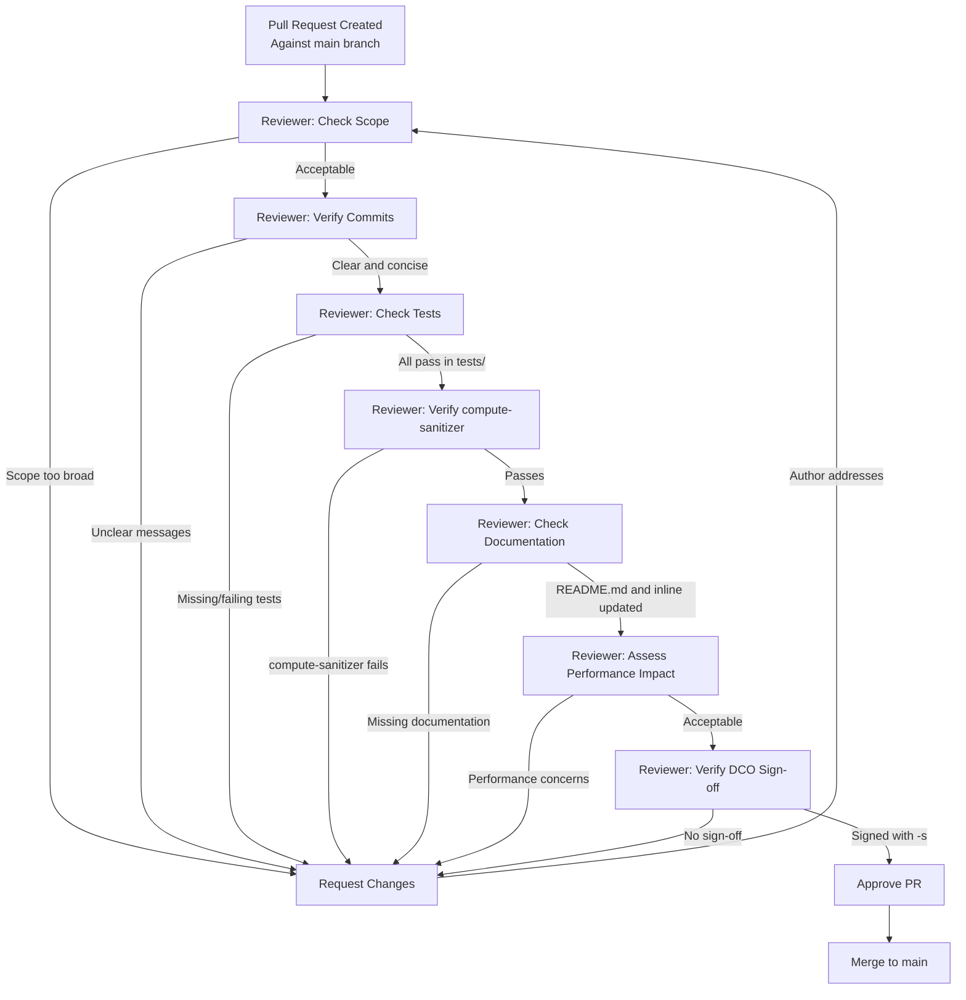
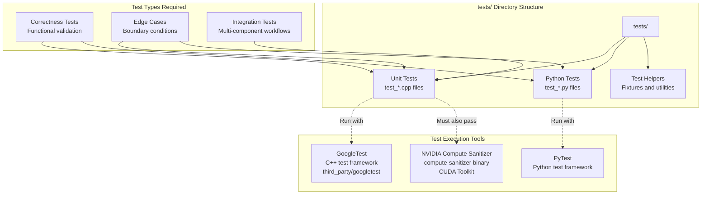
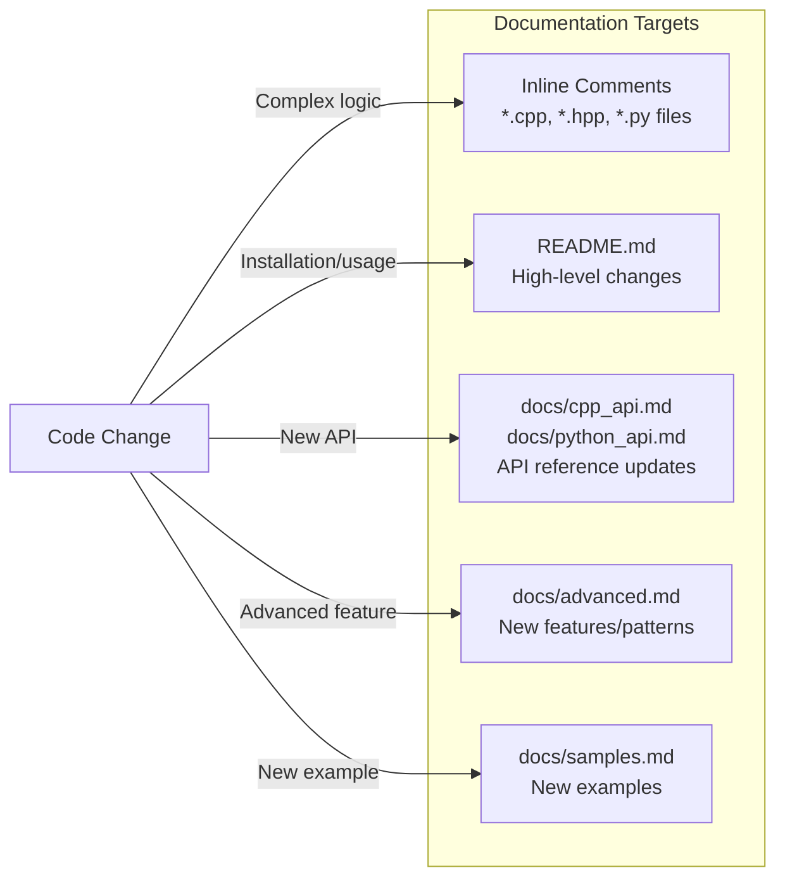
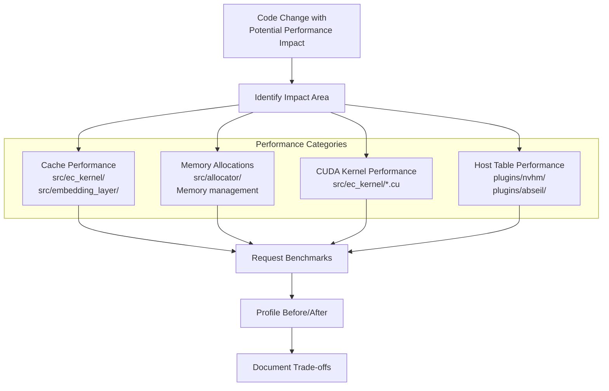

<!-- source: DeepWiki mcp.deepwiki.com · repo NVIDIA/nv-embedding-cache · page 12.3 Code Review Guidelines · fetched 2026-10-26 -->

# Code Review Guidelines

<details>
<summary>Relevant source files</summary>

The following files were used as context for generating this wiki page:

- [CONTRIBUTING.md](CONTRIBUTING.md)
- [README.md](README.md)

</details>


## Purpose and Scope

This document defines the code review standards and expectations for contributors to the NV Embedding Cache SDK. It covers quality requirements, review processes, testing obligations, and documentation standards that must be met for pull requests to be accepted.

For information about reporting bugs or feature requests, see [Reporting Issues](#12.1). For general pull request procedures and branch policies, see [Pull Request Process](#12.2).

---

## Code Quality Standards

All code contributions must meet the following quality standards based on the component being modified:

### C++ Code Requirements

| Requirement | Description | Applicable Files |
|------------|-------------|------------------|
| **C++17 Compliance** | Code must compile with C++17 standard | All `src/**/*.cpp`, `include/**/*.hpp` files |
| **Compiler Support** | Must build with GCC 13.3+ and Clang 20.1+ | Build tested via CMake |
| **CUDA Compatibility** | CUDA kernels require CUDA 12.8+ | Files in `src/ec_kernel/`, `include/nve/ec_kernel/` |
| **Memory Safety** | No memory leaks, use RAII patterns | All C++ implementations |
| **Thread Safety** | Document thread-safety guarantees | Embedding layers, table implementations |
| **Error Handling** | Use exceptions or error codes consistently | Public API boundaries |

### Python Code Requirements

| Requirement | Description | Applicable Files |
|------------|-------------|------------------|
| **Python Version** | Support Python 3.10+ | All `python/**/*.py` files |
| **Type Hints** | Include type annotations for public APIs | `python/pynve/nv_embedding.py` |
| **Documentation** | Docstrings for all public functions/classes | Python bindings |
| **PyTorch Integration** | Maintain compatibility with PyTorch API conventions | `python/pynve/**` |

### CUDA Kernel Requirements

| Requirement | Description | Verification |
|------------|-------------|--------------|
| **Compute Sanitizer** | Kernels must pass compute-sanitizer checks | Run `compute-sanitizer` on test binaries |
| **Memory Coalescing** | Optimize for coalesced memory access patterns | Review kernel access patterns |
| **Occupancy** | Document and justify occupancy trade-offs | Inline comments in kernel files |
| **Correctness** | Validate race conditions and synchronization | Unit tests with various input sizes |

Sources: [README.md:22-29](), [CONTRIBUTING.md:27-30]()

---

## Review Process and Expectations

### Code Review Workflow



Sources: [CONTRIBUTING.md:23-34]()

### Reviewer Responsibilities

Reviewers evaluating pull requests should verify the following:

1. **Scope and Clarity**
   - Each PR has limited, well-defined scope
   - Commit messages clearly describe changes
   - Code follows existing architectural patterns

2. **Correctness Verification**
   - Review logic in modified files (`src/`, `include/`, `python/`)
   - Check for potential race conditions in concurrent code
   - Verify error handling paths are covered

3. **Test Coverage**
   - Tests exist in [tests/](tests) directory for new functionality
   - Existing tests modified if behavior changes
   - Edge cases are covered

4. **Documentation Quality**
   - Inline comments explain non-obvious logic
   - Public API changes reflected in [docs/](docs) directory
   - [README.md](README.md) updated if installation/usage changes

5. **Performance Assessment**
   - Flag changes that may impact performance
   - Request benchmarks if GPU kernel performance affected
   - Verify memory allocation patterns are efficient

Sources: [CONTRIBUTING.md:24-32]()

### Author Responsibilities

Pull request authors must:

1. **Limit Pull Request Scope**
   - Keep changes focused on a single feature or bug fix
   - Split large refactoring into multiple PRs when possible
   - Avoid mixing unrelated changes

2. **Write Clear Commit Messages**
   - Describe what changed and why
   - Reference issue numbers where applicable
   - Use imperative mood ("Add feature" not "Added feature")

3. **Participate in Code Review**
   - Respond to reviewer comments promptly
   - Engage in design discussions constructively
   - Help review other contributors' pull requests

4. **Sign Commits**
   - Use `git commit -s` or `git commit --signoff`
   - Certifies Developer Certificate of Origin compliance

Sources: [CONTRIBUTING.md:24-34]()

---

## Testing Requirements

All pull requests must satisfy comprehensive testing requirements before merge.

### Test Directory Structure



Sources: [CONTRIBUTING.md:27-30](), [README.md:48-55]()

### Testing Checklist

| Test Type | Requirement | Location | Verification Command |
|-----------|-------------|----------|---------------------|
| **Unit Tests** | All new features covered | [tests/](tests) | `make test` or `ctest` in build directory |
| **Compute Sanitizer** | All CUDA code passes | CUDA test binaries | `compute-sanitizer ./build/bin/test_name` |
| **Python Tests** | Python API changes covered | Python test files | `pytest` after `pip install .` |
| **Existing Tests** | All existing tests still pass | All test files | Full test suite execution |

### Compute Sanitizer Requirements

NVIDIA Compute Sanitizer is a mandatory validation tool for CUDA code:

```bash
# Example: Running Compute Sanitizer on a test binary
compute-sanitizer --tool memcheck ./build/bin/test_gpu_cache
compute-sanitizer --tool racecheck ./build/bin/test_hierarchical_layer
compute-sanitizer --tool synccheck ./build/bin/test_ec_kernel
```

Common issues detected by Compute Sanitizer that must be resolved:
- **Memory leaks** in CUDA allocations
- **Race conditions** in kernel execution
- **Invalid memory accesses** (out-of-bounds, use-after-free)
- **Synchronization errors** between host and device

Files most likely to require Compute Sanitizer validation:
- [src/ec_kernel/](src/ec_kernel) - GPU cache kernel implementations
- [src/embedding_layer/gpu_embedding_layer.cpp]() - GPU layer logic
- [src/embedding_layer/linear_uvm_embedding_layer.cpp]() - UVM operations
- [src/table/gpu_table.cpp]() - GPU table operations

Sources: [CONTRIBUTING.md:29-30]()

---

## Documentation Requirements

### Required Documentation Updates



Sources: [CONTRIBUTING.md:31](), [README.md:58-70]()

### Documentation Standards by Component

| Component | Documentation Standard | Example Location |
|-----------|----------------------|------------------|
| **Public C++ API** | Doxygen-style comments in headers | [include/nve/](include/nve) |
| **Python API** | NumPy-style docstrings | [python/pynve/](python/pynve) |
| **CUDA Kernels** | Explain threading model, memory access patterns | [src/ec_kernel/](src/ec_kernel) |
| **Embedding Layers** | Document configuration options, use cases | [docs/cpp_api.md](), [docs/python_api.md]() |
| **Storage Plugins** | Describe backend requirements, performance characteristics | [docs/advanced.md]() |
| **Build System** | Document CMake variables, feature flags | [docs/](docs) |

### Inline Documentation Guidelines

For C++ code:
```cpp
/**
 * @brief Brief description of function purpose
 * 
 * @param param1 Description of first parameter
 * @param param2 Description of second parameter
 * @return Description of return value
 * 
 * @note Thread-safety guarantees or special considerations
 * @note Performance characteristics if relevant
 */
```

For Python code:
```python
def function_name(param1: Type1, param2: Type2) -> ReturnType:
    """Brief description of function purpose.
    
    Args:
        param1: Description of first parameter
        param2: Description of second parameter
        
    Returns:
        Description of return value
        
    Raises:
        ExceptionType: When this exception is raised
    """
```

For complex CUDA kernels, include:
- Threading model (block/grid dimensions)
- Shared memory usage
- Memory access patterns
- Synchronization points
- Performance considerations

Sources: [CONTRIBUTING.md:31]()

---

## Performance Considerations

### Performance Review Process

When reviewing changes that may impact performance:



Sources: [CONTRIBUTING.md:32]()

### Components Requiring Performance Attention

| Component | Performance Concerns | Benchmark Tool |
|-----------|---------------------|----------------|
| **GPU Cache Kernels** | Throughput (keys/sec), latency | [benchmarks/](benchmarks) scripts |
| **Memory Allocators** | Allocation speed, fragmentation | Custom profiling |
| **Host Tables** | Lookup latency, memory overhead | Plugin-specific tests |
| **Embedding Layers** | End-to-end inference latency | [samples/layer_sample/](samples/layer_sample) |
| **Multi-GPU** | Scaling efficiency, synchronization overhead | Multi-GPU benchmarks |

### Benchmark Execution

For changes affecting performance-critical paths:

1. **Run existing benchmarks**:
   ```bash
   # From benchmarks/ directory
   python benchmark_script.py --baseline main --compare feature-branch
   ```

2. **Profile with NVIDIA tools**:
   ```bash
   nsys profile ./build/bin/sample_binary
   ncu --set full ./build/bin/test_kernel
   ```

3. **Document results** in pull request description:
   - Throughput comparison (operations/sec)
   - Latency percentiles (p50, p95, p99)
   - Memory usage delta
   - Justification for any regressions

Sources: [CONTRIBUTING.md:32](), [README.md:72]()

---

## Commit Signing and Developer Certificate of Origin

### Required Sign-Off

All commits must be signed to certify compliance with the Developer Certificate of Origin (DCO).

**Sign commits using**:
```bash
git commit -s -m "Your commit message"
# or
git commit --signoff -m "Your commit message"
```

This adds a "Signed-off-by" trailer to the commit message:
```
Your commit message

Signed-off-by: Your Name <your.email@example.com>
```

### Developer Certificate of Origin (DCO)

By signing your commit, you certify:

1. **(a)** The contribution was created by you and you have the right to submit it under the project's open source license

2. **(b)** The contribution is based on previous work covered under an appropriate open source license, and you have the right to submit it with modifications

3. **(c)** The contribution was provided to you by someone who certified (a), (b), or (c) and you have not modified it

4. **(d)** You understand the contribution and your personal information will be maintained indefinitely and may be redistributed consistent with the project's license

The full DCO text is available in [CONTRIBUTING.md:36-75]().

### Verifying Sign-Off

Reviewers should verify commits are signed:

```bash
# Check if commits in PR are signed
git log --show-signature origin/main..HEAD

# Or check for "Signed-off-by" trailer
git log --format=full origin/main..HEAD | grep "Signed-off-by"
```

Pull requests with unsigned commits will not be accepted until all commits are properly signed.

Sources: [CONTRIBUTING.md:33-75]()

---

## Quality Gates Summary

All pull requests must pass these gates before merge:

| Gate | Requirement | Verification |
|------|-------------|--------------|
| **Scope** | Limited, focused changes | Manual review |
| **Commits** | Clear messages, signed with `-s` | Manual review, git log |
| **Tests** | All tests pass in [tests/](tests) | `make test` / `ctest` |
| **Sanitizer** | Compute Sanitizer clean | `compute-sanitizer` on test binaries |
| **Documentation** | Inline + [docs/](docs) updated | Manual review |
| **Performance** | No unintended regressions | Benchmarks when applicable |
| **Code Quality** | Meets language-specific standards | Manual review |
| **Compatibility** | Builds with GCC 13.3+, Clang 20.1+, CUDA 12.8+ | CI verification |

**Participation in code review** is encouraged for all contributors to improve overall code quality and knowledge sharing across the project.

Sources: [CONTRIBUTING.md:23-34](), [README.md:22-29]()

---

