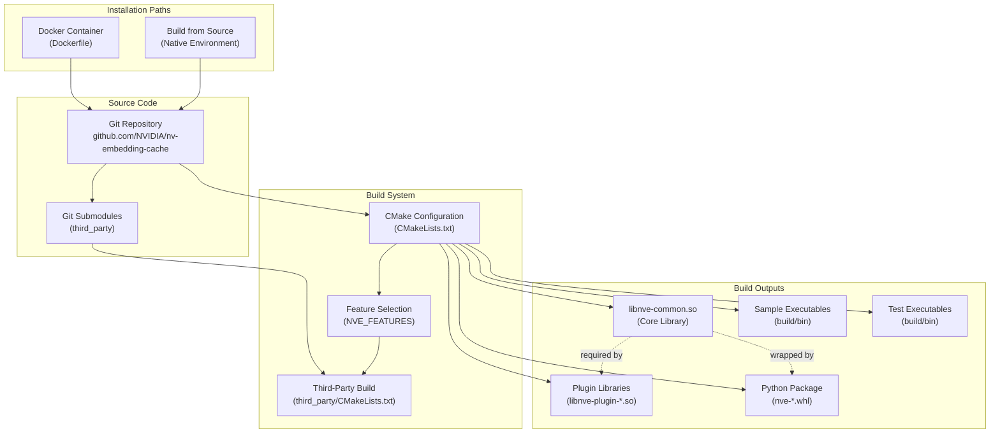
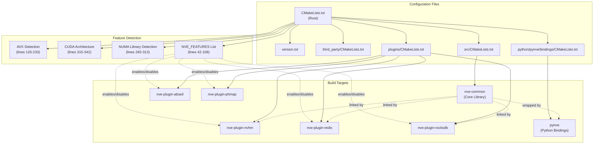
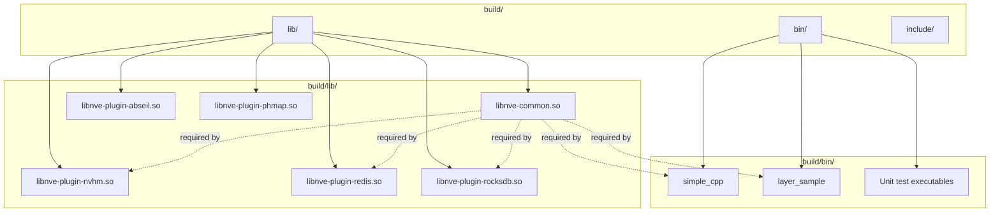

<!-- source: DeepWiki mcp.deepwiki.com · repo NVIDIA/nv-embedding-cache · page 2 Installation and Setup · fetched 2026-10-26 -->

# Installation and Setup

<details>
<summary>Relevant source files</summary>

The following files were used as context for generating this wiki page:

- [CMakeLists.txt](CMakeLists.txt)
- [README.md](README.md)

</details>


This page provides comprehensive instructions for installing and configuring the NV Embedding Cache SDK. It covers the complete setup process from obtaining the source code through building and verifying the installation. For detailed prerequisite requirements, see [Prerequisites](#2.1). For information on using the SDK after installation, see [Quick Start Guide](#1.1).

The SDK supports two primary installation paths: using the pre-configured Docker container (recommended) or building from source in a custom environment. Both methods produce the same output artifacts: the core C++ library (`libnve-common.so`), optional plugin libraries, and Python bindings.

---

## Installation Methods Overview

The following diagram shows the relationship between installation methods and build outputs:



**Sources:** [README.md:1-94](), [CMakeLists.txt:1-390]()

---

## Quick Start Installation

### Option 1: Docker Container (Recommended)

The Docker method provides a fully configured environment with all prerequisites satisfied:

```bash
# Clone repository with submodules
git clone git@github.com:NVIDIA/nv-embedding-cache.git
cd nv-embedding-cache
git submodule update --init --recursive

# Build and start Docker container
docker build -t nve \
    --build-arg START_DIR=$(pwd) \
    --build-arg UID=$(id -u) \
    --build-arg UNAME=$(id -u -n) \
    --build-arg GID=$(id -g) \
    --build-arg GNAME=$(id -g -n) .

docker run --cap-add=ALL --net=host --ipc=host \
    --gpus all -it --rm -v $(pwd):$(pwd) nve

# Inside container: Install Python bindings
pip install .
```

For detailed Docker configuration options, see [Docker Setup](#2.3).

**Sources:** [README.md:32-47]()

### Option 2: Build from Source

For custom environments, build the C++ libraries and optionally the Python bindings:

```bash
# Clone repository
git clone git@github.com:NVIDIA/nv-embedding-cache.git
cd nv-embedding-cache
git submodule update --init --recursive

# Build C++ libraries, samples, and tests
mkdir build
cd build
cmake ..
make all -j
cd ..

# Optional: Install Python bindings
pip install .
```

For detailed build configuration options and troubleshooting, see [Building from Source](#2.2).

**Sources:** [README.md:48-55]()

---

## Build System Architecture

The following diagram maps the build system components to their file locations and CMake targets:



**Sources:** [CMakeLists.txt:1-390]()

---

## Prerequisites Overview

The SDK requires the following components. See [Prerequisites](#2.1) for detailed version requirements and installation instructions.

| Component | Minimum Version | Purpose |
|-----------|----------------|---------|
| C++ Compiler | C++17 support | Build core library (GCC 13.3 or Clang 20.1 tested) |
| CUDA Toolkit | 12.8 | GPU kernel compilation and runtime |
| CMake | 3.18 | Build system configuration |
| Python | 3.10 | Python bindings (optional) |
| PyTorch | - | Python integration (optional) |
| Redis | 7.0.15 | Remote parameter server (optional, for testing) |
| libhwloc | - | NUMA control (optional) |
| libnuma | - | NUMA memory allocation (optional) |

The build system automatically detects available hardware features:

- **AVX/AVX2/AVX-512**: Vectorized CPU operations ([CMakeLists.txt:126-233]())
- **CUDA Compute Capability**: Target GPU architectures ([CMakeLists.txt:315-342]())
- **NUMA Libraries**: Memory affinity control ([CMakeLists.txt:283-313]())

**Sources:** [README.md:21-27](), [CMakeLists.txt:126-342]()

---

## Feature Configuration

The SDK uses a feature flag system (`NVE_FEATURES`) to enable/disable optional components at compile time. This controls which plugin libraries are built and which GPU kernel specializations are included.

### Available Features

```mermaid
graph LR
    subgraph "Plugin Features"
        NVHM["nvhm_plugin"]
        REDIS["redis_plugin"]
        ROCKSDB["rocksdb_plugin"]
        ABSEIL["abseil_plugin"]
        PHMAP["phmap_plugin"]
    end
    
    subgraph "GPU Kernel Features"
        MASK["ht_mask_8/16/32/64"]
        KEY["ht_key_8/16/32/64"]
        KERNEL["ht_kernel_64/128/256/..."]
        PART["ht_part_fnv1a/murmur3/..."]
    end
    
    subgraph "Feature Sets"
        MINIMAL["NVE_MINIMAL_FEATURES<br/>(Fast build)"]
        DEFAULT["NVE_DEFAULT_FEATURES<br/>(Standard)"]
        ALL["NVE_AVAILABLE_FEATURES<br/>(Everything)"]
    end
    
    MINIMAL --> MASK
    MINIMAL --> KEY
    MINIMAL --> PART
    MINIMAL --> KERNEL
    
    DEFAULT --> MINIMAL
    DEFAULT --> NVHM
    DEFAULT --> REDIS
    DEFAULT --> ROCKSDB
    DEFAULT --> ABSEIL
    DEFAULT --> PHMAP
    
    ALL --> DEFAULT
    ALL -.-> "Additional kernel sizes"
```

**Sources:** [CMakeLists.txt:41-84]()

### Feature Configuration Examples

The feature list can be customized via CMake:

```bash
# Build with minimal features (fast compile)
cmake -DNVE_FEATURES="ht_mask_64 ht_key_64 ht_part_fnv1a ht_kernel_64" ..

# Build with default features (recommended)
cmake ..

# Build with all features (slow compile, large binary)
cmake -DNVE_FEATURES="${NVE_AVAILABLE_FEATURES}" ..

# Disable all plugins
cmake -DNVE_DISABLE_PLUGINS=ON ..

# Disable specific plugin
cmake -DNVE_DISABLE_NVHM_PLUGIN=ON ..
```

The build system validates feature names against `NVE_AVAILABLE_FEATURES` at [CMakeLists.txt:99-108]().

**Sources:** [CMakeLists.txt:55-108]()

---

## Build Output Structure

After a successful build, artifacts are organized in the `build/` directory:



**Output Directory Configuration:**

The output directories are configured at [CMakeLists.txt:344-346]():
- `CMAKE_ARCHIVE_OUTPUT_DIRECTORY`: `${CMAKE_BINARY_DIR}/lib`
- `CMAKE_LIBRARY_OUTPUT_DIRECTORY`: `${CMAKE_BINARY_DIR}/lib`
- `CMAKE_RUNTIME_OUTPUT_DIRECTORY`: `${CMAKE_BINARY_DIR}/bin`

**Shared Library Dependencies:**

The `NVE_ORIGIN_RPATH` option ([CMakeLists.txt:350-353]()) enables runtime library search in the local directory, allowing relocated libraries (e.g., during `pip install`) to find their dependencies.

**Sources:** [CMakeLists.txt:344-353]()

---

## Python Bindings Installation

The Python bindings wrap the C++ API using pybind11. Installation methods:

### Method 1: pip install (Builds and Installs)

```bash
# From repository root
pip install .

# With specific build directory
pip install --config-settings cmake.build-type=Release .

# Development mode (editable install)
pip install -e .
```

This invokes the CMake build system and installs the resulting wheel package.

### Method 2: Separate Build and Install

```bash
# Build C++ libraries first
mkdir build && cd build
cmake ..
make -j

# Build Python wheel
cd ..
python -m build

# Install wheel
pip install dist/nve-*.whl
```

The Python bindings are configured in [python/pynve/bindings/CMakeLists.txt]() and wrapped at [CMakeLists.txt:382]().

**Sources:** [README.md:44-46](), [CMakeLists.txt:382]()

---

## Verification Steps

After installation, verify the build:

### C++ Library Verification

```bash
# Check library files exist
ls build/lib/libnve-common.so
ls build/lib/libnve-plugin-*.so  # If plugins enabled

# Run simple C++ sample
./build/bin/simple_cpp

# Run unit tests
cd build
ctest
```

### Python Bindings Verification

```python
# Test import
import nve

# Check version
print(nve.__version__)

# Create a simple embedding layer
from nve import NVEmbedding
emb = NVEmbedding(
    num_embeddings=1000,
    embedding_dim=128,
    cache_type="NoCache"
)
print("NVEmbedding created successfully")
```

**Sources:** [README.md:44-55]()

---

## Third-Party Dependencies

The SDK depends on several third-party libraries managed as git submodules in `third_party/`. These are automatically built by the CMake system.

| Dependency | Purpose | Required By | License |
|------------|---------|-------------|---------|
| googletest | C++ unit testing | Tests | BSD-3-Clause |
| pybind11 | Python bindings | Python API | BSD-3-Clause |
| abseil-cpp | Hash table backend | abseil_plugin | Apache 2.0 |
| parallel-hashmap | Hash table backend | phmap_plugin | Apache 2.0 |
| nvhashmap | GPU hash table | nvhm_plugin | BSD-3-Clause |
| hiredis | Redis client | redis_plugin | BSD-3-Clause |
| redis-plus-plus | Redis C++ API | redis_plugin | Apache 2.0 |
| rocksdb | Persistent storage | rocksdb_plugin | Apache/GPL |
| argparse | CLI parsing | Samples | MIT |
| dlpack | Tensor exchange | Python API | Apache 2.0 |
| json | JSON parsing | Core | MIT |

The dependency build configuration is at [third_party/CMakeLists.txt](), included by the root [CMakeLists.txt:255](). For detailed information on each dependency, see [Third-Party Dependencies](#2.4).

**Submodule Initialization:**

All submodules must be initialized before building:

```bash
git submodule update --init --recursive
```

**Sources:** [README.md:77-93](), [CMakeLists.txt:254-255]()

---

## Hardware Optimization

The build system automatically detects and configures hardware-specific optimizations:

### AVX Instruction Set Detection

The build system detects the highest supported AVX level ([CMakeLists.txt:126-233]()):

1. **AVX-512** (with BW, VL, VBMI extensions): Highest performance
2. **AVX-512F**: Basic AVX-512 support
3. **AVX2**: Widely supported
4. **AVX**: Fallback
5. **None**: Portable (no SIMD)

The detected level is set in `CMAKE_C_FLAGS`, `CMAKE_CXX_FLAGS`, and `CMAKE_CUDA_FLAGS` with appropriate compiler flags (e.g., `-mavx512f -mavx512bw -mavx512vl`).

Preprocessor macros are defined: `NVE_AVX_LEVEL_AVX512=1`, `NVE_AVX_LEVEL_AVX2=1`, etc.

**Disabling AVX-512:**

```bash
cmake -DNVE_DISABLE_AVX512=ON ..
```

### CUDA Architecture Detection

The build system detects the local GPU's compute capability using `nvidia-smi` ([CMakeLists.txt:315-342]()):

```bash
# Automatic detection
cmake ..

# Manual specification
cmake -DNVE_SM_VERSION="80;86;90" ..
```

Default architectures if detection fails: `80, 86, 90, 100` (Ampere, Ada, Hopper, Blackwell).

The result is set in `CMAKE_CUDA_ARCHITECTURES`.

**Sources:** [CMakeLists.txt:126-342]()

---

## Configuration Options Reference

The following CMake options control the build:

| Option | Type | Default | Description |
|--------|------|---------|-------------|
| `NVE_FEATURES` | List | Default set | Enabled features (plugins, kernel configs) |
| `NVE_DISABLE_PLUGINS` | Boolean | OFF | Disable all plugins, use minimal features |
| `NVE_DISABLE_NVHM_PLUGIN` | Boolean | OFF | Disable nvhm plugin specifically |
| `NVE_DISABLE_AVX512` | Boolean | OFF | Disable AVX-512 instructions |
| `NVE_SM_VERSION` | List | Auto-detected | Target CUDA architectures |
| `NVE_CACHE_LINE_SIZE` | Integer | Auto-detected | CPU cache line size in bytes |
| `NVE_WITH_LIBHWLOC` | Boolean | Auto | Enable hwloc NUMA control |
| `NVE_WITH_LIBNUMA` | Boolean | Auto | Enable libnuma NUMA control |
| `NVE_ORIGIN_RPATH` | Boolean | OFF | Enable $ORIGIN in RPATH for relocatable libs |
| `NVE_ENABLE_NVTX` | Boolean | OFF | Enable NVTX profiling markers |
| `NVE_DISABLE_TESTS_AND_SAMPLES` | Boolean | OFF | Skip building tests and samples |
| `CMAKE_BUILD_TYPE` | String | Release | Build type (Release, Debug) |

**Example Usage:**

```bash
# Custom configuration
cmake \
  -DCMAKE_BUILD_TYPE=Debug \
  -DNVE_FEATURES="nvhm_plugin redis_plugin ht_mask_64 ht_key_64" \
  -DNVE_ENABLE_NVTX=ON \
  -DNVE_SM_VERSION="90" \
  ..
```

**Sources:** [CMakeLists.txt:41-389]()

---

## Next Steps

After completing installation:

1. **Learn the Core Concepts**: See [Core Concepts](#3) for an understanding of layers, tables, and memory hierarchy
2. **Try Basic Examples**: Start with [Basic C++ Example](#9.1) or [Basic PyTorch Example](#9.2)
3. **Choose a Cache Strategy**: Review [Cache Configuration Strategies](#1.2) to select the appropriate layer type
4. **Explore the API**: See [C++ API Reference](#4) or [Python API Reference](#5)
5. **Configure Performance**: See [Performance Tuning](#8.3) for optimization strategies

For troubleshooting installation issues, see [Troubleshooting](#15).

**Sources:** [README.md:57-72]()

---

