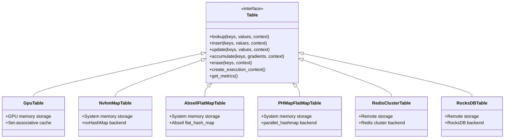
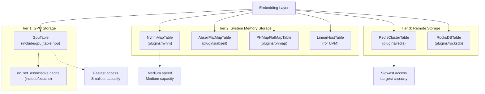
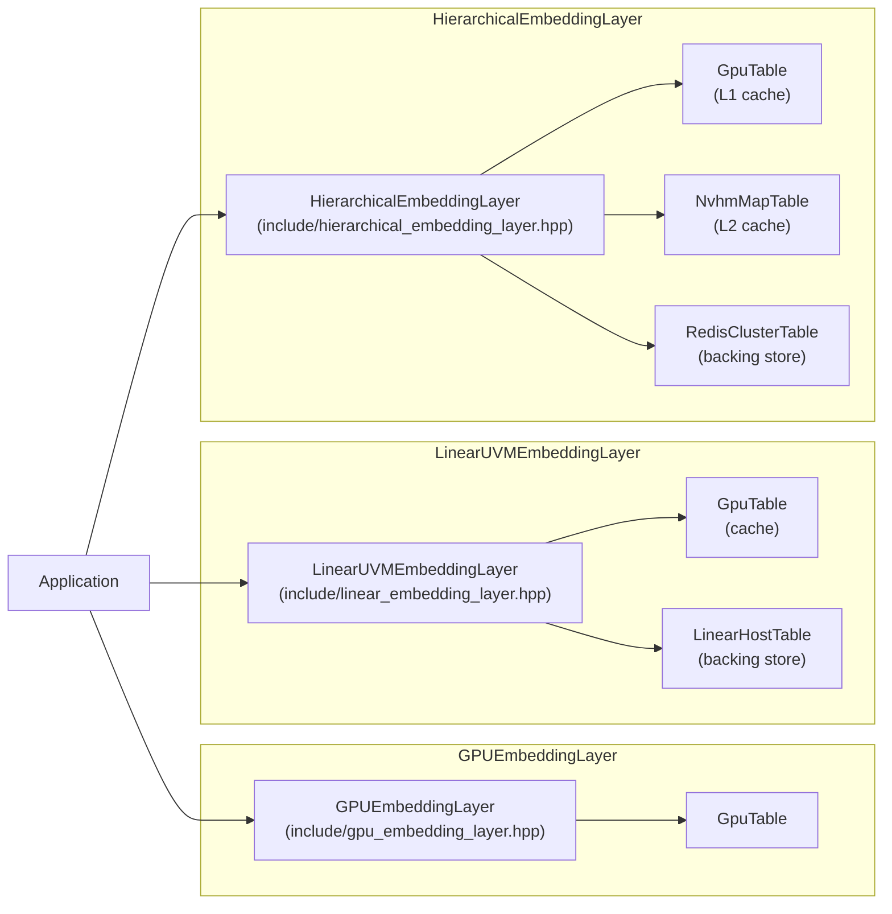
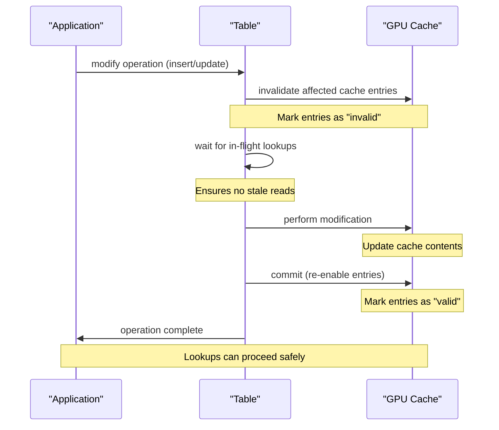
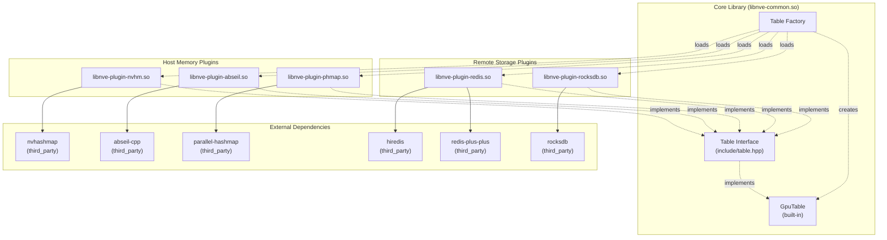
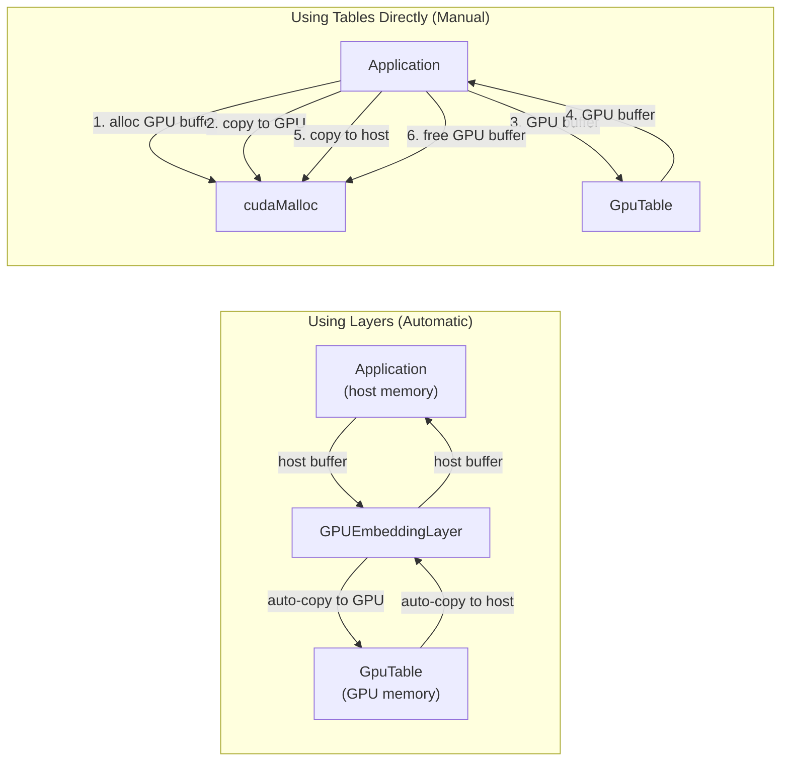

<!-- source: DeepWiki mcp.deepwiki.com · repo NVIDIA/nv-embedding-cache · page 3.2 Tables and Storage Backends · fetched 2026-10-26 -->

# Tables and Storage Backends

Relevant source files

The following files were used as context for generating this wiki page:

- [README.md](README.md)
- [docs/advanced.md](docs/advanced.md)
- [docs/cpp_api.md](docs/cpp_api.md)

## Purpose and Scope

This document describes the **Table** abstraction and its various storage backend implementations in the NV Embedding Cache SDK. Tables represent the lower-level storage layer that sits beneath Embedding Layers ([3.1](#3.1)), providing key-value storage for embedding rows in different memory locations (GPU, system memory, or remote storage).

For information about the higher-level Embedding Layer API that orchestrates tables, see [Embedding Layers](#3.1). For details on specific table implementations, see [GpuTable](#3.2.1), [Host Memory Tables](#3.2.2), and [Remote Storage Tables](#3.2.3).

---

## The Table Abstraction

Tables are key-value stores that map embedding IDs (keys) to embedding vectors (rows). Unlike Embedding Layers which may span multiple storage locations and handle memory copying automatically, a table represents a single storage location and requires buffers to be in the correct memory space.

The base `Table` interface is defined in [include/table.hpp]() and provides operations for:
- Storing and retrieving embedding rows by key
- Managing which keys are resident in the table (cache residency)
- Updating and accumulating gradients for resident keys
- Creating execution contexts for parallel operations

### Table Interface Design

**Sources:** [include/table.hpp](), [docs/cpp_api.md:49-56]()

---

## Table Types and Memory Hierarchy

Tables are organized by their storage location in the memory hierarchy, from fastest/smallest (GPU) to slowest/largest (remote storage).

### Memory Hierarchy Table

| Table Type | Storage Location | Typical Capacity | Typical Latency | Primary Use Case |
|------------|------------------|------------------|-----------------|------------------|
| `GpuTable` | GPU VRAM | ~GBs | ~nanoseconds | Hot cache for frequently accessed embeddings |
| `NvhmMapTable` | System Memory | ~10-100s GBs | ~microseconds | Warm cache for moderately accessed embeddings |
| `AbseilFlatMapTable` | System Memory | ~10-100s GBs | ~microseconds | Alternative host cache implementation |
| `PHMapFlatMapTable` | System Memory | ~10-100s GBs | ~microseconds | Alternative host cache implementation |
| `RedisClusterTable` | Remote/Network | ~TBs | ~milliseconds | Distributed parameter server |
| `RocksDBTable` | Remote/Disk | ~TBs | ~milliseconds | Persistent parameter storage |

### Table Organization by Storage Tier

**Sources:** [docs/cpp_api.md:49-56](), [README.md:11-15]()

---

## Tables vs Layers: When to Use Each

### Layers (High-Level API)
**Use Embedding Layers when:**
- You want automatic memory management across multiple storage tiers
- You need the system to handle buffer copying between GPU and CPU
- You want built-in cache promotion and eviction strategies
- Your application benefits from a simplified API

Layers coordinate multiple tables and handle data movement transparently.

### Tables (Low-Level API)
**Use Tables directly when:**
- You need fine-grained control over cache operations
- You're building custom caching strategies
- You want to minimize overhead by managing buffers yourself
- You're integrating with existing memory management infrastructure

Tables require buffers to be in the correct memory location and provide more control but less convenience.

### Layer-to-Table Relationship

**Sources:** [docs/cpp_api.md:14-22](), [README.md:11-15]()

---

## Table Operations

All tables implement a common set of operations defined in the `Table` interface. These operations form the foundation of embedding management.

### Core Operations

| Operation | Purpose | Modifies Cache? | Notes |
|-----------|---------|-----------------|-------|
| `lookup` | Retrieve embedding rows for given keys | Yes (via insert heuristic) | May trigger cache insertions |
| `insert` | Add keys to table (update residency) | Yes | May evict existing keys |
| `update` | Replace values for resident keys | No | Only affects resident keys |
| `accumulate` | Add gradients to resident keys | No | Used for gradient updates |
| `erase` | Remove keys from table | Yes | Rarely needed; eviction handles this |
| `create_execution_context` | Allocate resources for parallel ops | No | Required before operations |

### Operation Flow with Invalidate and Commit

Tables support concurrent lookup and modify operations through an **invalidate and commit** paradigm. This ensures thread safety when reads and writes overlap.

**Sources:** [docs/advanced.md:18-24]()

### Execution Contexts

Each table operation requires an **execution context** ([include/execution_context.hpp]()), which provides:
- Memory buffers for intermediate results
- CUDA streams for asynchronous execution
- State tracking for parallel operations

Applications create a fixed pool of execution contexts during initialization and reuse them (e.g., round-robin). Using the same context in multiple concurrent operations causes undefined behavior.

**Sources:** [docs/advanced.md:3-10](), [docs/cpp_api.md:38]()

---

## Plugin Architecture

Most table implementations are built as **separate plugin libraries** to minimize dependencies. This allows applications to link only the storage backends they need.

### Plugin Organization

### Plugin Linking

**Core Library:**
- `libnve-common.so` contains the `Table` interface and `GpuTable` implementation
- Always required for any NV Embedding Cache application

**Plugin Libraries (Optional):**
- `libnve-plugin-nvhm.so` - nvHashMap-based system memory cache
- `libnve-plugin-abseil.so` - Abseil flat_hash_map-based cache
- `libnve-plugin-phmap.so` - parallel_hashmap-based cache
- `libnve-plugin-redis.so` - Redis cluster integration
- `libnve-plugin-rocksdb.so` - RocksDB integration

Plugins must be present in `LD_LIBRARY_PATH` at runtime if used by the application.

**Sources:** [docs/cpp_api.md:12](), [docs/cpp_api.md:57](), [README.md:77-93]()

---

## Memory and Buffer Management

A critical difference between tables and layers is **memory location requirements**:

### Buffer Location Requirements by Table Type

| Table Type | Lookup Keys | Lookup Values | Insert/Update Keys | Insert/Update Values |
|------------|-------------|---------------|--------------------|----------------------|
| `GpuTable` | GPU or Host | GPU | GPU or Host | GPU |
| `NvhmMapTable` | Host | Host | Host | Host |
| `AbseilFlatMapTable` | Host | Host | Host | Host |
| `PHMapFlatMapTable` | Host | Host | Host | Host |
| `RedisClusterTable` | Host | Host | Host | Host |
| `RocksDBTable` | Host | Host | Host | Host |

**Key Points:**
1. **Tables do not perform automatic memory transfers** - the application must ensure buffers are in the correct location
2. **Layers handle copying** - `EmbeddingLayerBase` subclasses will copy buffers between GPU and host as needed
3. **Custom allocators** - Applications can provide custom `Allocator` objects ([include/allocator.hpp]()) to control memory allocation

### Memory Management Example

**Sources:** [docs/cpp_api.md:47-48]()

---

## Table Metrics and Observability

Tables expose performance metrics through the `get_metrics()` method. Metrics vary by table type but commonly include:

- **Hit/miss rates** - cache effectiveness
- **Lookup latency** - operation timing
- **Eviction counts** - cache churn
- **Memory usage** - current capacity utilization

For GPU tables, additional metrics track:
- Cache line occupancy
- Set utilization (for set-associative cache)
- Query kernel performance

**Sources:** [include/table.hpp]()

---

## Summary

**Tables** are the storage abstraction layer in NV Embedding Cache, providing key-value storage for embedding rows across different memory locations:

- **GPU**: `GpuTable` for fastest access to hot embeddings
- **System Memory**: `NvhmMapTable`, `AbseilFlatMapTable`, `PHMapFlatMapTable` for larger warm caches
- **Remote Storage**: `RedisClusterTable`, `RocksDBTable` for distributed/persistent storage

Tables operate at a lower level than Embedding Layers, requiring explicit buffer management but offering fine-grained control. The plugin architecture allows applications to include only needed storage backends, minimizing dependencies.

For most applications, the Embedding Layer API ([3.1](#3.1)) provides the right abstraction level. Direct table usage is appropriate for custom caching strategies or when integrating with existing memory management systems.

**Sources:** [docs/cpp_api.md:46-56](), [include/table.hpp]()

---

