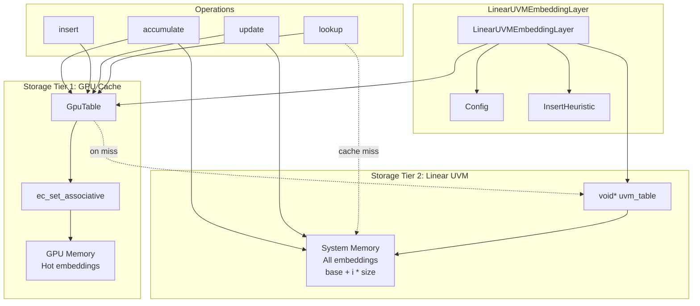
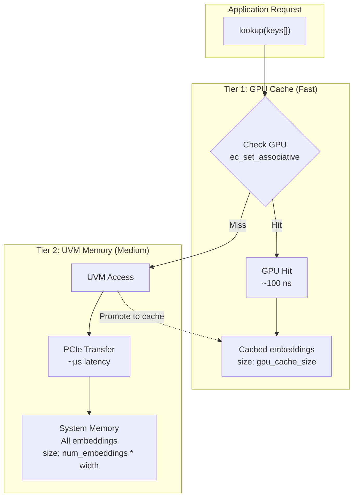
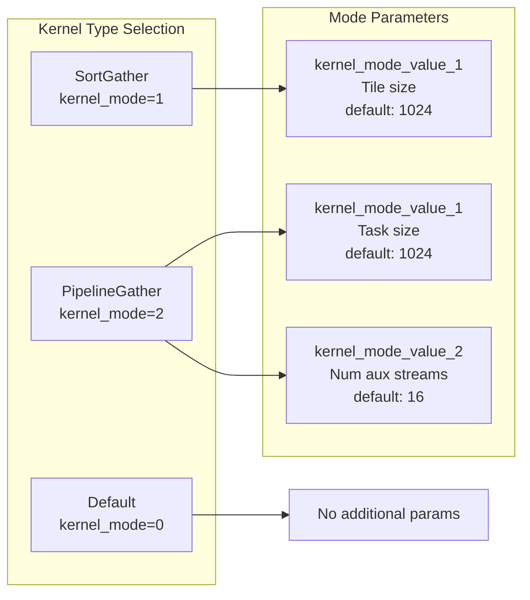
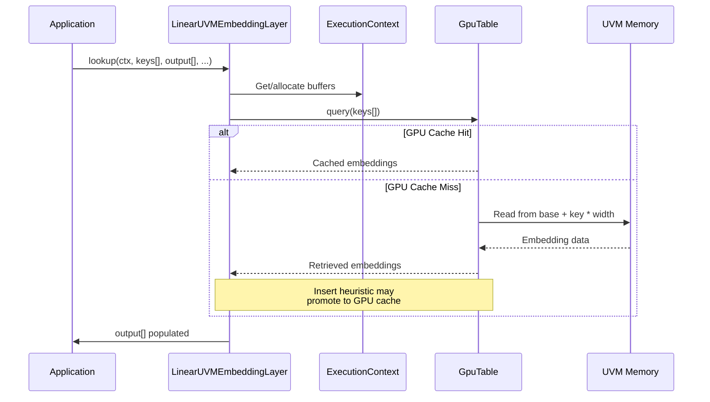
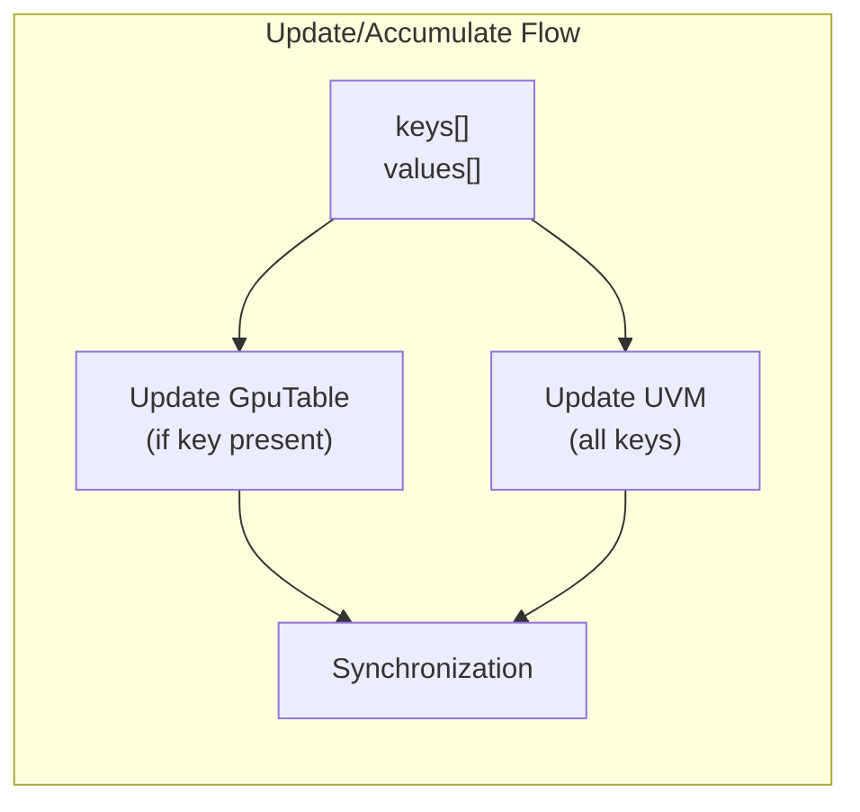
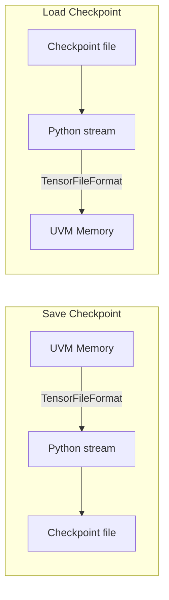

<!-- source: DeepWiki mcp.deepwiki.com · repo NVIDIA/nv-embedding-cache · extra page LinearUVMEmbeddingLayer · fetched 2026-10-26 -->

# LinearUVMEmbeddingLayer

<details>
<summary>Relevant source files</summary>

The following files were used as context for generating this wiki page:

- [README.md](README.md)
- [docs/cpp_api.md](docs/cpp_api.md)
- [python/pynve/bindings/binding_layers.hpp](python/pynve/bindings/binding_layers.hpp)

</details>


**Purpose**: This document describes the `LinearUVMEmbeddingLayer` class, an embedding layer implementation that stores all embedding data in linear Unified Virtual Memory (UVM) while maintaining a GPU cache for frequently accessed embeddings. This layer is designed for embedding tables that exceed GPU memory capacity but can fit in system memory on a single node.

For GPU-only embedding storage, see [GPUEmbeddingLayer](#3.1.1). For multi-tier distributed caching with remote storage, see [HierarchicalEmbeddingLayer](#3.1.3). For details on the underlying GPU cache mechanics, see [GpuTable](#3.2.1).

---

## Overview

`LinearUVMEmbeddingLayer` implements a two-tier memory hierarchy where all embeddings reside in a contiguous linear memory space (typically system memory) accessible via CUDA Unified Virtual Memory, with a GPU-resident cache holding the most frequently accessed embeddings. The term "linear" refers to the property that the address of embedding *i* can be computed as `base_address + i * embedding_size`.

**Key characteristics**:
- All embeddings stored in UVM-accessible linear memory
- GPU set-associative cache for hot embeddings
- Automatic cache management with configurable insert heuristics
- Single-node deployment optimized
- Suitable for datasets between ~10s of GB and ~100s of GB

### Architecture Diagram



**Sources**: [include/linear_embedding_layer.hpp](), [include/gpu_table.hpp](), [README.md:13-13]()

---

## Class Structure and Code Entities

### C++ API

The `LinearUVMEmbeddingLayer` class is defined in [include/linear_embedding_layer.hpp](). It is templated on the key type:

```cpp
template<typename KeyT>
class LinearUVMEmbeddingLayer : public EmbeddingLayerBase
```

| Component | Type | Description |
|-----------|------|-------------|
| `KeyT` | Template parameter | Key type (typically `uint32_t` or `uint64_t`) |
| `Config` | Nested struct | Configuration including layer name and insert heuristic |
| `gpu_table_` | `std::shared_ptr<GpuTable<KeyT>>` | GPU cache table |
| `allocator_` | `allocator_ptr_t` | Memory allocator for buffers |

### Python API

The Python binding is implemented in [python/pynve/bindings/binding_layers.hpp:478-624]() as `LinearUVMEmbedding<IndexT>`:

| Method | Purpose |
|--------|---------|
| `__init__` | Creates layer with memory block and GPU cache size |
| `lookup` | Retrieves embeddings by keys |
| `lookup_with_pooling` | Retrieves embeddings with pooling (sum/mean) |
| `accumulate` | Accumulates gradients into embeddings |
| `update` | Updates embedding values |
| `insert` | Inserts embeddings into GPU cache |
| `get_dl_tensor` | Returns DLPack tensor for host buffer access |
| `write_tensor_to_stream` | Saves embeddings to checkpoint |
| `load_tensor_from_stream` | Loads embeddings from checkpoint |

**Sources**: [include/linear_embedding_layer.hpp](), [python/pynve/bindings/binding_layers.hpp:478-624]()

---

## Memory Layout

### Linear Address Computation

All embeddings are stored in a contiguous memory region where each embedding can be addressed directly:

```
embedding_address(i) = base_ptr + (i * embedding_width_in_bytes)
```

This linear layout enables:
- Direct indexing without hash lookups for UVM accesses
- Efficient sequential access patterns
- Simplified address calculation in CUDA kernels

### Memory Hierarchy Diagram



The `GpuTable` configuration includes the UVM pointer at [python/pynve/bindings/binding_layers.hpp:513-513]():

```cpp
cfg.uvm_table = mem_block_->get_ptr();
```

**Sources**: [README.md:17-17](), [python/pynve/bindings/binding_layers.hpp:496-537](), [docs/cpp_api.md:22-22]()

---

## Configuration

### Layer Configuration

The layer is constructed with a `Config` struct and a `GpuTable` instance:

| Configuration Field | Type | Purpose |
|---------------------|------|---------|
| `layer_name` | `std::string` | Identifier for logging and debugging |
| `insert_heuristic` | `std::shared_ptr<InsertHeuristic>` | Policy for cache insertion decisions |

**Default insert heuristic threshold**: 0.75 (inserts to GPU cache when cache hit rate drops below 75%)

See [Advanced Topics](#8) for custom insert heuristic implementation.

### GPU Table Configuration

The underlying `GpuTable` is configured via `GPUTableConfig`:

| Parameter | Default (Python) | Description |
|-----------|------------------|-------------|
| `device_id` | Required | CUDA device index |
| `cache_size` | Required | Number of embeddings in GPU cache |
| `max_modify_size` | `16 << 20` | Maximum embeddings per modify operation |
| `row_size_in_bytes` | Computed | Size of each embedding in bytes |
| `uvm_table` | Required | Pointer to linear UVM memory |
| `value_dtype` | Required | `Float32` or `Float16` |
| `count_misses` | `true` | Enable miss rate tracking |
| `private_stream` | Optional | Dedicated CUDA stream for table operations |

**Sources**: [python/pynve/bindings/binding_layers.hpp:499-526](), [include/gpu_table.hpp]()

---

## Kernel Modes

`LinearUVMEmbeddingLayer` supports multiple kernel execution modes for the gather operation (reading embeddings from UVM on cache miss):

### Kernel Mode Configuration Diagram



### Kernel Types

| Kernel Type | Value | Description | Configuration |
|-------------|-------|-------------|---------------|
| Default | 0 | Standard gather kernel | None |
| `SortGather` | 1 | Sort keys before gather for coalesced access | `kernel_mode_value_1`: tile size |
| `PipelineGather` | 2 | Pipelined gather with multiple streams | `kernel_mode_value_1`: task size<br/>`kernel_mode_value_2`: number of auxiliary streams |

**Configuration example** [python/pynve/bindings/binding_layers.hpp:515-526]():

```cpp
if (cfg.kernel_mode_type == static_cast<uint64_t>(nve::KernelType::SortGather)) {
    cfg.kernel_mode_value = config.kernel_mode_value_1 > 0 ? config.kernel_mode_value_1 : 1024;
}
else if (cfg.kernel_mode_type == static_cast<uint64_t>(nve::KernelType::PipelineGather)) {
    gather_pipeline_params_.task_size = config.kernel_mode_value_1 > 0 ? config.kernel_mode_value_1 : 1024;
    gather_pipeline_params_.num_aux_streams = config.kernel_mode_value_2 > 0 ? config.kernel_mode_value_2 : 16;
    cfg.kernel_mode_value = reinterpret_cast<uintptr_t>(&gather_pipeline_params_);
}
```

**Sources**: [python/pynve/bindings/binding_layers.hpp:515-526](), [include/gpu_table.hpp]()

---

## Operations

### Lookup Operation Flow



The `lookup` method signature:
```cpp
void lookup(std::shared_ptr<ExecutionContext> context,
            size_t num_keys,
            const void* keys,
            void* output,
            size_t output_stride,
            void* hitmask = nullptr,
            const PoolingParams* pooling_params = nullptr,
            float* hitrates = nullptr);
```

**Key behaviors**:
- Queries GPU cache first for each key
- On cache miss, reads directly from UVM memory using computed address
- Insert heuristic determines if missed keys should be promoted to GPU cache
- Supports optional pooling operations (sum/mean) for variable-length feature lists

**Sources**: [include/embedding_layer.hpp](), [python/pynve/bindings/binding_layers.hpp:61-76]()

### Update and Accumulate

| Operation | Behavior | Use Case |
|-----------|----------|----------|
| `update` | Replaces embedding values in all locations (GPU + UVM) | Inference with externally updated embeddings |
| `accumulate` | Adds gradients to existing values in all locations | Training with gradient descent |

Both operations write through to UVM memory to maintain consistency:



**Python API examples** [python/pynve/bindings/binding_layers.hpp:221-240]():
- `accumulate(num_keys, keys, updates, stream)`: Gradient accumulation
- `update(num_keys, keys, updates, stream)`: Direct value replacement

**Sources**: [include/embedding_layer.hpp](), [python/pynve/bindings/binding_layers.hpp:221-240]()

### Insert Operation

The `insert` operation explicitly adds or updates embeddings in the GPU cache:

```cpp
void insert(std::shared_ptr<ExecutionContext> context,
            size_t num_keys,
            const void* keys,
            size_t key_stride,
            size_t value_stride,
            const void* values,
            int64_t table_id);
```

**Behavior**:
- Inserts key-value pairs into the specified table (GPU cache)
- May evict existing entries if cache is full
- Does NOT guarantee residency after insertion
- Does NOT update UVM memory (use `update` for that)

**Sources**: [docs/cpp_api.md:26-32](), [python/pynve/bindings/binding_layers.hpp:242-252]()

---

## Execution Contexts

Each operation requires an `ExecutionContext` to manage:
- CUDA streams for asynchronous execution
- Temporary memory buffers
- State variables for multi-stage operations

### Context Management

The Python binding maintains a stream-to-context map at [python/pynve/bindings/binding_layers.hpp:308-321]():

```cpp
std::shared_ptr<nve::ExecutionContext> get_exec_context(cudaStream_t stream)
{
    if (stream_ctx_map_.count(stream) != 1)
    {
        cudaStream_t lookup_stream = stream;
        cudaStream_t modify_stream = modify_stream_;
        
        stream_ctx_map_[stream] = emb_layer_ptr_->create_execution_context(
            lookup_stream, modify_stream, nullptr, nullptr);
    }
    return stream_ctx_map_[stream];
}
```

**Key points**:
- One context per unique CUDA stream
- Separate `lookup_stream` and `modify_stream` for concurrent operations
- Contexts cached in `stream_ctx_map_` for reuse

See [Execution Contexts](#3.4) for detailed documentation.

**Sources**: [python/pynve/bindings/binding_layers.hpp:308-321](), [include/execution_context.hpp]()

---

## Python Integration

### Construction

The Python binding `LinearUVMEmbedding` is constructed with [python/pynve/bindings/binding_layers.hpp:484-537]():

| Parameter | Type | Description |
|-----------|------|-------------|
| `row_size` | `size_t` | Number of elements per embedding |
| `num_embeddings` | `size_t` | Total number of embeddings |
| `dtype` | `nve::DataType_t` | `Float32` or `Float16` |
| `mem_block` | `std::shared_ptr<MemBlock>` | UVM memory allocation |
| `gpu_cache_size` | `size_t` | Number of embeddings in GPU cache |
| `use_private_stream` | `bool` | Create dedicated CUDA stream |
| `device_id` | `int` | CUDA device index |
| `config` | `EmbedLayerConfig` | Logging and kernel mode settings |

### Host Buffer Access via DLPack

The layer provides direct access to the UVM buffer as a DLPack tensor [python/pynve/bindings/binding_layers.hpp:572-591]():

```cpp
py::capsule get_dl_tensor(nve::DataType_t dtype)
{
    DLManagedTensor* p = create_dlpack_tensor(dtype);
    return py::capsule(p, "dltensor", ...);
}
```

This enables zero-copy integration with PyTorch, TensorFlow, and other frameworks supporting the DLPack protocol.

**Sources**: [python/pynve/bindings/binding_layers.hpp:484-624]()

---

## Checkpointing

### Save and Load Operations

`LinearUVMEmbedding` supports serialization to/from Python file streams:

| Method | Purpose | Implementation |
|--------|---------|----------------|
| `write_tensor_to_stream` | Save UVM buffer to file | [python/pynve/bindings/binding_layers.hpp:593-597]() |
| `load_tensor_from_stream` | Load UVM buffer from file | [python/pynve/bindings/binding_layers.hpp:599-603]() |

**Data Flow**:



**Note**: GPU cache is NOT persisted. After loading, the GPU cache starts empty and is populated during subsequent lookups according to the insert heuristic.

See [Checkpointing](#8.5) for detailed usage.

**Sources**: [python/pynve/bindings/binding_layers.hpp:593-603](), [python/pynve/bindings/binding_serialization.hpp]()

---

## Performance Characteristics

### Access Latency Profile

| Access Type | Latency | Bandwidth | Notes |
|-------------|---------|-----------|-------|
| GPU cache hit | ~100 ns | >1 TB/s | Set-associative lookup in GPU SRAM |
| UVM access (cached in CPU) | ~1-5 μs | ~30-50 GB/s | PCIe transfer, page already resident |
| UVM access (page fault) | ~10-100 μs | ~10-30 GB/s | First access, page migration overhead |

### Optimization Guidelines

**When to use `LinearUVMEmbeddingLayer`**:
- ✅ Embedding table size: 10s of GB to 100s of GB
- ✅ Single-node deployment
- ✅ Working set fits comfortably in GPU cache (typically 5-20% of total)
- ✅ Access pattern exhibits temporal locality

**When to use alternatives**:
- ❌ Dataset fits in GPU memory → Use `GPUEmbeddingLayer` (#3.1.1)
- ❌ Dataset exceeds system memory or requires distributed storage → Use `HierarchicalEmbeddingLayer` (#3.1.3)
- ❌ Uniform random access without locality → Consider hierarchical with explicit memory management

### Configuration Tuning

| Parameter | Impact | Recommendation |
|-----------|--------|----------------|
| `gpu_cache_size` | Cache hit rate vs GPU memory usage | Start with 10-20% of total embeddings |
| `insert_heuristic threshold` | Cache update aggressiveness | Default 0.75 works for most workloads |
| `kernel_mode` | UVM access pattern efficiency | Try `PipelineGather` (mode 2) for high miss rates |
| `private_stream` | Concurrent operation overlap | Enable for training with frequent updates |

**Sources**: [README.md:13-14](), [docs/cpp_api.md:22-22]()

---

## Thread Safety and Synchronization

### Concurrent Access

- **Lookups**: Safe from multiple threads/streams with different `ExecutionContext` instances
- **Modifies** (update/accumulate): Serialized through shared `modify_stream` in Python binding
- **Insert**: Thread-safe at GPU table level, but insert heuristic runs on lookup thread

### Modify Operations

The Python binding uses a single `modify_stream_` for all modify operations [python/pynve/bindings/binding_layers.hpp:280-280]():

```cpp
NVE_CHECK_(cudaStreamCreate(&modify_stream_));
```

This ensures:
1. Sequential consistency for updates
2. Proper synchronization between lookup and modify streams
3. No race conditions on embedding values

See [Modify Operations and Synchronization](#8.2) for advanced usage patterns.

**Sources**: [python/pynve/bindings/binding_layers.hpp:266-295](), [docs/cpp_api.md:38-38]()

---

## Usage Examples

### Basic C++ Usage

```cpp
#include "include/linear_embedding_layer.hpp"
#include "include/gpu_table.hpp"

// Allocate UVM memory
void* uvm_buffer;
cudaMallocManaged(&uvm_buffer, num_embeddings * embedding_width_in_bytes);

// Configure GPU cache
nve::GPUTableConfig table_cfg;
table_cfg.device_id = 0;
table_cfg.cache_size = num_embeddings / 10; // 10% in cache
table_cfg.row_size_in_bytes = embedding_width_in_bytes;
table_cfg.uvm_table = uvm_buffer;
table_cfg.value_dtype = nve::DataType_t::Float32;

auto gpu_table = std::make_shared<nve::GpuTable<uint64_t>>(table_cfg, nullptr);

// Create layer
nve::LinearUVMEmbeddingLayer<uint64_t>::Config layer_cfg = {
    "my_layer",
    std::make_shared<nve::DefaultInsertHeuristic>(std::vector<float>{0.75})
};

auto layer = std::make_shared<nve::LinearUVMEmbeddingLayer<uint64_t>>(
    layer_cfg, gpu_table, nullptr);

// Create execution context
auto ctx = layer->create_execution_context(stream, modify_stream, nullptr, nullptr);

// Lookup
layer->lookup(ctx, num_keys, keys, output, embedding_width_in_bytes);
```

### Python PyTorch Integration

See [PyTorch Integration](#5.2) and [samples/pytorch/](../samples/pytorch) for complete examples.

**Sources**: [docs/cpp_api.md:42-43](), [samples/simple_cpp/]()

---

## Related Components

| Component | Purpose | Documentation |
|-----------|---------|---------------|
| `GpuTable` | GPU cache implementation | [GpuTable](#3.2.1) |
| `ec_set_associative` | Low-level cache data structure | [GPU Embedding Cache Internals](#7) |
| `InsertHeuristic` | Cache promotion policy | [Custom Insert Heuristics](#8.4) |
| `ExecutionContext` | Operation state management | [Execution Contexts](#3.4) |
| `MemBlock` | UVM memory allocation wrapper | [binding_memblock.hpp]() |

**Sources**: [include/linear_embedding_layer.hpp](), [include/gpu_table.hpp](), [docs/cpp_api.md:20-23]()

---

