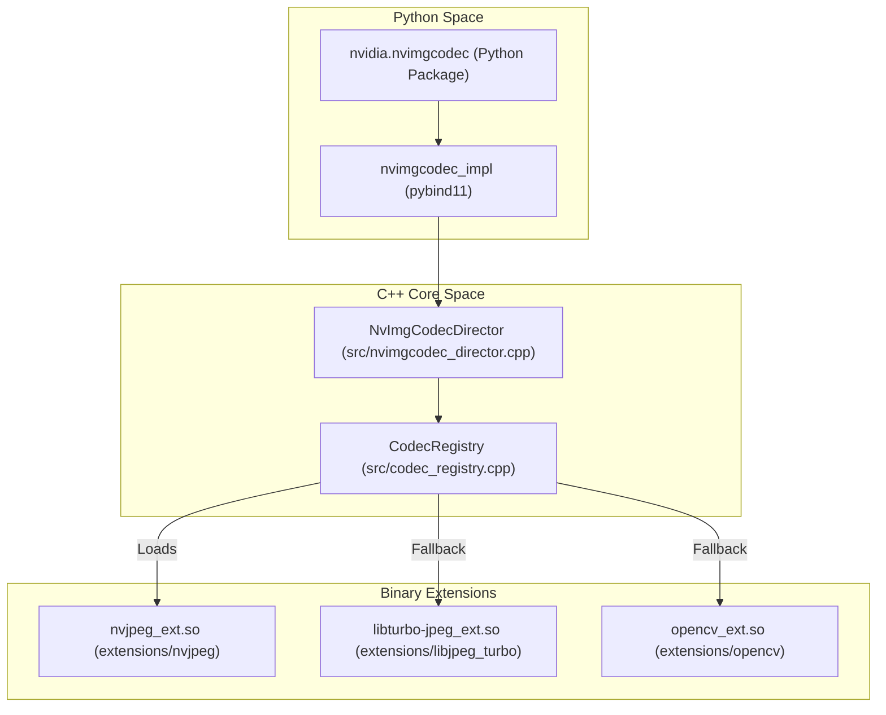
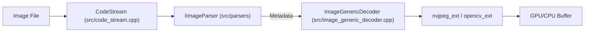

<!-- source: DeepWiki mcp.deepwiki.com · repo NVIDIA/nvImageCodec · page 1.1 Getting Started · fetched 2026-10-26 -->

# Getting Started

<details>
<summary>Relevant source files</summary>

The following files were used as context for generating this wiki page:

- [README.md](README.md)
- [conda/build.sh](conda/build.sh)
- [conda/recipes/libnvimgcodec/meta.yaml](conda/recipes/libnvimgcodec/meta.yaml)
- [conda/recipes/nvimgcodec/meta.yaml](conda/recipes/nvimgcodec/meta.yaml)

</details>


The nvImageCodec library provides a unified framework for accelerated image decoding and encoding, designed to abstract away the complexities of different hardware and software backends [README.md:17-18](). This guide details the installation process, environment requirements, and initial steps to verify a working setup.

## Platform Prerequisites

Before installing nvImageCodec, ensure your system meets the following hardware and software requirements:

### Supported Operating Systems
*   **Linux (x86_64 and arm64-sbsa):** Debian 12, Fedora 41, RHEL 8/9, OpenSUSE/SLES 15, and Ubuntu 20.04/22.04/24.04 [README.md:83-95]().
*   **Linux (aarch64-jetson):** Ubuntu 22.04 (requires CUDA Toolkit >= 12.1 and < 13.0) [README.md:96-97]().
*   **Windows (x86_64):** Native or WSL2 (Ubuntu 20.04). Requires Microsoft Visual C++ Redistributable [README.md:91,99-101]().

### Hardware and Drivers
*   **NVIDIA Driver:** >= 530.30.02 (Linux) or >= 531.14 (Windows) [README.md:98,102]().
*   **CUDA Toolkit:** Version 12.1 or newer [README.md:103]().

### Build and Runtime Dependencies
*   **GCC:** Version 14.0 or newer [README.md:104]().
*   **Python:** Versions 3.9 through 3.14 (including experimental "t" variants) [README.md:13,105]().
*   **CMake:** Version 3.18 or newer [README.md:10]().

---

## Installation

nvImageCodec can be installed via Python package managers (pip), Conda, or by downloading binary packages.

### 1. Using Pip (Recommended for Python Users)
The library is distributed on PyPI with CUDA-version-specific suffixes. You can install the base library or include optional GPU-accelerated extensions.

| Component | CUDA 12.x | CUDA 13.x |
| :--- | :--- | :--- |
| **Base Library** | `pip install nvidia-nvimgcodec-cu12` | `pip install nvidia-nvimgcodec-cu13` |
| **With All Extensions** | `pip install nvidia-nvimgcodec-cu12[all]` | `pip install nvidia-nvimgcodec-cu13[all]` |
| **Tegra (Jetson)** | `pip install nvidia-nvimgcodec-tegra-cu12` | N/A |

*Sources: [README.md:111-125]()*

#### Manual Extension Installation
If you prefer to manage dependencies manually rather than using the `[all]` extra, you can install the underlying libraries independently:
*   **nvJPEG:** `pip install nvidia-nvjpeg-cu12` [README.md:142]()
*   **nvJPEG2000:** `pip install nvidia-nvjpeg2k-cu12` [README.md:150]()
*   **nvTIFF:** `pip install nvidia-nvtiff-cu12` [README.md:161]()

### 2. Using Conda
The codebase provides recipes for building and installing via Conda. The packages are split into `libnvimgcodec` (C++ library) and `nvimgcodec` (Python bindings) [conda/recipes/libnvimgcodec/meta.yaml:27](), [conda/recipes/nvimgcodec/meta.yaml:17]().

To build locally using the provided script:
```bash
# Setup environment and build both C++ and Python packages for CUDA 12.9
./conda/build.sh --setup-env --cuda-version 12.9 all
```
*Sources: [conda/build.sh:9-32](), [conda/build.sh:140-177]()*

---

## System Flow and Verification

The following diagram illustrates how the installation components interact to enable image processing.

### Installation Component Mapping
This diagram bridges the installation entities (packages/libraries) to the code entities that manage them.


*Sources: [README.md:17-26](), [conda/recipes/libnvimgcodec/meta.yaml:156-160](), [conda/recipes/nvimgcodec/meta.yaml:83-85]()*

### Verifying the Installation
To verify the installation, you can run a simple Python script to check if the library and its extensions are correctly loaded.

```python
import nvidia.nvimgcodec as nvimgcodec

# Create an instance of the library
# This triggers NvImgCodecDirector initialization and extension discovery
instance = nvimgcodec.Instance()

# List available backends to verify extensions (e.g., nvJPEG, OpenCV)
for backend in instance.backends:
    print(f"Found backend: {backend.name}")
```
*Sources: [README.md:22-26](), [conda/recipes/nvimgcodec/meta.yaml:88-89]()*

---

## First Operation: Decode and Encode

The core of nvImageCodec is the `Decoder` and `Encoder` classes. The system automatically handles format detection using built-in parsers [README.md:25]().

### Data Flow for a Simple Decode
The following diagram traces the data flow from a file on disk to a GPU buffer.


*Sources: [README.md:22-25](), [conda/recipes/libnvimgcodec/meta.yaml:121-129]()*

### Python Example: Batch Decoding
```python
import nvidia.nvimgcodec as nvimgcodec

# Initialize decoder
decoder = nvimgcodec.Decoder()

# Decode a batch of images (handles different formats automatically)
images = decoder.decode(["image1.jpg", "image2.png", "image3.webp"])

# images[0] is now a nvimgcodec.Image object containing the pixel data
for img in images:
    print(f"Decoded: {img.width}x{img.height} {img.color_spec}")
```
*Sources: [README.md:22-26]()*

### Python Example: Encoding
```python
import nvidia.nvimgcodec as nvimgcodec

encoder = nvimgcodec.Encoder()
# Encode the first image from the previous step as a JPEG
encoder.encode(images[0], "output.jpg")
```
*Sources: [README.md:22-24]()*

---
**Sources:**
* `README.md:1-170`
* `conda/build.sh:1-180`
* `conda/recipes/libnvimgcodec/meta.yaml:1-170`
* `conda/recipes/nvimgcodec/meta.yaml:1-107`

---

