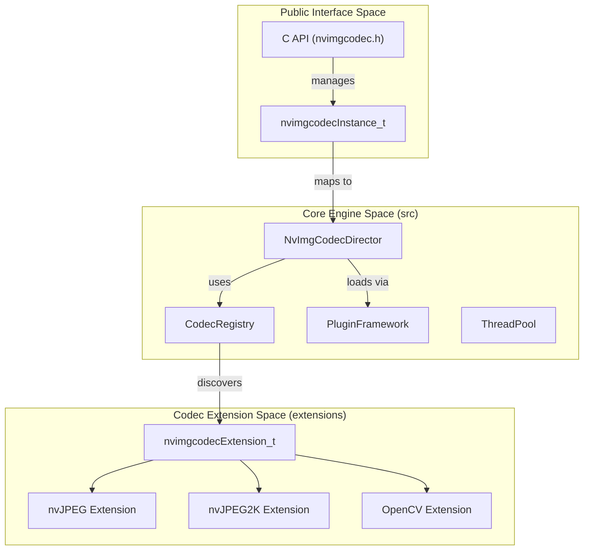
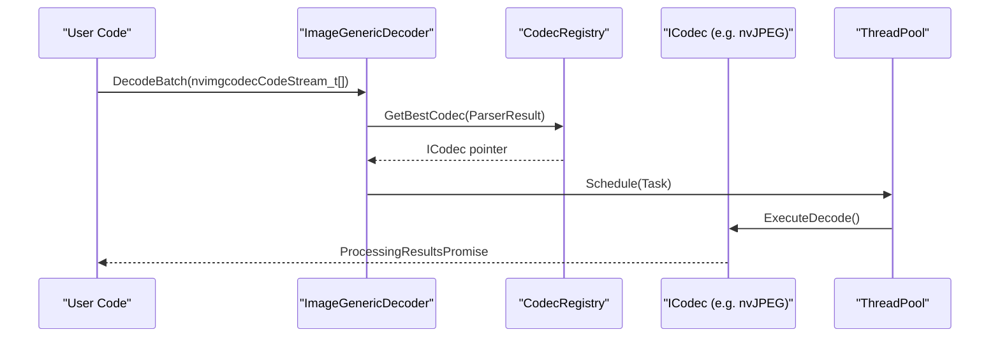

<!-- source: DeepWiki mcp.deepwiki.com · repo NVIDIA/nvImageCodec · page 2 Architecture and Core Library · fetched 2026-10-26 -->

# Architecture and Core Library

Relevant source files

The following files were used as context for generating this wiki page:

- [.gitmodules](.gitmodules)
- [CMakeLists.txt](CMakeLists.txt)

The `nvImageCodec` library is designed as a modular, extensible framework for high-performance image decoding and encoding. It leverages a "Director" pattern to manage the lifecycle of the engine, a plugin-based architecture for codec extensions, and an orchestrated pipeline that handles batch processing and hardware acceleration fallbacks.

### High-Level System Architecture

The core library acts as a central hub that coordinates between the public API, internal processing engines, and external codec extensions.

**Natural Language to Code Entity Mapping**

**Sources:** [include/nvimgcodec.h:1-100](), [src/director.h:1-50](), [src/codec_registry.h:1-40]()

---

### Core Subsystems

#### Public C API
The library exposes a stable C-linkage API that serves as the foundation for both C++ and Python bindings. It uses opaque handles to manage resources like instances, decoders, encoders, and code streams. Error handling is standardized through `nvimgcodecStatus_t` and helper macros.
For details, see [Public C API](#2.1).

#### Core Engine: Director and Registry
The `NvImgCodecDirector` is the primary internal orchestrator. It manages the global state and the `CodecRegistry`, which maintains a prioritized list of available codecs. The `PluginFramework` allows the library to dynamically discover and load shared object extensions (`.so` or `.dll`) at runtime.
For details, see [Core Engine: Director, Registry, and Plugin Framework](#2.2).

#### Decode and Encode Pipeline
The pipeline handles the complexity of batch processing. When a decode request is made, the `ImageGenericDecoder` consults the registry to find the best matching codec based on format and hardware availability. If a preferred backend (e.g., GPU) fails, the system can automatically fallback to CPU-based extensions.
For details, see [Decode and Encode Pipeline](#2.3).

**Pipeline Execution Flow**

**Sources:** [src/image_generic_decoder.h:1-100](), [src/codec_registry.h:40-80]()

#### Code Streams and I/O
Bitstreams are abstracted via the `CodeStream` class. This allows the library to handle image data from various sources—standard files, memory buffers, or memory-mapped files—using a unified `IIoStream` interface.
For details, see [Code Streams and I/O](#2.4).

#### Built-in Format Parsers
Before decoding, the library must identify the image format. The `src/parsers/` directory contains lightweight headers parsers for JPEG, JPEG2000, TIFF, BMP, PNG, and more. These parsers extract essential metadata (width, height, color space) without decoding the full pixel data.
For details, see [Built-in Format Parsers](#2.5).

#### Image Processing Utilities (imgproc)
The `imgproc` subsystem provides essential CUDA kernels and C++ utilities for post-processing. This includes color space conversion (e.g., YUV to RGB), pixel format conversion, and handling EXIF orientation metadata.
For details, see [Image Processing Utilities (imgproc)](#2.6).

#### Dynamic Linking Layer
To minimize binary dependencies and handle different CUDA versions, `nvImageCodec` uses a dynamic linking layer. This system uses `dlopen`/`LoadLibrary` to resolve symbols for libraries like `nvjpeg`, `nvjpeg2k`, and `nvtiff` only when they are needed.
For details, see [Dynamic Linking Layer](#2.7).

---

### Key Code Entities

| Component | Code Entity | Role |
| :--- | :--- | :--- |
| **Director** | `nvimgcodec::NvImgCodecDirector` | Root object managing the lifecycle of all resources. |
| **Registry** | `nvimgcodec::CodecRegistry` | Database of registered `ICodec` and `IImageParser` objects. |
| **Decoder** | `nvimgcodec::ImageGenericDecoder` | High-level orchestrator for batch decoding. |
| **Encoder** | `nvimgcodec::ImageGenericEncoder` | High-level orchestrator for batch encoding. |
| **IO Stream** | `nvimgcodec::IIoStream` | Abstract interface for reading/writing bitstreams. |
| **Extension** | `nvimgcodecExtension_t` | Opaque handle for a loaded plugin module. |

**Sources:** [src/director.h:20-60](), [src/codec_registry.h:25-55](), [src/image_generic_decoder.h:30-50]()

---

