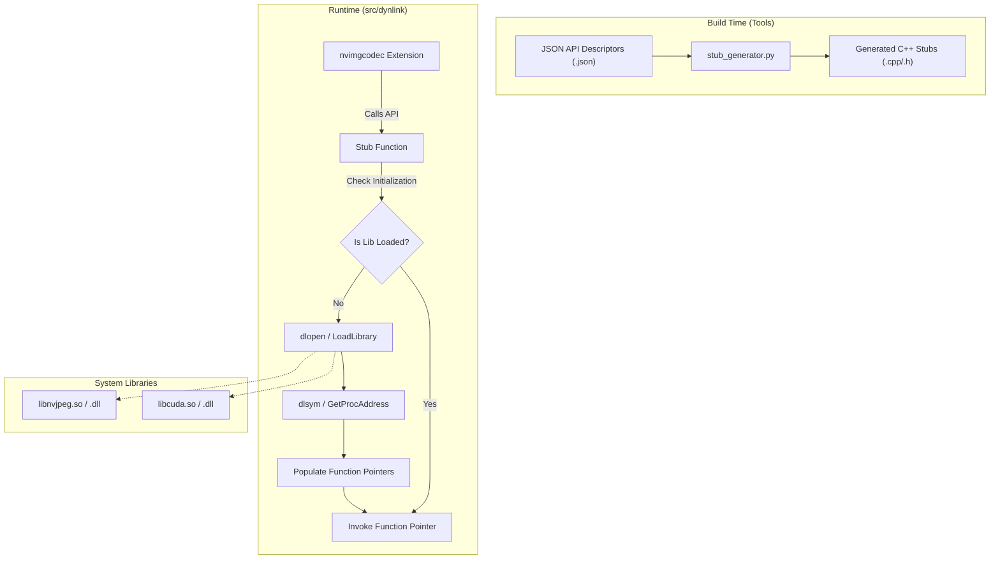
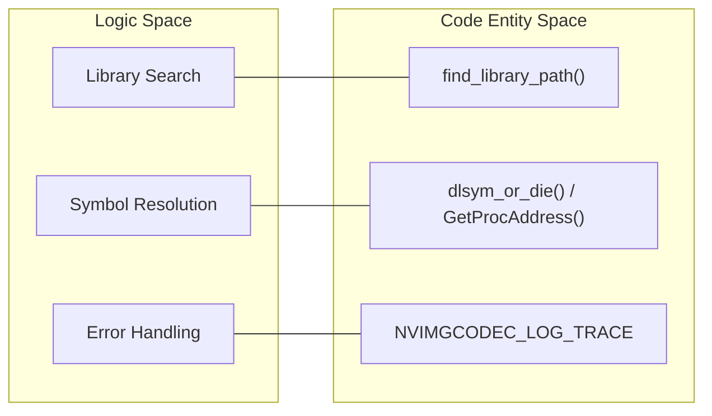

<!-- source: DeepWiki mcp.deepwiki.com · repo NVIDIA/nvImageCodec · page 2.7 Dynamic Linking Layer · fetched 2026-10-26 -->

# Dynamic Linking Layer

Relevant source files

The following files were used as context for generating this wiki page:

- [CMakeLists.txt](CMakeLists.txt)
- [cmake/CUDA_utils.cmake](cmake/CUDA_utils.cmake)

The Dynamic Linking Layer in `nvImageCodec` provides a mechanism for runtime discovery and loading of CUDA-related libraries. Instead of linking directly against shared objects at compile time, this subsystem uses `dlopen` (on Linux) or `LoadLibrary` (on Windows) to resolve symbols at execution time. This approach ensures that the library can initialize even if certain dependencies (like `nvJPEG`, `nvJPEG2000`, or `nvTIFF`) are missing from the system, allowing for graceful fallbacks to CPU-based extensions.

## Overview and Configuration

The dynamic linking behavior is controlled by several CMake options that determine whether specific libraries are linked normally or loaded via the dynamic linking layer.

| CMake Option | Default | Description |
| :--- | :--- | :--- |
| `WITH_DYNAMIC_LINK` | `ON` | Global toggle for runtime `dlopen`-based loading. [CMakeLists.txt:144-144]() |
| `WITH_DYNAMIC_CUDA` | `ON` | Dynamically loads the CUDA driver at runtime. [CMakeLists.txt:145-145]() |
| `WITH_DYNAMIC_NVJPEG` | `ON` | Dynamically loads `nvjpeg` at runtime. [CMakeLists.txt:146-146]() |
| `WITH_DYNAMIC_NVJPEG2K`| `ON` | Dynamically loads `nvjpeg2k` at runtime. [CMakeLists.txt:147-147]() |
| `WITH_DYNAMIC_NVTIFF` | `ON` | Dynamically loads `nvtiff` at runtime. [CMakeLists.txt:148-148]() |

Sources: [CMakeLists.txt:144-148]()

## Subsystem Architecture

The dynamic linking layer is located in `src/dynlink/`. It consists of generated C++ stubs that mirror the APIs of the target libraries. These stubs manage a function pointer table that is populated when the library is first accessed.

### Data Flow: Stub Generation to Runtime Loading

The following diagram illustrates how the API descriptors are transformed into executable stubs and how they interact with the host system's dynamic loader.

**Dynamic Linking Generation and Execution Flow**

Sources: [CMakeLists.txt:144-150]()

## Stub Generator Tool

The `tools/stub_generator/` directory contains the automation logic for creating the dynamic linking code. This prevents manual maintenance of hundreds of function pointers and ensures consistency with the original library headers.

### API Descriptors
The generator consumes JSON files that describe the function signatures, constants, and types of the target library. These descriptors act as the "Source of Truth" for the dynamic layer.

### Generation Logic
The tool generates:
1.  **Header Files**: Containing the original function signatures but redirected to the stub implementation.
2.  **Implementation Files**: Handling the logic for searching for the library file (e.g., searching through standard paths or `LD_LIBRARY_PATH`), loading the handle, and mapping every symbol to a local function pointer.

## Implementation Details

The core logic for finding and loading the libraries is implemented within the generated files in `src/dynlink/`.

### Key Code Entities

| Entity | Role |
| :--- | :--- |
| `dynlink_cuda.cpp` | Manages the loading of `libcuda.so` or `nvcuda.dll`. |
| `dynlink_nvjpeg.cpp`| Manages the loading of `libnvjpeg.so` or `nvjpeg.dll`. |
| `dynlink_nvjpeg2k.cpp`| Manages the loading of `libnvjpeg2k.so` or `nvjpeg2k.dll`. |
| `dynlink_nvtiff.cpp`| Manages the loading of `libnvtiff.so` or `nvtiff.dll`. |

### Logic Space to Code Entity Mapping

The following diagram maps the logical steps of dynamic loading to the specific code structures used in the `dynlink` subsystem.

**Mapping Logic to Code Entities**

## Build System Integration

The build system handles the inclusion of these stubs based on the `WITH_DYNAMIC_LINK` flag. If dynamic linking is disabled, the build system uses `find_package` for the respective libraries and links them directly.

When `WITH_DYNAMIC_LINK` is `ON`:
1.  The compiler is directed to include the `src/dynlink/` headers instead of the system CUDA/nvJPEG headers.
2.  The generated `.cpp` files are compiled into the core library or specific extensions.
3.  The linker does not receive `-lnvjpeg` or similar flags, avoiding a hard dependency in the resulting binary's `NEEDED` section (on Linux).

Sources: [CMakeLists.txt:144-160](), [cmake/CUDA_utils.cmake:1-20]()

---

