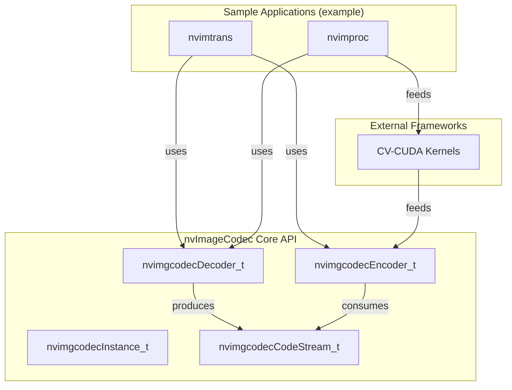
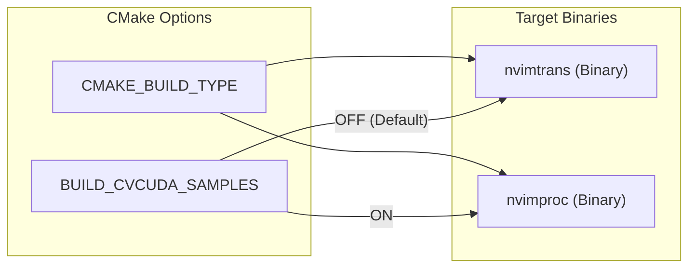

<!-- source: DeepWiki mcp.deepwiki.com · repo NVIDIA/nvImageCodec · page 5 C++ Sample Applications · fetched 2026-10-26 -->

# C++ Sample Applications

<details>
<summary>Relevant source files</summary>

The following files were used as context for generating this wiki page:

- [example/CMakeLists.txt](example/CMakeLists.txt)
- [example/NOTICE.md](example/NOTICE.md)
- [example/README.md](example/README.md)
- [example/assets/images/4ch16bpp.jp2](example/assets/images/4ch16bpp.jp2)
- [example/assets/images/Alex_2016-01-14_1300Z_(Geotiff).tif](example/assets/images/Alex_2016-01-14_1300Z_(Geotiff).tif)
- [example/assets/images/CMU-1.tif](example/assets/images/CMU-1.tif)
- [example/assets/images/DICOM/MRI/Knee/DICOMS/STU00001/SER00001/IMG00001.dcm](example/assets/images/DICOM/MRI/Knee/DICOMS/STU00001/SER00001/IMG00001.dcm)

</details>


The `nvImageCodec` repository provides a set of C++ sample applications located in the `example/` directory. These applications demonstrate how to integrate the library into image processing and transcoding workflows, utilizing both GPU acceleration and CPU fallbacks.

## Overview

The C++ samples serve as a reference for using the core C API and the library's plugin-based architecture. They cover two primary use cases:
1.  **Transcoding (`nvimtrans`)**: Efficiently converting batches of images between different formats and configurations.
2.  **Processing (`nvimproc`)**: Building an end-to-end pipeline that combines `nvImageCodec` for decoding/encoding with CV-CUDA for high-performance image processing.

### Sample Application Structure

The samples are organized into distinct subdirectories, each managed by a unified CMake build system.

| Application | Directory | Purpose |
| :--- | :--- | :--- |
| **nvimtrans** | `example/nvimtrans/` | Batch transcoding between image formats. |
| **nvimproc** | `example/nvimproc/` | Integration with CV-CUDA for ROI and color conversion. |
| **Assets** | `example/assets/` | Test images including DICOM, TIFF, and JPEG2000. |

**Sources:** [example/CMakeLists.txt:53-75](), [example/README.md:1-6]()

---

## Build Instructions

The C++ samples can be built either as part of the main `nvImageCodec` project or as a standalone project. The build system requires a C++17 compliant compiler and the CUDA Toolkit.

### Standard Build
To build the base samples (including `nvimtrans`):
```bash
mkdir build && cd build
export CUDACXX=nvcc
cmake .. -DCMAKE_BUILD_TYPE=Release
make
```

### CV-CUDA Integration Build
To build `nvimproc`, the `BUILD_CVCUDA_SAMPLES` flag must be enabled, and the CV-CUDA library must be present on the system.
- Set `-DBUILD_CVCUDA_SAMPLES=ON`.
- Ensure `CVCUDA_DIR` and `NVCV_TYPES_DIR` point to the directories containing the respective `-config.cmake` files.

**Sources:** [example/README.md:29-43](), [example/CMakeLists.txt:16-32]()

---

## Application High-Level Descriptions

### nvimtrans (Transcoding)
`nvimtrans` is a command-line utility designed for batch image transcoding. It demonstrates how to use `nvimgcodecDecoder_t` and `nvimgcodecEncoder_t` to move data between different bitstream formats (e.g., JPEG to JPEG2000) while managing memory across host and device.

For detailed command-line options and API usage, see **[nvimproc and nvimtrans Applications](#5.1)**.

### nvimproc (Image Processing)
`nvimproc` showcases the interoperability between `nvImageCodec` and **CV-CUDA**. It illustrates a pipeline where images are decoded directly into GPU memory, processed using CV-CUDA kernels (such as Region of Interest (ROI) cropping or color space conversion), and then re-encoded.

For a walkthrough of the CV-CUDA integration, see **[nvimproc and nvimtrans Applications](#5.1)**.

**Sources:** [example/CMakeLists.txt:71-75](), [example/README.md:22-26]()

---

## Sample Assets

The library includes a variety of complex image assets to demonstrate support for professional and medical imaging standards. Due to their size, these assets are managed via **Git LFS**.

### Asset Types
- **Medical Imaging**: DICOM MRI knee series (STU00001/SER00001).
- **Geospatial**: GeoTIFF (Alex_2016-01-14).
- **High-Bit Depth**: 16-bit 4-channel JPEG2000 (`4ch16bpp.jp2`).
- **Whole-Slide Imaging**: Large TIFF files (CMU-1, Philips-1).

For details on asset licenses and Git LFS setup, see **[Sample Assets and Test Images](#5.2)**.

**Sources:** [example/NOTICE.md:1-18](), [example/assets/images/4ch16bpp.jp2:1-3]()

---

## Code Entity Relationships

The following diagrams illustrate how the sample applications interact with the core library and external processing frameworks.

### Application Pipeline Flow
This diagram shows the relationship between the sample applications and the `nvImageCodec` C API entities.


**Sources:** [example/CMakeLists.txt:71-75](), [example/README.md:22-26]()

### Build Configuration Logic
This diagram maps the CMake variables to the resulting application binaries.


**Sources:** [example/CMakeLists.txt:32-75]()

---

## Detailed Documentation
- **[nvimproc and nvimtrans Applications](#5.1)**: Detailed walkthrough of command-line options and C API integration.
- **[Sample Assets and Test Images](#5.2)**: Information on bundled test images and Git LFS usage.

---

