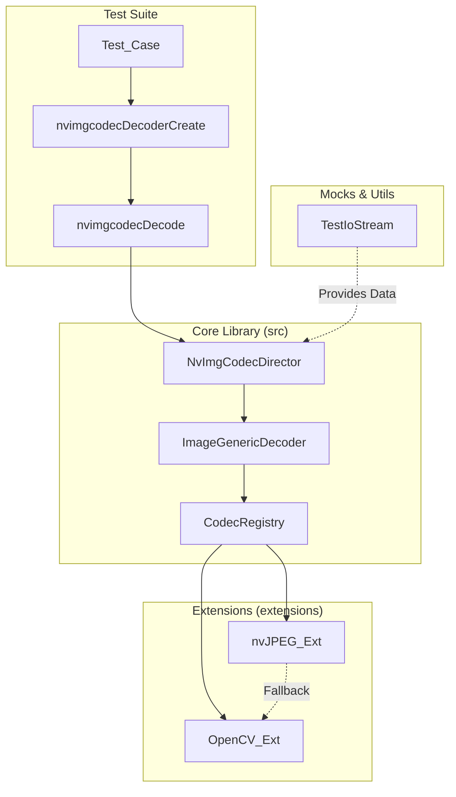
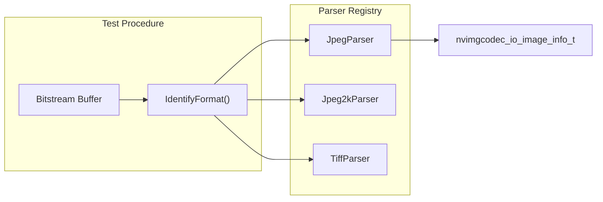

<!-- source: DeepWiki mcp.deepwiki.com · repo NVIDIA/nvImageCodec · page 6.1 C++ Unit and Integration Tests · fetched 2026-10-26 -->

# C++ Unit and Integration Tests

<details>
<summary>Relevant source files</summary>

The following files were used as context for generating this wiki page:

- [.gitmodules](.gitmodules)
- [CMakeLists.txt](CMakeLists.txt)

</details>


The nvImageCodec C++ test suite is built using **GoogleTest** and provides comprehensive coverage for the core library, format parsers, image processing kernels, and extension-specific codec implementations. The suite includes low-level unit tests for individual components and high-level integration tests that exercise the full decode/encode pipelines.

### Test Infrastructure Overview

The test suite is located in the `test/` directory and is enabled via the `BUILD_TEST` CMake option [CMakeLists.txt:80-81](). It relies on the GoogleTest submodule located in `external/googletest` [.gitmodules:8-11]().

#### Key Test Categories
| Category | Description |
| :--- | :--- |
| **API Tests** | Verify the public C API, object lifecycle, and error handling. |
| **Core Engine Tests** | Validate the `NvImgCodecDirector`, `CodecRegistry`, and `PluginFramework`. |
| **Parser Tests** | Ensure bitstream headers are correctly identified and parsed for all supported formats. |
| **Imgproc Tests** | Test CUDA kernels for color conversion, ROI handling, and buffer management. |
| **Extension Tests** | Targeted tests for `nvJPEG`, `nvJPEG2K`, `nvTIFF`, and CPU fallbacks like `OpenCV`. |

---

### Core Engine and Pipeline Testing

The core tests verify how the `NvImgCodecDirector` orchestrates requests through the `ImageGenericDecoder` and `ImageGenericEncoder`. These tests cover complex scenarios such as concurrency, fallback logic when a preferred backend fails, and the reuse of codec objects.

#### Data Flow: Integration Testing
The following diagram illustrates how integration tests exercise the path from the C API through the internal engine to the specific codec implementations.

**C++ Integration Test Flow**

**Sources:** [CMakeLists.txt:80-81](), [src/nvimgcodec.cpp:1-50]()

---

### Extension-Specific Testing

Each extension module has dedicated tests to ensure that format-specific features (e.g., HT-JPEG2000, multi-page TIFF, or JPEG lossless) are functioning correctly.

#### GPU Extension Tests
*   **nvJPEG Extension**: Validates hardware-accelerated decoding, Huffman table handling, and different chroma subsampling formats.
*   **nvJPEG2K Extension**: Focuses on J2K bitstream types, progression orders, and tile-based decoding.
*   **nvTIFF Extension**: Tests multi-channel support and integration with `nvCOMP` for compressed TIFFs. The `SKIP_NVTIFF_WITH_NVCOMP_TESTS` flag allows skipping these if the compression library is missing [CMakeLists.txt:119-125]().

#### CPU Fallback Tests
Tests for `libjpeg-turbo`, `libtiff`, and `opencv_ext` ensure that the system remains functional on platforms without specific GPU hardware or when the GPU codec encounters an unsupported bitstream feature.

---

### Parser and Bitstream Testing

The parser tests verify the implementation of the `IImageParser` interface for various formats. These tests ensure that the `CodecRegistry` can correctly route a bitstream to the appropriate decoder based on signature detection.

**Parser Discovery Logic**

**Sources:** [src/parsers/jpeg.cpp:1-20](), [src/parsers/tiff.cpp:1-20]()

---

### Image Processing (Imgproc) Tests

The `imgproc` tests focus on the mathematical correctness of CUDA kernels located in `src/imgproc/`. 

*   **Color Space Conversion**: Validates YCbCr to RGB, Gray to RGB, and other conversions against reference implementations.
*   **ROI and Orientation**: Tests the `apply_exif_orientation` logic and Region-of-Interest (ROI) cropping during the decode process.
*   **Buffer Management**: Verifies that `DeviceBuffer`, `PinnedBuffer`, and `PageableBuffer` correctly handle CUDA memory allocations and transfers.

---

### Test Utilities and Mocks

To facilitate isolated unit testing, the suite provides several utility classes:

1.  **Mock Objects**: Implementations of `ICodec` and `IImageDecoder` that allow testing the `Director` without loading heavy external libraries.
2.  **IoStream Mocks**: `TestIoStream` allows simulating file system errors, slow reads, or memory-mapped file behavior to test the robustness of the I/O layer.
3.  **Bitstream Generators**: Utilities that create valid (or intentionally malformed) image headers to test parser resilience.

### Building and Running Tests

Tests are built by default unless `BUILD_TEST` is set to `OFF`.

```bash
# Build the test suite
cmake -DBUILD_TEST=ON ..
make -j

# Run all C++ tests
ctest

# Run a specific test with GoogleTest filters
./test/nvimgcodec_tests --gtest_filter=JpegParserTest.*
```
**Sources:** [CMakeLists.txt:80-81](), [CMakeLists.txt:72-76]()

---

