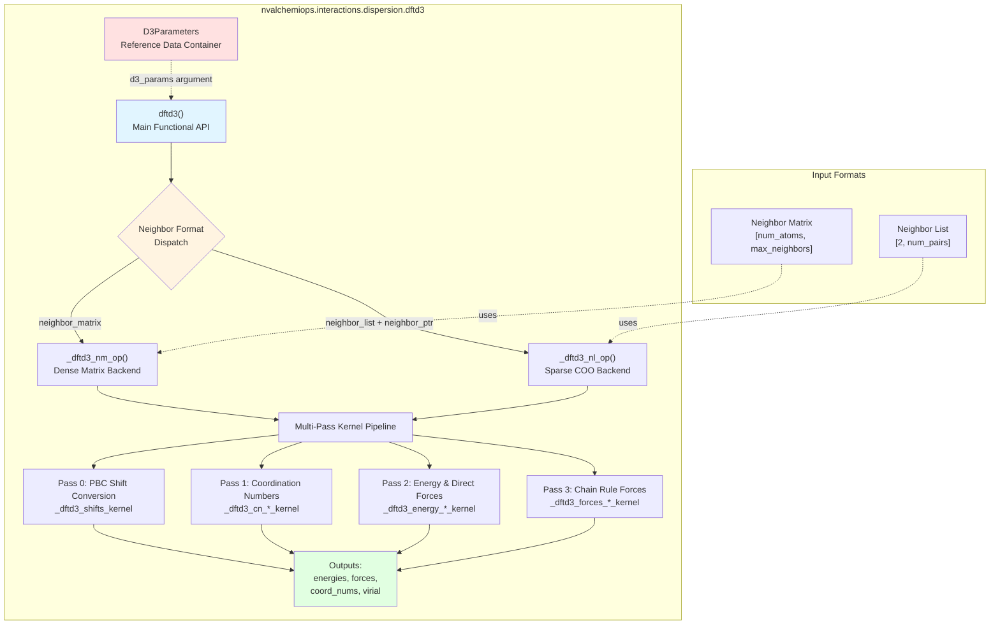
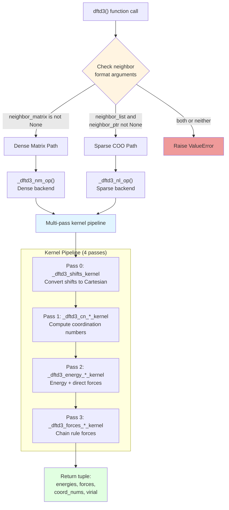
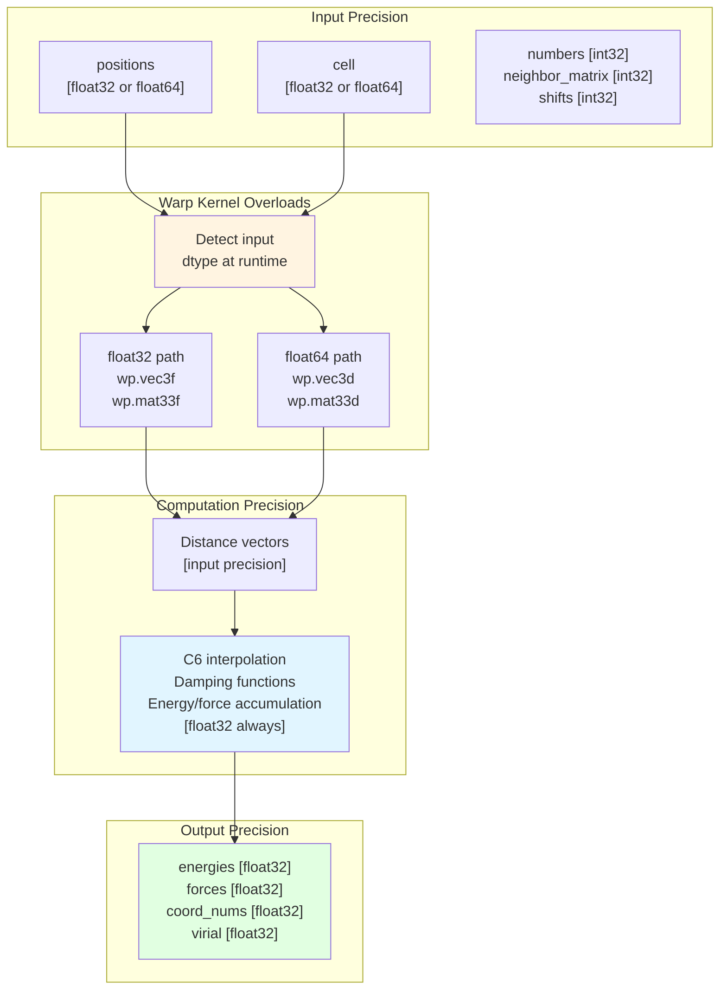

<!-- source: DeepWiki mcp.deepwiki.com · repo NVIDIA/nvalchemi-toolkit-ops · page 5.2 Dispersion API · fetched 2026-10-26 -->

# Dispersion API

<details>
<summary>Relevant source files</summary>

The following files were used as context for generating this wiki page:

- [README.md](README.md)
- [docs/userguide/components/dispersion.md](docs/userguide/components/dispersion.md)

</details>


This page provides complete API reference documentation for the DFT-D3 dispersion correction module. For conceptual background, usage patterns, and theory, see [Dispersion Corrections (DFT-D3)](#2.2). For performance benchmarks, see [Dispersion Performance](#4.2).

## Module Overview

The dispersion API provides GPU-accelerated DFT-D3 with Becke-Johnson damping through a functional interface. The module supports both dense neighbor matrix and sparse neighbor list formats, automatic precision handling, and optional virial computation for periodic systems.

**Primary Exports**:
- {func}`dftd3`: Main functional interface for dispersion energy and force calculation
- {class}`D3Parameters`: Dataclass container for reference parameters



**Sources**: [docs/userguide/components/dispersion.md:1-578](), [nvalchemiops/interactions/dispersion/dftd3.py]()

---

## Main Function: `dftd3`

```python
def dftd3(
    positions: torch.Tensor,
    numbers: torch.Tensor,
    *,
    neighbor_matrix: Optional[torch.Tensor] = None,
    neighbor_matrix_shifts: Optional[torch.Tensor] = None,
    neighbor_list: Optional[torch.Tensor] = None,
    neighbor_ptr: Optional[torch.Tensor] = None,
    unit_shifts: Optional[torch.Tensor] = None,
    cell: Optional[torch.Tensor] = None,
    batch_idx: Optional[torch.Tensor] = None,
    a1: float,
    a2: float,
    s8: float,
    s6: float = 1.0,
    d3_params: Optional[Union[D3Parameters, Dict[str, torch.Tensor]]] = None,
    covalent_radii: Optional[torch.Tensor] = None,
    r4r2: Optional[torch.Tensor] = None,
    c6_reference: Optional[torch.Tensor] = None,
    coord_num_ref: Optional[torch.Tensor] = None,
    s5_smoothing_on: Optional[float] = None,
    s5_smoothing_off: Optional[float] = None,
    compute_virial: bool = False,
    num_systems: Optional[int] = None,
) -> Tuple[torch.Tensor, torch.Tensor, torch.Tensor, Optional[torch.Tensor]]
```

Compute DFT-D3 dispersion correction with Becke-Johnson damping.

**Sources**: [docs/userguide/components/dispersion.md:52-137]()

### Required Parameters

| Parameter | Type | Shape | Description |
|-----------|------|-------|-------------|
| `positions` | `torch.Tensor` | `[num_atoms, 3]` | Atomic positions in Bohr (float32 or float64) |
| `numbers` | `torch.Tensor` | `[num_atoms]` | Atomic numbers (int32) |
| `a1` | `float` | scalar | BJ damping parameter (dimensionless) |
| `a2` | `float` | scalar | BJ damping parameter (Bohr) |
| `s8` | `float` | scalar | C8 scaling parameter (dimensionless) |

**Sources**: [docs/userguide/components/dispersion.md:63-68](), [docs/userguide/components/dispersion.md:276-287]()

### Neighbor Representation (Mutually Exclusive)

**Option 1: Dense Neighbor Matrix**

| Parameter | Type | Shape | Description |
|-----------|------|-------|-------------|
| `neighbor_matrix` | `torch.Tensor` | `[num_atoms, max_neighbors]` | Neighbor indices (int32), padded with fill value |
| `neighbor_matrix_shifts` | `torch.Tensor` | `[num_atoms, max_neighbors, 3]` | Unit cell shift vectors (int32) for PBC |

**Option 2: Sparse Neighbor List (COO)**

| Parameter | Type | Shape | Description |
|-----------|------|-------|-------------|
| `neighbor_list` | `torch.Tensor` | `[2, num_pairs]` | Edge index in COO format (int32) |
| `neighbor_ptr` | `torch.Tensor` | `[num_atoms + 1]` | CSR row pointers (int32) |
| `unit_shifts` | `torch.Tensor` | `[num_pairs, 3]` | Unit cell shift vectors (int32) for PBC |

```{note}
Exactly one neighbor format must be provided. Providing both or neither raises an error.
```

**Sources**: [docs/userguide/components/dispersion.md:147-180]()

### Optional Geometric Parameters

| Parameter | Type | Shape | Default | Description |
|-----------|------|-------|---------|-------------|
| `cell` | `torch.Tensor` | `[num_systems, 3, 3]` | `None` | Lattice vectors (Bohr) for periodic systems |
| `batch_idx` | `torch.Tensor` | `[num_atoms]` | `None` | System index for each atom (int32) |
| `s6` | `float` | scalar | `1.0` | C6 scaling parameter (dimensionless) |

**Sources**: [docs/userguide/components/dispersion.md:100-143]()

### D3 Reference Parameters (Required)

One of the following must be provided:

**Option 1: Unified Container**

| Parameter | Type | Description |
|-----------|------|-------------|
| `d3_params` | `D3Parameters` or `Dict` | Complete reference data (see [D3Parameters](#d3parameters-dataclass)) |

**Option 2: Individual Parameters**

| Parameter | Type | Shape | Description |
|-----------|------|-------|-------------|
| `covalent_radii` | `torch.Tensor` | `[max_Z + 1]` | Covalent radii in Bohr (float32) |
| `r4r2` | `torch.Tensor` | `[max_Z + 1]` | $\langle r^4 \rangle / \langle r^2 \rangle$ expectation values (float32) |
| `c6_reference` | `torch.Tensor` | `[max_Z+1, max_Z+1, 5, 5]` | Reference C6 grid (Hartree·Bohr⁶, float32) |
| `coord_num_ref` | `torch.Tensor` | `[max_Z+1, max_Z+1, 5, 5]` | Reference coordination number grid (float32) |

```{important}
Reference parameters must use atomic units (Bohr for lengths, Hartree for energies). Parameter files are available from the [Grimme group website](https://www.chemie.uni-bonn.de/grimme/de/software/dft-d3).
```

**Sources**: [docs/userguide/components/dispersion.md:223-287]()

### Optional Control Parameters

| Parameter | Type | Default | Description |
|-----------|------|---------|-------------|
| `s5_smoothing_on` | `float` | `None` | Start of smooth cutoff transition (Bohr) |
| `s5_smoothing_off` | `float` | `None` | End of smooth cutoff (Bohr) |
| `compute_virial` | `bool` | `False` | Whether to compute virial tensor |
| `num_systems` | `int` | `None` | Number of systems (prevents graph breaks with `torch.compile`) |

**Sources**: [docs/userguide/components/dispersion.md:293-426]()

### Return Values

Returns a tuple of `(energies, forces, coord_nums, virial)`:

| Output | Type | Shape | Units | Description |
|--------|------|-------|-------|-------------|
| `energies` | `torch.Tensor` | `[num_systems]` | Hartree | Per-system dispersion energy (float32) |
| `forces` | `torch.Tensor` | `[num_atoms, 3]` | Hartree/Bohr | Per-atom forces (float32) |
| `coord_nums` | `torch.Tensor` | `[num_atoms]` | dimensionless | Coordination numbers (float32) |
| `virial` | `torch.Tensor` or `None` | `[num_systems, 3, 3]` | Hartree | Virial tensor (float32) if `compute_virial=True` |

**Sources**: [docs/userguide/components/dispersion.md:183-220]()

---

## D3Parameters Dataclass

```python
@dataclass
class D3Parameters:
    rcov: torch.Tensor          # [max_Z + 1], Bohr
    r4r2: torch.Tensor          # [max_Z + 1], dimensionless
    c6ab: torch.Tensor          # [max_Z+1, max_Z+1, 5, 5], Hartree·Bohr⁶
    cn_ref: torch.Tensor        # [max_Z+1, max_Z+1, 5, 5], dimensionless
```

Container for DFT-D3 reference parameters. All tensors must be on the same device as input positions.

**Sources**: [docs/userguide/components/dispersion.md:227-244]()

### Fields

| Field | Type | Shape | Units | Description |
|-------|------|-------|-------|-------------|
| `rcov` | `torch.Tensor` | `[max_Z + 1]` | Bohr | Covalent radii for atomic numbers 0 to max_Z (float32) |
| `r4r2` | `torch.Tensor` | `[max_Z + 1]` | dimensionless | $\langle r^4 \rangle / \langle r^2 \rangle$ expectation values (float32) |
| `c6ab` | `torch.Tensor` | `[max_Z+1, max_Z+1, 5, 5]` | Hartree·Bohr⁶ | Reference C6 coefficients grid (float32) |
| `cn_ref` | `torch.Tensor` | `[max_Z+1, max_Z+1, 5, 5]` | dimensionless | Reference coordination number grid (float32) |

### Indexing Convention

All arrays use 0-based indexing where index `i` corresponds to atomic number `i`. Index 0 is unused but must be present. For a system with elements up to atomic number Z, arrays must have size at least `Z + 1`.

**Example**: For a system containing H (Z=1), C (Z=6), N (Z=7), O (Z=8):
- All arrays must have first dimension ≥ 9
- Valid indices used: 1, 6, 7, 8
- Index 0 is unused but required

**Sources**: [docs/userguide/components/dispersion.md:227-274]()

### Usage Examples

**From dictionary**:
```python
d3_params = D3Parameters(
    rcov=covalent_radii_tensor,     # [95] for elements up to Pu
    r4r2=r4r2_tensor,                # [95]
    c6ab=c6_reference_tensor,        # [95, 95, 5, 5]
    cn_ref=coord_num_ref_tensor,     # [95, 95, 5, 5]
)

energy, forces, coord_num = dftd3(
    positions, numbers, neighbor_matrix,
    a1=0.3981, a2=4.4211, s8=0.7875,
    d3_params=d3_params
)
```

**As dictionary**:
```python
d3_params_dict = {
    "rcov": covalent_radii_tensor,
    "r4r2": r4r2_tensor,
    "c6ab": c6_reference_tensor,
    "cn_ref": coord_num_ref_tensor,
}

energy, forces, coord_num = dftd3(
    positions, numbers, neighbor_matrix,
    a1=0.3981, a2=4.4211, s8=0.7875,
    d3_params=d3_params_dict
)
```

**Sources**: [docs/userguide/components/dispersion.md:227-268]()

---

## Dispatch Mechanism

The `dftd3` function dispatches to different backend implementations based on the neighbor representation format provided:



**Sources**: [docs/userguide/components/dispersion.md:527-541]()

### Backend Selection Logic

| Condition | Backend | Kernel Suffix |
|-----------|---------|---------------|
| `neighbor_matrix is not None` | Dense matrix | `_dftd3_nm_op` → kernels with `_nm_` suffix |
| `neighbor_list is not None` and `neighbor_ptr is not None` | Sparse COO | `_dftd3_nl_op` → kernels with `_nl_` suffix |
| Both formats provided | Error | `ValueError` |
| Neither format provided | Error | `ValueError` |

Both backends execute an identical four-pass algorithm and produce bit-identical results. The difference is in memory access patterns:

- **Dense matrix backend**: Iterates over fixed-size `[num_atoms, max_neighbors]` array with padding
- **Sparse COO backend**: Uses CSR pointers for variable-length neighbor lists with no padding

**Sources**: [docs/userguide/components/dispersion.md:527-541]()

---

## Multi-Pass Kernel Architecture

The force calculation requires coordination-dependent C6 coefficients, creating a data dependency that necessitates multiple kernel passes:

```mermaid
graph TB
    subgraph "Pass 0: PBC Shift Conversion"
        P0["_dftd3_shifts_kernel<br/>Convert integer shifts to Cartesian"]
        P0_IN["Input: shift_matrix [int32]<br/>cell [float32/64]"]
        P0_OUT["Output: shift_vectors [float32]<br/>Cartesian displacements"]
        
        P0_IN --> P0
        P0 --> P0_OUT
    end
    
    subgraph "Pass 1: Coordination Numbers"
        P1["_dftd3_cn_*_kernel<br/>Geometric counting function"]
        P1_IN["Input: positions, neighbor_matrix<br/>rcov, shift_vectors"]
        P1_OUT["Output: coord_nums [float32]<br/>Per-atom CN values"]
        
        P1_IN --> P1
        P1 --> P1_OUT
    end
    
    subgraph "Pass 2: Energy & Direct Forces"
        P2["_dftd3_energy_*_kernel<br/>C6/C8 interpolation & damping"]
        P2_IN["Input: coord_nums, c6ab, cn_ref<br/>a1, a2, s6, s8"]
        P2_COMP["For each pair:<br/>1. Interpolate C6<br/>2. Compute E_disp<br/>3. Compute F_direct<br/>4. Accumulate dE/dCN_i"]
        P2_OUT["Output: energies [float32]<br/>forces [float32] partial<br/>dcn_accumulator [float32]"]
        
        P2_IN --> P2
        P2 --> P2_COMP
        P2_COMP --> P2_OUT
    end
    
    subgraph "Pass 3: Chain Rule Forces"
        P3["_dftd3_forces_*_kernel<br/>CN-dependent force contribution"]
        P3_IN["Input: dcn_accumulator<br/>positions, neighbor_matrix<br/>rcov, shift_vectors"]
        P3_COMP["For each pair:<br/>F_chain = -sum_k dE/dCN_i * dCN_i/dr_ij"]
        P3_OUT["Output: forces [float32]<br/>forces += F_chain"]
        
        P3_IN --> P3
        P3 --> P3_COMP
        P3_COMP --> P3_OUT
    end
    
    P0_OUT -.->|"used in P1, P2, P3"| P1_IN
    P1_OUT -.->|"needed for<br/>C6 interpolation"| P2_IN
    P2_OUT -.->|"accumulated<br/>gradient"| P3_IN
    
    style P0 fill:#e1f5ff
    style P1 fill:#fff4e1
    style P2 fill:#ffe1e1
    style P3 fill:#e1ffe1
```



**Sources**: [docs/userguide/components/dispersion.md:494-526]()

### Pass Dependencies

| Pass | Kernel | Depends On | Produces | Purpose |
|------|--------|------------|----------|---------|
| 0 | `_dftd3_shifts_kernel` | `shift_matrix`, `cell` | `shift_vectors` | Convert integer shifts to Cartesian coordinates |
| 1 | `_dftd3_cn_{nm,nl}_kernel` | `positions`, `rcov`, `shift_vectors` | `coord_nums` | Compute coordination numbers via geometric counting |
| 2 | `_dftd3_energy_{nm,nl}_kernel` | `coord_nums`, `c6ab`, `cn_ref` | `energies`, `forces_direct`, `dcn_accumulator` | Interpolate C6, compute energy and direct forces, accumulate $\partial E / \partial \text{CN}$ |
| 3 | `_dftd3_forces_{nm,nl}_kernel` | `dcn_accumulator`, `positions`, `rcov`, `shift_vectors` | `forces_chain` | Compute chain-rule force contribution and add to forces |

The accumulation in Pass 2 of $\sum_k \partial E_{ik} / \partial \text{CN}_i$ over **all pairs** involving atom $i$ creates the data dependency preventing single-pass computation.

**Sources**: [docs/userguide/components/dispersion.md:494-526]()

---

## Precision and Data Type Handling



**Sources**: [docs/userguide/components/dispersion.md:543-556](), [docs/userguide/components/dispersion.md:210-220]()

### Precision Rules

| Component | Precision | Notes |
|-----------|-----------|-------|
| **Input positions** | `float32` or `float64` | User choice; `float64` useful for large cells or coordinates far from origin |
| **Input cell** | `float32` or `float64` | Must match positions dtype |
| **Distance vectors** | Matches input | Computed at input precision to preserve geometric accuracy |
| **All dispersion calculations** | `float32` | C6 interpolation, damping, energy/force accumulation |
| **All outputs** | `float32` | Sufficient precision for dispersion corrections (typically ~0.1 kcal/mol accuracy) |

**Rationale**: DFT-D3 corrections are empirical with typical accuracy of ~0.1 kcal/mol. Using `float32` for dispersion calculations provides ~7 digits of precision, far exceeding this accuracy threshold. Higher precision is only needed for geometric calculations (distances) when positions span large ranges.

**Sources**: [docs/userguide/components/dispersion.md:315-318](), [docs/userguide/components/dispersion.md:543-556]()

---

## Unit Conversion Reference

All DFT-D3 parameters use atomic units (Bohr for lengths, Hartree for energies):

| Quantity | Expected Unit | Conversion Factor | Notes |
|----------|---------------|-------------------|-------|
| **positions** | Bohr | Å × 1.88972598858 | Input positions |
| **cell** | Bohr | Å × 1.88972598858 | Lattice vectors |
| **a2** parameter | Bohr | Same as positions | BJ damping parameter |
| **rcov** (in `d3_params`) | Bohr | Same as positions | Covalent radii |
| **c6ab** (in `d3_params`) | Hartree·Bohr⁶ | — | Reference C6 coefficients |
| **energies** (output) | Hartree | × 27.2113862459 → eV | Per-system energies |
| **forces** (output) | Hartree/Bohr | × 51.42206747 → eV/Å | Per-atom forces |
| **virial** (output) | Hartree | × 27.2113862459 → eV | Virial tensor |

**Dimensionless parameters**: `a1`, `s6`, `s8`, `coord_nums`, `r4r2`, `cn_ref`

```python
# Example conversion
import scipy.constants

ANGSTROM_TO_BOHR = 1.0 / scipy.constants.value('atomic unit of length')
HARTREE_TO_EV = scipy.constants.value('Hartree energy in eV')

positions_ang = torch.tensor([...], device='cuda')
positions_bohr = positions_ang * ANGSTROM_TO_BOHR

energy_hartree, forces_hartree_bohr, cn = dftd3(
    positions=positions_bohr,
    # ... other args
)

energy_ev = energy_hartree * HARTREE_TO_EV
forces_ev_ang = forces_hartree_bohr * (HARTREE_TO_EV / ANGSTROM_TO_BOHR)
```

**Sources**: [docs/userguide/components/dispersion.md:183-207]()

---

## Common Functional Parameters

Standard BJ damping parameters for common DFT functionals:

| Functional | a1 | a2 (Bohr) | s8 | Reference |
|------------|----|-----------|----|-----------|
| **PBE** | 0.3981 | 4.4211 | 0.7875 | [J. Chem. Phys. 132, 154104 (2010)] |
| **PBE0** | 0.4145 | 4.8593 | 1.2177 | [J. Comput. Chem. 32, 1456 (2011)] |
| **B3LYP** | 0.3981 | 4.4211 | 1.9889 | [J. Comput. Chem. 32, 1456 (2011)] |
| **TPSS** | 0.4535 | 4.4752 | 1.9435 | [J. Comput. Chem. 32, 1456 (2011)] |
| **revPBE** | 0.5238 | 3.5016 | 2.3550 | [J. Comput. Chem. 32, 1456 (2011)] |

Complete parameter tables available at: https://www.chemie.uni-bonn.de/grimme/de/software/dft-d3/

**Sources**: [docs/userguide/components/dispersion.md:276-287]()

---

## torch.compile Compatibility

The `dftd3` function fully supports `torch.compile` for JIT optimization. To avoid graph breaks:

```python
import torch
from nvalchemiops.interactions.dispersion.dftd3 import dftd3

compiled_dftd3 = torch.compile(dftd3, mode='reduce-overhead')

# For batched systems, provide num_systems to prevent graph breaks
energy, forces, coord_num = compiled_dftd3(
    positions=positions,
    numbers=numbers,
    neighbor_matrix=neighbor_matrix,
    a1=0.3981, a2=4.4211, s8=0.7875,
    d3_params=d3_params,
    batch_idx=batch_idx,
    num_systems=num_systems,  # Critical for avoiding recompilation
)
```

**Graph Break Prevention**:
- Provide `num_systems` explicitly when using batching
- Use consistent neighbor format (matrix or COO) across calls
- Keep `d3_params` on the same device throughout

**Sources**: [docs/userguide/components/dispersion.md:297-312]()

---

