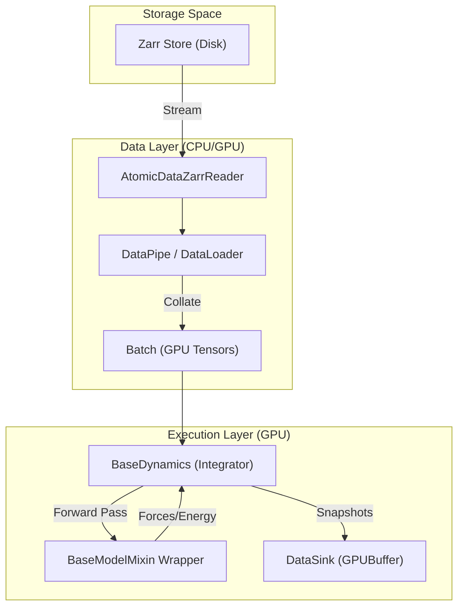
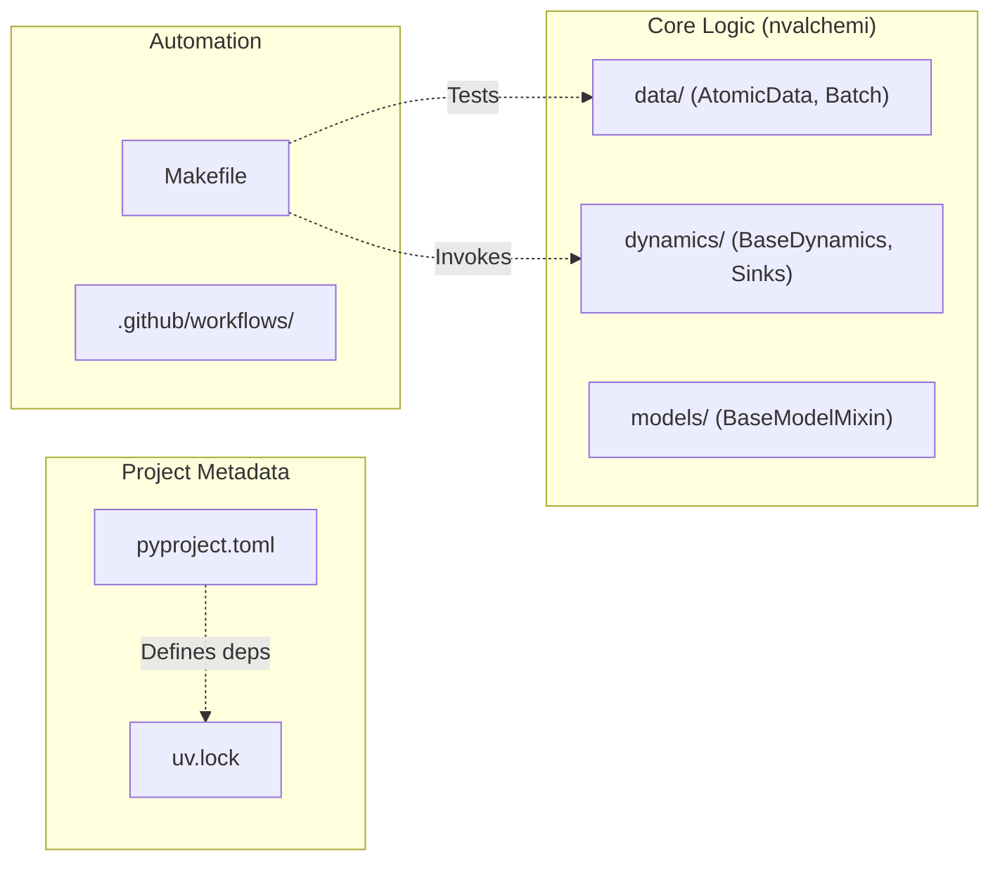

<!-- source: DeepWiki mcp.deepwiki.com · repo NVIDIA/nvalchemi-toolkit · page 1.1 Getting Started: Installation and Setup · fetched 2026-10-26 -->

# Getting Started: Installation and Setup

<details>
<summary>Relevant source files</summary>

The following files were used as context for generating this wiki page:

- [Makefile](Makefile)
- [docs/userguide/about/install.md](docs/userguide/about/install.md)
- [docs/userguide/about/intro.md](docs/userguide/about/intro.md)
- [nvalchemi/dynamics/demo.py](nvalchemi/dynamics/demo.py)
- [nvalchemi/dynamics/sinks.py](nvalchemi/dynamics/sinks.py)
- [pyproject.toml](pyproject.toml)
- [sonar-project.properties](sonar-project.properties)
- [uv.lock](uv.lock)

</details>


This page provides comprehensive instructions for setting up the NVIDIA ALCHEMI Toolkit (`nvalchemi`). It covers environment prerequisites, multiple installation methods (including `uv`, PyPI, and source), and the configuration of optional feature sets such as MACE models and distributed training.

## Environment Prerequisites

The ALCHEMI Toolkit is a **GPU-first** framework designed for high-performance atomic simulations. To ensure optimal performance and compatibility, the following environment is required:

*   **Hardware**: NVIDIA GPU with Compute Capability 8.0+ (e.g., Ampere A100, Hopper H100/B100).
*   **CUDA**: Version 12.0 or higher.
*   **Python**: Version 3.11, 3.12, or 3.13 [pyproject.toml:12-12]().
*   **Operating System**: Linux is the primary supported platform for production and distributed workflows [pyproject.toml:39-39]().

## Core Dependencies

The toolkit relies on several key libraries for its functionality:
*   **PyTorch**: >= 2.5.1 [pyproject.toml:17-17]().
*   **nvalchemi-toolkit-ops**: >= 0.3.0 (Provides optimized CUDA kernels for neighbor lists and segmented operations) [pyproject.toml:16-16]().
*   **Pydantic**: >= 2.11.7 (Used for data validation in `AtomicData`) [pyproject.toml:22-22]().
*   **Zarr**: >= 3 (Backend for high-performance trajectory I/O) [pyproject.toml:25-25]().
*   **ASE**: >= 3.27.0 (Integration with the Atomic Simulation Environment) [pyproject.toml:15-15]().

## Installation Methods

### 1. Using `uv` (Recommended)
`uv` is the preferred tool for managing `nvalchemi` environments due to its speed and reliable dependency resolution [docs/userguide/about/install.md:18-21]().

**For Users (Stable):**
```bash
$ uv venv --seed --python 3.12
$ uv pip install nvalchemi-toolkit
```
[docs/userguide/about/install.md:46-48]()

**For Developers (Nightly/Source):**
```bash
$ git clone git@github.com:NVIDIA/nvalchemi-toolkit.git
$ cd nvalchemi-toolkit
$ uv sync --all-extras
```
[docs/userguide/about/install.md:58-62]()

### 2. Using PyPI
Standard installation via `pip`:
```bash
$ pip install nvalchemi-toolkit
```
[docs/userguide/about/install.md:14-14]()

### 3. From GitHub Source
To use the latest features from the `main` branch:
```bash
$ pip install git+https://www.github.com/NVIDIA/nvalchemi-toolkit.git
```
[docs/userguide/about/install.md:29-29]()

## Optional Extras

`nvalchemi` provides optional dependency groups for specific workflows, defined in `pyproject.toml` [pyproject.toml:58-66]().

| Extra | Purpose | Key Dependencies |
| :--- | :--- | :--- |
| `mace` | Support for MACE Interatomic Potentials | `mace-torch`, `cuequivariance-torch` |
| `training` | Advanced data pipelines for model training | `nvidia-physicsnemo[datapipes-extras]` |
| `docs` | Tools for building documentation | `sphinx`, `sphinx-gallery`, `pydata-sphinx-theme` |

To install with specific extras:
```bash
$ uv pip install "nvalchemi-toolkit[mace,training]"
```

## System Architecture and Data Flow

The installation sets up a four-layer architecture that moves data from storage to GPU-resident simulation loops.

### Data Flow: From Disk to Dynamics
The following diagram illustrates how the installed components interact during a typical simulation initialization.

**Simulation Initialization Data Flow**

**Sources:** [nvalchemi/dynamics/sinks.py:201-235](), [docs/userguide/about/intro.md:98-143]()

## Developer Setup and Quality Control

For contributors, the toolkit provides a `Makefile` to automate common development tasks [Makefile:20-21]().

### Common Makefile Targets
*   `make install`: Syncs environment with all extras using `uv` [Makefile:26-28]().
*   `make lint`: Runs `ruff` and `pre-commit` checks [Makefile:40-48]().
*   `make pytest`: Executes the test suite with coverage reporting [Makefile:71-74]().
*   `make docs`: Builds the Sphinx documentation and executes gallery examples [Makefile:145-147]().

### Code Entity Association
This diagram maps the high-level installation concepts to specific code entities within the repository.

**System Entity Mapping**

**Sources:** [pyproject.toml:5-27](), [Makefile:1-18](), [docs/userguide/about/intro.md:144-150]()

## Verification

After installation, verify that the toolkit and its GPU dependencies are correctly configured:

```bash
$ python -c "import nvalchemi; print(nvalchemi.__version__)"
$ python -c "import torch; print(f'CUDA available: {torch.cuda.is_available()}')"
```
[docs/userguide/about/install.md:113-115]()

**Sources:**
* `pyproject.toml:1-130`
* `docs/userguide/about/install.md:1-123`
* `docs/userguide/about/intro.md:1-150`
* `Makefile:1-188`
* `nvalchemi/dynamics/sinks.py:43-243`

---

