# Page: Overview

# Overview

<details>
<summary>Relevant source files</summary>

The following files were used as context for generating this wiki page:

- [README.md](README.md)
- [docs/modules/dynamics/api.rst](docs/modules/dynamics/api.rst)
- [docs/modules/typing.rst](docs/modules/typing.rst)
- [docs/userguide/about/install.md](docs/userguide/about/install.md)
- [docs/userguide/about/intro.md](docs/userguide/about/intro.md)
- [docs/userguide/index.md](docs/userguide/index.md)
- [nvalchemi/__init__.py](nvalchemi/__init__.py)
- [test/__init__.py](test/__init__.py)

</details>


The **NVIDIA ALCHEMI Toolkit** (`nvalchemi`) is a GPU-first Python framework designed for high-throughput atomic simulation workflows [docs/userguide/about/intro.md:5-9](). It provides a unified interface for machine-learned interatomic potentials (MLIPs), batched molecular dynamics, and composable simulation pipelines [README.md:12-16]().

The toolkit is built on a "batch-first" philosophy, ensuring that all operations—from neighbor list generation to model inference—are performed on multiple systems in parallel to maximize GPU saturation [docs/userguide/about/intro.md:17-18]().

### System Architecture

The toolkit is organized into four primary layers that bridge the gap between high-level simulation intent and low-level GPU execution.

#### Layered Architecture Overview
| Layer | Responsibility | Key Code Entities |
| :--- | :--- | :--- |
| **Data** | Graph representation and batching | `AtomicData`, `Batch` |
| **Model** | MLIP wrapping and adaptation | `BaseModelMixin`, `ModelCard` |
| **Dynamics** | Integration and optimization | `BaseDynamics`, `Hook` |
| **I/O** | Persistence and loading | `AtomicDataZarrWriter`, `DataLoader` |

**Sources:** [docs/userguide/about/intro.md:96-143](), [README.md:18-35]()

### Core Capabilities

*   **GPU-Resident Data Structures**: Atomic systems are represented as graphs where nodes (atoms) and edges (neighbors) live on the GPU by default [docs/userguide/about/intro.md:74-77]().
*   **Model Agnosticism**: Standardized wrappers allow the use of MACE, AIMNet2, or custom models through a common interface [README.md:20-22]().
*   **Composable Pipelines**: Users can chain simulation stages (e.g., relaxation followed by MD) using Python operators. The `+` operator fuses stages on a single GPU, while the `|` operator distributes them across multiple GPUs [README.md:25-27]().
*   **Inflight Batching**: The `SizeAwareSampler` manages GPU memory by replacing converged or completed samples with new ones on the fly, keeping the pipeline full [README.md:30-31]().

### Mapping Natural Language to Code Entities

The following diagrams illustrate how high-level simulation concepts map to specific classes and protocols within the `nvalchemi` codebase.

#### Simulation Pipeline Mapping
This diagram shows how user-defined simulation logic is translated into the `nvalchemi.dynamics` execution model.

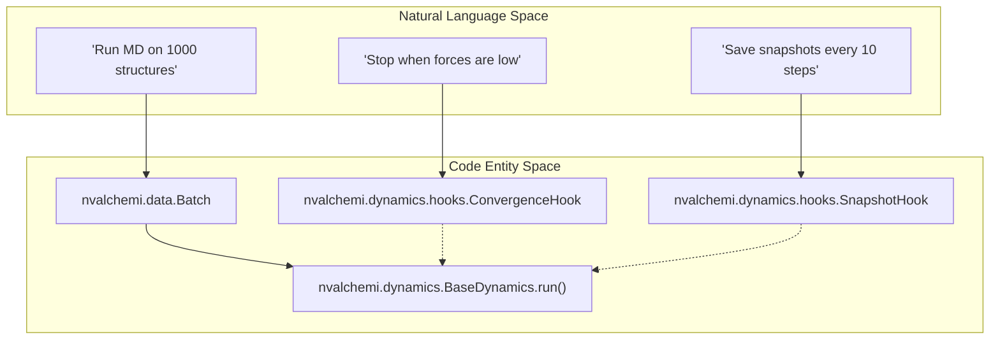
**Sources:** [docs/userguide/about/intro.md:124-132](), [README.md:81-90]()

#### Model Integration Mapping
This diagram shows how an external Machine Learning Interatomic Potential (MLIP) is integrated into the toolkit.

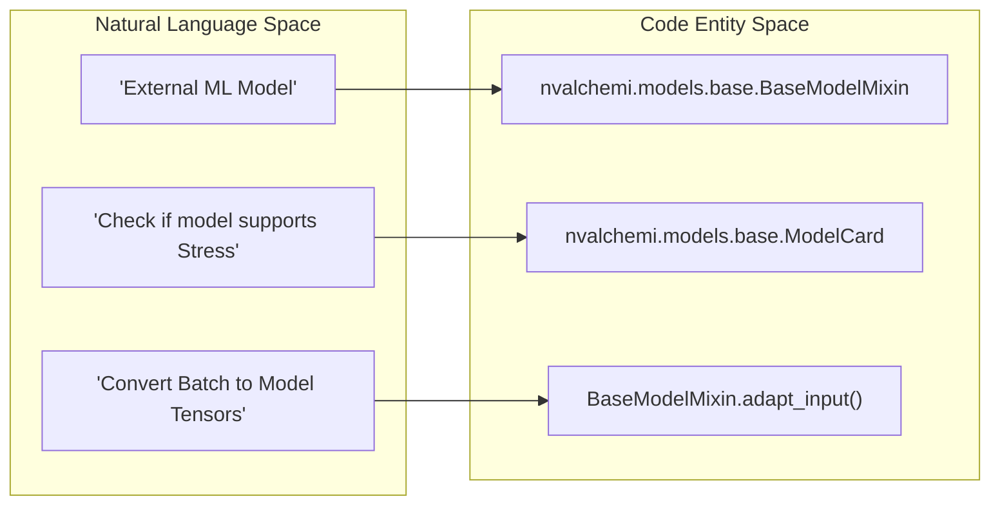
**Sources:** [docs/userguide/about/intro.md:112-119](), [README.md:20-22]()

### Wiki Navigation

This wiki is structured to guide you from initial setup to advanced distributed orchestration.

*   **[Getting Started: Installation and Setup](#1.1)**: Instructions for installing `nvalchemi-toolkit` via `pip` or `uv`, including GPU prerequisites and optional dependencies like `mace` or `warp-lang` [docs/userguide/about/install.md:5-30]().
*   **[Core Concepts and Architecture](#1.2)**: A deeper dive into the batching philosophy, the four-layer design, and the Domain Specific Language (DSL) for pipeline composition [docs/userguide/about/intro.md:15-27]().
*   **Data Layer**: Details on `AtomicData` and the high-performance Zarr I/O system.
*   **Model Layer**: Guide to wrapping potentials and capability negotiation.
*   **Dynamics Engine**: Reference for integrators (NVE, NVT, NPT) and the extensible `Hook` system [docs/modules/dynamics/api.rst:19-62]().
*   **Examples and Tutorials**: Walkthroughs of common workflows, from simple geometry optimization to distributed MD [README.md:44-127]().

**Sources:** [docs/userguide/index.md:25-70](), [docs/modules/dynamics/api.rst:1-99]()

---

# Page: Getting Started: Installation and Setup

# Getting Started: Installation and Setup

<details>
<summary>Relevant source files</summary>

The following files were used as context for generating this wiki page:

- [Makefile](Makefile)
- [docs/userguide/about/install.md](docs/userguide/about/install.md)
- [docs/userguide/about/intro.md](docs/userguide/about/intro.md)
- [nvalchemi/dynamics/demo.py](nvalchemi/dynamics/demo.py)
- [nvalchemi/dynamics/sinks.py](nvalchemi/dynamics/sinks.py)
- [pyproject.toml](pyproject.toml)
- [sonar-project.properties](sonar-project.properties)
- [uv.lock](uv.lock)

</details>


This page provides comprehensive instructions for setting up the NVIDIA ALCHEMI Toolkit (`nvalchemi`). It covers environment prerequisites, multiple installation methods (including `uv`, PyPI, and source), and the configuration of optional feature sets such as MACE models and distributed training.

## Environment Prerequisites

The ALCHEMI Toolkit is a **GPU-first** framework designed for high-performance atomic simulations. To ensure optimal performance and compatibility, the following environment is required:

*   **Hardware**: NVIDIA GPU with Compute Capability 8.0+ (e.g., Ampere A100, Hopper H100/B100).
*   **CUDA**: Version 12.0 or higher.
*   **Python**: Version 3.11, 3.12, or 3.13 [pyproject.toml:12-12]().
*   **Operating System**: Linux is the primary supported platform for production and distributed workflows [pyproject.toml:39-39]().

## Core Dependencies

The toolkit relies on several key libraries for its functionality:
*   **PyTorch**: >= 2.5.1 [pyproject.toml:17-17]().
*   **nvalchemi-toolkit-ops**: >= 0.3.0 (Provides optimized CUDA kernels for neighbor lists and segmented operations) [pyproject.toml:16-16]().
*   **Pydantic**: >= 2.11.7 (Used for data validation in `AtomicData`) [pyproject.toml:22-22]().
*   **Zarr**: >= 3 (Backend for high-performance trajectory I/O) [pyproject.toml:25-25]().
*   **ASE**: >= 3.27.0 (Integration with the Atomic Simulation Environment) [pyproject.toml:15-15]().

## Installation Methods

### 1. Using `uv` (Recommended)
`uv` is the preferred tool for managing `nvalchemi` environments due to its speed and reliable dependency resolution [docs/userguide/about/install.md:18-21]().

**For Users (Stable):**
```bash
$ uv venv --seed --python 3.12
$ uv pip install nvalchemi-toolkit
```
[docs/userguide/about/install.md:46-48]()

**For Developers (Nightly/Source):**
```bash
$ git clone git@github.com:NVIDIA/nvalchemi-toolkit.git
$ cd nvalchemi-toolkit
$ uv sync --all-extras
```
[docs/userguide/about/install.md:58-62]()

### 2. Using PyPI
Standard installation via `pip`:
```bash
$ pip install nvalchemi-toolkit
```
[docs/userguide/about/install.md:14-14]()

### 3. From GitHub Source
To use the latest features from the `main` branch:
```bash
$ pip install git+https://www.github.com/NVIDIA/nvalchemi-toolkit.git
```
[docs/userguide/about/install.md:29-29]()

## Optional Extras

`nvalchemi` provides optional dependency groups for specific workflows, defined in `pyproject.toml` [pyproject.toml:58-66]().

| Extra | Purpose | Key Dependencies |
| :--- | :--- | :--- |
| `mace` | Support for MACE Interatomic Potentials | `mace-torch`, `cuequivariance-torch` |
| `training` | Advanced data pipelines for model training | `nvidia-physicsnemo[datapipes-extras]` |
| `docs` | Tools for building documentation | `sphinx`, `sphinx-gallery`, `pydata-sphinx-theme` |

To install with specific extras:
```bash
$ uv pip install "nvalchemi-toolkit[mace,training]"
```

## System Architecture and Data Flow

The installation sets up a four-layer architecture that moves data from storage to GPU-resident simulation loops.

### Data Flow: From Disk to Dynamics
The following diagram illustrates how the installed components interact during a typical simulation initialization.

**Simulation Initialization Data Flow**
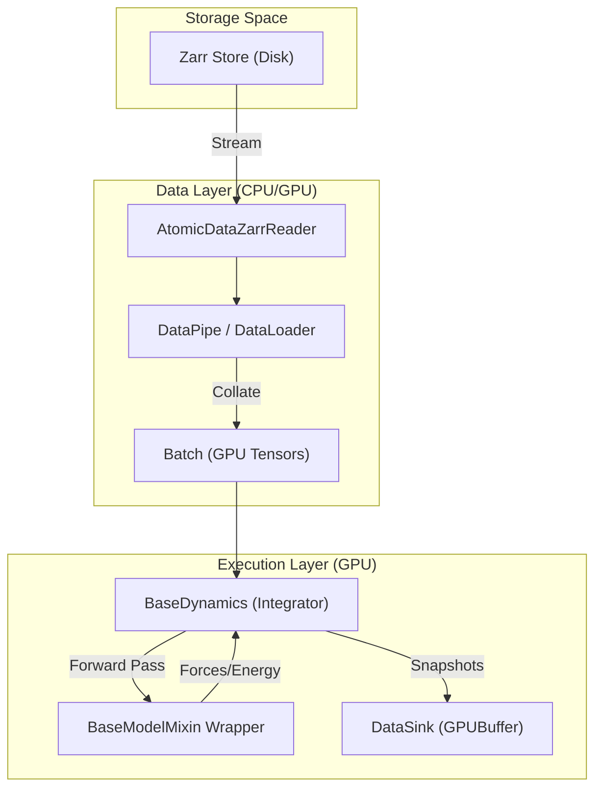
**Sources:** [nvalchemi/dynamics/sinks.py:201-235](), [docs/userguide/about/intro.md:98-143]()

## Developer Setup and Quality Control

For contributors, the toolkit provides a `Makefile` to automate common development tasks [Makefile:20-21]().

### Common Makefile Targets
*   `make install`: Syncs environment with all extras using `uv` [Makefile:26-28]().
*   `make lint`: Runs `ruff` and `pre-commit` checks [Makefile:40-48]().
*   `make pytest`: Executes the test suite with coverage reporting [Makefile:71-74]().
*   `make docs`: Builds the Sphinx documentation and executes gallery examples [Makefile:145-147]().

### Code Entity Association
This diagram maps the high-level installation concepts to specific code entities within the repository.

**System Entity Mapping**
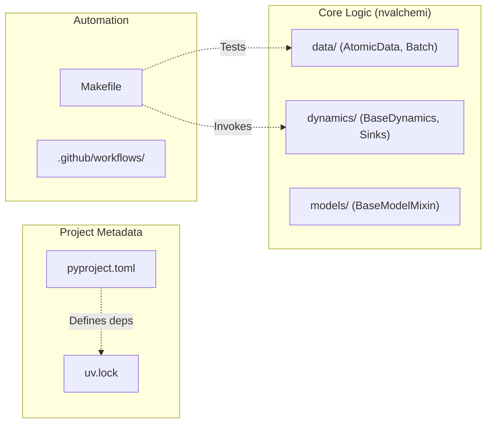
**Sources:** [pyproject.toml:5-27](), [Makefile:1-18](), [docs/userguide/about/intro.md:144-150]()

## Verification

After installation, verify that the toolkit and its GPU dependencies are correctly configured:

```bash
$ python -c "import nvalchemi; print(nvalchemi.__version__)"
$ python -c "import torch; print(f'CUDA available: {torch.cuda.is_available()}')"
```
[docs/userguide/about/install.md:113-115]()

**Sources:**
* `pyproject.toml:1-130`
* `docs/userguide/about/install.md:1-123`
* `docs/userguide/about/intro.md:1-150`
* `Makefile:1-188`
* `nvalchemi/dynamics/sinks.py:43-243`

---

# Page: Core Concepts and Architecture

# Core Concepts and Architecture

<details>
<summary>Relevant source files</summary>

The following files were used as context for generating this wiki page:

- [AGENTS.md](AGENTS.md)
- [README.md](README.md)
- [docs/modules/dynamics/api.rst](docs/modules/dynamics/api.rst)
- [docs/modules/dynamics/convergence.rst](docs/modules/dynamics/convergence.rst)
- [docs/modules/dynamics/implementing_dynamics.rst](docs/modules/dynamics/implementing_dynamics.rst)
- [docs/modules/typing.rst](docs/modules/typing.rst)
- [docs/userguide/about/install.md](docs/userguide/about/install.md)
- [docs/userguide/about/intro.md](docs/userguide/about/intro.md)
- [docs/userguide/index.md](docs/userguide/index.md)
- [nvalchemi/_typing.py](nvalchemi/_typing.py)
- [nvalchemi/data/datapipes/dataset.py](nvalchemi/data/datapipes/dataset.py)

</details>


This page describes the architectural foundations of the NVIDIA ALCHEMI Toolkit (`nvalchemi`). It covers the four-layer design, the batch-first execution philosophy, and the domain-specific language (DSL) used to compose complex simulation pipelines.

## Architectural Layers

The toolkit is organized into four tightly integrated layers that facilitate the transition from raw atomic data to high-throughput distributed simulations [docs/userguide/about/intro.md:97-143]().

| Layer | Responsibility | Key Entities |
| :--- | :--- | :--- |
| **Data** | Graph-based representation and batching | `AtomicData`, `Batch` |
| **Model** | Standardization of Interatomic Potentials | `BaseModelMixin`, `ModelCard` |
| **Dynamics** | Execution loops and integration | `BaseDynamics`, `Hook`, `Integrators` |
| **I/O** | Persistence and high-performance loading | `ZarrWriter`, `DataLoader`, `DataSink` |

### System Architecture Diagram
The following diagram illustrates the data flow between these layers, specifically how `Batch` objects move through the `Dynamics` engine and interact with `Models`.

"Architecture Data Flow"
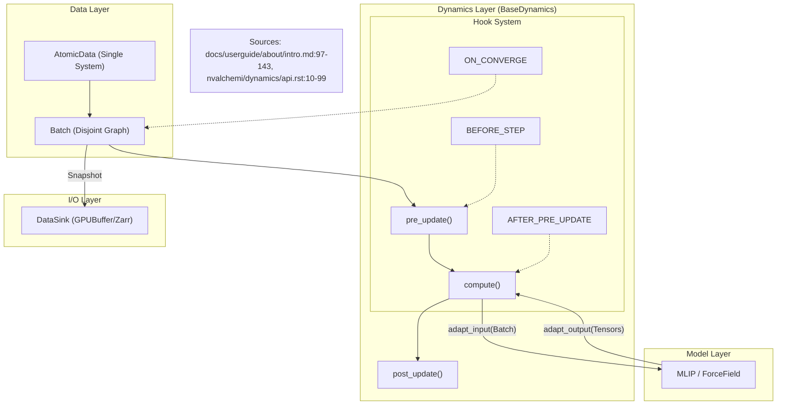
Sources: [docs/userguide/about/intro.md:97-143](), [docs/modules/dynamics/api.rst:10-99]()

---

## Design Philosophies

### Batch-First Philosophy
Unlike traditional MD codes that operate on a single system at a time, `nvalchemi` is designed to process many structures in parallel to maximize GPU occupancy [docs/userguide/about/intro.md:15-18]().
*   **Amortization**: Running thousands of structures simultaneously amortizes the overhead of GPU kernel launches [docs/userguide/about/intro.md:51-55]().
*   **Inflight Batching**: The `SizeAwareSampler` allows for "graduated" samples (those that have converged) to be replaced on-the-fly, keeping the GPU fully saturated during long-running screening campaigns [README.md:30-31]().

### GPU-Resident Design
Data structures live on the GPU by default. `AtomicData` and `Batch` use device-resident tensors to minimize host-device transfers during the simulation loop [docs/userguide/about/intro.md:74-77](). High-performance primitives for neighbor lists and electrostatics are implemented via `warp-lang` in the `nvalchemi-toolkit-ops` dependency [README.md:32-35]().

### Strong Semantic Typing
The codebase utilizes `jaxtyping` and `pydantic` to provide compile-time and runtime validation of tensor shapes and physical properties [docs/userguide/about/intro.md:79-89]().

| Alias | Description | Shape |
| :--- | :--- | :--- |
| `NodePositions` | Cartesian coordinates of atoms | `[V, 3]` |
| `Forces` | Atomic forces | `[V, 3]` |
| `Energy` | Potential energy per system | `[B, 1]` |
| `LatticeVectors` | Periodic cell vectors | `[B, 3, 3]` |

Sources: [nvalchemi/_typing.py:52-100](), [docs/userguide/about/intro.md:79-89]()

---

## Pipeline Composition DSL

`nvalchemi` introduces a Pythonic DSL for composing simulation stages using the `+` and `|` operators.

### FusedStage (`+`)
The `+` operator creates a `FusedStage`. This fuses multiple dynamics objects (e.g., an Optimizer and an NVT Integrator) to run on a **single GPU** [README.md:95-109]().
*   **Shared Forward Pass**: All sub-stages share a single model evaluation per step.
*   **Masked Updates**: The `FusedStage` uses `batch.status` to determine which samples belong to which stage, applying only the relevant integrator updates to specific samples in the batch [docs/modules/dynamics/convergence.rst:165-180]().

### DistributedPipeline (`|`)
The `|` operator creates a `DistributedPipeline` for scaling across **multiple GPUs or nodes** [README.md:112-127]().
*   **Rank-Based Execution**: Each stage in the pipeline is assigned to a specific GPU rank.
*   **NCCL Communication**: Samples move between stages via asynchronous `isend`/`irecv` calls as they converge or complete their step count [docs/userguide/about/intro.md:47-49]().

"Code Entity Mapping: Composition"
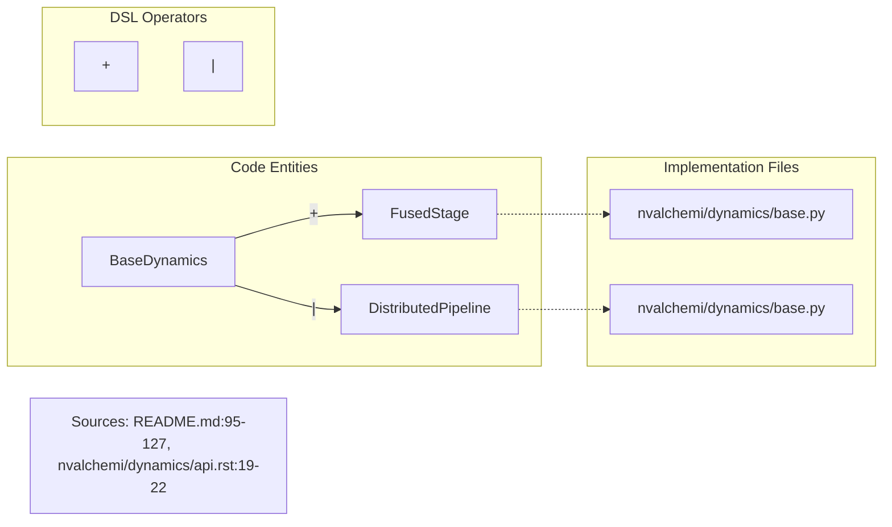
Sources: [README.md:95-127](), [docs/modules/dynamics/api.rst:19-22](), [nvalchemi/dynamics/base.py]()

---

## Key Terminology

*   **Batch**: A collection of disjoint atomic graphs concatenated into a single set of tensors. Node indices are offset using `batch_ptr` [docs/userguide/about/intro.md:100-108]().
*   **Hook**: A callback mechanism with 9 lifecycle points (e.g., `BEFORE_STEP`, `ON_CONVERGE`) for extending dynamics behavior [README.md:28-29]().
*   **ModelCard**: A declarative interface where a model specifies its capabilities, such as whether it supports periodic boundary conditions (PBC) or requires autograd for forces [docs/userguide/about/intro.md:112-119]().
*   **DataSink**: An abstraction for recording trajectory data, supporting backends like `GPUBuffer` (memory) or `ZarrData` (disk) [docs/modules/dynamics/api.rst:64-77]().
*   **Convergence Criterion**: A Pydantic-backed rule (e.g., `fmax < 0.05`) used by a `ConvergenceHook` to trigger sample migration or simulation termination [docs/modules/dynamics/convergence.rst:44-68]().

Sources: [docs/userguide/about/intro.md:100-119](), [docs/modules/dynamics/convergence.rst:44-68](), [README.md:28-29]()

---

# Page: Data Layer

# Data Layer

<details>
<summary>Relevant source files</summary>

The following files were used as context for generating this wiki page:

- [docs/modules/data.rst](docs/modules/data.rst)
- [docs/userguide/data.md](docs/userguide/data.md)
- [docs/userguide/dynamics_hooks.md](docs/userguide/dynamics_hooks.md)
- [docs/userguide/dynamics_simulations.md](docs/userguide/dynamics_simulations.md)
- [nvalchemi/data/__init__.py](nvalchemi/data/__init__.py)
- [nvalchemi/data/atomic_data.py](nvalchemi/data/atomic_data.py)
- [nvalchemi/data/data.py](nvalchemi/data/data.py)
- [nvalchemi/data/datapipes/__init__.py](nvalchemi/data/datapipes/__init__.py)
- [nvalchemi/data/datapipes/backends/zarr.py](nvalchemi/data/datapipes/backends/zarr.py)
- [test/data/test_zarr_datapipe.py](test/data/test_zarr_datapipe.py)

</details>


The Data Layer provides a high-performance, GPU-resident subsystem for representing and moving molecular graph data. It is built around a "batch-first" philosophy where multiple molecular systems (graphs) are concatenated into single contiguous tensors to maximize GPU utilization and minimize kernel launch overhead.

## Data Representations

The toolkit uses two primary structures to represent atomic systems:

*   **`AtomicData`**: A Pydantic-backed model representing a single molecular graph. It stores node-level (e.g., positions, atomic numbers), edge-level (e.g., neighbor indices, periodic shifts), and system-level (e.g., energy, cell vectors) properties as PyTorch tensors [nvalchemi/data/atomic_data.py:76-118]().
*   **`Batch`**: A container that aggregates multiple `AtomicData` instances into a single structure [nvalchemi/data/batch.py:104-120](). It manages the internal layout of data using different "levels" of storage to handle variable-sized graphs efficiently [docs/userguide/data.md:147-154]().

### Data Structure Mapping

The following diagram shows how high-level molecular concepts map to the internal code entities and their storage levels.

**Data Entity Mapping**
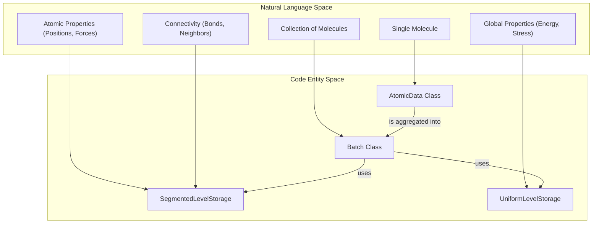
Sources: [nvalchemi/data/atomic_data.py:76-80](), [nvalchemi/data/batch.py:104-110](), [docs/userguide/data.md:149-154]()

For details on indexing, slicing, and memory layouts, see **[AtomicData and Batch Data Structures](#2.1)**.

---

## I/O and Persistence

The I/O subsystem is designed for high-throughput serialization of graph data using the Zarr format. It supports CSR-style (Compressed Sparse Row) pointer layouts to handle variable numbers of atoms and edges across different samples [nvalchemi/data/datapipes/__init__.py:35-37]().

*   **`AtomicDataZarrWriter`**: Handles bulk writes and appends of `AtomicData` or `Batch` objects to disk [nvalchemi/data/datapipes/backends/zarr.py:20-23]().
*   **`AtomicDataZarrReader`**: Provides random access to stored samples, returning them as dictionaries of tensors ready for consumption by the training pipeline [nvalchemi/data/datapipes/backends/zarr.py:24-27]().

For details on Zarr configuration, sharding, and chunking, see **[Zarr I/O: AtomicDataZarrWriter and AtomicDataZarrReader](#2.2)**.

---

## Data Loading Pipeline

The loading pipeline connects on-disk storage to the GPU-resident dynamics engine or training loop. It features a tiered architecture to ensure the GPU is never starved of data [nvalchemi/data/datapipes/__init__.py:21-34]().

1.  **`Reader`**: Low-level interface for fetching raw tensor data [nvalchemi/data/datapipes/backends/base.py:18-20]().
2.  **`Dataset`**: Orchestrates device transfers and implements **CUDA-stream prefetching** to overlap I/O with computation [nvalchemi/data/datapipes/dataset.py:34-45]().
3.  **`DataLoader`**: Combines individual samples into `Batch` objects using a `SizeAwareSampler` that performs bin-packing based on `max_atoms` or `max_edges` constraints to prevent GPU Out-of-Memory (OOM) errors [nvalchemi/data/datapipes/dataloader.py:32-40]().

### Pipeline Architecture

The diagram below illustrates the flow of data from disk to the GPU-resident batch used by models and integrators.

**Data Pipeline Flow**
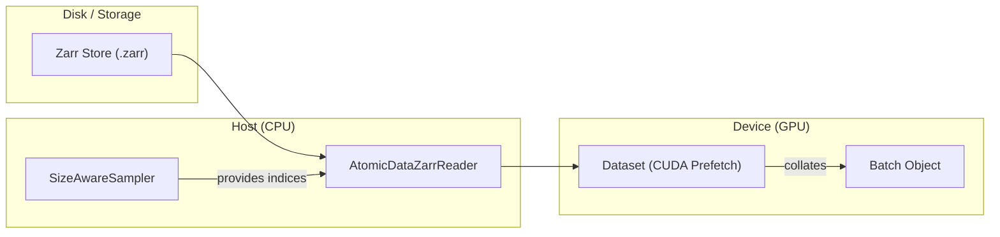
Sources: [nvalchemi/data/datapipes/__init__.py:25-34](), [nvalchemi/data/datapipes/dataset.py:34-45](), [nvalchemi/data/datapipes/dataloader.py:32-40]()

For details on prefetching and the bin-packing sampler, see **[DataLoader and SizeAwareSampler](#2.3)**.

---

# Page: AtomicData and Batch Data Structures

# AtomicData and Batch Data Structures

<details>
<summary>Relevant source files</summary>

The following files were used as context for generating this wiki page:

- [docs/userguide/data.md](docs/userguide/data.md)
- [docs/userguide/dynamics_hooks.md](docs/userguide/dynamics_hooks.md)
- [docs/userguide/dynamics_simulations.md](docs/userguide/dynamics_simulations.md)
- [nvalchemi/data/__init__.py](nvalchemi/data/__init__.py)
- [nvalchemi/data/atomic_data.py](nvalchemi/data/atomic_data.py)
- [nvalchemi/data/batch.py](nvalchemi/data/batch.py)
- [nvalchemi/data/buffer_kernels.py](nvalchemi/data/buffer_kernels.py)
- [nvalchemi/data/data.py](nvalchemi/data/data.py)
- [nvalchemi/data/level_storage.py](nvalchemi/data/level_storage.py)
- [nvalchemi/dynamics/_ops/__init__.py](nvalchemi/dynamics/_ops/__init__.py)
- [nvalchemi/dynamics/_ops/_bridge.py](nvalchemi/dynamics/_ops/_bridge.py)
- [nvalchemi/dynamics/_ops/fire.py](nvalchemi/dynamics/_ops/fire.py)
- [test/data/test_atomic_data.py](test/data/test_atomic_data.py)
- [test/data/test_batch.py](test/data/test_batch.py)
- [test/data/test_buffer_kernels.py](test/data/test_buffer_kernels.py)
- [test/data/test_data_mixin.py](test/data/test_data_mixin.py)
- [test/data/test_level_storage.py](test/data/test_level_storage.py)
- [test/dynamics/test_base.py](test/dynamics/test_base.py)

</details>


The NVIDIA ALCHEMI Toolkit represents molecular systems as graphs where atoms are nodes and interactions (bonds or radius-cutoff neighbors) are edges [docs/userguide/data.md:7-11](). The data layer is designed for high-performance GPU execution, using a "batch-first" philosophy where multiple systems are packed into a single contiguous memory structure to saturate GPU compute [nvalchemi/data/level_storage.py:17-20]().

## AtomicData: Single System Representation

`AtomicData` is a Pydantic-backed model representing a single molecular graph [nvalchemi/data/atomic_data.py:27-30](). It enforces schema validation while allowing flexible storage of node, edge, and system-level attributes.

### Key Components
*   **Node-level**: `positions` [N, 3] and `atomic_numbers` [N] are required [docs/userguide/data.md:17-18]().
*   **Edge-level**: `edge_index` [2, E] and `shifts` [E, 3] for periodic boundary conditions [docs/userguide/data.md:19-20]().
*   **System-level**: `energies` [1, 1], `cell` [1, 3, 3], and `pbc` [1, 3] [docs/userguide/data.md:21-22]().

`AtomicData` inherits from `DataMixin`, providing utility methods like `.to(device)` and `.clone()` [nvalchemi/data/data.py:108-112]().

Sources: [nvalchemi/data/atomic_data.py:27-50](), [docs/userguide/data.md:13-46](), [nvalchemi/data/data.py:108-125]()

---

## Batch: Multi-System GPU Container

The `Batch` class is a multi-system container that flattens a list of `AtomicData` objects into contiguous tensors [nvalchemi/data/batch.py:62-70](). Unlike standard PyTorch batching which adds a new dimension, `Batch` concatenates variable-length node and edge data to avoid padding [nvalchemi/data/batch.py:23-31]().

### Internal Storage Architecture
`Batch` delegates storage to `MultiLevelStorage`, which manages three distinct attribute groups [nvalchemi/data/batch.py:65-70]():

| Level | Storage Class | Description |
| :--- | :--- | :--- |
| **Atoms** | `SegmentedLevelStorage` | Concatenated node tensors (positions, forces) [nvalchemi/data/level_storage.py:74-77](). |
| **Edges** | `SegmentedLevelStorage` | Concatenated edge tensors (edge_index, shifts) [nvalchemi/data/level_storage.py:74-77](). |
| **System** | `UniformLevelStorage` | Stacked system tensors (energies, cell) [nvalchemi/data/level_storage.py:71-73](). |

### Logical to Physical Mapping
The following diagram illustrates how individual systems in "Natural Language Space" map to the "Code Entity Space" of the `Batch` internal storage.

**System Batching Data Flow**
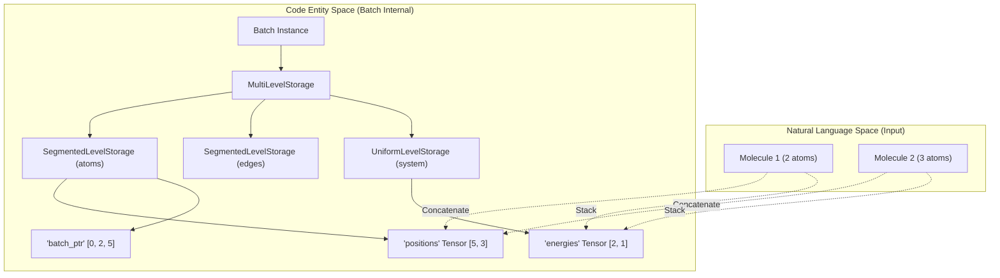
Sources: [nvalchemi/data/batch.py:15-31](), [nvalchemi/data/level_storage.py:28-60](), [docs/userguide/data.md:142-166]()

---

## Level Storage Implementation

### SegmentedLevelStorage
Used for data where the number of elements varies per system (atoms, edges). It tracks boundaries using `batch_ptr` [nvalchemi/data/level_storage.py:74-77]().
*   **`batch_ptr`**: A tensor of shape `[num_graphs + 1]` where `batch_ptr[i]` is the start index of system `i` [nvalchemi/data/batch.py:172-178]().
*   **Edge Offsetting**: When batching `edge_index`, the node indices are automatically shifted by the cumulative node count of previous systems so they point to the correct rows in the flattened node array [nvalchemi/data/batch.py:29-31]().

### UniformLevelStorage
Used for system-level properties where every system has exactly one entry (e.g., total energy). Data is stored as a tensor of shape `[num_graphs, ...]` [nvalchemi/data/level_storage.py:71-73]().

Sources: [nvalchemi/data/level_storage.py:47-50](), [nvalchemi/data/batch.py:164-180]()

---

## Buffer Management: Put, Defrag, and Trim

For dynamics simulations, `Batch` acts as a pre-allocated buffer. High-performance kernels written in **NVIDIA Warp** handle the movement of systems within these buffers without CPU synchronization [nvalchemi/data/buffer_kernels.py:18-22]().

### Core Operations
*   **`index_select`**: Creates a new `Batch` by selecting specific systems. It operates directly on concatenated storage via segment selection [nvalchemi/data/batch.py:23-24]().
*   **`put`**: Inserts new systems into empty slots in a pre-allocated `Batch`. It uses `compute_put_fit_mask_segmented` to identify available space [nvalchemi/data/level_storage.py:100-108]().
*   **`defrag`**: Compacts the buffer by removing "holes" left by converged or deleted systems. It uses `defrag_segmented` (for atoms/edges) and `defrag_per_system` (for system-level) Warp kernels [nvalchemi/data/buffer_kernels.py:23-31]().
*   **`trim`**: Reduces the physical size of the underlying tensors to match the logical number of systems/nodes [nvalchemi/data/batch.py:534-540]().

**Buffer Lifecycle**
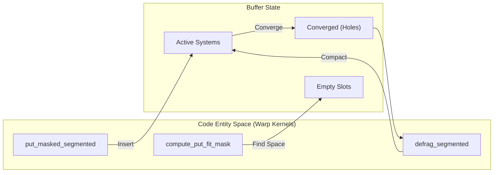
Sources: [nvalchemi/data/buffer_kernels.py:15-33](), [nvalchemi/data/level_storage.py:100-108](), [nvalchemi/data/batch.py:23-31]()

---

## Distributed Protocol: isend / irecv

The `Batch` class implements a non-blocking distributed communication protocol using `torch.distributed` for multi-GPU pipelines [nvalchemi/data/batch.py:43-44]().

### Protocol Flow
1.  **`isend(dst, group, tag)`**: Initiates an asynchronous send of the batch. It first sends a metadata header (number of graphs, nodes, edges) followed by the actual tensor data [nvalchemi/data/batch.py:686-715]().
2.  **`irecv(src, group, tag)`**: Initiates an asynchronous receive. It requires a pre-allocated or "template" batch to receive data into [nvalchemi/data/batch.py:717-748]().

This protocol enables the `DistributedPipeline` (| operator) to stream systems between GPUs while overlapping communication with computation [nvalchemi/data/batch.py:680-684]().

Sources: [nvalchemi/data/batch.py:680-748]()

---

# Page: Zarr I/O: AtomicDataZarrWriter and AtomicDataZarrReader

# Zarr I/O: AtomicDataZarrWriter and AtomicDataZarrReader

<details>
<summary>Relevant source files</summary>

The following files were used as context for generating this wiki page:

- [docs/modules/data.rst](docs/modules/data.rst)
- [docs/userguide/zarr_compression.md](docs/userguide/zarr_compression.md)
- [nvalchemi/data/datapipes/__init__.py](nvalchemi/data/datapipes/__init__.py)
- [nvalchemi/data/datapipes/backends/__init__.py](nvalchemi/data/datapipes/backends/__init__.py)
- [nvalchemi/data/datapipes/backends/base.py](nvalchemi/data/datapipes/backends/base.py)
- [nvalchemi/data/datapipes/backends/zarr.py](nvalchemi/data/datapipes/backends/zarr.py)
- [nvalchemi/data/io_test.py](nvalchemi/data/io_test.py)
- [test/data/test_zarr_datapipe.py](test/data/test_zarr_datapipe.py)

</details>


The Zarr I/O subsystem provides a high-performance persistence layer for atomic simulation data. It is designed to handle the variable-sized graph structures (varying numbers of atoms and edges per system) typical of molecular dynamics and machine learning interatomic potentials (MLIPs). By utilizing the Zarr v3 format, the toolkit achieves efficient compressed storage and fast random access for training and analysis pipelines [nvalchemi/data/datapipes/backends/zarr.py:15-29]().

## CSR-Style Data Layout

To store variable-sized systems efficiently in flat Zarr arrays, `nvalchemi` employs a Compressed Sparse Row (CSR) style layout. Instead of padding systems to a maximum size, all atom-level and edge-level data are concatenated into contiguous global arrays [test/data/test_zarr_datapipe.py:91-132]().

### Data Levels and Pointer Arrays
Data is categorized into three levels, which determines how it is indexed and stored [nvalchemi/data/datapipes/backends/zarr.py:188-201]():

| Level | Description | Examples | Indexing Mechanism |
| :--- | :--- | :--- | :--- |
| **Atom** | Per-atom properties | `positions`, `forces`, `atomic_numbers` | `atoms_ptr` defines start/end offsets |
| **Edge** | Per-bond properties | `edge_index`, `shifts` | `edges_ptr` defines start/end offsets |
| **System** | Per-structure properties | `energies`, `cell`, `pbc` | Standard 0-based integer indexing |

### Metadata and Masking
The `meta` group in the Zarr store contains the structural information required to reconstruct individual `AtomicData` objects from the concatenated core arrays:
*   `atoms_ptr`: An array of length $N_{systems} + 1$ where `atoms_ptr[i]` is the starting index of system $i$ in atom-level arrays [test/data/test_zarr_datapipe.py:107-118]().
*   `edges_ptr`: An array of length $N_{systems} + 1$ where `edges_ptr[i]` is the starting index of system $i$ in edge-level arrays [test/data/test_zarr_datapipe.py:108-118]().
*   `samples_mask`: A boolean array used for **soft-deletion**. When a sample is deleted or marked as invalid, this mask is updated without rewriting the entire data block [test/data/test_zarr_datapipe.py:197-198]().

**Sources:** [nvalchemi/data/datapipes/backends/zarr.py:188-201](), [test/data/test_zarr_datapipe.py:91-132](), [docs/userguide/zarr_compression.md:50-57]()

## Writing Data: AtomicDataZarrWriter

The `AtomicDataZarrWriter` is the primary interface for persisting data. It supports writing single `AtomicData` objects, lists of objects, or entire `Batch` objects [nvalchemi/data/datapipes/backends/zarr.py:20-22]().

### Bulk Write Pipeline
The writer is optimized for throughput by minimizing I/O transactions. When a `Batch` is passed to the `write` or `append` method, the writer performs a bulk append to the Zarr arrays [test/data/test_zarr_datapipe.py:135-165]().

### Logical Data Flow: Write Operation
The following diagram illustrates how the `AtomicDataZarrWriter` transforms high-level code entities into the persistent Zarr structure.

**Diagram: AtomicDataZarrWriter Data Transformation**
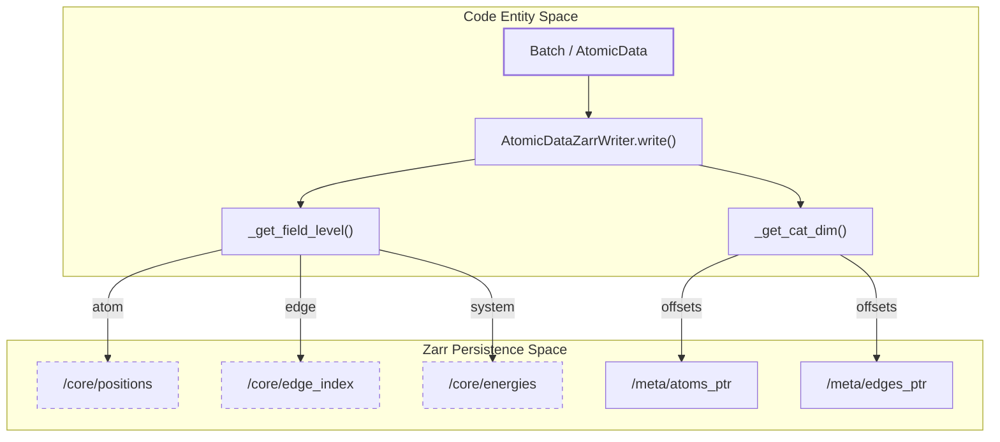
**Sources:** [nvalchemi/data/datapipes/backends/zarr.py:188-201](), [nvalchemi/data/datapipes/backends/zarr.py:35-50](), [test/data/test_zarr_datapipe.py:91-132]()

## Configuration: Sharding and Chunking

Efficient I/O depends on tuning the `ZarrWriteConfig` and `ZarrArrayConfig`. These classes allow fine-grained control over compression and storage layout [nvalchemi/data/datapipes/backends/zarr.py:58-186]().

### ZarrArrayConfig
This class defines the storage parameters for a specific array or group of arrays [nvalchemi/data/datapipes/backends/zarr.py:58-126]():
*   `compressors`: Codecs like `ZstdCodec` or `BloscCodec` [docs/userguide/zarr_compression.md:88-106]().
*   `chunk_size`: The chunk length along the first dimension (concatenated axis). For atom-level fields, this is the total number of atoms [docs/userguide/zarr_compression.md:119-125]().
*   `shard_size`: Enables Zarr v3 sharding. Multiple chunks are stored in a single storage object (shard) to improve filesystem efficiency while maintaining small read units [nvalchemi/data/datapipes/backends/zarr.py:98-107]().

### Configuration Hierarchy
The `ZarrWriteConfig` applies settings in a hierarchical manner [docs/userguide/zarr_compression.md:48-81]():
1.  **Field Overrides**: Explicit config for a specific field (e.g., `"positions"`).
2.  **Group Defaults**: Defaults for `meta`, `core`, or `custom` groups.
3.  **Zarr Defaults**: Fallback if no configuration is provided.

**Sources:** [nvalchemi/data/datapipes/backends/zarr.py:58-186](), [docs/userguide/zarr_compression.md:119-148](), [nvalchemi/data/io_test.py:194-230]()

## Reading Data: AtomicDataZarrReader

The `AtomicDataZarrReader` implements the `Reader` abstract base class to provide random access to the stored systems [nvalchemi/data/datapipes/backends/base.py:29-57]().

### Random Access Mechanism
When `reader[index]` is called, the reader performs the following steps:
1.  Consults `atoms_ptr[index:index+2]` and `edges_ptr[index:index+2]` to find the slice of the concatenated arrays [test/data/test_zarr_datapipe.py:100-118]().
2.  Reads only the required chunks from the Zarr store.
3.  Returns a dictionary of `torch.Tensor` objects on the CPU [nvalchemi/data/datapipes/backends/base.py:79-92]().

### Logical Architecture: Reader to Dataset
The reader is typically wrapped by a `Dataset` which handles the conversion from raw tensors to `AtomicData` objects and manages device transfers [nvalchemi/data/datapipes/__init__.py:21-49]().

**Diagram: Reader Pipeline Architecture**
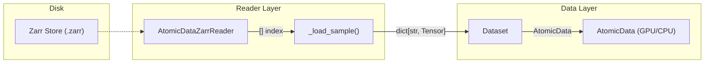
**Sources:** [nvalchemi/data/datapipes/backends/base.py:29-57](), [nvalchemi/data/datapipes/backends/zarr.py:24-27](), [nvalchemi/data/datapipes/__init__.py:21-49]()

## Maintenance: Soft-Delete and Defragmentation

The toolkit supports a non-destructive deletion workflow to maintain high write performance [test/data/test_zarr_datapipe.py:197-198]().

*   **Soft-Delete**: Marking a sample as invalid in the `samples_mask`. This is a metadata-only operation and does not remove data from the core arrays.
*   **Defragmentation**: An offline process (often triggered during large-scale data maintenance) that reads the Zarr store, filters out soft-deleted samples, and writes a new, contiguous Zarr store. This recovers disk space and optimizes sequential read performance.

**Sources:** [test/data/test_zarr_datapipe.py:197-198](), [nvalchemi/data/datapipes/backends/zarr.py:156-162]()

---

# Page: DataLoader and SizeAwareSampler

# DataLoader and SizeAwareSampler

<details>
<summary>Relevant source files</summary>

The following files were used as context for generating this wiki page:

- [.claude/skills/nvalchemi-dynamics-api/SKILL.md](.claude/skills/nvalchemi-dynamics-api/SKILL.md)
- [docs/userguide/datapipes.md](docs/userguide/datapipes.md)
- [nvalchemi/data/datapipes/dataloader.py](nvalchemi/data/datapipes/dataloader.py)
- [nvalchemi/dynamics/sampler.py](nvalchemi/dynamics/sampler.py)
- [test/dynamics/test_demo_dynamics.py](test/dynamics/test_demo_dynamics.py)
- [test/dynamics/test_inflight.py](test/dynamics/test_inflight.py)
- [test/dynamics/test_sampler.py](test/dynamics/test_sampler.py)
- [test/dynamics/test_sinks.py](test/dynamics/test_sinks.py)

</details>


The data loading pipeline in `nvalchemi` is designed for GPU-accelerated atomistic workloads, specifically addressing the challenges of variable-sized molecular graphs and the need for high-throughput I/O. It consists of four composable layers: a **Reader** for raw tensor I/O, a **Dataset** for validation and prefetching, a **DataLoader** for batching, and a **SizeAwareSampler** for memory-safe capacity management [docs/userguide/datapipes.md:5-13]().

## DataLoader and Prefetching Pipeline

The `DataLoader` [nvalchemi/data/datapipes/dataloader.py:39-40]() serves as a drop-in replacement for `torch.utils.data.DataLoader`, specialized for emitting `Batch` objects rather than generic tensor dictionaries [nvalchemi/data/datapipes/dataloader.py:15-25]().

### CUDA Stream Prefetching
To maximize GPU utilization, the `DataLoader` implements asynchronous prefetching using multiple CUDA streams [nvalchemi/data/datapipes/dataloader.py:43-45](). This allows host-to-device (H2D) transfers to overlap with model computation [docs/userguide/datapipes.md:71-79]().

| Feature | Implementation Detail |
| :--- | :--- |
| **Async Transfers** | Uses a `ThreadPoolExecutor` in the `Dataset` to load and transfer samples ahead of time [docs/userguide/datapipes.md:57-58](). |
| **Stream Management** | Manages a pool of `torch.cuda.Stream` objects to isolate prefetch operations [nvalchemi/data/datapipes/dataloader.py:133-137](). |
| **Overlap Strategy** | Prefetches `prefetch_factor` batches ahead; synchronizes the specific stream only when the batch is yielded to the training loop [nvalchemi/data/datapipes/dataloader.py:200-206](). |

### Data Flow Architecture
The following diagram illustrates the transition from storage to GPU-resident `Batch` objects through the pipeline entities.

**Data Loading Pipeline Flow**
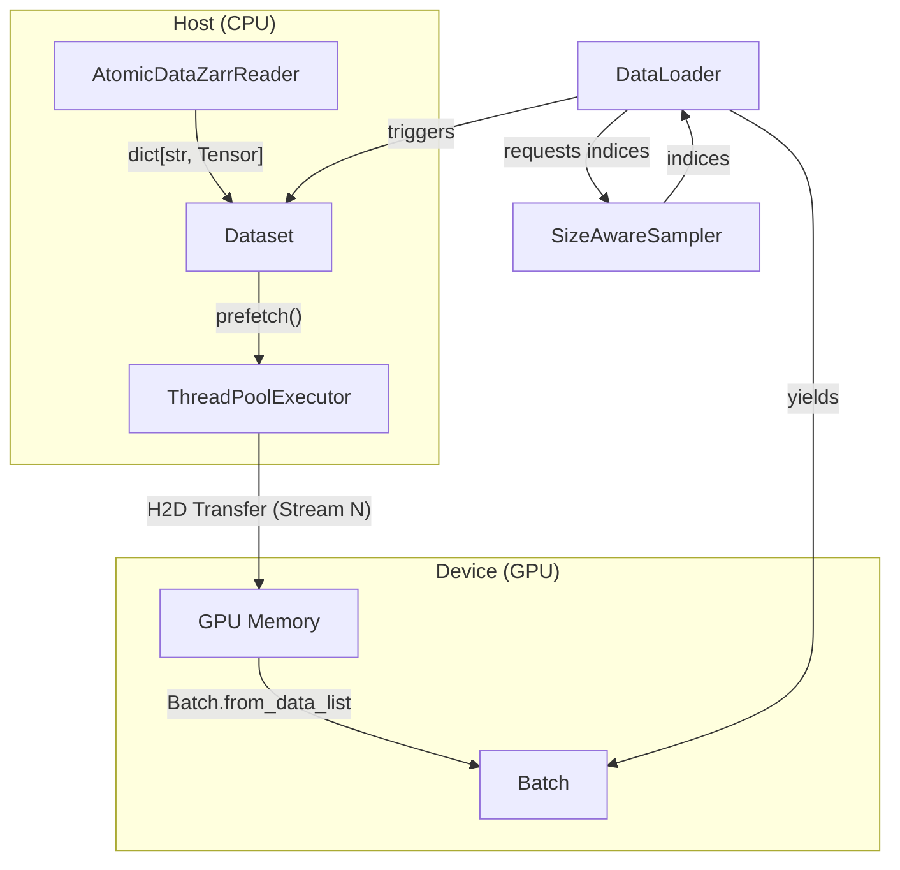
Sources: [nvalchemi/data/datapipes/dataloader.py:39-106](), [docs/userguide/datapipes.md:52-59](), [docs/userguide/datapipes.md:88-93]().

## SizeAwareSampler

In atomistic simulations, systems often vary significantly in size (number of atoms and edges). A fixed `batch_size` can lead to Out-of-Memory (OOM) errors if several large systems are grouped together, or poor GPU utilization if batches contain only small systems [docs/userguide/datapipes.md:123-128]().

`SizeAwareSampler` [nvalchemi/dynamics/sampler.py:36]() implements a capacity-aware bin-packing algorithm to solve this. It fills batches based on physical constraints (`max_atoms`, `max_edges`) rather than just a count of samples [nvalchemi/dynamics/sampler.py:39-42]().

### Constraints and Constraints Validation
The sampler validates every sample in the dataset during initialization to ensure it can fit within the defined limits [nvalchemi/dynamics/sampler.py:161-164]().

*   **max_atoms**: Maximum total atoms allowed in a single `Batch` [nvalchemi/dynamics/sampler.py:55-57]().
*   **max_edges**: Maximum total edges allowed in a single `Batch` [nvalchemi/dynamics/sampler.py:58-60]().
*   **max_batch_size**: Maximum number of graphs, regardless of atom/edge count [nvalchemi/dynamics/sampler.py:61-62]().
*   **GPU Memory Heuristic**: If `max_atoms` is omitted, the sampler estimates a conservative limit based on available GPU memory (default 80% fraction) [nvalchemi/dynamics/sampler.py:67-70]().

### Bin-Packing Logic
Samples are grouped into bins based on their atom count (controlled by `bin_width`) [nvalchemi/dynamics/sampler.py:63-64](). This allows the sampler to efficiently find "replacement" samples that fit into specific memory slots [nvalchemi/dynamics/sampler.py:157-160]().

**Sampler Entity Mapping**
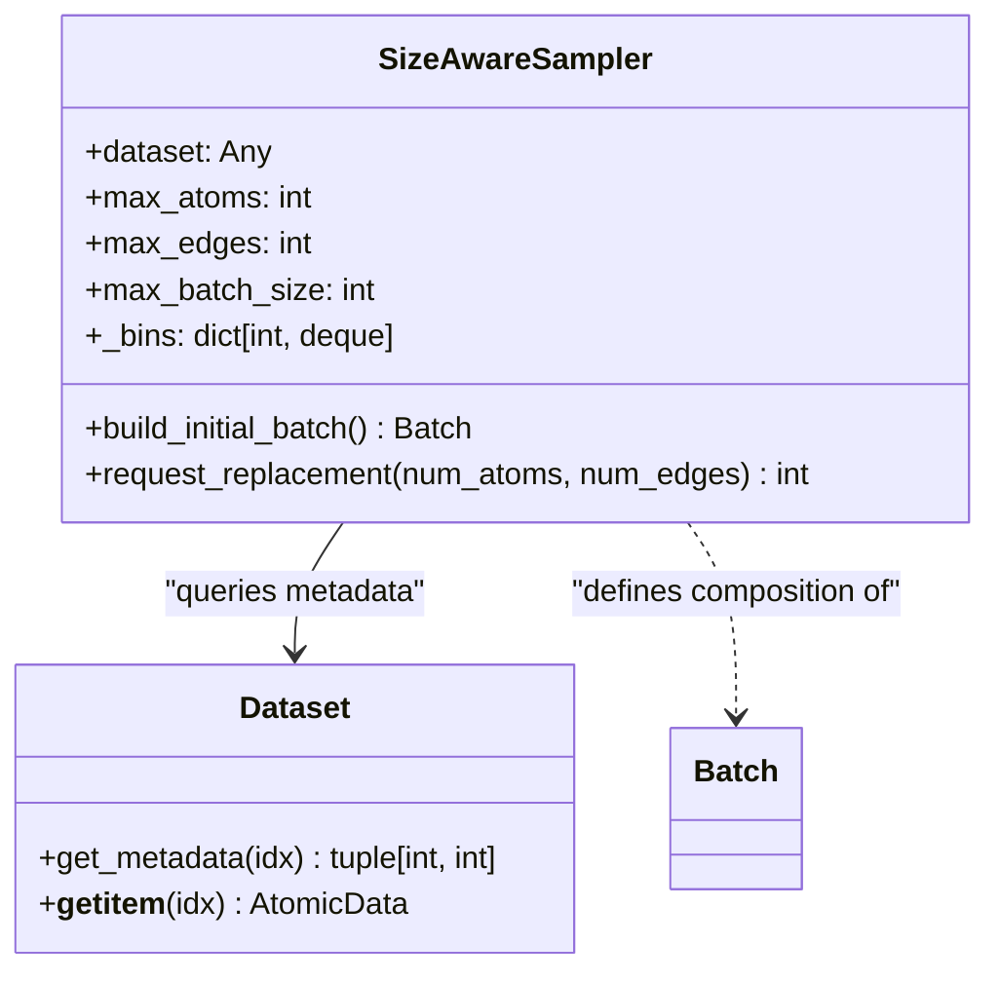
Sources: [nvalchemi/dynamics/sampler.py:36-97](), [docs/userguide/datapipes.md:81-86]().

## Inflight Batching and Replacement

A unique feature of the `nvalchemi` pipeline is the support for **Inflight Batching**. In dynamics simulations, samples within a batch may converge at different times. Instead of waiting for the entire batch to finish, converged samples can be "graduated" and replaced by new samples from the sampler [test/dynamics/test_inflight.py:18-22]().

### The Replacement Protocol
1.  **Convergence**: A `ConvergenceHook` identifies samples that have met criteria [test/dynamics/test_inflight.py:190-191]().
2.  **Request**: The dynamics engine calls `SizeAwareSampler.request_replacement()` [nvalchemi/dynamics/sampler.py:158]().
3.  **Search**: The sampler looks for a new index whose `num_atoms` and `num_edges` are less than or equal to the "slot" vacated by the graduated sample [nvalchemi/dynamics/sampler.py:39-42]().
4.  **Refill**: The `BaseDynamics.refill_check()` method integrates the new sample into the `active_batch` without reallocating the entire batch tensor [test/dynamics/test_inflight.py:19-20]().

### Example Configuration
```python
from nvalchemi.data.datapipes import Dataset, DataLoader
from nvalchemi.dynamics.sampler import SizeAwareSampler

# 1. Initialize Dataset
dataset = Dataset(reader=reader, device="cuda:0")

# 2. Configure Sampler with constraints
sampler = SizeAwareSampler(
    dataset=dataset, 
    max_atoms=4096, 
    max_batch_size=64
)

# 3. Create DataLoader using the sampler
loader = DataLoader(
    dataset=dataset,
    sampler=sampler,
    batch_size=64, # Upper bound
    prefetch_factor=2
)
```
Sources: [docs/userguide/datapipes.md:166-182](), [nvalchemi/dynamics/sampler.py:82-87]().

| Function | Role |
| :--- | :--- |
| `get_metadata(idx)` | Returns `(num_atoms, num_edges)` without loading full tensors [docs/userguide/datapipes.md:84-86](). |
| `build_initial_batch()` | Greedy packing to fill the first batch to capacity [nvalchemi/dynamics/sampler.py:85](). |
| `request_replacement(...)` | Finds an unconsumed sample that fits in a specific atom/edge budget [nvalchemi/dynamics/sampler.py:86](). |

Sources: [nvalchemi/dynamics/sampler.py:1-172](), [nvalchemi/data/datapipes/dataloader.py:1-206](), [docs/userguide/datapipes.md:1-183](), [test/dynamics/test_inflight.py:1-213]().

---

# Page: Model Layer

# Model Layer

<details>
<summary>Relevant source files</summary>

The following files were used as context for generating this wiki page:

- [docs/model_card_ext.py](docs/model_card_ext.py)
- [docs/models/index.md](docs/models/index.md)
- [docs/modules/models.rst](docs/modules/models.rst)
- [docs/userguide/dynamics.md](docs/userguide/dynamics.md)
- [docs/userguide/models.md](docs/userguide/models.md)
- [examples/advanced/04_mace_nvt.py](examples/advanced/04_mace_nvt.py)
- [examples/advanced/05_custom_integrator.py](examples/advanced/05_custom_integrator.py)
- [nvalchemi/dynamics/hooks/neighbor_list.py](nvalchemi/dynamics/hooks/neighbor_list.py)
- [nvalchemi/models/__init__.py](nvalchemi/models/__init__.py)
- [nvalchemi/models/_ops/lj.py](nvalchemi/models/_ops/lj.py)

</details>


The Model Layer provides a standardized interface for integrating Machine Learning Interatomic Potentials (MLIPs) and classical force fields into the NVIDIA ALCHEMI Toolkit. By wrapping models with a consistent API, the toolkit ensures that any supported potential can be used interchangeably within dynamics simulations, data pipelines, and active learning workflows [docs/userguide/models.md:7-11]().

### Architecture Overview

The system utilizes a **multiple inheritance** pattern to wrap existing PyTorch `nn.Module` implementations [docs/userguide/models.md:38-40](). A wrapper class inherits from both the underlying model and the `BaseModelMixin`, which provides the standardized framework interface [docs/userguide/models.md:42-71]().

The following diagram illustrates how the Model Layer connects high-level concepts to specific code entities:

**Model Wrapping Entity Relationship**
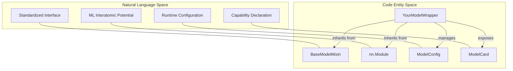
Sources: [docs/userguide/models.md:38-71](), [docs/userguide/models.md:84-87](), [docs/userguide/models.md:132-134]()

### Key Components

The model system is built upon three primary building blocks:

| Component | Role | Reference |
| :--- | :--- | :--- |
| `BaseModelMixin` | The core mixin that defines the `adapt_input` and `adapt_output` lifecycle. | [docs/userguide/models.md:57-61]() |
| `ModelCard` | An immutable declaration of what a model can compute (e.g., forces, stresses) and what it requires (e.g., PBC, neighbor lists). | [docs/userguide/models.md:84-87]() |
| `ModelConfig` | A mutable runtime object that controls which properties (energies, forces, etc.) are computed during a specific forward pass. | [docs/userguide/models.md:132-135]() |

For detailed information on implementing these components, see **[BaseModelMixin and ModelCard Interface](#3.1)**.

### Execution Lifecycle

When a wrapped model's `forward` method is called, it executes a three-step pipeline to bridge the toolkit's data structures with the underlying model's requirements:

1.  **`adapt_input`**: Converts `AtomicData` or `Batch` objects into the specific keyword arguments (tensors) expected by the underlying model [docs/userguide/models.md:75-77]().
2.  **`super().forward`**: Executes the original model's logic without modification [docs/userguide/models.md:78-78]().
3.  **`adapt_output`**: Maps the raw model results back into the framework's `ModelOutputs` dictionary [docs/userguide/models.md:79-80]().

**Forward Pass Data Flow**
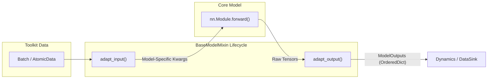
Sources: [docs/userguide/models.md:73-80]()

### Supported Model Wrappers

The toolkit includes several pre-built wrappers for both state-of-the-art MLIPs and classical physical models:

*   **Machine-Learned Potentials**: Includes `MACEWrapper` (supporting MACE-MP foundation models) and `AIMNet2Wrapper` [docs/userguide/models.md:27-31]().
*   **Physical/Classical Models**: Includes `LennardJonesModelWrapper`, `DFTD3ModelWrapper` for dispersion corrections, and electrostatics via `EwaldModelWrapper` and `PMEModelWrapper` [docs/modules/models.rst:46-84]().
*   **Composition**: The `ComposableModelWrapper` allows users to stack multiple potentials (e.g., MACE + DFT-D3) using the `+` operator [docs/modules/models.rst:88-95]().

For a full list of available implementations and how to use them, see **[Available Model Wrappers](#3.2)**.

### Sub-Pages
*   [BaseModelMixin and ModelCard Interface](#3.1) — Detailed reference for capability declarations, runtime toggles, and the input/output adaptation lifecycle.
*   [Available Model Wrappers](#3.2) — Reference for concrete implementations, foundation model loading, and potential composition.

Sources: [docs/userguide/models.md:1-21](), [docs/modules/models.rst:1-96](), [docs/models/index.md:1-53]()

---

# Page: BaseModelMixin and ModelCard Interface

# BaseModelMixin and ModelCard Interface

<details>
<summary>Relevant source files</summary>

The following files were used as context for generating this wiki page:

- [.claude/skills/nvalchemi-model-wrapping/SKILL.md](.claude/skills/nvalchemi-model-wrapping/SKILL.md)
- [docs/_static/NVIDIA-Logo-V-ForScreen-ForDarkBG.png](docs/_static/NVIDIA-Logo-V-ForScreen-ForDarkBG.png)
- [docs/_static/NVIDIA-Logo-V-ForScreen-ForLightBG.png](docs/_static/NVIDIA-Logo-V-ForScreen-ForLightBG.png)
- [docs/model_card_ext.py](docs/model_card_ext.py)
- [docs/models/index.md](docs/models/index.md)
- [docs/modules/dynamics/index.rst](docs/modules/dynamics/index.rst)
- [docs/modules/models.rst](docs/modules/models.rst)
- [docs/userguide/dynamics.md](docs/userguide/dynamics.md)
- [docs/userguide/models.md](docs/userguide/models.md)
- [nvalchemi/models/base.py](nvalchemi/models/base.py)
- [nvalchemi/models/demo.py](nvalchemi/models/demo.py)

</details>


The ALCHEMI Toolkit employs a standardized interface to bridge the gap between arbitrary Machine Learning Interatomic Potentials (MLIPs) and the framework's dynamics and data subsystems. This interface is defined by the `BaseModelMixin` class, which utilizes a "ModelCard" to declare capabilities and a "ModelConfig" to toggle runtime behaviors.

## Overview of the Mixin Pattern

The toolkit uses **multiple inheritance** to wrap models. A concrete wrapper class inherits from both the underlying `nn.Module` (the actual potential) and `BaseModelMixin` [docs/userguide/models.md:38-41]().

This architecture ensures that the original model code remains largely untouched, while the mixin provides the standardized methods required for the toolkit's lifecycle, specifically for adapting inputs from the `Batch` structure and formatting outputs into a consistent dictionary [docs/userguide/models.md:73-81]().

### Model Wrapping Data Flow

The following diagram illustrates how `BaseModelMixin` standardizes the communication between the Dynamics engine and various MLIP implementations.

**Diagram: Model Interface Architecture**
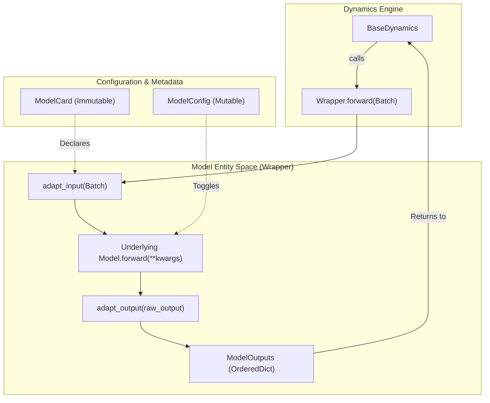
Sources: [docs/userguide/models.md:42-71](), [nvalchemi/models/base.py:152-160]()

---

## ModelCard: Capability Declarations

The `ModelCard` is an immutable Pydantic model that describes a model's physical capabilities and data requirements [nvalchemi/models/base.py:152-160](). It is accessed via the `@property` `model_card` on any wrapper [nvalchemi/models/demo.py:152-153]().

### Key Capability Fields
| Field | Type | Description |
|---|---|---|
| `forces_via_autograd` | `bool` | `True` if forces are computed by taking the gradient of energy w.r.t positions [nvalchemi/models/base.py:162-164](). |
| `supports_energies` | `bool` | Whether the model predicts total system energy [nvalchemi/models/base.py:175-177](). |
| `supports_forces` | `bool` | Whether the model can output forces (either directly or via autograd) [nvalchemi/models/base.py:178-180](). |
| `supports_stresses` | `bool` | Whether the model supports virial/stress tensor computation [nvalchemi/models/base.py:181-184](). |
| `supports_pbc` | `bool` | Whether the model logic handles Periodic Boundary Conditions [nvalchemi/models/base.py:191-194](). |

### Requirement Fields
| Field | Type | Description |
|---|---|---|
| `needs_pbc` | `bool` | `True` if the model requires `cell` and `pbc` tensors in its input [docs/userguide/models.md:109](). |
| `needs_neighborlist` | `bool` | `True` if the model requires an `edge_index` or neighbor matrix [docs/userguide/models.md:111](). |
| `neighbor_config` | `NeighborConfig` | Optional configuration for on-the-fly neighbor list construction [nvalchemi/models/base.py:54-57](). |

Sources: [nvalchemi/models/base.py:152-210](), [docs/userguide/models.md:89-112]()

---

## ModelConfig: Runtime Toggles

While the `ModelCard` is static, `ModelConfig` is a mutable attribute (`model.model_config`) that controls what the model actually computes during a specific forward pass [nvalchemi/models/base.py:93-99]().

*   **Computation Flags**: Includes `compute_forces`, `compute_stresses`, `compute_energies`, and `compute_embeddings` [nvalchemi/models/base.py:101-142]().
*   **Gradient Tracking**: The `gradient_keys` set tracks which input tensors (e.g., `"positions"`) require `requires_grad_(True)` to support autograd-based properties [nvalchemi/models/base.py:111-113]().

Sources: [nvalchemi/models/base.py:93-150](), [docs/userguide/models.md:131-148]()

---

## NeighborConfig and Formats

If a model requires a neighbor list, the `ModelCard` includes a `NeighborConfig`. This signals the `NeighborListHook` to build and cache neighbor data [nvalchemi/models/base.py:54-60]().

### NeighborListFormat
The toolkit supports two primary formats for neighbor data:
1.  **COO (Coordinate)**: Neighbors stored as an `edge_index` tensor of shape `[2, E]`. Standard for GNNs like MACE [nvalchemi/models/base.py:38-41]().
2.  **MATRIX (Dense)**: Neighbors stored as a `neighbor_matrix` of shape `[N, max_neighbors]`. Optimized for Warp-based kernels (e.g., Lennard-Jones) [nvalchemi/models/base.py:42-47]().

### Configuration Parameters
*   **cutoff**: Interaction radius [nvalchemi/models/base.py:86]().
*   **skin**: Verlet skin distance for lazy rebuilding [nvalchemi/models/base.py:89]().
*   **half_list**: If `True`, only unique pairs `(i, j)` where `i < j` are stored [nvalchemi/models/base.py:88-90]().

Sources: [nvalchemi/models/base.py:33-91](), [docs/model_card_ext.py:59-78]()

---

## Lifecycle: adapt_input and adapt_output

The `BaseModelMixin` defines a standard lifecycle for the `forward` pass.

### adapt_input
This method converts a `Batch` or `AtomicData` object into the keyword arguments (`kwargs`) expected by the underlying model's `forward` method [docs/userguide/models.md:75-77]().
*   **Validation**: It checks if the input `Batch` contains all required keys defined in the `ModelCard` [nvalchemi/models/base.py:284-290]().
*   **Gradient Setup**: It automatically calls `requires_grad_()` on tensors specified in `ModelConfig.gradient_keys` [nvalchemi/models/base.py:293-295]().

### adapt_output
This method maps the raw outputs from the underlying model back to the toolkit's `ModelOutputs` (an `OrderedDict`) [docs/userguide/models.md:79-80]().
*   **Standardization**: It ensures that energies are shape `[B, 1]` and forces are `[N, 3]` [nvalchemi/models/demo.py:231-240]().
*   **Verification**: It issues warnings if the model returns a property that wasn't requested or fails to return a requested one [nvalchemi/models/base.py:317-320]().

**Diagram: Input/Output Adaptation Lifecycle**
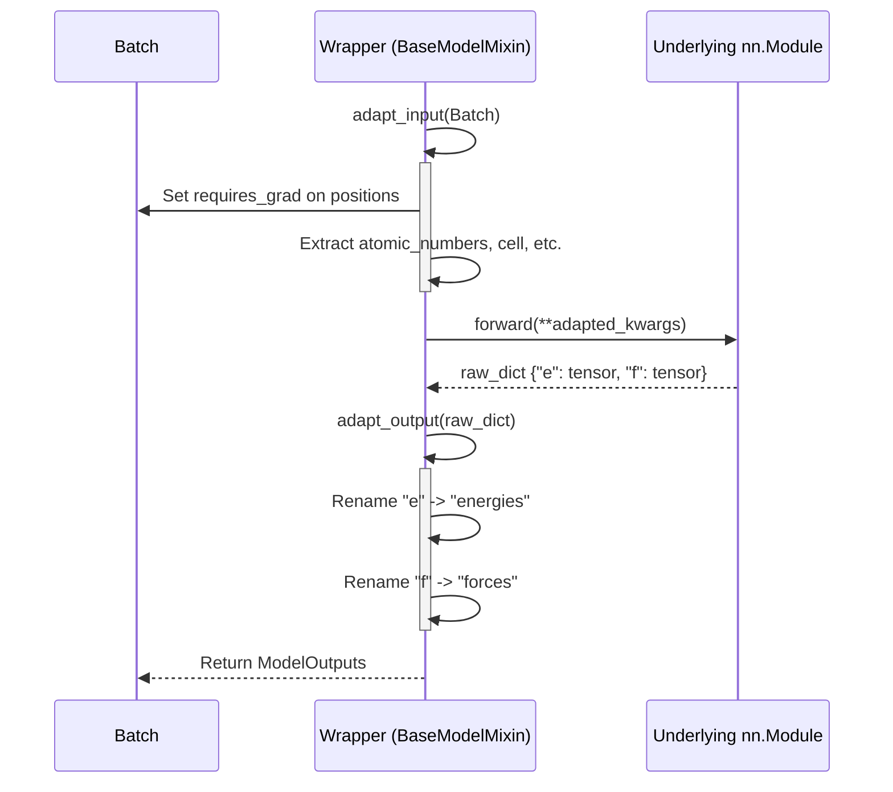
Sources: [nvalchemi/models/base.py:277-330](), [nvalchemi/models/demo.py:214-245]()

---

## Model Exportability

To support interoperability (e.g., using a toolkit-wrapped model in an ASE calculator), wrappers can implement `export_model` [docs/userguide/models.md:189]().

The `export_model` function typically strips the `BaseModelMixin` inheritance and returns the original `nn.Module` with the current weights [nvalchemi/models/demo.py:247-259](). This allows the model to be saved via `torch.save` without requiring the `nvalchemi` library for subsequent loading in restricted environments.

Sources: [nvalchemi/models/demo.py:247-264](), [.claude/skills/nvalchemi-model-wrapping/SKILL.md:189-203]()

---

# Page: Available Model Wrappers

# Available Model Wrappers

<details>
<summary>Relevant source files</summary>

The following files were used as context for generating this wiki page:

- [nvalchemi/models/_ops/neighbor_filter.py](nvalchemi/models/_ops/neighbor_filter.py)
- [nvalchemi/models/composable.py](nvalchemi/models/composable.py)
- [nvalchemi/models/dftd3.py](nvalchemi/models/dftd3.py)
- [nvalchemi/models/ewald.py](nvalchemi/models/ewald.py)
- [nvalchemi/models/lj.py](nvalchemi/models/lj.py)
- [nvalchemi/models/mace.py](nvalchemi/models/mace.py)
- [nvalchemi/models/pme.py](nvalchemi/models/pme.py)
- [nvalchemi/models/registry.py](nvalchemi/models/registry.py)
- [test/models/test_composable.py](test/models/test_composable.py)
- [test/models/test_mace.py](test/models/test_mace.py)
- [test/models/test_physical_models.py](test/models/test_physical_models.py)

</details>


The NVIDIA ALCHEMI Toolkit provides a suite of model wrappers that expose diverse potential energy surfaces (PES)—ranging from machine-learned interatomic potentials (MLIPs) like MACE to classical force fields and long-range electrostatics—through a unified `BaseModelMixin` interface. This standardization allows any supported model to be used interchangeably within the dynamics engine or composed into complex multi-model pipelines.

### Model Execution Flow

All model wrappers follow a structured data flow to ensure compatibility between the GPU-resident `Batch` and the specific requirements of the underlying kernel (e.g., Warp kernels, autograd-based ML models, or external libraries).

1.  **Neighbor Filtering**: Models filter the global neighbor list to their specific `cutoff` using `prepare_neighbors_for_model` [[nvalchemi/models/dftd3.py:70-70](), [nvalchemi/models/_ops/neighbor_filter.py:39-40]()].
2.  **Input Adaptation**: `adapt_input` prepares the data dictionary, handling unit conversions (e.g., Å to Bohr for D3) or tensor reshaping [[nvalchemi/models/dftd3.py:41-44](), [nvalchemi/models/mace.py:100-109]()].
3.  **Forward Pass**: The core potential is evaluated. Forces are either computed analytically within a kernel or via `torch.autograd` if `forces_via_autograd` is `True` [[nvalchemi/models/mace.py:165-165](), [nvalchemi/models/lj.py:42-43]()].
4.  **Output Adaptation**: `adapt_output` standardizes the results into a `ModelOutputs` dictionary containing `energies`, `forces`, and optionally `stresses` [[nvalchemi/models/lj.py:65-65](), [nvalchemi/models/mace.py:69-69]()].

---

## MACEWrapper

The `MACEWrapper` integrates the MACE (Higher Order Equivariant Transformers) architecture. It supports foundation models, fine-tuning, and high-performance inference via `cuEq` (CUDA Equivariant) kernels.

### Key Features
*   **Foundation Models**: Includes a factory method `from_checkpoint` to load named models (e.g., "medium-0b2") with automatic integrity verification via a SHA-256 registry [[nvalchemi/models/mace.py:24-30](), [nvalchemi/models/registry.py:15-20]()].
*   **Zero-CPU Encodings**: Atomic number one-hot encodings (`node_attrs`) are generated via a GPU lookup table (`_node_emb`) to avoid host-device synchronization during MD loops [[nvalchemi/models/mace.py:101-103](), [nvalchemi/models/mace.py:140-156]()].
*   **Autograd Forces**: Forces and stresses are computed conservatively via MACE's internal autograd path [[nvalchemi/models/mace.py:49-50](), [nvalchemi/models/mace.py:165-165]()].

### Foundation Model Registry
The toolkit maintains a registry of verified foundation model checkpoints.
| Function | Description |
| :--- | :--- |
| `list_foundation_models()` | Lists available canonical model names [[nvalchemi/models/registry.py:136-141]()]. |
| `download_and_verify()` | Atomically downloads and checks SHA-256 hashes [[nvalchemi/models/registry.py:183-213]()]. |
| `register_model()` | Allows users to add custom remote checkpoints to the registry [[nvalchemi/models/registry.py:106-124]()]. |

**Sources:** `nvalchemi/models/mace.py`, `nvalchemi/models/registry.py`, `test/models/test_mace.py`

---

## Classical Potential Wrappers

These wrappers utilize NVIDIA Warp-accelerated kernels for high-performance analytic force computations.

### Lennard-Jones (LJ)
The `LennardJonesModelWrapper` implements a standard 12-6 potential for single-species systems [[nvalchemi/models/lj.py:44-45]()].
*   **Switching Function**: Supports a C2-continuous switching region to zero out interactions smoothly at the cutoff [[nvalchemi/models/lj.py:93-95]()].
*   **Virial Stress**: Computes the physical virial `+Σ r_ij ⊗ F_ij` for NPT ensembles [[nvalchemi/models/lj.py:46-49]()].

### DFT-D3(BJ) Dispersion
The `DFTD3ModelWrapper` provides the Becke-Johnson damped dispersion correction [[nvalchemi/models/dftd3.py:15-17]()].
*   **Automatic Parameter Loading**: Downloads and parses the official Grimme group Fortran reference implementation to extract C6 coefficients and R4R2 values [[nvalchemi/models/dftd3.py:45-49](), [nvalchemi/models/dftd3.py:112-139]()].
*   **Unit Handling**: Manages internal conversion between Ångström and Bohr (atomic units) required by the D3 kernels [[nvalchemi/models/dftd3.py:89-91](), [nvalchemi/models/dftd3.py:41-44]()].

**Sources:** `nvalchemi/models/lj.py`, `nvalchemi/models/dftd3.py`, `test/models/test_physical_models.py`

---

## Electrostatics Wrappers

For systems with long-range interactions, the toolkit provides Ewald-based methods. Both require `node_charges` to be present in the `AtomicData` [[nvalchemi/models/ewald.py:40-40](), [nvalchemi/models/pme.py:39-39]()].

### EwaldModelWrapper
Implements standard Ewald summation, splitting the Coulomb interaction into real-space (damped) and reciprocal-space (structure factor) components [[nvalchemi/models/ewald.py:73-75]()].
*   **Complexity**: $O(N^{1.5})$ or $O(N^2)$ depending on k-space optimization.
*   **Caching**: Caches k-vectors and alpha parameters, invalidating them only when the unit cell changes (e.g., during NPT) [[nvalchemi/models/ewald.py:115-121]()].

### PMEModelWrapper (Particle Mesh Ewald)
Uses B-spline interpolation and FFTs to evaluate the reciprocal space contribution, achieving $O(N \log N)$ scaling [[nvalchemi/models/pme.py:42-43](), [nvalchemi/models/pme.py:74-76]()].
*   **Parameters**: Supports `mesh_spacing` for automatic grid determination or explicit `mesh_dimensions` [[nvalchemi/models/pme.py:82-88]()].
*   **Accuracy**: Uses the Kolafa-Perram formula for automatic estimation of the splitting parameter $\alpha$ [[nvalchemi/models/pme.py:92-95]()].

**Sources:** `nvalchemi/models/ewald.py`, `nvalchemi/models/pme.py`

---

## ComposableModelWrapper

The `ComposableModelWrapper` allows multiple models to be combined by summing their energies, forces, and stresses [[nvalchemi/models/composable.py:17-19]()].

### Composition Logic
*   **Operator Overloading**: Models can be composed using the `+` syntax: `combined = model_mlip + model_d3` [[nvalchemi/models/composable.py:23-25]()].
*   **Neighbor Configuration Synthesis**: The wrapper automatically calculates a "super-set" neighbor configuration, picking the maximum cutoff and the most restrictive format (e.g., if one model requires `MATRIX`, the entire composition uses `MATRIX`) [[nvalchemi/models/composable.py:34-37](), [nvalchemi/models/composable.py:162-168]()].
*   **Autograd Guard**: Currently restricts composition to a maximum of one model using `forces_via_autograd=True` to prevent memory-inefficient nested gradient graphs [[nvalchemi/models/composable.py:92-106]()].

### System Architecture: Model Composition
Title: Model Composition and Data Flow
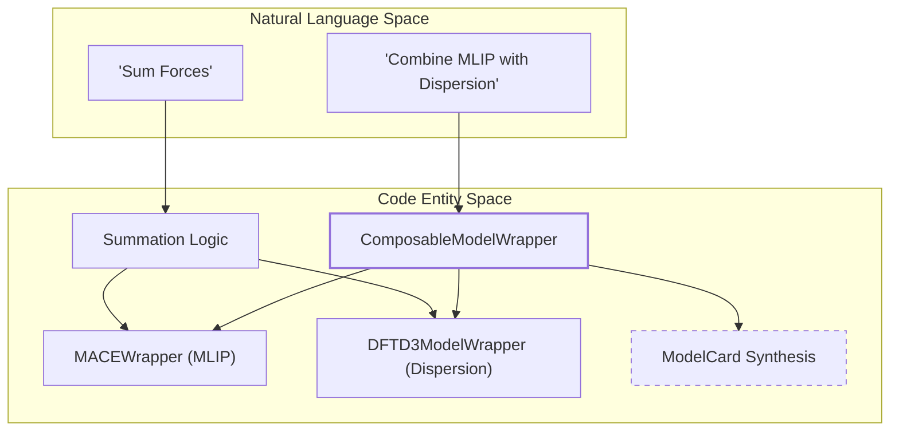
**Sources:** `nvalchemi/models/composable.py`, `test/models/test_composable.py`

---

## Neighbor List Preparation

The `prepare_neighbors_for_model` utility acts as the bridge between the dynamics engine's neighbor list and the specific requirements of a model wrapper [[nvalchemi/models/_ops/neighbor_filter.py:39-40]()].

### Neighbor Handling Logic
Title: Neighbor List Adaptation Logic
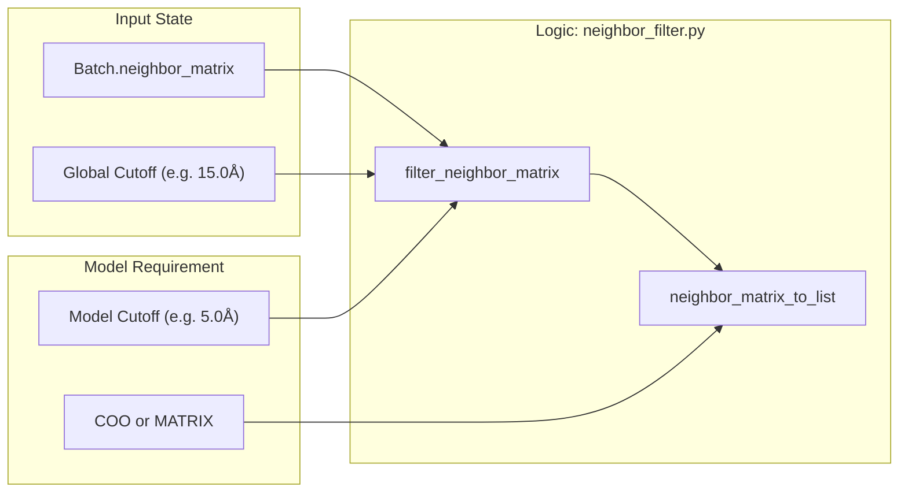
*   **Filtering**: If the model's cutoff is smaller than the batch's neighbor list cutoff, it performs a GPU-side filter and defragmentation [[nvalchemi/models/_ops/neighbor_filter.py:129-135]()].
*   **Format Conversion**: Automatically converts between dense `MATRIX` (Warp-style) and sparse `COO` (PyTorch Geometric/MACE style) formats based on the `ModelCard` [[nvalchemi/models/_ops/neighbor_filter.py:38-39](), [nvalchemi/models/base.py:76-76]()].

**Sources:** `nvalchemi/models/_ops/neighbor_filter.py`, `nvalchemi/models/base.py`

---

# Page: Dynamics Engine

# Dynamics Engine

<details>
<summary>Relevant source files</summary>

The following files were used as context for generating this wiki page:

- [docs/modules/dynamics/distributed_pipeline.rst](docs/modules/dynamics/distributed_pipeline.rst)
- [docs/modules/dynamics/fused_stage.rst](docs/modules/dynamics/fused_stage.rst)
- [docs/modules/dynamics/overview.rst](docs/modules/dynamics/overview.rst)
- [docs/userguide/dynamics.md](docs/userguide/dynamics.md)
- [docs/userguide/models.md](docs/userguide/models.md)
- [nvalchemi/dynamics/base.py](nvalchemi/dynamics/base.py)
- [test/dynamics/test_safety_hooks.py](test/dynamics/test_safety_hooks.py)

</details>


The `nvalchemi.toolkit` dynamics engine is a high-performance, GPU-resident framework for executing batched molecular dynamics (MD) and geometry optimization. It is designed around a "batch-first" philosophy, where multiple chemical systems are evolved simultaneously in a single execution loop to maximize GPU utilization and amortize the cost of machine learning interatomic potential (MLIP) forward passes [docs/userguide/dynamics.md:7-17]().

The engine provides a unified interface for various simulation types—from simple NVE ensembles to complex NPT barostats and FIRE optimizers—all sharing a common lifecycle, hook system, and convergence logic [docs/userguide/dynamics.md:18-21]().

## Core Architecture

The architecture is built on a single base class with two primary extension points: the `pre_update` and `post_update` methods of the integrator [docs/modules/dynamics/overview.rst:14-16]().

### The BaseDynamics Lifecycle
Every simulation step in `BaseDynamics` follows a rigid sequence of stages defined by `HookStageEnum`. This allows users to inject custom logic (logging, constraints, or analysis) at any point in the integration cycle [nvalchemi/dynamics/base.py:106-144]().

**Execution Flow (Natural Language to Code):**

```mermaid
graph TD
    subgraph "Natural Language Space"
        Start["Start Step"]
        Integrator1["Integrator Half-Step 1"]
        ModelEval["MLIP Forward Pass"]
        Integrator2["Integrator Half-Step 2"]
        Check["Convergence Check"]
    end

    subgraph "Code Entity Space (BaseDynamics)"
        HS0["HookStageEnum.BEFORE_STEP"]
        PRE["BaseDynamics.pre_update()"]
        COMP["BaseDynamics.compute()"]
        POST["BaseDynamics.post_update()"]
        HS7["HookStageEnum.AFTER_STEP"]
        HS8["HookStageEnum.ON_CONVERGE"]
    end

    Start --> HS0
    HS0 --> PRE
    PRE --> COMP
    COMP --> POST
    POST --> HS7
    HS7 --> Check
    Check -- "If Converged" --> HS8
```
Sources: [nvalchemi/dynamics/base.py:106-144](), [docs/userguide/dynamics.md:25-49]()

For a deep dive into the internal loop mechanics, state synchronization, and sample masking, see **[BaseDynamics: Core Execution Loop](#4.1)**.

## Integrators and Optimizers

The toolkit implements a variety of standard MD ensembles and optimization algorithms. These classes inherit from `BaseDynamics` and implement the specific velocity and position update logic required for the ensemble [nvalchemi/dynamics/base.py:24-34]().

| Type | Implementations | Key Characteristics |
| :--- | :--- | :--- |
| **Ensembles** | NVE, NVT (Langevin/Nose-Hoover), NPT, NPH | Uses per-integrator state tensors for thermostats/barostats. |
| **Optimizers** | FIRE, FIRE2 | Convergence-driven; uses `ConvergenceHook` to signal completion. |
| **Reference** | DemoDynamics | A minimal implementation for testing and custom extensions. |

For implementation details and parameter references, see **[Integrators and Optimizers](#4.2)**.

## The Hook System

Hooks are the primary mechanism for extending dynamics behavior without modifying the core engine. A `Hook` is a protocol-compliant object that executes at a specific `HookStageEnum` with a defined `frequency` [nvalchemi/dynamics/base.py:147-185]().

**Key Hook Categories:**
*   **Safety:** `NaNDetectorHook` and `MaxForceClampHook` prevent simulation crashes [test/dynamics/test_safety_hooks.py:15-18]().
*   **I/O:** `LoggingHook` (CSV/TensorBoard) and `SnapshotHook` for trajectory saving.
*   **Physics:** `NeighborListHook`, `WrapPeriodicHook`, and `BiasedPotentialHook`.
*   **Control:** `ConvergenceHook` for evaluating termination criteria [nvalchemi/dynamics/base.py:187-210]().

For the full catalog of hooks and the Hook protocol specification, see **[Hook System](#4.3)**.

## Data Sinks and Storage

Dynamics results (trajectories, converged structures, and logs) are routed to `DataSink` implementations. This tiered storage system allows for high-throughput GPU-resident buffering before staging to CPU or disk [docs/modules/dynamics/overview.rst:124-126]().

*   **GPUBuffer:** High-performance, lazy-allocated buffer for in-memory samples.
*   **HostMemory:** CPU-side staging for large-scale analysis.
*   **ZarrData:** Persistent disk storage using the Zarr format for compressed, chunked trajectories.

For details on buffer management and Zarr integration, see **[Data Sinks: GPUBuffer, HostMemory, and ZarrData](#4.4)**.

## Pipeline Composition and Scaling

The toolkit uses an operator-based DSL to compose complex workflows and scale across multiple GPUs [docs/modules/dynamics/overview.rst:24-25]().

### FusedStage (`+` Operator)
Combines multiple dynamics stages on a **single GPU**. It uses a shared model forward pass and partitions the batch using `batch.status` codes. As samples converge, they "graduate" to the next status code within the same batch [docs/modules/dynamics/fused_stage.rst:10-16]().

### DistributedPipeline (`|` Operator)
Distributes stages across **multiple GPUs** (one stage per rank). It uses NCCL `isend`/`irecv` to move samples between ranks as they complete a stage [docs/modules/dynamics/distributed_pipeline.rst:10-15]().

**Scaling Logic (Natural Language to Code):**

```mermaid
graph LR
    subgraph "Single-GPU Scaling (Fused)"
        S1["Stage A"]
        S2["Stage B"]
        OP_PLUS["Operator +"]
        FUSED["FusedStage"]
        
        S1 & S2 -- OP_PLUS --> FUSED
    end

    subgraph "Multi-GPU Scaling (Distributed)"
        R0["Rank 0 (Stage A)"]
        R1["Rank 1 (Stage B)"]
        OP_PIPE["Operator |"]
        DP["DistributedPipeline"]
        NCCL["Batch.isend / Batch.irecv"]

        R0 & R1 -- OP_PIPE --> DP
        R0 -. NCCL .-> R1
    end
```
Sources: [docs/modules/dynamics/fused_stage.rst:18-32](), [docs/modules/dynamics/distributed_pipeline.rst:23-53]()

For orchestration details, deadlock prevention, and `torch.compile` integration, see **[FusedStage and DistributedPipeline](#4.5)**.

---

# Page: BaseDynamics: Core Execution Loop

# BaseDynamics: Core Execution Loop

<details>
<summary>Relevant source files</summary>

The following files were used as context for generating this wiki page:

- [.github/workflows/ci.yml](.github/workflows/ci.yml)
- [docs/modules/dynamics/buffers_and_data_flow.rst](docs/modules/dynamics/buffers_and_data_flow.rst)
- [docs/userguide/dynamics.md](docs/userguide/dynamics.md)
- [docs/userguide/models.md](docs/userguide/models.md)
- [nvalchemi/data/batch.py](nvalchemi/data/batch.py)
- [nvalchemi/dynamics/base.py](nvalchemi/dynamics/base.py)
- [nvalchemi/dynamics/integrators/nph.py](nvalchemi/dynamics/integrators/nph.py)
- [nvalchemi/dynamics/integrators/npt.py](nvalchemi/dynamics/integrators/npt.py)
- [test/dynamics/test_base.py](test/dynamics/test_base.py)
- [test/dynamics/test_safety_hooks.py](test/dynamics/test_safety_hooks.py)
- [test/dynamics/test_single_loop.py](test/dynamics/test_single_loop.py)
- [test/dynamics/test_state_management.py](test/dynamics/test_state_management.py)

</details>


`BaseDynamics` is the foundational class for all molecular dynamics (MD) integrators and geometry optimizers in the NVIDIA ALCHEMI Toolkit. It provides a standardized execution lifecycle, orchestrates model evaluations, and manages per-system simulation state.

### Overview and Lifecycle

The core of `BaseDynamics` is the `step()` method, which defines a sequence of operations bracketed by hook execution points defined in `HookStageEnum` [nvalchemi/dynamics/base.py:106-143](). This design ensures that all simulation types—from simple NVE to complex NPT—share a common control flow [docs/userguide/dynamics.md:7-11]().

#### The Step Lifecycle
A single call to `step()` proceeds through the following stages:

| Stage | Code Entity | Description |
| :--- | :--- | :--- |
| **BEFORE_STEP** | `HookStageEnum.BEFORE_STEP` | Initial hooks (e.g., reset counters). |
| **PRE_UPDATE** | `pre_update(batch)` | First half-step (e.g., update velocities by $\Delta t/2$). |
| **COMPUTE** | `compute(batch)` | Model forward pass to evaluate forces/energies. |
| **POST_UPDATE** | `post_update(batch)` | Second half-step (e.g., final velocity/position update). |
| **AFTER_STEP** | `HookStageEnum.AFTER_STEP` | Final hooks (e.g., logging, convergence checks). |
| **ON_CONVERGE** | `HookStageEnum.ON_CONVERGE` | Triggered for systems meeting convergence criteria. |

Sources: [nvalchemi/dynamics/base.py:106-143](), [docs/userguide/dynamics.md:25-49]()

### Core Execution Flow

The `run()` method orchestrates the loop, calling `step()` repeatedly until the maximum number of steps is reached or all systems in the batch have converged [nvalchemi/dynamics/base.py:537-565]().

#### Natural Language to Code Entity Mapping: Execution Loop
The following diagram maps the conceptual simulation steps to the internal method calls and hook stages.

```mermaid
graph TD
    subgraph "Execution Loop (run)"
        START["run(batch, n_steps)"] --> LOOP{"Step < n_steps?"}
        LOOP -- "Yes" --> STEP["step(batch)"]
        STEP --> BEFORE["_call_hooks(BEFORE_STEP)"]
        
        subgraph "Integrator Lifecycle"
            BEFORE --> PRE["pre_update(batch)"]
            PRE --> COMP["compute(batch)"]
            COMP --> POST["post_update(batch)"]
        end
        
        POST --> AFTER["_call_hooks(AFTER_STEP)"]
        AFTER --> CONV{"All Converged?"}
        CONV -- "No" --> LOOP
        CONV -- "Yes" --> END["Return Batch"]
        LOOP -- "No" --> END
    end

    style PRE stroke-dasharray: 5 5
    style POST stroke-dasharray: 5 5
    style COMP stroke-dasharray: 5 5
```
Sources: [nvalchemi/dynamics/base.py:448-518](), [nvalchemi/dynamics/base.py:537-565]()

### State Management

`BaseDynamics` manages per-system simulation state (e.g., velocities, thermostat variables) using an internal `_state` batch [nvalchemi/dynamics/base.py:317-318](). This state is initialized lazily on the first call to `step()` via `_ensure_state_initialized()` [nvalchemi/dynamics/base.py:365-377]().

#### Key Functions
*   `_init_state(batch)`: Abstract method implemented by integrators to allocate tensors like `nhc_eta` (Nosé-Hoover) or `cell_velocity` [nvalchemi/dynamics/integrators/npt.py:146-189]().
*   `_sync_state_to_batch(batch)`: Ensures the `_state` buffer matches the current `batch` size and order, particularly after systems are removed or added during inflight batching [nvalchemi/dynamics/base.py:383-426]().
*   `_make_new_state(n, template)`: Creates state for $n$ new samples when refilling a batch [nvalchemi/dynamics/base.py:428-446]().

Sources: [nvalchemi/dynamics/base.py:317-446](), [test/dynamics/test_state_management.py:134-193]()

### Inflight Batching and Refilling

To maximize GPU utilization, `BaseDynamics` supports "inflight batching." If a `SizeAwareSampler` is provided, the engine can check for available capacity and refill the batch with new samples as others converge [nvalchemi/dynamics/base.py:546-553]().

#### Refill Logic (`refill_check`)
1.  **Convergence**: `ConvergenceHook` marks systems as converged by updating their `status` [nvalchemi/dynamics/base.py:228-245]().
2.  **Removal**: Converged systems are removed from the active batch [nvalchemi/dynamics/base.py:549-550]().
3.  **Refill**: `sampler.request_replacement()` is called to fetch new `AtomicData` objects to fill the `max_atoms` or `max_systems` quota [nvalchemi/dynamics/base.py:551-553]().
4.  **Sync**: `_sync_state_to_batch` is called to align the integrator's internal tensors with the new batch composition [nvalchemi/dynamics/base.py:383-386]().

Sources: [nvalchemi/dynamics/base.py:537-565](), [test/dynamics/test_state_management.py:15-22]()

### Sample Masking and Graduated Execution

In `FusedStage` (a subclass of `BaseDynamics`), multiple integrators share the same batch. To ensure each system is updated only by its assigned integrator, `BaseDynamics` supports **masked updates** [nvalchemi/dynamics/base.py:648-655]().

#### Masking Logic
The `_masked_pre_update` and `_masked_post_update` methods receive a boolean mask indicating which systems in the batch belong to that specific stage [nvalchemi/dynamics/base.py:520-535](). This allows a single `compute()` (model forward pass) to be shared across all systems, while the integrator updates are applied selectively [docs/userguide/dynamics.md:91-97]().

#### Natural Language to Code Entity Mapping: State & Masking
```mermaid
graph LR
    subgraph "Batch Data"
        B["Batch Object"]
        B_STAT["batch.status"]
    end

    subgraph "BaseDynamics State"
        D_STATE["_state (Batch)"]
        D_MASK["mask (BoolTensor)"]
    end

    subgraph "Logic Entities"
        INIT["_init_state()"]
        SYNC["_sync_state_to_batch()"]
        MASK_UP["_masked_pre_update()"]
    end

    B -- "Template" --> INIT
    INIT -- "Allocates" --> D_STATE
    B_STAT -- "Determines" --> D_MASK
    D_MASK -- "Filters" --> MASK_UP
    B -- "Triggers" --> SYNC
    SYNC -- "Updates" --> D_STATE
```
Sources: [nvalchemi/dynamics/base.py:383-426](), [nvalchemi/dynamics/base.py:520-535](), [test/dynamics/test_state_management.py:15-22]()

### Hook Registration

Hooks are registered during initialization and are categorized by their `stage` and `frequency` [nvalchemi/dynamics/base.py:168-184]().

*   **Frequency Gating**: A hook with `frequency=10` only executes when `step_count % 10 == 0` [nvalchemi/dynamics/base.py:284-288]().
*   **Stage Dispatch**: During `step()`, the `_call_hooks(stage)` method iterates through all hooks assigned to that `HookStageEnum` [nvalchemi/dynamics/base.py:280-291]().

Sources: [nvalchemi/dynamics/base.py:147-184](), [nvalchemi/dynamics/base.py:280-291](), [test/dynamics/test_base.py:107-156]()

---

# Page: Integrators and Optimizers

# Integrators and Optimizers

<details>
<summary>Relevant source files</summary>

The following files were used as context for generating this wiki page:

- [.github/workflows/ci.yml](.github/workflows/ci.yml)
- [Makefile](Makefile)
- [examples/advanced/06_ewald_electrostatics.py](examples/advanced/06_ewald_electrostatics.py)
- [examples/advanced/07_composable_model_composition.py](examples/advanced/07_composable_model_composition.py)
- [nvalchemi/dynamics/__init__.py](nvalchemi/dynamics/__init__.py)
- [nvalchemi/dynamics/_ops/langevin.py](nvalchemi/dynamics/_ops/langevin.py)
- [nvalchemi/dynamics/_ops/nose_hoover.py](nvalchemi/dynamics/_ops/nose_hoover.py)
- [nvalchemi/dynamics/_ops/npt_nph.py](nvalchemi/dynamics/_ops/npt_nph.py)
- [nvalchemi/dynamics/_ops/thermostat_utils.py](nvalchemi/dynamics/_ops/thermostat_utils.py)
- [nvalchemi/dynamics/_ops/velocity_verlet.py](nvalchemi/dynamics/_ops/velocity_verlet.py)
- [nvalchemi/dynamics/demo.py](nvalchemi/dynamics/demo.py)
- [nvalchemi/dynamics/integrators/__init__.py](nvalchemi/dynamics/integrators/__init__.py)
- [nvalchemi/dynamics/integrators/nph.py](nvalchemi/dynamics/integrators/nph.py)
- [nvalchemi/dynamics/integrators/npt.py](nvalchemi/dynamics/integrators/npt.py)
- [nvalchemi/dynamics/integrators/nve.py](nvalchemi/dynamics/integrators/nve.py)
- [nvalchemi/dynamics/integrators/nvt_langevin.py](nvalchemi/dynamics/integrators/nvt_langevin.py)
- [nvalchemi/dynamics/integrators/nvt_nose_hoover.py](nvalchemi/dynamics/integrators/nvt_nose_hoover.py)
- [nvalchemi/dynamics/optimizers/__init__.py](nvalchemi/dynamics/optimizers/__init__.py)
- [nvalchemi/dynamics/optimizers/fire.py](nvalchemi/dynamics/optimizers/fire.py)
- [nvalchemi/dynamics/optimizers/fire2.py](nvalchemi/dynamics/optimizers/fire2.py)
- [sonar-project.properties](sonar-project.properties)
- [test/dynamics/test_ops.py](test/dynamics/test_ops.py)
- [test/dynamics/test_state_management.py](test/dynamics/test_state_management.py)

</details>


This page provides a technical reference for all concrete dynamics implementations in the `nvalchemi-toolkit`. These classes inherit from `BaseDynamics` and implement specific physical ensembles (NVE, NVT, NPT, NPH) or optimization algorithms (FIRE, FIRE2).

All integrators follow a split-step pattern where the update logic is divided into `pre_update` and `post_update` around the model's force and stress evaluation.

## Molecular Dynamics Integrators

Molecular dynamics (MD) integrators evolve the system in time by solving Newton's equations of motion, often coupled to thermostats or barostats.

### NVE (Velocity Verlet)
The `NVE` class implements the standard Velocity Verlet algorithm, conserving the number of particles (N), volume (V), and energy (E). It is a symplectic and time-reversible integrator.

*   **Implementation**: Splits the velocity update into two half-kicks.
*   **State**: Tracks `dt`.
*   **Keys**: Needs `forces`; provides `positions`, `velocities`.

Sources: `[nvalchemi/dynamics/integrators/nve.py:1-50]()`, `[nvalchemi/dynamics/demo.py:46-106]()`

### NVT Langevin (BAOAB)
The `NVTLangevin` class implements the BAOAB splitting scheme for Langevin dynamics. It samples the canonical ensemble (NVT) using a stochastic Ornstein-Uhlenbeck process as a thermostat.

*   **Algorithm**: B (half-kick) -> A (drift) -> O (OU-process) -> A (drift) -> [Force Eval] -> B (final half-kick).
*   **Parameters**: `temperature` (K), `friction` (ps⁻¹).
*   **State**: `dt`, `temperature` (converted to eV), `friction`.

Sources: `[nvalchemi/dynamics/integrators/nvt_langevin.py:15-100]()`, `[nvalchemi/dynamics/integrators/nvt_langevin.py:115-178]()`

### NVT Nosé-Hoover (NHC)
The `NVTNoseHoover` class provides a deterministic, time-reversible thermostat using Nosé-Hoover chains (NHC). It utilizes Yoshida-Suzuki factorization for high-order integration of the chain variables.

*   **Algorithm**: NHC half-step -> Velocity half-kick -> Position full-step -> [Force Eval] -> Velocity half-kick -> NHC half-step.
*   **State**: `nhc_eta` (positions), `nhc_eta_dot` (velocities), and `nhc_Q` (masses) for the chains.
*   **Parameters**: `thermostat_time` (τ_T), `chain_length` (default 3), `yoshida_order` (3 or 5).

Sources: `[nvalchemi/dynamics/integrators/nvt_nose_hoover.py:15-101]()`, `[nvalchemi/dynamics/integrators/nvt_nose_hoover.py:132-166]()`

### NPT and NPH (MTK Barostat)
The `NPT` and `NPH` classes implement variable-cell dynamics using the Martyna-Tobias-Klein (MTK) equations.

*   **NPT**: Isothermal-isobaric ensemble. Uses two NHCs: one for particles and one for the barostat (cell) degrees of freedom.
*   **NPH**: Isenthalpic-isobaric ensemble. Omits the thermostat; temperature fluctuates while enthalpy is conserved.
*   **Pressure Coupling**: Supports `isotropic`, `anisotropic`, and `triclinic` modes.
*   **State**: Includes `cell_velocity` [M, 3, 3], `W` (barostat mass), and pressure tensors.

Sources: `[nvalchemi/dynamics/integrators/npt.py:15-109]()`, `[nvalchemi/dynamics/integrators/nph.py:15-99]()`, `[nvalchemi/dynamics/_ops/npt_nph.py:15-50]()`

## Geometry Optimizers

Optimizers are designed to find local energy minima. While they use MD-like machinery (velocities, timesteps), they include non-physical mixing or damping steps to accelerate convergence.

### FIRE (Fast Inertial Relaxation Engine)
The `FIRE` class implements the original Bitzek et al. algorithm. It adjusts the trajectory by mixing velocities with the force direction and dynamically scaling the timestep.

*   **Variants**: `FIRE` (fixed-cell) and `FIREVariableCell` (variable-cell via NPH-like propagation at zero target pressure).
*   **Logic**: If $P = F \cdot v > 0$, the system is moving downhill; increase $dt$ and decrease damping ($\alpha$). If $P < 0$, reset velocities and shrink $dt$.

Sources: `[nvalchemi/dynamics/optimizers/fire.py:15-125]()`

### FIRE2
The `FIRE2` class implements the improved version (Shuang et al., 2020) with better restart conditions and a modified velocity-mixing rule.

*   **Optimization**: The entire FIRE2 step (MD + mixing) is often fused into `pre_update` via specialized Warp kernels (`fire2_step_coord`).
*   **Parameters**: Uses `delaystep`, `dtgrow`, `dtshrink`, and `alpha0`.

Sources: `[nvalchemi/dynamics/optimizers/fire2.py:15-137]()`

## State Management and Data Flow

Integrators maintain a `_state` attribute (a `Batch` object) containing per-system parameters and persistent variables (e.g., NHC chain states).

### Dynamics State Initialization
The state is lazily initialized during the first `step()` or manually via `_init_state`.

Title: Dynamics State Initialization Flow
```mermaid
graph TD
    subgraph "BaseDynamics Lifecycle"
        A["run() or step()"] --> B{"_state exists?"}
        B -- "No" --> C["_init_state(batch)"]
        B -- "Yes" --> D["_ensure_state_initialized(batch)"]
        C --> E["_make_state_batch(dict, dev)"]
        D --> F["refill_check(batch)"]
        F -- "New samples detected" --> G["_make_new_state(n, template)"]
        G --> H["_state.put(new_state)"]
    end

    subgraph "Code Entities"
        C1["nvalchemi.dynamics.base.BaseDynamics._init_state"]
        E1["nvalchemi.dynamics._ops._bridge._make_state_batch"]
        H1["nvalchemi.data.Batch.put"]
    end

    C -.-> C1
    E -.-> E1
    H -.-> H1
```
Sources: `[test/dynamics/test_state_management.py:134-190]()`, `[nvalchemi/dynamics/integrators/npt.py:146-171]()`, `[nvalchemi/dynamics/base.py:1-100]()`

### Split-Step Execution
The following diagram maps the mathematical integration steps to the code methods for an NVT Langevin integrator.

Title: NVT Langevin (BAOAB) Execution Mapping
```mermaid
sequenceDiagram
    participant D as NVTLangevin
    participant M as Model (MLIP)
    participant K as Warp Kernels

    Note over D: pre_update(batch)
    D->>K: langevin_half_step (B-A-O-A)
    Note right of K: v += 0.5*F/m*dt<br/>r += v*0.5*dt<br/>v = OU_process(v)<br/>r += v*0.5*dt

    Note over D: compute(batch)
    D->>M: model.forward(batch)
    M-->>D: updated forces F(t+dt)

    Note over D: post_update(batch)
    D->>K: langevin_finalize (B)
    Note right of K: v += 0.5*F(t+dt)/m*dt
```
Sources: `[nvalchemi/dynamics/integrators/nvt_langevin.py:143-177]()`, `[nvalchemi/dynamics/_ops/langevin.py:15-60]()`

## Technical Summary Table

| Integrator | Ensemble | Keys Needed | Per-System State Tensors |
| :--- | :--- | :--- | :--- |
| `NVE` | NVE | `forces` | `dt` |
| `NVTLangevin` | NVT | `forces` | `dt`, `temperature`, `friction` |
| `NVTNoseHoover` | NVT | `forces` | `nhc_eta`, `nhc_eta_dot`, `nhc_Q`, `nhc_ndof` |
| `NPT` | NPT | `forces`, `stresses` | `cell_velocity`, `W`, `nhc_eta`, `nhc_b_eta`, `pressure` |
| `NPH` | NPH | `forces`, `stresses` | `cell_velocity`, `W`, `pressure` |
| `FIRE` | Opt | `forces` | `dt`, `alpha`, `n_pos` |
| `FIRE2` | Opt | `forces` | `dt`, `alpha`, `nsteps_inc`, `vf` |

Sources: `[nvalchemi/dynamics/integrators/npt.py:111-112]()`, `[nvalchemi/dynamics/integrators/nph.py:97-98]()`, `[nvalchemi/dynamics/optimizers/fire.py:121-124]()`, `[nvalchemi/dynamics/optimizers/fire2.py:139-140]()`

## DemoDynamics Reference
`DemoDynamics` is a reference implementation of a Velocity Verlet integrator used for testing and debugging. It demonstrates how to handle `torch.no_grad()` contexts when updating positions to avoid interfering with autograd-based force calculations.

*   **Position Update**: $x(t+dt) = x(t) + v(t)dt + 0.5 a(t)dt^2$
*   **Velocity Update**: $v(t+dt) = v(t) + 0.5(a(t) + a(t+dt))dt$

Sources: `[nvalchemi/dynamics/demo.py:46-186]()`

---

# Page: Hook System

# Hook System

<details>
<summary>Relevant source files</summary>

The following files were used as context for generating this wiki page:

- [docs/modules/dynamics/hooks.rst](docs/modules/dynamics/hooks.rst)
- [nvalchemi/dynamics/hooks/__init__.py](nvalchemi/dynamics/hooks/__init__.py)
- [nvalchemi/dynamics/hooks/_base.py](nvalchemi/dynamics/hooks/_base.py)
- [nvalchemi/dynamics/hooks/_utils.py](nvalchemi/dynamics/hooks/_utils.py)
- [nvalchemi/dynamics/hooks/bias.py](nvalchemi/dynamics/hooks/bias.py)
- [nvalchemi/dynamics/hooks/freeze.py](nvalchemi/dynamics/hooks/freeze.py)
- [nvalchemi/dynamics/hooks/logging.py](nvalchemi/dynamics/hooks/logging.py)
- [nvalchemi/dynamics/hooks/monitors.py](nvalchemi/dynamics/hooks/monitors.py)
- [nvalchemi/dynamics/hooks/periodic.py](nvalchemi/dynamics/hooks/periodic.py)
- [nvalchemi/dynamics/hooks/profiling.py](nvalchemi/dynamics/hooks/profiling.py)
- [nvalchemi/dynamics/hooks/safety.py](nvalchemi/dynamics/hooks/safety.py)
- [nvalchemi/dynamics/hooks/snapshot.py](nvalchemi/dynamics/hooks/snapshot.py)
- [test/dynamics/test_bias_hook.py](test/dynamics/test_bias_hook.py)
- [test/dynamics/test_freeze_hook.py](test/dynamics/test_freeze_hook.py)
- [test/dynamics/test_hook_utils.py](test/dynamics/test_hook_utils.py)
- [test/dynamics/test_observer_hooks.py](test/dynamics/test_observer_hooks.py)
- [test/dynamics/test_periodic_hook.py](test/dynamics/test_periodic_hook.py)
- [test/dynamics/test_profiler_hook.py](test/dynamics/test_profiler_hook.py)

</details>


Hooks are the primary extensibility mechanism for the `nvalchemi` dynamics engine. They allow for the injection of custom logic at specific points in the integration lifecycle without requiring modifications to the core integrator classes. Hooks are used for a wide range of tasks, including data logging, numerical safety, enhanced sampling, and on-the-fly neighbor list management.

## The Hook Protocol

The toolkit utilizes a structural typing approach via a `runtime_checkable` `Protocol`. Any class or object that implements the required attributes and methods is considered a valid `Hook` [docs/modules/dynamics/hooks.rst:14-44]().

### Core Interface
*   **`frequency: int`**: Determines how often the hook fires (every `n` steps).
*   **`stage: HookStageEnum`**: Specifies the lifecycle point where the hook is executed.
*   **`__call__(batch: Batch, dynamics: BaseDynamics)`**: The execution logic. It receives the current `Batch` and the `BaseDynamics` instance.

## Hook Lifecycle (HookStageEnum)

The `HookStageEnum` defines nine insertion points that cover the entirety of a dynamics step. Hooks are dispatched by `BaseDynamics._call_hooks(stage, batch)` in their registration order [docs/modules/dynamics/hooks.rst:50-120]().

### Lifecycle Stages
| Stage | Description |
| :--- | :--- |
| `BEFORE_STEP` | Fired at the very start of the `step()` call. |
| `BEFORE_PRE_UPDATE` | Fired before the first integrator half-step (typically position update). |
| `AFTER_PRE_UPDATE` | Fired after positions are updated, but before the model forward pass. |
| `BEFORE_COMPUTE` | Fired immediately before the model forward pass. |
| `AFTER_COMPUTE` | Fired after forces/energies are written to the batch. |
| `BEFORE_POST_UPDATE` | Fired before the second integrator half-step (typically velocity update). |
| `AFTER_POST_UPDATE` | Fired after velocities are updated. |
| `AFTER_STEP` | Fired at the end of the step. |
| `ON_CONVERGE` | Special stage fired only when convergence is detected for one or more samples. |

**Sources:** [docs/modules/dynamics/hooks.rst:50-98](), [nvalchemi/dynamics/hooks/_base.py:39-47]()

## Data Flow and Code Entity Mapping

The following diagrams illustrate how hooks interact with the `BaseDynamics` loop and how specific implementations map to the codebase.

### Hook Execution Flow
"BaseDynamics" orchestrates the lifecycle, while "Hook" implementations modify or observe the "Batch".

```mermaid
graph TD
    subgraph "Dynamics Loop (BaseDynamics.step)"
        A["BEFORE_STEP"] --> B["pre_update()"]
        B --> C["BEFORE_COMPUTE"]
        C --> D["compute() (Model Forward)"]
        D --> E["AFTER_COMPUTE"]
        E --> F["post_update()"]
        F --> G["AFTER_STEP"]
        G --> H{"Converged?"}
        H -- "Yes" --> I["ON_CONVERGE"]
    end

    subgraph "Hook Implementations"
        J["NaNDetectorHook"] -.->|"Observe"| E
        K["MaxForceClampHook"] -.->|"Modify Forces"| E
        L["BiasedPotentialHook"] -.->|"Add Forces/Energy"| E
        M["LoggingHook"] -.->|"Read Stats"| G
        N["SnapshotHook"] -.->|"Write Sink"| G
        O["ConvergedSnapshotHook"] -.->|"Write Sink"| I
    end
```
**Sources:** [docs/modules/dynamics/hooks.rst:50-62](), [nvalchemi/dynamics/hooks/safety.py:25-27](), [nvalchemi/dynamics/hooks/snapshot.py:62-66]()

### Hook System Class Hierarchy
This diagram maps natural language categories to the internal class structures.

```mermaid
classDiagram
    class Hook {
        <<Protocol>>
        +int frequency
        +HookStageEnum stage
        +__call__(Batch, BaseDynamics)
    }

    class _ObserverHook {
        <<Internal>>
        +stage: AFTER_STEP | ON_CONVERGE
    }

    class _PostComputeHook {
        <<Internal>>
        +stage: AFTER_COMPUTE
    }

    Hook <|.. _ObserverHook
    Hook <|.. _PostComputeHook
    
    _ObserverHook <|-- LoggingHook
    _ObserverHook <|-- SnapshotHook
    _ObserverHook <|-- EnergyDriftMonitorHook
    
    _PostComputeHook <|-- NaNDetectorHook
    _PostComputeHook <|-- MaxForceClampHook
    _PostComputeHook <|-- BiasedPotentialHook
    
    Hook <|.. WrapPeriodicHook : stage=AFTER_POST_UPDATE
    Hook <|.. ProfilerHook : multi-stage
```
**Sources:** [nvalchemi/dynamics/hooks/_base.py:49-140](), [nvalchemi/dynamics/hooks/logging.py:72-78](), [nvalchemi/dynamics/hooks/safety.py:44-41](), [nvalchemi/dynamics/hooks/periodic.py:36-112]()

## Built-in Hook Implementations

### Observer Hooks
These hooks inherit from `_ObserverHook` and typically fire at `AFTER_STEP` [nvalchemi/dynamics/hooks/_base.py:49-74]().

*   **`LoggingHook`**: Logs scalar observables (energy, temperature, fmax). It uses a dedicated CUDA stream for D2H transfers and a `ThreadPoolExecutor` for asynchronous I/O to CSV or TensorBoard [nvalchemi/dynamics/hooks/logging.py:72-132]().
*   **`SnapshotHook`**: Periodically writes the full `Batch` state to a `DataSink` (e.g., `ZarrData`, `GPUBuffer`) [nvalchemi/dynamics/hooks/snapshot.py:39-83]().
*   **`ConvergedSnapshotHook`**: Specifically fires at `ON_CONVERGE` to write only the samples that have met convergence criteria [nvalchemi/dynamics/hooks/snapshot.py:117-152]().
*   **`EnergyDriftMonitorHook`**: Tracks cumulative total energy drift in NVE simulations. It can be configured to warn or raise a `RuntimeError` if drift exceeds a threshold [nvalchemi/dynamics/hooks/monitors.py:40-108]().

### Safety and Modification Hooks
These hooks modify the `Batch` in-place, usually at the `AFTER_COMPUTE` stage [nvalchemi/dynamics/hooks/_base.py:102-124]().

*   **`NaNDetectorHook`**: Inspects forces and energies for non-finite values. If detected, it halts the simulation and provides diagnostics on which graph indices failed [nvalchemi/dynamics/hooks/safety.py:44-109]().
*   **`MaxForceClampHook`**: Clamps the magnitude of per-atom forces to a user-defined maximum while preserving the force direction, preventing numerical explosions during integration [nvalchemi/dynamics/hooks/safety.py:17-23]().
*   **`BiasedPotentialHook`**: Adds an external bias potential (energy and forces) to the batch. This is the foundation for umbrella sampling, metadynamics, and harmonic restraints [nvalchemi/dynamics/hooks/bias.py:38-129]().

### Utility and Infrastructure Hooks
*   **`WrapPeriodicHook`**: Wraps atomic positions back into the unit cell based on `batch.pbc` flags. It executes at `AFTER_POST_UPDATE` using `nvalchemiops` Warp kernels for efficiency [nvalchemi/dynamics/hooks/periodic.py:36-112]().
*   **`NeighborListHook`**: Manages on-the-fly neighbor list construction. It supports `MATRIX` or `COO` formats and can use Verlet-skin buffering to avoid rebuilds on every step [docs/modules/dynamics/hooks.rst:147-150]().
*   **`FreezeAtomsHook`**: Zeroes out forces and velocities for specific atoms, effectively freezing them in place during dynamics [nvalchemi/dynamics/hooks/__init__.py:39-40]().
*   **`ProfilerHook`**: Instruments the simulation with NVTX ranges for Nsight Systems and records wall-clock timing for every stage in the lifecycle [nvalchemi/dynamics/hooks/profiling.py:54-121]().

## Implementation Details: Asynchronous Logging

The `LoggingHook` implementation is a key example of how hooks maintain performance. To avoid stalling the GPU pipeline, it performs the following:
1.  **Side Stream**: Scalar computations and `non_blocking=True` D2H transfers occur on a dedicated CUDA stream [nvalchemi/dynamics/hooks/logging.py:95-100]().
2.  **Background Thread**: A `ThreadPoolExecutor` worker waits for the stream to synchronize and then performs the actual disk/network I/O [nvalchemi/dynamics/hooks/logging.py:98-100]().
3.  **Context Management**: Using the hook as a context manager (`with LoggingHook(...) as hook`) ensures that all pending writes are flushed and the background thread is shut down correctly [nvalchemi/dynamics/hooks/logging.py:102-109]().

**Sources:** [nvalchemi/dynamics/hooks/logging.py:15-37](), [nvalchemi/dynamics/hooks/logging.py:72-114]()

---

# Page: Data Sinks: GPUBuffer, HostMemory, and ZarrData

# Data Sinks: GPUBuffer, HostMemory, and ZarrData

<details>
<summary>Relevant source files</summary>

The following files were used as context for generating this wiki page:

- [.claude/skills/README.md](.claude/skills/README.md)
- [.claude/skills/nvalchemi-data-storage/SKILL.md](.claude/skills/nvalchemi-data-storage/SKILL.md)
- [.claude/skills/nvalchemi-data-structures/SKILL.md](.claude/skills/nvalchemi-data-structures/SKILL.md)
- [.claude/skills/nvalchemi-dynamics-hooks/SKILL.md](.claude/skills/nvalchemi-dynamics-hooks/SKILL.md)
- [.claude/skills/nvalchemi-dynamics-implementation/SKILL.md](.claude/skills/nvalchemi-dynamics-implementation/SKILL.md)
- [docs/userguide/dynamics_sinks.md](docs/userguide/dynamics_sinks.md)
- [nvalchemi/dynamics/sinks.py](nvalchemi/dynamics/sinks.py)
- [pyproject.toml](pyproject.toml)
- [uv.lock](uv.lock)

</details>


Data sinks are pluggable storage backends designed to record results during dynamics simulations [docs/userguide/dynamics_sinks.md:9-10](). They provide a unified interface for storing and retrieving `Batch` snapshots, allowing users to choose between high-throughput in-memory buffers or persistent disk storage [nvalchemi/dynamics/sinks.py:43-49]().

### The DataSink Abstraction

All storage backends inherit from the `DataSink` abstract base class [nvalchemi/dynamics/sinks.py:43](). This abstraction ensures that dynamics hooks can write data without needing to know the underlying storage implementation.

| Method | Description |
| :--- | :--- |
| `write(batch, mask)` | Stores a batch, optionally filtering samples via a boolean mask [nvalchemi/dynamics/sinks.py:79-81](). |
| `read()` | Retrieves all stored samples as a single concatenated `Batch` [nvalchemi/dynamics/sinks.py:100-102](). |
| `drain()` | Atomic operation that reads all data and then clears the sink [nvalchemi/dynamics/sinks.py:162-164](). |
| `zero()` | Clears all stored data and resets internal pointers [nvalchemi/dynamics/sinks.py:117-119](). |

**Sources:** [nvalchemi/dynamics/sinks.py:43-182](), [docs/userguide/dynamics_sinks.md:14-16]()

---

### GPUBuffer: High-Performance GPU Residency

The `GPUBuffer` stores snapshots directly in CUDA device memory [nvalchemi/dynamics/sinks.py:201](). It is optimized for maximum throughput by avoiding Device-to-Host (D2H) transfers, making it ideal for inter-stage data passing in `FusedStage` pipelines [docs/userguide/dynamics_sinks.md:50-53]().

#### Implementation Details
- **Lazy Allocation**: The buffer pre-allocates memory on the first `write()` call, using the incoming batch as a template for schema and dtypes [nvalchemi/dynamics/sinks.py:204-208]().
- **Pointer Management**: It maintains an internal `_batch_ptr` to track the current write position within the pre-allocated tensors [nvalchemi/dynamics/sinks.py:201-210]().
- **Warp Integration**: It is designed to integrate with Warp-based kernels for fast data manipulation without leaving the GPU [docs/userguide/dynamics_sinks.md:50-53]().

**Sources:** [nvalchemi/dynamics/sinks.py:201-242](), [docs/userguide/dynamics_sinks.md:48-57]()

---

### HostMemory: CPU Staging

`HostMemory` moves snapshots from the GPU to host RAM [docs/userguide/dynamics_sinks.md:61](). This serves as a middle ground between the limited capacity of GPU VRAM and the latency of disk I/O [docs/userguide/dynamics_sinks.md:61-65]().

- **Use Case**: Moderate-length trajectories that exceed GPU memory but where disk writes should be deferred until after the simulation loop [docs/userguide/dynamics_sinks.md:21]().
- **Mechanism**: On `write()`, tensors are copied to the CPU. On `read()`, they are concatenated and moved back to the requested device [nvalchemi/dynamics/sinks.py:59-65]().

**Sources:** [nvalchemi/dynamics/sinks.py:18-21](), [docs/userguide/dynamics_sinks.md:59-65]()

---

### ZarrData: Persistent Disk Storage

`ZarrData` provides persistence by writing snapshots to a Zarr store on disk [nvalchemi/dynamics/sinks.py:20](). It utilizes the toolkit's high-performance `AtomicDataZarrWriter` to handle serialization [nvalchemi/dynamics/sinks.py:35-40]().

#### ZarrWriteConfig
The behavior of the disk sink is governed by `ZarrWriteConfig`, which allows fine-grained control over:
- **Compression**: Enabling codecs like `Zstd` for storage efficiency [docs/userguide/dynamics_sinks.md:91-98]().
- **Chunking**: Defining `chunk_size` for optimal read/write performance [docs/userguide/dynamics_sinks.md:96]().
- **Tiered Overrides**: Applying different settings to `core` (positions, numbers) vs `custom` fields [docs/userguide/dynamics_sinks.md:83-86]().

#### Data Persistence Flow
1. **Snapshot**: `SnapshotHook` triggers at a specific `frequency` [docs/userguide/dynamics_sinks.md:37-40]().
2. **Sink Write**: `ZarrData.write(batch)` is called [nvalchemi/dynamics/sinks.py:58-59]().
3. **Zarr Serialization**: The `AtomicDataZarrWriter` appends the batch to the `.zarr` hierarchy on disk [.claude/skills/nvalchemi-data-storage/SKILL.md:43-59]().

**Sources:** [nvalchemi/dynamics/sinks.py:35-40](), [docs/userguide/dynamics_sinks.md:67-100](), [.claude/skills/nvalchemi-data-storage/SKILL.md:34-59]()

---

### Integration with Hooks

Sinks are passive; they are driven by `SnapshotHook` or `ConvergedSnapshotHook` during the dynamics lifecycle [docs/userguide/dynamics_sinks.md:26-30]().

#### Hook-to-Sink Relationship
The following diagram illustrates how the `BaseDynamics` loop interacts with hooks and their associated sinks.

**Dynamics I/O Data Flow**
```mermaid
graph TD
    subgraph "Dynamics Loop (BaseDynamics.run)"
        A["step()"] --> B{"Hook Frequency?"}
    end

    subgraph "Hooks (nvalchemi.dynamics.hooks)"
        B -- "Yes" --> C["SnapshotHook.__call__"]
        B -- "Yes" --> D["ConvergedSnapshotHook.__call__"]
    end

    subgraph "Data Sinks (nvalchemi.dynamics.sinks)"
        C --> E["DataSink.write(batch)"]
        D --> E
        
        E --> F["GPUBuffer"]
        E --> G["HostMemory"]
        E --> H["ZarrData"]
    end

    subgraph "Storage Backends"
        F --> I["CUDA VRAM"]
        G --> J["System RAM"]
        H --> K["ZarrStore (Disk)"]
    end
```
**Sources:** [docs/userguide/dynamics_sinks.md:24-46](), [.claude/skills/nvalchemi-dynamics-hooks/SKILL.md:153-162]()

---

### Tiered Storage Comparison

The toolkit provides three implementations to balance performance and persistence.

| Entity Name | Storage Layer | Performance | Persistence | Code Pointer |
| :--- | :--- | :--- | :--- | :--- |
| `GPUBuffer` | Device Memory | Ultra High | Volatile | [nvalchemi/dynamics/sinks.py:201]() |
| `HostMemory` | Host RAM | High | Volatile | [nvalchemi/dynamics/sinks.py:19]() |
| `ZarrData` | Disk | Moderate | Persistent | [nvalchemi/dynamics/sinks.py:20]() |

#### Code Entity Mapping
This diagram maps the high-level storage concepts to the specific classes and configurations in the codebase.

**Sink Architecture and Dependencies**
```mermaid
classDiagram
    class DataSink {
        <<abstract>>
        +capacity: int
        +write(batch, mask)
        +read() Batch
        +drain() Batch
    }

    class GPUBuffer {
        -max_atoms: int
        -max_edges: int
        -_batch_ptr: int
        +write()
    }

    class HostMemory {
        +write()
    }

    class ZarrData {
        -writer: AtomicDataZarrWriter
        -config: ZarrWriteConfig
        +write()
    }

    class AtomicDataZarrWriter {
        +write(batch)
        +append(batch)
    }

    class ZarrWriteConfig {
        +core: ZarrArrayConfig
        +custom: ZarrArrayConfig
    }

    DataSink <|-- GPUBuffer
    DataSink <|-- HostMemory
    DataSink <|-- ZarrData
    ZarrData *-- AtomicDataZarrWriter
    ZarrData *-- ZarrWriteConfig
```
**Sources:** [nvalchemi/dynamics/sinks.py:43-242](), [docs/userguide/dynamics_sinks.md:18-22](), [nvalchemi/data/datapipes/backends/zarr.py:35-40]() (referenced in sinks.py)

---

# Page: FusedStage and DistributedPipeline

# FusedStage and DistributedPipeline

<details>
<summary>Relevant source files</summary>

The following files were used as context for generating this wiki page:

- [docs/modules/dynamics/buffers_and_data_flow.rst](docs/modules/dynamics/buffers_and_data_flow.rst)
- [docs/modules/dynamics/distributed_pipeline.rst](docs/modules/dynamics/distributed_pipeline.rst)
- [docs/modules/dynamics/fused_stage.rst](docs/modules/dynamics/fused_stage.rst)
- [docs/modules/dynamics/overview.rst](docs/modules/dynamics/overview.rst)
- [docs/userguide/dynamics.md](docs/userguide/dynamics.md)
- [docs/userguide/models.md](docs/userguide/models.md)
- [examples/distributed/README.rst](examples/distributed/README.rst)
- [nvalchemi/dynamics/base.py](nvalchemi/dynamics/base.py)
- [test/dynamics/test_pipeline_stage.py](test/dynamics/test_pipeline_stage.py)
- [test/dynamics/test_safety_hooks.py](test/dynamics/test_safety_hooks.py)
- [test/dynamics/test_single_loop.py](test/dynamics/test_single_loop.py)

</details>


The NVIDIA ALCHEMI Toolkit provides two primary scaling strategies for composing dynamics workflows: **FusedStage** and **DistributedPipeline**. These strategies allow users to transition from simple single-stage simulations to complex, multi-stage, and multi-GPU production workloads using a consistent operator-based DSL (`+` and `|`).

## 1. FusedStage: Single-GPU Orchestration

A `FusedStage` (created via the `+` operator) composes multiple dynamics sub-stages on a **single GPU**. Its primary purpose is to eliminate redundant model forward passes when a simulation involves multiple phases (e.g., Energy Minimization followed by NVT Molecular Dynamics) [nvalchemi/dynamics/base.py:22-22]().

### Key Implementation Details
- **Shared Forward Pass**: Regardless of the number of sub-stages, only one model forward pass is executed per step for the entire batch [docs/modules/dynamics/fused_stage.rst:73-74]().
- **Status-Based Masking**: Each sub-stage is assigned a unique `status` code. The `FusedStage` uses a `batch.status` tensor to determine which samples are updated by which integrator during the `masked_update` phase [docs/modules/dynamics/fused_stage.rst:53-56]().
- **Automatic Migration**: `FusedStage` automatically inserts `ConvergenceHook` instances between adjacent stages. When a sample converges in stage $N$, its status is incremented to $N+1$, and it is processed by the next integrator in the subsequent step [docs/modules/dynamics/fused_stage.rst:81-82]().

### FusedStage Data Flow
The following diagram illustrates how `FusedStage` partitions a single `Batch` across multiple integrators.

**Diagram: FusedStage Masked Execution**
```mermaid
graph TD
    subgraph FusedStage["FusedStage (BaseDynamics)"]
        B["Batch (All Samples)"] --> FP["Model.forward() (Shared)"]
        FP --> M0{"Status == 0?"}
        FP --> M1{"Status == 1?"}
        
        M0 -- "True" --> I0["Integrator A (e.g. FIRE)"]
        M1 -- "True" --> I1["Integrator B (e.g. NVE)"]
        
        I0 --> C0["Convergence Check"]
        C0 -- "Converged" --> S1["Set Status = 1"]
        C0 -- "Not Converged" --> S0["Keep Status = 0"]
        
        I1 --> C1["Convergence Check"]
        C1 -- "Converged" --> EXIT["Set Status = ExitCode"]
    end
```
Sources: [nvalchemi/dynamics/base.py:2025-2080](), [docs/modules/dynamics/fused_stage.rst:57-71]()

---

## 2. DistributedPipeline: Multi-GPU Execution

A `DistributedPipeline` (created via the `|` operator) maps **one dynamics stage per GPU rank**. It uses point-to-point communication (NCCL `isend`/`irecv`) to move converged samples from upstream ranks to downstream ranks [docs/modules/dynamics/distributed_pipeline.rst:10-12]().

### Communication Infrastructure
- **BufferConfig**: Every rank must define a `BufferConfig` (specifying `num_systems`, `num_nodes`, and `num_edges`) to pre-allocate GPU memory for NCCL transfers [nvalchemi/dynamics/base.py:76-93]().
- **CommMode**:
    - `sync`: Blocking receives; simplest for debugging.
    - `async_recv`: (Default) Posts `irecv` at the start of a step and waits only when the data is needed, allowing compute/comm overlap [docs/modules/dynamics/distributed_pipeline.rst:178-183]().
    - `fully_async`: Both sends and receives are deferred for maximum throughput [docs/modules/dynamics/distributed_pipeline.rst:184-188]().
- **Deadlock Prevention**: Ranks unconditionally send their `send_buffer` every step, even if empty. This ensures that downstream `irecv` calls always find a matching `isend` [docs/modules/dynamics/distributed_pipeline.rst:153-156]().

### Distributed Pipeline Architecture
The diagram below shows the mapping between the high-level pipeline and the underlying `_CommunicationMixin` entities.

**Diagram: DistributedPipeline and NCCL Buffers**
```mermaid
graph LR
    subgraph Rank0["Rank 0 (Upstream)"]
        D0["BaseDynamics Subclass"]
        SB0["send_buffer (Batch)"]
    end

    subgraph Rank1["Rank 1 (Downstream)"]
        RB1["recv_buffer (Batch)"]
        D1["BaseDynamics Subclass"]
        SK1["DataSink (e.g. ZarrData)"]
    end

    D0 -- "Graduated Samples" --> SB0
    SB0 -- "Batch.isend" --> RB1
    RB1 -- "Batch.irecv" --> D1
    D1 -- "Final Results" --> SK1
```
Sources: [nvalchemi/dynamics/base.py:126-140](), [docs/modules/dynamics/distributed_pipeline.rst:125-138](), [docs/modules/dynamics/buffers_and_data_flow.rst:41-54]()

---

## 3. Implementation Details

### Buffer Management
Communication buffers are lazily initialized on the first simulation step. The toolkit uses `Batch.empty()` to create a container with the correct schema (keys/dtypes) based on the first available data batch [docs/modules/dynamics/buffers_and_data_flow.rst:82-86]().

| Function | Role | Source |
| :--- | :--- | :--- |
| `_prestep_sync_buffers` | Posts `irecv` and zeros the `send_buffer`. | [nvalchemi/dynamics/base.py:476-476]() |
| `_complete_pending_recv` | Waits on NCCL handles and moves data into `active_batch`. | [nvalchemi/dynamics/base.py:530-530]() |
| `_poststep_sync_buffers` | Populates `send_buffer` with converged samples and calls `isend`. | [nvalchemi/dynamics/base.py:575-575]() |
| `_sync_done_flags` | Uses `dist.all_reduce` to determine if all ranks have finished. | [nvalchemi/dynamics/base.py:734-734]() |

### Back-Pressure and Overflow
To prevent GPU memory exhaustion, the pipeline implements back-pressure. If the `active_batch` is full, incoming samples from `recv_buffer` are diverted to `DataSink` objects (overflow sinks) like `GPUBuffer` or `HostMemory`. These samples are backfilled into the simulation as slots become available [docs/modules/dynamics/buffers_and_data_flow.rst:138-142]().

### Summary Table: Scaling Strategies

| Feature | FusedStage (`+`) | DistributedPipeline (`|`) |
| :--- | :--- | :--- |
| **Hardware** | Single GPU | Multiple GPUs |
| **Forward Pass** | Shared (One per step) | Independent per Rank |
| **Communication** | In-memory pointer masking | NCCL `isend` / `irecv` |
| **Scaling Limit** | GPU Memory | Network Bandwidth / Rank Count |
| **Termination** | Local Convergence | Global `all_reduce` |

Sources: [docs/userguide/dynamics.md:74-134](), [docs/modules/dynamics/overview.rst:100-133](), [nvalchemi/dynamics/base.py:24-34]()

---

# Page: Examples and Tutorials

# Examples and Tutorials

<details>
<summary>Relevant source files</summary>

The following files were used as context for generating this wiki page:

- [docs/conf.py](docs/conf.py)
- [docs/sg_execution_times.rst](docs/sg_execution_times.rst)
- [examples/README.rst](examples/README.rst)
- [examples/advanced/01_biased_potential.py](examples/advanced/01_biased_potential.py)
- [examples/advanced/02_custom_hook.py](examples/advanced/02_custom_hook.py)
- [examples/advanced/03_custom_convergence.py](examples/advanced/03_custom_convergence.py)
- [examples/advanced/README.rst](examples/advanced/README.rst)
- [examples/basic/01_data_structures.py](examples/basic/01_data_structures.py)
- [examples/basic/02_geometry_optimization.py](examples/basic/02_geometry_optimization.py)
- [examples/basic/03_ase_integration.py](examples/basic/03_ase_integration.py)
- [examples/basic/04_nve_energy_conservation.py](examples/basic/04_nve_energy_conservation.py)
- [examples/basic/05_nvt_langevin.py](examples/basic/05_nvt_langevin.py)
- [examples/basic/README.rst](examples/basic/README.rst)
- [examples/distributed/01_distributed_pipeline.py](examples/distributed/01_distributed_pipeline.py)
- [examples/distributed/02_distributed_monitoring.py](examples/distributed/02_distributed_monitoring.py)
- [examples/distributed/README.rst](examples/distributed/README.rst)
- [examples/intermediate/01_multistage_pipeline.py](examples/intermediate/01_multistage_pipeline.py)
- [examples/intermediate/02_trajectory_zarr_io.py](examples/intermediate/02_trajectory_zarr_io.py)
- [examples/intermediate/03_npt_variable_cell.py](examples/intermediate/03_npt_variable_cell.py)
- [examples/intermediate/04_inflight_batching.py](examples/intermediate/04_inflight_batching.py)
- [examples/intermediate/05_safety_and_monitoring.py](examples/intermediate/05_safety_and_monitoring.py)
- [examples/intermediate/README.rst](examples/intermediate/README.rst)

</details>


The `nvalchemi-toolkit` provides a comprehensive gallery of examples designed to guide users from basic data manipulation to complex, multi-GPU distributed simulation pipelines. These examples are organized into four complexity tiers, ensuring a progressive learning curve for researchers and engineers.

All examples are provided as self-contained Python scripts in the `examples/` directory [examples/README.rst:1-7](). They are compatible with **Sphinx-Gallery**, which automatically executes them to generate a visual documentation build with plots and execution times [docs/conf.py:139-153]().

### Example Tiers Overview

The toolkit categorizes its tutorials into the following levels of sophistication:

| Tier | Focus Area | Key Components Demonstrated |
| :--- | :--- | :--- |
| **Basic** | Core API & Single-system MD | `AtomicData`, `Batch`, `FIRE`, `NVTLangevin`, `NVE` |
| **Intermediate** | Scaling & Production I/O | `FusedStage`, `ZarrData`, `NPT`, `SizeAwareSampler` |
| **Advanced** | Framework Extension | Custom `Hook`, `BaseDynamics` subclassing, Biased MD |
| **Distributed** | Multi-GPU Orchestration | `DistributedPipeline`, `BufferConfig`, NCCL communication |

### Example Organization and Execution

The examples are structured to be both readable as code and executable as a test suite. The `docs/conf.py` file defines the gallery order and filtering logic [docs/conf.py:146-154]().

#### Natural Language to Code Entity Mapping

The following diagram illustrates how high-level simulation concepts translate into specific example files and toolkit classes.

**Simulation Concept Mapping**
```mermaid
graph TD
    subgraph "Natural Language Space"
        A["'How do I store my molecules?'"]
        B["'How do I run a basic MD?'"]
        C["'How do I scale to 4 GPUs?'"]
        D["'How do I add a custom constraint?'"]
    end

    subgraph "Code Entity Space"
        A --> E["01_data_structures.py"]
        E -.-> F["nvalchemi.data.AtomicData"]
        
        B --> G["05_nvt_langevin.py"]
        G -.-> H["nvalchemi.dynamics.NVTLangevin"]
        
        C --> I["01_distributed_pipeline.py"]
        I -.-> J["nvalchemi.dynamics.DistributedPipeline"]
        
        D --> K["01_biased_potential.py"]
        K -.-> L["nvalchemi.dynamics.hooks.BiasedPotentialHook"]
    end
```
Sources: [examples/README.rst:14-41](), [examples/basic/01_data_structures.py:26-36](), [examples/basic/05_nvt_langevin.py:64-67](), [examples/advanced/01_biased_potential.py:55-59](), [examples/distributed/01_distributed_pipeline.py:55-66]()

### Basic and Intermediate Examples

The **Basic** tier is suitable for users transitioning from tools like ASE. It introduces the fundamental `AtomicData` and `Batch` structures [examples/basic/01_data_structures.py:19-22](), geometry optimization with `FIRE`, and standard ensembles like `NVE` and `NVT` using the Langevin thermostat [examples/basic/05_nvt_langevin.py:24-34]().

The **Intermediate** tier focuses on production-grade features. This includes:
* **Multi-stage Pipelines**: Using `FusedStage` to chain different dynamics (e.g., Minimized -> NVT) [examples/README.rst:23-27]().
* **High-performance I/O**: Persisting trajectories using the `ZarrData` sink [examples/intermediate/02_trajectory_zarr_io.py]().
* **Inflight Batching**: Managing GPU memory with `SizeAwareSampler` to pack variable-sized systems efficiently [examples/intermediate/04_inflight_batching.py]().

For details, see [Basic and Intermediate Examples](#5.1).

### Advanced and Distributed Examples

The **Advanced** tier demonstrates how to extend the toolkit's logic. It covers writing custom `Hook` implementations for structural analysis (like RDF) [examples/advanced/02_custom_hook.py:25-35](), implementing custom integrators by subclassing `BaseDynamics` [examples/advanced/README.rst:19-22](), and multi-criteria convergence logic [examples/advanced/03_custom_convergence.py:24-30]().

The **Distributed** tier provides the blueprint for multi-GPU simulations. Using `DistributedPipeline`, users can map different simulation stages to specific GPU ranks [examples/distributed/01_distributed_pipeline.py:154-158](). These examples utilize NCCL for high-speed tensor transfer between ranks [examples/distributed/README.rst:16-18]().

**Distributed Pipeline Topology**
```mermaid
graph LR
    subgraph "GPU Rank 0"
        S["SizeAwareSampler"] --> F["FIRE (Optimiser)"]
    end
    
    subgraph "GPU Rank 1"
        F -- "NCCL (isend/irecv)" --> L["NVTLangevin (MD)"]
        L --> Z["ZarrData (Sink)"]
    end
    
    style S fill:none
    style F fill:none
    style L fill:none
    style Z fill:none
```
Sources: [examples/distributed/README.rst:20-32](), [examples/distributed/01_distributed_pipeline.py:27-34]()

For details, see [Advanced and Distributed Examples](#5.2).

### Running the Examples

Most examples can be run directly with a standard Python interpreter:
```bash
python examples/basic/01_data_structures.py
```

However, **Distributed** examples require `torchrun` to initialize the process group across multiple GPUs [examples/distributed/README.rst:49-57]():
```bash
torchrun --nproc_per_node=4 examples/distributed/01_distributed_pipeline.py
```

Sources:
- [docs/conf.py:139-170]()
- [examples/README.rst:1-41]()
- [examples/basic/README.rst:1-19]()
- [examples/intermediate/README.rst:1-27]()
- [examples/advanced/README.rst:1-22]()
- [examples/distributed/README.rst:1-78]()

---

# Page: Basic and Intermediate Examples

# Basic and Intermediate Examples

<details>
<summary>Relevant source files</summary>

The following files were used as context for generating this wiki page:

- [examples/advanced/03_custom_convergence.py](examples/advanced/03_custom_convergence.py)
- [examples/basic/01_data_structures.py](examples/basic/01_data_structures.py)
- [examples/basic/02_geometry_optimization.py](examples/basic/02_geometry_optimization.py)
- [examples/basic/03_ase_integration.py](examples/basic/03_ase_integration.py)
- [examples/basic/04_nve_energy_conservation.py](examples/basic/04_nve_energy_conservation.py)
- [examples/basic/05_nvt_langevin.py](examples/basic/05_nvt_langevin.py)
- [examples/distributed/01_distributed_pipeline.py](examples/distributed/01_distributed_pipeline.py)
- [examples/distributed/02_distributed_monitoring.py](examples/distributed/02_distributed_monitoring.py)
- [examples/intermediate/01_multistage_pipeline.py](examples/intermediate/01_multistage_pipeline.py)
- [examples/intermediate/02_trajectory_zarr_io.py](examples/intermediate/02_trajectory_zarr_io.py)
- [examples/intermediate/03_npt_variable_cell.py](examples/intermediate/03_npt_variable_cell.py)
- [examples/intermediate/04_inflight_batching.py](examples/intermediate/04_inflight_batching.py)
- [examples/intermediate/05_safety_and_monitoring.py](examples/intermediate/05_safety_and_monitoring.py)

</details>


This page provides a technical walkthrough of the `nvalchemi-toolkit` example gallery, categorized into **Basic** (data structures, single-stage dynamics, ASE integration) and **Intermediate** (multistage pipelines, Zarr I/O, variable-cell NPT, and inflight batching) tiers. These examples demonstrate the practical application of the toolkit's four-layer architecture and operator-based DSL.

## Basic Examples

The basic tier focuses on the fundamental data structures and the execution of single-stage dynamics simulations.

### Data Structures: AtomicData and Batch
The toolkit uses a graph-based representation for molecular systems. `AtomicData` represents a single system, while `Batch` represents a GPU-resident collection of systems.

*   **`AtomicData`**: Built on Pydantic, it requires `positions` and `atomic_numbers` [examples/basic/01_data_structures.py:31-36](). It supports arbitrary node, edge, and system-level properties via `add_node_property`, `add_edge_property`, and `add_system_property` [examples/basic/01_data_structures.py:84-90]().
*   **`Batch`**: Created via `Batch.from_data_list` [examples/basic/01_data_structures.py:137-157](). It manages the `batch_ptr` and `ptr` tensors to allow segmented operations on the GPU [examples/basic/01_data_structures.py:172-177]().

### Geometry Optimization (FIRE)
Geometry optimization is typically performed using the **FIRE** (Fast Inertial Relaxation Engine) algorithm [examples/basic/02_geometry_optimization.py:23-28]().

*   **Implementation**: The `FIRE` optimizer propagates atoms with Newtonian dynamics but damps velocities toward the force direction [examples/basic/02_geometry_optimization.py:23-28]().
*   **Convergence**: A `ConvergenceHook` monitors the maximum per-atom force norm (`fmax`). Systems that fall below the threshold are removed from the active batch to save compute [examples/basic/02_geometry_optimization.py:35-39]().
*   **Neighbor Lists**: A `NeighborListHook` is registered to recompute the neighbor matrix before model forward passes [examples/basic/02_geometry_optimization.py:30-34]().

### ASE Integration
The toolkit provides seamless integration with the **Atomic Simulation Environment (ASE)**.

*   **Ingestion**: `AtomicData.from_atoms(atoms)` converts an `ase.Atoms` object, automatically mapping ASE tags to `AtomCategory` (e.g., `SURFACE`, `BULK`, `GAS`) [examples/basic/03_ase_integration.py:68-81]().
*   **Constraints**: `FreezeAtomsHook` uses these categories to fix the positions of specific atoms (e.g., freezing a copper slab while relaxing an adsorbate) [examples/basic/03_ase_integration.py:170-175]().

### NVE and NVT Dynamics
Standard MD ensembles are implemented as dynamics stages.

*   **NVE (Microcanonical)**: Uses the `VelocityVerlet` algorithm. Energy conservation is monitored via `EnergyDriftMonitorHook` [examples/basic/04_nve_energy_conservation.py:48-54]().
*   **NVT (Canonical)**: `NVTLangevin` implements the **BAOAB** splitting scheme for high configurational accuracy [examples/basic/05_nvt_langevin.py:24-30](). It couples the system to a heat bath using a friction coefficient $\gamma$ [examples/basic/05_nvt_langevin.py:30-34]().

**Sources:** [examples/basic/01_data_structures.py](), [examples/basic/02_geometry_optimization.py](), [examples/basic/03_ase_integration.py](), [examples/basic/04_nve_energy_conservation.py](), [examples/basic/05_nvt_langevin.py]()

---

## Intermediate Examples

Intermediate examples demonstrate complex orchestration, persistent I/O, and advanced thermodynamic ensembles.

### Multistage Pipelines (FusedStage)
The `+` operator allows users to compose multiple dynamics stages into a single `FusedStage` pipeline [examples/intermediate/01_multistage_pipeline.py:183-188]().

#### Data Flow: Multistage Transition
The diagram below illustrates how a system migrates through a `FIRE -> NVT -> NVE` pipeline.

**System State Migration**
```mermaid
graph TD
    subgraph "FusedStage (+)"
        S0["Stage 0: FIRE (Relaxation)"]
        S1["Stage 1: NVT (Equilibration)"]
        S2["Stage 2: NVE (Production)"]
    end

    Input["Batch Input"] --> S0
    S0 -- "ConvergenceHook (fmax < threshold)" --> S1
    S1 -- "n_steps exhausted" --> S2
    S2 -- "n_steps exhausted" --> Sink["DataSink (HostMemory/Zarr)"]

    style S0 stroke-dasharray: 5 5
    style S1 stroke-dasharray: 5 5
    style S2 stroke-dasharray: 5 5
```
**Sources:** [examples/intermediate/01_multistage_pipeline.py:183-191](), [nvalchemi/dynamics/base.py:51]().

### Zarr Trajectory I/O
For large-scale simulations, snapshots are written to **Zarr** stores.

*   **Writing**: A `SnapshotHook` directs the `Batch` state to a `ZarrData` sink at a defined `frequency` [examples/intermediate/02_trajectory_zarr_io.py:128-135]().
*   **Reading**: `AtomicDataZarrReader` provides random access to the stored snapshots, which is then wrapped in a `Dataset` and `DataLoader` for training or post-processing [examples/intermediate/02_trajectory_zarr_io.py:180-182]().

### NPT Variable Cell Dynamics
The **NPT ensemble** (constant Pressure and Temperature) allows the simulation cell to fluctuate.

*   **Implementation**: Uses the **Martyna-Tobias-Klein (MTK)** barostat coupled to a **Nosé-Hoover chain (NHC)** thermostat [examples/intermediate/03_npt_variable_cell.py:24-28]().
*   **Stress Tensor**: The model must provide a `stress` tensor. For the `LennardJonesModelWrapper`, this is enabled via `model.model_config.compute_stresses = True` [examples/intermediate/03_npt_variable_cell.py:62-73]().

### Inflight Batching
Inflight batching (Mode 2) maintains a fully occupied GPU by replacing graduated systems with new samples from a dataset in real-time.

**Inflight Replacement Logic**
```mermaid
sequenceDiagram
    participant D as Dataset
    participant S as SizeAwareSampler
    participant B as Live Batch (GPU)
    participant K as DataSink (Zarr/Host)

    Note over B: System 5 Converges
    B->>K: Write System 5 Snapshot
    B->>S: request_replacement(num_atoms=N, num_edges=E)
    S->>D: __getitem__(next_idx)
    D-->>S: AtomicData
    S-->>B: Put new system into Slot 5
    Note over B: Continue Integration
```

*   **`SizeAwareSampler`**: Pre-scans the dataset using `get_metadata` to build size-bins [examples/intermediate/04_inflight_batching.py:83-87](). It ensures that replacement systems fit within the memory budget of the vacated slot [examples/intermediate/04_inflight_batching.py:173-178]().
*   **`system_id`**: Each sample is assigned a unique ID to track its trajectory across refill events [examples/intermediate/04_inflight_batching.py:49-51]().

**Sources:** [examples/intermediate/01_multistage_pipeline.py](), [examples/intermediate/02_trajectory_zarr_io.py](), [examples/intermediate/03_npt_variable_cell.py](), [examples/intermediate/04_inflight_batching.py]()

---

## Safety and Monitoring

The intermediate tier also introduces safety hooks to prevent simulation failure.

| Hook Class | Role | Implementation Detail |
| :--- | :--- | :--- |
| `NaNDetectorHook` | Failure Detection | Checks positions and forces for NaNs; terminates the run if found. |
| `MaxForceClampHook` | Stability | Clamps force magnitudes to a maximum value to prevent "explosions" in high-energy states. |
| `EnergyDriftMonitorHook` | Validation | Calculates $E_{total}$ drift per atom per step and warns/errors if it exceeds a threshold [examples/basic/04_nve_energy_conservation.py:166-173](). |
| `ProfilerHook` | Performance | Records wall-clock time between hook stages for bottleneck analysis [examples/distributed/02_distributed_monitoring.py:142-145](). |

**Sources:** [examples/basic/04_nve_energy_conservation.py](), [examples/distributed/02_distributed_monitoring.py](), [examples/intermediate/05_safety_and_monitoring.py]()

---

# Page: Advanced and Distributed Examples

# Advanced and Distributed Examples

<details>
<summary>Relevant source files</summary>

The following files were used as context for generating this wiki page:

- [examples/advanced/03_custom_convergence.py](examples/advanced/03_custom_convergence.py)
- [examples/advanced/04_mace_nvt.py](examples/advanced/04_mace_nvt.py)
- [examples/advanced/05_custom_integrator.py](examples/advanced/05_custom_integrator.py)
- [examples/advanced/06_ewald_electrostatics.py](examples/advanced/06_ewald_electrostatics.py)
- [examples/advanced/07_composable_model_composition.py](examples/advanced/07_composable_model_composition.py)
- [examples/basic/05_nvt_langevin.py](examples/basic/05_nvt_langevin.py)
- [examples/distributed/01_distributed_pipeline.py](examples/distributed/01_distributed_pipeline.py)
- [examples/distributed/02_distributed_monitoring.py](examples/distributed/02_distributed_monitoring.py)
- [examples/distributed/README.rst](examples/distributed/README.rst)
- [nvalchemi/dynamics/hooks/neighbor_list.py](nvalchemi/dynamics/hooks/neighbor_list.py)
- [nvalchemi/dynamics/optimizers/fire.py](nvalchemi/dynamics/optimizers/fire.py)
- [nvalchemi/dynamics/optimizers/fire2.py](nvalchemi/dynamics/optimizers/fire2.py)
- [nvalchemi/models/__init__.py](nvalchemi/models/__init__.py)
- [nvalchemi/models/_ops/lj.py](nvalchemi/models/_ops/lj.py)

</details>


This section covers advanced simulation patterns in the NVIDIA ALCHEMI Toolkit (`nvalchemi`), including custom logic for convergence and integration, multi-model composition, and large-scale distributed pipelines using multiple GPUs.

## 1. Advanced Dynamics and Customization

The toolkit is designed for extensibility, allowing users to inject custom logic into the simulation loop via the hook system or by subclassing core dynamics components.

### 1.1 Custom Convergence Criteria
The `ConvergenceHook` is responsible for detecting when a system has reached a steady state (e.g., in geometry optimization) and masking it from further computation [nvalchemi/dynamics/base.py:19-37](). While the toolkit provides a standard `from_forces` factory, users can define multi-criteria convergence or arbitrary logic using the `custom_op` parameter.

| Feature | Implementation | Use Case |
| :--- | :--- | :--- |
| **Force Norm** | `ConvergenceHook.from_forces(threshold)` | Standard geometry optimization. |
| **Multi-Criteria** | List of dicts with `reduce_op="norm"` | Combining force and energy stability [examples/advanced/03_custom_convergence.py:114-131](). |
| **Custom Operator** | Callable returning `[B]` bool mask | Relative energy change $|\Delta E / E| < \varepsilon$ [examples/advanced/03_custom_convergence.py:151-174](). |

**Sources:** [examples/advanced/03_custom_convergence.py:19-37](), [examples/advanced/03_custom_convergence.py:114-131](), [examples/advanced/03_custom_convergence.py:151-174]().

### 1.2 Custom Integrators
New molecular dynamics integrators are created by subclassing `BaseDynamics` and implementing the `pre_update` and `post_update` methods [examples/advanced/05_custom_integrator.py:19-30](). This allows for the implementation of novel thermostats, barostats, or non-equilibrium driving forces.

**Data Flow in Custom Integrator:**
1. **`pre_update`**: Update positions and perform the first velocity half-kick [examples/advanced/05_custom_integrator.py:152-174]().
2. **`compute`**: The model evaluates forces at the new positions.
3. **`post_update`**: Perform the second velocity half-kick and any auxiliary logic like velocity rescaling [examples/advanced/05_custom_integrator.py:176-200]().

**Sources:** [examples/advanced/05_custom_integrator.py:19-30](), [examples/advanced/05_custom_integrator.py:152-200]().

---

## 2. Model Composition and Foundation Models

Advanced workflows often require combining multiple potentials (e.g., MLIP + Classical) or utilizing large-scale foundation models like MACE.

### 2.1 MACE and Foundation Models
The `MACEWrapper` provides a high-performance interface to the Message-passing Atomic Cluster Expansion models [examples/advanced/04_mace_nvt.py:19-27]().
* **Automatic Wiring**: The `NeighborListHook` can be automatically configured by reading the `model.model_card.neighbor_config`, ensuring the correct format (`COO` for MACE, `MATRIX` for LJ) is used [examples/advanced/04_mace_nvt.py:124-132]().
* **Foundation Registry**: Models can be loaded via `MACEWrapper.from_checkpoint` using local paths or named registry entries [examples/advanced/04_mace_nvt.py:93-96]().

### 2.2 Composable Model Composition
The `ComposableModelWrapper` (accessible via the `+` operator) allows stacking multiple models [nvalchemi/models/__init__.py:65-68]().
* **Hybrid Potentials**: Combining a MACE foundation model with a classical Lennard-Jones term for short-range repulsion.
* **Electrostatics**: Adding `EwaldModelWrapper` or `PMEModelWrapper` for long-range interactions [nvalchemi/models/__init__.py:77-92]().

**Sources:** [examples/advanced/04_mace_nvt.py:19-27](), [examples/advanced/04_mace_nvt.py:93-96](), [examples/advanced/04_mace_nvt.py:124-132](), [nvalchemi/models/__init__.py:65-92]().

---

## 3. Distributed Pipelines

For high-throughput screening or multi-stage simulations, `DistributedPipeline` orchestrates execution across multiple GPUs using NCCL.

### 3.1 Topology and Data Flow
A `DistributedPipeline` maps GPU ranks to specific dynamics stages. Systems flow between ranks via asynchronous `isend`/`irecv` operations [examples/distributed/01_distributed_pipeline.py:154-158]().

**Pipeline Communication Logic**
"Natural Language Space" to "Code Entity Space" Bridge:
1. **Upstream Stage**: An instance of `FIRE` or `NVTLangevin` with `prior_rank=None`. It uses a `SizeAwareSampler` to feed the pipeline [examples/distributed/01_distributed_pipeline.py:169-175]().
2. **Communication Buffer**: `BufferConfig` defines the fixed-size tensors (atoms, edges, systems) required for NCCL transfers [examples/distributed/01_distributed_pipeline.py:181-187]().
3. **Downstream Stage**: A stage with `next_rank=None`. It receives systems, completes its dynamics, and writes to a `DataSink` (e.g., `HostMemory` or `ZarrData`) [examples/distributed/01_distributed_pipeline.py:191-194]().

**Sources:** [examples/distributed/01_distributed_pipeline.py:154-194]().

### 3.2 Distributed Monitoring and Observability
In a multi-GPU environment, monitoring must be rank-aware to prevent file contention.

| Entity | Role in Distributed Execution |
| :--- | :--- |
| `LoggingHook` | Writes per-rank CSV logs (energy, temperature) [examples/distributed/02_distributed_monitoring.py:142-145](). |
| `ProfilerHook` | Records step timings and NVTX annotations per rank [examples/distributed/02_distributed_monitoring.py:145-146](). |
| `ZarrData` | Provides persistent, shardable trajectory storage on disk [examples/distributed/02_distributed_monitoring.py:157-164](). |
| `DownstreamDoneHook` | Detects idle stages and terminates the pipeline after a `patience` period [examples/distributed/02_distributed_monitoring.py:106-123](). |

**Distributed Pipeline Architecture**
```mermaid
graph LR
    subgraph "Rank 0 (GPU 0)"
        S1["SizeAwareSampler"] --> F1["FIRE (Stage A)"]
        F1 --> LH1["LoggingHook"]
    end

    subgraph "Rank 1 (GPU 1)"
        F1 -- "NCCL isend/irecv (BufferConfig)" --> L1["NVTLangevin (Stage B)"]
        L1 --> Z1["ZarrData Sink"]
    end

    subgraph "Rank 2 (GPU 2)"
        S2["SizeAwareSampler"] --> F2["FIRE (Stage C)"]
    end

    subgraph "Rank 3 (GPU 3)"
        F2 -- "NCCL isend/irecv" --> L2["NVTLangevin (Stage D)"]
        L2 --> Z2["ZarrData Sink"]
    end
```
**Sources:** [examples/distributed/01_distributed_pipeline.py:27-29](), [examples/distributed/02_distributed_monitoring.py:106-164]().

### 3.3 Termination and Collation
* **Termination**: The pipeline terminates when all ranks report `done=True`. Upstream ranks finish when their samplers are exhausted; downstream ranks use `DownstreamDoneHook` to exit after a period of inactivity [examples/distributed/01_distributed_pipeline.py:110-133]().
* **Collation**: After the `pipeline.run()` call, rank 0 typically performs post-run collation, reading the per-rank CSV logs to generate a unified summary [examples/distributed/02_distributed_monitoring.py:28-29]().

**Sources:** [examples/distributed/01_distributed_pipeline.py:110-133](), [examples/distributed/02_distributed_monitoring.py:28-29]().

---

# Page: Infrastructure and Development

# Infrastructure and Development

<details>
<summary>Relevant source files</summary>

The following files were used as context for generating this wiki page:

- [.pre-commit-config.yaml](.pre-commit-config.yaml)
- [Makefile](Makefile)
- [SECURITY.md](SECURITY.md)
- [docs/index.md](docs/index.md)
- [docs/modules/index.md](docs/modules/index.md)
- [docs/userguide/about/contributing.md](docs/userguide/about/contributing.md)
- [docs/userguide/about/faq.md](docs/userguide/about/faq.md)
- [nvalchemi/dynamics/demo.py](nvalchemi/dynamics/demo.py)
- [sonar-project.properties](sonar-project.properties)
- [test/_license/header.txt](test/_license/header.txt)
- [test/_license/header_check.py](test/_license/header_check.py)

</details>


The NVIDIA ALCHEMI Toolkit (nvalchemi) employs a robust infrastructure designed to ensure code quality, high-performance execution, and comprehensive documentation. This section provides an overview of the development lifecycle, the automated quality assurance pipelines, and the documentation systems that support the toolkit's "GPU-first" philosophy.

## Development Lifecycle and Tooling

The project utilizes `uv` as the primary package and environment manager [Makefile:28-33](). Development workflows are orchestrated via a `Makefile` that provides a standardized interface for installation, linting, testing, and documentation builds.

### Local Environment Setup
Developers can initialize their environment using `uv sync`, which handles all dependencies including optional extras like `mace` and `warp-lang` [Makefile:27-28](). Pre-commit hooks are mandatory for local development to catch common issues before they reach the CI pipeline [Makefile:34]().

### Development Workflow Diagram
The following diagram illustrates the path from local development to the integrated codebase.

**Code Quality and Contribution Flow**
```mermaid
graph TD
    subgraph "LocalDevelopment"
        ["uv sync"] -- "Environment Setup" --> ["Code Changes"]
        ["Code Changes"] -- "make lint" --> ["Ruff / Interrogate"]
        ["Code Changes"] -- "make pytest" --> ["Local Coverage"]
        ["Ruff / Interrogate"] --> ["Pre-commit Hooks"]
        ["Local Coverage"] --> ["Pre-commit Hooks"]
    end

    subgraph "QualityGate"
        ["Pre-commit Hooks"] -- "git commit -s" --> ["DCO Sign-off"]
        ["DCO Sign-off"] -- "GitHub PR" --> ["CI Workflow"]
        ["CI Workflow"] -- "GPU Tests" --> ["H100 Validation"]
        ["CI Workflow"] -- "SonarQube" --> ["Quality Gate"]
    end

    ["Quality Gate"] -- "Approval" --> ["Main Branch"]

    style LocalDevelopment fill:none
    style QualityGate fill:none
```
Sources: [Makefile:26-58](), [.pre-commit-config.yaml:16-67](), [docs/userguide/about/contributing.md:125-167]()

## CI/CD, Testing, and Code Quality

The toolkit maintains high standards for code integrity through an automated CI/CD pipeline. Key components include:

*   **Static Analysis**: The project uses `ruff` for linting and formatting [Makefile:40-58](), and `interrogate` to ensure docstring coverage [Makefile:59-62]().
*   **License Compliance**: A custom script `test/_license/header_check.py` validates that all source files contain the appropriate Apache-2.0 and NVIDIA copyright headers [test/_license/header_check.py:25-156]().
*   **Testing**: Automated testing is performed via `pytest`, with a requirement for code coverage (typically targeting >70%) [Makefile:71-83]().
*   **SonarQube Integration**: The project is integrated with SonarQube for deep code analysis, tracking technical debt, and security vulnerabilities [Makefile:112-130]().

For detailed information on the CI configuration and quality metrics, see **[CI/CD, Testing, and Code Quality (#6.1)]**.

Sources: [Makefile:40-83](), [.pre-commit-config.yaml:33-48](), [test/_license/header_check.py:1-24]()

## Documentation Build System

The documentation is built using Sphinx and hosted with the `pydata_sphinx_theme` [Makefile:145-147](). It serves as the primary resource for both users and developers.

*   **Rich Content**: Uses `myst_parser` for Markdown support and `sphinx-gallery` to execute and render example notebooks [Makefile:135-143]().
*   **API Reference**: Automatically generated from docstrings, ensuring the documentation stays in sync with the `jaxtyping`-annotated codebase [docs/modules/index.md:1-15]().
*   **Custom Extensions**: Includes specialized extensions for rendering `ModelCard` capabilities and simulation galleries.

For details on building the docs and the gallery pipeline, see **[Documentation Build System (#6.2)]**.

Sources: [Makefile:132-157](), [docs/index.md:63-102](), [docs/modules/index.md:7-15]()

## Contribution Guidelines

NVIDIA ALCHEMI Toolkit welcomes community contributions under the **Developer Certificate of Origin (DCO)** [docs/userguide/about/contributing.md:30-34](). 

### Key Requirements
*   **Sign-off**: Every commit must be signed off (`git commit -s`) to certify adherence to DCO terms [docs/userguide/about/contributing.md:33-34]().
*   **Security**: Security vulnerabilities should **not** be reported via GitHub Issues. Instead, use the NVIDIA Product Security portal or email `psirt@nvidia.com` [SECURITY.md:7-12]().
*   **Style**: Adherence to the project's `ruff` configuration and docstring requirements is mandatory [Makefile:40-62]().

**Infrastructure Entity Mapping**
```mermaid
classDiagram
    class Makefile {
        +install()
        +lint()
        +pytest()
        +sonar()
        +docs()
    }
    class PreCommit {
        +ruff-check
        +interrogate
        +license-check
    }
    class LicenseCheck {
        +COPYRIGHT_RE
        +get_top_comments()
    }
    class Documentation {
        +Sphinx
        +myst_parser
        +sphinx-gallery
    }

    Makefile --> PreCommit : "triggers"
    PreCommit --> LicenseCheck : "calls header_check.py"
    Makefile --> Documentation : "builds html"
```
Sources: [Makefile:1-188](), [.pre-commit-config.yaml:16-67](), [test/_license/header_check.py:16-25]()

---
**Child Pages:**
*   [6.1 CI/CD, Testing, and Code Quality](#)
*   [6.2 Documentation Build System](#)

---

# Page: CI/CD, Testing, and Code Quality

# CI/CD, Testing, and Code Quality

<details>
<summary>Relevant source files</summary>

The following files were used as context for generating this wiki page:

- [.github/ISSUE_TEMPLATE/bug_report.yml](.github/ISSUE_TEMPLATE/bug_report.yml)
- [.github/ISSUE_TEMPLATE/config.yml](.github/ISSUE_TEMPLATE/config.yml)
- [.github/ISSUE_TEMPLATE/feature_request.yml](.github/ISSUE_TEMPLATE/feature_request.yml)
- [.github/codecov.yml](.github/codecov.yml)
- [.github/workflows/ci.yml](.github/workflows/ci.yml)
- [.pre-commit-config.yaml](.pre-commit-config.yaml)
- [Makefile](Makefile)
- [docs/index.md](docs/index.md)
- [docs/modules/index.md](docs/modules/index.md)
- [docs/userguide/about/contributing.md](docs/userguide/about/contributing.md)
- [docs/userguide/about/faq.md](docs/userguide/about/faq.md)
- [nvalchemi/dynamics/demo.py](nvalchemi/dynamics/demo.py)
- [nvalchemi/dynamics/integrators/nph.py](nvalchemi/dynamics/integrators/nph.py)
- [nvalchemi/dynamics/integrators/npt.py](nvalchemi/dynamics/integrators/npt.py)
- [sonar-project.properties](sonar-project.properties)
- [test/_license/header.txt](test/_license/header.txt)
- [test/_license/header_check.py](test/_license/header_check.py)
- [test/conftest.py](test/conftest.py)
- [test/dynamics/conftest.py](test/dynamics/conftest.py)
- [test/dynamics/test_state_management.py](test/dynamics/test_state_management.py)

</details>


This section describes the automated infrastructure and quality assurance protocols used in the NVIDIA ALCHEMI Toolkit (`nvalchemi`). The project employs a "GPU-first" CI/CD philosophy, ensuring that performance-critical CUDA kernels and multi-GPU communication logic are verified on actual hardware (H100) before merging.

## GitHub Actions CI Workflow

The primary CI pipeline is defined in `.github/workflows/ci.yml`. It is triggered by pushes to `main`, pull requests, merge group events, and a daily schedule at 07:00 UTC [`.github/workflows/ci.yml`:34-42]().

### Workflow Stages and Data Flow

The workflow is divided into functional jobs that utilize `uv` for high-performance dependency management and environment synchronization [`.github/workflows/ci.yml`:106-110]().

| Job | Purpose | Runner |
| :--- | :--- | :--- |
| `changed-files` | Detects modified files to optimize downstream execution [`.github/workflows/ci.yml`:60-87](). | `ubuntu-latest` |
| `lint` | Executes static analysis and formatting checks [`.github/workflows/ci.yml`:95-123](). | `ubuntu-latest` |
| `get-pr-labels` | Retrieves GitHub labels (e.g., `ciflow:all`) for conditional logic [`.github/workflows/ci.yml`:127-155](). | `ubuntu-latest` |
| `test` | Runs the full `pytest` suite on NVIDIA H100 GPUs [`.github/workflows/ci.yml`:159-222](). | `linux-amd64-gpu-h100-latest-1` |
| `verify-status` | Final gatekeeper ensuring all required jobs passed. | `ubuntu-latest` |

### GPU Test Environment
The `test` job executes within a specialized container `nvcr.io/nvidia/cuda:13.1.0-runtime-ubuntu24.04` with full GPU access enabled via `--gpus all` [`.github/workflows/ci.yml`:166-168](). This environment allows for testing:
* **Warp Kernels:** Validation of NPT/NPH integrators that rely on JIT-compiled Warp ops [`nvalchemi/dynamics/integrators/npt.py`:46-54]().
* **State Management:** Verifying lazy initialization and tensor shapes across various integrators [`test/dynamics/test_state_management.py`:134-190]().
* **Coverage:** Code coverage is collected during the GPU run and uploaded to Codecov [`.github/workflows/ci.yml`:214-222]().

**Sources:** [`.github/workflows/ci.yml`:32-222](), [`test/dynamics/test_state_management.py`:1-190]()

## Makefile and Developer Tooling

The `Makefile` serves as the unified interface for local development and CI automation. It abstracts complex `uv` and `pre-commit` commands into simple targets.

### Key Makefile Targets

| Target | Command | Description |
| :--- | :--- | :--- |
| `install` | `uv sync --all-extras` | Installs all dependencies including `mace`, `warp-lang`, and `training` [`Makefile`:26-28](). |
| `lint` | `uv run pre-commit run ...` | Runs all hooks defined in `.pre-commit-config.yaml` [`Makefile`:40-48](). |
| `pytest` | `uv run pytest --cov=nvalchemi` | Runs the test suite with coverage tracking [`Makefile`:71-74](). |
| `coverage` | `uv run coverage xml` | Generates XML reports with a 70% minimum threshold [`Makefile`:79-83](). |
| `license` | `uv run python test/_license/header_check.py` | Validates SPDX license headers on all source files [`Makefile`:63-65](). |
| `sonar` | `sonar-scanner ...` | Uploads analysis to NVIDIA's SonarQube instance [`Makefile`:112-129](). |

**Sources:** [`Makefile`:1-188]()

## Code Quality and Linting

`nvalchemi` enforces strict coding standards through `pre-commit` hooks and `ruff`.

### Pre-commit Configuration
The `.pre-commit-config.yaml` file defines the following checks:
* **Ruff:** Used for both linting (`ruff-check`) and formatting (`ruff-format`) [`.pre-commit-config.yaml`:33-41]().
* **Interrogate:** Ensures docstring coverage meets the requirements defined in `pyproject.toml` [`.pre-commit-config.yaml`:42-48]().
* **Markdownlint:** Validates documentation style [`.pre-commit-config.yaml`:49-58]().
* **Custom License Hook:** A local Python script that checks for the mandatory NVIDIA Copyright and Apache-2.0 license headers [`.pre-commit-config.yaml`:59-67]().

### Code Entity to Tooling Mapping

The following diagram maps high-level quality goals to the specific code entities and tools that implement them.

**Quality Infrastructure Mapping**
```mermaid
graph TD
    subgraph "Natural Language Space"
        Formatting["Code Formatting"]
        LicenseCheck["License Compliance"]
        DocCoverage["Documentation Quality"]
        Analysis["Static Analysis"]
    end

    subgraph "Code Entity Space"
        RuffHook[".pre-commit-config.yaml: ruff-format"]
        LicenseScript["test/_license/header_check.py"]
        InterrogateHook[".pre-commit-config.yaml: interrogate"]
        RuffCheck[".pre-commit-config.yaml: ruff-check"]
    end

    Formatting --> RuffHook
    LicenseCheck --> LicenseScript
    DocCoverage --> InterrogateHook
    Analysis --> RuffCheck
```

**Sources:** [`.pre-commit-config.yaml`:1-67](), [`Makefile`:40-65]()

## SonarQube Integration

For deep static analysis and long-term quality tracking, the toolkit integrates with NVIDIA's internal SonarQube instance.

### Implementation Details
* **Project Key:** `GPUSW_ALCHEMI_ALCHEMIStudio_alchemistudio` [`sonar-project.properties`:1]().
* **Exclusions:** Test files, examples, and benchmarks are excluded from coverage calculations to focus on the core `nvalchemi` library [`Makefile`:129]().
* **Execution:** The `make sonar` target automatically downloads the `sonar-scanner` CLI if missing and requires a `SONAR_TOKEN` environment variable [`Makefile`:95-129]().

**Sources:** [`Makefile`:95-129](), [`sonar-project.properties`:1]()

## License Header System

The project uses a custom verification system to ensure all files carry the correct legal headers.

### Header Check Workflow

The following diagram illustrates how the license check is integrated into the developer workflow and CI.

**License Verification Flow**
```mermaid
sequenceDiagram
    participant Dev as Developer / CI
    participant Make as Makefile: license
    participant Script as test/_license/header_check.py
    participant Header as test/_license/header.txt

    Dev->>Make: make license
    Make->>Script: execute python script
    Script->>Header: read expected template
    loop For each .py, .yaml, .ci, .release
        Script->>Script: validate_file(path)
    end
    Script-->>Dev: Return 0 (Success) or 1 (Failure)
```

**Sources:** [`Makefile`:63-65](), [`.pre-commit-config.yaml`:59-67]()

---

# Page: Documentation Build System

# Documentation Build System

<details>
<summary>Relevant source files</summary>

The following files were used as context for generating this wiki page:

- [docs/conf.py](docs/conf.py)
- [docs/model_card_ext.py](docs/model_card_ext.py)
- [docs/models/index.md](docs/models/index.md)
- [docs/modules/models.rst](docs/modules/models.rst)
- [docs/sg_execution_times.rst](docs/sg_execution_times.rst)

</details>


The NVIDIA ALCHEMI Toolkit documentation system is built on **Sphinx**, utilizing a combination of standard extensions and custom-built logic to provide an integrated view of API references, executable examples, and model capability declarations. The system is designed to be GPU-aware, executing example scripts during the build process to capture outputs and performance metrics.

## Core Components and Configuration

The documentation build is orchestrated by `docs/conf.py`, which configures the theme, extensions, and environment-driven behaviors.

### Theme and Parsers
*   **Theme**: The toolkit uses `pydata_sphinx_theme` [docs/conf.py:99-99](), customized with NVIDIA-specific branding and CSS [docs/conf.py:101-109]().
*   **Markdown Support**: `myst_parser` is integrated to allow authoring in Markdown while maintaining compatibility with reStructuredText (RST) directives like `colon_fence` and `dollarmath` [docs/conf.py:72-81]().
*   **API Generation**: `sphinx.ext.autodoc` and `sphinx.ext.autosummary` are used to generate API reference pages from Python docstrings [docs/conf.py:67-70]().

### Environment Variables
The build process is sensitive to several environment variables that control the execution of the example gallery:

| Variable | Default | Description |
| :--- | :--- | :--- |
| `NVALCHEMI_PLOT` | `1` | Enables plotting within example scripts for thumbnail generation [docs/conf.py:34-34](). |
| `DOC_VERSION` | `main` | Sets the version string displayed in the documentation [docs/conf.py:35-35](). |
| `PLOT_GALLERY` | `True` | Controls whether `sphinx-gallery` captures figure outputs [docs/conf.py:36-36](). |
| `RUN_STALE_EXAMPLES` | `False` | If `True`, forces re-execution of examples even if no changes are detected [docs/conf.py:37-41](). |

Sources: [docs/conf.py:29-47](), [docs/conf.py:63-81](), [docs/conf.py:96-134]()

---

## Example Execution Pipeline (`sphinx-gallery`)

The `sphinx-gallery` extension manages the lifecycle of example scripts located in the `examples/` directory. These scripts are parsed, executed, and converted into interactive documentation pages.

### Execution Lifecycle
1.  **Discovery**: The system matches files in `../examples/` against the `filename_pattern` (typically numbered `.py` files) [docs/conf.py:140-143]().
2.  **Execution**: Scripts are executed in a fresh process. The build uses `sphinxext.reset_torch` (referenced in `reset_modules`) to ensure CUDA state is handled correctly between examples [docs/conf.py:158-161]().
3.  **Capture**: Standard output and Matplotlib figures are captured. `capture_repr` is configured to handle both HTML and standard string representations [docs/conf.py:169-169]().
4.  **Backreferences**: The system generates links between API documentation and the examples that use those specific functions/classes [docs/conf.py:156-157]().

### Gallery Organization
The examples are organized into a hierarchical structure defined by `ExplicitOrder` in the `subsection_order` configuration [docs/conf.py:146-153]().

**Gallery Ordering Diagram**
```mermaid
graph TD
    subgraph "Gallery Structure"
        ROOT["examples/"] --> B["basic/"]
        ROOT --> I["intermediate/"]
        ROOT --> A["advanced/"]
        ROOT --> D["distributed/"]
    end

    subgraph "Ordering Logic"
        EO["ExplicitOrder (docs/conf.py)"] --> B
        EO --> I
        EO --> A
        EO --> D
        FNS["FileNameSortKey"] --> |"Sorts within folder"| B
    end
```

### Execution Metrics
The build system tracks computation time and memory usage for every example. These are aggregated into a summary table in `docs/sg_execution_times.rst` [docs/sg_execution_times.rst:7-92]().

Sources: [docs/conf.py:137-170](), [docs/sg_execution_times.rst:1-92]()

---

## Custom Extension: `model_card_ext`

To automate the documentation of model capabilities, a custom Sphinx extension `model_card_ext` is implemented in `docs/model_card_ext.py`. This extension inspects the toolkit's model wrappers and extracts metadata from their `ModelCard` attributes.

### Directives
*   `.. model-capability-table::`: Generates a matrix of supported features (Forces, Stresses, PBC, etc.) for a category of models [docs/model_card_ext.py:19-22]().
*   `.. foundation-model-table::`: Renders a table of pre-trained checkpoints available in the foundation model registry [docs/model_card_ext.py:23-25]().

### Data Flow and Fallbacks
Since some model wrappers require large neural network weights or specific CUDA environments that might not be available on a standard documentation build server, the extension uses a fallback mechanism.

**Model Metadata Extraction Flow**
```mermaid
graph TD
    DIR["Directive: model-capability-table"] --> SPEC["_WrapperSpec (docs/model_card_ext.py)"]
    SPEC --> GET_CARD["_get_model_card()"]
    
    subgraph "Extraction Logic"
        GET_CARD --> TRY_INST["Try Instantiate Wrapper"]
        TRY_INST -- "Success" --> EXTRACT["Extract ModelCard from Instance"]
        TRY_INST -- "Failure / No Kwargs" --> FALLBACK["_FALLBACK_CARDS (docs/model_card_ext.py)"]
    end
    
    EXTRACT --> TABLE["Render RST Table"]
    FALLBACK --> TABLE
    
    subgraph "Code Entities"
        MMC["ModelCard (nvalchemi.models.base)"]
        BMM["BaseModelMixin (nvalchemi.models.base)"]
    end
    
    EXTRACT -.-> MMC
```

### Implementation Details
*   **Static Fallbacks**: Definitions for complex models like `MACEWrapper` are hardcoded in `_FALLBACK_CARDS` to ensure documentation builds even without model weights [docs/model_card_ext.py:48-80]().
*   **Category Mapping**: Wrappers are categorized into `ml` (Machine Learning) and `physical` (Analytical/Classical) for targeted rendering in the documentation [docs/model_card_ext.py:88-120]().
*   **Icon Rendering**: Boolean capabilities are converted to Unicode icons (`✓` or `✗`) via `_bool_icon` [docs/model_card_ext.py:169-171]().

Sources: [docs/model_card_ext.py:15-41](), [docs/model_card_ext.py:48-120](), [docs/model_card_ext.py:139-184](), [docs/models/index.md:7-42]()

---

## API Reference Generation

The toolkit uses a structured approach to API documentation, separating core classes from specific implementations. This is managed via `docs/modules/` files using `autosummary`.

### Module Organization
The `docs/modules/models.rst` file defines the structure for the Models API:
1.  **Core Classes**: `ModelConfig`, `ModelCard`, and `BaseModelMixin` from `nvalchemi.models.base` [docs/modules/models.rst:7-19]().
2.  **Implementations**: Grouped by type (MACE, Lennard-Jones, DFTD3, PME, Ewald) [docs/modules/models.rst:34-84]().
3.  **Composition**: The `ComposableModelWrapper` for combining multiple potentials [docs/modules/models.rst:86-96]().

Sources: [docs/modules/models.rst:1-96]()

---

# Page: Glossary

# Glossary

<details>
<summary>Relevant source files</summary>

The following files were used as context for generating this wiki page:

- [AGENTS.md](AGENTS.md)
- [README.md](README.md)
- [docs/modules/data.rst](docs/modules/data.rst)
- [docs/modules/dynamics/convergence.rst](docs/modules/dynamics/convergence.rst)
- [docs/modules/dynamics/distributed_pipeline.rst](docs/modules/dynamics/distributed_pipeline.rst)
- [docs/modules/dynamics/fused_stage.rst](docs/modules/dynamics/fused_stage.rst)
- [docs/modules/dynamics/implementing_dynamics.rst](docs/modules/dynamics/implementing_dynamics.rst)
- [docs/modules/dynamics/overview.rst](docs/modules/dynamics/overview.rst)
- [docs/modules/typing.rst](docs/modules/typing.rst)
- [docs/userguide/about/install.md](docs/userguide/about/install.md)
- [docs/userguide/about/intro.md](docs/userguide/about/intro.md)
- [docs/userguide/dynamics.md](docs/userguide/dynamics.md)
- [docs/userguide/models.md](docs/userguide/models.md)
- [nvalchemi/_typing.py](nvalchemi/_typing.py)
- [nvalchemi/data/batch.py](nvalchemi/data/batch.py)
- [nvalchemi/data/datapipes/__init__.py](nvalchemi/data/datapipes/__init__.py)
- [nvalchemi/data/datapipes/backends/zarr.py](nvalchemi/data/datapipes/backends/zarr.py)
- [nvalchemi/data/datapipes/dataset.py](nvalchemi/data/datapipes/dataset.py)
- [nvalchemi/dynamics/base.py](nvalchemi/dynamics/base.py)
- [nvalchemi/dynamics/sinks.py](nvalchemi/dynamics/sinks.py)
- [nvalchemi/models/base.py](nvalchemi/models/base.py)
- [nvalchemi/models/demo.py](nvalchemi/models/demo.py)
- [pyproject.toml](pyproject.toml)
- [test/data/test_zarr_datapipe.py](test/data/test_zarr_datapipe.py)
- [test/dynamics/test_base.py](test/dynamics/test_base.py)
- [test/dynamics/test_safety_hooks.py](test/dynamics/test_safety_hooks.py)
- [uv.lock](uv.lock)

</details>


This page provides definitions for the technical terms, domain-specific jargon, and architectural concepts used within the NVIDIA ALCHEMI Toolkit (`nvalchemi`). It serves as a reference for onboarding engineers to bridge the gap between high-level simulation concepts and their specific implementations in the codebase.

## Core Data Structures

### AtomicData
The fundamental unit of data representing a single molecular or atomic system. It is implemented as a Pydantic-backed graph where atoms are nodes and interatomic interactions (bonds or neighbors) are edges.
*   **Implementation**: `AtomicData` inherits from `BaseModel` to provide runtime validation of tensor shapes and types.
*   **Key Fields**: `positions`, `atomic_numbers`, `cell`, `pbc`.
*   **Sources**: [nvalchemi/data/atomic_data.py:25-100](), [nvalchemi/data/atomic_data.py:105-150]()

### Batch
A GPU-resident container that concatenates multiple `AtomicData` objects into a single large graph to enable efficient vectorized processing (SIMT).
*   **Mechanism**: It uses "segmented" storage. Node indices in `edge_index` are shifted by the cumulative sum of atoms in previous systems.
*   **Key Attributes**: `batch` (mapping nodes to system IDs), `ptr` (system boundaries in node space), `num_graphs`.
*   **Sources**: [nvalchemi/data/batch.py:45-120](), [nvalchemi/data/batch.py:200-250]()

### SegmentedLevelStorage
A specialized storage pattern used in `Batch` to handle variable-sized data (like atoms or edges) across multiple systems.
*   **Data Flow**: Data is flattened into a single tensor, and a `ptr` (pointer) tensor tracks the start and end indices of each system within that flattened array.
*   **Sources**: [nvalchemi/data/batch.py:150-180]()

---

## Model & Potential Layer

### BaseModelMixin
A mixin class that standardizes the interface for any Interatomic Potential (MLIP). It separates the raw model logic from the toolkit's data structures.
*   **Lifecycle**: `adapt_input` (Batch -> Model Tensors) → `forward` → `adapt_output` (Model Tensors -> ModelOutputs).
*   **Sources**: [nvalchemi/models/base.py:50-150](), [docs/userguide/models.md:38-81]()

### ModelCard
A static declaration of a model's capabilities and requirements. It allows the dynamics engine to negotiate features (e.g., whether the model supports periodic boundary conditions or requires a neighbor list).
*   **Key Flags**: `supports_forces`, `needs_pbc`, `forces_via_autograd`.
*   **Sources**: [nvalchemi/models/base.py:160-220](), [docs/userguide/models.md:82-128]()

### ModelConfig
A runtime configuration object that controls what properties the model should compute during a specific forward pass.
*   **Key Flags**: `compute_energies`, `compute_forces`, `compute_stresses`.
*   **Sources**: [nvalchemi/models/base.py:230-280](), [docs/userguide/models.md:130-160]()

### Natural Language to Code Entity Mapping: Model Layer
The following diagram illustrates how abstract model concepts map to specific classes and methods.

"Model Interface Architecture"
```mermaid
graph TD
    subgraph "Natural Language Space"
        A["'Model Capabilities'"]
        B["'Runtime Toggles'"]
        C["'Input Adaptation'"]
        D["'Output Standardization'"]
    end

    subgraph "Code Entity Space"
        A --- E["ModelCard"]
        B --- F["ModelConfig"]
        C --- G["BaseModelMixin.adapt_input()"]
        D --- H["BaseModelMixin.adapt_output()"]
        I["ModelOutputs"] --- D
    end

    E -.-> |"defines"| G
    F -.-> |"filters"| H
```
*   **Sources**: [nvalchemi/models/base.py:50-280](), [docs/userguide/models.md:36-160]()

---

## Dynamics & Execution

### Hook
A protocol-based callback system that allows users to inject logic at specific points in the simulation loop without modifying the integrator.
*   **Stages**: Defined in `HookStageEnum` (e.g., `BEFORE_STEP`, `AFTER_COMPUTE`, `ON_CONVERGE`).
*   **Sources**: [nvalchemi/dynamics/base.py:106-186](), [docs/userguide/dynamics.md:20-53]()

### FusedStage
A scaling strategy that combines multiple dynamics stages (e.g., Relaxation + MD) on a **single GPU**.
*   **Optimization**: It shares a single model forward pass across all systems in the batch, even if they are in different stages. It uses masking to apply specific integrator updates to relevant systems.
*   **Operator**: Composed using the `+` operator.
*   **Sources**: [nvalchemi/dynamics/base.py:200-250](), [docs/userguide/dynamics.md:74-110]()

### DistributedPipeline
A scaling strategy for **multi-GPU** execution. It maps one dynamics stage to one GPU rank.
*   **Communication**: Uses `isend`/`irecv` to move graduated samples (e.g., a system that finished relaxation) from one rank to the next.
*   **Operator**: Composed using the `|` operator.
*   **Sources**: [nvalchemi/dynamics/base.py:71-74](), [docs/modules/dynamics/distributed_pipeline.rst:10-22]()

### Inflight Batching
A high-throughput technique where "graduated" (converged or finished) samples are replaced by new samples from a `DataLoader` in real-time, keeping the GPU saturated.
*   **Implementation**: Managed by `SizeAwareSampler` and the `refill_check` logic in `BaseDynamics`.
*   **Sources**: [docs/userguide/about/intro.md:67-73](), [nvalchemi/dynamics/base.py:400-450]()

### Natural Language to Code Entity Mapping: Dynamics Loop
The diagram below maps the conceptual simulation steps to the internal method calls in `BaseDynamics`.

"Dynamics Execution Lifecycle"
```mermaid
graph LR
    subgraph "Simulation Step"
        S1["'Start Step'"] --> S2["'Integrator Part 1'"]
        S2 --> S3["'Model Forward'"]
        S3 --> S4["'Integrator Part 2'"]
        S4 --> S5["'Check Convergence'"]
    end

    subgraph "BaseDynamics Methods"
        S1 -.-> M1["_run_hooks(BEFORE_STEP)"]
        S2 -.-> M2["pre_update()"]
        S3 -.-> M3["compute()"]
        S4 -.-> M4["post_update()"]
        S5 -.-> M5["ConvergenceHook.__call__()"]
    end

    M2 --- C1["BEFORE_PRE_UPDATE"]
    M2 --- C2["AFTER_PRE_UPDATE"]
```
*   **Sources**: [nvalchemi/dynamics/base.py:106-186](), [docs/userguide/dynamics.md:20-53]()

---

## I/O & Storage

### Zarr CSR Layout
The toolkit stores variable-sized atomic graphs in Zarr using a Compressed Sparse Row (CSR) style.
*   **Components**: Flat arrays for data (e.g., `positions`) and pointer arrays (`atoms_ptr`, `edges_ptr`) to reconstruct individual systems.
*   **Sources**: [nvalchemi/data/datapipes/backends/zarr.py:50-120](), [docs/userguide/about/intro.md:136-143]()

### DataSink
An abstraction for where simulation results (trajectories or final states) are stored.
*   **Backends**: 
    *   `GPUBuffer`: Fast, on-device circular buffer.
    *   `HostMemory`: CPU-side RAM storage.
    *   `ZarrData`: Persistent disk storage.
*   **Sources**: [nvalchemi/dynamics/sinks.py:43-76](), [nvalchemi/dynamics/sinks.py:201-235]()

---

## Technical Abbreviations Summary

| Abbreviation | Full Term | Context |
| :--- | :--- | :--- |
| **MLIP** | Machine-Learned Interatomic Potential | General category of models supported. |
| **PBC** | Periodic Boundary Conditions | Simulation of infinite bulk systems. |
| **CSR** | Compressed Sparse Row | Data layout for variable-sized graph storage. |
| **SIMT** | Single Instruction, Multiple Threads | GPU execution model enabled by `Batch`. |
| **NCCL** | NVIDIA Collective Communications Library | Backend for `DistributedPipeline`. |

*   **Sources**: [docs/userguide/about/intro.md:5-16](), [nvalchemi/dynamics/base.py:161-164](), [nvalchemi/data/datapipes/backends/zarr.py:50-100]()