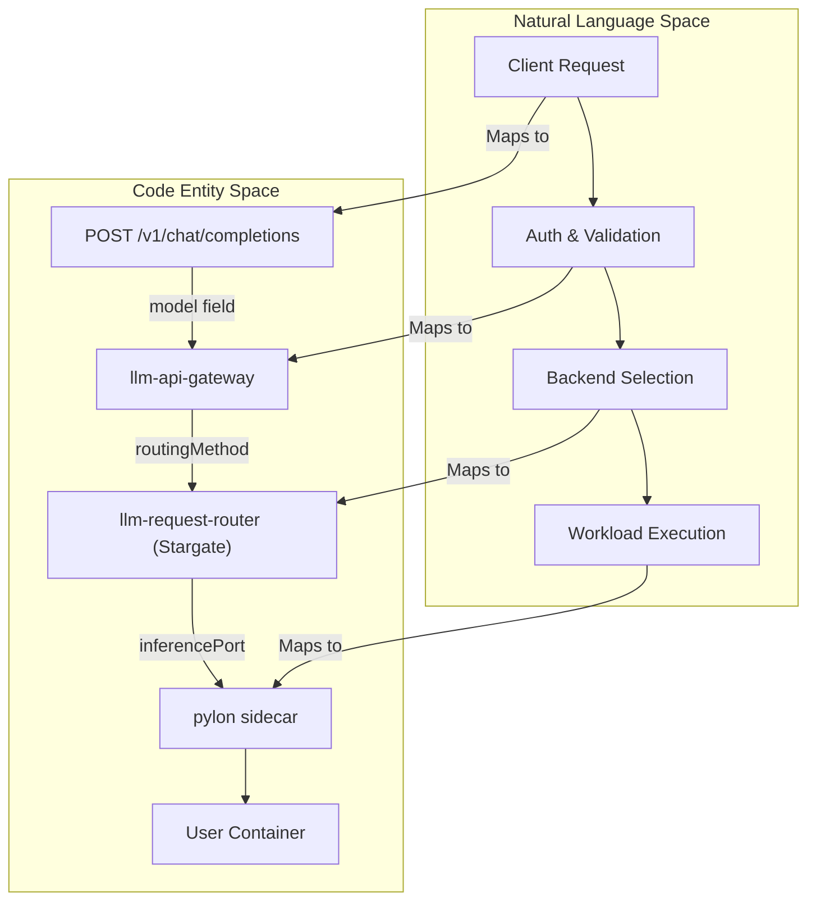
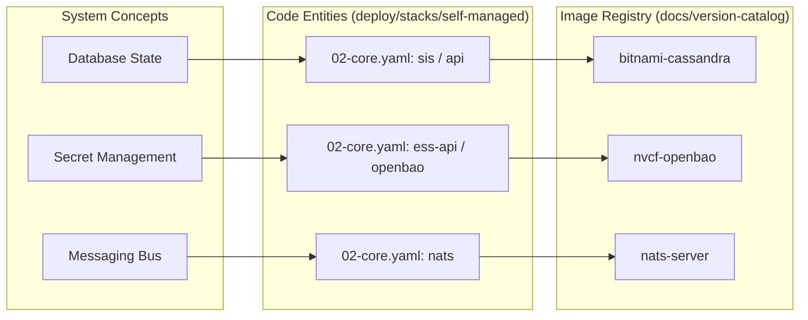

<!-- source: DeepWiki mcp.deepwiki.com · repo NVIDIA/nvcf · page 12 Glossary · fetched 2026-10-26 -->

# Glossary

Relevant source files

The following files were used as context for generating this wiki page:

- [.bazelignore](.bazelignore)
- [.bazelrc](.bazelrc)
- [.bazelversion](.bazelversion)
- [.github/ISSUE_TEMPLATE/config.yml](.github/ISSUE_TEMPLATE/config.yml)
- [.github/PULL_REQUEST_TEMPLATE.md](.github/PULL_REQUEST_TEMPLATE.md)
- [.github/workflows/stale.yaml](.github/workflows/stale.yaml)
- [.rumdl.toml](.rumdl.toml)
- [AGENTS.md](AGENTS.md)
- [CONTRIBUTING.md](CONTRIBUTING.md)
- [MODULE.bazel](MODULE.bazel)
- [MODULE.bazel.lock](MODULE.bazel.lock)
- [README.md](README.md)
- [ai-tooling/AGENTS.md](ai-tooling/AGENTS.md)
- [ai-tooling/CLAUDE.md](ai-tooling/CLAUDE.md)
- [ai-tooling/README.md](ai-tooling/README.md)
- [ai-tooling/dev/skills/documentation-style/SKILL.md](ai-tooling/dev/skills/documentation-style/SKILL.md)
- [ai-tooling/user/skills/nvcf-self-managed-cli/SKILL.md](ai-tooling/user/skills/nvcf-self-managed-cli/SKILL.md)
- [ai-tooling/user/skills/nvcf-self-managed-cli/prompts/deploy-and-invoke.md](ai-tooling/user/skills/nvcf-self-managed-cli/prompts/deploy-and-invoke.md)
- [ai-tooling/user/skills/nvcf-self-managed-cli/reference/commands.md](ai-tooling/user/skills/nvcf-self-managed-cli/reference/commands.md)
- [ai-tooling/user/skills/nvcf-self-managed-cli/reference/flags.md](ai-tooling/user/skills/nvcf-self-managed-cli/reference/flags.md)
- [deploy/helm/nvca-operator/nvca-operator/Chart.yaml](deploy/helm/nvca-operator/nvca-operator/Chart.yaml)
- [deploy/helm/nvca-operator/nvca-operator/templates/cluster-validator-network-checks-cm.yaml](deploy/helm/nvca-operator/nvca-operator/templates/cluster-validator-network-checks-cm.yaml)
- [deploy/helm/nvca-operator/nvca-operator/templates/cronjob.yaml](deploy/helm/nvca-operator/nvca-operator/templates/cronjob.yaml)
- [deploy/helm/nvca-operator/nvca-operator/templates/rbac.yaml](deploy/helm/nvca-operator/nvca-operator/templates/rbac.yaml)
- [deploy/stacks/self-managed/Makefile.dist](deploy/stacks/self-managed/Makefile.dist)
- [deploy/stacks/self-managed/environments/base.yaml](deploy/stacks/self-managed/environments/base.yaml)
- [deploy/stacks/self-managed/global.yaml.gotmpl](deploy/stacks/self-managed/global.yaml.gotmpl)
- [deploy/stacks/self-managed/helmfile-docker.mk](deploy/stacks/self-managed/helmfile-docker.mk)
- [deploy/stacks/self-managed/helmfile.d/01-dependencies.yaml.gotmpl](deploy/stacks/self-managed/helmfile.d/01-dependencies.yaml.gotmpl)
- [deploy/stacks/self-managed/helmfile.d/02-core.yaml.gotmpl](deploy/stacks/self-managed/helmfile.d/02-core.yaml.gotmpl)
- [deploy/stacks/self-managed/helmfile.d/03-observability.yaml.gotmpl](deploy/stacks/self-managed/helmfile.d/03-observability.yaml.gotmpl)
- [deploy/stacks/self-managed/secrets/secrets.yaml.template](deploy/stacks/self-managed/secrets/secrets.yaml.template)
- [docs/dev/architecture.md](docs/dev/architecture.md)
- [docs/dev/assets/architecture-overview.svg](docs/dev/assets/architecture-overview.svg)
- [docs/user/cli.md](docs/user/cli.md)
- [docs/user/cluster-management/gxcache.md](docs/user/cluster-management/gxcache.md)
- [docs/user/cluster-management/nsight-profiling.md](docs/user/cluster-management/nsight-profiling.md)
- [docs/user/cluster-management/self-managed.md](docs/user/cluster-management/self-managed.md)
- [docs/user/function-creation.md](docs/user/function-creation.md)
- [docs/user/image-mirroring.md](docs/user/image-mirroring.md)
- [docs/user/images/nvcf-gpu-cluster-targeting.svg](docs/user/images/nvcf-gpu-cluster-targeting.svg)
- [docs/user/images/nvcf-high-level-stack.svg](docs/user/images/nvcf-high-level-stack.svg)
- [docs/user/images/nvcf-multi-region-multi-cluster.svg](docs/user/images/nvcf-multi-region-multi-cluster.svg)
- [docs/user/llm-gateway.md](docs/user/llm-gateway.md)
- [docs/user/manifest.md](docs/user/manifest.md)
- [docs/version-catalog/main.yaml](docs/version-catalog/main.yaml)
- [maven_install.json](maven_install.json)
- [setup.sh](setup.sh)
- [src/clis/nvcf-cli/README.md](src/clis/nvcf-cli/README.md)
- [src/clis/nvcf-cli/USAGE-GUIDE.md](src/clis/nvcf-cli/USAGE-GUIDE.md)
- [src/clis/nvcf-cli/cmd/function.go](src/clis/nvcf-cli/cmd/function.go)
- [src/clis/nvcf-cli/cmd/function_llm_model_test.go](src/clis/nvcf-cli/cmd/function_llm_model_test.go)
- [src/clis/nvcf-cli/internal/agentskill/skilldata_generated.go](src/clis/nvcf-cli/internal/agentskill/skilldata_generated.go)
- [src/clis/nvcf-cli/internal/client/client.go](src/clis/nvcf-cli/internal/client/client.go)
- [src/clis/nvcf-cli/internal/client/client_test.go](src/clis/nvcf-cli/internal/client/client_test.go)
- [src/compute-plane-services/nvca/internal/miniservice/BUILD.bazel](src/compute-plane-services/nvca/internal/miniservice/BUILD.bazel)
- [src/compute-plane-services/nvca/internal/miniservice/reconcile.go](src/compute-plane-services/nvca/internal/miniservice/reconcile.go)
- [src/compute-plane-services/nvca/internal/miniservice/reconcile_test.go](src/compute-plane-services/nvca/internal/miniservice/reconcile_test.go)
- [src/compute-plane-services/nvca/internal/miniservice/reconcile_update_test.go](src/compute-plane-services/nvca/internal/miniservice/reconcile_update_test.go)
- [src/compute-plane-services/nvca/internal/miniservice/reval_client.go](src/compute-plane-services/nvca/internal/miniservice/reval_client.go)
- [src/compute-plane-services/nvca/internal/miniservice/reval_client_test.go](src/compute-plane-services/nvca/internal/miniservice/reval_client_test.go)
- [src/compute-plane-services/nvca/internal/miniservice/revision.go](src/compute-plane-services/nvca/internal/miniservice/revision.go)
- [src/compute-plane-services/nvca/internal/miniservice/revision_test.go](src/compute-plane-services/nvca/internal/miniservice/revision_test.go)
- [src/compute-plane-services/nvca/internal/miniservice/status.go](src/compute-plane-services/nvca/internal/miniservice/status.go)
- [src/compute-plane-services/nvca/internal/miniservice/status_karta.go](src/compute-plane-services/nvca/internal/miniservice/status_karta.go)
- [src/compute-plane-services/nvca/internal/miniservice/status_karta_test.go](src/compute-plane-services/nvca/internal/miniservice/status_karta_test.go)
- [src/compute-plane-services/nvca/internal/miniservice/status_test.go](src/compute-plane-services/nvca/internal/miniservice/status_test.go)
- [src/compute-plane-services/nvca/internal/miniservice/transport_tls.go](src/compute-plane-services/nvca/internal/miniservice/transport_tls.go)
- [src/compute-plane-services/nvca/internal/util/k8sutil/pod.go](src/compute-plane-services/nvca/internal/util/k8sutil/pod.go)
- [src/compute-plane-services/nvca/internal/util/k8sutil/pod_test.go](src/compute-plane-services/nvca/internal/util/k8sutil/pod_test.go)
- [src/compute-plane-services/nvca/pkg/apis/nvca/v1alpha1/generated.openapi.go](src/compute-plane-services/nvca/pkg/apis/nvca/v1alpha1/generated.openapi.go)
- [src/compute-plane-services/nvca/pkg/apis/nvca/v1alpha1/miniservice_json.go](src/compute-plane-services/nvca/pkg/apis/nvca/v1alpha1/miniservice_json.go)
- [src/compute-plane-services/nvca/pkg/apis/nvca/v1alpha1/miniservice_json_test.go](src/compute-plane-services/nvca/pkg/apis/nvca/v1alpha1/miniservice_json_test.go)
- [src/compute-plane-services/nvca/pkg/apis/nvca/v1alpha1/zz_generated.deepcopy.go](src/compute-plane-services/nvca/pkg/apis/nvca/v1alpha1/zz_generated.deepcopy.go)
- [src/control-plane-services/helm-reval/go.mod](src/control-plane-services/helm-reval/go.mod)
- [src/control-plane-services/helm-reval/go.sum](src/control-plane-services/helm-reval/go.sum)
- [src/control-plane-services/helm-reval/pkg/reval/config/config.go](src/control-plane-services/helm-reval/pkg/reval/config/config.go)
- [src/control-plane-services/helm-reval/pkg/reval/service/models.go](src/control-plane-services/helm-reval/pkg/reval/service/models.go)
- [src/control-plane-services/helm-reval/pkg/reval/service/service.go](src/control-plane-services/helm-reval/pkg/reval/service/service.go)
- [src/control-plane-services/helm-reval/reval/BUILD.bazel](src/control-plane-services/helm-reval/reval/BUILD.bazel)
- [src/control-plane-services/helm-reval/reval/helm_template.go](src/control-plane-services/helm-reval/reval/helm_template.go)
- [src/control-plane-services/helm-reval/reval/helm_template_test.go](src/control-plane-services/helm-reval/reval/helm_template_test.go)
- [src/control-plane-services/helm-reval/reval/run.go](src/control-plane-services/helm-reval/reval/run.go)
- [src/control-plane-services/helm-reval/reval/run_test.go](src/control-plane-services/helm-reval/reval/run_test.go)
- [src/control-plane-services/instance-cluster-management/BAZEL.md](src/control-plane-services/instance-cluster-management/BAZEL.md)
- [src/control-plane-services/instance-cluster-management/icms-core/BUILD.bazel](src/control-plane-services/instance-cluster-management/icms-core/BUILD.bazel)
- [src/libraries/rust/stargate/Cargo.lock](src/libraries/rust/stargate/Cargo.lock)
- [src/libraries/rust/stargate/Cargo.toml](src/libraries/rust/stargate/Cargo.toml)
- [src/libraries/rust/stargate/Dockerfile](src/libraries/rust/stargate/Dockerfile)
- [src/libraries/rust/stargate/README.md](src/libraries/rust/stargate/README.md)
- [src/libraries/rust/stargate/crates/mock-dynamo/src/main.rs](src/libraries/rust/stargate/crates/mock-dynamo/src/main.rs)
- [src/libraries/rust/stargate/crates/mock-dynamo/src/openai.rs](src/libraries/rust/stargate/crates/mock-dynamo/src/openai.rs)
- [src/libraries/rust/stargate/crates/mock-dynamo/src/test_control.rs](src/libraries/rust/stargate/crates/mock-dynamo/src/test_control.rs)
- [src/libraries/rust/stargate/crates/mock-dynamo/src/tests.rs](src/libraries/rust/stargate/crates/mock-dynamo/src/tests.rs)
- [src/libraries/rust/stargate/crates/protocol/src/lib.rs](src/libraries/rust/stargate/crates/protocol/src/lib.rs)
- [src/libraries/rust/stargate/crates/stargate-telemetry/src/lib.rs](src/libraries/rust/stargate/crates/stargate-telemetry/src/lib.rs)
- [tools/bazel/BUILD.bazel](tools/bazel/BUILD.bazel)
- [tools/bazel/patches/gazelle_go_work_dev_dependency.patch](tools/bazel/patches/gazelle_go_work_dev_dependency.patch)
- [tools/ci/check-doc-version-sync](tools/ci/check-doc-version-sync)
- [tools/ci/check-oci-pins](tools/ci/check-oci-pins)
- [tools/ci/check-private-go-module-paths](tools/ci/check-private-go-module-paths)
- [tools/ci/preview-docs](tools/ci/preview-docs)
- [tools/docs-version-sync/catalog.go](tools/docs-version-sync/catalog.go)
- [tools/docs-version-sync/inline.go](tools/docs-version-sync/inline.go)
- [tools/docs-version-sync/main_test.go](tools/docs-version-sync/main_test.go)
- [tools/docs-version-sync/render.go](tools/docs-version-sync/render.go)
- [tools/scripts/cut-docs-version.sh](tools/scripts/cut-docs-version.sh)
- [tools/scripts/test/test-check-doc-version-sync](tools/scripts/test/test-check-doc-version-sync)
- [tools/scripts/test/test-cut-docs-version](tools/scripts/test/test-cut-docs-version)

This glossary defines the technical terms, service names, and domain concepts specific to the NVIDIA Cloud Functions (NVCF) codebase. It serves as a reference for onboarding engineers to navigate the three-plane architecture and its implementation.

## System Planes

The NVCF architecture is divided into three distinct logical and physical planes to ensure isolation between management, request routing, and workload execution.

| Plane | Responsibility | Key Services |
| :--- | :--- | :--- |
| **Control Plane** | Management of functions, deployments, secrets, and cluster registrations. | `nvcf-service`, `icms`, `ess-api`, `api-keys` |
| **Invocation Plane** | Request entry, protocol translation (HTTP/gRPC/LLM), and routing. | `http-invocation`, `grpc-proxy`, `llm-api-gateway`, `stargate` |
| **Compute Plane** | Execution of workloads on GPU clusters and local agent coordination. | `nvca`, `miniservice-controller`, `pylon`, `worker-sidecars` |

**Sources:** [README.md:14-38](), [docs/user/manifest.md:109-127]()

## Core Terminology

### Admin Token
A high-privilege JWT used for administrative operations such as cluster registration, function lifecycle management, and sensitive platform operations.
*   **Implementation:** Handled by the `admin-token-issuer-proxy`.
*   **Code Pointer:** [deploy/stacks/self-managed/helmfile.d/02-core.yaml.gotmpl:113-143]()
*   **CLI Usage:** Resolved via `NVCF_TOKEN` environment variable. [ai-tooling/user/skills/nvcf-self-managed-cli/SKILL.md:88-94]()

### ESS (Encrypted Secret Store)
A service and agent architecture for managing tenant-scoped secrets. It interfaces with OpenBao (Vault) to provide secrets to function pods at runtime.
*   **Components:** `ess-api` (Control Plane) and `ess-agent` (Compute Plane sidecar).
*   **Code Pointer:** [deploy/stacks/self-managed/helmfile.d/02-core.yaml.gotmpl:101-106](), [docs/version-catalog/main.yaml:75-77]()

### ICMS (Instance and Cluster Management Service)
The central authority for managing GPU clusters. It handles cluster registration, tracks health, and manages OIDC/JWKS for authenticating compute plane agents.
*   **Implementation:** Defined as `sis` (Service Instance Store) in deployment manifests.
*   **Code Pointer:** [deploy/stacks/self-managed/helmfile.d/02-core.yaml.gotmpl:52-56](), [src/control-plane-services/instance-cluster-management/icms-core/BUILD.bazel:1-5]()

### LLM Gateway & Stargate
A specialized invocation path for OpenAI-compatible Large Language Model requests.
*   **LLM API Gateway:** Handles `/v1/chat/completions` and extracts routing keys from the `model` field. [docs/user/llm-gateway.md:30-32]()
*   **Stargate (Request Router):** A Rust-based service that selects healthy backends using algorithms like `power_of_two` or `round_robin`. [docs/user/llm-gateway.md:33-35](), [docs/user/llm-gateway.md:82-86]()

### MiniService
A Kubernetes Custom Resource (CRD) used by the Compute Plane to represent a deployed NVCF function. It is reconciled by the `nvca` agent.
*   **Implementation:** Managed within the `miniservice` package in NVCA.
*   **Code Pointer:** [src/compute-plane-services/nvca/internal/miniservice/reconcile.go:1-10](), [src/compute-plane-services/nvca/internal/miniservice/revision.go:1-10]()

### NVCA (NVIDIA Cluster Agent)
The primary operator running on GPU clusters. It registers the cluster with ICMS and manages the lifecycle of `NVCFBackend` and `MiniService` resources.
*   **Implementation:** Located in `src/compute-plane-services/nvca/`.
*   **Code Pointer:** [docs/version-catalog/main.yaml:66-71](), [deploy/helm/nvca-operator/nvca-operator/Chart.yaml:1-5]()

### Pylon
A sidecar proxy (part of the Stargate library) that provides a QUIC-HTTP tunnel for efficient request delivery to worker containers, especially for streaming workloads.
*   **Code Pointer:** [docs/version-catalog/main.yaml:114-116](), [docs/user/llm-gateway.md:34-35]()

### ReVal (Helm Revalidation Service)
A Go-based service that validates and renders Helm charts before they are deployed to the compute plane.
*   **Implementation:** Located in `src/control-plane-services/helm-reval/`.
*   **Code Pointer:** [src/control-plane-services/helm-reval/reval/run.go:1-20](), [deploy/stacks/self-managed/helmfile.d/02-core.yaml.gotmpl:145-153]()

---

## Architectural Mapping: Natural Language to Code Entities

The following diagrams bridge high-level system concepts to their specific code representations and file locations.

### Invocation Request Flow Mapping
This diagram maps the logical steps of an LLM request to the specific services and configuration fields used in the code.

**Sources:** [docs/user/llm-gateway.md:24-38](), [docs/user/llm-gateway.md:52-72]()

### Deployment & Configuration Mapping
This diagram associates infrastructure concepts with the Helmfile and Version Catalog entities that define them.

**Sources:** [deploy/stacks/self-managed/helmfile.d/02-core.yaml.gotmpl:43-112](), [docs/version-catalog/main.yaml:45-47](), [docs/version-catalog/main.yaml:133-140]()

---

## Technical Artifacts Summary

The following table summarizes the key container images and Helm charts defined in the `version-catalog`.

| Artifact Name | Type | Registry Alias | Purpose |
| :--- | :--- | :--- | :--- |
| `nvcf-service-oss` | Image | `public-images` | Core NVCF API logic. |
| `nvca` | Image | `public-images` | Compute plane agent. |
| `helm-nvcf-api` | Chart | `public-helm` | Deploys the control plane API. |
| `nvcf-openbao` | Image | `selfhosted-ga` | Security and secret storage. |
| `pylon` | Image | `public-images` | High-performance worker proxy. |

**Sources:** [docs/version-catalog/main.yaml:48-116](), [docs/version-catalog/main.yaml:153-201]()