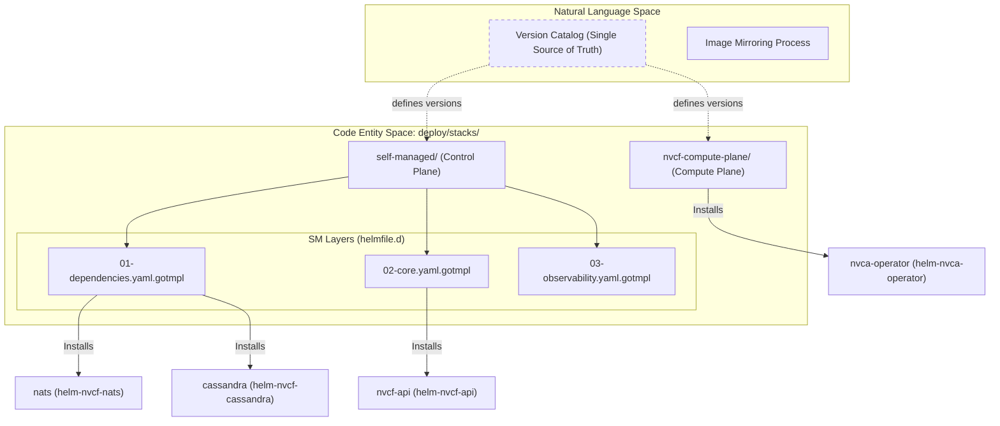
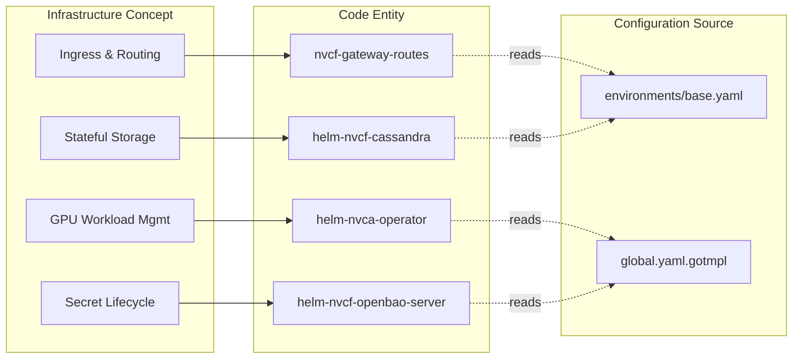

<!-- source: DeepWiki mcp.deepwiki.com · repo NVIDIA/nvcf · page 5 Deployment and Infrastructure · fetched 2026-10-26 -->

# Deployment and Infrastructure

Relevant source files

The following files were used as context for generating this wiki page:

- [deploy/helm/nvca-operator/nvca-operator/Chart.yaml](deploy/helm/nvca-operator/nvca-operator/Chart.yaml)
- [deploy/helm/nvca-operator/nvca-operator/templates/cluster-validator-network-checks-cm.yaml](deploy/helm/nvca-operator/nvca-operator/templates/cluster-validator-network-checks-cm.yaml)
- [deploy/helm/nvca-operator/nvca-operator/templates/cronjob.yaml](deploy/helm/nvca-operator/nvca-operator/templates/cronjob.yaml)
- [deploy/helm/nvca-operator/nvca-operator/templates/rbac.yaml](deploy/helm/nvca-operator/nvca-operator/templates/rbac.yaml)
- [deploy/stacks/self-managed/Makefile.dist](deploy/stacks/self-managed/Makefile.dist)
- [deploy/stacks/self-managed/environments/base.yaml](deploy/stacks/self-managed/environments/base.yaml)
- [deploy/stacks/self-managed/global.yaml.gotmpl](deploy/stacks/self-managed/global.yaml.gotmpl)
- [deploy/stacks/self-managed/helmfile-docker.mk](deploy/stacks/self-managed/helmfile-docker.mk)
- [deploy/stacks/self-managed/helmfile.d/01-dependencies.yaml.gotmpl](deploy/stacks/self-managed/helmfile.d/01-dependencies.yaml.gotmpl)
- [deploy/stacks/self-managed/helmfile.d/02-core.yaml.gotmpl](deploy/stacks/self-managed/helmfile.d/02-core.yaml.gotmpl)
- [deploy/stacks/self-managed/helmfile.d/03-observability.yaml.gotmpl](deploy/stacks/self-managed/helmfile.d/03-observability.yaml.gotmpl)
- [deploy/stacks/self-managed/secrets/secrets.yaml.template](deploy/stacks/self-managed/secrets/secrets.yaml.template)
- [docs/user/cluster-management/nsight-profiling.md](docs/user/cluster-management/nsight-profiling.md)
- [docs/user/cluster-management/self-managed.md](docs/user/cluster-management/self-managed.md)
- [docs/user/image-mirroring.md](docs/user/image-mirroring.md)
- [docs/user/manifest.md](docs/user/manifest.md)
- [docs/version-catalog/main.yaml](docs/version-catalog/main.yaml)
- [tools/docs-version-sync/catalog.go](tools/docs-version-sync/catalog.go)
- [tools/docs-version-sync/inline.go](tools/docs-version-sync/inline.go)
- [tools/docs-version-sync/main_test.go](tools/docs-version-sync/main_test.go)
- [tools/docs-version-sync/render.go](tools/docs-version-sync/render.go)

This page provides a high-level overview of the NVIDIA Cloud Functions (NVCF) deployment architecture. NVCF utilizes a multi-layered deployment strategy based on **Helmfile** stacks to manage the lifecycle of the Control Plane, Invocation Plane, and Compute Plane. The infrastructure is defined as code, leveraging a central version catalog to ensure consistency across services, databases, and secret management providers.

## Deployment Architecture Overview

NVCF is deployed using two primary Helmfile stacks: the **Self-Managed Stack** (Control and Invocation Planes) and the **Compute Plane Stack**. These stacks orchestrate the deployment of numerous Helm charts, ranging from core dependencies like NATS and Cassandra to specialized NVCF services.

### Deployment Flow Diagram
The following diagram illustrates how deployment artifacts flow from the Version Catalog into the Kubernetes clusters through Helmfile orchestration.

"Deployment Artifact Flow"

**Sources:** [deploy/stacks/self-managed/helmfile.d/01-dependencies.yaml.gotmpl:44-72](), [deploy/stacks/self-managed/helmfile.d/02-core.yaml.gotmpl:43-211](), [docs/version-catalog/main.yaml:1-252]()

---

## 1. Self-Managed Stack (Control Plane)
The self-managed stack handles the core NVCF logic and the invocation gateway. It is organized into three sequential layers to ensure dependencies are ready before higher-level services start.

*   **Layer 01 (Dependencies):** Deploys NATS for messaging, Cassandra for state, and OpenBao for secrets [deploy/stacks/self-managed/helmfile.d/01-dependencies.yaml.gotmpl:44-72]().
*   **Layer 02 (Core):** Deploys the functional services including `nvcf-api`, `invocation-service`, `grpc-proxy`, and the `ingress` gateway [deploy/stacks/self-managed/helmfile.d/02-core.yaml.gotmpl:43-228]().
*   **Layer 03 (Observability):** Deploys `state-metrics` and the `function-autoscaler` [deploy/stacks/self-managed/helmfile.d/03-observability.yaml.gotmpl:57-78]().

For details, see [Self-Managed Stack Helmfile Deployment](#5.1).

---

## 2. Compute Plane Stack
The compute plane stack is deployed on GPU clusters. Its primary component is the `nvca-operator`, which manages the `NVCFBackend` custom resources and coordinates with the Control Plane to execute workloads.

*   **Registration:** Clusters must be registered via `nvcf-cli` to obtain a unique `clusterID` before deployment [docs/user/cluster-management/self-managed.md:58-69]().
*   **Operator Lifecycle:** The `nvca-operator` handles the injection of sidecars (like the ESS agent) and manages the MiniService lifecycle [docs/user/cluster-management/self-managed.md:70-83]().

For details, see [Compute Plane Stack Deployment](#5.2).

---

## 3. Database Migrations
NVCF manages schema evolution for Cassandra and configuration for OpenBao through automated migration jobs.

*   **Cassandra Migrations:** Uses a specialized migration container (`nvcf-cassandra-migrations`) to manage keyspaces such as `nvcf_api`, `sis_api`, and `ess_api` [deploy/stacks/self-managed/global.yaml.gotmpl:51-57]().
*   **OpenBao Migrations:** Configures authentication methods, secret engines, and PKI infrastructure required for secure inter-service communication [deploy/stacks/self-managed/global.yaml.gotmpl:106-123]().

For details, see [Database Migrations: Cassandra and OpenBao](#5.3).

---

## 4. Secret Management (OpenBao)
NVCF uses **OpenBao** (a community-maintained fork of Vault) for all sensitive data. Secrets flow to services via `vault-agent` sidecars that authenticate using Kubernetes Service Account tokens.

*   **Identity:** Services use OpenBao-rendered bearer tokens for authentication [deploy/stacks/self-managed/environments/base.yaml:152-155]().
*   **Injection:** The `openbao.injector` handles the automatic sidecar injection into service pods [deploy/stacks/self-managed/global.yaml.gotmpl:125-157]().

For details, see [OpenBao (Vault) and Secret Management](#5.4).

---

## 5. Artifact Manifest and Version Catalog
To maintain stability across complex deployments, NVCF uses a **Version Catalog** as the single source of truth for all container images and Helm charts.

*   **Catalog:** Located at `docs/version-catalog/main.yaml`, it defines the exact versions of every component [docs/version-catalog/main.yaml:29-252]().
*   **Mirroring:** Artifacts are mirrored from `nvcr.io` to local registries to support air-gapped or private environments [docs/user/manifest.md:20-58]().
*   **Sync Tooling:** The `docs-version-sync` tool ensures that the public-facing documentation and the artifact manifest stay in sync with the code [tools/docs-version-sync/main_test.go:78-101]().

For details, see [Artifact Manifest and Version Catalog](#5.5).

---

## Infrastructure Configuration Mapping
The following diagram maps high-level infrastructure concepts to the specific configuration files and entities within the codebase.

"Infrastructure to Code Mapping"

**Sources:** [deploy/stacks/self-managed/environments/base.yaml:4-138](), [deploy/stacks/self-managed/global.yaml.gotmpl:27-174](), [deploy/stacks/self-managed/helmfile.d/02-core.yaml.gotmpl:213-228]()

---

