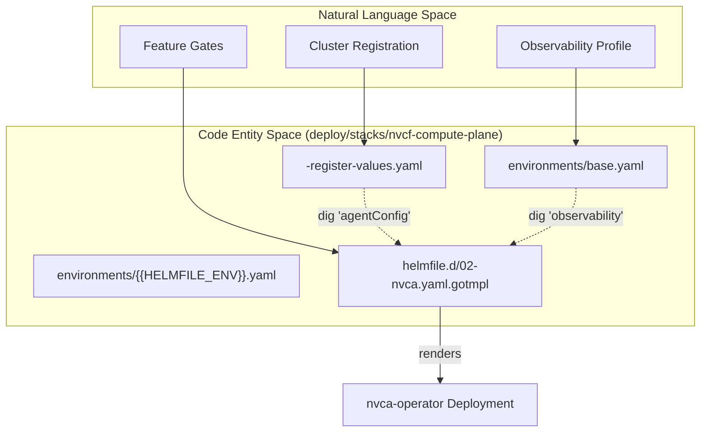
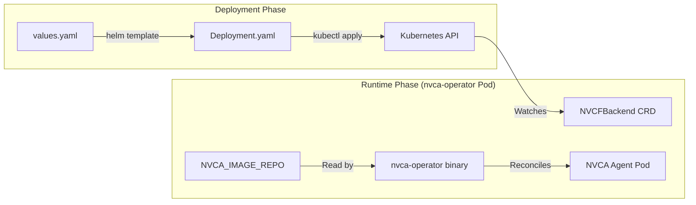

<!-- source: DeepWiki mcp.deepwiki.com · repo NVIDIA/nvcf · page 5.2 Compute Plane Stack Deployment · fetched 2026-10-26 -->

# Compute Plane Stack Deployment

Relevant source files

The following files were used as context for generating this wiki page:

- [deploy/helm/nvca-operator/Makefile](deploy/helm/nvca-operator/Makefile)
- [deploy/helm/nvca-operator/nvca-operator/README.md](deploy/helm/nvca-operator/nvca-operator/README.md)
- [deploy/helm/nvca-operator/nvca-operator/templates/_helpers.tpl](deploy/helm/nvca-operator/nvca-operator/templates/_helpers.tpl)
- [deploy/helm/nvca-operator/nvca-operator/templates/deployment.yaml](deploy/helm/nvca-operator/nvca-operator/templates/deployment.yaml)
- [deploy/helm/nvca-operator/nvca-operator/values.schema.json](deploy/helm/nvca-operator/nvca-operator/values.schema.json)
- [deploy/helm/nvca-operator/nvca-operator/values.yaml](deploy/helm/nvca-operator/nvca-operator/values.yaml)
- [deploy/helm/nvca-operator/scripts/ci_vendor_nvca_operator_chart](deploy/helm/nvca-operator/scripts/ci_vendor_nvca_operator_chart)
- [deploy/helm/nvca-operator/scripts/render_release_supplemental_images.sh](deploy/helm/nvca-operator/scripts/render_release_supplemental_images.sh)
- [deploy/helm/nvca-operator/tests/image_pull_secret_defaults_test.sh](deploy/helm/nvca-operator/tests/image_pull_secret_defaults_test.sh)
- [deploy/helm/nvca-operator/tests/release_image_manifest_test.sh](deploy/helm/nvca-operator/tests/release_image_manifest_test.sh)
- [deploy/helm/nvca-operator/tests/self_managed_nvca_image_reference_test.sh](deploy/helm/nvca-operator/tests/self_managed_nvca_image_reference_test.sh)
- [deploy/stacks/nvcf-compute-plane/Makefile](deploy/stacks/nvcf-compute-plane/Makefile)
- [deploy/stacks/nvcf-compute-plane/README.md](deploy/stacks/nvcf-compute-plane/README.md)
- [deploy/stacks/nvcf-compute-plane/environments/base.yaml](deploy/stacks/nvcf-compute-plane/environments/base.yaml)
- [deploy/stacks/nvcf-compute-plane/helmfile.d/02-nvca.yaml.gotmpl](deploy/stacks/nvcf-compute-plane/helmfile.d/02-nvca.yaml.gotmpl)
- [deploy/stacks/nvcf-compute-plane/testdata/golden/local/02-nvca.yaml-nvca-operator/helm-nvca-operator/templates/agent-config-merge-cm.yaml](deploy/stacks/nvcf-compute-plane/testdata/golden/local/02-nvca.yaml-nvca-operator/helm-nvca-operator/templates/agent-config-merge-cm.yaml)
- [deploy/stacks/nvcf-compute-plane/testdata/golden/local/02-nvca.yaml-nvca-operator/helm-nvca-operator/templates/rbac_allowed_extra_types.yaml](deploy/stacks/nvcf-compute-plane/testdata/golden/local/02-nvca.yaml-nvca-operator/helm-nvca-operator/templates/rbac_allowed_extra_types.yaml)
- [deploy/stacks/nvcf-compute-plane/testdata/golden/local/02-nvca.yaml-nvca-operator/helm-nvca-operator/templates/self-managed-nvcfbackend-cm.yaml](deploy/stacks/nvcf-compute-plane/testdata/golden/local/02-nvca.yaml-nvca-operator/helm-nvca-operator/templates/self-managed-nvcfbackend-cm.yaml)
- [deploy/stacks/nvcf-compute-plane/tests/observability-profile.sh](deploy/stacks/nvcf-compute-plane/tests/observability-profile.sh)
- [src/compute-plane-services/nvca/deployments/nvca-operator/README.md](src/compute-plane-services/nvca/deployments/nvca-operator/README.md)
- [src/compute-plane-services/nvca/deployments/nvca-operator/templates/_helpers.tpl](src/compute-plane-services/nvca/deployments/nvca-operator/templates/_helpers.tpl)
- [src/compute-plane-services/nvca/deployments/nvca-operator/templates/deployment.yaml](src/compute-plane-services/nvca/deployments/nvca-operator/templates/deployment.yaml)
- [src/compute-plane-services/nvca/deployments/nvca-operator/values.schema.json](src/compute-plane-services/nvca/deployments/nvca-operator/values.schema.json)
- [src/compute-plane-services/nvca/deployments/nvca-operator/values.yaml](src/compute-plane-services/nvca/deployments/nvca-operator/values.yaml)

The **nvcf-compute-plane** stack is responsible for deploying the necessary components onto GPU clusters to enable them to execute NVIDIA Cloud Functions (NVCF) workloads. This stack primarily manages the lifecycle of the **NVIDIA Cluster Agent (NVCA) Operator**, which in turn bootstraps the compute plane environment, handles cluster registration, and manages workload isolation.

## NVCA Operator Release

The core of the compute plane deployment is the `nvca-operator` Helm chart. This operator manages the installation and reconfiguration of the NVCA agent, which is the primary bridge between the Kubernetes cluster and the NVCF Control Plane [deploy/helm/nvca-operator/nvca-operator/README.md:3-5]().

### Configuration and Feature Gates
The deployment is highly configurable via `values.yaml`, supporting various feature gates that enable advanced scheduling and workload support:
*   **DynamicGPUDiscovery**: Enables automatic detection of GPU resources.
*   **BYOObservability**: Integrates Bring-Your-Own-OTel capabilities.
*   **KAIScheduler**: Enables support for the KAI (Kubernetes AI) scheduler.
*   **DynamoOperatorSupport**: Enables support for the Dynamo operator and multi-node training/inference workloads.

The Helmfile stack uses a helper function, `nvca-operator.featureGateValues`, to normalize these gates, ensuring that default gates (like resource limit enforcement) are maintained even when custom gates are added [deploy/stacks/nvcf-compute-plane/helmfile.d/02-nvca.yaml.gotmpl:31-56]().

### Cluster Registration Flow
Before a compute plane can be fully operational, it must be registered with the Control Plane.
1.  **Registration Values**: The operator requires a registration handoff file (e.g., `<cluster-name>-register-values.yaml`) generated during the registration process [deploy/stacks/nvcf-compute-plane/helmfile.d/02-nvca.yaml.gotmpl:72-75]().
2.  **Merge Config**: The stack merges agent configurations from the registration file and the environment-specific values to create the final NVCA configuration [deploy/stacks/nvcf-compute-plane/helmfile.d/02-nvca.yaml.gotmpl:83-89]().

### Deployment Logic association
The following diagram associates the Helm deployment entities with their corresponding configuration sources in the codebase.

**Compute Plane Deployment Entity Map**

Sources: [deploy/stacks/nvcf-compute-plane/helmfile.d/02-nvca.yaml.gotmpl:72-98](), [deploy/stacks/nvcf-compute-plane/environments/base.yaml]()

## Observability Profile Options

The stack supports an `observability.profile` setting that determines which telemetry components are deployed to the compute plane [deploy/stacks/nvcf-compute-plane/helmfile.d/02-nvca.yaml.gotmpl:78]().

| Profile | Description |
| :--- | :--- |
| `disabled` | No observability components are deployed. |
| `control` | Only control-plane related telemetry is enabled (if applicable). |
| `compute` | Enables the OTel collector sidecar for Kubernetes event collection and BYOO metrics [deploy/helm/nvca-operator/nvca-operator/values.yaml:30-38](). |
| `all` | Enables both control and compute observability features. |

The `otelCollector` configuration within the operator allows for fine-grained resource limits and image overrides for the telemetry sidecar [deploy/helm/nvca-operator/nvca-operator/values.yaml:37-47]().

## Lifecycle Management and Makefile Targets

The compute plane lifecycle is managed via a `Makefile` located in `deploy/stacks/nvcf-compute-plane/`.

### Key Targets
*   **`make register-cluster CLUSTER_NAME=<name>`**: Scopes the registration values and prepares the cluster for installation [deploy/stacks/nvcf-compute-plane/helmfile.d/02-nvca.yaml.gotmpl:7]().
*   **`make install`**: Executes `helmfile apply` to deploy the stack components.
*   **`make template`**: Renders the Helm templates locally for debugging.
*   **`make test`**: Runs the observability profile validation scripts [deploy/stacks/nvcf-compute-plane/tests/observability-profile.sh]().

### Golden Test Data
To ensure stability, the stack maintains "golden" test data in `deploy/stacks/nvcf-compute-plane/testdata/golden/`. These files represent the expected output of rendered Helm templates for specific configurations (e.g., `local` k3d clusters).
*   **`agent-config-merge-cm.yaml`**: The rendered ConfigMap containing the merged NVCA agent configuration [deploy/stacks/nvcf-compute-plane/testdata/golden/local/02-nvca.yaml-nvca-operator/helm-nvca-operator/templates/agent-config-merge-cm.yaml]().
*   **`rbac_allowed_extra_types.yaml`**: The RBAC rules generated for extra Kubernetes types required by addons like Grove or Dynamo [deploy/stacks/nvcf-compute-plane/testdata/golden/local/02-nvca.yaml-nvca-operator/helm-nvca-operator/templates/rbac_allowed_extra_types.yaml]().

## Implementation Details

### Validation Policies
The NVCA Operator uses a `validationPolicy` to restrict which Kubernetes resources can be created within the compute plane [deploy/helm/nvca-operator/nvca-operator/values.yaml:96-97](). The Helmfile stack automatically appends required types for enabled addons (e.g., `PodGroup` for KAI Scheduler, `DynamoModel` for Dynamo) to the `allowedExtraKubernetesTypes` list [deploy/stacks/nvcf-compute-plane/helmfile.d/02-nvca.yaml.gotmpl:108-130]().

### Image Reference Management
The stack includes scripts for vendoring and managing image references to ensure consistency across environments.
*   **`ci_vendor_nvca_operator_chart`**: A script used to vendor the NVCA Operator chart from the monorepo source into the deployment stack, applying license headers and updating image tags [deploy/helm/nvca-operator/scripts/ci_vendor_nvca_operator_chart:170-171]().
*   **`render_release_supplemental_images.sh`**: Renders annotations for supplemental images like the `image-credential-helper` and `samba` storage [deploy/helm/nvca-operator/scripts/render_release_supplemental_images.sh]().

**Data Flow: Configuration to Agent Pod**

Sources: [deploy/helm/nvca-operator/nvca-operator/templates/deployment.yaml:103-132](), [deploy/helm/nvca-operator/nvca-operator/values.yaml:68-69]()

### Resource Management
The operator and agent containers have specific resource requests and limits defined in `values.yaml` to ensure they do not interfere with GPU workloads [deploy/helm/nvca-operator/nvca-operator/values.yaml:143-154](). The `priorityClassName` is also supported to prevent eviction during cluster resource pressure [deploy/helm/nvca-operator/nvca-operator/values.yaml:82-83]().

Sources:
* [deploy/helm/nvca-operator/nvca-operator/values.yaml:1-154]()
* [deploy/stacks/nvcf-compute-plane/helmfile.d/02-nvca.yaml.gotmpl:1-144]()
* [deploy/helm/nvca-operator/nvca-operator/README.md:1-40]()
* [deploy/helm/nvca-operator/nvca-operator/templates/deployment.yaml:1-163]()
* [deploy/helm/nvca-operator/nvca-operator/templates/_helpers.tpl:1-200]()
* [deploy/helm/nvca-operator/scripts/ci_vendor_nvca_operator_chart:1-171]()

---

