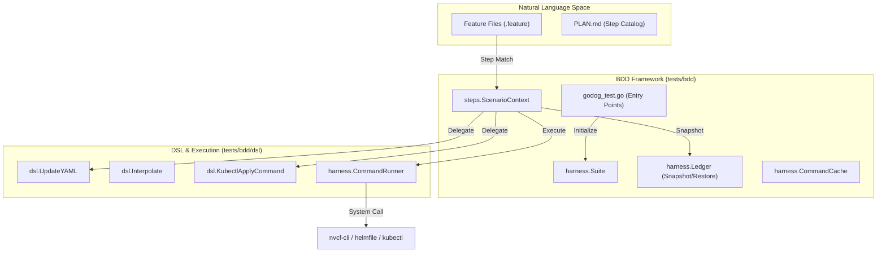
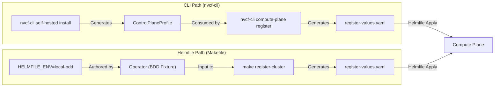

<!-- source: DeepWiki mcp.deepwiki.com · repo NVIDIA/nvcf · page 9.1 BDD Integration Test Suite · fetched 2026-10-26 -->

# BDD Integration Test Suite

<details>
<summary>Relevant source files</summary>

The following files were used as context for generating this wiki page:

- [tests/bdd/AGENTS.md](tests/bdd/AGENTS.md)
- [tests/bdd/PLAN.md](tests/bdd/PLAN.md)
- [tests/bdd/PLAN_DESTRUCTIVE_CLEANUP.md](tests/bdd/PLAN_DESTRUCTIVE_CLEANUP.md)
- [tests/bdd/README.md](tests/bdd/README.md)
- [tests/bdd/dsl/kubectl.go](tests/bdd/dsl/kubectl.go)
- [tests/bdd/dsl/kubectl_test.go](tests/bdd/dsl/kubectl_test.go)
- [tests/bdd/dsl/yamledit.go](tests/bdd/dsl/yamledit.go)
- [tests/bdd/dsl/yamledit_test.go](tests/bdd/dsl/yamledit_test.go)
- [tests/bdd/features/multi-cluster-eks-helmfile.feature](tests/bdd/features/multi-cluster-eks-helmfile.feature)
- [tests/bdd/features/multi-cluster-helmfile.feature](tests/bdd/features/multi-cluster-helmfile.feature)
- [tests/bdd/features/multi-cluster-up.feature](tests/bdd/features/multi-cluster-up.feature)
- [tests/bdd/features/observability-control.feature](tests/bdd/features/observability-control.feature)
- [tests/bdd/features/single-cluster-eks-helmfile.feature](tests/bdd/features/single-cluster-eks-helmfile.feature)
- [tests/bdd/features/single-cluster-helmfile.feature](tests/bdd/features/single-cluster-helmfile.feature)
- [tests/bdd/features/single-cluster-up.feature](tests/bdd/features/single-cluster-up.feature)
- [tests/bdd/fixtures/nvcf-cli-local.yaml](tests/bdd/fixtures/nvcf-cli-local.yaml)
- [tests/bdd/fixtures/nvcf-gateway.yaml](tests/bdd/fixtures/nvcf-gateway.yaml)
- [tests/bdd/fixtures/self-managed-local-bdd-multi.yaml](tests/bdd/fixtures/self-managed-local-bdd-multi.yaml)
- [tests/bdd/fixtures/self-managed-local-bdd.yaml](tests/bdd/fixtures/self-managed-local-bdd.yaml)
- [tests/bdd/fixtures_test.go](tests/bdd/fixtures_test.go)
- [tests/bdd/godog_test.go](tests/bdd/godog_test.go)
- [tests/bdd/scripts/destroy-nonlocal-stack.sh](tests/bdd/scripts/destroy-nonlocal-stack.sh)
- [tests/bdd/scripts/destroy-stack.sh](tests/bdd/scripts/destroy-stack.sh)
- [tests/bdd/scripts/run-nvct-task-smoke.sh](tests/bdd/scripts/run-nvct-task-smoke.sh)
- [tests/bdd/scripts/wait-for-dns.sh](tests/bdd/scripts/wait-for-dns.sh)
- [tests/bdd/steps/assertion_steps.go](tests/bdd/steps/assertion_steps.go)
- [tests/bdd/steps/file_steps.go](tests/bdd/steps/file_steps.go)
- [tests/bdd/steps/infra_steps.go](tests/bdd/steps/infra_steps.go)
- [tests/bdd/steps/steps_test.go](tests/bdd/steps/steps_test.go)
- [tools/ncp-local-cluster/apps/control-plane-endpoints/grpcroute-api.yaml](tools/ncp-local-cluster/apps/control-plane-endpoints/grpcroute-api.yaml)

</details>


The NVCF BDD Integration Test Suite is a Go-based testing framework built on **Godog** that exercises the system using a strict infrastructure-level Domain Specific Language (DSL). It validates end-to-end workflows for both `nvcf-cli` and Helmfile-based deployments across local k3d clusters and remote EKS environments.

## Architecture and Design

The suite is designed to mimic user behavior by interacting with the system through the CLI, Helmfile, and Kubernetes manifests. It follows a "Natural Language Space" to "Code Entity Space" mapping where Gherkin steps translate directly into thin Go wrappers that delegate to specialized DSL helpers.

### Component Diagram: BDD Suite Structure
Title: BDD Suite Component Interaction

Sources: [tests/bdd/README.md:10-35](), [tests/bdd/godog_test.go:37-88](), [tests/bdd/PLAN.md:1-30]()

## Feature File Catalog

The suite categorizes tests by deployment topology and tooling:

| Category | Feature File | Key Focus |
| :--- | :--- | :--- |
| **Single-Cluster CLI** | `single-cluster-up.feature` | `nvcf-cli self-hosted up` (Quickstart) and manual CP/Compute primitives. |
| **Multi-Cluster CLI** | `multi-cluster-up.feature` | Separate Control Plane and Compute Plane clusters using CLI profiles. |
| **Single-Cluster Helmfile** | `single-cluster-helmfile.feature` | Makefile-driven Helmfile installs on k3d with LLM gateway add-ons. |
| **Multi-Cluster Helmfile** | `multi-cluster-helmfile.feature` | Cross-cluster registration and NVCA operator installation. |
| **EKS Helmfile** | `multi-cluster-eks-helmfile.feature` | Pre-provisioned EKS clusters, AWS NLB capture, and nip.io DNS derivation. |

Sources: [tests/bdd/README.md:13-15](), [tests/bdd/features/single-cluster-helmfile.feature:1-7](), [tests/bdd/features/multi-cluster-helmfile.feature:1-7]()

## Strict DSL and Step Handlers

The DSL is restricted to four functional categories to prevent domain-specific logic from leaking into Go code. All logic resides in the Gherkin files via command invocations and assertions.

### 1. Interpolation and Environment
The DSL uses a strict `${VAR}` regex for expansion to avoid accidental shell expansion of literal tokens (e.g., `$oauthtoken` for NGC).
*   **Code:** `dsl.Interpolate` in [tests/bdd/PLAN.md:20-28]()

### 2. File Operations
Handlers support repo-relative copying and dotted-path YAML manipulation.
*   `And I update yaml file {string} with keys:`: Uses `dsl.UpdateYAML` to upsert keys or indices (e.g., `global.imagePullSecrets[0].name`).
*   `And I substitute a block in file {string}:`: Performs exact block replacement using a `---` separator.

### 3. Command Execution
Commands are executed via `harness.CommandRunner`.
*   `When I run command with a terminal:`: Uses a pseudo-terminal (PTY) to satisfy interactive auth requirements (e.g., admin token minting).
*   `When I export command output to environment variable {string}`: Captures stdout for downstream steps (e.g., capturing an EKS ELB address).

### 4. Output Assertions
*   `Then the json output should contain rows:`: Validates `helm list -o json` or `kubectl` JSON output against a Gherkin table.
*   `Then yaml file {string} key {string} should equal {string}`: Deep-reads YAML values for verification.

Sources: [tests/bdd/PLAN.md:30-130](), [tests/bdd/steps/assertion_steps.go:33-47](), [tests/bdd/steps/steps_test.go:96-111]()

## Suite Lifecycle and Cleanup

The `harness.Suite` manages the lifecycle, including building the `nvcf-cli` binary and managing environment state.

### State Management: The Ledger
The `harness.Ledger` tracks every file modification and environment variable change. Before a file is edited via `iUpdateYAMLFile`, the original is snapshotted.
*   **Restore:** `sc.Suite.Ledger.RestoreAll()` is called during teardown to return the repository to a clean state.

### Cleanup Modes
Cleanup is controlled by the `BDD_CLEANUP_MODE` environment variable:
*   `stack-single` / `stack-multi`: Uninstalls Helm releases but keeps the k3d clusters.
*   `topology-single` / `topology-multi`: Destroys the entire k3d cluster infrastructure.

Sources: [tests/bdd/godog_test.go:70-88](), [tests/bdd/steps/steps_test.go:68-94](), [tests/bdd/README.md:70-82]()

## Data Flow: CLI vs Helmfile Paths

The suite validates two distinct installation paths that must maintain parity in configuration.

### Data Flow Diagram: Installation Path Comparison
Title: Configuration Flow for CLI vs Helmfile

Sources: [tests/bdd/features/multi-cluster-helmfile.feature:9-25](), [tests/bdd/godog_test.go:93-120](), [tests/bdd/features/single-cluster-helmfile.feature:105-120]()

## Execution and Prerequisites

### Local Prerequisites
*   **Docker & k3d**: Required for local cluster orchestration.
*   **NGC Credentials**: `NGC_API_KEY`, `SAMPLE_NGC_ORG`, and `SAMPLE_NGC_TEAM` must be set for image/chart pulls.
*   **Binary Path**: `NVCF_CLI` must point to a valid CLI binary (usually built by the harness).

### Running Tests
```sh
# Wiring tests (Mocked, no cluster required)
go test -short ./...

# Live Single-Cluster CLI test
go test -run '^TestSingleClusterUp$' -timeout 30m -v

# Live Multi-Cluster Helmfile test
go test -run '^TestMultiClusterHelmfile$' -timeout 90m -v
```

Sources: [tests/bdd/README.md:37-90](), [tests/bdd/README.md:158-170]()

---

