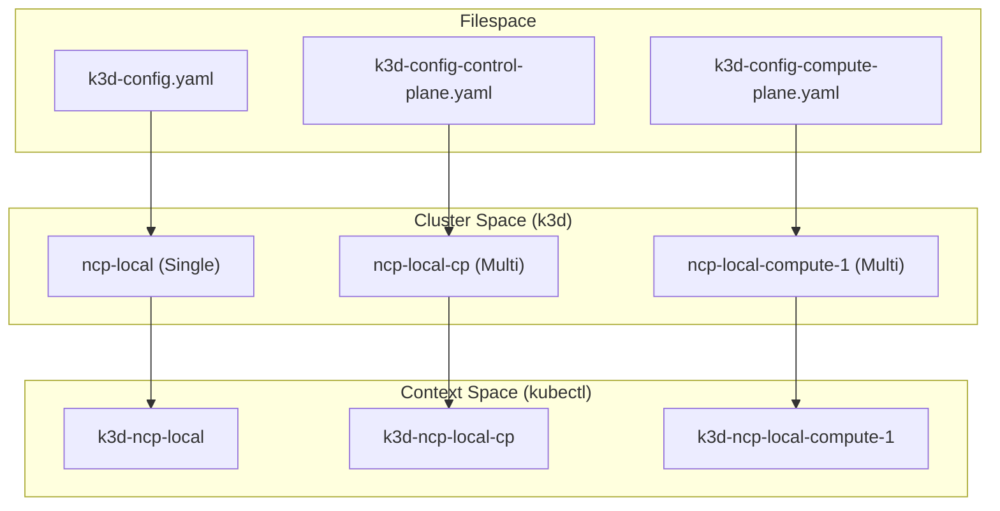
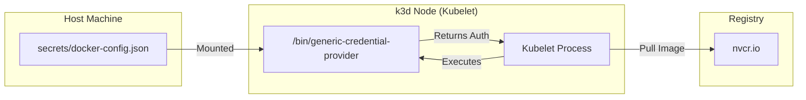

<!-- source: DeepWiki mcp.deepwiki.com · repo NVIDIA/nvcf · page 9.2 Local Development Cluster (ncp-local-cluster) · fetched 2026-10-26 -->

# Local Development Cluster (ncp-local-cluster)

Relevant source files

The following files were used as context for generating this wiki page:

- [docs/dev/local-development.md](docs/dev/local-development.md)
- [docs/user/local-development/multi-cluster-cli.md](docs/user/local-development/multi-cluster-cli.md)
- [docs/user/local-development/multi-cluster-helmfile.md](docs/user/local-development/multi-cluster-helmfile.md)
- [docs/user/local-development/single-cluster-cli.md](docs/user/local-development/single-cluster-cli.md)
- [docs/user/local-development/single-cluster-helmfile.md](docs/user/local-development/single-cluster-helmfile.md)
- [tools/ncp-local-cluster/.gitignore](tools/ncp-local-cluster/.gitignore)
- [tools/ncp-local-cluster/Makefile](tools/ncp-local-cluster/Makefile)
- [tools/ncp-local-cluster/README.md](tools/ncp-local-cluster/README.md)
- [tools/ncp-local-cluster/apps/compute-control-plane-endpoints/kustomization.yaml](tools/ncp-local-cluster/apps/compute-control-plane-endpoints/kustomization.yaml)
- [tools/ncp-local-cluster/apps/compute-control-plane-endpoints/service-grpc.yaml](tools/ncp-local-cluster/apps/compute-control-plane-endpoints/service-grpc.yaml)
- [tools/ncp-local-cluster/apps/compute-control-plane-endpoints/service-nvct-api.yaml](tools/ncp-local-cluster/apps/compute-control-plane-endpoints/service-nvct-api.yaml)
- [tools/ncp-local-cluster/apps/control-plane-endpoints/kustomization.yaml](tools/ncp-local-cluster/apps/control-plane-endpoints/kustomization.yaml)
- [tools/ncp-local-cluster/apps/envoy-gateway/gateway-grpc.yaml](tools/ncp-local-cluster/apps/envoy-gateway/gateway-grpc.yaml)
- [tools/ncp-local-cluster/docs/multi-cluster-local-cluster-design.md](tools/ncp-local-cluster/docs/multi-cluster-local-cluster-design.md)
- [tools/ncp-local-cluster/k3d-config-control-plane.yaml](tools/ncp-local-cluster/k3d-config-control-plane.yaml)
- [tools/ncp-local-cluster/k3d-config.yaml](tools/ncp-local-cluster/k3d-config.yaml)
- [tools/ncp-local-cluster/sample/deployment.yaml](tools/ncp-local-cluster/sample/deployment.yaml)
- [tools/ncp-local-cluster/sample/kustomization.yaml](tools/ncp-local-cluster/sample/kustomization.yaml)
- [tools/ncp-local-cluster/scripts/configure-control-plane-endpoints.sh](tools/ncp-local-cluster/scripts/configure-control-plane-endpoints.sh)
- [tools/ncp-local-cluster/scripts/render-sample.sh](tools/ncp-local-cluster/scripts/render-sample.sh)
- [tools/ncp-local-cluster/tests/test-multicluster-make.sh](tools/ncp-local-cluster/tests/test-multicluster-make.sh)

The `ncp-local-cluster` tooling provides a local Kubernetes environment based on [k3d](https://k3d.io) for developing and testing the NVIDIA Cloud Functions (NVCF) stack [docs/dev/local-development.md:1-5](). It automates the creation of cluster topologies, configures cross-cluster networking for multi-cluster scenarios, and injects necessary infrastructure components like fake GPU operators and image credential providers [tools/ncp-local-cluster/README.md:9-11]().

## Cluster Topologies

The tooling supports two primary topologies which are mutually exclusive as they claim the same host ports (8080, 8443, 4222) [docs/dev/local-development.md:45-47]().

### Single-Cluster Topology
In this mode, a single cluster named `ncp-local` hosts both the Control Plane and the Compute Plane [docs/dev/local-development.md:35-37](). This is the fastest path for basic validation and function lifecycle testing.

### Multi-Cluster Topology
This mode creates a split environment to exercise cross-cluster registration and OIDC/JWKS discovery flows [docs/dev/local-development.md:39-43]().
*   **Control Plane Cluster**: Named `ncp-local-cp`. It owns the host ports for ingress traffic [tools/ncp-local-cluster/README.md:48-52]().
*   **Compute Plane Cluster(s)**: Named `ncp-local-compute-N`. These clusters do not expose host ports to allow multiple instances to run simultaneously [tools/ncp-local-cluster/docs/multi-cluster-local-cluster-design.md:27-29]().

### Topology Entity Mapping
The following diagram associates k3d configuration files and cluster roles with their resulting Kubernetes contexts.

**Cluster Topology and Configuration Mapping**

Sources: [tools/ncp-local-cluster/Makefile:19-20](), [tools/ncp-local-cluster/Makefile:32-44](), [tools/ncp-local-cluster/README.md:48-52](), [tools/ncp-local-cluster/docs/multi-cluster-local-cluster-design.md:87-92]()

---

## Makefile Lifecycle Targets

The `tools/ncp-local-cluster/Makefile` serves as the entry point for cluster management.

| Target | Description |
| :--- | :--- |
| `build-and-deploy-cluster` | Creates a single `ncp-local` cluster, installs fake GPU operators, and validates the setup [tools/ncp-local-cluster/Makefile:16](), [tools/ncp-local-cluster/README.md:31-32](). |
| `build-and-deploy-multicluster` | Orchestrates the creation of one CP cluster and one or more Compute clusters [tools/ncp-local-cluster/Makefile:16](), [tools/ncp-local-cluster/README.md:75-77](). |
| `destroy` | Deletes the single `ncp-local` cluster [tools/ncp-local-cluster/Makefile:141-148](). |
| `destroy-multicluster` | Deletes all clusters associated with the multi-cluster topology [tools/ncp-local-cluster/Makefile:16](), [tools/ncp-local-cluster/README.md:99-103](). |
| `destroy-all-ncp-local` | Discovers and deletes every `ncp-local*` cluster on the host using `jq` [tools/ncp-local-cluster/Makefile:150-155](). |

Sources: [tools/ncp-local-cluster/Makefile:16-155](), [tools/ncp-local-cluster/README.md:25-38]()

---

## Control Plane Endpoints and Networking

In multi-cluster mode, compute clusters must reach services on the control plane cluster. The tooling uses a combination of Docker network bridging and Kubernetes `Service`/`Endpoints` aliases [tools/ncp-local-cluster/docs/multi-cluster-local-cluster-design.md:48-51]().

### Cross-Cluster Flow
1.  **Network Connection**: The control plane load balancer container (`k3d-ncp-local-cp-serverlb`) is connected to the compute cluster's Docker network [tools/ncp-local-cluster/scripts/configure-control-plane-endpoints.sh:39-43]().
2.  **DNS Aliases**: The script `configure-control-plane-endpoints.sh` creates `Endpoints` in the compute cluster that point to the IP of the control plane load balancer [tools/ncp-local-cluster/scripts/configure-control-plane-endpoints.sh:58-168]().
3.  **Port Mapping**: Local service ports (e.g., 8080) are mapped to the host ports exposed by the control plane k3d cluster [tools/ncp-local-cluster/docs/multi-cluster-local-cluster-design.md:65-77]().

**Service Endpoint Mapping**
| Service Name | Namespace | Compute Port | CP Host Port Variable |
| :--- | :--- | :--- | :--- |
| `api` | `nvcf` | 8080 | `CONTROL_PLANE_HTTP_PORT` |
| `api` | `sis` | 8080 | `CONTROL_PLANE_HTTP_PORT` |
| `grpc` | `nvcf` | 10086 | `CONTROL_PLANE_GRPC_WORKER_PORT` |
| `nats` | `nats-system` | 4222 | `CONTROL_PLANE_NATS_PORT` |

Sources: [tools/ncp-local-cluster/scripts/configure-control-plane-endpoints.sh:58-168](), [tools/ncp-local-cluster/docs/multi-cluster-local-cluster-design.md:65-77](), [tools/ncp-local-cluster/apps/compute-control-plane-endpoints/kustomization.yaml:7-16]()

---

## Envoy Gateway Setup

The tooling deploys [Envoy Gateway](https://gateway-api.sigs.k8s.io) to handle ingress for the control plane.
*   **TCP Listeners**: Configured for NATS (4222) and gRPC Proxy (10081, 10086) [tools/ncp-local-cluster/tests/test-multicluster-make.sh:159-172]().
*   **GRPCRoute**: Used for worker-facing API gRPC traffic [tools/ncp-local-cluster/tests/test-multicluster-make.sh:165-166]().
*   **Validation**: The `validate-gateway` target ensures the Envoy Gateway is correctly routing traffic by deploying a sample Nginx service and probing the host ports [tools/ncp-local-cluster/Makefile:16]().

Sources: [tools/ncp-local-cluster/Makefile:16](), [tools/ncp-local-cluster/tests/test-multicluster-make.sh:159-172](), [tools/ncp-local-cluster/README.md:60-61]()

---

## Kubelet Credential Provider (Go)

To pull images from the private NGC registry (`nvcr.io`), the local clusters use a custom Kubelet Credential Provider implemented in Go [tools/ncp-local-cluster/README.md:5-6]().

### Implementation Details
*   **Binary**: `generic-credential-provider` [tools/ncp-local-cluster/Makefile:50]().
*   **Functionality**: It reads credentials from a standard Docker `config.json` (mounted from `tools/ncp-local-cluster/secrets/docker-config.json`) and provides them to Kubelet via the `CredentialProviderRequest` API [tools/ncp-local-cluster/README.md:179-183](), [docs/user/local-development/single-cluster-cli.md:52-54]().
*   **Multi-Arch Support**: The Makefile includes `build-credential-provider-multiarch` to produce binaries for both `amd64` and `arm64` [tools/ncp-local-cluster/Makefile:37-38]().

**Credential Provider Data Flow**

Sources: [tools/ncp-local-cluster/README.md:5-10](), [tools/ncp-local-cluster/Makefile:49-60](), [docs/user/local-development/single-cluster-cli.md:52-54]()

---

## Infrastructure Addons

The `ncp-local-cluster` provides several "fake" or lightweight versions of production infrastructure to facilitate local testing [docs/dev/local-development.md:8-10]():

1.  **Fake GPU Operator**: Simulates the presence of NVIDIA GPUs, allowing the NVCA agent and function pods to schedule without physical hardware [tools/ncp-local-cluster/Makefile:66-68](), [tools/ncp-local-cluster/README.md:63]().
2.  **CSI SMB Driver**: Provides a local implementation for shared storage volumes [tools/ncp-local-cluster/Makefile:62-63](), [tools/ncp-local-cluster/README.md:62]().
3.  **Observability CRDs**: Deploys `kube-prometheus-stack` CRDs and `kube-state-metrics` to support service metrics without a full Prometheus installation [tools/ncp-local-cluster/Makefile:71-80]().

Sources: [tools/ncp-local-cluster/Makefile:62-80](), [tools/ncp-local-cluster/README.md:54-64](), [docs/dev/local-development.md:8-10]()

---

