# Page: Overview

# Overview

<details>
<summary>Relevant source files</summary>

The following files were used as context for generating this wiki page:

- [.gitignore](.gitignore)
- [CMakeLists.txt](CMakeLists.txt)
- [README.md](README.md)
- [src/BF/chassiscommands.cpp](src/BF/chassiscommands.cpp)

</details>


This document provides an overview of the NVIDIA IPMI OEM Commands library, a platform-specific extension to the OpenBMC IPMI implementation that enables hardware management and control for NVIDIA server platforms including Bluefield DPUs and Grace systems.

## Purpose and Scope

The NVIDIA IPMI OEM Commands library (`znvipmioemcmds`) extends the standard IPMI command set with platform-specific OEM commands tailored for NVIDIA hardware platforms. The library integrates with the OpenBMC ecosystem, providing out-of-band management capabilities for system monitoring, power control, thermal management, and hardware configuration across different NVIDIA platform variants.

The library serves as an IPMI provider that registers custom command handlers with the OpenBMC `libipmid` framework, enabling remote management through standard IPMI interfaces while exposing NVIDIA-specific functionality. For detailed information about specific platform implementations, see [Bluefield Platform](#3.1) and [Grace Platform](#3.2). For architecture details, see [System Architecture](#2).

## Library Architecture

The library is structured around a platform-differentiated architecture that provides common infrastructure while enabling platform-specific customizations:

### IPMI Command Registration and Processing Flow

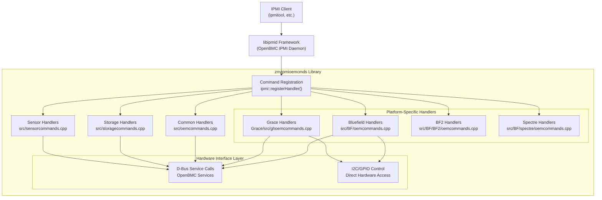

*Sources: [CMakeLists.txt:114-189](), [src/BF/chassiscommands.cpp:76-151]()*

### Platform Differentiation Strategy

The library implements a graduated feature support model where different platforms receive different levels of OEM command functionality:

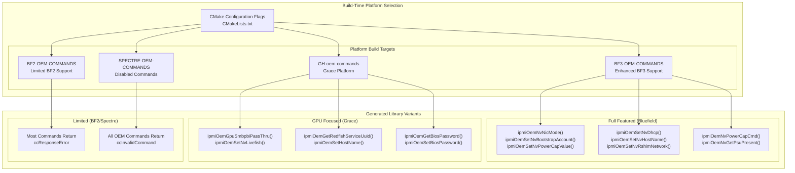

*Sources: [CMakeLists.txt:120-150](), [CMakeLists.txt:185-189]()*

## Core Functional Areas

The library provides management capabilities across several key functional domains:

| Functional Area | Primary Platforms | Key Commands | Integration Method |
|-----------------|-------------------|--------------|-------------------|
| Network Management | Bluefield, Grace | `ipmiOemSetNvDhcp`, `ipmiOemSetNvHostName` | D-Bus services |
| Power Management | Bluefield | `ipmiOemNvPowerCapCmd`, `ipmiOemGetPowerSupplyInfo` | D-Bus + I2C |
| Thermal Control | All platforms | `ipmiOemNvSetFanPwm`, `ipmiOemNvGetFanPwm` | D-Bus fan services |
| Hardware Status | All platforms | `ipmiOemNvGetPsuPresent`, `ipmiOemNvGetLedStatus` | I2C + GPIO |
| User Management | Bluefield | `ipmiOemSetNvBootstrapAccount` | D-Bus user services |
| GPU Management | Grace | `ipmiOemGpuSmbpbiPassThru` | Direct I2C passthrough |
| Storage/FRU | All platforms | FRU read/write, SDR management | IPMI storage layer |

*Sources: [CMakeLists.txt:114-117](), [src/BF/chassiscommands.cpp:1-16]()*

## Integration with OpenBMC

The library leverages the OpenBMC D-Bus architecture for most system interactions, providing a clean separation between IPMI protocol handling and actual system management:

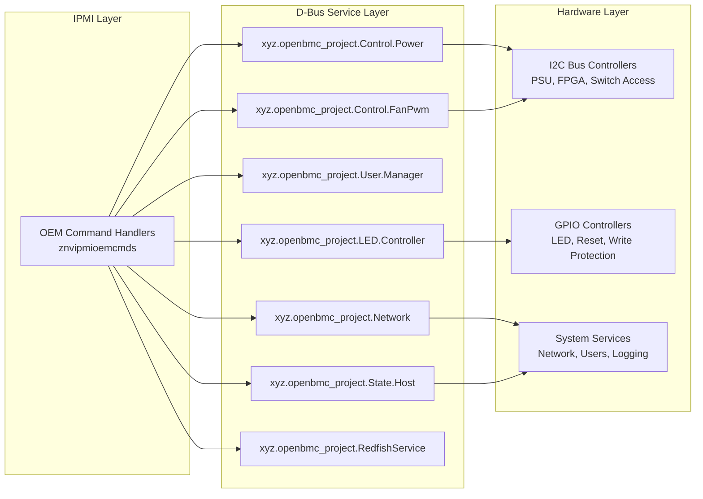

*Sources: [src/BF/chassiscommands.cpp:40-74](), [CMakeLists.txt:96-99]()*

## Build System and Configuration

The library uses CMake with extensive conditional compilation to support multiple platform variants from a single codebase. Key configuration options include:

- **Platform Selection**: `GH-oem-commands`, `BF2-OEM-COMMANDS`, `BF3-OEM-COMMANDS`, `SPECTRE-OEM-COMMANDS`
- **Feature Toggles**: `disable-smbpbi-passthru`, `custom-pwm-fan`, `cpu-diag-enable`
- **Hardware Configuration**: `WP-GPIO`, `chassis-write-protect`, `gb200-fan-enable`

The build system generates the `znvipmioemcmds` shared library that integrates with the OpenBMC `libipmid` framework as a provider plugin.

*Sources: [CMakeLists.txt:1-236](), [README.md:1-2]()*

This overview establishes the foundation for understanding the NVIDIA IPMI OEM Commands library's role in providing platform-specific hardware management capabilities within the OpenBMC ecosystem. For detailed implementation specifics, refer to the relevant platform and functional area documentation sections.

---

# Page: System Architecture

# System Architecture

<details>
<summary>Relevant source files</summary>

The following files were used as context for generating this wiki page:

- [CMakeLists.txt](CMakeLists.txt)
- [Grace/src/ghoemcommands.cpp](Grace/src/ghoemcommands.cpp)
- [src/BF/chassiscommands.cpp](src/BF/chassiscommands.cpp)
- [src/BF/oemcommands.cpp](src/BF/oemcommands.cpp)
- [src/BF/spectre/oemcommands.cpp](src/BF/spectre/oemcommands.cpp)
- [src/oemcommands.cpp](src/oemcommands.cpp)

</details>


This document describes the high-level system architecture of the NVIDIA IPMI OEM Commands library (`znvipmioemcmds`). It covers the platform differentiation strategy, command processing pipeline, hardware abstraction mechanisms, and build system organization that enable unified IPMI management across different NVIDIA hardware platforms.

For platform-specific implementation details, see [Bluefield Platform](#3.1), [Grace Platform](#3.2), and [Platform Variants](#3.3). For hardware integration specifics, see [Hardware Integration](#5).

## Architectural Overview

The NVIDIA IPMI OEM Commands library implements a platform-centric architecture that provides unified IPMI management interfaces while supporting graduated feature sets across different NVIDIA hardware platforms. The system is built around three core architectural principles: platform abstraction, shared infrastructure, and conditional compilation.

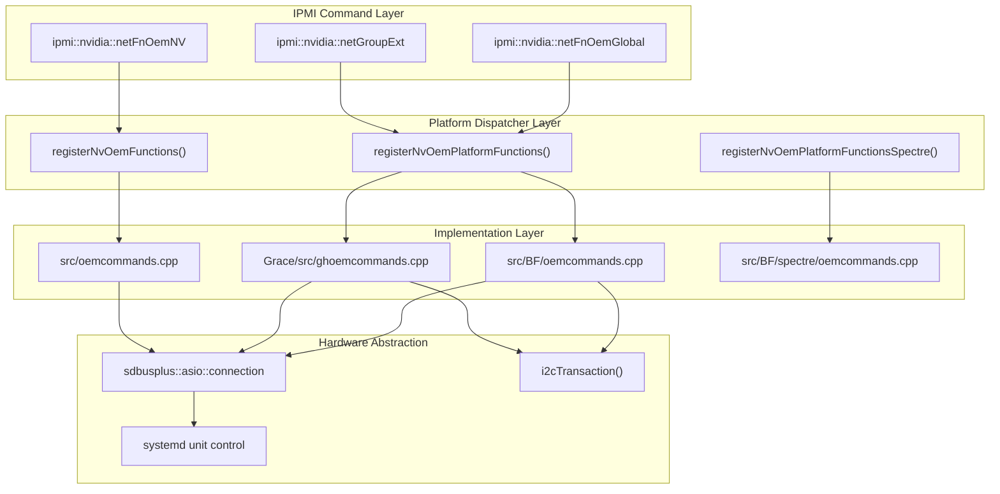

**Sources:** [src/BF/oemcommands.cpp:229](), [Grace/src/ghoemcommands.cpp:132](), [src/oemcommands.cpp:201](), [src/BF/spectre/oemcommands.cpp:52]()

## Platform Differentiation Strategy

The system implements a graduated feature support model where different NVIDIA platforms expose different subsets of OEM commands based on their hardware capabilities and intended use cases.

### Platform Support Matrix

| Platform | Implementation File | Feature Level | Constructor Priority |
|----------|-------------------|---------------|---------------------|
| Bluefield | `src/BF/oemcommands.cpp` | Full Featured | 102 |
| Grace | `Grace/src/ghoemcommands.cpp` | GPU Focused | Default |
| BF2 | `src/BF/BF2/oemcommands.cpp` | Limited | N/A |
| Spectre | `src/BF/spectre/oemcommands.cpp` | Disabled | 103 |

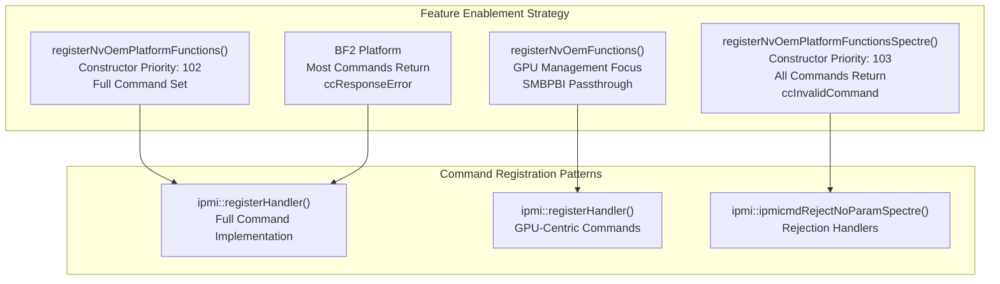

**Sources:** [src/BF/oemcommands.cpp:229](), [Grace/src/ghoemcommands.cpp:132](), [src/BF/spectre/oemcommands.cpp:112](), [CMakeLists.txt:185-189]()

## Command Processing Pipeline

The IPMI command processing follows a structured pipeline that routes commands through platform-specific handlers while maintaining common infrastructure for shared functionality.

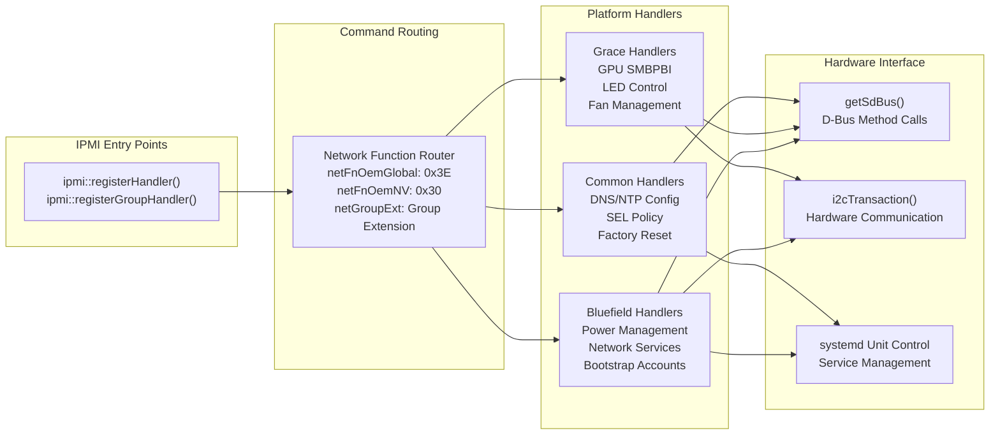

**Sources:** [src/BF/oemcommands.cpp:2150-2250](), [Grace/src/ghoemcommands.cpp:1850-1950](), [src/oemcommands.cpp:3400-3500]()

## Hardware Abstraction Layer

The system provides a unified hardware abstraction layer that enables platform-agnostic access to various hardware subsystems through standardized interfaces.

### D-Bus Service Integration

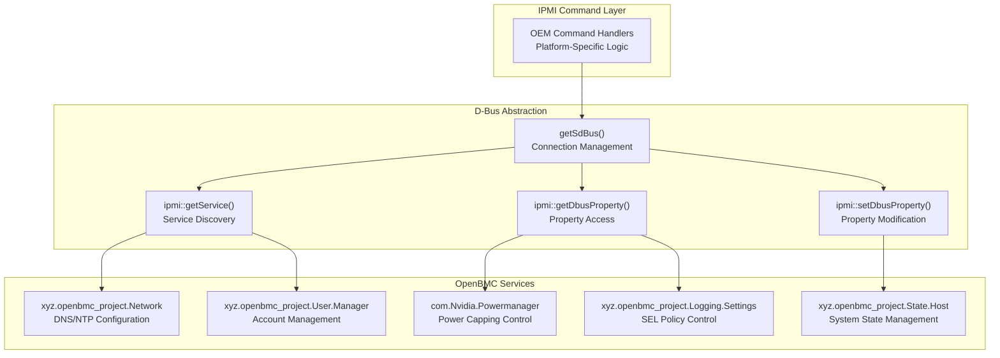

**Sources:** [src/oemcommands.cpp:52-55](), [src/BF/oemcommands.cpp:68-89](), [Grace/src/ghoemcommands.cpp:89-93]()

### I2C Hardware Communication

The system provides direct hardware access through a standardized I2C transaction interface that abstracts low-level hardware communication details.

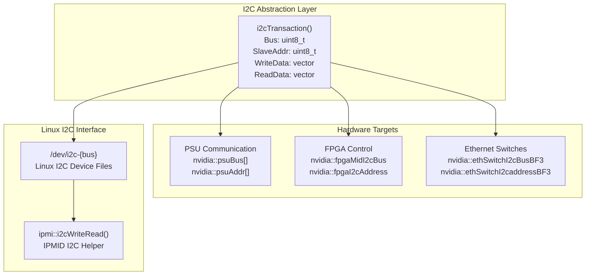

**Sources:** [src/oemcommands.cpp:340-361](), [src/BF/oemcommands.cpp:372-393](), [Grace/src/ghoemcommands.cpp:328-349]()

## Build System Architecture

The build system implements a flexible configuration mechanism that enables conditional compilation of platform-specific features and commands through CMake options and preprocessor definitions.

### Conditional Compilation Strategy

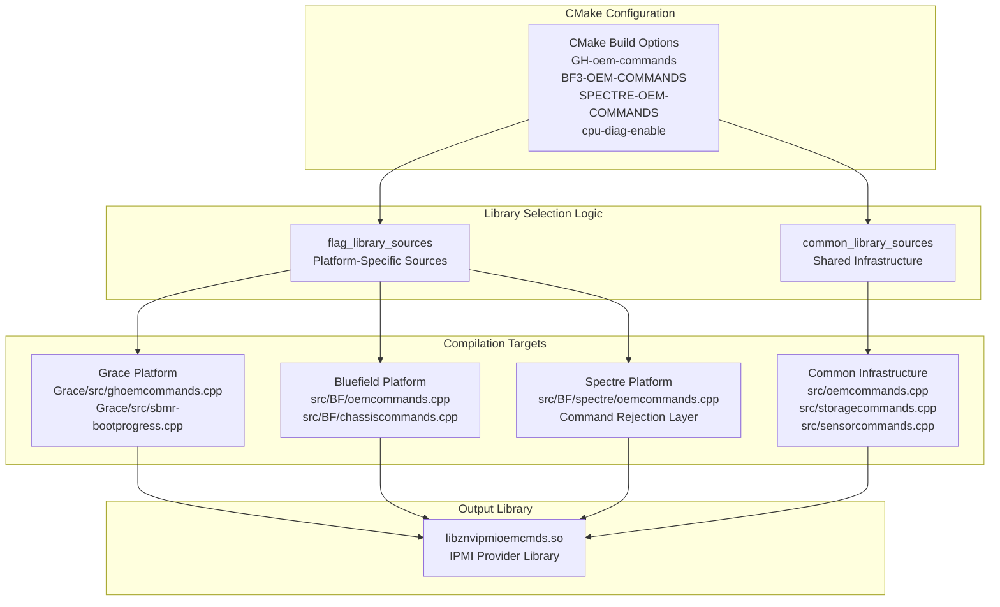

**Sources:** [CMakeLists.txt:120-150](), [CMakeLists.txt:185-189](), [CMakeLists.txt:195-197]()

### Feature Enablement Matrix

| CMake Option | Preprocessor Define | Affected Files | Purpose |
|--------------|-------------------|----------------|---------|
| `GH-oem-commands` | N/A | `Grace/src/ghoemcommands.cpp` | Enable Grace platform support |
| `BF3-OEM-COMMANDS` | `BF3_OEM_COMMANDS` | `src/BF/oemcommands.cpp` | Enable BF3 platform features |
| `SPECTRE-OEM-COMMANDS` | N/A | `src/BF/spectre/oemcommands.cpp` | Enable Spectre rejection handlers |
| `cpu-diag-enable` | `CPU_DIAG_ENABLE` | `Grace/src/ghoemcommands.cpp` | Enable CPU diagnostic commands |
| `gb200nvl-oem-commands` | `GB200NVL_OEM_COMMANDS` | Multiple files | Enable GB200NVL specific features |

**Sources:** [CMakeLists.txt:22-24](), [CMakeLists.txt:126-148](), [CMakeLists.txt:178-183]()

---

# Page: IPMI Command Processing

# IPMI Command Processing

<details>
<summary>Relevant source files</summary>

The following files were used as context for generating this wiki page:

- [include/oemcommands.hpp](include/oemcommands.hpp)
- [src/oemcommands.cpp](src/oemcommands.cpp)

</details>


This document explains how IPMI commands are registered, dispatched, and processed within the NVIDIA IPMI OEM Commands library. It covers the common infrastructure used across all platform implementations for handling IPMI protocol interactions, command validation, and response generation.

For platform-specific command implementations, see [Bluefield Platform](#3.1), [Grace Platform](#3.2), and [Platform Variants](#3.3). For details on D-Bus service integration patterns, see [D-Bus Service Integration](#2.2).

## Command Registration Architecture

The IPMI command processing system uses a registration-based architecture where command handlers are automatically registered during library initialization. The registration process maps network function and command code combinations to specific handler functions.

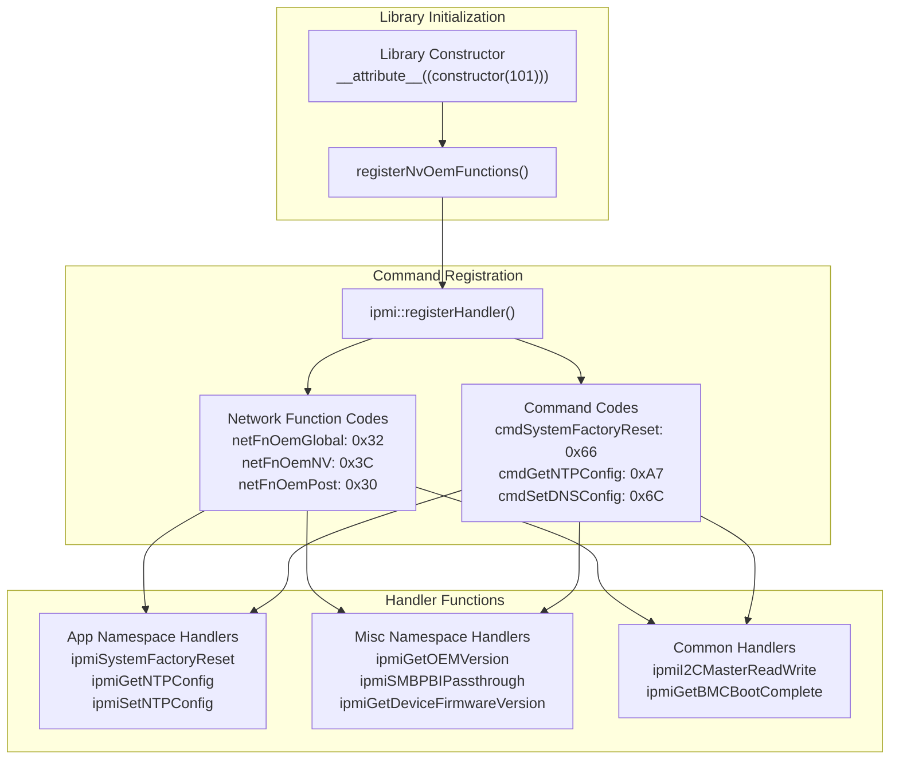

Sources: [src/oemcommands.cpp:201](), [include/oemcommands.hpp:26-30](), [include/oemcommands.hpp:32-57](), [include/oemcommands.hpp:59-163]()

## Command Processing Flow

When an IPMI command is received, it follows a standardized processing pattern that includes validation, execution, and response formatting. The system uses template-based response types to ensure type safety and consistent formatting.

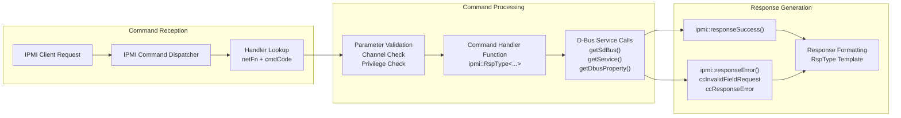

Sources: [src/oemcommands.cpp:275-330](), [src/oemcommands.cpp:428-474](), [src/oemcommands.cpp:517-610]()

## Handler Implementation Patterns

IPMI command handlers follow consistent implementation patterns using templated response types and standardized error handling. The system provides a rich set of response types and completion codes for different scenarios.

### Response Type Templates

The command handlers use `ipmi::RspType` templates to define strongly-typed return values:

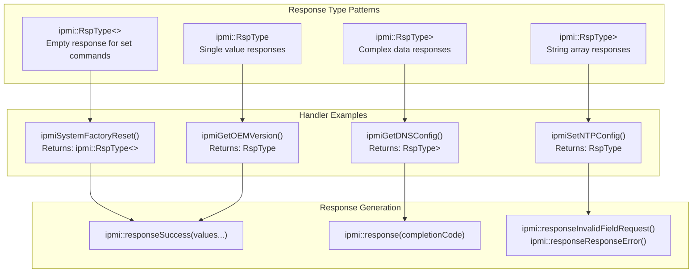

Sources: [src/oemcommands.cpp:275](), [src/oemcommands.cpp:1116-1122](), [src/oemcommands.cpp:428](), [src/oemcommands.cpp:612]()

## D-Bus Integration Patterns

Command handlers integrate with OpenBMC D-Bus services using standardized patterns for service discovery, property access, and method calls. The system maintains service name and object path constants for consistency.

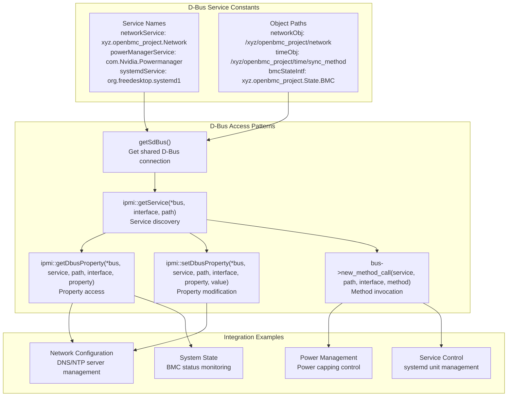

Sources: [src/oemcommands.cpp:52-108](), [src/oemcommands.cpp:238-273](), [src/oemcommands.cpp:534-556](), [src/oemcommands.cpp:1056-1070]()

## Error Handling and Validation

The system implements comprehensive error handling with standardized completion codes and validation patterns. Commands validate parameters, check system state, and handle D-Bus communication failures gracefully.

### Validation Patterns

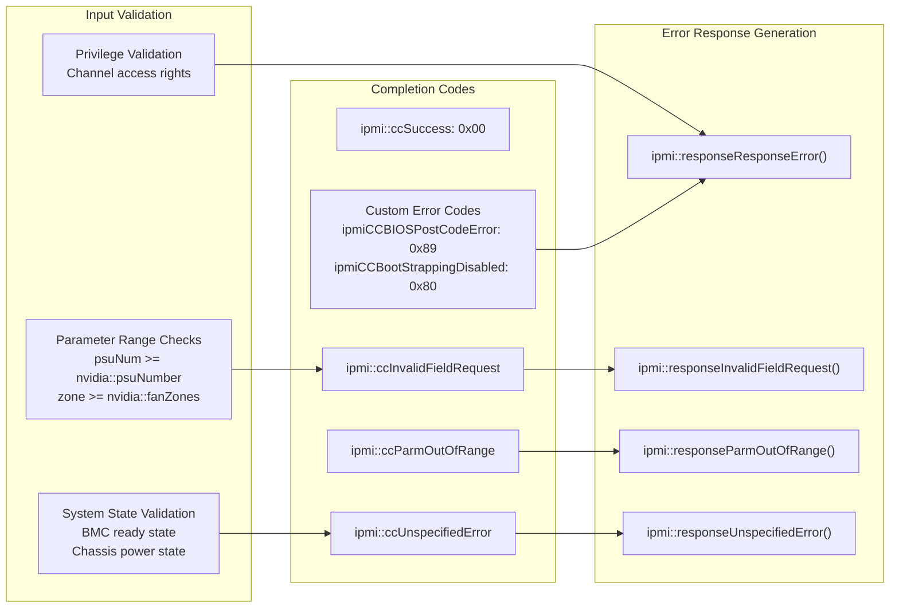

Sources: [src/oemcommands.cpp:366-384](), [src/oemcommands.cpp:1433-1436](), [src/oemcommands.cpp:215-221](), [src/oemcommands.cpp:1771-1781]()

## Hardware Abstraction Layer

Command handlers access hardware through abstraction layers that provide consistent interfaces for I2C communication, GPIO control, and system service interaction. This abstraction enables platform portability while maintaining hardware-specific optimization.

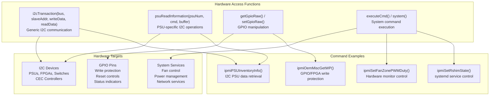

Sources: [src/oemcommands.cpp:340-384](), [src/oemcommands.cpp:1427-1517](), [src/oemcommands.cpp:2405-2427](), [src/oemcommands.cpp:1024-1072]()

---

# Page: D-Bus Service Integration

# D-Bus Service Integration

<details>
<summary>Relevant source files</summary>

The following files were used as context for generating this wiki page:

- [Grace/src/ghoemcommands.cpp](Grace/src/ghoemcommands.cpp)
- [src/BF/oemcommands.cpp](src/BF/oemcommands.cpp)
- [src/BF/spectre/oemcommands.cpp](src/BF/spectre/oemcommands.cpp)
- [src/oemcommands.cpp](src/oemcommands.cpp)

</details>


## Purpose and Scope

This document describes how the NVIDIA IPMI OEM Commands library integrates with OpenBMC D-Bus services to provide system management functionality. The library acts as a bridge between IPMI protocol commands and the underlying OpenBMC D-Bus ecosystem, enabling remote management of NVIDIA hardware platforms through standardized IPMI interfaces.

For information about the overall system architecture, see [System Architecture](#2). For platform-specific implementations, see [Platform Implementations](#3).

## D-Bus Integration Architecture

The NVIDIA IPMI OEM Commands library implements a layered approach to D-Bus service integration, where IPMI command handlers communicate with various OpenBMC services through the D-Bus message bus.

### Overall D-Bus Service Integration Flow

```mermaid
graph TB
    subgraph "IPMI Command Layer"
        BF_Handlers["Bluefield Handlers<br/>src/BF/oemcommands.cpp"]
        Grace_Handlers["Grace Handlers<br/>Grace/src/ghoemcommands.cpp"]
        Common_Handlers["Common Handlers<br/>src/oemcommands.cpp"]
    end
    
    subgraph "D-Bus Service Categories"
        SystemMgmt["System Management<br/>systemd, BMC state"]
        NetworkSvc["Network Services<br/>DNS, NTP, Network Config"]
        PowerMgmt["Power Management<br/>Power capping, Control"]
        UserMgmt["User Management<br/>Accounts, Authentication"]
        HardwareCtrl["Hardware Control<br/>GPU, Sensors, I2C"]
        StorageMgmt["Storage Management<br/>Software updates, FRU"]
    end
    
    subgraph "OpenBMC D-Bus Services"
        Systemd["org.freedesktop.systemd1"]
        NetworkService["xyz.openbmc_project.Network"]
        PowerService["com.Nvidia.Powermanager"]
        UserService["xyz.openbmc_project.User.Manager"]
        GpuService["xyz.openbmc_project.GpuMgr.Server"]
        LoggingService["xyz.openbmc_project.Logging"]
        TimeService["xyz.openbmc_project.Time.Synchronization"]
        BiosService["xyz.openbmc_project.BIOSConfig.Manager"]
    end
    
    BF_Handlers --> SystemMgmt
    BF_Handlers --> NetworkSvc
    BF_Handlers --> PowerMgmt
    Grace_Handlers --> HardwareCtrl
    Grace_Handlers --> UserMgmt
    Common_Handlers --> StorageMgmt
    Common_Handlers --> NetworkSvc
    
    SystemMgmt --> Systemd
    NetworkSvc --> NetworkService
    NetworkSvc --> TimeService
    PowerMgmt --> PowerService
    UserMgmt --> UserService
    UserMgmt --> BiosService
    HardwareCtrl --> GpuService
    StorageMgmt --> LoggingService
```

Sources: [src/BF/oemcommands.cpp:68-148](), [src/oemcommands.cpp:52-200](), [Grace/src/ghoemcommands.cpp:64-125]()

## Core D-Bus Service Categories

### System Management Services

The library integrates with systemd and BMC state management services to control system-level operations.

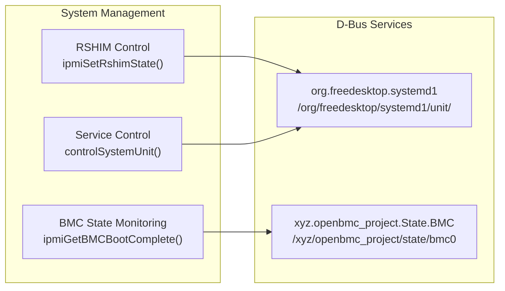

Key service objects and interfaces:
- **systemdService**: `"org.freedesktop.systemd1"`
- **systemdUnitIntf**: `"org.freedesktop.systemd1.Unit"`
- **rshimSystemdObj**: `"/org/freedesktop/systemd1/unit/rshim_2eservice"`
- **bmcStateIntf**: `"xyz.openbmc_project.State.BMC"`

Sources: [src/oemcommands.cpp:74-82](), [src/BF/oemcommands.cpp:68-72](), [Grace/src/ghoemcommands.cpp:650-668]()

### Network Configuration Services

Network services handle DNS, NTP, and general network configuration management.

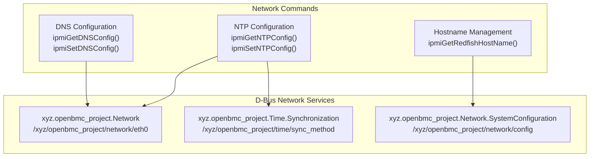

Key properties managed:
- **StaticNameServers**: DNS server configuration
- **StaticNTPServers**: NTP server configuration  
- **TimeSyncMethod**: NTP enable/disable control
- **HostName**: System hostname

Sources: [src/oemcommands.cpp:428-749](), [Grace/src/ghoemcommands.cpp:1014-1035]()

### Power Management Services

Power management integration provides control over power capping and monitoring.

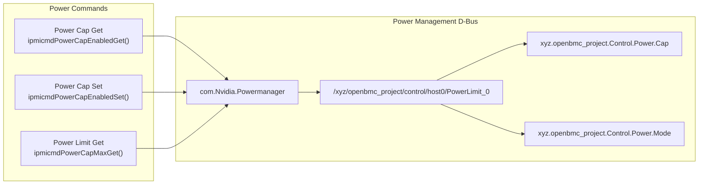

Sources: [src/BF/oemcommands.cpp:82-88](), [src/oemcommands.cpp:93-109]()

## Platform-Specific D-Bus Integration

### Bluefield Platform Integration

Bluefield platforms implement extensive D-Bus integration for DPU-specific functionality.

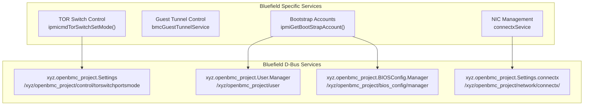

Key Bluefield-specific D-Bus objects:
- **ctlBMCtorSwitchModeService**: `"xyz.openbmc_project.Settings"`
- **ctlBMCtorSwitchModeBMCObj**: `"/xyz/openbmc_project/control/torswitchportsmode"`
- **connectxSevice**: `"xyz.openbmc_project.Settings.connectx"`

Sources: [src/BF/oemcommands.cpp:74-148](), [src/BF/oemcommands.cpp:924-1053](), [src/BF/oemcommands.cpp:1062-1117]()

### Grace Platform Integration  

Grace platforms focus on GPU management and sensor control through D-Bus services.

```mermaid
graph TB
    subgraph "Grace Specific Commands"
        GPUPassthrough["GPU SMBPBI Passthrough<br/>ipmiSMBPBIPassthroughCmd()"]
        SensorControl["Sensor Scanning Control<br/>ipmiSensorScanEnableDisable()"]
        LEDControl["LED Control<br/>ipmiOemSetSSDLed()"]
        FanControl["Fan Control<br/>ipmiSetFanZonePWMDuty()"]
    end
    
    subgraph "Grace D-Bus Services"
        GpuMgrService["xyz.openbmc_project.GpuMgr.Server<br/>/xyz/openbmc_project/GpuMgr"]
        PLDMService["xyz.openbmc_project.Object.Enable<br/>/xyz/openbmc_project/pldm/sensor_polling"]
        SELService["xyz.openbmc_project.Logging.Settings<br/>/xyz/openbmc_project/logging/settings"]
    end
    
    GPUPassthrough --> GpuMgrService
    SensorControl --> PLDMService
    LEDControl --> SELService
```

Key Grace-specific interfaces:
- **gpuSMBPBIIntf**: `"xyz.openbmc_project.GpuMgr.Server"`
- **pldmPollingIntf**: `"xyz.openbmc_project.Object.Enable"`

Sources: [Grace/src/ghoemcommands.cpp:167-275](), [Grace/src/ghoemcommands.cpp:677-712](), [Grace/src/ghoemcommands.cpp:746-834]()

## D-Bus Interaction Patterns

### Service Discovery Pattern

The library uses a consistent pattern for D-Bus service discovery and interaction.

```mermaid
graph TB
    A["getSdBus()"] --> B["ipmi::getService()"]
    B --> C["new_method_call()"]
    C --> D["method.append()"]
    D --> E["bus->call()"]
    E --> F["reply.read()"]
    
    G["Property Access"] --> H["ipmi::getDbusProperty()"]
    H --> I["ipmi::setDbusProperty()"]
    
    J["Async Operations"] --> K["yield_method_call()"]
    K --> L["boost::system::error_code"]
```

### Error Handling Pattern

D-Bus operations implement consistent error handling across all platform implementations.

```mermaid
graph LR
    subgraph "Error Handling Flow"
        TryCatch["try/catch block"]
        DBusCall["D-Bus method call"]
        ErrorCheck["Error code check"]
        LogError["phosphor::logging::log()"]
        ReturnError["ipmi::responseError()"]
    end
    
    TryCatch --> DBusCall
    DBusCall --> ErrorCheck
    ErrorCheck --> LogError
    LogError --> ReturnError
```

Common error handling patterns:
- Try-catch blocks around D-Bus calls
- Boost error code checking for async operations
- Phosphor logging for error reporting
- IPMI completion code mapping

Sources: [src/oemcommands.cpp:275-330](), [src/BF/oemcommands.cpp:355-370](), [Grace/src/ghoemcommands.cpp:896-923]()

## Property Management

### Property Access Methods

The library implements standardized methods for D-Bus property access across all platforms.

| Function | Purpose | Usage Pattern |
|----------|---------|---------------|
| `ipmi::getDbusProperty()` | Read D-Bus properties | Service discovery + property read |
| `ipmi::setDbusProperty()` | Write D-Bus properties | Service discovery + property write |
| `dbusctlSetGetProperty()` | Custom property access | String-based property operations |

### Common Property Types

| Property Type | D-Bus Type | Usage |
|---------------|------------|-------|
| Boolean flags | `bool` | Enable/disable settings |
| String values | `std::string` | Hostnames, service names |
| String arrays | `std::vector<std::string>` | DNS/NTP server lists |
| Numeric values | `uint64_t`, `uint32_t` | Timestamps, power values |

Sources: [src/oemcommands.cpp:230-273](), [src/BF/oemcommands.cpp:1064-1081](), [Grace/src/ghoemcommands.cpp:1360-1377]()

# D-Bus Service Integration

This document provides a comprehensive overview of how the NVIDIA IPMI OEM Commands library integrates with the OpenBMC D-Bus ecosystem to provide platform management capabilities across different NVIDIA hardware platforms.

---

# Page: Platform Implementations

# Platform Implementations

<details>
<summary>Relevant source files</summary>

The following files were used as context for generating this wiki page:

- [Grace/src/ghoemcommands.cpp](Grace/src/ghoemcommands.cpp)
- [include/oemcommandsBF.hpp](include/oemcommandsBF.hpp)
- [src/BF/BF2/oemcommands.cpp](src/BF/BF2/oemcommands.cpp)
- [src/BF/oemcommands.cpp](src/BF/oemcommands.cpp)
- [src/BF/spectre/oemcommands.cpp](src/BF/spectre/oemcommands.cpp)

</details>


This document covers the platform-specific implementations within the NVIDIA IPMI OEM Commands library, detailing how different NVIDIA hardware platforms are supported through a graduated feature model. For information about the overall system architecture and command processing flow, see [System Architecture](#2). For details about common infrastructure shared across platforms, see [Common Infrastructure](#4).

## Platform Differentiation Strategy

The codebase implements a platform-centric design that provides different levels of OEM command support based on the target hardware platform. This graduated support model allows the same codebase to serve multiple NVIDIA platforms while optimizing functionality for each platform's specific capabilities and requirements.

## Platform Support Levels

```mermaid
graph TD
    subgraph "Platform Support Hierarchy"
        BF["Bluefield Platform<br/>src/BF/oemcommands.cpp<br/>Full Feature Set"]
        Grace["Grace Platform<br/>Grace/src/ghoemcommands.cpp<br/>GPU-Focused Features"]
        BF2["BF2 Platform<br/>src/BF/BF2/oemcommands.cpp<br/>Limited Support"]
        Spectre["Spectre Platform<br/>src/BF/spectre/oemcommands.cpp<br/>Disabled Commands"]
    end
    
    subgraph "Feature Categories"
        LiveFish["Live Fish Mode<br/>ipmiEnterLiveFish<br/>ipmiExitLiveFish"]
        NIC["NIC Management<br/>SmartNIC Mode<br/>Host Access Control"]
        Power["Power Management<br/>Power Capping<br/>Capacity Control"]
        GPU["GPU Management<br/>SMBPBI Passthrough<br/>Device Control"]
        Bootstrap["Bootstrap Accounts<br/>User Management<br/>UEFI Integration"]
        TorSwitch["TorSwitch Control<br/>Port Mode Management<br/>Reset Control"]
    end
    
    BF --> LiveFish
    BF --> NIC
    BF --> Power
    BF --> Bootstrap
    BF --> TorSwitch
    
    Grace --> GPU
    Grace --> Power
    Grace --> Bootstrap
    
    BF2 -.-> |"Returns ccResponseError"| LiveFish
    BF2 -.-> |"Returns ccResponseError"| NIC
    BF2 -.-> |"Returns ccResponseError"| Power
    
    Spectre -.-> |"Returns ccInvalidCommand"| LiveFish
    Spectre -.-> |"Returns ccInvalidCommand"| NIC
    Spectre -.-> |"Returns ccInvalidCommand"| Power
```

**Sources:** [src/BF/oemcommands.cpp:1-100](), [Grace/src/ghoemcommands.cpp:1-100](), [src/BF/BF2/oemcommands.cpp:66-110](), [src/BF/spectre/oemcommands.cpp:58-110]()

## Platform Command Implementation Matrix

```mermaid
graph LR
    subgraph "Command Registration Pattern"
        Reg["ipmi::registerHandler<br/>ipmi::registerGroupHandler"]
        NetFn["Network Function<br/>netFnOemGlobal<br/>netFnOemNV<br/>netGroupExt"]
        Cmd["Command Codes<br/>cmdEnterLiveFish<br/>cmdPowerCapEnabledGet<br/>cmdSMBPBIPassthrough"]
        Handler["Platform Handlers<br/>Platform-specific functions"]
    end
    
    subgraph "Bluefield Handlers"
        BF_Enter["ipmiEnterLiveFish"]
        BF_Power["ipmicmdPowerCapEnabledGet"]
        BF_NIC["ipmicmdNicGetSmartnicMode"]
        BF_Bootstrap["ipmiGetBootStrapAccount"]
    end
    
    subgraph "Grace Handlers"
        Grace_GPU["ipmiSMBPBIPassthroughCmd"]
        Grace_Fan["ipmiSetFanZonePWMDuty"]
        Grace_LED["ipmiOemGetSSDLed"]
        Grace_SEL["ipmiGetSELPolicy"]
    end
    
    subgraph "BF2 Handlers"
        BF2_Reject["ipmicmdEnterLiveFishBF2<br/>nicManagerBF2NA<br/>ipmicmdPowerCapGet"]
    end
    
    subgraph "Spectre Handlers"
        Spectre_Reject["ipmicmdRejectNoParamSpectre<br/>ipmicmdRejectOneParamSpectre<br/>ipmicmdRejectTwoParamSpectre"]
    end
    
    Reg --> NetFn
    NetFn --> Cmd
    Cmd --> Handler
    
    Handler --> BF_Enter
    Handler --> BF_Power
    Handler --> BF_NIC
    Handler --> BF_Bootstrap
    
    Handler --> Grace_GPU
    Handler --> Grace_Fan
    Handler --> Grace_LED
    Handler --> Grace_SEL
    
    Handler --> BF2_Reject
    Handler --> Spectre_Reject
```

**Sources:** [src/BF/oemcommands.cpp:2800-3000](), [Grace/src/ghoemcommands.cpp:1800-2000](), [src/BF/BF2/oemcommands.cpp:111-206](), [src/BF/spectre/oemcommands.cpp:112-298]()

## Platform-Specific Feature Sets

### Bluefield Platform

The Bluefield platform provides the most comprehensive OEM command support, implementing full DPU (Data Processing Unit) management capabilities.

**Key Features:**
- **Live Fish Mode**: `ipmiEnterLiveFish` and `ipmiExitLiveFish` functions for firmware recovery
- **NIC Management**: SmartNIC mode control, host access privileges, external host privileges
- **Power Capping**: Complete power management with min/max capacity and percentage controls  
- **Bootstrap Accounts**: UEFI boot account management with `NvBluefieldUefi0` and `NvBluefieldUefi1` accounts
- **TorSwitch Control**: Ethernet switch port mode management
- **DPU Reset Control**: Multiple reset options including SOC hard reset and ARM soft reset
- **Network Reprovisioning**: Golden image update capabilities

**Sources:** [src/BF/oemcommands.cpp:323-570](), [src/BF/oemcommands.cpp:924-1050](), [src/BF/oemcommands.cpp:1400-1600]()

### Grace Platform  

The Grace platform focuses on GPU and system management with specialized hardware control capabilities.

**Key Features:**
- **GPU Management**: SMBPBI passthrough commands via `ipmiSMBPBIPassthroughCmd` and `ipmiSMBPBIPassthroughExtendedCmd`
- **Fan Control**: PWM duty cycle control through `ipmiSetFanZonePWMDuty` and zone management
- **LED Control**: SSD LED management with `ipmiOemGetSSDLed` and `ipmiOemSetSSDLed`
- **SEL Policy**: System Event Log policy management with linear/circular modes
- **BIOS Integration**: Redfish hostname retrieval and USB device description
- **I2C Communication**: Direct I2C master read/write operations via `ipmiI2CMasterReadWrite`

**Sources:** [Grace/src/ghoemcommands.cpp:167-275](), [Grace/src/ghoemcommands.cpp:463-605](), [Grace/src/ghoemcommands.cpp:714-834]()

### Platform Variants

#### BF2 Platform (Limited Support)

The BF2 platform provides minimal OEM command support, with most commands returning error responses.

**Command Rejection Pattern:**
```cpp
ipmi::RspType<uint8_t> ipmicmdEnterLiveFishBF2()
{
    phosphor::logging::log<phosphor::logging::level::ERR>(
        "Enter LiveFish command is unsupported in Bluefield 2");
    return ipmi::response(ipmi::ccResponseError);
}
```

**Sources:** [src/BF/BF2/oemcommands.cpp:66-100](), [src/BF/BF2/oemcommands.cpp:80-107]()

#### Spectre Platform (Disabled Commands)

The Spectre platform completely disables OEM command functionality, returning `ccInvalidCommand` for all requests.

**Universal Rejection Pattern:**
```cpp
ipmi::RspType<uint8_t> ipmicmdRejectNoParamSpectre()
{
    phosphor::logging::log<phosphor::logging::level::ERR>(
        "Command is unsupported on Spectre");
    return ipmi::response(ipmi::ccInvalidCommand);
}
```

**Sources:** [src/BF/spectre/oemcommands.cpp:58-110]()

## Constructor-Based Registration

Each platform uses constructor functions with different priorities to ensure proper initialization order:

| Platform | Constructor Function | Priority |
|----------|---------------------|----------|
| Common | `registerNvOemCommonFunctions()` | 101 |
| Bluefield | `registerNvOemPlatformFunctions()` | 102 |
| BF2 | `registerNvOemPlatformFunctionsBF2()` | 103 |
| Spectre | `registerNvOemPlatformFunctionsSpectre()` | 103 |
| Grace | `registerNvOemFunctions()` | default |

**Sources:** [src/BF/oemcommands.cpp:229](), [src/BF/BF2/oemcommands.cpp:52](), [src/BF/spectre/oemcommands.cpp:52](), [Grace/src/ghoemcommands.cpp:132]()

## Hardware Abstraction Layer

```mermaid
graph TD
    subgraph "Platform Hardware Interfaces"
        BF_HW["Bluefield Hardware<br/>DPU Control<br/>Ethernet Switch<br/>RShim Service"]
        Grace_HW["Grace Hardware<br/>GPU SMBPBI<br/>Fan Controllers<br/>FPGA MID"]
        
        I2C_Layer["I2C Transaction Layer<br/>i2cTransaction()<br/>i2cWriteRead()"]
        GPIO_Layer["GPIO Control<br/>devmem commands<br/>Register manipulation"]
        Service_Layer["System Service Layer<br/>D-Bus Integration<br/>Systemd Control"]
    end
    
    subgraph "Platform Addresses"
        BF_Addr["BF2: ethSwitchI2cBusBF2=0xe<br/>ethSwitchI2caddressBF2=0x5f<br/>cecI2cAddressBF2=0x55"]
        BF3_Addr["BF3: ethSwitchI2cBusBF3=10<br/>ethSwitchI2caddressBF3=0x5f<br/>cecI2cAddressBF3=0x52"]
        Grace_Addr["Grace: fpgaMidI2cBus<br/>fpgaI2cAddress<br/>fanZoneCtrlName0-4"]
    end
    
    BF_HW --> I2C_Layer
    BF_HW --> GPIO_Layer
    BF_HW --> Service_Layer
    
    Grace_HW --> I2C_Layer
    Grace_HW --> Service_Layer
    
    I2C_Layer --> BF_Addr
    I2C_Layer --> BF3_Addr
    I2C_Layer --> Grace_Addr
```

**Sources:** [include/oemcommandsBF.hpp:26-34](), [Grace/src/ghoemcommands.cpp:328-349](), [src/BF/oemcommands.cpp:372-393]()

---

# Page: Bluefield Platform

# Bluefield Platform

<details>
<summary>Relevant source files</summary>

The following files were used as context for generating this wiki page:

- [include/oemcommandsBF.hpp](include/oemcommandsBF.hpp)
- [src/BF/BF2/oemcommands.cpp](src/BF/BF2/oemcommands.cpp)
- [src/BF/oemcommands.cpp](src/BF/oemcommands.cpp)
- [src/BF/spectre/oemcommands.cpp](src/BF/spectre/oemcommands.cpp)

</details>


## Purpose and Scope

The Bluefield Platform implementation provides comprehensive IPMI OEM command support for NVIDIA's Bluefield Data Processing Unit (DPU) systems. This platform offers the most feature-complete implementation within the NVIDIA IPMI OEM commands library, supporting advanced DPU management capabilities including LiveFish mode operations, network service control, power capping, and bootstrap account management.

For information about other platform implementations, see [Grace Platform](#3.2) and [Platform Variants](#3.3). For general OEM command infrastructure, see [Common Infrastructure](#4).

## Platform Architecture Overview

The Bluefield platform follows a layered architecture that integrates IPMI command processing with OpenBMC D-Bus services and direct hardware control mechanisms.

### Bluefield Platform Command Architecture

```mermaid
graph TB
    subgraph "IPMI Command Layer"
        BFReg["registerNvOemPlatformFunctions()"]
        IPMIHandler["ipmi::registerHandler()"]
        CMDMapping["Command Mapping"]
    end
    
    subgraph "Core Command Categories"
        LiveFish["LiveFish Management<br/>cmdEnterLiveFish: 0x92<br/>cmdExitLiveFish: 0x93"]
        Network["Network Services<br/>cmdTorSwitchSetMode: 0x98<br/>cmdNetworkReprovisioning: 0x99"]
        Power["Power Management<br/>cmdPowerCapEnabledGet: 0xC4<br/>cmdPowerPowerCapSet: 0xC9"]
        NIC["NIC Management<br/>cmdNicGetSmartnicMode: 0x9C<br/>cmdNicSetHostAccess: 0x9F"]
        Bootstrap["Bootstrap Accounts<br/>cmdGetBootStrapAccount: 0x02<br/>cmdCreateBootStrapAccount: 0xF2"]
        DPUReset["DPU Control<br/>cmdBFResetControl: 0xA1<br/>cmdForceSocHardRst: 0x96"]
    end
    
    subgraph "D-Bus Integration Layer"
        RshimService["systemdServiceBf<br/>rshimSystemdObjBf"]
        PowerService["powerCapacitySrvice<br/>powerCapacityObj"]
        NetworkService["ctlBMCtorSwitchModeService<br/>networkService"]
        UserMgr["userMgrInterface<br/>biosConfigMgrIface"]
    end
    
    subgraph "Hardware Control Layer"
        I2CTransaction["i2cTransaction()<br/>ethSwitchI2cBusBF3: 10<br/>ethSwitchI2caddressBF3: 0x5f"]
        SystemdCmds["executeCmd()<br/>mlnx_bf_reset_control"]
        DBusProps["ipmi::getDbusProperty()<br/>ipmi::setDbusProperty()"]
    end
    
    BFReg --> IPMIHandler
    IPMIHandler --> CMDMapping
    CMDMapping --> LiveFish
    CMDMapping --> Network
    CMDMapping --> Power
    CMDMapping --> NIC
    CMDMapping --> Bootstrap
    CMDMapping --> DPUReset
    
    LiveFish --> SystemdCmds
    Network --> RshimService
    Network --> NetworkService
    Power --> PowerService
    NIC --> I2CTransaction
    Bootstrap --> UserMgr
    DPUReset --> SystemdCmds
    
    RshimService --> DBusProps
    PowerService --> DBusProps
    NetworkService --> DBusProps
    UserMgr --> DBusProps
```

Sources: [src/BF/oemcommands.cpp:229](), [include/oemcommandsBF.hpp:47-82](), [src/BF/oemcommands.cpp:68-148]()

## Core Functionality Areas

### LiveFish Mode Management

LiveFish mode provides a special operational state for DPU debugging and maintenance. The Bluefield platform implements complete LiveFish lifecycle management through dedicated IPMI commands.

```mermaid
graph LR
    subgraph "LiveFish Control Flow"
        EnterCmd["ipmicmdEnterLiveFish()"]
        ExitCmd["ipmicmdExitLiveFish()"]
        LaunchpadCmd["ipmiSupportLaunchpad()"]
    end
    
    subgraph "Hardware Operations"
        ResetControl["mlnx_bf_reset_control<br/>enter_livefish<br/>exit_livefish"]
        EthSwitch["i2cTransaction()<br/>3-port Ethernet Switch<br/>Bus: ethSwitchI2cBusBF3"]
        I2CDisable["devmem operations<br/>0x1e78a080 (BF3)<br/>0x1e78a040 (BF2)"]
    end
    
    subgraph "Service Management"
        RshimControl["ipmiSetRshimStateBf()<br/>systemdServiceBf<br/>rshimSystemdObjBf"]
    end
    
    EnterCmd --> ResetControl
    ExitCmd --> ResetControl
    LaunchpadCmd --> EthSwitch
    LaunchpadCmd --> I2CDisable
    LaunchpadCmd --> RshimControl
```

Sources: [src/BF/oemcommands.cpp:542-566](), [src/BF/oemcommands.cpp:395-483](), [src/BF/oemcommands.cpp:323-371]()

### Network Services Control

The platform manages multiple network services including RShim communication, TOR switch configuration, and guest tunnel services through integrated D-Bus and systemd interfaces.

**Key Network Service Constants:**
- `systemdServiceBf`: `"org.freedesktop.systemd1"`
- `ctlBMCtorSwitchModeService`: `"xyz.openbmc_project.Settings"`
- `bmcGuestTunnelService`: `"xyz.openbmc_project.Settings"`

Sources: [src/BF/oemcommands.cpp:68-107](), [src/BF/oemcommands.cpp:924-1053]()

### Power Capping Implementation

Power management capabilities include dynamic power cap configuration with minimum, maximum, and current power settings controlled through OpenBMC power management services.

**Power Service Integration:**
- Service: `com.Nvidia.Powermanager`
- Object Path: `/xyz/openbmc_project/control/host0/PowerLimit_0`
- Interfaces: `xyz.openbmc_project.Control.Power.Cap`, `xyz.openbmc_project.Control.Power.Mode`

Sources: [src/BF/oemcommands.cpp:82-89]()

### Bootstrap Account Management

The platform implements a sophisticated bootstrap account system with PAM integration for secure temporary account creation during system initialization.

```mermaid
graph TB
    subgraph "Bootstrap Account System"
        UserDB["userDatabase[BOOTSTRAP_ACCOUNTS_NUM]<br/>NvBluefieldUefi0<br/>NvBluefieldUefi1"]
        CredCheck["getCredentialBootStrap()<br/>biosConfigMgrIface"]
        PamAuth["pamFunctionConversation()<br/>pamUpdatePasswd()"]
    end
    
    subgraph "Account Operations"
        GetAccount["ipmiGetBootStrapAccount()<br/>cmdGetBootStrapAccount: 0x02"]
        CreateAccount["ipmiCreateBootStrapAccount()<br/>cmdCreateBootStrapAccount: 0xF2"]
        PassGen["getRandomPasswordInternal()<br/>isValidPassword()"]
    end
    
    subgraph "D-Bus Integration"
        UserMgrSvc["userMgrInterface<br/>xyz.openbmc_project.User.Manager"]
        BiosConfig["biosConfigMgrPath<br/>/xyz/openbmc_project/bios_config/manager"]
    end
    
    GetAccount --> UserDB
    CreateAccount --> PassGen
    CreateAccount --> PamAuth
    CreateAccount --> CredCheck
    
    PamAuth --> UserMgrSvc
    CredCheck --> BiosConfig
    PassGen --> UserDB
```

Sources: [src/BF/oemcommands.cpp:256-274](), [src/BF/oemcommands.cpp:1062-1117](), [src/BF/oemcommands.cpp:1177-1281]()

## NIC Management and SmartNIC Features

The Bluefield platform provides comprehensive Network Interface Controller management including SmartNIC mode configuration, host access privileges, and OS state monitoring.

### NIC Attribute Management

The platform uses structured property mappings to manage NIC configurations through D-Bus services:

**Property Information Structures:**
- `nicAttributeInfo`: Binary enable/disable states
- `nicTristateAttributeInfo`: Default/enabled/disabled states  
- `smartNicOsStateInfo`: Comprehensive OS state tracking

**External Host Privileges:**
The system manages eight distinct host privilege categories through dedicated D-Bus object paths under `/xyz/openbmc_project/network/connectx/external_host_privileges/`.

Sources: [src/BF/oemcommands.cpp:131-139](), [src/BF/oemcommands.cpp:153-228]()

## Hardware Integration

### I2C Communication Layer

The platform implements direct I2C hardware communication for various subsystems including Ethernet switches and CEC controllers.

**I2C Bus Configuration:**
- **BF2**: Ethernet switch on bus `0xe`, address `0x5f`; CEC on bus `0x7`, address `0x55`
- **BF3**: Ethernet switch on bus `10`, address `0x5f`; CEC on bus `0xf`, address `0x52`

The `i2cTransaction()` function provides the core I2C communication interface with automatic resource management.

Sources: [src/BF/oemcommands.cpp:372-393](), [include/oemcommandsBF.hpp:26-34]()

## Platform Variants and Feature Support

### Bluefield Feature Matrix

| Platform | LiveFish | Power Capping | NIC Management | Bootstrap Accounts | TOR Switch |
|----------|----------|---------------|----------------|-------------------|------------|
| BF3 (Full) | ✓ | ✓ | ✓ | ✓ | ✓ |
| BF2 (Limited) | ✗ | ✗ | ✗ | ✓ | ✓ |
| Spectre | ✗ | ✗ | ✗ | ✗ | ✗ |

### Command Registration Architecture

```mermaid
graph TB
    subgraph "Registration Functions"
        MainReg["registerNvOemPlatformFunctions()<br/>constructor(102)"]
        BF2Reg["registerNvOemPlatformFunctionsBF2()<br/>constructor(103)"]
        SpectreReg["registerNvOemPlatformFunctionsSpectre()<br/>constructor(103)"]
    end
    
    subgraph "Command Handlers"
        FullImpl["Full Implementation<br/>src/BF/oemcommands.cpp"]
        LimitedImpl["Limited Response<br/>ccResponseError"]
        RejectImpl["Rejection Handler<br/>ccInvalidCommand"]
    end
    
    subgraph "IPMI Registration"
        HandlerReg["ipmi::registerHandler()<br/>netFnOemGlobal<br/>netGroupExt"]
        GroupReg["ipmi::registerGroupHandler()"]
    end
    
    MainReg --> FullImpl
    BF2Reg --> LimitedImpl
    SpectreReg --> RejectImpl
    
    FullImpl --> HandlerReg
    LimitedImpl --> HandlerReg
    RejectImpl --> HandlerReg
    
    FullImpl --> GroupReg
    RejectImpl --> GroupReg
```

Sources: [src/BF/oemcommands.cpp:229](), [src/BF/BF2/oemcommands.cpp:52-206](), [src/BF/spectre/oemcommands.cpp:52-298]()

The Bluefield platform demonstrates a comprehensive approach to DPU management, providing full-featured IPMI OEM command support with extensive hardware integration capabilities and robust service management through OpenBMC's D-Bus architecture.

---

# Page: Grace Platform

# Grace Platform

<details>
<summary>Relevant source files</summary>

The following files were used as context for generating this wiki page:

- [Grace/include/gh-config.hpp](Grace/include/gh-config.hpp)
- [Grace/include/ghoemcommands.hpp](Grace/include/ghoemcommands.hpp)
- [Grace/src/ghoemcommands.cpp](Grace/src/ghoemcommands.cpp)

</details>


## Purpose and Scope

The Grace Platform implementation provides IPMI OEM command support specifically for NVIDIA Grace-based systems, focusing on GPU management, BIOS configuration, Redfish integration, and hardware control. This platform emphasizes GPU-centric operations through SMBPBI (System Management Bus Pass-through Bus Interface) passthrough capabilities, along with comprehensive system management features including LED control, fan management, and bootstrap account functionality.

For information about other platform implementations, see [Bluefield Platform](#3.1) and [Platform Variants](#3.3). For common infrastructure shared across platforms, see [Common Infrastructure](#4).

## Architecture Overview

The Grace Platform follows a modular architecture that integrates GPU management capabilities with standard BMC functionality through IPMI OEM commands.

### Grace Platform Command Architecture

```mermaid
graph TB
    subgraph "Grace Platform Core"
        GraceOEM["Grace OEM Commands<br/>ghoemcommands.cpp"]
        GraceConfig["Grace Configuration<br/>gh-config.hpp"]
        GraceHeaders["Grace Headers<br/>ghoemcommands.hpp"]
    end
    
    subgraph "GPU Management"
        SMBPBI["SMBPBI Passthrough<br/>ipmiSMBPBIPassthroughCmd<br/>ipmiSMBPBIPassthroughExtendedCmd"]
        GPUMgr["GPU Manager Service<br/>xyz.openbmc_project.GpuMgr.Server"]
    end
    
    subgraph "System Management"
        BIOSMgmt["BIOS Management<br/>ipmiSetBiosPassword<br/>ipmiGetBiosPassword"]
        RedfishInteg["Redfish Integration<br/>ipmiGetRedfishHostName<br/>ipmiGetRedfishServiceUuid"]
        BootStrap["Bootstrap Accounts<br/>ipmiGetBootStrapAccount"]
    end
    
    subgraph "Hardware Control"
        LEDCtrl["LED Control<br/>ipmiOemGetSSDLed<br/>ipmiOemSetSSDLed<br/>ipmiOemGetLedStatus"]
        FanCtrl["Fan Control<br/>ipmiSetFanZonePWMDuty<br/>ipmiSetAllFanZonesPWMDuty"]
        I2CComm["I2C Communication<br/>ipmiI2CMasterReadWrite"]
    end
    
    subgraph "Optional Features"
        CPUDiag["CPU Diagnostics<br/>#ifdef CPU_DIAG_ENABLE"]
        CustomOEM["Custom OEM Commands<br/>#ifdef CUSTOM_OEM_CMD"]
    end
    
    GraceOEM --> SMBPBI
    GraceOEM --> BIOSMgmt
    GraceOEM --> RedfishInteg
    GraceOEM --> BootStrap
    GraceOEM --> LEDCtrl
    GraceOEM --> FanCtrl
    GraceOEM --> I2CComm
    
    GraceConfig --> CPUDiag
    GraceConfig --> CustomOEM
    
    SMBPBI --> GPUMgr
    
    style SMBPBI fill:#e1f5fe
    style BIOSMgmt fill:#f3e5f5
    style RedfishInteg fill:#e8f5e8
```

Sources: [Grace/src/ghoemcommands.cpp:1-2000](), [Grace/include/gh-config.hpp:1-103](), [Grace/include/ghoemcommands.hpp:1-119]()

## GPU Management via SMBPBI

The Grace Platform's primary distinguishing feature is its GPU management capabilities through SMBPBI passthrough commands.

### SMBPBI Passthrough Implementation

```mermaid
graph LR
    subgraph "IPMI Command Flow"
        IPMIReq["IPMI Request<br/>netFnOemNV:0x3C<br/>cmdSMBPBIPassthrough:0x09"]
        ExtIPMIReq["Extended IPMI Request<br/>cmdSMBPBIPassthroughExtended:0x0A"]
    end
    
    subgraph "Grace Command Handlers"
        PassthruCmd["ipmiSMBPBIPassthroughCmd<br/>param:0x01 (GPU)<br/>execute:0x80"]
        ExtPassthruCmd["ipmiSMBPBIPassthroughExtendedCmd<br/>execute:0x1f"]
    end
    
    subgraph "D-Bus GPU Service"
        GPUSvc["GPU Manager Service<br/>gpuSMBPBIIntf"]
        GPUPath["GPU Manager Path<br/>gpuSMBPBIPath"]
        PassthruMethod["Passthrough Method<br/>deviceId, opcode, arg1, arg2"]
    end
    
    subgraph "Hardware Interface"
        GPUDevices["GPU Devices<br/>Device ID 0x00-0x07<br/>FPGA I2C-1/2: 0x08/0x09<br/>NVSwitch 1-6: 0x0A-0x0F"]
    end
    
    IPMIReq --> PassthruCmd
    ExtIPMIReq --> ExtPassthruCmd
    
    PassthruCmd --> GPUSvc
    ExtPassthruCmd --> GPUSvc
    
    GPUSvc --> GPUPath
    GPUPath --> PassthruMethod
    PassthruMethod --> GPUDevices
    
    style PassthruCmd fill:#e1f5fe
    style GPUSvc fill:#f3e5f5
```

Sources: [Grace/src/ghoemcommands.cpp:167-275](), [Grace/src/ghoemcommands.cpp:351-461](), [Grace/src/ghoemcommands.cpp:63-66]()

The SMBPBI implementation provides two command variants:

| Command | Execute Code | Device Support | Response Size |
|---------|-------------|----------------|---------------|
| `ipmiSMBPBIPassthroughCmd` | 0x80 | GPU only (param=0x01) | 9 bytes |
| `ipmiSMBPBIPassthroughExtendedCmd` | 0x1f | GPU, FPGA, NVSwitch | 13 bytes (includes extended data) |

## BIOS and Security Management

### BIOS Password Management

The Grace Platform includes comprehensive BIOS password management with support for multiple hashing algorithms.

```mermaid
graph TB
    subgraph "BIOS Password Commands"
        SetBIOSPwd["ipmiSetBiosPassword<br/>cmdSetBiosPassword:0x36"]
        GetBIOSPwd["ipmiGetBiosPassword<br/>cmdGetBiosPassword:0x37"]
    end
    
    subgraph "Password Types"
        NoPassword["biosPasswordTypeNoPassowrd:0x01<br/>Empty password with salt"]
        SHA256["biosPasswordTypePbkdf2Sha256:0x02<br/>PBKDF2 with SHA-256"]
        SHA384["biosPasswordTypePbkdf2Sha384:0x03<br/>PBKDF2 with SHA-384"]
    end
    
    subgraph "Storage"
        SeedFile["Seed Data File<br/>biosPasswordFilePath<br/>/var/lib/bios-settings-manager/seedData"]
        JSONFormat["JSON Format<br/>HashAlgo, Seed, AdminPwdHash<br/>IsAdminPwdChanged"]
    end
    
    subgraph "Cryptographic Operations"
        PBKDF2["PKCS5_PBKDF2_HMAC<br/>Iterations: 1000<br/>Salt Size: 32 bytes<br/>Hash Size: up to 64 bytes"]
    end
    
    SetBIOSPwd --> NoPassword
    SetBIOSPwd --> SHA256
    SetBIOSPwd --> SHA384
    
    GetBIOSPwd --> SeedFile
    SeedFile --> JSONFormat
    
    SHA256 --> PBKDF2
    SHA384 --> PBKDF2
    
    SetBIOSPwd --> SeedFile
    
    style SetBIOSPwd fill:#e1f5fe
    style SeedFile fill:#f3e5f5
```

Sources: [Grace/src/ghoemcommands.cpp:1232-1290](), [Grace/src/ghoemcommands.cpp:1292-1356](), [Grace/include/ghoemcommands.hpp:76-85]()

### Bootstrap Account Management

```mermaid
graph TB
    subgraph "Bootstrap Account Flow"
        GetBootStrap["ipmiGetBootStrapAccount<br/>cmdGetBootStrapAcc:0x02"]
        CredCheck["getCredentialBootStrap<br/>biosConfigMgrIface"]
        UserGen["getRandomUserName<br/>16 char alphanumeric"]
        PwdGen["getRandomPassword<br/>12 char mixed charset"]
    end
    
    subgraph "User Management"
        UserMgr["User Manager Service<br/>userMgrInterface<br/>CreateUser method"]
        PAMUpdate["pamUpdatePasswd<br/>PAM authentication"]
        GroupAssign["redfish-hostiface group<br/>priv-admin privilege"]
    end
    
    subgraph "Credential Bootstrap Control"
        BIOSConfig["BIOS Config Manager<br/>biosConfigMgrPath<br/>CredentialBootstrap property"]
        DisableCheck["disableCredBootStrap:0xa5<br/>Keep enabled vs disable"]
    end
    
    GetBootStrap --> CredCheck
    CredCheck --> UserGen
    UserGen --> PwdGen
    PwdGen --> UserMgr
    UserMgr --> PAMUpdate
    UserMgr --> GroupAssign
    
    GetBootStrap --> BIOSConfig
    BIOSConfig --> DisableCheck
    
    style GetBootStrap fill:#e1f5fe
    style UserMgr fill:#f3e5f5
    style BIOSConfig fill:#e8f5e8
```

Sources: [Grace/src/ghoemcommands.cpp:1606-1723](), [Grace/src/ghoemcommands.cpp:1358-1404](), [Grace/src/ghoemcommands.cpp:1535-1554]()

## Redfish Integration

The Grace Platform provides comprehensive Redfish Host Interface support with multiple configuration endpoints.

### Redfish Service Information

| Command | Function | Return Data |
|---------|----------|-------------|
| `ipmiGetRedfishHostName` | Get system hostname | Variable length string |
| `ipmiGetRedfishServiceUuid` | Get service UUID | 16-byte UUID (RFC format) |
| `ipmiGetRedfishServicePort` | Get service port | 16-bit port (default: 443) |
| `ipmiGetipmiChannelRfHi` | Get IPMI channel for Redfish | Channel number for `usb0` |

```mermaid
graph TB
    subgraph "Redfish Commands"
        GetHostname["ipmiGetRedfishHostName<br/>cmdGetRedfishHostName:0x32"]
        GetUUID["ipmiGetRedfishServiceUuid<br/>cmdGetRedfishServiceUuid:0x34"]
        GetPort["ipmiGetRedfishServicePort<br/>cmdGetRedfishServicePort:0x35"]
        GetChannel["ipmiGetipmiChannelRfHi<br/>cmdGetipmiChannelRfHi:0x33"]
    end
    
    subgraph "Network Configuration"
        NetworkSvc["Network Service<br/>networkServiceName<br/>xyz.openbmc_project.Network"]
        NetworkConfig["Network Config Object<br/>networkConfigObj<br/>networkConfigIntf"]
        HostnameProp["HostName Property"]
    end
    
    subgraph "Channel Configuration"
        ChannelConfig["Channel Config File<br/>channelConfigDefaultFilename<br/>/usr/share/ipmi-providers/channel_config.json"]
        USBChannel["redfishHostInterfaceChannel<br/>usb0 interface"]
    end
    
    subgraph "UUID Management"
        PersistentData["Persistent Data File<br/>/var/lib/bmcweb/bmcweb_persistent_data.json"]
        SystemUUID["system_uuid property"]
        UUIDFormat["16-byte RFC format<br/>Byte order conversion"]
    end
    
    GetHostname --> NetworkSvc
    NetworkSvc --> NetworkConfig
    NetworkConfig --> HostnameProp
    
    GetChannel --> ChannelConfig
    ChannelConfig --> USBChannel
    
    GetUUID --> PersistentData
    PersistentData --> SystemUUID
    SystemUUID --> UUIDFormat
    
    style GetHostname fill:#e1f5fe
    style ChannelConfig fill:#f3e5f5
    style PersistentData fill:#e8f5e8
```

Sources: [Grace/src/ghoemcommands.cpp:1014-1035](), [Grace/src/ghoemcommands.cpp:1037-1109](), [Grace/src/ghoemcommands.cpp:1146-1221](), [Grace/src/ghoemcommands.cpp:1223-1230]()

## Hardware Control Systems

### LED Control Implementation

The Grace Platform provides comprehensive LED control for both SSD activity indicators and system status LEDs.

```mermaid
graph TB
    subgraph "LED Control Commands"
        GetSSDLed["ipmiOemGetSSDLed<br/>cmdGetSSDLed:0x64"]
        SetSSDLed["ipmiOemSetSSDLed<br/>cmdSetSSDLed:0x63"]
        GetLedStatus["ipmiOemGetLedStatus<br/>cmdGetLedStatus:0x65"]
    end
    
    subgraph "SSD LED Types"
        ReadyMove["ReadyMove LEDs<br/>getSSDLedTypeReadyMove:0x30<br/>fpgaMidSSDLedReadyMove:0x0e"]
        Activity["Activity LEDs<br/>getSSDLedTypeActivity:0x31<br/>fpgaMidSSDLedActivity:0x0c"]
        Fault["Fault LEDs<br/>getSSDLedTypeFault:0x32<br/>fpgaMidSSDLedFaultBase:0x08"]
    end
    
    subgraph "System LEDs"
        PowerLed["Power LED<br/>powerLedName:power_led"]
        FaultLed["Fault LED<br/>faultLedName:fault_led"]
        MBLed["Motherboard LED<br/>mbLedName:motherboard_debug_led"]
    end
    
    subgraph "Hardware Interface"
        FPGAMid["FPGA Mid Controller<br/>fpgaMidI2cBus:2<br/>fpgaI2cAddress:0x3c"]
        I2CTrans["i2cTransaction<br/>Register read/write"]
        SysfsLED["Sysfs LED Interface<br/>/sys/class/leds/<name>/brightness"]
    end
    
    GetSSDLed --> ReadyMove
    GetSSDLed --> Activity
    GetSSDLed --> Fault
    SetSSDLed --> ReadyMove
    SetSSDLed --> Fault
    
    GetLedStatus --> PowerLed
    GetLedStatus --> FaultLed
    GetLedStatus --> MBLed
    
    ReadyMove --> FPGAMid
    Activity --> FPGAMid
    Fault --> FPGAMid
    FPGAMid --> I2CTrans
    
    PowerLed --> SysfsLED
    FaultLed --> SysfsLED
    MBLed --> SysfsLED
    
    style GetSSDLed fill:#e1f5fe
    style FPGAMid fill:#f3e5f5
    style SysfsLED fill:#e8f5e8
```

Sources: [Grace/src/ghoemcommands.cpp:746-781](), [Grace/src/ghoemcommands.cpp:783-834](), [Grace/src/ghoemcommands.cpp:836-873](), [Grace/include/gh-config.hpp:72-83]()

### Fan Control System

The Grace Platform supports multiple fan control configurations through conditional compilation.

```mermaid
graph TB
    subgraph "Fan Control Commands"
        SetFanZone["ipmiSetFanZonePWMDuty<br/>cmdSetFanZonePWMDuty:0x75"]
        SetAllFans["ipmiSetAllFanZonesPWMDuty<br/>cmdAllFanZonesPWMDuty:0x74"]
        SetFanControl["ipmiSetFanControl<br/>cmdSetFanMode:0x73"]
    end
    
    subgraph "Configuration Variants"
        CustomPWM["CUSTOM_PWM_FAN<br/>fanZones:3, pwm:CONFIG_PWM"]
        GB200Fan["GB200_FAN_ENABLE<br/>fanZones:GB200_FAN_CTRL<br/>pwm:GB200_PWM"]
        DefaultFan["Default Configuration<br/>fanZones:3, pwm:4<br/>max31790_1, max31790_2"]
    end
    
    subgraph "Hardware Interface"
        HwmonPath["/sys/class/hwmon/<device>/pwm<N>"]
        UeventFile["uevent file parsing<br/>OF_FULLNAME matching"]
        PWMControl["PWM Value Calculation<br/>Percentage to 0-255 range"]
    end
    
    subgraph "Service Integration"
        FanService["Fan Service Control<br/>fanServiceName:phosphor-pid-control<br/>systemctl start/stop"]
        DefaultSpeed["Default Speed Fallback<br/>fanNoServiceSpeed:100"]
    end
    
    SetFanZone --> CustomPWM
    SetFanZone --> GB200Fan
    SetFanZone --> DefaultFan
    
    SetAllFans --> SetFanZone
    
    SetFanControl --> FanService
    SetFanControl --> DefaultSpeed
    
    SetFanZone --> HwmonPath
    HwmonPath --> UeventFile
    UeventFile --> PWMControl
    
    style SetFanZone fill:#e1f5fe
    style HwmonPath fill:#f3e5f5
    style FanService fill:#e8f5e8
```

Sources: [Grace/src/ghoemcommands.cpp:463-574](), [Grace/src/ghoemcommands.cpp:576-605](), [Grace/src/ghoemcommands.cpp:607-638](), [Grace/include/gh-config.hpp:38-58]()

## System Management Features

### Reset Control and Power Management

```mermaid
graph TB
    subgraph "Reset Control"
        BF2Reset["ipmiBF2ResetControl<br/>Reset option selection"]
        SoftReboot["ipmiOemSoftReboot<br/>Grace-specific soft reboot"]
    end
    
    subgraph "Reset Options"
        SOCHard["0x00: soc_hard_reset"]
        ARMHard["0x01: arm_hard_reset"]
        ARMSoft["0x02: arm_soft_reset"]
        TORSwitch["0x03: tor_eswitch_reset"]
        SecondaryHard["0x04: bf2_nic_bmc_ctrl1"]
        SecondarySoft["0x05: bf2_nic_bmc_ctrl0"]
    end
    
    subgraph "Reset Implementation"
        ResetScript["/usr/sbin/mlnx_bf2_reset_control"]
        PowerCtrl["powerctrl grace_off<br/>powerctrl power_cycle"]
    end
    
    BF2Reset --> SOCHard
    BF2Reset --> ARMHard
    BF2Reset --> ARMSoft
    BF2Reset --> TORSwitch
    BF2Reset --> SecondaryHard
    BF2Reset --> SecondarySoft
    
    SOCHard --> ResetScript
    ARMHard --> ResetScript
    ARMSoft --> ResetScript
    TORSwitch --> ResetScript
    SecondaryHard --> ResetScript
    SecondarySoft --> ResetScript
    
    SoftReboot --> PowerCtrl
    
    style BF2Reset fill:#e1f5fe
    style ResetScript fill:#f3e5f5
```

Sources: [Grace/src/ghoemcommands.cpp:285-326](), [Grace/src/ghoemcommands.cpp:1799-1808]()

### Sensor and Service Management

```mermaid
graph TB
    subgraph "Sensor Control"
        SensorScan["ipmiSensorScanEnableDisable<br/>cmdSensorScanEnable:0x85"]
        ServiceControl["controlSystemUnit<br/>StartUnit/StopUnit"]
    end
    
    subgraph "Service List"
        GPUMgrSvc["nvidia-gpu-manager.service"]
        ExitAirSvc["xyz.openbmc_project.exitairsensor.service"]
        ExtSensorSvc["xyz.openbmc_project.externalsensor.service"]
        HwmonSvc["xyz.openbmc_project.hwmontempsensor.service"]
        MCUSvc["xyz.openbmc_project.mcutempsensor.service"]
        PSUSvc["xyz.openbmc_project.psusensor.service"]
        FanSvc["xyz.openbmc_project.fansensor.service"]
        NVMeSvc["xyz.openbmc_project.nvmesensor.service"]
    end
    
    subgraph "PLDM Integration"
        PLDMPolling["PLDM Polling Service<br/>pldmPollingObj<br/>pldmPollingIntf"]
        EnabledProp["Enabled property<br/>true/false"]
    end
    
    SensorScan --> ServiceControl
    SensorScan --> PLDMPolling
    
    ServiceControl --> GPUMgrSvc
    ServiceControl --> ExitAirSvc
    ServiceControl --> ExtSensorSvc
    ServiceControl --> HwmonSvc
    ServiceControl --> MCUSvc
    ServiceControl --> PSUSvc
    ServiceControl --> FanSvc
    ServiceControl --> NVMeSvc
    
    PLDMPolling --> EnabledProp
    
    style SensorScan fill:#e1f5fe
    style ServiceControl fill:#f3e5f5
    style PLDMPolling fill:#e8f5e8
```

Sources: [Grace/src/ghoemcommands.cpp:677-712](), [Grace/src/ghoemcommands.cpp:650-668](), [Grace/include/gh-config.hpp:60-70](), [Grace/src/ghoemcommands.cpp:78-80]()

## Platform Configuration

### Conditional Compilation Features

The Grace Platform uses extensive conditional compilation to support different hardware variants and optional features:

| Build Flag | Purpose | Impact |
|------------|---------|--------|
| `CUSTOM_PWM_FAN` | Custom PWM fan configuration | Configures fan zones and PWM counts |
| `GB200_FAN_ENABLE` | GB200-specific fan support | Enables 5-zone fan control |
| `CPU_DIAG_ENABLE` | CPU diagnostics support | Adds diagnostic commands and services |
| `CUSTOM_OEM_CMD` | Custom OEM command set | Modifies available sensor services |
| `GB200NVL_OEM_COMMANDS` | GB200 NVL variant | Disables certain sensor commands |

### I2C and Hardware Addressing

| Component | Bus | Address | Purpose |
|-----------|-----|---------|---------|
| FPGA Mid Controller | 2 | 0x3c | SSD LED control |
| GPIO Write Protect | gpiochip816 | 70 | Write protection control |

Sources: [Grace/include/gh-config.hpp:41-58](), [Grace/include/gh-config.hpp:78-86](), [Grace/include/gh-config.hpp:88-92]()

## Optional CPU Diagnostics

When `CPU_DIAG_ENABLE` is defined, the Grace Platform includes additional CPU diagnostic capabilities:

```mermaid
graph TB
    subgraph "CPU Diagnostic Commands"
        SetDiag["cmdSetDiag:0x1A"]
        GetDiag["cmdGetDiag:0x1B"]
        SetSysConfig["cmdSetDiagSystemConfig:0x2A"]
        GetSysConfig["cmdGetDiagSystemConfig:0x2B"]
        SetTidConfig["cmdSetDiagTidConfig:0x2C"]
        GetTidConfig["cmdGetDiagTidConfig:0x2D"]
        SetResult["cmdSetDiagResult:0x3A"]
        GetResult["cmdGetDiagResult:0x3B"]
        SetFlowCtrl["cmdSetDiagFlowCtrl:0x4A"]
        GetFlowCtrl["cmdGetDiagFlowCtrl:0x4B"]
    end
    
    subgraph "Diagnostic Services"
        DiagTimer["cpu-diag-status.timer"]
        DiagService["cpu-diag-status.service"]
        DiagDBus["diagService<br/>xyz.openbmc_project.Settings<br/>diagServiceObj<br/>diagIntf"]
    end
    
    SetDiag --> DiagDBus
    GetDiag --> DiagDBus
    SetSysConfig --> DiagDBus
    GetSysConfig --> DiagDBus
    
    DiagDBus --> DiagTimer
    DiagDBus --> DiagService
    
    style SetDiag fill:#e1f5fe
    style DiagDBus fill:#f3e5f5
```

Sources: [Grace/include/ghoemcommands.hpp:98-109](), [Grace/include/gh-config.hpp:88-102]()

---

# Page: Platform Variants

# Platform Variants

<details>
<summary>Relevant source files</summary>

The following files were used as context for generating this wiki page:

- [include/oemcommandsBF.hpp](include/oemcommandsBF.hpp)
- [src/BF/BF2/oemcommands.cpp](src/BF/BF2/oemcommands.cpp)
- [src/BF/oemcommands.cpp](src/BF/oemcommands.cpp)
- [src/BF/spectre/oemcommands.cpp](src/BF/spectre/oemcommands.cpp)

</details>


This document covers the graduated feature support model implemented across different NVIDIA platform variants within the IPMI OEM commands library. It explains how BF2 provides limited command support and Spectre completely disables OEM commands, contrasting with the full-featured Bluefield and Grace platforms.

For information about the full-featured Bluefield platform implementation, see [Bluefield Platform](#3.1). For Grace platform specifics, see [Grace Platform](#3.2).

## Platform Support Matrix

The NVIDIA IPMI OEM commands library implements a tiered support model across different hardware platforms, with each variant providing different levels of functionality:

| Platform | Support Level | Error Response | Description |
|----------|---------------|----------------|-------------|
| Bluefield | Full Featured | N/A | Complete OEM command implementation |
| Grace | GPU Focused | N/A | Specialized GPU management commands |
| BF2 | Limited | `ccResponseError` | Basic functionality, most commands disabled |
| Spectre | Disabled | `ccInvalidCommand` | All OEM commands rejected |

## BF2 Platform Limited Support

The BF2 platform implements a subset of OEM commands with most advanced features disabled. Commands return `ipmi::ccResponseError` with descriptive error messages.

### BF2 Disabled Command Categories

```mermaid
graph TB
    subgraph "BF2 Platform Architecture"
        Constructor["registerNvOemPlatformFunctionsBF2()"]
        
        subgraph "Disabled LiveFish Commands"
            EnterLF["ipmicmdEnterLiveFishBF2()"]
            ExitLF["ipmicmdExitLiveFishBF2()"]
        end
        
        subgraph "Disabled NIC Management" 
            NicMgr["nicManagerBF2NA()"]
        end
        
        subgraph "Disabled Power Management"
            PowerGet["ipmicmdPowerCapGet()"]
            PowerSet["ipmicmdPowerCapSet()"]
        end
        
        subgraph "Disabled Security Features"
            ERoT["ipmiCmdERoTReset()"]
        end
        
        subgraph "Error Response Pattern"
            ErrorMsg["ccResponseError + Error Message"]
        end
    end
    
    Constructor --> EnterLF
    Constructor --> ExitLF
    Constructor --> NicMgr
    Constructor --> PowerGet
    Constructor --> PowerSet
    Constructor --> ERoT
    
    EnterLF --> ErrorMsg
    ExitLF --> ErrorMsg
    NicMgr --> ErrorMsg
    PowerGet --> ErrorMsg
    PowerSet --> ErrorMsg
    ERoT --> ErrorMsg
```

**Sources:** [src/BF/BF2/oemcommands.cpp:111-206]()

### BF2 Command Registration Pattern

The BF2 platform registers command handlers that immediately return error responses:

```mermaid
graph LR
    subgraph "Command Registration Flow"
        Register["ipmi::registerHandler()"]
        Command["Command ID"]
        Handler["BF2 Error Handler"]
        Response["ccResponseError"]
    end
    
    Register --> Command
    Command --> Handler
    Handler --> Response
    
    subgraph "Example Commands"
        EnterLF["cmdEnterLiveFish → ipmicmdEnterLiveFishBF2"]
        NicStrap["cmdNicGetStrap → nicManagerBF2NA"]
        PowerCap["cmdPowerCapEnabledGet → ipmicmdPowerCapGet"]
    end
```

**Sources:** [src/BF/BF2/oemcommands.cpp:117-203]()

### BF2 Specific Implementations

The BF2 platform provides specialized error handlers for different command categories:

- **LiveFish Mode Commands**: `ipmicmdEnterLiveFishBF2()` and `ipmicmdExitLiveFishBF2()` return "unsupported in Bluefield 2"
- **NIC Management**: `nicManagerBF2NA()` handles all NIC-related commands with "not supported in Bluefield 2"
- **Power Management**: `ipmicmdPowerCapGet()` and `ipmicmdPowerCapSet()` reject power capping functionality
- **Security Features**: `ipmiCmdERoTReset()` disables ERoT reset capabilities

**Sources:** [src/BF/BF2/oemcommands.cpp:66-107]()

## Spectre Platform Disabled Commands

The Spectre platform completely disables all OEM commands by returning `ipmi::ccInvalidCommand` for any OEM command request.

### Spectre Rejection Architecture

```mermaid
graph TB
    subgraph "Spectre Platform Command Rejection"
        Constructor["registerNvOemPlatformFunctionsSpectre()"]
        
        subgraph "Rejection Handler Variants"
            NoParam["ipmicmdRejectNoParamSpectre()"]
            CtxNoParam["ipmicmdRejectCtxNoParamSpectre()"]
            OneParam["ipmicmdRejectOneParamSpectre()"]
            CtxOneParam["ipmicmdRejectCtxOneParamSpectre()"]
            TwoParam["ipmicmdRejectTwoParamSpectre()"]
            CtxTwoParam["ipmicmdRejectCtxTwoParamSpectre()"]
            CtxThreeParam["ipmicmdRejectCtxThreeParamSpectre()"]
        end
        
        subgraph "All Commands Rejected"
            LiveFish["LiveFish Commands"]
            NIC["NIC Commands"]
            Power["Power Commands"]
            TorSwitch["TorSwitch Commands"]
            Bootstrap["Bootstrap Commands"]
        end
        
        subgraph "Uniform Response"
            InvalidCmd["ccInvalidCommand"]
        end
    end
    
    Constructor --> NoParam
    Constructor --> CtxNoParam
    Constructor --> OneParam
    Constructor --> CtxOneParam
    Constructor --> TwoParam
    Constructor --> CtxTwoParam
    Constructor --> CtxThreeParam
    
    NoParam --> InvalidCmd
    CtxNoParam --> InvalidCmd
    OneParam --> InvalidCmd
    CtxOneParam --> InvalidCmd
    TwoParam --> InvalidCmd
    CtxTwoParam --> InvalidCmd
    CtxThreeParam --> InvalidCmd
    
    LiveFish --> NoParam
    NIC --> CtxNoParam
    Power --> CtxOneParam
    TorSwitch --> CtxOneParam
    Bootstrap --> CtxTwoParam
```

**Sources:** [src/BF/spectre/oemcommands.cpp:58-109](), [src/BF/spectre/oemcommands.cpp:112-298]()

### Spectre Command Registration

The Spectre platform uses a systematic approach to reject all OEM commands by providing multiple rejection handler variants to match different command signatures:

- **No Parameters**: `ipmicmdRejectNoParamSpectre()` for simple commands
- **Context Only**: `ipmicmdRejectCtxNoParamSpectre()` for context-aware commands  
- **Single Parameter**: `ipmicmdRejectOneParamSpectre()` and `ipmicmdRejectCtxOneParamSpectre()`
- **Multiple Parameters**: Up to three parameter variants with context support

All rejection handlers return the same response: `ipmi::response(ipmi::ccInvalidCommand)` with the message "Command is unsupported on Spectre".

**Sources:** [src/BF/spectre/oemcommands.cpp:58-109]()

## Cross-Platform Implementation Architecture

### Platform-Specific Constructor Pattern

```mermaid
graph TD
    subgraph "Platform Registration System"
        BF["registerNvOemPlatformFunctions()"]
        BF2["registerNvOemPlatformFunctionsBF2()"]
        Spectre["registerNvOemPlatformFunctionsSpectre()"]
        Grace["registerNvOemPlatformFunctionsGrace()"]
    end
    
    subgraph "Constructor Attributes"
        BF_Attr["__attribute__((constructor(102)))"]
        BF2_Attr["__attribute__((constructor(103)))"]
        Spectre_Attr["__attribute__((constructor(103)))"]
        Grace_Attr["__attribute__((constructor(104)))"]
    end
    
    subgraph "Command Registration"
        FullImpl["Full Implementation Handlers"]
        LimitedImpl["Limited Error Handlers"]
        RejectImpl["Rejection Handlers"]
        SpecImpl["Specialized Handlers"]
    end
    
    BF --> BF_Attr
    BF2 --> BF2_Attr
    Spectre --> Spectre_Attr
    Grace --> Grace_Attr
    
    BF --> FullImpl
    BF2 --> LimitedImpl
    Spectre --> RejectImpl
    Grace --> SpecImpl
```

**Sources:** [src/BF/oemcommands.cpp:229](), [src/BF/BF2/oemcommands.cpp:52](), [src/BF/spectre/oemcommands.cpp:52]()

### Error Response Differentiation

The platform variants use different IPMI completion codes to signal their support level:

| Platform | Completion Code | Meaning |
|----------|-----------------|---------|
| BF2 | `ccResponseError` | Command recognized but not supported |
| Spectre | `ccInvalidCommand` | Command not recognized/completely disabled |

This differentiation allows clients to understand whether a command might be supported on different hardware or is fundamentally unavailable.

**Sources:** [src/BF/BF2/oemcommands.cpp:70](), [src/BF/spectre/oemcommands.cpp:62]()

### Command Overlap Analysis

Some commands show cross-platform restrictions even in full-featured implementations:

```mermaid
graph LR
    subgraph "Command Support Matrix"
        subgraph "Bluefield Main"
            BF_Unsupported["ipmiGetFwBootupSlotBF()<br/>ipmiSMBPBIPassthroughCmdBF()<br/>ipmiSetFanZonePWMDutyBF()"]
        end
        
        subgraph "BF2 Limited"
            BF2_Disabled["LiveFish Commands<br/>NIC Management<br/>Power Capping<br/>ERoT Reset"]
        end
        
        subgraph "Spectre Rejected"
            Spectre_All["All OEM Commands"]
        end
        
        subgraph "Error Messages"
            BF_Msg["'unsupported in Spectre / Bluefield 2/3'"]
            BF2_Msg["'not supported in Bluefield 2'"]
            Spectre_Msg["'unsupported on Spectre'"]
        end
    end
    
    BF_Unsupported --> BF_Msg
    BF2_Disabled --> BF2_Msg
    Spectre_All --> Spectre_Msg
```

**Sources:** [src/BF/oemcommands.cpp:665-892](), [src/BF/BF2/oemcommands.cpp:68-106](), [src/BF/spectre/oemcommands.cpp:60-108]()

---

# Page: Common Infrastructure

# Common Infrastructure

<details>
<summary>Relevant source files</summary>

The following files were used as context for generating this wiki page:

- [.clang-format](.clang-format)
- [src/oemcommands.cpp](src/oemcommands.cpp)
- [src/sensorcommands.cpp](src/sensorcommands.cpp)
- [src/storagecommands.cpp](src/storagecommands.cpp)

</details>


This document covers the shared components and services that provide foundational functionality across all NVIDIA platform implementations. The common infrastructure layer abstracts core IPMI operations, storage management, and sensor handling to ensure consistent behavior regardless of the specific platform (Bluefield, Grace, etc.).

For platform-specific implementations that build upon this infrastructure, see [Platform Implementations](#3). For low-level hardware integration details, see [Hardware Integration](#5).

## Overview

The common infrastructure consists of three primary subsystems that work together to provide a unified IPMI management interface:

```mermaid
graph TB
    subgraph "Common Infrastructure Layer"
        subgraph "Core IPMI Services"
            OEM[OEM Commands<br/>oemcommands.cpp]
            Storage[Storage Commands<br/>storagecommands.cpp]
            Sensor[Sensor Commands<br/>sensorcommands.cpp]
        end
        
        subgraph "Shared Resources"
            DBusInt[D-Bus Integration]
            HWAbstraction[Hardware Abstraction]
            ConfigMgmt[Configuration Management]
        end
    end
    
    subgraph "External Dependencies"
        OpenBMC[OpenBMC D-Bus Services]
        Hardware[Physical Hardware]
        Network[Network Services]
    end
    
    OEM --> DBusInt
    Storage --> DBusInt
    Sensor --> DBusInt
    
    DBusInt --> OpenBMC
    HWAbstraction --> Hardware
    ConfigMgmt --> Network
    
    style OEM fill:#f9f9f9
    style Storage fill:#f9f9f9
    style Sensor fill:#f9f9f9
```

Sources: [src/oemcommands.cpp:1-1500](), [src/storagecommands.cpp:1-1000](), [src/sensorcommands.cpp:1-1700]()

## Core Service Architecture

The common infrastructure implements a layered service architecture where IPMI commands are processed through standardized interfaces:

```mermaid
graph LR
    subgraph "IPMI Command Processing Flow"
        Client[IPMI Client] --> Registry[ipmi::registerHandler]
        Registry --> Validation[Channel & Privilege<br/>Validation]
        Validation --> Dispatcher[Command Dispatcher]
        
        subgraph "Common Command Handlers"
            Dispatcher --> OEMHandlers[OEM Command Handlers<br/>ipmiSystemFactoryReset<br/>ipmiGetDNSConfig<br/>ipmiSetNTPConfig]
            Dispatcher --> StorageHandlers[Storage Command Handlers<br/>ipmiStorageReadFruData<br/>ipmiStorageWriteFruData<br/>ipmiStorageGetFruInvAreaInfo]
            Dispatcher --> SensorHandlers[Sensor Command Handlers<br/>ipmiSenGetSensorReading<br/>ipmiSenSetSensorThresholds<br/>ipmiSenGetSensorEventStatus]
        end
        
        subgraph "D-Bus Service Layer"
            OEMHandlers --> NetworkSvc[Network Services<br/>DNS, NTP, Hostname]
            StorageHandlers --> FRUSvc[FRU Device Service<br/>xyz.openbmc_project.FruDevice]
            SensorHandlers --> SensorSvc[Sensor Services<br/>xyz.openbmc_project.Sensor]
        end
    end
```

Sources: [src/oemcommands.cpp:201-330](), [src/storagecommands.cpp:979-997](), [src/sensorcommands.cpp:104-105]()

## Configuration Management

The common infrastructure provides centralized configuration management through D-Bus property manipulation and persistent storage:

| Configuration Area | Service | Key Properties | Implementation |
|-------------------|---------|----------------|----------------|
| Network Settings | `xyz.openbmc_project.Network` | `StaticNameServers`, `StaticNTPServers` | [src/oemcommands.cpp:428-748]() |
| System Event Logging | `xyz.openbmc_project.Logging.Settings` | `SelPolicy` | [src/oemcommands.cpp:751-841]() |
| Time Synchronization | `xyz.openbmc_project.Time.Synchronization` | `TimeSyncMethod` | [src/oemcommands.cpp:517-748]() |
| Vendor Field Mode | `xyz.openbmc_project.Software.BMC.VendorFieldModeService` | `VendorFieldModeStatus` | [src/oemcommands.cpp:843-931]() |
| Serial Redirect | `xyz.openbmc_project.Common.SerialRedirectMode` | `SerialRedirectModeStatus` | [src/oemcommands.cpp:933-1022]() |

Sources: [src/oemcommands.cpp:52-200]()

## Hardware Abstraction Layer

The common infrastructure provides standardized hardware access patterns through I2C transactions and GPIO control:

```mermaid
graph TB
    subgraph "Hardware Abstraction"
        I2CLayer[I2C Transaction Layer<br/>i2cTransaction]
        GPIOLayer[GPIO Control Layer<br/>CheckGWPfru]
        ServiceLayer[Service Integration Layer<br/>D-Bus Method Calls]
    end
    
    subgraph "Hardware Components"
        PSU[PSU Devices<br/>6x Power Supplies]
        Sensors[Temperature Sensors<br/>Multiple Zones]
        FRU[FRU Devices<br/>Field Replaceable Units]
        WriteProtect[Write Protection<br/>GPIO Controls]
    end
    
    subgraph "Access Methods"
        DirectI2C[Direct I2C Access<br/>Bus + Slave Address]
        ServiceAccess[Service-Based Access<br/>D-Bus Interfaces]
        GPIOAccess[GPIO-Based Control<br/>sysfs Interface]
    end
    
    I2CLayer --> DirectI2C
    ServiceLayer --> ServiceAccess
    GPIOLayer --> GPIOAccess
    
    DirectI2C --> PSU
    ServiceAccess --> Sensors
    ServiceAccess --> FRU
    GPIOAccess --> WriteProtect
```

Sources: [src/oemcommands.cpp:340-384](), [src/storagecommands.cpp:289-566]()

## Data Structure Management

The common infrastructure maintains several key data structures for efficient operation:

### FRU Management Data Structures

```mermaid
graph LR
    subgraph "FRU Device Management"
        DeviceHashes[deviceHashes<br/>flat_map&lt;uint8_t, pair&lt;uint16_t, uint8_t&gt;&gt;]
        FruCache[fruCache<br/>vector&lt;uint8_t&gt;]
        FruCacheTemp[fruCacheTemp<br/>vector&lt;uint8_t&gt;]
        ManagedFrus[frus<br/>ManagedObjectType]
    end
    
    subgraph "Cache Operations"
        DeviceHashes --> HashLookup[Device ID → Bus/Address]
        FruCache --> ReadOps[FRU Read Operations]
        FruCacheTemp --> WriteOps[FRU Write Operations]
        ManagedFrus --> Discovery[Device Discovery]
    end
    
    subgraph "Persistence"
        WriteOps --> TimerBased[Timer-Based Writes<br/>writeTimer]
        TimerBased --> PhysicalWrite[Physical FRU Update]
    end
```

Sources: [src/storagecommands.cpp:95-217]()

### Sensor Data Repository

```mermaid
graph TB
    subgraph "Sensor Data Management"
        SensorTree[sensorTree<br/>SensorSubTree]
        SensorDataRecords[sensorDataRecords<br/>SDRObjectType]
        SensorCache[SensorCache<br/>flat_map&lt;string, ManagedObjectType&gt;]
    end
    
    subgraph "SDR Generation Process"
        SensorTree --> RecordGen[SDR Record Generation<br/>getSensorDataRecords]
        RecordGen --> FullRecord[SensorDataFullRecord<br/>Type 01 Records]
        RecordGen --> FruRecord[SensorDataFruRecord<br/>Type 11 Records]
        RecordGen --> Type12[Type12Record<br/>Management Controller Records]
    end
    
    subgraph "Record Storage"
        FullRecord --> SensorDataRecords
        FruRecord --> SensorDataRecords
        Type12 --> SensorDataRecords
    end
```

Sources: [src/sensorcommands.cpp:63-84](), [src/sensorcommands.cpp:1136-1432]()

## Service Registration

The common infrastructure uses constructor-based registration to ensure all IPMI command handlers are properly registered during module initialization:

| Registration Function | Purpose | Command Handlers |
|----------------------|---------|------------------|
| `registerNvOemFunctions()` | OEM command registration | Factory reset, DNS/NTP config, SEL policy, vendor modes |
| `registerStorageFunctions()` | Storage command registration | FRU read/write, inventory info |
| `registerSensorFunctions()` | Sensor command registration | Sensor readings, thresholds, event status |

Sources: [src/oemcommands.cpp:201](), [src/storagecommands.cpp:113](), [src/sensorcommands.cpp:104]()

---

# Page: Storage and FRU Management

# Storage and FRU Management

<details>
<summary>Relevant source files</summary>

The following files were used as context for generating this wiki page:

- [include/sdrutils.hpp](include/sdrutils.hpp)
- [include/storagecommands.hpp](include/storagecommands.hpp)
- [src/storagecommands.cpp](src/storagecommands.cpp)

</details>


This document covers the storage and Field Replaceable Unit (FRU) management functionality within the NVIDIA IPMI OEM commands library. This includes FRU data handling, Sensor Data Record (SDR) management, and IPMI storage commands for hardware inventory management. For sensor data collection and threshold management, see [Sensor Management](#4.2). For platform-specific storage implementations, see the respective platform documentation ([Bluefield Platform](#3.1), [Grace Platform](#3.2)).

## System Overview

The storage management system provides IPMI-compliant access to FRU data and sensor metadata through standardized storage commands. It integrates with OpenBMC's D-Bus infrastructure to provide hardware inventory management and supports both read and write operations on FRU devices connected via I2C buses.

## FRU Management Architecture

```mermaid
graph TB
    subgraph "IPMI Storage Commands"
        ReadFRU["ipmiStorageReadFruData()"]
        WriteFRU["ipmiStorageWriteFruData()"]
        GetInfo["ipmiStorageGetFruInvAreaInfo()"]
    end
    
    subgraph "FRU Management Layer"
        GetFru["getFru()"]
        WriteFruFunc["writeFru()"]
        DeviceHashes["deviceHashes<br/>boost::container::flat_map"]
        FruCache["fruCache<br/>std::vector<uint8_t>"]
    end
    
    subgraph "D-Bus Services"
        FruDevice["xyz.openbmc_project.FruDevice"]
        FruManager["xyz.openbmc_project.FruDeviceManager"]
        EntityMgr["xyz.openbmc_project.EntityManager"]
    end
    
    subgraph "Hardware Layer"
        I2CBus["I2C Buses"]
        FruDevices["FRU Devices<br/>PSUs, Boards, etc."]
        GPIO["GPIO Write Protection"]
    end
    
    ReadFRU --> GetFru
    WriteFRU --> GetFru
    GetInfo --> GetFru
    
    GetFru --> DeviceHashes
    GetFru --> FruCache
    WriteFruFunc --> FruManager
    
    GetFru --> FruDevice
    WriteFruFunc --> FruDevice
    DeviceHashes --> EntityMgr
    
    FruDevice --> I2CBus
    FruManager --> I2CBus
    I2CBus --> FruDevices
    WriteFRU --> GPIO
```

**Sources:** [src/storagecommands.cpp:434-482](), [src/storagecommands.cpp:115-143](), [src/storagecommands.cpp:240-277]()

The FRU management system maintains a device hash map that associates 8-bit device IDs with 16-bit bus addresses and 8-bit device addresses. The `recalculateHashes()` function generates unique device IDs by hashing object paths, handling collisions by incrementing the hash value.

## IPMI Storage Command Implementation

| Command | Function | Purpose | Privilege Level |
|---------|----------|---------|-----------------|
| Read FRU Data | `ipmiStorageReadFruData()` | Read FRU inventory data | User |
| Write FRU Data | `ipmiStorageWriteFruData()` | Write FRU inventory data | Operator |
| Get FRU Inventory Area Info | `ipmiStorageGetFruInvAreaInfo()` | Get FRU size and access type | User |

**Sources:** [src/storagecommands.cpp:984-997](), [include/storagecommands.hpp:95-101]()

### FRU Data Structure

The FRU data follows the IPMI FRU Data Format Specification with a standardized header structure:

```mermaid
graph TD
    subgraph "FRU Data Layout"
        Header["FRUHeader<br/>8 bytes"]
        Internal["Internal Use Area<br/>Optional"]
        Chassis["Chassis Info Area<br/>Optional"]
        Board["Board Info Area<br/>Optional"]
        Product["Product Info Area<br/>Optional"]
        MultiRecord["MultiRecord Area<br/>Optional"]
    end
    
    subgraph "Header Fields"
        CommonFormat["commonHeaderFormat"]
        InternalOffset["internalOffset"]
        ChassisOffset["chassisOffset"]
        BoardOffset["boardOffset"]
        ProductOffset["productOffset"]
        MultiRecordOffset["multiRecordOffset"]
        Checksum["checksum"]
    end
    
    Header --> Internal
    Header --> Chassis
    Header --> Board
    Header --> Product
    Header --> MultiRecord
    
    CommonFormat --> Header
    InternalOffset --> Header
    ChassisOffset --> Header
    BoardOffset --> Header
    ProductOffset --> Header
    MultiRecordOffset --> Header
    Checksum --> Header
```

**Sources:** [include/storagecommands.hpp:104-115](), [src/storagecommands.cpp:593-639]()

## Write Protection Mechanisms

The system implements multiple write protection mechanisms:

1. **GPIO-based Protection**: Configurable via `WP_GPIO` and `WP_GPIO_CHIP` build options
2. **Software Protection**: Via `CHASSIS_WRITE_PROTECT` D-Bus property
3. **Device-level Protection**: Enforced by FRU device drivers

**Sources:** [src/storagecommands.cpp:510-566](), [src/storagecommands.cpp:289-343]()

## SDR Management System

```mermaid
graph TB
    subgraph "SDR Types"
        FruSDR["FRU SDR<br/>get_sdr::SensorDataFruRecord"]
        Type12SDR["Type 12 SDR<br/>Management Controller"]
        NMDiscovery["NM Discovery SDR<br/>Node Manager"]
    end
    
    subgraph "SDR Generation Functions"
        GetFruSdrs["getFruSdrs()"]
        GetType12["getType12SDRs()"]
        GetNMSDR["getNMDiscoverySDR()"]
    end
    
    subgraph "Data Sources"
        DeviceHashes2["deviceHashes"]
        FrusMap["frus<br/>ManagedObjectType"]
        EntityManager["Entity Manager<br/>D-Bus"]
    end
    
    GetFruSdrs --> FruSDR
    GetType12 --> Type12SDR
    GetNMSDR --> NMDiscovery
    
    GetFruSdrs --> DeviceHashes2
    GetFruSdrs --> FrusMap
    GetFruSdrs --> EntityManager
    
    FruSDR --> DeviceHashes2
    Type12SDR --> DeviceHashes2
```

**Sources:** [src/storagecommands.cpp:694-886](), [src/storagecommands.cpp:888-977](), [include/storagecommands.hpp:118-150]()

### SDR Record Types

The system generates three types of SDR records:

1. **FRU SDR Records**: Map FRU devices to device IDs with entity information
2. **Type 12 Records**: Management Controller Device Records for BMC and ME
3. **NM Discovery Records**: Node Manager discovery information

**Sources:** [include/storagecommands.hpp:118-150]()

## Sensor Number Management

```mermaid
graph LR
    subgraph "Sensor Discovery"
        SensorTree["SensorSubTree<br/>boost::container::flat_map"]
        SensorNumMap["SensorNumMap<br/>boost::bimap"]
    end
    
    subgraph "Sensor Interfaces"
        ValueIntf["xyz.openbmc_project.Sensor.Value"]
        WarnIntf["xyz.openbmc_project.Sensor.Threshold.Warning"]
        CritIntf["xyz.openbmc_project.Sensor.Threshold.Critical"]
    end
    
    subgraph "LUN Assignment"
        LUN0["LUN 0<br/>Sensors 0-254"]
        LUN1["LUN 1<br/>Sensors 256-510"]
        LUN3["LUN 3<br/>Sensors 768-1022"]
    end
    
    SensorTree --> SensorNumMap
    ValueIntf --> SensorTree
    WarnIntf --> SensorTree
    CritIntf --> SensorTree
    
    SensorNumMap --> LUN0
    SensorNumMap --> LUN1
    SensorNumMap --> LUN3
```

**Sources:** [include/sdrutils.hpp:138-184](), [include/sdrutils.hpp:68-73]()

The sensor numbering system assigns sensors across three LUNs (Logical Unit Numbers), skipping LUN 2 per IPMI specification. The system supports up to 1023 total sensors with automatic LUN assignment based on sensor discovery order.

## D-Bus Integration

The storage system integrates with multiple OpenBMC D-Bus services:

| Service | Interface | Purpose |
|---------|-----------|---------|
| `xyz.openbmc_project.FruDevice` | FRU device management | Hardware FRU access |
| `xyz.openbmc_project.EntityManager` | Entity configuration | Hardware metadata |
| `xyz.openbmc_project.ObjectMapper` | Object discovery | Service location |

**Sources:** [src/storagecommands.cpp:78-87](), [include/sdrutils.hpp:112-135]()

## Caching and Performance

The system implements several caching mechanisms:

1. **FRU Cache**: `fruCache` stores recently accessed FRU data
2. **Device Hash Cache**: `deviceHashes` maps device IDs to bus/address pairs  
3. **Sensor Tree Cache**: Static sensor hierarchy with invalidation on changes
4. **Write Buffering**: `fruCacheTemp` buffers partial writes with timer-based commits

**Sources:** [src/storagecommands.cpp:95-104](), [src/storagecommands.cpp:145-153](), [include/sdrutils.hpp:77-136]()

## Error Handling and Validation

The storage commands implement comprehensive error handling:

- **Invalid Device ID**: Returns `IPMI_CC_SENSOR_INVALID` for unknown devices
- **Access Violations**: Returns `ipmi::responseCommandDisabled()` for write-protected devices  
- **Range Validation**: Checks offset and length parameters against FRU size
- **D-Bus Failures**: Graceful degradation with appropriate IPMI completion codes

**Sources:** [src/storagecommands.cpp:247-252](), [src/storagecommands.cpp:469-472](), [src/storagecommands.cpp:538-544]()

---

# Page: Sensor Management

# Sensor Management

<details>
<summary>Relevant source files</summary>

The following files were used as context for generating this wiki page:

- [.clang-format](.clang-format)
- [include/sdrutils.hpp](include/sdrutils.hpp)
- [src/sensorcommands.cpp](src/sensorcommands.cpp)

</details>


This document covers the sensor management subsystem within the NVIDIA IPMI OEM Commands repository, which provides IPMI sensor reading, threshold management, event handling, and Sensor Data Record (SDR) repository services. The sensor management system serves as a bridge between IPMI clients and the underlying OpenBMC sensor infrastructure via D-Bus services.

For information about platform-specific sensor implementations, see [Platform Implementations](#3). For storage and FRU management capabilities, see [Storage and FRU Management](#4.1).

## Sensor Data Collection and Caching

The sensor management system implements a comprehensive caching mechanism to efficiently access sensor data from multiple D-Bus services. The core sensor reading functionality centers around the `getSensorMap()` function which maintains cached sensor properties with periodic updates.

```mermaid
graph TB
    subgraph "Sensor Discovery and Caching"
        SensorSubtree["SensorSubTree<br/>sensorTree"]
        SensorCache1["SensorCache<br/>Managed Objects"]
        SensorCache2["SensorCache2<br/>Sensor Path Objects"]
        UpdateMap["updateTimeMap<br/>Cache Timing"]
    end
    
    subgraph "D-Bus Sensor Services"
        ObjectMapper["xyz.openbmc_project.ObjectMapper<br/>GetSubTree()"]
        SensorServices["Sensor D-Bus Services<br/>GetManagedObjects()"]
        ValueInterface["xyz.openbmc_project.Sensor.Value"]
        ThresholdWarning["xyz.openbmc_project.Sensor.Threshold.Warning"]
        ThresholdCritical["xyz.openbmc_project.Sensor.Threshold.Critical"]
    end
    
    subgraph "IPMI Sensor Commands"
        GetReading["ipmiSenGetSensorReading()"]
        GetThresholds["ipmiSenGetSensorThresholds()"]
        SetThresholds["ipmiSenSetSensorThresholds()"]
        GetEventStatus["ipmiSenGetSensorEventStatus()"]
    end
    
    ObjectMapper --> SensorSubtree
    SensorServices --> SensorCache1
    SensorServices --> SensorCache2
    
    SensorSubtree --> GetReading
    SensorCache1 --> GetReading
    SensorCache2 --> GetReading
    UpdateMap --> SensorCache1
    
    ValueInterface --> GetReading
    ThresholdWarning --> GetThresholds
    ThresholdCritical --> GetThresholds
    
    GetReading --> GetEventStatus
    GetThresholds --> SetThresholds
```

The system maintains two levels of caching: a sensor tree discovery cache updated through D-Bus signals, and individual sensor property caches with configurable update periods. The `sensorMapUpdatePeriod` constant controls cache refresh timing to balance performance with data freshness.

**Sources:** [src/sensorcommands.cpp:257-334](), [src/sensorcommands.cpp:83-87](), [src/sensorcommands.cpp:106-128]()

## Threshold Management and Monitoring

Threshold management provides both reading and writing capabilities for sensor warning and critical thresholds. The system supports upper and lower thresholds for both warning (non-critical) and critical levels, with automatic scaling between raw IPMI values and engineering units.

```mermaid
graph TB
    subgraph "Threshold Configuration"
        ThresholdMasks["Threshold Masks<br/>lowerCriticalThreshMask<br/>upperCriticalThreshMask<br/>lowerNonCriticalThreshMask<br/>upperNonCriticalThreshMask"]
        ThresholdValues["Raw IPMI Values<br/>lowerCritical<br/>upperCritical<br/>lowerNonCritical<br/>upperNonCritical"]
    end
    
    subgraph "Sensor Attributes"
        MaxMin["getSensorMaxMin()<br/>Extract sensor ranges"]
        Attributes["getSensorAttributes()<br/>mValue, rExp, bValue, bExp, bSigned"]
        Scaling["scaleIPMIValueFromDouble()<br/>Engineering to IPMI conversion"]
    end
    
    subgraph "D-Bus Properties"
        CriticalInterface["xyz.openbmc_project.Sensor.Threshold.Critical<br/>CriticalHigh, CriticalLow"]
        WarningInterface["xyz.openbmc_project.Sensor.Threshold.Warning<br/>WarningHigh, WarningLow"]
        PropertyWrite["setDbusProperty()<br/>Update threshold values"]
    end
    
    subgraph "Threshold Monitoring"
        AlarmStatus["Alarm Status<br/>CriticalAlarmHigh/Low<br/>WarningAlarmHigh/Low"]
        DeassertMap["thresholdDeassertMap<br/>Track assertion/deassertion"]
        ThresholdEvents["D-Bus Signal Monitoring<br/>PropertiesChanged events"]
    end
    
    ThresholdMasks --> MaxMin
    ThresholdValues --> Attributes
    MaxMin --> Attributes
    Attributes --> Scaling
    Scaling --> PropertyWrite
    
    PropertyWrite --> CriticalInterface
    PropertyWrite --> WarningInterface
    
    CriticalInterface --> AlarmStatus
    WarningInterface --> AlarmStatus
    AlarmStatus --> DeassertMap
    ThresholdEvents --> DeassertMap
```

The threshold system implements linear scaling using the IPMI sensor formula: `Reading = (Raw * M + B * 10^(bExp)) * 10^(rExp)` where M, B, and exponents are derived from sensor min/max ranges. This ensures proper conversion between IPMI raw values and actual engineering units.

**Sources:** [src/sensorcommands.cpp:598-734](), [src/sensorcommands.cpp:736-816](), [src/sensorcommands.cpp:178-255]()

## Sensor Event Processing

The sensor event system monitors threshold crossings and manages event assertions and deassertions. It tracks sensor alarm states through D-Bus property changes and maintains historical event information for status reporting.

```mermaid
graph TB
    subgraph "Event Detection"
        SignalHandler["thresholdChanged Signal Handler<br/>PropertiesChanged monitoring"]
        AlarmProperties["Alarm Properties<br/>CriticalAlarmHigh/Low<br/>WarningAlarmHigh/Low"]
        AssertionTracking["Assertion Tracking<br/>Store alarm state changes"]
    end
    
    subgraph "Event State Management"
        DeassertMap["thresholdDeassertMap<br/>Path -> Property -> State"]
        AssertionMap["Current Assertions<br/>Track active alarms"]
        DeassertionMap["Current Deassertions<br/>Track cleared alarms"]
    end
    
    subgraph "Event Status Reporting"
        EventEnable["ipmiSenGetSensorEventEnable()<br/>Report enabled events"]
        EventStatus["ipmiSenGetSensorEventStatus()<br/>Report current status"]
        StatusBits["IPMIGetSensorEventEnableThresholds<br/>Bit field encoding"]
    end
    
    subgraph "Platform Events"
        PlatformEvent["ipmiSenPlatformEvent()<br/>Process platform events"]
        MEHealthStatus["setMeStatus()<br/>Management Engine health"]
        HealthInterface["xyz.openbmc_project.SetHealth"]
    end
    
    SignalHandler --> AlarmProperties
    AlarmProperties --> AssertionTracking
    AssertionTracking --> DeassertMap
    
    DeassertMap --> AssertionMap
    DeassertMap --> DeassertionMap
    
    AssertionMap --> EventStatus
    DeassertionMap --> EventStatus
    EventStatus --> StatusBits
    
    EventEnable --> StatusBits
    
    PlatformEvent --> MEHealthStatus
    MEHealthStatus --> HealthInterface
```

The event system distinguishes between assertions (threshold crossings) and deassertions (threshold clears), requiring an assertion to occur before a deassertion can be reported. This prevents spurious deassertion reports and maintains accurate event state tracking.

**Sources:** [src/sensorcommands.cpp:130-176](), [src/sensorcommands.cpp:901-987](), [src/sensorcommands.cpp:997-1134](), [src/sensorcommands.cpp:403-450]()

## SDR Repository Management

The Sensor Data Record (SDR) repository provides a comprehensive catalog of all available sensors, their properties, and capabilities. The system builds SDR records dynamically from sensor discovery and integrates with FRU and type 12 management records.

```mermaid
graph TB
    subgraph "SDR Record Types"
        SensorRecords["Sensor Data Full Records<br/>get_sdr::SensorDataFullRecord"]
        FRURecords["FRU Data Records<br/>get_sdr::SensorDataFruRecord"]
        Type12Records["Type 12 Records<br/>Management Controller records"]
        NMDiscovery["NM Discovery SDRs<br/>Node Manager discovery"]
    end
    
    subgraph "SDR Construction"
        RecordBuilder["getSensorDataRecords()<br/>Build complete repository"]
        SensorIteration["Iterate sensorTree<br/>Create sensor records"]
        RecordFields["Record Field Population<br/>Entity ID, sensor type, units"]
        ThresholdData["getIPMIThresholds()<br/>Extract threshold info"]
    end
    
    subgraph "SDR Storage"
        SDRMap["sensorDataRecords<br/>RecordID -> Record data"]
        RecordHeaders["get_sdr::SensorDataRecordHeader<br/>Record metadata"]
        RecordIDs["Record ID Assignment<br/>Sequential numbering"]
    end
    
    subgraph "SDR Access Interface"
        GetSDRInfo["ipmiStorageGetSDRRepositoryInfo()<br/>Repository information"]
        ReserveSDR["ipmiStorageReserveSDR()<br/>Reservation management"]
        GetSDR["ipmiStorageGetSDR()<br/>Record retrieval"]
        AllocationInfo["ipmiStorageGetSDRAllocationInfo()<br/>Allocation details"]
    end
    
    SensorIteration --> RecordBuilder
    RecordFields --> RecordBuilder
    ThresholdData --> RecordBuilder
    RecordBuilder --> SensorRecords
    
    SensorRecords --> SDRMap
    FRURecords --> SDRMap
    Type12Records --> SDRMap
    NMDiscovery --> SDRMap
    
    SDRMap --> RecordHeaders
    RecordHeaders --> RecordIDs
    
    RecordIDs --> GetSDRInfo
    GetSDRInfo --> ReserveSDR
    ReserveSDR --> GetSDR
    GetSDR --> AllocationInfo
```

Each sensor record contains complete sensor metadata including entity information derived from association chains, threshold configurations, supported event types, and sensor-specific attributes like units and scaling factors. The repository supports partial record reads with reservation-based access control.

**Sources:** [src/sensorcommands.cpp:1136-1432](), [src/sensorcommands.cpp:1553-1581](), [src/sensorcommands.cpp:1616-1698]()

## Sensor Numbering and Path Management

The system implements a sophisticated sensor numbering scheme that maps sensor D-Bus paths to IPMI sensor numbers across multiple Logical Unit Numbers (LUNs). This provides a stable addressing mechanism for IPMI clients while accommodating dynamic sensor discovery.

```mermaid
graph TB
    subgraph "Sensor Discovery"
        GetSubTree["ObjectMapper.GetSubTree()<br/>/xyz/openbmc_project/sensors"]
        SensorInterfaces["Required Interfaces<br/>Sensor.Value<br/>Threshold.Warning<br/>Threshold.Critical"]
        PathMapping["Path to Service Mapping<br/>SensorSubTree structure"]
    end
    
    subgraph "Sensor Numbering"
        SensorNumMap["SensorNumMap<br/>Bidirectional mapping"]
        LUNDistribution["LUN Distribution<br/>LUN 0: 0-254<br/>LUN 1: 256-509<br/>LUN 3: 768-1022"]
        SpecialSensors["Special Sensors<br/>BIOS: sensor 6<br/>SYS_FW_BIOS_PATH"]
    end
    
    subgraph "Entity Management"
        AssociationChain["updateIpmiFromAssociation()<br/>Follow association properties"]
        EntityProperties["Entity ID/Instance<br/>EntityManager integration"]
        BoardAssociation["Board Entity Mapping<br/>Chassis associations"]
    end
    
    subgraph "Utility Functions"
        GetSensorNumber["getSensorNumberFromPath()<br/>Path -> Sensor number"]
        GetPathFromNumber["getPathFromSensorNumber()<br/>Sensor number -> Path"]
        GetSensorType["getSensorTypeFromPath()<br/>Extract sensor type"]
        GetEventType["getSensorEventTypeFromPath()<br/>Event type determination"]
    end
    
    GetSubTree --> SensorInterfaces
    SensorInterfaces --> PathMapping
    PathMapping --> SensorNumMap
    
    SensorNumMap --> LUNDistribution
    SpecialSensors --> SensorNumMap
    
    PathMapping --> AssociationChain
    AssociationChain --> EntityProperties
    EntityProperties --> BoardAssociation
    
    SensorNumMap --> GetSensorNumber
    SensorNumMap --> GetPathFromNumber
    PathMapping --> GetSensorType
    PathMapping --> GetEventType
```

The numbering system supports up to 1023 sensors distributed across three LUNs, with LUN 2 reserved. Special handling exists for system firmware progress sensors and other platform-specific sensor types. Entity ID and instance information is derived from Entity Manager associations when available.

**Sources:** [include/sdrutils.hpp:138-184](), [include/sdrutils.hpp:268-320](), [include/sdrutils.hpp:417-545](), [src/sensorcommands.cpp:1207-1215]()

## Integration with OpenBMC Services

The sensor management system integrates deeply with the OpenBMC D-Bus architecture, providing a translation layer between IPMI sensor commands and the underlying sensor services. This integration supports dynamic sensor discovery, real-time event monitoring, and seamless property updates.

The system registers D-Bus signal handlers for sensor addition, removal, and property changes, ensuring that the sensor repository remains synchronized with the actual system state. Cache invalidation occurs automatically when sensors are added or removed, and threshold monitoring provides immediate response to alarm condition changes.

**Sources:** [src/sensorcommands.cpp:106-128](), [src/sensorcommands.cpp:136-176](), [include/sdrutils.hpp:77-136]()

---

# Page: General OEM Commands

# General OEM Commands

<details>
<summary>Relevant source files</summary>

The following files were used as context for generating this wiki page:

- [include/oemcommands.hpp](include/oemcommands.hpp)
- [src/oemcommands.cpp](src/oemcommands.cpp)

</details>


This document covers the platform-agnostic OEM commands that provide common functionality across all NVIDIA platforms, including DNS/NTP configuration, factory reset, user management, and system monitoring capabilities. These commands form the foundation of system management operations available through IPMI.

For platform-specific OEM commands, see [Bluefield Platform](#3.1) and [Grace Platform](#3.2). For hardware-specific control commands, see [Hardware Integration](#5).

## Overview

The general OEM commands are implemented in the common infrastructure layer and provide essential system management functions that work consistently across all supported NVIDIA platforms. These commands handle network configuration, system maintenance, hardware monitoring, and low-level system control through standardized IPMI interfaces.

```mermaid
graph TB
    subgraph "IPMI Network Functions"
        netFnGlobal["netFnOemGlobal (0x32)"]
        netFnNV["netFnOemNV (0x3C)"]
        netFnPost["netFnOemPost (0x30)"]
        netFnEight["netFnOemEight (0x3E)"]
        netGroupExt["netGroupExt (0x52)"]
    end
    
    subgraph "Command Categories"
        NetworkCfg["Network Configuration<br/>DNS, NTP, Hostname"]
        SystemMgmt["System Management<br/>Factory Reset, Boot Status"]
        FieldMode["Field Modes<br/>Vendor Field, Serial Redirect"]
        HardwareCtrl["Hardware Control<br/>I2C, GPIO, LEDs"]
        PowerMgmt["Power Management<br/>PSU, Fan Control"]
        DiagInfo["Diagnostic Info<br/>Firmware Versions, POST Codes"]
    end
    
    subgraph "D-Bus Integration"
        NetworkSvc["xyz.openbmc_project.Network"]
        TimeSvc["xyz.openbmc_project.Time.Synchronization"]
        PowerSvc["com.Nvidia.Powermanager"]
        LogSvc["xyz.openbmc_project.Logging.Settings"]
        SoftwareSvc["xyz.openbmc_project.software"]
        GpuSvc["xyz.openbmc_project.GpuMgr.Server"]
    end
    
    netFnGlobal --> NetworkCfg
    netFnNV --> SystemMgmt
    netFnPost --> DiagInfo
    netFnEight --> HardwareCtrl
    netGroupExt --> PowerMgmt
    
    NetworkCfg --> NetworkSvc
    NetworkCfg --> TimeSvc
    SystemMgmt --> SoftwareSvc
    PowerMgmt --> PowerSvc
    DiagInfo --> LogSvc
    HardwareCtrl --> GpuSvc
```

Sources: [src/oemcommands.cpp:52-168](), [include/oemcommands.hpp:26-31]()

## Network Configuration Commands

### DNS Configuration

The DNS configuration commands provide get/set functionality for DNS server settings through the OpenBMC network service. These commands interface with the `StaticNameServers` property of the network interface.

| Command | Function | Description |
|---------|----------|-------------|
| `cmdGetDNSConfig (0x6B)` | `ipmiGetDNSConfig()` | Retrieves current DNS server configuration |
| `cmdSetDNSConfig (0x6C)` | `ipmiSetDNSConfig()` | Updates DNS server configuration |

```mermaid
graph LR
    GetDNS["ipmiGetDNSConfig()"] --> DbusGet["dbusctlSetGetProperty()"]
    SetDNS["ipmiSetDNSConfig()"] --> DbusSet["dbusctlSetGetProperty()"]
    
    DbusGet --> NetworkIntf["networkNTPIntf<br/>xyz.openbmc_project.Network.EthernetInterface"]
    DbusSet --> NetworkIntf
    
    NetworkIntf --> StaticNS["StaticNameServers Property"]
    
    GetDNS --> Response["Response: DNS Server List"]
    SetDNS --> Status["Response: Success/Error Status"]
```

Sources: [src/oemcommands.cpp:428-515](), [include/oemcommands.hpp:45-46]()

### NTP Configuration

NTP configuration commands manage both the time synchronization method and NTP server settings. The system supports Manual, NTP, and failure states.

| Command | Function | Description |
|---------|----------|-------------|
| `cmdGetNTPConfig (0xA7)` | `ipmiGetNTPConfig()` | Gets NTP status and server list |
| `cmdSetNTPConfig (0xA8)` | `ipmiSetNTPConfig()` | Configures NTP enable/disable and servers |

The NTP configuration supports three operational modes:
- **Manual (0x00)**: Time synchronization disabled
- **NTP (0x01)**: Network time synchronization enabled  
- **Failure (0x02)**: Time synchronization in error state

Sources: [src/oemcommands.cpp:520-749](), [include/oemcommands.hpp:43-44]()

## System Management Commands

### Factory Reset

The `ipmiSystemFactoryReset()` command performs a comprehensive BMC factory reset operation in two phases:

1. **Network Factory Reset**: Restores all network interfaces to DHCP configuration
2. **BMC Software Factory Reset**: Clears persistence files and volumes (applied on next reboot)

```mermaid
graph TB
    FactoryReset["ipmiSystemFactoryReset()"] --> NetworkReset["Network Factory Reset"]
    FactoryReset --> BMCReset["BMC Software Reset"]
    
    NetworkReset --> NetworkService["networkService<br/>xyz.openbmc_project.Network"]
    NetworkReset --> NetworkResetCall["Reset() Method Call"]
    
    BMCReset --> SoftwareService["sftBMCService<br/>getService()"]
    BMCReset --> BMCResetCall["Reset() Method Call"]
    
    NetworkResetCall --> NetworkSuccess["Network Config Cleared"]
    BMCResetCall --> BMCSuccess["BMC Reset Scheduled"]
    
    NetworkSuccess --> Complete["Factory Reset Complete"]
    BMCSuccess --> Complete
```

Sources: [src/oemcommands.cpp:275-330](), [include/oemcommands.hpp:35]()

### Boot Status Monitoring

The system provides comprehensive boot status monitoring through multiple commands:

| Command | Function | Purpose |
|---------|----------|---------|
| `cmdGetBMCBootComplete (0x05)` | `ipmiGetBMCBootComplete()` | Check if BMC initialization is complete |
| `cmdGetBiosPostStatus (0x25)` | `ipmiGetBiosPostStatus()` | Monitor BIOS POST progress |
| `cmdGetBiosPostCode (0xE9)` | `ipmiGetBiosPostCode()` | Retrieve BIOS POST codes |

Sources: [src/oemcommands.cpp:1168-1833](), [include/oemcommands.hpp:50-53]()

## Field Mode Operations

### Vendor Field Mode

Vendor Field Mode is a special boot configuration that enables field service operations. The mode is mutually exclusive with Serial Redirect Mode.

```mermaid
graph TB
    SetVFM["ipmiSetVendorFieldModeConfig()"] --> CheckSRM["Check Serial Redirect Mode"]
    GetVFM["ipmiGetVendorFieldModeConfig()"] --> QueryVFM["Query Current Status"]
    
    CheckSRM --> DisableSRM["Disable Serial Redirect<br/>if enabling VFM"]
    DisableSRM --> SetVFMStatus["SetVendorFieldModeStatus()"]
    
    QueryVFM --> VFMService["sftVendorFieldModeService"]
    SetVFMStatus --> VFMService
    
    VFMService --> VFMInterface["sftBMCVendorFieldModeIntf<br/>xyz.openbmc_project.Common.VendorFieldMode"]
```

| Command | Function | Description |
|---------|----------|-------------|
| `cmdSetVendorFieldModeConfig (0x67)` | `ipmiSetVendorFieldModeConfig()` | Enable/disable vendor field mode |
| `cmdGetVendorFieldModeConfig (0x68)` | `ipmiGetVendorFieldModeConfig()` | Query vendor field mode status |

Sources: [src/oemcommands.cpp:843-931](), [include/oemcommands.hpp:36-37]()

### Serial Redirect Mode

Serial Redirect Mode enables console redirection capabilities and is mutually exclusive with Vendor Field Mode.

| Command | Function | Description |
|---------|----------|-------------|
| `cmdSetSerialRedirectModeConfig (0x6D)` | `ipmiSetSerialRedirectModeConfig()` | Enable/disable serial redirect |
| `cmdGetSerialRedirectModeConfig (0x6E)` | `ipmiGetSerialRedirectModeConfig()` | Query serial redirect status |

Sources: [src/oemcommands.cpp:933-1022](), [include/oemcommands.hpp:54-55]()

## Hardware Control Commands

### I2C Master Operations

The `ipmiI2CMasterReadWrite()` command provides direct I2C bus access for hardware communication. It supports combined write-then-read transactions commonly used for register access.

```mermaid
graph LR
    I2CCmd["ipmiI2CMasterReadWrite()"] --> I2CTrans["i2cTransaction()"]
    I2CTrans --> BusOpen["Open /dev/i2c-{bus}"]
    BusOpen --> WriteRead["ipmi::i2cWriteRead()"]
    WriteRead --> Response["Return Read Data"]
    
    I2CCmd --> Params["Parameters:<br/>bus, slaveAddr, readCount, writeData"]
    Response --> ReadData["std::vector<uint8_t> rdData"]
```

Sources: [src/oemcommands.cpp:1101-1114](), [src/oemcommands.cpp:340-384](), [include/oemcommands.hpp:52]()

### SMBPBI GPU Passthrough

The SMBPBI (SMBus Packet-Based Interface) commands provide direct communication with GPU devices through the GPU manager service.

| Command | Function | Description |
|---------|----------|-------------|
| `cmdSMBPBIPassthrough (0x09)` | `ipmiSMBPBIPassthroughCmd()` | Standard GPU SMBPBI communication |
| `cmdSMBPBIPassthroughExtended (0x0A)` | `ipmiSMBPBIPassthroughExtendedCmd()` | Extended GPU SMBPBI with more data |

```mermaid
graph TB
    SMBPBICmd["SMBPBI Passthrough Command"] --> GPUService["GPU Manager Service"]
    SMBPBICmd --> ValidateParams["Validate Parameters<br/>param=0x01, execute=0x80"]
    
    ValidateParams --> DBusCall["D-Bus Method Call"]
    DBusCall --> GPUMgr["xyz.openbmc_project.GpuMgr.Server"]
    GPUMgr --> Passthrough["Passthrough() Method"]
    
    Passthrough --> GPUDevice["GPU Device Communication"]
    GPUDevice --> Response["SMBPBI Response Data<br/>Status, Data Out, Extended Data"]
```

Sources: [src/oemcommands.cpp:1207-1425](), [include/oemcommands.hpp:65-66]()

## System Event Log Management

### SEL Policy Configuration

The SEL (System Event Log) policy commands control how system events are logged and stored, supporting both Linear and Circular logging policies.

| Command | Function | Policy Types |
|---------|----------|-------------|
| `cmdGetSELPolicy (0x7E)` | `ipmiGetSELPolicy()` | Linear (0x00), Circular (0x01) |
| `cmdSetSELPolicy (0x7F)` | `ipmiSetSELPolicy()` | Linear (0x00), Circular (0x01) |

```mermaid
graph LR
    GetSEL["ipmiGetSELPolicy()"] --> LogService["Logging Service"]
    SetSEL["ipmiSetSELPolicy()"] --> LogService
    
    LogService --> LogIntf["xyz.openbmc_project.Logging.Settings"]
    LogIntf --> SelPolicy["SelPolicy Property"]
    
    SelPolicy --> Linear["Linear Policy<br/>xyz.openbmc_project.Logging.Settings.Policy.Linear"]
    SelPolicy --> Circular["Circular Policy<br/>xyz.openbmc_project.Logging.Settings.Policy.Circular"]
```

Sources: [src/oemcommands.cpp:751-841](), [include/oemcommands.hpp:41-42]()

## Remote Access Control

### Rshim Service Management

Rshim (Remote Shared Memory) provides out-of-band access to the system. The commands control the systemd service state.

| Command | Function | States |
|---------|----------|--------|
| `cmdSetRshimState (0x6A)` | `ipmiSetRshimState()` | Stop (0x00), Start (0x01) |
| `cmdGetRshimState (0x69)` | `ipmiGetRshimState()` | Active (0x01), Inactive (0x00) |

```mermaid
graph TB
    SetRshim["ipmiSetRshimState()"] --> SystemdCall["Systemd D-Bus Call"]
    GetRshim["ipmiGetRshimState()"] --> SystemdQuery["Query ActiveState"]
    
    SystemdCall --> SystemdService["org.freedesktop.systemd1"]
    SystemdQuery --> SystemdService
    
    SystemdService --> RshimUnit["rshimSystemdObj<br/>/org/freedesktop/systemd1/unit/rshim_2eservice"]
    RshimUnit --> UnitIntf["org.freedesktop.systemd1.Unit"]
    
    SetRshim --> StartStop["Start/Stop Commands"]
    GetRshim --> ActiveState["ActiveState Property"]
```

Sources: [src/oemcommands.cpp:1024-1098](), [include/oemcommands.hpp:38-39]()

## Command Registration

All general OEM commands are registered through the `registerNvOemFunctions()` constructor function, which maps IPMI command codes to their corresponding handler functions using the `ipmi::registerHandler()` interface.

```mermaid
graph TB
    Constructor["registerNvOemFunctions()<br/>__attribute__((constructor(101)))"] --> RegisterCmds["Register Command Handlers"]
    
    RegisterCmds --> GlobalCmds["Global Commands (0x32)"]
    RegisterCmds --> NVCmds["NV Commands (0x3C)"]
    RegisterCmds --> PostCmds["Post Commands (0x30)"]
    RegisterCmds --> EightCmds["Eight Commands (0x3E)"]
    
    GlobalCmds --> IPMIRegistry["ipmi::registerHandler()"]
    NVCmds --> IPMIRegistry
    PostCmds --> IPMIRegistry
    EightCmds --> IPMIRegistry
    
    IPMIRegistry --> CommandMap["IPMI Command Dispatcher"]
```

Sources: [src/oemcommands.cpp:201](), [src/oemcommands.cpp:2848-3000]()

---

# Page: Hardware Integration

# Hardware Integration

<details>
<summary>Relevant source files</summary>

The following files were used as context for generating this wiki page:

- [Grace/src/ghoemcommands.cpp](Grace/src/ghoemcommands.cpp)
- [include/dgx-a100-config.hpp](include/dgx-a100-config.hpp)
- [src/BF/oemcommands.cpp](src/BF/oemcommands.cpp)
- [src/BF/spectre/oemcommands.cpp](src/BF/spectre/oemcommands.cpp)

</details>


This document describes how the NVIDIA IPMI OEM commands system interfaces with physical hardware components through various communication protocols and abstraction layers. It covers the hardware communication mechanisms, component management strategies, and platform-specific integration patterns used across different NVIDIA platforms.

For information about the platform-specific command implementations that utilize this hardware integration, see [Platform Implementations](#3). For details about the D-Bus services that mediate hardware control, see [D-Bus Service Integration](#2.2).

## Hardware Communication Protocols

The system primarily uses I2C and GPIO protocols for direct hardware communication, with additional abstraction through D-Bus services for system-level hardware management.

### I2C Communication Layer

The core I2C communication is implemented through the `i2cTransaction()` function which provides a standardized interface for hardware access across all platforms.

```mermaid
graph TB
    subgraph "IPMI Command Layer"
        A[ipmiOemCommand]
    end
    
    subgraph "I2C Abstraction Layer"
        B[i2cTransaction]
        C[ipmi::i2cWriteRead]
    end
    
    subgraph "Hardware Layer"
        D["/dev/i2c-N"]
        E["Hardware Components"]
    end
    
    A --> B
    B --> C
    C --> D
    D --> E
    
    A --> F["D-Bus Services"]
    F --> G["System Hardware Control"]
```

The I2C transaction function handles device file operations, error handling, and provides a consistent interface for all hardware communication:

```mermaid
graph LR
    subgraph "I2C Transaction Flow"
        A["writeData Vector"] --> B["i2cTransaction()"]
        B --> C["Open /dev/i2c-bus"]
        C --> D["ipmi::i2cWriteRead()"]
        D --> E["readData Vector"]
        
        B --> F["Error Handling"]
        F --> G["ipmi::ccInvalidFieldRequest"]
        F --> H["ipmi::ccSuccess"]
    end
```

Sources: [src/BF/oemcommands.cpp:372-393](), [Grace/src/ghoemcommands.cpp:328-349]()

### GPIO Control Interface

GPIO control is used for direct hardware manipulation, particularly for write protection and LED control. The system uses Linux GPIO interfaces with specific chip and pin mappings.

```mermaid
graph TB
    subgraph "GPIO Control Flow"
        A["IPMI GPIO Command"] --> B["Platform Config Lookup"]
        B --> C["GPIO Chip/Pin Mapping"]
        C --> D["Linux GPIO Interface"]
        D --> E["Hardware Pin Control"]
    end
    
    subgraph "GPIO Configuration"
        F["mbWpGpioChip: gpiochip792"]
        G["mbWpGpioId: 55"]
        H["biosGpioId: 74"]
    end
    
    B --> F
    B --> G
    B --> H
```

Sources: [include/dgx-a100-config.hpp:82-84](), [include/dgx-a100-config.hpp:103-104]()

## Hardware Component Management

The system manages various hardware components through standardized addressing schemes and communication protocols.

### Power Supply Unit (PSU) Management

PSU management involves monitoring and control of multiple power supply units through I2C communication with predefined addresses and registers.

```mermaid
graph TB
    subgraph "PSU Hardware Topology"
        A["PSU Array: 6 Units"]
        B["psuAddr[]: {0x40, 0x41, 0x42, 0x40, 0x41, 0x42}"]
        C["psuBus[]: {215, 216, 217, 219, 220, 221}"]
    end
    
    subgraph "PSU Registers"
        D["psuRegSerialNumber: 0x9e"]
        E["psuRegPartNumber: 0x9A"]
        F["psuRegVendor: 0x99"]
        G["psuRegPowerReal: 0x96"]
    end
    
    subgraph "IPMI Commands"
        H["ipmiOemPsuPower()"]
        I["PSU Monitoring Commands"]
    end
    
    A --> B
    A --> C
    B --> D
    B --> E
    B --> F
    B --> G
    H --> I
    I --> A
```

Sources: [include/dgx-a100-config.hpp:28-44]()

### FPGA and Control Hardware

The system manages multiple FPGAs for various control functions including write protection, LED control, and system monitoring.

```mermaid
graph TB
    subgraph "FPGA Hardware Layout"
        A["fpgaI2cAddress: 0x3c"]
        B["fpgaMbI2cBus: 1"]
        C["fpgaMidI2cBus: 2"]
    end
    
    subgraph "FPGA Registers"
        D["fpgaMbVersionAddr: 0x00"]
        E["fpgaMidVersionAddr: 0x2d"]
        F["fpgaMidWpReg: 0x30"]
        G["fpgaMidSSDLedReadyMove: 0x0e"]
    end
    
    subgraph "Control Functions"
        H["Write Protection Control"]
        I["SSD LED Management"]
        J["Version Monitoring"]
    end
    
    A --> B
    A --> C
    B --> D
    C --> E
    C --> F
    C --> G
    
    D --> J
    E --> J
    F --> H
    G --> I
```

Sources: [include/dgx-a100-config.hpp:45-62]()

### Switch and Network Hardware

The system manages PEX switches and Ethernet switches through I2C communication for network topology control.

```mermaid
graph TB
    subgraph "Switch Hardware Configuration"
        A["pexSwitchI2CBus[]: {7, 9, 7, 9}"]
        B["pexSwitchI2CVersionAddress[]: {0x48, 0x49, 0x48, 0x49}"]
        C["ethSwitchI2caddressBF3"]
        D["ethSwitchI2cBusBF3"]
    end
    
    subgraph "Switch Operations"
        E["ipmi3PortEthSwitchStatus()"]
        F["Switch Version Reading"]
        G["Switch Reset Control"]
    end
    
    A --> E
    B --> F
    C --> E
    D --> E
    E --> G
```

Sources: [include/dgx-a100-config.hpp:70-73](), [src/BF/oemcommands.cpp:485-513]()

## Platform-Specific Hardware Integration

Different NVIDIA platforms implement varying levels of hardware integration based on their capabilities and intended use cases.

### Bluefield Platform Hardware Support

The Bluefield platform provides comprehensive hardware integration with full support for all hardware components.

```mermaid
graph TB
    subgraph "Bluefield Hardware Features"
        A["Full I2C Support"]
        B["PSU Management"]
        C["FPGA Control"]
        D["Switch Management"]
        E["LED Control"]
        F["GPIO Operations"]
    end
    
    subgraph "Implementation Functions"
        G["i2cTransaction()"]
        H["ipmiSupportLaunchpad()"]
        I["ipmi3PortEthSwitchStatus()"]
        J["DPUHardRST()"]
    end
    
    A --> G
    B --> G
    C --> H
    D --> I
    E --> G
    F --> J
```

Sources: [src/BF/oemcommands.cpp:372-393](), [src/BF/oemcommands.cpp:395-483]()

### Grace Platform Hardware Support

The Grace platform focuses on GPU management and system control with specialized SMBPBI passthrough capabilities.

```mermaid
graph TB
    subgraph "Grace Hardware Features"
        A["GPU SMBPBI Interface"]
        B["Fan Control"]
        C["LED Management"]
        D["I2C Communication"]
    end
    
    subgraph "Implementation Functions"
        E["ipmiSMBPBIPassthroughCmd()"]
        F["ipmiSetFanZonePWMDuty()"]
        G["ipmiOemGetSSDLed()"]
        H["i2cTransaction()"]
    end
    
    A --> E
    B --> F
    C --> G
    D --> H
```

Sources: [Grace/src/ghoemcommands.cpp:167-275](), [Grace/src/ghoemcommands.cpp:463-574]()

### Platform Hardware Differentiation

The system implements graduated hardware support across platforms, with some platforms disabling hardware commands entirely.

```mermaid
graph TB
    subgraph "Platform Support Matrix"
        A["Bluefield: Full Support"]
        B["Grace: GPU-Focused Support"]
        C["BF2: Limited Support"]
        D["Spectre: No Support"]
    end
    
    subgraph "Implementation Strategy"
        E["Platform-Specific Files"]
        F["Conditional Compilation"]
        G["Function Rejection Handlers"]
    end
    
    A --> E
    B --> E
    C --> F
    D --> G
```

Sources: [src/BF/spectre/oemcommands.cpp:58-110]()

## Hardware Control Flow

The hardware control flow demonstrates how IPMI commands are translated into actual hardware operations through multiple abstraction layers.

### Command Processing to Hardware Execution

```mermaid
graph TD
    subgraph "IPMI Layer"
        A["IPMI OEM Command"]
        B["Parameter Validation"]
    end
    
    subgraph "Platform Layer"
        C["Platform-Specific Handler"]
        D["Hardware Address Lookup"]
    end
    
    subgraph "Communication Layer"
        E["i2cTransaction()"]
        F["GPIO Control"]
        G["D-Bus Service Call"]
    end
    
    subgraph "Hardware Layer"
        H["I2C Device"]
        I["GPIO Pin"]
        J["System Service"]
    end
    
    A --> B
    B --> C
    C --> D
    D --> E
    D --> F
    D --> G
    
    E --> H
    F --> I
    G --> J
```

Sources: [src/BF/oemcommands.cpp:372-393](), [Grace/src/ghoemcommands.cpp:328-349]()

### Fan Control Hardware Integration

Fan control demonstrates the integration between IPMI commands, system services, and hardware PWM control.

```mermaid
graph LR
    subgraph "Fan Control Flow"
        A["ipmiSetFanControl()"] --> B["Mode Selection"]
        B --> C["Auto Mode"]
        B --> D["Manual Mode"]
        
        C --> E["systemctl start phosphor-pid-control"]
        D --> F["systemctl stop phosphor-pid-control"]
        D --> G["ipmiSetAllFanZonesPWMDuty()"]
        
        G --> H["ipmiSetFanZonePWMDuty()"]
        H --> I["PWM Hardware Write"]
    end
```

Sources: [Grace/src/ghoemcommands.cpp:607-638](), [Grace/src/ghoemcommands.cpp:463-574]()

## Hardware Configuration and Addressing

The system uses comprehensive configuration constants to define hardware addressing schemes and communication parameters.

### I2C Bus and Address Mapping

```mermaid
graph TB
    subgraph "Hardware Address Configuration"
        A["PSU Addresses"]
        B["FPGA Addresses"]
        C["Switch Addresses"]
        D["Sensor Addresses"]
    end
    
    subgraph "Bus Configuration"
        E["I2C Bus Numbers"]
        F["GPIO Chip Names"]
        G["Hardware Register Maps"]
    end
    
    A --> E
    B --> E
    C --> E
    D --> E
    
    E --> F
    E --> G
```

The hardware configuration provides compile-time constants for all hardware addressing:

| Component | Bus/Address | Register | Purpose |
|-----------|-------------|----------|---------|
| PSU Array | Buses 215-221 | Addresses 0x40-0x42 | Power monitoring |
| MB FPGA | Bus 1 | Address 0x3c | Motherboard control |
| MID FPGA | Bus 2 | Address 0x3c | System control |
| PEX Switches | Buses 7,9 | Addresses 0x48,0x49 | Network topology |

Sources: [include/dgx-a100-config.hpp:28-107]()

### Hardware Register Organization

```mermaid
graph TB
    subgraph "Register Categories"
        A["Version Registers"]
        B["Control Registers"]
        C["Status Registers"]
        D["Data Registers"]
    end
    
    subgraph "Access Patterns"
        E["Read-Only Monitoring"]
        F["Read-Write Control"]
        G["Write-Only Commands"]
    end
    
    A --> E
    B --> F
    C --> E
    D --> F
    D --> G
```

Sources: [include/dgx-a100-config.hpp:33-68]()

---

# Page: I2C and GPIO Control

# I2C and GPIO Control

<details>
<summary>Relevant source files</summary>

The following files were used as context for generating this wiki page:

- [Grace/include/gh-config.hpp](Grace/include/gh-config.hpp)
- [Grace/src/ghoemcommands.cpp](Grace/src/ghoemcommands.cpp)
- [include/dgx-a100-config.hpp](include/dgx-a100-config.hpp)

</details>


This document covers the low-level hardware communication interfaces used by the NVIDIA IPMI OEM commands library to interact with physical hardware components. The I2C and GPIO control systems provide direct access to devices such as FPGAs, fan controllers, PSUs, and status indicators across different NVIDIA platform implementations.

For broader hardware integration topics including power management and thermal control, see [Power and Thermal Management](#5.2). For status indication systems, see [Status and LED Control](#5.3).

## I2C Communication Framework

The I2C communication system provides a standardized interface for reading and writing data to hardware devices across multiple I2C buses. The framework supports both synchronous transactions and IPMI-exposed I2C master operations.

### Core I2C Transaction Function

The foundation of I2C communication is the `i2cTransaction` function, which handles low-level I2C read/write operations:

```mermaid
graph TB
    subgraph "I2C Transaction Flow"
        A["`i2cTransaction`"] --> B["`Open /dev/i2c-{bus}`"]
        B --> C["`ipmi::i2cWriteRead`"]
        C --> D["Write Data to Device"]
        D --> E["Read Response Data"]
        E --> F["Return Status Code"]
    end
    
    subgraph "IPMI I2C Interface"
        G["`ipmiI2CMasterReadWrite`"] --> H["Convert 8-bit to 7-bit Address"]
        H --> A
        A --> I["Return Read Data Vector"]
    end
    
    subgraph "Hardware Devices"
        J["FPGA Controllers"]
        K["Fan Controllers"] 
        L["PSU Monitors"]
        M["LED Controllers"]
    end
    
    F --> J
    F --> K
    F --> L
    F --> M
```

**Sources:** [Grace/src/ghoemcommands.cpp:328-349](), [Grace/src/ghoemcommands.cpp:875-888]()

### Platform I2C Bus Configuration

Different NVIDIA platforms utilize distinct I2C bus layouts and device addresses:

| Platform | FPGA Bus | FPGA Address | PSU Buses | Fan Controller Buses |
|----------|----------|--------------|-----------|---------------------|
| Grace | 2 (MID), 1 (MB) | 0x3c | Various | hwmon interface |
| DGX-A100 | 1 (MB), 2 (MID) | 0x3c | 215-221 | 20, 2c |

**Sources:** [Grace/include/gh-config.hpp:78-79](), [include/dgx-a100-config.hpp:45-47](), [include/dgx-a100-config.hpp:31]()

## GPIO Control Interface

GPIO control provides direct hardware line manipulation for write protection, reset signals, and device control. The system uses Linux GPIO character device interface through specific GPIO chip identifiers.

### GPIO Control Architecture

```mermaid
graph LR
    subgraph "GPIO Control System"
        A["`GPIO Commands`"] --> B["`GPIO Chip Interface`"]
        B --> C["`/dev/gpiochip*`"]
        C --> D["Hardware GPIO Lines"]
    end
    
    subgraph "GPIO Functions"
        E["Write Protection Control"]
        F["Reset Signal Control"] 
        G["Status Indication"]
        H["Device Enable/Disable"]
    end
    
    subgraph "Platform GPIO Mapping"
        I["Grace: gpiochip816, ID 70"]
        J["DGX-A100: gpiochip792, ID 55/74"]
    end
    
    D --> E
    D --> F
    D --> G
    D --> H
    
    A --> I
    A --> J
```

**Sources:** [Grace/include/gh-config.hpp:85-86](), [include/dgx-a100-config.hpp:82-84](), [include/dgx-a100-config.hpp:103-104]()

### Write Protection Control

Write protection functionality uses GPIO signals to control hardware write access:

```mermaid
graph TD
    subgraph "Write Protection System"
        A["`chassisWriteProtectObj`"] --> B["D-Bus Property Interface"]
        B --> C["`Software.Settings`"]
        C --> D["GPIO Control Logic"]
        D --> E["Hardware Write Protection"]
    end
    
    subgraph "Protection Targets"
        F["FPGA Configuration"]
        G["BIOS/Firmware"]
        H["PEX Switch Config"]
        I["System Settings"]
    end
    
    E --> F
    E --> G
    E --> H
    E --> I
```

**Sources:** [Grace/src/ghoemcommands.cpp:83-86]()

## Hardware Component Integration

The I2C and GPIO systems integrate with various hardware components to provide monitoring, control, and status functions.

### FPGA Communication Interface

FPGA devices serve as central control hubs, accessible via I2C for configuration and status monitoring:

```mermaid
graph TB
    subgraph "FPGA I2C Interface"
        A["`fpgaI2cAddress: 0x3c`"] --> B["`fpgaMidI2cBus: 2`"]
        A --> C["`fpgaMbI2cBus: 1`"]
    end
    
    subgraph "FPGA Register Map"
        D["`fpgaMidVersionAddr: 0x2d`"]
        E["`fpgaMidWpReg: 0x30`"]
        F["`fpgaMidSSDLedReadyMove: 0x0e`"]
        G["`fpgaMidSSDLedActivity: 0x0c`"]
        H["`fpgaMidSSDLedFaultBase: 0x08`"]
    end
    
    subgraph "FPGA Functions"
        I["Version Information"]
        J["Write Protection Control"]
        K["SSD LED Management"]
        L["System Status Monitoring"]
    end
    
    B --> D
    B --> E
    B --> F
    B --> G
    B --> H
    
    D --> I
    E --> J
    F --> K
    G --> K
    H --> K
```

**Sources:** [Grace/include/gh-config.hpp:72-79](), [include/dgx-a100-config.hpp:45-62]()

### SSD LED Control System

SSD LED control demonstrates the integration between I2C communication and hardware status indication:

```mermaid
graph LR
    subgraph "SSD LED Control Functions"
        A["`ipmiOemGetSSDLed`"] --> B["`getSSDLedRegister`"]
        A --> C["`i2cTransaction`"]
        D["`ipmiOemSetSSDLed`"] --> B
        D --> C
    end
    
    subgraph "LED Register Mapping"
        E["`getSSDLedTypeReadyMove: 0x0e`"]
        F["`getSSDLedTypeActivity: 0x0c`"] 
        G["`getSSDLedTypeFault: 0x08-0x0b`"]
    end
    
    subgraph "LED Pattern Control"
        H["Ready/Move Status"]
        I["Activity Indication"]
        J["Fault Patterns (0-4)"]
    end
    
    B --> E
    B --> F  
    B --> G
    
    E --> H
    F --> I
    G --> J
```

**Sources:** [Grace/src/ghoemcommands.cpp:714-834](), [Grace/include/gh-config.hpp:72-77]()

### Fan Zone PWM Control

Fan control integrates I2C communication with the Linux hwmon subsystem for thermal management:

```mermaid
graph TD
    subgraph "Fan Control Architecture"
        A["`ipmiSetFanZonePWMDuty`"] --> B["hwmon Path Discovery"]
        B --> C["`/sys/class/hwmon/*/uevent`"]
        C --> D["Device Name Matching"]
        D --> E["`/sys/class/hwmon/*/pwm*`"]
        E --> F["PWM Value Write"]
    end
    
    subgraph "Fan Zone Configuration"
        G["`fanZoneCtrlName1: max31790_1`"]
        H["`fanZoneCtrlName2: max31790_2`"]
        I["`fanZones: 3-5`"]
        J["`pwm: 1-4`"]
    end
    
    subgraph "Control Modes"
        K["`ipmiSetFanControl: Auto (0x00)`"]
        L["`ipmiSetFanControl: Manual (0x01)`"]
    end
    
    D --> G
    D --> H
    A --> I
    A --> J
    
    K --> A
    L --> A
```

**Sources:** [Grace/src/ghoemcommands.cpp:463-638](), [Grace/include/gh-config.hpp:38-58]()

## Platform-Specific Hardware Mapping

### Grace Platform I2C/GPIO Configuration

The Grace platform utilizes specific hardware addresses and GPIO assignments for its component layout:

| Component | Interface | Address/ID | Bus/Chip |
|-----------|-----------|------------|----------|
| FPGA MID | I2C | 0x3c | Bus 2 |
| FPGA MB | I2C | 0x3c | Bus 1 |
| Write Protection | GPIO | 70 | gpiochip816 |
| Fan Control | hwmon | Variable | /sys/class/hwmon |

### DGX-A100 Platform Configuration

DGX-A100 platforms use a more complex I2C topology with multiple PSU and PEX switch devices:

| Component | Interface | Address | Bus |
|-----------|-----------|---------|-----|
| PSU 1-3 | I2C | 0x40-0x42 | 215-217 |
| PSU 4-6 | I2C | 0x40-0x42 | 219-221 |
| PEX Switch 1-4 | I2C | 0x48-0x49 | 7, 9 |
| CEC Controller | I2C | 0x55 | 1 |
| MB Write Protection | GPIO | 55 | gpiochip792 |
| BIOS Control | GPIO | 74 | gpiochip792 |

**Sources:** [include/dgx-a100-config.hpp:28-104](), [Grace/include/gh-config.hpp:85-86]()

---

# Page: Power and Thermal Management

# Power and Thermal Management

<details>
<summary>Relevant source files</summary>

The following files were used as context for generating this wiki page:

- [Grace/include/gh-config.hpp](Grace/include/gh-config.hpp)
- [include/dgx-a100-config.hpp](include/dgx-a100-config.hpp)
- [src/BF/oemcommands.cpp](src/BF/oemcommands.cpp)
- [src/BF/spectre/oemcommands.cpp](src/BF/spectre/oemcommands.cpp)

</details>


This document covers the power and thermal management capabilities of the NVIDIA IPMI OEM Commands library, including power capping, fan control, PSU monitoring, and thermal management across different NVIDIA platforms. The system provides comprehensive power and thermal control through D-Bus service integration and direct hardware communication.

For information about hardware control interfaces, see [I2C and GPIO Control](#5.1). For status monitoring and LED control systems, see [Status and LED Control](#5.3).

## Power Capping System

The power management subsystem provides dynamic power capping capabilities through D-Bus service integration. Power capping allows systems to limit power consumption within specified bounds while maintaining operational stability.

### Power Capacity Management

```mermaid
graph TB
    subgraph "Power Capacity Control Flow"
        IPMI_Cmd["IPMI Power Cap Commands"] --> PowerCapSvc["com.Nvidia.Powermanager"]
        PowerCapSvc --> PowerLimitObj["/xyz/openbmc_project/control/host0/PowerLimit_0"]
        PowerLimitObj --> CapIntf["xyz.openbmc_project.Control.Power.Cap"]
        PowerLimitObj --> ModeIntf["xyz.openbmc_project.Control.Power.Mode"]
    end
    
    subgraph "Power Cap Operations"
        CapIntf --> PowerCapMax["PowerCapMax Property"]
        CapIntf --> PowerCapMin["PowerCapMin Property"]
        CapIntf --> PowerCapCurrent["PowerCapCurrent Property"]
        ModeIntf --> PowerCapEnabled["PowerCapEnabled Property"]
    end
    
    subgraph "Platform Support"
        BF_Platform["Bluefield Platform"] --> PowerCapSvc
        Grace_Platform["Grace Platform"] --> PowerCapSvc
        Spectre_Platform["Spectre Platform"] -.-> Rejected["Commands Rejected"]
    end
```

The power capping system operates through several D-Bus interfaces defined in the codebase:

- **Power Capacity Service**: `com.Nvidia.Powermanager` manages power limit enforcement
- **Power Limit Object**: `/xyz/openbmc_project/control/host0/PowerLimit_0` provides the control interface
- **Power Cap Interface**: `xyz.openbmc_project.Control.Power.Cap` handles capacity settings
- **Power Mode Interface**: `xyz.openbmc_project.Control.Power.Mode` controls enable/disable state

**Sources**: [src/BF/oemcommands.cpp:82-89](), [src/BF/spectre/oemcommands.cpp:227-285]()

### Power Cap Command Support

| Platform | Power Cap Support | Implementation |
|----------|------------------|----------------|
| Bluefield | Full Support | D-Bus service integration |
| Grace | Full Support | D-Bus service integration |
| BF2 | Limited Support | Returns `ccResponseError` |
| Spectre | Not Supported | Returns `ccInvalidCommand` |

The Spectre platform explicitly rejects all power capping commands, while BF2 provides limited functionality. Only Bluefield and Grace platforms offer full power management capabilities.

**Sources**: [src/BF/spectre/oemcommands.cpp:227-285]()

## Thermal Management

The thermal management system controls cooling through fan speed regulation and temperature monitoring. Fan control operates through the phosphor-pid-control service with platform-specific configurations.

### Fan Control Architecture

```mermaid
graph TB
    subgraph "Fan Control System"
        FanService["phosphor-pid-control"] --> FanZones["Fan Zone Controllers"]
        FanZones --> Zone1["Zone 1: fanZoneCtrlName1"]
        FanZones --> Zone2["Zone 2: fanZoneCtrlName2"] 
        FanZones --> Zone3["Zone 3: fanZoneCtrlName3"]
    end
    
    subgraph "Platform Configurations"
        DGX_A100["DGX-A100 Platform"] --> MAX31790_Config["max31790@20, max31790@2c"]
        Grace_Platform["Grace Platform"] --> CustomPWM["Custom PWM / GB200 Configuration"]
        BF_Platform["Bluefield Platform"] --> Unsupported["Fan Commands Unsupported"]
    end
    
    subgraph "Fan Control Parameters"
        PWM_Duty["PWM Duty Cycle"] --> FanZones
        AutoManual["Auto/Manual Mode"] --> FanZones
        NoServiceSpeed["No Service Speed: 100%"] --> FanZones
    end
```

### Platform-Specific Fan Configurations

The system supports different fan configurations based on the target platform:

#### DGX-A100 Configuration
- **Fan Zones**: 3 zones total
- **Controllers**: `max31790@20` and `max31790@2c`
- **Service**: `phosphor-pid-control`
- **No Service Speed**: 100% when service unavailable

#### Grace Platform Configuration
The Grace platform supports multiple fan control configurations through compile-time flags:

```mermaid
graph LR
    subgraph "Grace Fan Configurations"
        CustomPWM["CUSTOM_PWM_FAN"] --> CustomConfig["3 zones, configurable PWM"]
        GB200["GB200_FAN_ENABLE"] --> GB200Config["4 zones, GB200-specific"]
        Default["Default"] --> DefaultConfig["3 zones, max31790"]
    end
    
    subgraph "Configuration Parameters"
        CustomConfig --> PWM_Config["CONFIG_PWM"]
        CustomConfig --> Zone1_Custom["CONFIG_FAN_ZONE_CTRL_NAME1"]
        GB200Config --> GB200_PWM["GB200_PWM"]
        GB200Config --> GB200_Zones["CONFIG_GB200_FAN_ZONE_CTRL_NAME1-4"]
    end
```

#### Bluefield Platform Limitations
Bluefield platforms do not support fan control commands. All fan-related IPMI commands return `ccResponseError`, indicating these platforms rely on alternative cooling management.

**Sources**: [Grace/include/gh-config.hpp:38-58](), [include/dgx-a100-config.hpp:85-90](), [src/BF/oemcommands.cpp:695-714]()

## PSU Monitoring

The PSU monitoring system provides comprehensive power supply unit health and status information through I2C communication. The system supports monitoring of multiple PSUs with detailed telemetry data.

### PSU Configuration

```mermaid
graph TB
    subgraph "PSU Monitoring System"
        PSU_Count["6 PSUs Total"] --> PSU_Buses["I2C Bus Configuration"]
        PSU_Buses --> Bus_Group1["Buses 215-217: PSUs 0-2"]
        PSU_Buses --> Bus_Group2["Buses 219-221: PSUs 3-5"]
    end
    
    subgraph "PSU I2C Addressing"
        Bus_Group1 --> Addr_40["Address 0x40"]
        Bus_Group1 --> Addr_41["Address 0x41"] 
        Bus_Group1 --> Addr_42["Address 0x42"]
        Bus_Group2 --> Addr_40_2["Address 0x40"]
        Bus_Group2 --> Addr_41_2["Address 0x41"]
        Bus_Group2 --> Addr_42_2["Address 0x42"]
    end
    
    subgraph "PSU Data Registers"
        SerialNum["Serial Number: 0x9E"]
        PartNum["Part Number: 0x9A"]
        Vendor["Vendor: 0x99"]
        Model["Model: 0x9B"]
        FWVersion["FW Version: 0xE2"]
        PowerReal["Real Power: 0x96"]
        PowerApp["Apparent Power: 0xA7"]
    end
```

### PSU Register Map

| Register | Address | Length | Description |
|----------|---------|--------|-------------|
| Serial Number | 0x9E | 0x0D | PSU serial number identification |
| Part Number | 0x9A | 0x0C | PSU part number |
| Vendor | 0x99 | 0x06 | PSU vendor information |
| Model | 0x9B | 0x06 | PSU model identifier |
| FW Version | 0xE2 | Variable | PSU firmware version |
| Real Power | 0x96 | Variable | Actual power output |
| Apparent Power | 0xA7 | Variable | Apparent power measurement |

The PSU monitoring system uses a distributed I2C architecture where PSUs are accessed across multiple I2C buses (215-217 and 219-221) with identical addressing schemes on each bus group.

**Sources**: [include/dgx-a100-config.hpp:28-43]()

## Sensor Monitoring Integration

The thermal management system integrates with comprehensive sensor monitoring services to provide complete environmental awareness.

### Sensor Service Architecture

```mermaid
graph TB
    subgraph "Sensor Monitoring Services"
        ExitAir["xyz.openbmc_project.exitairsensor.service"]
        External["xyz.openbmc_project.externalsensor.service"] 
        HWMon["xyz.openbmc_project.hwmontempsensor.service"]
        MCU["xyz.openbmc_project.mcutempsensor.service"]
        PSUSensor["xyz.openbmc_project.psusensor.service"]
        FanSensor["xyz.openbmc_project.fansensor.service"]
        NVMe["xyz.openbmc_project.nvmesensor.service"]
    end
    
    subgraph "Platform-Specific Services"
        GPU_Manager["nvidia-gpu-manager.service"] --> Grace_Only["Grace Platform Only"]
    end
    
    subgraph "Sensor Control"
        SensorScan["Sensor Scan Control"] --> Enable_Disable["Enable/Disable Operations"]
        Enable_Disable --> ServiceList["All Sensor Services"]
    end
```

The sensor monitoring system provides environmental data that feeds into the thermal management algorithms. The `nvidia-gpu-manager.service` is conditionally included only on Grace platforms that don't use `CUSTOM_OEM_CMD` compilation flag.

**Sources**: [Grace/include/gh-config.hpp:60-70](), [include/dgx-a100-config.hpp:92-98]()

## Platform Implementation Differences

The power and thermal management capabilities vary significantly across NVIDIA platforms, reflecting different hardware architectures and use cases.

### Feature Support Matrix

| Feature | Bluefield | Grace | BF2 | Spectre |
|---------|-----------|-------|-----|---------|
| Power Capping | ✅ Full | ✅ Full | ⚠️ Limited | ❌ Disabled |
| Fan Control | ❌ Unsupported | ✅ Full | ❌ Unsupported | ❌ Disabled |
| PSU Monitoring | ✅ Supported | ✅ Supported | ⚠️ Limited | ❌ Disabled |
| Sensor Integration | ✅ Basic | ✅ Full | ⚠️ Limited | ❌ Disabled |

### Platform-Specific Implementations

#### Bluefield Platform
- Power capping through D-Bus integration
- No fan control support (commands return errors)
- PSU monitoring via I2C
- Basic sensor integration

#### Grace Platform  
- Full power and thermal management
- Configurable fan control (3-4 zones)
- Complete sensor monitoring including GPU management
- Support for custom PWM and GB200 configurations

#### BF2 Platform
- Limited functionality across all subsystems
- Most commands return `ccResponseError`
- Reduced feature set compared to full Bluefield

#### Spectre Platform
- All power and thermal commands disabled
- Returns `ccInvalidCommand` for all operations
- No thermal or power management capabilities

**Sources**: [src/BF/oemcommands.cpp:695-714](), [src/BF/spectre/oemcommands.cpp:227-285]()

---

# Page: Status and LED Control

# Status and LED Control

<details>
<summary>Relevant source files</summary>

The following files were used as context for generating this wiki page:

- [Grace/include/gh-config.hpp](Grace/include/gh-config.hpp)
- [Grace/src/ghoemcommands.cpp](Grace/src/ghoemcommands.cpp)
- [src/oemcommands.cpp](src/oemcommands.cpp)

</details>


This document covers the visual status indication and LED control systems within the NVIDIA IPMI OEM Commands library. The system provides comprehensive LED management for SSDs and system status indicators, along with GPIO control functionality for hardware state management.

For power and thermal management of fans and PSUs, see [Power and Thermal Management](#5.2). For general hardware communication protocols, see [I2C and GPIO Control](#5.1).

## Overview

The LED control system provides two primary categories of visual status indication:

1. **SSD Activity LEDs** - Storage device status indicators controlled via FPGA I2C interface
2. **System Status LEDs** - Power, fault, and debug indicators managed through Linux sysfs interface
3. **GPIO Control** - Direct hardware pin control for write protection and system state management

The LED control functionality is primarily implemented in the Grace platform, with hardware-specific configurations defined for different system variants.

## LED Control Architecture

```mermaid
graph TB
    subgraph "IPMI LED Commands"
        GetSSDLed["ipmiOemGetSSDLed()"]
        SetSSDLed["ipmiOemSetSSDLed()"]
        GetLedStatus["ipmiOemGetLedStatus()"]
        GetGpio["getGpioCmd()"]
        SetGpio["setGpioCmd()"]
    end
    
    subgraph "LED Register Management"
        GetSSDReg["getSSDLedRegister()"]
        RegCalc["Register/Offset/Mask Calculation"]
    end
    
    subgraph "Hardware Interfaces"
        I2CInterface["i2cTransaction()"]
        SysfsInterface["Linux sysfs (/sys/class/leds)"]
        GpioInterface["GPIO sysfs (/sys/class/gpio)"]
    end
    
    subgraph "Physical Hardware"
        subgraph "FPGA Control"
            SSDReady["SSD Ready/Move LEDs"]
            SSDActivity["SSD Activity LEDs"]
            SSDFault["SSD Fault LEDs"]
        end
        
        subgraph "System LEDs"
            PowerLed["Power LED"]
            FaultLed["Fault LED"]
            MBLed["Motherboard Debug LED"]
        end
        
        subgraph "GPIO Pins"
            WriteProtect["Write Protection GPIO"]
            StatusPins["Status GPIO Pins"]
        end
    end
    
    GetSSDLed --> GetSSDReg
    SetSSDLed --> GetSSDReg
    GetSSDReg --> RegCalc
    
    GetSSDLed --> I2CInterface
    SetSSDLed --> I2CInterface
    GetLedStatus --> SysfsInterface
    GetGpio --> GpioInterface
    SetGpio --> GpioInterface
    
    I2CInterface --> SSDReady
    I2CInterface --> SSDActivity
    I2CInterface --> SSDFault
    
    SysfsInterface --> PowerLed
    SysfsInterface --> FaultLed
    SysfsInterface --> MBLed
    
    GpioInterface --> WriteProtect
    GpioInterface --> StatusPins
```

Sources: [Grace/src/ghoemcommands.cpp:714-873](), [Grace/include/gh-config.hpp:72-86]()

## SSD LED Management

The system provides comprehensive SSD LED control through FPGA I2C communication. Each SSD has multiple LED types for different status indications.

### SSD LED Types and Register Mapping

| LED Type | Register Base | Description | Pattern Values |
|----------|---------------|-------------|----------------|
| Ready/Move | `fpgaMidSSDLedReadyMove` (0x0e) | Indicates SSD ready or data movement | 0-1 |
| Activity | `fpgaMidSSDLedActivity` (0x0c) | Shows SSD I/O activity | 0-1 |
| Fault | `fpgaMidSSDLedFaultBase` (0x08) | Error/fault indication | 0-4 |

```mermaid
graph LR
    subgraph "SSD LED Control Flow"
        IPMICmd["IPMI OEM Command"]
        LedType["LED Type Selection"]
        RegMap["getSSDLedRegister()"]
        I2CTrans["i2cTransaction()"]
        FPGARegs["FPGA Registers"]
    end
    
    subgraph "Register Calculation"
        TypeCheck["Type: Ready/Activity/Fault"]
        InstanceCalc["Instance (SSD Number)"]
        OffsetCalc["Bit Offset Calculation"]
        MaskCalc["Bit Mask Generation"]
    end
    
    IPMICmd --> LedType
    LedType --> RegMap
    RegMap --> TypeCheck
    TypeCheck --> InstanceCalc
    InstanceCalc --> OffsetCalc
    OffsetCalc --> MaskCalc
    MaskCalc --> I2CTrans
    I2CTrans --> FPGARegs
```

The `getSSDLedRegister()` function implements complex bit-field mapping for fault LEDs, where each register contains multiple LED states using 3-bit fields arranged in reverse order.

Sources: [Grace/src/ghoemcommands.cpp:714-744](), [Grace/src/ghoemcommands.cpp:746-834](), [Grace/include/gh-config.hpp:72-79]()

### SSD LED Command Implementation

The SSD LED control uses I2C communication to the FPGA at address `fpgaI2cAddress` (0x3c) on bus `fpgaMidI2cBus` (2):

```mermaid
graph TD
    subgraph "ipmiOemSetSSDLed() Flow"
        ValidateInput["Validate Type/Instance/Pattern"]
        GetRegInfo["getSSDLedRegister()"]
        ReadCurrent["Read Current Register Value"]
        ModifyBits["Modify Specific Bits"]
        WriteBack["Write Modified Value"]
        Success["Return Success"]
    end
    
    subgraph "Error Handling"
        InvalidParam["Invalid Parameters"]
        I2CError["I2C Transaction Failed"]
        FPGAError["FPGA Communication Error"]
    end
    
    ValidateInput --> GetRegInfo
    ValidateInput --> InvalidParam
    GetRegInfo --> ReadCurrent
    ReadCurrent --> ModifyBits
    ReadCurrent --> I2CError
    ModifyBits --> WriteBack
    WriteBack --> Success
    WriteBack --> FPGAError
```

Sources: [Grace/src/ghoemcommands.cpp:783-834]()

## System LED Management

System LEDs (power, fault, motherboard debug) are controlled through the Linux LED subsystem via sysfs interface.

### System LED Types

The system defines three primary LED types in the configuration:

```mermaid
graph LR
    subgraph "LED Configuration Constants"
        PowerLedName["powerLedName = 'power_led'"]
        FaultLedName["faultLedName = 'fault_led'"]
        MBLedName["mbLedName = 'motherboard_debug_led'"]
    end
    
    subgraph "Sysfs Interface"
        LedPath["/sys/class/leds/{led_name}/"]
        Brightness["/brightness"]
        Trigger["/trigger"]
    end
    
    subgraph "LED Status Values"
        Off["0 = LED Off"]
        On["1 = LED On"]
    end
    
    PowerLedName --> LedPath
    FaultLedName --> LedPath  
    MBLedName --> LedPath
    LedPath --> Brightness
    LedPath --> Trigger
    Brightness --> Off
    Brightness --> On
```

The `ipmiOemGetLedStatus()` function reads LED brightness values to determine on/off state, returning 1 for any non-zero brightness value and 0 for off.

Sources: [Grace/src/ghoemcommands.cpp:836-873](), [Grace/include/gh-config.hpp:81-83]()

## GPIO Control Interface

The system provides GPIO control functionality for hardware state management, particularly for write protection and status pins.

### GPIO Export and Control Flow

```mermaid
graph TD
    subgraph "GPIO Control Functions"
        GetGpio["getGpioCmd()"]
        SetGpio["setGpioCmd()"]
        GpioExport["gpioExport()"]
    end
    
    subgraph "GPIO Sysfs Operations"
        ReadBase["/sys/class/gpio/{gpiochip}/base"]
        CalcGpio["Calculate Absolute GPIO Number"]
        ExportGpio["/sys/class/gpio/export"]
        SetDirection["/sys/class/gpio/gpio{N}/direction"]
        ReadWrite["/sys/class/gpio/gpio{N}/value"]
    end
    
    subgraph "Write Protection GPIO"
        WPChip["GWpGpioChip = 'gpiochip816'"]
        WPId["GWpGpioId = 70"]
        WPControl["Write Protection Control"]
    end
    
    GetGpio --> GpioExport
    SetGpio --> GpioExport
    GpioExport --> ReadBase
    ReadBase --> CalcGpio
    CalcGpio --> ExportGpio
    ExportGpio --> SetDirection
    SetDirection --> ReadWrite
    
    WPChip --> GpioExport
    WPId --> GpioExport
    ReadWrite --> WPControl
```

The GPIO control system automatically exports GPIO pins if they don't exist in sysfs, providing persistent access to hardware control pins.

Sources: [Grace/src/ghoemcommands.cpp:1852-1964](), [Grace/include/gh-config.hpp:85-86]()

## Hardware Interface Details

### I2C Communication Protocol

SSD LED control uses the standardized I2C transaction flow:

| Parameter | Value | Description |
|-----------|--------|-------------|
| Bus | `fpgaMidI2cBus` (2) | I2C bus for FPGA communication |
| Slave Address | `fpgaI2cAddress` (0x3c) | FPGA I2C device address |
| Register Access | Single byte write/read | Register address followed by data |

### LED Register Organization

The FPGA LED registers use different bit layouts for different LED types:

- **Ready/Move and Activity LEDs**: 1 bit per LED instance
- **Fault LEDs**: 3 bits per LED instance, packed in reverse order
- **Register Width**: Fault LEDs use `fpgaMidSSDLedFaultWidth` (3) bits per instance

### Error Handling and Validation

The LED control system implements comprehensive error checking:

1. **Parameter Validation**: LED type, instance number, and pattern value ranges
2. **Hardware Communication**: I2C transaction error detection
3. **Resource Management**: Automatic cleanup of I2C file descriptors
4. **GPIO Export**: Automatic GPIO pin setup and error recovery

Sources: [Grace/src/ghoemcommands.cpp:328-349](), [Grace/src/ghoemcommands.cpp:714-873](), [Grace/include/gh-config.hpp:72-86]()

---

# Page: Boot Progress and Diagnostics

# Boot Progress and Diagnostics

<details>
<summary>Relevant source files</summary>

The following files were used as context for generating this wiki page:

- [Grace/include/gh-config.hpp](Grace/include/gh-config.hpp)
- [Grace/include/sbmr-bootprogress.hpp](Grace/include/sbmr-bootprogress.hpp)
- [Grace/src/sbmr-bootprogress.cpp](Grace/src/sbmr-bootprogress.cpp)
- [include/sbmr-bootprogress.hpp](include/sbmr-bootprogress.hpp)
- [src/sbmr-bootprogress.cpp](src/sbmr-bootprogress.cpp)

</details>


## Purpose and Scope

This page documents the boot progress monitoring and diagnostic capabilities provided by the NVIDIA IPMI OEM Commands library. The system implements Server Base Management Requirements (SBMR) boot progress codes and provides platform-specific diagnostic features to monitor system health during boot and runtime operations.

The boot progress system enables remote monitoring of system initialization stages, error reporting, and debug information collection through IPMI commands. For general system monitoring and sensor management, see [Sensor Management](#4.2). For platform-specific hardware control, see [Hardware Integration](#5).

## SBMR Boot Progress System

The boot progress system implements SBMR-compliant boot monitoring through a set of IPMI commands that allow external management systems to track system boot status and receive detailed error information.

### Boot Progress Architecture

```mermaid
graph TB
    subgraph "IPMI Command Layer"
        SendCmd["ipmiSbmrSendBootProgressCode<br/>Command: 0x02"]
        GetCmd["ipmiSbmrGetBootProgressCode<br/>Command: 0x03"]
        DescCmd["ipmiOemSbmrSendDescription<br/>Command: 0xD1"]
    end
    
    subgraph "Boot Progress Processing"
        Validation["Channel Validation<br/>SSIF/System Interface Only"]
        CodeGen["Boot Code Generation<br/>9-byte Progress Record"]
        DescProc["Description Processing<br/>String Validation & Formatting"]
    end
    
    subgraph "D-Bus State Management"
        BootService["xyz.openbmc_project.State.Boot.Raw"]
        BootObj["/xyz/openbmc_project/state/boot/raw0"]
        LogService["xyz.openbmc_project.Logging"]
    end
    
    subgraph "Storage & Logging"
        StateStorage["Boot Progress State<br/>SbmrBootProgressRecord"]
        EventLog["System Event Log<br/>Progress/Error/Debug Events"]
    end
    
    SendCmd --> Validation
    GetCmd --> Validation
    DescCmd --> Validation
    
    Validation --> CodeGen
    Validation --> DescProc
    
    CodeGen --> BootService
    DescProc --> LogService
    
    BootService --> StateStorage
    LogService --> EventLog
    
    GetCmd --> StateStorage
```

Sources: [include/sbmr-bootprogress.hpp:20-54](), [src/sbmr-bootprogress.cpp:30-82](), [Grace/src/sbmr-bootprogress.cpp:30-83]()

### Boot Progress Code Structure

The system uses a 9-byte boot progress record structure to encode comprehensive boot status information:

| Field | Purpose | Values |
|-------|---------|--------|
| Status Code | Progress/Error/Debug indicator | `0x01` (Progress), `0x02` (Error), `0x03` (Debug) |
| Reserved Fields | Future use | 2 bytes reserved |
| Severity | Error severity level | `0x40` (Minor), `0x80` (Major), `0x90` (Unrecovered), `0xA0` (Uncontained) |
| Operation | Boot operation identifier | 2 bytes for operation classification |
| Sub-Class | Operation sub-category | 1 byte |
| Code Class | Error/progress classification | 1 byte |
| Instance | Instance identifier | 1 byte |

Sources: [include/sbmr-bootprogress.hpp:45-53](), [src/sbmr-bootprogress.cpp:61-66]()

## Boot Progress Code Management

### Sending Boot Progress Codes

The `ipmiSbmrSendBootProgressCode` function processes incoming boot progress information and stores it in the OpenBMC state management system:

```mermaid
graph LR
    subgraph "Input Validation"
        ChannelCheck["Channel Type Check<br/>SSIF/System Interface"]
        ParamValidation["Parameter Validation<br/>9-byte Record Structure"]
    end
    
    subgraph "Data Processing"
        RecordCreation["SbmrBootProgressRecord<br/>Tuple Creation"]
        DbusCall["D-Bus Property Set<br/>xyz.openbmc_project.State.Boot.Raw"]
    end
    
    subgraph "Error Handling"
        ChannelError["responseCommandNotAvailable"]
        DbusError["responseUnspecifiedError"]
    end
    
    ChannelCheck --> ParamValidation
    ParamValidation --> RecordCreation
    RecordCreation --> DbusCall
    
    ChannelCheck --> ChannelError
    DbusCall --> DbusError
```

Sources: [src/sbmr-bootprogress.cpp:30-81](), [Grace/src/sbmr-bootprogress.cpp:30-82]()

### Retrieving Boot Progress Codes

The `ipmiSbmrGetBootProgressCode` function retrieves the current boot progress state from the D-Bus service:

```mermaid
graph LR
    subgraph "D-Bus Query"
        ServiceCall["D-Bus Method Call<br/>sbmrBootProgressService"]
        PropertyGet["Get Property: Value<br/>SbmrBootProgressRecord"]
    end
    
    subgraph "Response Processing"
        DataExtraction["Extract Vector<uint8_t><br/>9-byte Boot Code"]
        SizeValidation["Validate Size<br/>sbmrBootProgressSize = 9"]
        ResponseFormat["Format IPMI Response<br/>Return Boot Progress Data"]
    end
    
    subgraph "Error Conditions"
        ServiceError["Service Unavailable<br/>responseUnspecifiedError"]
        DataError["Invalid Data Size<br/>responseUnspecifiedError"]
    end
    
    ServiceCall --> PropertyGet
    PropertyGet --> DataExtraction
    DataExtraction --> SizeValidation
    SizeValidation --> ResponseFormat
    
    PropertyGet --> ServiceError
    SizeValidation --> DataError
```

Sources: [src/sbmr-bootprogress.cpp:83-122](), [Grace/src/sbmr-bootprogress.cpp:85-127]()

## Boot Progress Description System

### Enhanced Error Reporting

The `ipmiOemSbmrSendDescription` command provides detailed textual descriptions for boot events, creating comprehensive log entries in the OpenBMC logging system:

```mermaid
graph TB
    subgraph "Input Processing"
        DescValidation["Description Validation<br/>Max 256 chars, Null-terminated"]
        CharValidation["Character Filtering<br/>No Control Characters 0x01-0x1F"]
    end
    
    subgraph "Message Formatting"
        HexFormat["Hex Code Generation<br/>0xCCSSRROO Format"]
        SeverityMap["Severity Mapping<br/>Progress/Error/Debug"]
        MessageBuild["Event Message Construction<br/>Code + Description"]
    end
    
    subgraph "Logging Integration"
        LogLevel["Log Level Assignment<br/>Info/Warning/Error/Debug"]
        DbusLog["xyz.openbmc_project.Logging<br/>Create Method Call"]
    end
    
    DescValidation --> CharValidation
    CharValidation --> HexFormat
    HexFormat --> SeverityMap
    SeverityMap --> MessageBuild
    MessageBuild --> LogLevel
    LogLevel --> DbusLog
```

Sources: [src/sbmr-bootprogress.cpp:123-244](), [Grace/src/sbmr-bootprogress.cpp:128-262]()

### Event Message Format

Boot progress descriptions are formatted as structured log entries:

| Status Code | Message Format | Log Level |
|-------------|----------------|-----------|
| `0x01` (Progress) | `"Progress Code 0xCCSSRROO: description"` | Informational |
| `0x02` (Error) | `"Error Code [Severity] 0xCCSSRROO: description"` | Warning/Error |
| `0x03` (Debug) | `"Debug Code 0xCCSSRROO: description"` | Debug |

Where `CC` = Code Class, `SS` = Sub-Class, `RR` = Operation 2nd, `OO` = Operation 1st.

Sources: [src/sbmr-bootprogress.cpp:187-243]()

## CPU Diagnostics (Grace Platform)

The Grace platform includes optional CPU diagnostic capabilities for enhanced system health monitoring:

### Diagnostic Service Integration

```mermaid
graph LR
    subgraph "CPU Diagnostic Configuration"
        DiagEnable["CPU_DIAG_ENABLE<br/>Compile-time Flag"]
        ServiceList["cpu-diag-status.timer<br/>cpu-diag-status.service"]
    end
    
    subgraph "D-Bus Interface"
        DiagService["xyz.openbmc_project.Settings"]
        DiagObj["/xyz/openbmc_project/Control/Diag"]
        DiagIntf["xyz.openbmc_project.Control.Diag"]
    end
    
    subgraph "System Integration"
        SystemdIntegration["systemd Service Management<br/>Timer-based Execution"]
        PropertyAccess["D-Bus Property Interface<br/>Diagnostic Status Access"]
    end
    
    DiagEnable --> ServiceList
    ServiceList --> DiagService
    DiagService --> DiagObj
    DiagObj --> DiagIntf
    
    DiagIntf --> SystemdIntegration
    DiagIntf --> PropertyAccess
```

Sources: [Grace/include/gh-config.hpp:88-102]()

### Platform-Specific Configuration

The Grace platform provides conditional compilation support for CPU diagnostics:

```cpp
#ifdef CPU_DIAG_ENABLE
constexpr auto diagServiceList = "cpu-diag-status.timer "
                                 "cpu-diag-status.service";
#endif
```

The diagnostic system integrates with systemd for service lifecycle management and uses standardized OpenBMC D-Bus interfaces for status reporting.

Sources: [Grace/include/gh-config.hpp:88-91](), [Grace/include/gh-config.hpp:97-102]()

## Command Registration and Interface

### IPMI Command Mapping

The boot progress system registers three main IPMI commands with specific privilege requirements:

| Command | Group/NetFn | Code | Privilege | Function |
|---------|-------------|------|-----------|----------|
| Send Boot Progress | `0xAE` (Group Ext) | `0x02` | Admin | `ipmiSbmrSendBootProgressCode` |
| Get Boot Progress | `0xAE` (Group Ext) | `0x03` | User | `ipmiSbmrGetBootProgressCode` |
| Send Description | `0x3C` (OEM) | `0xD1` | Admin | `ipmiOemSbmrSendDescription` |

```mermaid
graph TB
    subgraph "Registration Process"
        Constructor["registerBootprogressFunctions<br/>__attribute__((constructor))"]
        FeatureCheck["FEATURE_SBMR_BOOTPROGRESS<br/>Conditional Compilation"]
    end
    
    subgraph "Command Registration"
        GroupHandler1["registerGroupHandler<br/>cmdSendBootProgressCode"]
        GroupHandler2["registerGroupHandler<br/>cmdGetBootProgressCode"]
        Handler3["registerHandler<br/>cmdSbmrSendDescription"]
    end
    
    subgraph "IPMI Framework"
        Priority["Priority Assignment<br/>prioOpenBmcBase/prioOemBase"]
        Privilege["Privilege Validation<br/>Admin/User Access"]
    end
    
    Constructor --> FeatureCheck
    FeatureCheck --> GroupHandler1
    FeatureCheck --> GroupHandler2
    FeatureCheck --> Handler3
    
    GroupHandler1 --> Priority
    GroupHandler2 --> Priority
    Handler3 --> Priority
    
    Priority --> Privilege
```

Sources: [src/sbmr-bootprogress.cpp:246-271](), [Grace/src/sbmr-bootprogress.cpp:264-289]()

The system uses conditional compilation with the `FEATURE_SBMR_BOOTPROGRESS` flag to enable boot progress functionality, allowing platforms to selectively include this feature based on their requirements.

Sources: [src/sbmr-bootprogress.cpp:248](), [Grace/src/sbmr-bootprogress.cpp:266]()

---

# Page: Configuration and Build

# Configuration and Build

<details>
<summary>Relevant source files</summary>

The following files were used as context for generating this wiki page:

- [CMakeLists.txt](CMakeLists.txt)
- [Grace/include/gh-config.hpp](Grace/include/gh-config.hpp)
- [include/dgx-a100-config.hpp](include/dgx-a100-config.hpp)
- [src/BF/chassiscommands.cpp](src/BF/chassiscommands.cpp)

</details>


This document covers the build system configuration, platform selection mechanisms, and compile-time feature toggles that control the functionality and hardware support of the NVIDIA IPMI OEM Commands library. The build system uses CMake with extensive conditional compilation to support multiple NVIDIA platforms and hardware configurations.

For information about platform-specific implementations and their runtime behavior, see [Platform Implementations](#3). For details about the resulting command structures and runtime architecture, see [System Architecture](#2).

## Build System Overview

The NVIDIA IPMI OEM Commands library uses a CMake-based build system that generates the `znvipmioemcmds` shared library. The build process is highly configurable, allowing the same codebase to support multiple NVIDIA platforms with different feature sets and hardware configurations.

```mermaid
graph TB
    subgraph "CMake Build Configuration"
        CMakeFile[CMakeLists.txt]
        OptionsFlags["Build Options & Flags"]
        PlatformSelect["Platform Selection Logic"]
        FeatureToggles["Feature Toggle Definitions"]
    end
    
    subgraph "Source File Selection"
        CommonSrc["common_library_sources<br/>storagecommands.cpp<br/>sensorcommands.cpp"]
        FlagSrc["flag_library_sources<br/>Platform-specific sources"]
        ConditionalSrc["Conditional Source Inclusion"]
    end
    
    subgraph "Platform-Specific Sources"
        GraceSrc["Grace Platform<br/>Grace/src/ghoemcommands.cpp<br/>Grace/src/sbmr-bootprogress.cpp"]
        BFSrc["Bluefield Platform<br/>src/BF/oemcommands.cpp<br/>src/BF/chassiscommands.cpp"]
        BF2Src["BF2 Platform<br/>src/BF/BF2/oemcommands.cpp"]
        SpectreSrc["Spectre Platform<br/>src/BF/spectre/oemcommands.cpp"]
        BaseSrc["Base Platform<br/>src/oemcommands.cpp<br/>src/sbmr-bootprogress.cpp"]
    end
    
    subgraph "Configuration Headers"
        GraceConfig["Grace/include/gh-config.hpp"]
        DGXConfig["include/dgx-a100-config.hpp"]
        GeneratedHeaders["Generated Headers<br/>ipmi-whitelist.hpp"]
    end
    
    subgraph "Build Output"
        SharedLib["znvipmioemcmds.so<br/>Version 0.1.0"]
        InstallPath["/lib/ipmid-providers/"]
    end
    
    CMakeFile --> OptionsFlags
    CMakeFile --> PlatformSelect
    CMakeFile --> FeatureToggles
    
    PlatformSelect --> ConditionalSrc
    FeatureToggles --> ConditionalSrc
    
    ConditionalSrc --> CommonSrc
    ConditionalSrc --> FlagSrc
    
    FlagSrc --> GraceSrc
    FlagSrc --> BFSrc
    FlagSrc --> BF2Src
    FlagSrc --> SpectreSrc
    FlagSrc --> BaseSrc
    
    OptionsFlags --> GraceConfig
    OptionsFlags --> DGXConfig
    OptionsFlags --> GeneratedHeaders
    
    CommonSrc --> SharedLib
    FlagSrc --> SharedLib
    GraceConfig --> SharedLib
    DGXConfig --> SharedLib
    
    SharedLib --> InstallPath
```

Sources: [CMakeLists.txt:1-236]()

## Platform Selection and Source Configuration

The build system implements a hierarchical platform selection mechanism that determines which source files to include based on compile-time flags. This allows the same codebase to support different NVIDIA platforms with varying levels of functionality.

```mermaid
graph TD
    subgraph "Platform Selection Logic"
        BuildFlags["CMake Build Flags"]
        SourceSelection["Source File Selection"]
    end
    
    subgraph "Platform-Specific Flags"
        GHFlag["GH-oem-commands<br/>Grace Platform"]
        BF3Flag["BF3-OEM-COMMANDS<br/>Bluefield 3"]
        BF2Flag["BF2-OEM-COMMANDS<br/>Bluefield 2"]
        SpectreFlag["SPECTRE-OEM-COMMANDS<br/>Spectre Platform"]
        DefaultFlag["Default Configuration<br/>Base Platform"]
    end
    
    subgraph "Source File Sets"
        GraceSources["Grace Sources<br/>Grace/src/ghoemcommands.cpp<br/>Grace/src/sbmr-bootprogress.cpp"]
        BF3Sources["BF3 Sources<br/>src/oemcommands.cpp<br/>src/sbmr-bootprogress.cpp<br/>src/BF/oemcommands.cpp<br/>src/BF/chassiscommands.cpp"]
        BF2Sources["BF2 Sources<br/>src/oemcommands.cpp<br/>src/sbmr-bootprogress.cpp<br/>src/BF/oemcommands.cpp<br/>src/BF/BF2/oemcommands.cpp<br/>src/BF/chassiscommands.cpp"]
        SpectreSources["Spectre Sources<br/>src/oemcommands.cpp<br/>src/sbmr-bootprogress.cpp<br/>src/BF/oemcommands.cpp<br/>src/BF/spectre/oemcommands.cpp<br/>src/BF/chassiscommands.cpp"]
        DefaultSources["Default Sources<br/>src/oemcommands.cpp<br/>src/sbmr-bootprogress.cpp"]
    end
    
    subgraph "Common Sources"
        CommonLibrary["common_library_sources<br/>src/storagecommands.cpp<br/>src/sensorcommands.cpp"]
        ConditionalInclusion["Conditional Common Source Inclusion"]
    end
    
    BuildFlags --> SourceSelection
    
    SourceSelection --> GHFlag
    SourceSelection --> BF3Flag
    SourceSelection --> BF2Flag
    SourceSelection --> SpectreFlag
    SourceSelection --> DefaultFlag
    
    GHFlag --> GraceSources
    BF3Flag --> BF3Sources
    BF2Flag --> BF2Sources
    SpectreFlag --> SpectreSources
    DefaultFlag --> DefaultSources
    
    BF2Flag --> ConditionalInclusion
    BF3Flag --> ConditionalInclusion
    SpectreFlag --> ConditionalInclusion
    
    ConditionalInclusion --> CommonLibrary
```

Sources: [CMakeLists.txt:120-150](), [CMakeLists.txt:185-189]()

## Feature Toggles and Conditional Compilation

The build system provides extensive feature toggles that control specific functionality within each platform. These toggles use CMake options and compile-time definitions to enable or disable features.

| Feature Toggle | CMake Option | Compile Definition | Purpose |
|----------------|--------------|-------------------|---------|
| Entity Manager Decorators | `USING_ENTITY_MANAGER_DECORATORS` | `USING_ENTITY_MANAGER_DECORATORS` | Enable FRU to entity ID mapping |
| Network Device Selection | `USE_ETH1_NETWORK_DEVICE` | `USE_ETH1_NETWORK_DEVICE` | Use eth1 instead of eth0 for network settings |
| Boot Progress Support | `sbmr-boot-progress` | `FEATURE_SBMR_BOOTPROGRESS` | Enable ARM system boot progress codes |
| SMBPBI Passthrough | `disable-smbpbi-passthru` | `ENABLE_SMBPBI_PASSTHRU=0/1` | Control GPU SMBPBI command passthrough |
| Custom PWM/Fan | `custom-pwm-fan` | `CUSTOM_PWM_FAN` | Enable custom fan/PWM configurations |
| GB200 Fan Support | `gb200-fan-enable` | `GB200_FAN_ENABLE` | Enable GB200-specific fan configurations |
| CPU Diagnostics | `cpu-diag-enable` | `CPU_DIAG_ENABLE` | Enable CPU diagnostic commands |
| GB200NVL Commands | `gb200nvl-oem-commands` | `GB200NVL_OEM_COMMANDS` | Enable GB200NVL-specific OEM commands |
| BF3 Chassis Commands | `bf3-chassis-commands` | `BF3_CHASSIS_COMMAND` | Enable BF3 chassis control commands |
| Write Protection | `chassis-write-protect` | `CHASSIS_WRITE_PROTECT` | Enable chassis write protection |

Sources: [CMakeLists.txt:10-70](), [CMakeLists.txt:152-197](), [CMakeLists.txt:213-235]()

## Hardware Configuration Constants

Platform-specific configuration is managed through dedicated header files that define hardware addresses, service names, and operational parameters. These configurations are selected at compile time based on platform flags.

### Grace Platform Configuration

The Grace platform configuration defines GPU-focused hardware settings and service integration parameters.

```mermaid
graph LR
    subgraph "Grace Platform Constants"
        FanConfig["Fan Configuration<br/>fanServiceName: phosphor-pid-control<br/>fanZones: 3 or custom<br/>pwm: 4 or custom"]
        GPIOConfig["GPIO Configuration<br/>GWpGpioId: 70<br/>GWpGpioChip: gpiochip816"]
        FPGAConfig["FPGA Configuration<br/>fpgaMidI2cBus: 2<br/>fpgaI2cAddress: 0x3c"]
        LEDConfig["LED Configuration<br/>powerLedName: power_led<br/>faultLedName: fault_led<br/>mbLedName: motherboard_debug_led"]
    end
    
    subgraph "Service Integration"
        SensorServices["Sensor Monitor Services<br/>nvidia-gpu-manager.service<br/>xyz.openbmc_project.externalsensor.service<br/>xyz.openbmc_project.hwmontempsensor.service"]
        SystemServices["System Services<br/>systemBusName: org.freedesktop.systemd1<br/>systemPath: /org/freedesktop/systemd1"]
        DiagServices["Diagnostic Services<br/>cpu-diag-status.timer<br/>cpu-diag-status.service"]
    end
    
    subgraph "Conditional Compilation"
        CustomPWM["CUSTOM_PWM_FAN<br/>CONFIG_PWM<br/>CONFIG_FAN_ZONE_CTRL_NAME1/2"]
        GB200Fan["GB200_FAN_ENABLE<br/>GB200_PWM<br/>GB200_FAN_CTRL"]
        CPUDiag["CPU_DIAG_ENABLE<br/>diagServiceList"]
    end
    
    FanConfig --> CustomPWM
    FanConfig --> GB200Fan
    SensorServices --> DiagServices
    DiagServices --> CPUDiag
```

Sources: [Grace/include/gh-config.hpp:28-102]()

### DGX-A100 Platform Configuration

The DGX-A100 configuration focuses on multi-PSU systems and complex hardware component addressing.

| Component | Configuration | Values |
|-----------|---------------|---------|
| PSU Configuration | `psuNumber` | 6 units |
| PSU I2C Addresses | `psuAddr[]` | {0x40, 0x41, 0x42, 0x40, 0x41, 0x42} |
| PSU I2C Buses | `psuBus[]` | {215, 216, 217, 219, 220, 221} |
| FPGA MB Bus | `fpgaMbI2cBus` | 1 |
| FPGA MID Bus | `fpgaMidI2cBus` | 2 |
| FPGA I2C Address | `fpgaI2cAddress` | 0x3c |
| CEC I2C Configuration | `cecI2cAddress`, `cecI2cBus` | 0x55, 1 |
| PEX Switch Buses | `pexSwitchI2CBus[]` | {7, 9, 7, 9} |
| Write Protection GPIO | `mbWpGpioId`, `mbWpGpioChip` | 55, "gpiochip792" |

Sources: [include/dgx-a100-config.hpp:28-105]()

## Build Dependencies and Library Generation

The build system integrates with the OpenBMC ecosystem through multiple external dependencies and generates a shared library for IPMI command providers.

```mermaid
graph TB
    subgraph "External Dependencies"
        PkgConfig["pkg-config Dependencies"]
        Logging["phosphor-logging"]
        LIBIPMID["libipmid"]
        OpenSSL["OpenSSL"]
        SystemLibs["System Libraries"]
    end
    
    subgraph "Custom Build Steps"
        WhitelistGen["Whitelist Generation<br/>generate-whitelist.py<br/>ipmi-whitelist.conf"]
        HeaderGen["Generated Headers<br/>ipmi-whitelist.hpp"]
    end
    
    subgraph "Library Linking"
        CoreLibs["Core Libraries<br/>stdc++fs, ipmid<br/>sdbusplus, phosphor_logging"]
        IPMILibs["IPMI Libraries<br/>userlayer, channellayer"]
        HardwareLibs["Hardware Libraries<br/>gpiodcxx, pam"]
        CryptoLibs["Crypto Libraries<br/>OpenSSL crypto"]
    end
    
    subgraph "Build Output"
        SharedLibrary["znvipmioemcmds.so<br/>Version: 0.1.0<br/>SOVERSION: 0"]
        InstallLocation["Install Location<br/>/lib/ipmid-providers/"]
    end
    
    PkgConfig --> Logging
    PkgConfig --> LIBIPMID
    
    WhitelistGen --> HeaderGen
    
    Logging --> CoreLibs
    LIBIPMID --> IPMILibs
    OpenSSL --> CryptoLibs
    
    CoreLibs --> SharedLibrary
    IPMILibs --> SharedLibrary
    HardwareLibs --> SharedLibrary
    CryptoLibs --> SharedLibrary
    HeaderGen --> SharedLibrary
    
    SharedLibrary --> InstallLocation
```

Sources: [CMakeLists.txt:91-211]()

## Compilation Flags and Standards

The build system enforces strict compilation standards and includes comprehensive error checking to ensure code quality across all supported platforms.

| Configuration | Setting | Purpose |
|---------------|---------|---------|
| C++ Standard | C++20 | Modern C++ features and type safety |
| CMake Minimum | 3.5 | Build system compatibility |
| Error Handling | `-Werror` | Treat warnings as errors |
| Type Safety | `-Wtype-limits`, `-Wnull-dereference` | Prevent common programming errors |
| Boost Configuration | `BOOST_ERROR_CODE_HEADER_ONLY` | Header-only Boost usage |
| ASIO Configuration | `BOOST_ASIO_DISABLE_THREADS` | Single-threaded ASIO operation |

The build system also supports GPIO-based write protection through conditional compilation, allowing hardware-specific write protection mechanisms to be enabled based on GPIO chip and pin configurations.

Sources: [CMakeLists.txt:1-89](), [CMakeLists.txt:35-46]()

---

# Page: Build System

# Build System

<details>
<summary>Relevant source files</summary>

The following files were used as context for generating this wiki page:

- [.gitignore](.gitignore)
- [CMakeLists.txt](CMakeLists.txt)
- [src/BF/chassiscommands.cpp](src/BF/chassiscommands.cpp)

</details>


This document covers the CMake-based build system for the NVIDIA IPMI OEM Commands library. The build system manages platform-specific compilation, conditional feature inclusion, and library generation for the `znvipmioemcmds` shared library.

For information about platform-specific configurations and hardware addresses, see [Platform Configuration](#7.2). For details about command definitions and constants used in the build process, see [Command Definitions and Constants](#7.3).

## CMake Configuration Structure

The build system is implemented using CMake 3.5+ and follows a modular approach with extensive use of conditional compilation. The main configuration is defined in `CMakeLists.txt` which sets up C++20 compilation standards, manages dependencies, and controls platform-specific feature inclusion.

### Build Configuration Flow

```mermaid
graph TD
    CMakeStart["CMakeLists.txt"]
    Options["Build Options Processing"]
    PlatformSelect["Platform Selection Logic"]
    SourceSelect["Source File Selection"]
    Dependencies["Dependency Resolution"]
    CompilerFlags["Compiler Flags & Definitions"]
    LibraryBuild["Library Compilation"]
    Installation["Installation & Packaging"]

    CMakeStart --> Options
    Options --> PlatformSelect
    PlatformSelect --> SourceSelect
    SourceSelect --> Dependencies
    Dependencies --> CompilerFlags
    CompilerFlags --> LibraryBuild
    LibraryBuild --> Installation

    Options --> CompilerDefs["Compile Definitions"]
    CompilerDefs --> LibraryBuild
```

**Sources**: [CMakeLists.txt:1-236]()

## Platform Selection and Feature Flags

The build system uses CMake options to control which platform-specific code and features are included in the final library. These options determine both source file inclusion and compile-time definitions.

### Platform Options

| Option | Purpose | Default |
|--------|---------|---------|
| `GH-oem-commands` | Enable Grace platform specific commands | OFF |
| `BF2-OEM-COMMANDS` | Enable BF2 platform variant | OFF |
| `BF3-OEM-COMMANDS` | Enable BF3 platform variant | OFF |
| `SPECTRE-OEM-COMMANDS` | Enable Spectre platform (disabled commands) | OFF |

### Feature Control Options

| Option | Purpose | Default |
|--------|---------|---------|
| `USING_ENTITY_MANAGER_DECORATORS` | Enable EM decorators for FRU mapping | ON |
| `USE_ETH1_NETWORK_DEVICE` | Use eth1 instead of eth0 for network settings | OFF |
| `disable-smbpbi-passthru` | Disable SMBPBI passthrough commands | OFF |
| `custom-pwm-fan` | Enable custom PWM/fan configurations | OFF |
| `gb200-fan-enable` | Enable GB200 specific fan configurations | OFF |
| `cpu-diag-enable` | Enable CPU diagnostic commands | OFF |

### Platform Selection Logic

```mermaid
graph TD
    BuildStart["Build Process Start"]
    
    GraceCheck{"GH-oem-commands?"}
    SpectreCheck{"SPECTRE-OEM-COMMANDS?"}
    BF2Check{"BF2-OEM-COMMANDS?"}
    BF3Check{"BF3-OEM-COMMANDS?"}
    
    GraceSources["Grace Platform Sources<br/>Grace/src/ghoemcommands.cpp<br/>Grace/src/sbmr-bootprogress.cpp"]
    SpectreSources["Spectre Platform Sources<br/>src/oemcommands.cpp<br/>src/BF/spectre/oemcommands.cpp<br/>src/BF/chassiscommands.cpp"]
    BF2Sources["BF2 Platform Sources<br/>src/oemcommands.cpp<br/>src/BF/BF2/oemcommands.cpp<br/>src/BF/chassiscommands.cpp"]
    BF3Sources["BF3 Platform Sources<br/>src/oemcommands.cpp<br/>src/BF/oemcommands.cpp<br/>src/BF/chassiscommands.cpp"]
    DefaultSources["Default Sources<br/>src/oemcommands.cpp<br/>src/sbmr-bootprogress.cpp"]
    
    CommonSources["Common Sources<br/>src/storagecommands.cpp<br/>src/sensorcommands.cpp"]
    
    BuildStart --> GraceCheck
    GraceCheck -->|YES| GraceSources
    GraceCheck -->|NO| SpectreCheck
    SpectreCheck -->|YES| SpectreSources
    SpectreCheck -->|NO| BF2Check
    BF2Check -->|YES| BF2Sources
    BF2Check -->|NO| BF3Check
    BF3Check -->|YES| BF3Sources
    BF3Check -->|NO| DefaultSources
    
    GraceSources --> CommonSources
    SpectreSources --> CommonSources
    BF2Sources --> CommonSources
    BF3Sources --> CommonSources
    DefaultSources --> CommonSources
```

**Sources**: [CMakeLists.txt:120-151](), [CMakeLists.txt:185-189]()

## Source File Organization

The build system organizes source files into categories based on functionality and platform requirements. Source selection is driven by CMake conditional logic that determines which files to include in the final library.

### Source File Categories

```mermaid
graph LR
    subgraph "Common Sources"
        CommonLib["common_library_sources"]
        Storage["src/storagecommands.cpp"]
        Sensors["src/sensorcommands.cpp"]
    end
    
    subgraph "Platform-Specific Sources"
        FlagLib["flag_library_sources"]
        GraceOEM["Grace/src/ghoemcommands.cpp"]
        BFOEM["src/BF/oemcommands.cpp"]
        BF2OEM["src/BF/BF2/oemcommands.cpp"]
        SpectreOEM["src/BF/spectre/oemcommands.cpp"]
        ChassisCmd["src/BF/chassiscommands.cpp"]
        CommonOEM["src/oemcommands.cpp"]
        BootProgress["src/sbmr-bootprogress.cpp"]
    end
    
    subgraph "Generated Sources"
        IPMIWhitelist["include/ipmi-whitelist.hpp"]
        WhitelistConf["ipmi-whitelist.conf"]
        GenScript["generate-whitelist.py"]
    end
    
    CommonLib --> Storage
    CommonLib --> Sensors
    
    FlagLib --> GraceOEM
    FlagLib --> BFOEM
    FlagLib --> BF2OEM
    FlagLib --> SpectreOEM
    FlagLib --> ChassisCmd
    FlagLib --> CommonOEM
    FlagLib --> BootProgress
    
    WhitelistConf --> IPMIWhitelist
    GenScript --> IPMIWhitelist
```

**Sources**: [CMakeLists.txt:115-117](), [CMakeLists.txt:122-150](), [CMakeLists.txt:106-111]()

### Conditional Source Inclusion

The build system uses cascading conditional logic to select appropriate source files:

1. **Grace Platform**: Uses Grace-specific sources and excludes Bluefield components
2. **Spectre Platform**: Includes disabled command implementations in `src/BF/spectre/oemcommands.cpp`
3. **BF2 Platform**: Includes limited command implementations in `src/BF/BF2/oemcommands.cpp`
4. **BF3 Platform**: Uses standard Bluefield sources with BF3-specific chassis commands
5. **Default**: Basic OEM commands without platform-specific extensions

**Sources**: [CMakeLists.txt:120-151]()

## Dependency Management

The build system manages external dependencies through PkgConfig and CMake's find_package mechanism. All dependencies are linked to the final `znvipmioemcmds` shared library.

### Required Dependencies

| Dependency | Purpose | Link Method |
|------------|---------|-------------|
| `phosphor-logging` | OpenBMC logging framework | PkgConfig |
| `libipmid` | IPMI daemon library | PkgConfig |
| `OpenSSL` | Cryptographic functions | find_package |
| `sdbusplus` | D-Bus C++ bindings | Direct linking |
| `gpiodcxx` | GPIO control library | Direct linking |
| `pam` | PAM authentication | Direct linking |

### Dependency Resolution Process

```mermaid
graph TD
    PkgConfigInit["pkg_check_modules()"]
    FindPackages["find_package()"]
    IncludeDirs["Include Directories Setup"]
    LinkDirs["Link Directories Setup"]
    TargetLinking["target_link_libraries()"]
    
    PkgConfigInit --> PhosphorLog["phosphor-logging"]
    PkgConfigInit --> LibIPMID["libipmid"]
    FindPackages --> OpenSSL["OpenSSL"]
    
    PhosphorLog --> IncludeDirs
    LibIPMID --> IncludeDirs
    OpenSSL --> IncludeDirs
    
    IncludeDirs --> LinkDirs
    LinkDirs --> TargetLinking
    
    TargetLinking --> FinalLib["znvipmioemcmds"]
```

**Sources**: [CMakeLists.txt:91-104](), [CMakeLists.txt:201-209]()

## Compiler Configuration

The build system applies strict compiler flags and preprocessor definitions to ensure code quality and platform-specific behavior.

### Compiler Flags

The following warning and error flags are enforced:

- `-Werror`: Treat warnings as errors
- `-Wtype-limits`: Warn about type limit comparisons  
- `-Wnull-dereference`: Warn about null pointer dereferences
- `-Wno-psabi`: Suppress ABI warnings

### Preprocessor Definitions

Key compile-time definitions control library behavior:

| Definition | Purpose |
|------------|---------|
| `BOOST_ERROR_CODE_HEADER_ONLY` | Use header-only Boost error codes |
| `BOOST_ASIO_DISABLE_THREADS` | Disable threading in Boost ASIO |
| `ENABLE_SMBPBI_PASSTHRU` | Control SMBPBI passthrough availability |
| `USING_ENTITY_MANAGER_DECORATORS` | Enable Entity Manager integration |
| `FEATURE_SBMR_BOOTPROGRESS` | Enable boot progress reporting |

**Sources**: [CMakeLists.txt:72-89](), [CMakeLists.txt:152-156](), [CMakeLists.txt:213-235]()

## Library Generation and Installation

The build process culminates in generating the `znvipmioemcmds` shared library, which is installed as an IPMI provider plugin.

### Library Properties

- **Name**: `znvipmioemcmds`
- **Type**: Shared library (.so)
- **Version**: 0.1.0
- **SOVERSION**: 0
- **Installation Path**: `/lib/ipmid-providers/`

### Build Artifacts

```mermaid
graph LR
    SourceFiles["Source Files"]
    CompilerProcess["Compilation Process"]
    SharedLib["znvipmioemcmds.so.0.1.0"]
    InstallLocation["/lib/ipmid-providers/"]
    IPMIDaemon["IPMI Daemon Integration"]
    
    SourceFiles --> CompilerProcess
    CompilerProcess --> SharedLib
    SharedLib --> InstallLocation
    InstallLocation --> IPMIDaemon
    
    subgraph "Build Artifacts"
        SharedLib
        SymLink["znvipmioemcmds.so.0"]
        DevLink["znvipmioemcmds.so"]
    end
```

**Sources**: [CMakeLists.txt:185-211](), [CMakeLists.txt:199-211]()

The library is automatically loaded by the OpenBMC IPMI daemon (`ipmid`) at runtime, providing the NVIDIA-specific OEM command implementations to the IPMI framework.

---

# Page: Platform Configuration

# Platform Configuration

<details>
<summary>Relevant source files</summary>

The following files were used as context for generating this wiki page:

- [Grace/include/gh-config.hpp](Grace/include/gh-config.hpp)
- [include/dgx-a100-config.hpp](include/dgx-a100-config.hpp)

</details>


This document covers platform-specific configuration parameters, hardware addresses, service names, and feature toggles used throughout the NVIDIA IPMI OEM commands library. These configurations define hardware-specific constants, D-Bus service names, GPIO mappings, and conditional compilation settings that enable different functionality across NVIDIA platforms.

For information about the build system that processes these configurations, see [Build System](#7.1). For the actual command definitions and constants, see [Command Definitions and Constants](#7.3).

## Configuration Architecture Overview

The platform configuration system uses header files to define platform-specific parameters that are compiled into the appropriate platform implementations. Each platform has its own configuration header that defines hardware addresses, service names, and feature flags.

```mermaid
graph TB
    subgraph "Configuration Headers"
        GraceConfig["Grace/include/gh-config.hpp<br/>Grace Platform Config"]
        DGXConfig["include/dgx-a100-config.hpp<br/>DGX A100 Platform Config"]
    end
    
    subgraph "Configuration Categories"
        SystemServices["System Services<br/>systemBusName<br/>systemPath<br/>systemIntf"]
        HardwareAddrs["Hardware Addresses<br/>psuAddr, psuBus<br/>fpgaI2cAddress<br/>cecI2cAddress"]
        ServiceNames["Service Names<br/>fanServiceName<br/>sensorMonitorServiceList<br/>diagService"]
        GPIOMapping["GPIO Mappings<br/>GWpGpioId, GWpGpioChip<br/>mbWpGpioId, mbWpGpioChip"]
        ConditionalFeatures["Conditional Features<br/>CUSTOM_PWM_FAN<br/>GB200_FAN_ENABLE<br/>CPU_DIAG_ENABLE"]
    end
    
    subgraph "Platform Implementations"
        GraceImpl["Grace Platform<br/>Grace/src/ghoemcommands.cpp"]
        BluefielImpl["Bluefield Platform<br/>src/BF/oemcommands.cpp"]
    end
    
    GraceConfig --> SystemServices
    GraceConfig --> ServiceNames
    GraceConfig --> GPIOMapping
    GraceConfig --> ConditionalFeatures
    
    DGXConfig --> HardwareAddrs
    DGXConfig --> ServiceNames
    DGXConfig --> GPIOMapping
    
    SystemServices --> GraceImpl
    ServiceNames --> GraceImpl
    GPIOMapping --> GraceImpl
    ConditionalFeatures --> GraceImpl
    
    HardwareAddrs --> BluefielImpl
    ServiceNames --> BluefielImpl
    GPIOMapping --> BluefielImpl
```

Sources: [Grace/include/gh-config.hpp:1-103](), [include/dgx-a100-config.hpp:1-108]()

## Grace Platform Configuration

The Grace platform configuration defines parameters for GPU-focused systems, including fan control, sensor monitoring, LED management, and optional CPU diagnostics.

### System D-Bus Configuration

| Constant | Value | Purpose |
|----------|-------|---------|
| `systemBusName` | `"org.freedesktop.systemd1"` | SystemD D-Bus service name |
| `systemPath` | `"/org/freedesktop/systemd1"` | SystemD D-Bus object path |
| `systemIntf` | `"org.freedesktop.systemd1.Manager"` | SystemD Manager interface |

### Fan Control Configuration

The Grace platform supports multiple fan control configurations through conditional compilation:

```mermaid
graph LR
    subgraph "Fan Configuration Options"
        CustomPWM["CUSTOM_PWM_FAN<br/>fanZones = 3<br/>pwm = CONFIG_PWM<br/>fanZoneCtrlName1/2"]
        GB200Fan["GB200_FAN_ENABLE<br/>fanZones = GB200_FAN_CTRL<br/>pwm = GB200_PWM<br/>fanZoneCtrlName1-4"]
        DefaultFan["Default Configuration<br/>fanZones = 3<br/>pwm = 4<br/>max31790_1, max31790_2"]
    end
    
    subgraph "Common Fan Parameters"
        FanService["fanServiceName<br/>'phosphor-pid-control'"]
        NoServiceSpeed["fanNoServiceSpeed<br/>100"]
    end
    
    CustomPWM --> FanService
    GB200Fan --> FanService
    DefaultFan --> FanService
    
    FanService --> NoServiceSpeed
```

### Sensor Monitoring Services

The Grace platform defines a comprehensive list of sensor monitoring services:

| Service Name | Purpose |
|-------------|---------|
| `nvidia-gpu-manager.service` | GPU sensor management (disabled with `CUSTOM_OEM_CMD`) |
| `xyz.openbmc_project.exitairsensor.service` | Exit air temperature monitoring |
| `xyz.openbmc_project.externalsensor.service` | External sensor management |
| `xyz.openbmc_project.hwmontempsensor.service` | Hardware monitor temperature sensors |
| `xyz.openbmc_project.mcutempsensor.service` | MCU temperature sensors |
| `xyz.openbmc_project.psusensor.service` | Power supply unit sensors |
| `xyz.openbmc_project.fansensor.service` | Fan sensor monitoring |
| `xyz.openbmc_project.nvmesensor.service` | NVMe storage sensors |

### LED and FPGA Configuration

The Grace platform defines several LED and FPGA control parameters:

| Parameter | Value | Purpose |
|-----------|-------|---------|
| `fpgaMidSSDLedReadyMove` | `0x0e` | SSD ready/move LED register |
| `fpgaMidSSDLedActivity` | `0x0c` | SSD activity LED register |
| `fpgaMidSSDLedFaultBase` | `0x08` | SSD fault LED base register |
| `fpgaMidI2cBus` | `2` | FPGA MID I2C bus number |
| `fpgaI2cAddress` | `0x3c` | FPGA I2C device address |
| `powerLedName` | `"power_led"` | Power LED identifier |
| `faultLedName` | `"fault_led"` | Fault LED identifier |
| `mbLedName` | `"motherboard_debug_led"` | Motherboard debug LED |

Sources: [Grace/include/gh-config.hpp:38-84](), [Grace/include/gh-config.hpp:60-70]()

## DGX A100 Platform Configuration

The DGX A100 platform configuration focuses on high-density GPU systems with extensive PSU arrays, FPGA controllers, and PEX switch management.

### Power Supply Unit Configuration

The DGX A100 supports 6 PSUs with specific I2C addressing:

| PSU Index | I2C Address | I2C Bus | Purpose |
|-----------|-------------|---------|---------|
| 0 | `0x40` | `215` | PSU group 1, unit 1 |
| 1 | `0x41` | `216` | PSU group 1, unit 2 |
| 2 | `0x42` | `217` | PSU group 1, unit 3 |
| 3 | `0x40` | `219` | PSU group 2, unit 1 |
| 4 | `0x41` | `220` | PSU group 2, unit 2 |
| 5 | `0x42` | `221` | PSU group 2, unit 3 |

### PSU Register Mapping

| Register Constant | Address | Length | Purpose |
|------------------|---------|--------|---------|
| `psuRegSerialNumber` | `0x9e` | `0x0D` | PSU serial number |
| `psuRegPartNumber` | `0x9A` | `0x0C` | PSU part number |
| `psuRegVendor` | `0x99` | `0x06` | PSU vendor information |
| `psuRegModel` | `0x9B` | `0x06` | PSU model number |
| `psuRegFWVersion` | `0xE2` | - | Firmware version |
| `psuRegPowerReal` | `0x96` | - | Real power consumption |

### FPGA and CEC Configuration

```mermaid
graph TB
    subgraph "FPGA Configuration"
        FPGAMb["FPGA Motherboard<br/>fpgaMbI2cBus = 1<br/>fpgaMbVersionAddr = 0x00"]
        FPGAMid["FPGA MID<br/>fpgaMidI2cBus = 2<br/>fpgaMidVersionAddr = 0x2d"]
        FPGACommon["Common FPGA<br/>fpgaI2cAddress = 0x3c"]
    end
    
    subgraph "CEC Configuration"
        CECMain["CEC Controller<br/>cecI2cAddress = 0x55<br/>cecI2cBus = 1"]
        CECFPGA["CEC FPGA<br/>cecFpgaI2cBus = 10<br/>cecFpgaI2cVersionRegister = 0x01"]
    end
    
    subgraph "Write Protection"
        MbWP["Motherboard WP<br/>fpgaMidWpReg = 0x30<br/>fpgaMidWpMidBit = 1"]
        PexWP["PEX Switch WP<br/>fpgaMidPexSwWpReg = 0x21<br/>fpgaMidWpSw = 2"]
        BIOS_WP["BIOS WP<br/>mbWpGpioId = 55<br/>mbWpGpioChip = 'gpiochip792'"]
    end
    
    FPGACommon --> FPGAMb
    FPGACommon --> FPGAMid
    FPGAMid --> MbWP
    FPGAMid --> PexWP
    CECMain --> CECFPGA
    MbWP --> BIOS_WP
```

### PEX Switch Configuration

The DGX A100 includes 4 PEX switches with specific I2C configuration:

| Switch Index | I2C Bus | I2C Address | Version Write Command |
|-------------|---------|-------------|----------------------|
| 0 | `7` | `0x48` | `0x04` |
| 1 | `9` | `0x49` | `0x00` |
| 2 | `7` | `0x48` | `0x3C` |
| 3 | `9` | `0x49` | `0x84` |

Sources: [include/dgx-a100-config.hpp:28-44](), [include/dgx-a100-config.hpp:45-82](), [include/dgx-a100-config.hpp:70-73]()

## Configuration Parameter Categories

The platform configurations can be categorized into several functional groups:

```mermaid
graph TB
    subgraph "Hardware Interface Parameters"
        I2CConfig["I2C Configuration<br/>Bus numbers, Device addresses<br/>Register mappings"]
        GPIOConfig["GPIO Configuration<br/>Chip names, Pin numbers<br/>Write protection controls"]
    end
    
    subgraph "Service Integration Parameters"
        DBusServices["D-Bus Services<br/>systemBusName<br/>diagService"]
        SensorServices["Sensor Services<br/>sensorMonitorServiceList<br/>nvidia-gpu-manager.service"]
        FanServices["Fan Services<br/>fanServiceName<br/>phosphor-pid-control"]
    end
    
    subgraph "Platform Feature Toggles"
        ConditionalComp["Conditional Compilation<br/>CUSTOM_PWM_FAN<br/>GB200_FAN_ENABLE<br/>CPU_DIAG_ENABLE<br/>CUSTOM_OEM_CMD"]
    end
    
    subgraph "Hardware Constants"
        LEDConstants["LED Constants<br/>powerLedName<br/>faultLedName<br/>mbLedName"]
        FPGAConstants["FPGA Constants<br/>fpgaMidSSDLedReadyMove<br/>fpgaMidSSDLedActivity<br/>fpgaMidSSDLedFaultBase"]
        PSUConstants["PSU Constants<br/>psuNumber = 6<br/>psuAddr[], psuBus[]<br/>psuReg* constants"]
    end
    
    I2CConfig --> LEDConstants
    GPIOConfig --> FPGAConstants
    DBusServices --> SensorServices
    SensorServices --> FanServices
    ConditionalComp --> I2CConfig
    ConditionalComp --> ServiceIntegration
    FPGAConstants --> PSUConstants
```

## Conditional Compilation Features

Both platforms support conditional compilation to enable/disable specific features:

### Grace Platform Features

| Feature Flag | Purpose | Default Behavior |
|-------------|---------|------------------|
| `CUSTOM_PWM_FAN` | Custom PWM fan configuration | Uses `CONFIG_PWM` and `CONFIG_FAN_ZONE_CTRL_NAME*` |
| `GB200_FAN_ENABLE` | GB200-specific fan configuration | Uses `GB200_FAN_CTRL` and `GB200_PWM` |
| `CPU_DIAG_ENABLE` | CPU diagnostics functionality | Enables `diagServiceList` and D-Bus interfaces |
| `CUSTOM_OEM_CMD` | Custom OEM command set | Disables `nvidia-gpu-manager.service` |

### Fan Zone Configuration Example

The fan control system adapts based on compilation flags:

```cpp
// From gh-config.hpp lines 41-58
#ifdef CUSTOM_PWM_FAN
constexpr auto fanZones = 3;
constexpr auto pwm = int(CONFIG_PWM);
constexpr auto fanZoneCtrlName1 = STR(CONFIG_FAN_ZONE_CTRL_NAME1);
constexpr auto fanZoneCtrlName2 = STR(CONFIG_FAN_ZONE_CTRL_NAME2);
#elif GB200_FAN_ENABLE
constexpr auto fanZones = int(GB200_FAN_CTRL);
constexpr auto pwm = int(GB200_PWM);
// Additional zone names for GB200
#else
constexpr auto fanZones = 3;
constexpr auto pwm = 4;
constexpr auto fanZoneCtrlName1 = "max31790_1";
constexpr auto fanZoneCtrlName2 = "max31790_2";
#endif
```

Sources: [Grace/include/gh-config.hpp:41-58](), [Grace/include/gh-config.hpp:88-102](), [include/dgx-a100-config.hpp:85-105]()

---

# Page: Command Definitions and Constants

# Command Definitions and Constants

<details>
<summary>Relevant source files</summary>

The following files were used as context for generating this wiki page:

- [Grace/include/ghoemcommands.hpp](Grace/include/ghoemcommands.hpp)
- [include/oemcommands.hpp](include/oemcommands.hpp)
- [include/oemcommandsBF.hpp](include/oemcommandsBF.hpp)
- [src/BF/BF2/oemcommands.cpp](src/BF/BF2/oemcommands.cpp)

</details>


This document describes the IPMI command codes, network function definitions, device addresses, and protocol constants used throughout the NVIDIA IPMI OEM commands system. These constants define the interface between IPMI clients and the BMC, establishing the command structure and addressing scheme for hardware management operations.

For information about how these commands are implemented and registered, see [IPMI Command Processing](#2.1). For platform-specific command implementations, see [Platform Implementations](#3).

## Network Function Organization

The system organizes IPMI commands using standardized network function codes that categorize different types of operations. These network functions serve as the top-level routing mechanism for IPMI command processing.

### Core Network Functions

```mermaid
graph TB
    subgraph "IPMI Network Functions"
        NetFnGlobal["netFnOemGlobal<br/>0x32<br/>General OEM Commands"]
        NetFnNV["netFnOemNV<br/>0x3C<br/>NVIDIA-Specific Commands"]
        NetFnPost["netFnOemPost<br/>0x30<br/>POST/Boot Commands"]
        NetFnEight["netFnOemEight<br/>0x3E<br/>Extended Commands"]
        NetGroupExt["netGroupExt<br/>0x52<br/>Group Extension"]
    end
    
    subgraph "Command Categories"
        AppCommands["app namespace<br/>Application Commands"]
        MiscCommands["misc namespace<br/>Miscellaneous Commands"]
        ChassisCommands["chassis namespace<br/>Chassis Commands"]
    end
    
    NetFnGlobal --> AppCommands
    NetFnNV --> MiscCommands
    NetFnPost --> AppCommands
    NetFnEight --> MiscCommands
    NetGroupExt --> ChassisCommands
    
    subgraph "Platform Implementations"
        CommonImpl["Common Implementation<br/>All Platforms"]
        BlueFieldImpl["Bluefield Implementation<br/>BF-Specific Commands"]
        GraceImpl["Grace Implementation<br/>Grace-Specific Commands"]
    end
    
    AppCommands --> CommonImpl
    MiscCommands --> BlueFieldImpl
    ChassisCommands --> GraceImpl
```

Sources: [include/oemcommands.hpp:26-30](), [include/oemcommandsBF.hpp:26-30](), [Grace/include/ghoemcommands.hpp:27-30]()

## Command Code Structure by Namespace

The system organizes command codes within three primary namespaces, each serving distinct functional categories. This hierarchical organization enables systematic command routing and platform-specific implementations.

### Application Commands (app namespace)

```mermaid
graph LR
    subgraph "System Management Commands"
        SystemReset["cmdSystemFactoryReset<br/>0x66"]
        VendorField["cmdSetVendorFieldModeConfig<br/>0x67<br/>cmdGetVendorFieldModeConfig<br/>0x68"]
        BiosVersion["cmdSetBiosVersion<br/>0x10"]
        SELPolicy["cmdGetSELPolicy<br/>0x7E<br/>cmdSetSELPolicy<br/>0x7F"]
    end
    
    subgraph "Network Configuration Commands"
        NTPConfig["cmdGetNTPConfig<br/>0xA7<br/>cmdSetNTPConfig<br/>0xA8"]
        DNSConfig["cmdGetDNSConfig<br/>0x6B<br/>cmdSetDNSConfig<br/>0x6C"]
        SerialRedirect["cmdSetSerialRedirectModeConfig<br/>0x6D<br/>cmdGetSerialRedirectModeConfig<br/>0x6E"]
    end
    
    subgraph "Hardware Control Commands"
        FanControl["cmdSetFanMode<br/>0x73<br/>cmdAllFanZonesPWMDuty<br/>0x74<br/>cmdSetFanZonePWMDuty<br/>0x75"]
        I2CAccess["cmdI2CMasterReadWrite<br/>0x81"]
        PSUInfo["cmdPSUInventoryInfo<br/>0x0E"]
    end
    
    subgraph "Boot and POST Commands"
        BiosPost["cmdGetBiosPostStatus<br/>0x25<br/>cmdGetBiosPostCode<br/>0xE9"]
        RshimState["cmdGetRshimState<br/>0x69<br/>cmdSetRshimState<br/>0x6A"]
    end
```

Sources: [include/oemcommands.hpp:34-56](), [Grace/include/ghoemcommands.hpp:34-40]()

### Miscellaneous Commands (misc namespace)

```mermaid
graph TB
    subgraph "Platform Information Commands"
        OEMVersion["cmdGetOEMVersion<br/>0x01"]
        FwBootSlot["cmdGetFwBootupSlot<br/>0x03"]
        BMCBootComplete["cmdGetBMCBootComplete<br/>0x05"]
        DeviceFwVersion["cmdGetDeviceFirmwareVersion<br/>0x0F"]
    end
    
    subgraph "GPU and Hardware Commands"
        SMBPBIPassthrough["cmdSMBPBIPassthrough<br/>0x09<br/>cmdSMBPBIPassthroughExtended<br/>0x0A"]
        SensorScan["cmdSensorScanEnable<br/>0x85"]
        WriteProtect["cmdGetWpStatus<br/>0x8A<br/>cmdSetWpStatus<br/>0x8B"]
    end
    
    subgraph "LED and Status Commands"
        SSDLed["cmdSetSSDLed<br/>0x63<br/>cmdGetSSDLed<br/>0x64"]
        LEDStatus["cmdGetLedStatus<br/>0x65"]
        PSUPower["cmdGetPsuPower<br/>0x78"]
    end
    
    subgraph "BIOS Configuration Commands"
        BiosConfig["cmdGetBiosConfig<br/>0x21<br/>cmdSetBiosConfig<br/>0x25"]
        BiosImage["cmdGetBiosBootupImage<br/>0x1E<br/>cmdGetBiosNextImage<br/>0x22<br/>cmdSetBiosNextImage<br/>0x23"]
        BiosVersions["cmdGetBiosVerions<br/>0x24"]
    end
    
    subgraph "USB and Redfish Commands"
        USBConfig["cmdGetUsbDescription<br/>0x30<br/>cmdGetUsbSerialNum<br/>0x31"]
        RedfishConfig["cmdGetRedfishHostName<br/>0x32<br/>cmdGetRedfishServiceUuid<br/>0x34<br/>cmdGetRedfishServicePort<br/>0x35"]
        IPMIChannel["cmdGetipmiChannelRfHi<br/>0x33"]
    end
    
    subgraph "Power Management Commands"
        PowerCycle["cmdSoftPowerCycle<br/>0x04"]
        MaxPMaxQ["cmdGetMaxPMaxQConfiguration<br/>0x90<br/>cmdSetMaxPMaxQConfiguration<br/>0x91"]
        HostBoot["cmdNotifyHostBoot<br/>0x92"]
    end
```

Sources: [include/oemcommands.hpp:61-93](), [Grace/include/ghoemcommands.hpp:44-75]()

## Device and Hardware Address Constants

The system defines specific device identifiers and I2C addresses for hardware component access across different platforms.

### Device Firmware Version Constants

| Device Type | Constant | Value | Description |
|-------------|----------|-------|-------------|
| Main Board FPGA | `getFirmwareVersionDeviceMBFPGA` | 0x00 | Motherboard FPGA |
| GPU Board FPGA | `getFirmwareVersionDeviceGBFPGA` | 0x01 | GPU Board FPGA |
| PSU Units | `getFirmwareVersionDevicePSU0-5` | 0x02-0x07 | Power Supply Units 0-5 |
| MID FPGA | `getFirmwareVersionDeviceMIDFPGA` | 0x08 | MID Controller FPGA |
| CEC Controllers | `getFirmwareVersionDeviceCEC` | 0x09 | Consumer Electronics Control |
| FPGA CEC | `getFirmwareVersionDeviceFPGACEC` | 0x0A | FPGA CEC Controller |
| PEX Switches | `getFirmwareVersionDevicePEXSwitch0-3` | 0x10-0x13 | PCIe Switches 0-3 |
| BMC Images | `getFirmwareVersionDeviceBMCActive/Inactive` | 0x20-0x21 | BMC Active/Inactive Images |

Sources: [include/oemcommands.hpp:94-111]()

### Platform-Specific I2C Addressing

```mermaid
graph LR
    subgraph "Bluefield 2 Platform"
        BF2_EthSwitch["ethSwitchI2cBusBF2: 0xe<br/>ethSwitchI2caddressBF2: 0x5f"]
        BF2_CEC["cecI2cAddressBF2: 0x55<br/>cecI2cBusBF2: 0x7"]
    end
    
    subgraph "Bluefield 3 Platform"
        BF3_EthSwitch["ethSwitchI2cBusBF3: 10<br/>ethSwitchI2caddressBF3: 0x5f"]
        BF3_CEC["cecI2cAddressBF3: 0x52<br/>cecI2cBusBF3: 0xf"]
    end
    
    subgraph "Hardware Components"
        EthernetSwitch["Ethernet Switch<br/>Hardware"]
        CECController["CEC Controller<br/>Hardware"]
    end
    
    BF2_EthSwitch --> EthernetSwitch
    BF3_EthSwitch --> EthernetSwitch
    BF2_CEC --> CECController
    BF3_CEC --> CECController
```

Sources: [include/oemcommandsBF.hpp:26-34]()

## Configuration and Status Constants

### Write Protection Types and IDs

The system defines hierarchical write protection constants for different hardware components:

```mermaid
graph TB
    subgraph "Write Protection Types"
        WPTypePEX["getWPTypePEX<br/>0x00<br/>PEX Switch Protection"]
        WPTypeFRU["getWPTypeFRU<br/>0x01<br/>FRU Protection"]
    end
    
    subgraph "PEX Switch IDs"
        PEXSwitch0["getWPIdPexSW0: 0x00"]
        PEXSwitch1["getWPIdPexSW1: 0x01"]
        PEXSwitch2["getWPIdPexSW2: 0x02"]
        PEXSwitch3["getWPIdPexSW3: 0x03"]
    end
    
    subgraph "FRU Component IDs"
        WPIDMB["getWPIdMB: 0x00<br/>Main Board"]
        WPIDMid["getWPIdMid: 0x01<br/>MID Board"]
        WPIDIOEL["getWPIdIOEL: 0x02<br/>IO Left"]
        WPIDIOER["getWpIdIOER: 0x03<br/>IO Right"]
        WPIDPDB["getWpIdPDB: 0x04<br/>Power Distribution"]
        WPIDGB["getWpIdGB: 0x05<br/>GPU Board"]
        WPIDM2["getWPIdM2: 0x06<br/>M.2 Storage"]
        WPIDSwitch["getWpIdSW: 0x07<br/>Switch"]
    end
    
    WPTypePEX --> PEXSwitch0
    WPTypePEX --> PEXSwitch1
    WPTypePEX --> PEXSwitch2
    WPTypePEX --> PEXSwitch3
    
    WPTypeFRU --> WPIDMB
    WPTypeFRU --> WPIDMid
    WPTypeFRU --> WPIDIOEL
    WPTypeFRU --> WPIDIOER
    WPTypeFRU --> WPIDPDB
    WPTypeFRU --> WPIDGB
    WPTypeFRU --> WPIDM2
    WPTypeFRU --> WPIDSwitch
```

Sources: [include/oemcommands.hpp:112-128]()

### LED and Power Management Constants

```mermaid
graph LR
    subgraph "SSD LED Types"
        SSDReadyMove["getSSDLedTypeReadyMove<br/>0x30"]
        SSDActivity["getSSDLedTypeActivity<br/>0x31"]
        SSDFault["getSSDLedTypeFault<br/>0x32"]
        SSDLedCount["getSSDLedNLed<br/>8"]
    end
    
    subgraph "System LED Types"
        PowerLED["getLedStatusPowerLed<br/>0x00"]
        FaultLED["getLedStatusFaultLed<br/>0x01"]
        MotherBoardLED["getLedStatusMotherBoardLed<br/>0x10"]
    end
    
    subgraph "Power Configuration"
        PowerMode["staticMode: 0x01<br/>maximumPerformanceMode: 0x01<br/>powerSavingMode: 0x02<br/>OemMode: 0x03"]
        PowerParams["getMaxPMaxQConfigurationMode: 0x00<br/>getCurrentPowerLimit: 0x01<br/>getCurrentPowerLimitP: 0x02<br/>getCurrentPowerLimitQ: 0x03"]
    end
```

Sources: [include/oemcommands.hpp:129-157](), [Grace/include/ghoemcommands.hpp:54-62]()

## Platform-Specific Command Variations

### Bluefield Platform Commands

The Bluefield platform extends the common command set with DPU-specific functionality:

```mermaid
graph TB
    subgraph "Live Fish Mode Commands"
        EnterLiveFish["cmdEnterLiveFish<br/>0x92"]
        ExitLiveFish["cmdExitLiveFish<br/>0x93"]
        SupportLaunchpad["cmdSupportLaunchpad<br/>0x94"]
    end
    
    subgraph "Network Management Commands"
        TorSwitchGet["cmdTorSwitchGetMode<br/>0x97"]
        TorSwitchSet["cmdTorSwitchSetMode<br/>0x98"]
        NetworkReprovisioning["cmdNetworkReprovisioning<br/>0x99"]
        EthSwitchStatus["cmd3PortEthSwitchStatus<br/>0x95"]
    end
    
    subgraph "NIC Management Commands"
        NicGetPrivileges["cmdNicGetExternalHostPrivileges<br/>0x9A"]
        NicSetPrivilege["cmdNicSetExternalHostPrivilege<br/>0x9B"]
        NicGetSmartnic["cmdNicGetSmartnicMode<br/>0x9C"]
        NicSetSmartnic["cmdNicSetSmartnicMode<br/>0x9D"]
        NicGetHostAccess["cmdNicGetHostAccess<br/>0x9E"]
        NicSetHostAccess["cmdNicSetHostAccess<br/>0x9F"]
    end
    
    subgraph "Power Capping Commands"
        PowerCapEnabledGet["cmdPowerCapEnabledGet<br/>0xC4"]
        PowerCapEnabledSet["cmdPowerCapEnabledSet<br/>0xC5"]
        PowerCapMaxGet["cmdPowerCapMaxGet<br/>0xC6"]
        PowerCapMaxSet["cmdPowerCapMaxSet<br/>0xC7"]
        PowerCapGet["cmdPowerPowerCapGet<br/>0xC8"]
        PowerCapSet["cmdPowerPowerCapSet<br/>0xC9"]
        PowerCapMinGet["cmdPowerCapMinGet<br/>0xCA"]
        PowerCapMinSet["cmdPowerCapMinSet<br/>0xCB"]
    end
    
    subgraph "Security and Boot Commands"
        BFResetControl["cmdBFResetControl<br/>0xA1"]
        ForceSocHardRst["cmdForceSocHardRst<br/>0x96"]
        ERoTReset["CmdERoTReset<br/>0xD2"]
        BIOSMode["cmdBIOSMode<br/>0x24"]
        GuestTunnel["cmdGuestTunnel<br/>0xFD"]
    end
```

Sources: [include/oemcommandsBF.hpp:50-81]()

### Grace Platform Commands

The Grace platform includes GPU-specific management and BIOS password functionality:

```mermaid
graph LR
    subgraph "BIOS Password Management"
        SetBiosPassword["cmdSetBiosPassword<br/>0x36"]
        GetBiosPassword["cmdGetBiosPassword<br/>0x37"]
        BiosPasswordConstants["biosPasswordSelectorAdmin: 0x01<br/>biosPasswordTypeNoChange: 0x00<br/>biosPasswordTypePbkdf2Sha256: 0x02"]
    end
    
    subgraph "CPU Diagnostics (Optional)"
        SetDiag["cmdSetDiag<br/>0x1A"]
        GetDiag["cmdGetDiag<br/>0x1B"]
        DiagSystemConfig["cmdSetDiagSystemConfig<br/>0x2A<br/>cmdGetDiagSystemConfig<br/>0x2B"]
        DiagTidConfig["cmdSetDiagTidConfig<br/>0x2C<br/>cmdGetDiagTidConfig<br/>0x2D"]
        DiagResult["cmdSetDiagResult<br/>0x3A<br/>cmdGetDiagResult<br/>0x3B"]
        DiagFlowCtrl["cmdSetDiagFlowCtrl<br/>0x4A<br/>cmdGetDiagFlowCtrl<br/>0x4B"]
    end
    
    subgraph "Chassis Power Commands"
        StandByPower["cmdStandByPower<br/>0xA0"]
        StandbyPowerCycle["cmdStandbyPowerCycle<br/>0xA2"]
    end
```

Sources: [Grace/include/ghoemcommands.hpp:70-116]()

## Command Registration Pattern

The system uses a consistent pattern for registering IPMI command handlers, demonstrated in the BF2 implementation:

```mermaid
graph LR
    subgraph "Registration Process"
        RegisterCall["ipmi::registerHandler()"]
        Priority["ipmi::prioOemBase"]
        NetworkFunction["ipmi::nvidia::netFnOemGlobal"]
        CommandCode["ipmi::nvidia::app::cmdEnterLiveFish"]
        Privilege["ipmi::Privilege::Admin"]
        Handler["ipmi::ipmicmdEnterLiveFishBF2"]
    end
    
    subgraph "Command Response Pattern"
        HandlerImpl["Handler Implementation"]
        ErrorResponse["ipmi::response(ipmi::ccResponseError)"]
        SuccessResponse["ipmi::response(data)"]
    end
    
    RegisterCall --> Priority
    Priority --> NetworkFunction
    NetworkFunction --> CommandCode
    CommandCode --> Privilege
    Privilege --> Handler
    
    Handler --> HandlerImpl
    HandlerImpl --> ErrorResponse
    HandlerImpl --> SuccessResponse
```

Sources: [src/BF/BF2/oemcommands.cpp:111-130]()

### Utility Functions

The system includes utility functions for data manipulation:

```cpp
constexpr uint8_t getMaskdata(int data, int position)
{
    return (data >> position * 8) & 0xff;
}
```

This function extracts byte-level data from multi-byte values, commonly used in IPMI data processing.

Sources: [include/oemcommands.hpp:158-161]()

---

# Page: Utility Components

# Utility Components

<details>
<summary>Relevant source files</summary>

The following files were used as context for generating this wiki page:

- [include/biosversionutils.hpp](include/biosversionutils.hpp)
- [include/sdrutils.hpp](include/sdrutils.hpp)

</details>


This page documents the supporting utility components that provide essential data management, sensor integration, and version tracking capabilities for the NVIDIA IPMI OEM commands library. These utilities serve as the foundational layer for sensor data record (SDR) management and BIOS version tracking across all platform implementations.

For information about platform-specific command implementations, see [Platform Implementations](#3). For details about sensor command processing, see [Sensor Management](#4.2).

## SDR Utilities

The SDR utilities provide a comprehensive framework for managing sensor data records, sensor numbering, and integration with the OpenBMC sensor infrastructure. These utilities bridge the gap between D-Bus sensor services and IPMI sensor access patterns.

### Sensor Data Management Architecture

```mermaid
graph TB
    subgraph "IPMI Sensor Access"
        SensorNum["Sensor Number<br/>(uint16_t)"]
        SensorPath["D-Bus Path<br/>(/xyz/openbmc_project/sensors/*)"]
        SensorType["Sensor Type<br/>(IPMI Type Codes)"]
    end
    
    subgraph "SDR Utility Components"
        SensorSubTree["SensorSubTree<br/>boost::flat_map"]
        SensorNumMap["SensorNumMap<br/>boost::bimap"]
        TypeMapping["Type Mapping<br/>sensorTypes"]
    end
    
    subgraph "D-Bus Integration"
        ObjectMapper["ObjectMapper<br/>xyz.openbmc_project.ObjectMapper"]
        EntityManager["EntityManager<br/>xyz.openbmc_project.EntityManager"]
        SensorServices["Sensor Services<br/>Value, Threshold interfaces"]
    end
    
    subgraph "Utility Functions"
        getSensorSubtree["getSensorSubtree()"]
        getSensorNumMap["getSensorNumMap()"]
        getSensorTypeFromPath["getSensorTypeFromPath()"]
        getSensorNumberFromPath["getSensorNumberFromPath()"]
        getPathFromSensorNumber["getPathFromSensorNumber()"]
        updateIpmiFromAssociation["updateIpmiFromAssociation()"]
    end
    
    ObjectMapper --> getSensorSubtree
    getSensorSubtree --> SensorSubTree
    SensorSubTree --> getSensorNumMap
    getSensorNumMap --> SensorNumMap
    
    SensorPath --> getSensorTypeFromPath
    getSensorTypeFromPath --> TypeMapping
    TypeMapping --> SensorType
    
    SensorPath --> getSensorNumberFromPath
    getSensorNumberFromPath --> SensorNumMap
    SensorNumMap --> SensorNum
    
    SensorNum --> getPathFromSensorNumber
    getPathFromSensorNumber --> SensorNumMap
    
    EntityManager --> updateIpmiFromAssociation
    updateIpmiFromAssociation --> SensorServices
```

Sources: [include/sdrutils.hpp:61-184](), [include/sdrutils.hpp:322-547]()

### Sensor Number Allocation Strategy

The system implements a sophisticated sensor numbering scheme that maps IPMI sensor numbers to D-Bus sensor paths using LUN-based allocation:

| LUN | Range | Purpose |
|-----|-------|---------|
| 0 | 0x00-0xFE | Primary sensors (255 max) |
| 1 | 0x100-0x1FE | Extended sensors (255 max) |
| 2 | - | Reserved (skipped) |
| 3 | 0x300-0x3FE | Additional sensors (255 max) |

```mermaid
graph LR
    subgraph "Sensor Numbering Constants"
        maxSensorsPerLUN["maxSensorsPerLUN<br/>255"]
        maxIPMISensors["maxIPMISensors<br/>765 total"]
        lun1Sensor0["lun1Sensor0<br/>0x100"]
        lun3Sensor0["lun3Sensor0<br/>0x300"]
        invalidSensorNumber["invalidSensorNumber<br/>0xFFFF"]
    end
    
    subgraph "Allocation Logic"
        StartLUN0["LUN 0: 0x00"]
        CheckLUN0["Index < 255?"]
        MoveLUN1["LUN 1: 0x100"]
        CheckLUN1["Index < 510?"]
        MoveLUN3["LUN 3: 0x300"]
        CheckLUN3["Index < 765?"]
        ThrowError["throw out_of_range"]
    end
    
    StartLUN0 --> CheckLUN0
    CheckLUN0 -->|Yes| StartLUN0
    CheckLUN0 -->|No| MoveLUN1
    MoveLUN1 --> CheckLUN1
    CheckLUN1 -->|Yes| MoveLUN1
    CheckLUN1 -->|No| MoveLUN3
    MoveLUN3 --> CheckLUN3
    CheckLUN3 -->|Yes| MoveLUN3
    CheckLUN3 -->|No| ThrowError
```

Sources: [include/sdrutils.hpp:68-73](), [include/sdrutils.hpp:158-180]()

### Sensor Type Classification

The utilities provide mapping between D-Bus sensor types and IPMI sensor type codes:

```mermaid
graph TD
    subgraph "D-Bus Sensor Types"
        DBusTemperature["temperature"]
        DBusVoltage["voltage"]
        DBusCurrent["current"]
        DBusFanTach["fan_tach"]
        DBusFanPwm["fan_pwm"]
        DBusPower["power"]
    end
    
    subgraph "SensorTypeCodes Enum"
        IPMITemperature["SensorTypeCodes::temperature<br/>0x1"]
        IPMIVoltage["SensorTypeCodes::voltage<br/>0x2"]
        IPMICurrent["SensorTypeCodes::current<br/>0x3"]
        IPMIFan["SensorTypeCodes::fan<br/>0x4"]
        IPMIOther["SensorTypeCodes::other<br/>0xB"]
        IPMISystemFW["SensorTypeCodes::system_firmware_progress<br/>0xF"]
    end
    
    subgraph "Special Cases"
        BiosPath["SYS_FW_BIOS_PATH<br/>/xyz/openbmc_project/sensors/system_firmware_progress/BIOS"]
        BiosSensorNum["BIOS_SENSOR_NUM<br/>0x06"]
    end
    
    DBusTemperature --> IPMITemperature
    DBusVoltage --> IPMIVoltage
    DBusCurrent --> IPMICurrent
    DBusFanTach --> IPMIFan
    DBusFanPwm --> IPMIFan
    DBusPower --> IPMIOther
    BiosPath --> IPMISystemFW
    BiosPath --> BiosSensorNum
```

Sources: [include/sdrutils.hpp:208-230](), [include/sdrutils.hpp:251-266](), [include/sdrutils.hpp:219-222]()

## BIOS Version Management Utilities

The BIOS version management utilities provide persistent storage and tracking of BIOS slot information, supporting dual-slot BIOS configurations common in enterprise systems.

### BIOS Version Information Architecture

```mermaid
graph TB
    subgraph "BiosVersionInformation Singleton"
        SlotInfo["slotInfo<br/>array<BiosSlotInformation, 2>"]
        LastBootSlot["lastBootSlot<br/>uint8_t"]
        ConfigFlags["configFlags<br/>array<bool, 2>"]
    end
    
    subgraph "BiosSlotInformation Structure"
        MajorVersion["majorVersion<br/>uint8_t"]
        MinorVersion["minorVersion<br/>uint8_t"]
        UpdateDate["date<br/>ISO 8601 string"]
    end
    
    subgraph "Persistent Storage"
        JsonFile["storageFilePath<br/>/var/ipmi-bios-info.json"]
        LoadFunction["loadInfoFromFile()"]
        SaveFunction["saveInfoToFile()"]
    end
    
    subgraph "Core Operations"
        UpdateSlot["updateBiosSlot()"]
        GetSlotInfo["getBiosSlotInformation()"]
        GetLastBoot["getLastBootSlot()"]
        ConfigFlagOps["getConfigFlag() / setConfigFlag()"]
    end
    
    SlotInfo --> MajorVersion
    SlotInfo --> MinorVersion
    SlotInfo --> UpdateDate
    
    SlotInfo --> JsonFile
    LastBootSlot --> JsonFile
    ConfigFlags --> JsonFile
    
    JsonFile --> LoadFunction
    JsonFile --> SaveFunction
    
    LoadFunction --> SlotInfo
    SaveFunction --> SlotInfo
    
    UpdateSlot --> SaveFunction
    ConfigFlagOps --> SaveFunction
```

Sources: [include/biosversionutils.hpp:46-171]()

### BIOS Slot Update Workflow

The system tracks BIOS version changes and boot slot usage with automatic persistence:

```mermaid
sequenceDiagram
    participant Client as "IPMI Client"
    participant BVI as "BiosVersionInformation"
    participant Storage as "JSON Storage"
    participant TimeLib as "boost::posix_time"
    
    Client->>BVI: updateBiosSlot(slot, major, minor)
    BVI->>BVI: Check slot < nSlots (2)
    
    alt Slot changed
        BVI->>BVI: lastBootSlot = slot
        Note over BVI: save = true
    end
    
    alt Version changed
        BVI->>BVI: slotInfo[slot].majorVersion = major
        BVI->>BVI: slotInfo[slot].minorVersion = minor
        BVI->>TimeLib: Get current UTC time
        TimeLib-->>BVI: ISO 8601 timestamp
        BVI->>BVI: slotInfo[slot].date = timestamp
        Note over BVI: save = true
    end
    
    alt save == true
        BVI->>Storage: saveInfoToFile()
        Storage-->>BVI: JSON written to /var/ipmi-bios-info.json
    end
    
    BVI-->>Client: Update complete
```

Sources: [include/biosversionutils.hpp:105-131](), [include/biosversionutils.hpp:74-83]()

## Entity Manager Integration

The SDR utilities provide sophisticated integration with OpenBMC's Entity Manager for sensor configuration and IPMI entity association:

```mermaid
graph TD
    subgraph "Association Discovery"
        SensorPath["Sensor D-Bus Path"]
        AssociationDefs["Association.Definitions<br/>interface"]
        AssociationRecords["Associations property<br/>vector<tuple<forward,reverse,endpoint>>"]
    end
    
    subgraph "Entity Manager Lookup"
        ChassisEndpoint["Chassis Endpoint<br/>(forward=chassis, reverse=all_sensors)"]
        EntityManagerProps["EntityManager Properties<br/>xyz.openbmc_project.EntityManager"]
        IPMIDecorator["Inventory.Decorator.Ipmi<br/>interface"]
    end
    
    subgraph "Configuration Interface Detection"
        ConfigurationInterfaces["Configuration Interfaces"]
        FanConfigs["AspeedFan / I2CFan / NuvotonFan"]
        GenericConfig["xyz.openbmc_project.Configuration.*"]
    end
    
    subgraph "IPMI Entity Information"
        EntityId["EntityId<br/>uint8_t"]
        EntityInstance["EntityInstance<br/>uint8_t"]
    end
    
    SensorPath --> AssociationDefs
    AssociationDefs --> AssociationRecords
    AssociationRecords --> ChassisEndpoint
    ChassisEndpoint --> EntityManagerProps
    EntityManagerProps --> IPMIDecorator
    IPMIDecorator --> EntityId
    IPMIDecorator --> EntityInstance
    
    ChassisEndpoint --> ConfigurationInterfaces
    ConfigurationInterfaces --> FanConfigs
    ConfigurationInterfaces --> GenericConfig
    FanConfigs --> EntityId
    GenericConfig --> EntityId
```

Sources: [include/sdrutils.hpp:417-545](), [include/sdrutils.hpp:380-413](), [include/sdrutils.hpp:353-378]()

## Data Structure Relationships

The utility components use several key data structures that provide efficient access patterns for sensor management:

| Data Structure | Type | Purpose | Key Features |
|----------------|------|---------|--------------|
| `SensorSubTree` | `boost::container::flat_map` | Sensor hierarchy mapping | Version-aware string comparison |
| `SensorNumMap` | `boost::bimap<int, std::string>` | Bidirectional sensor number mapping | O(log n) lookups both directions |
| `BiosSlotInformation` | Struct with JSON serialization | BIOS version tracking | nlohmann::json integration |
| `BiosVersionInformation` | Singleton pattern | Persistent BIOS state | Automatic file I/O |

Sources: [include/sdrutils.hpp:53-66](), [include/biosversionutils.hpp:35-43](), [include/biosversionutils.hpp:46-171]()