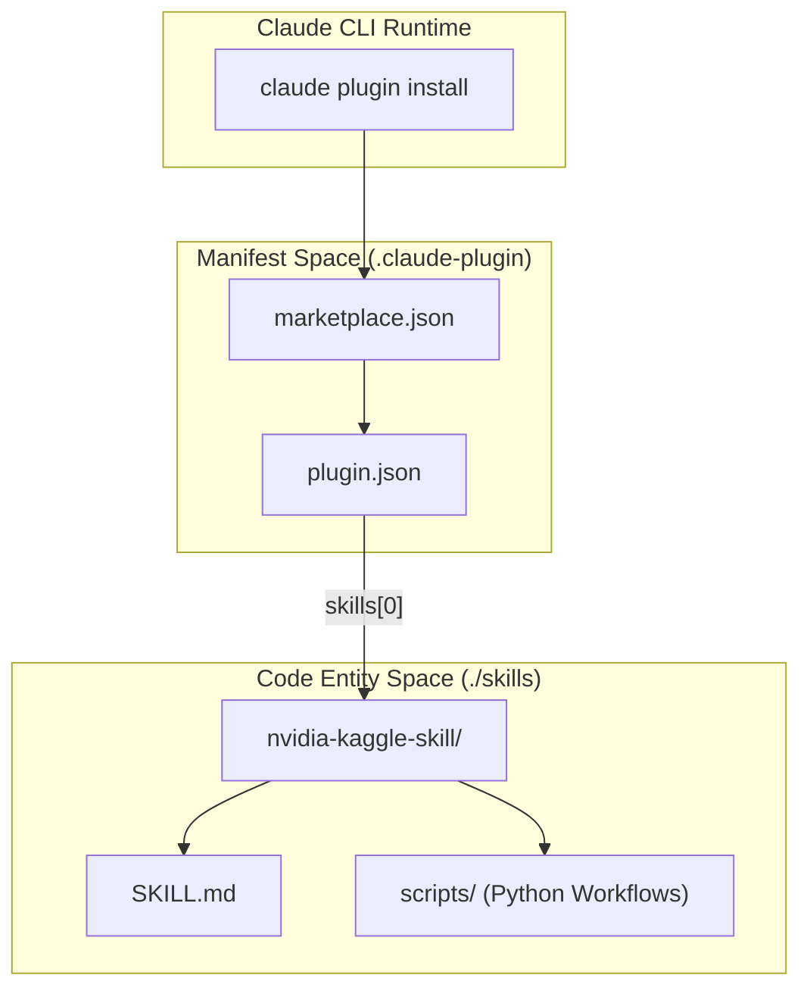
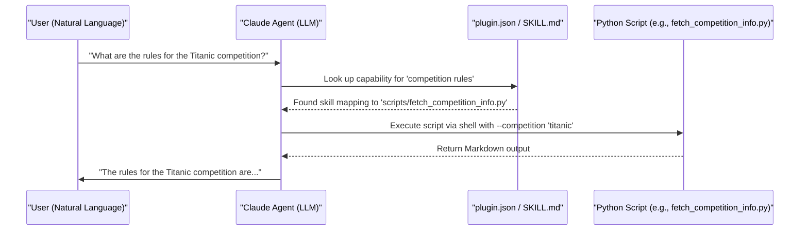

<!-- source: DeepWiki mcp.deepwiki.com · repo NVIDIA/nvidia-kaggle · page 4.1 Claude Code Plugin · fetched 2026-10-26 -->

# Claude Code Plugin

Relevant source files

The following files were used as context for generating this wiki page:

- [.claude-plugin/marketplace.json](.claude-plugin/marketplace.json)
- [.claude-plugin/plugin.json](.claude-plugin/plugin.json)

The `nvidia-kaggle` repository is designed to be consumed as a plugin for **Claude Code**, an agentic command-line interface. The plugin architecture allows Claude Code to discover, install, and execute the Kaggle-specific workflows defined in this repository. The integration is primarily managed through metadata files located in the `.claude-plugin/` directory.

## Plugin Architecture and Manifests

The plugin's identity and structure are defined by two primary JSON files. These files act as the entry point for the `claude` CLI to understand what capabilities the plugin provides and where the underlying logic resides.

### Plugin Manifest (`plugin.json`)
The `plugin.json` file is the core configuration for the plugin. It defines the plugin's name, description, and the location of its "skills."

*   **Name**: `nvidia-kaggle` [ .claude-plugin/plugin.json:2-2 ]()
*   **Skills Array**: This is the most critical field. It points to the directory containing the actual logic and the `SKILL.md` contract. In this repository, it points to `./skills/nvidia-kaggle-skill/` [ .claude-plugin/plugin.json:5-7 ]().

### Marketplace Registration (`marketplace.json`)
The `marketplace.json` file facilitates the discovery and installation of the plugin from a remote source. It provides the metadata necessary for the `claude` CLI to fetch the code from GitHub.

*   **Source Configuration**: It specifies the source type as `url` and points to the GitHub repository `https://github.com/NVIDIA/nvidia-kaggle.git` on the `main` branch [ .claude-plugin/marketplace.json:13-17 ]().
*   **Classification**: The plugin is categorized under `data-science` with tags including `kaggle` and `competition` [ .claude-plugin/marketplace.json:19-20 ]().

### Skill Mapping
The plugin logic is encapsulated in a "skill." The relationship between the plugin manifest and the physical code is illustrated below:

**Natural Language to Code Entity Mapping: Plugin Structure**

Sources: [ .claude-plugin/plugin.json:1-8 ](), [ .claude-plugin/marketplace.json:1-23 ]()

## Installation Lifecycle

The `claude` CLI manages the lifecycle of the plugin. When a user executes an install command, the CLI performs the following sequence:

1.  **Discovery**: The CLI reads `marketplace.json` to identify the repository URL [ .claude-plugin/marketplace.json:15-15 ]().
2.  **Cloning/Linking**: The CLI fetches the repository or links a local directory.
3.  **Manifest Parsing**: The CLI reads `.claude-plugin/plugin.json` to locate the skill directory [ .claude-plugin/plugin.json:6-6 ]().
4.  **Capability Registration**: The CLI parses the `SKILL.md` file within the skill directory to register available commands and their parameters with the LLM's toolset.

### Lifecycle Data Flow

The following diagram demonstrates how the plugin metadata bridges the gap between the Claude agent's natural language understanding and the execution of Python scripts.

**Natural Language to Code Entity Mapping: Execution Flow**

Sources: [ .claude-plugin/plugin.json:5-7 ](), [ .claude-plugin/marketplace.json:12-18 ]()

## Key Metadata Components

| Field | Location | Description |
| :--- | :--- | :--- |
| `name` | `plugin.json` | The unique identifier for the plugin in the Claude ecosystem. |
| `skills` | `plugin.json` | A list of paths to directories containing `SKILL.md` and associated scripts. |
| `source.url` | `marketplace.json` | The Git URL used for remote installation. |
| `metadata.version` | `marketplace.json` | The current semantic version of the plugin (e.g., `0.1.0`). |

Sources: [ .claude-plugin/plugin.json:1-8 ](), [ .claude-plugin/marketplace.json:1-23 ]()

---

