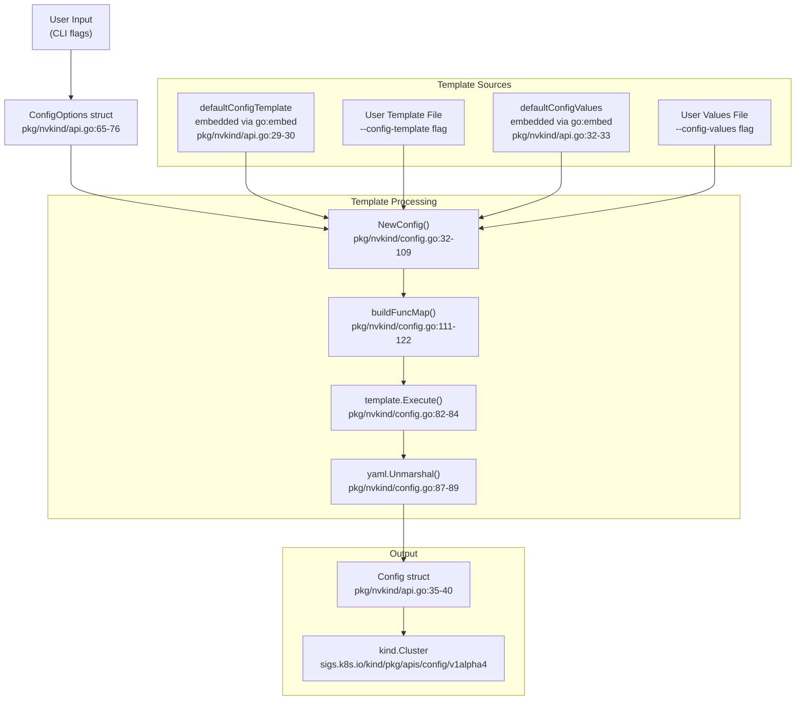
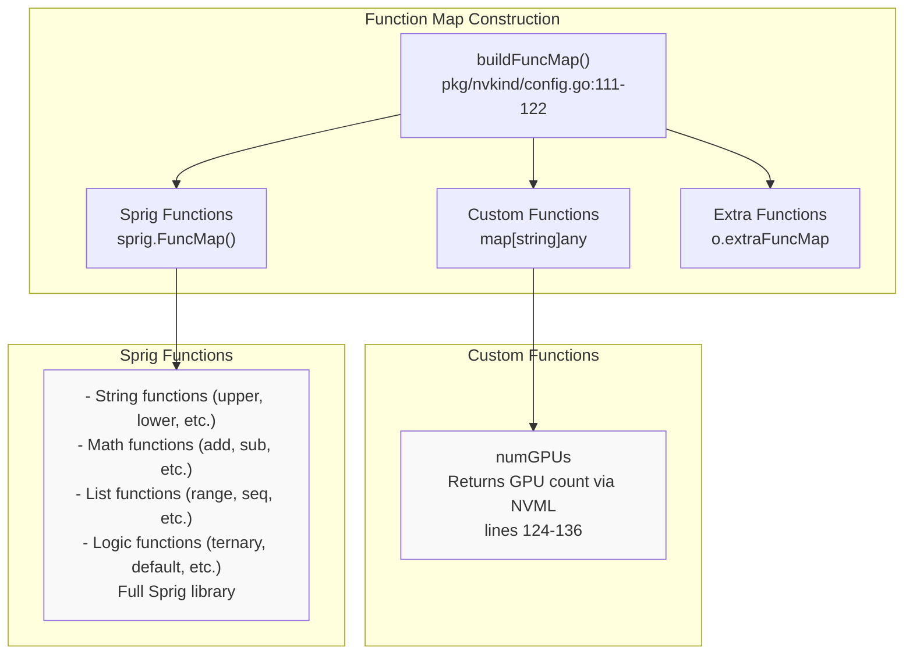
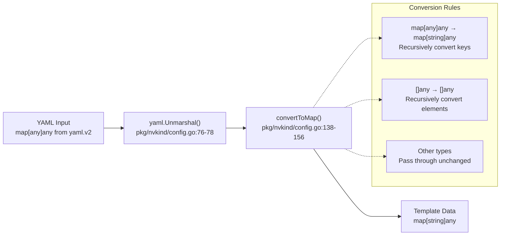

<!-- source: DeepWiki mcp.deepwiki.com · repo NVIDIA/nvkind · page 4.1 Configuration Template System · fetched 2026-10-26 -->

# Configuration Template System

<details>
<summary>Relevant source files</summary>

The following files were used as context for generating this wiki page:

- [README.md](README.md)
- [pkg/nvkind/api.go](pkg/nvkind/api.go)
- [pkg/nvkind/config.go](pkg/nvkind/config.go)

</details>


## Purpose and Scope

The Configuration Template System enables flexible creation of KIND cluster configurations with customizable GPU allocation patterns. This system uses Go's `text/template` engine to transform YAML configuration templates into concrete `kind.Cluster` configurations, supporting dynamic GPU distribution across worker nodes.

This page covers the template processing mechanism, built-in functions, and configuration value handling. For information about specific GPU distribution patterns enabled by templates, see [GPU Distribution Patterns](#3.4). For documentation of the built-in template examples, see [Built-in Template Examples](#4.2). For guidance on writing custom templates, see [Creating Custom Configurations](#4.3).

## System Overview

The template system operates as a configuration factory that transforms user-provided or default templates into KIND cluster configurations. It integrates NVIDIA GPU detection through NVML to enable dynamic GPU allocation decisions at cluster creation time.



**Sources:** [pkg/nvkind/api.go:29-33](), [pkg/nvkind/api.go:35-40](), [pkg/nvkind/api.go:65-76](), [pkg/nvkind/config.go:32-109]()

## Template Sources

The system supports two types of template sources: embedded defaults and user-provided files.

### Embedded Default Template

The default configuration template is embedded directly into the binary using Go's `//go:embed` directive:

```go
//go:embed default-config-template.yaml
var defaultConfigTemplate []byte
```

This template is used when no `--config-template` flag is provided. The embedded approach ensures nvkind can operate without external file dependencies.

**Location:** [pkg/nvkind/api.go:29-30]()

### User-Provided Templates

Users can override the default template by specifying a file path via the `WithConfigTemplate` option:

```go
func WithConfigTemplate[T string | []byte](arg T) ConfigOption
```

The function accepts either a file path (string) or raw template bytes, providing flexibility for both file-based and programmatic configuration.

**Location:** [pkg/nvkind/api.go:104-113]()

### Configuration Values

Similarly, configuration values can be provided as embedded defaults or user files:

| Value Source | Go Symbol | Usage |
|--------------|-----------|-------|
| Embedded Default | `defaultConfigValues` | Used when no `--config-values` flag provided |
| User File | Passed to `WithConfigValues` | Overrides default values with custom YAML data |
| Stdin | Special file path `-` | Allows inline YAML via heredoc or pipe |

**Sources:** [pkg/nvkind/api.go:32-33](), [pkg/nvkind/api.go:115-124]()

## Template Processing Pipeline

The `NewConfig` function orchestrates the complete template processing pipeline:

```mermaid
flowchart TD
    Start["NewConfig() Entry<br/>pkg/nvkind/config.go:32"]
    
    InitOptions["Apply ConfigOption functions<br/>lines 33-36"]
    
    SetDefaults["Set defaults:<br/>- defaultName (nvkind-<random>)<br/>- nvml instance<br/>- stdout/stderr<br/>lines 37-48"]
    
    LoadTemplate["Load template source:<br/>1. Check configTemplate bytes<br/>2. Else check configTemplatePath<br/>3. Else use defaultConfigTemplate<br/>lines 49-61"]
    
    LoadValues["Load values source:<br/>1. Check configValues bytes<br/>2. Else check configValuesPath<br/>3. Else use defaultConfigValues<br/>lines 52-68"]
    
    ParseTemplate["Parse template with FuncMap<br/>template.New().Funcs().Parse()<br/>lines 70-73"]
    
    UnmarshalValues["Unmarshal YAML values<br/>yaml.Unmarshal(configValues, &values)<br/>lines 75-78"]
    
    ConvertMap["Convert YAML map types<br/>convertToMap(values)<br/>line 79"]
    
    ExecuteTemplate["Execute template with values<br/>tmpl.Execute(&buffer, values)<br/>lines 81-84"]
    
    UnmarshalCluster["Unmarshal to kind.Cluster<br/>yaml.Unmarshal(buffer.Bytes(), &cluster)<br/>lines 86-89"]
    
    ApplyOverrides["Apply overrides:<br/>- Set cluster name if empty<br/>- Apply image to all nodes<br/>lines 91-99"]
    
    CreateConfig["Create Config struct<br/>with cluster, nvml, stdout, stderr<br/>lines 101-106"]
    
    Return["Return *Config"]
    
    Start --> InitOptions
    InitOptions --> SetDefaults
    SetDefaults --> LoadTemplate
    LoadTemplate --> LoadValues
    LoadValues --> ParseTemplate
    ParseTemplate --> UnmarshalValues
    UnmarshalValues --> ConvertMap
    ConvertMap --> ExecuteTemplate
    ExecuteTemplate --> UnmarshalCluster
    UnmarshalCluster --> ApplyOverrides
    ApplyOverrides --> CreateConfig
    CreateConfig --> Return
```



**Sources:** [pkg/nvkind/config.go:32-109]()

### Key Processing Steps

1. **Template Parsing**: The template string is parsed using Go's `text/template` engine with a custom function map
2. **Value Unmarshaling**: YAML values are unmarshaled into a generic `any` type structure
3. **Map Conversion**: YAML's `map[any]any` structures are converted to `map[string]any` for template compatibility (see [pkg/nvkind/config.go:138-156]())
4. **Template Execution**: The template is executed with the values, producing rendered YAML
5. **Cluster Unmarshaling**: The rendered YAML is unmarshaled into a `kind.Cluster` object

## Template Function Map

The template system provides an extended function map combining three sources:



**Sources:** [pkg/nvkind/config.go:111-122](), [README.md:221-226]()

### The `numGPUs` Function

The `numGPUs` function is a custom template function that queries the system's GPU count at template execution time:

| Aspect | Implementation |
|--------|----------------|
| **Function signature** | `func (o *ConfigOptions) numGPUs() (int, error)` |
| **Location** | [pkg/nvkind/config.go:124-136]() |
| **NVML operations** | `nvml.Init()`, `nvml.DeviceGetCount()`, `nvml.Shutdown()` |
| **Return value** | Integer count of available GPUs or error |
| **Usage in templates** | `{{ numGPUs }}` or `{{ $gpuCount := numGPUs }}` |

The function initializes NVML, queries the device count, and ensures proper cleanup with deferred shutdown. This enables templates to make GPU allocation decisions based on actual hardware availability.

**Example template usage:**
```yaml
nodes:
{{ range $i, $_ := until (numGPUs) }}
- role: worker
{{ end }}
```

### Sprig Integration

The system integrates the complete [Sprig function library](https://masterminds.github.io/sprig) via [pkg/nvkind/config.go:118-120](). This provides over 70 template functions including:

- **String manipulation**: `upper`, `lower`, `trim`, `replace`, `substr`
- **Math operations**: `add`, `sub`, `mul`, `div`, `mod`
- **List operations**: `first`, `last`, `rest`, `append`, `concat`
- **Flow control**: `ternary`, `default`, `empty`, `coalesce`
- **Iteration helpers**: `until`, `untilStep`, `seq`

**Sources:** [pkg/nvkind/config.go:111-122](), [README.md:223-224]()

## Configuration Values Structure

Configuration values are YAML documents that provide data to template execution. The values undergo type conversion to ensure compatibility with Go's `text/template` engine.

### Type Conversion Process



**Sources:** [pkg/nvkind/config.go:76-79](), [pkg/nvkind/config.go:138-156]()

The `convertToMap` function recursively transforms YAML's generic map types into string-keyed maps that the template engine can access using standard field notation (e.g., `.numWorkers` instead of requiring type assertions).

## Configuration Output

The final output of the template system is a `Config` struct containing a fully materialized `kind.Cluster` configuration:

| Field | Type | Purpose |
|-------|------|---------|
| `Cluster` | `*kind.Cluster` | KIND cluster configuration with nodes, networking, and mounts |
| `nvml` | `nvml.Interface` | NVML interface for GPU operations |
| `stdout` | `io.Writer` | Output stream for logging |
| `stderr` | `io.Writer` | Error stream for diagnostics |

**Location:** [pkg/nvkind/api.go:35-40]()

The `kind.Cluster` object contains:
- **Nodes**: Array of node configurations (control-plane and worker nodes)
- **ExtraMounts**: Volume mounts for GPU device injection
- **ContainerRuntime**: Runtime configuration settings
- **Networking**: Cluster networking parameters

This configuration is then consumed by the cluster creation process (see [Creating Clusters](#3.1)) to provision the actual KIND cluster with GPU support.

**Sources:** [pkg/nvkind/api.go:35-40](), [pkg/nvkind/config.go:101-108]()

---

