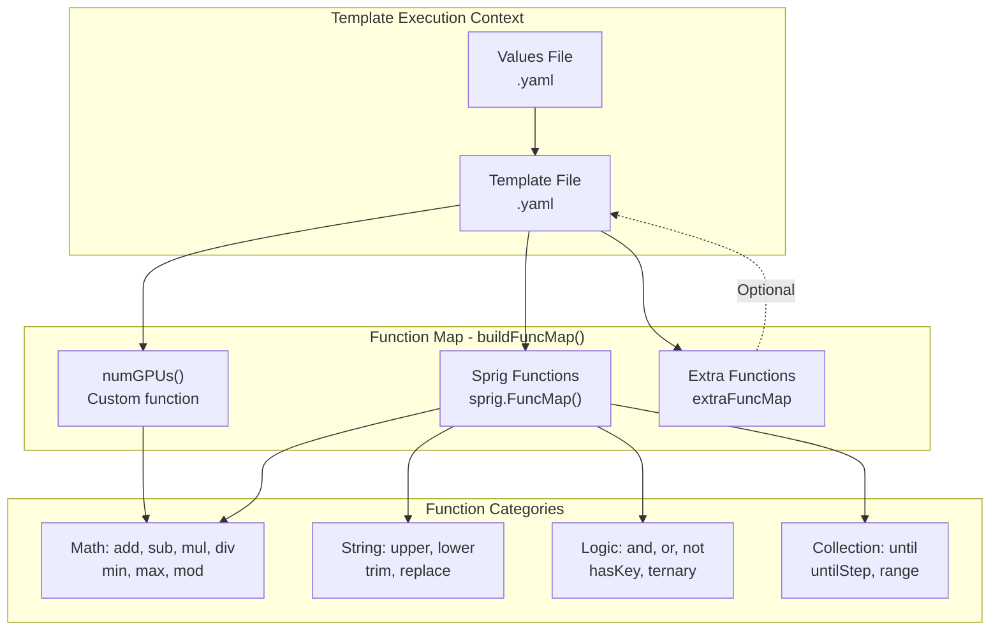
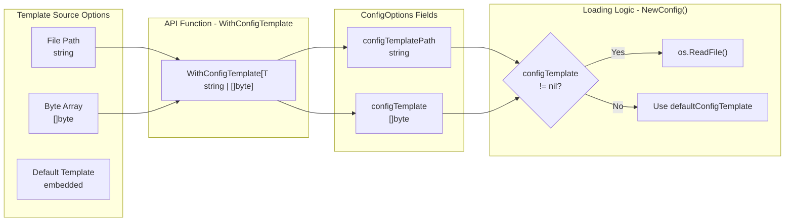
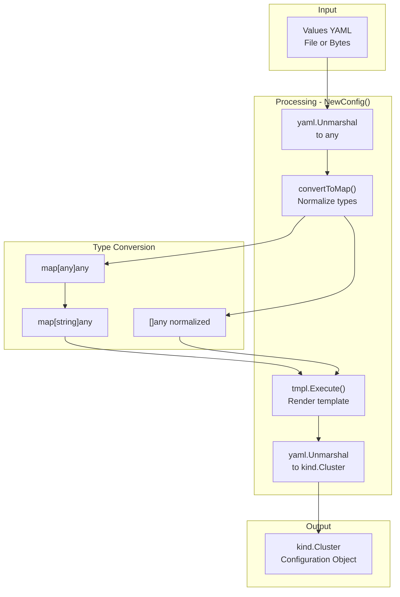

<!-- source: DeepWiki mcp.deepwiki.com · repo NVIDIA/nvkind · page 4.3 Creating Custom Configurations · fetched 2026-10-26 -->

# Creating Custom Configurations

<details>
<summary>Relevant source files</summary>

The following files were used as context for generating this wiki page:

- [examples/equally-distributed-gpus.yaml](examples/equally-distributed-gpus.yaml)
- [pkg/nvkind/api.go](pkg/nvkind/api.go)
- [pkg/nvkind/config.go](pkg/nvkind/config.go)

</details>


## Purpose and Scope

This page guides users through creating custom configuration templates for specialized GPU allocation scenarios in nvkind. Custom templates allow you to define arbitrary cluster topologies, GPU distribution patterns, and node configurations beyond the built-in examples.

For an explanation of how the template system works internally, see [Configuration Template System](#4.1). For documentation of the built-in templates, see [Built-in Template Examples](#4.2).

---

## Template File Structure

nvkind configuration templates are standard KIND cluster configuration files enhanced with Go template directives. A valid custom template must produce a `kind.Cluster` object when executed.

### Basic Template Structure

```yaml
kind: Cluster
apiVersion: kind.x-k8s.io/v1alpha4
{{- if hasKey $ "name" }}
name: {{ $.name }}
{{- end }}
nodes:
- role: control-plane
  {{- if hasKey $ "image" }}
  image: {{ $.image }}
  {{- end }}
# Worker nodes with GPU configuration
```

**Sources:** [examples/equally-distributed-gpus.yaml:17-26]()

### Required Components

| Component | Description | Required |
|-----------|-------------|----------|
| `kind: Cluster` | KIND cluster resource type | Yes |
| `apiVersion: kind.x-k8s.io/v1alpha4` | KIND API version | Yes |
| `nodes` array | List of cluster nodes | Yes |
| At least one `control-plane` node | Kubernetes control plane | Yes |
| `extraMounts` for GPU workers | GPU device injection mechanism | For GPU access |

### GPU Device Injection Mechanism

GPUs are injected into worker nodes using the `nvidia-container-runtime` volume mount mechanism. This requires specific `extraMounts` entries:

```yaml
extraMounts:
  - hostPath: /dev/null
    containerPath: /var/run/nvidia-container-devices/<GPU_INDEX>
```

The `nvidia-container-runtime` interprets paths under `/var/run/nvidia-container-devices/` as GPU device indices and mounts the corresponding devices into the container. This mechanism requires `accept-nvidia-visible-devices-as-volume-mounts = true` in `/etc/nvidia-container-runtime/config.toml`.

**Sources:** [examples/equally-distributed-gpus.yaml:36-43]()

---

## Template Function Reference

nvkind templates have access to a rich set of template functions for dynamic configuration generation.

### Built-in Template Functions



**Sources:** [pkg/nvkind/config.go:111-122]()

### The numGPUs Function

The `numGPUs` function queries the system's NVIDIA GPUs via NVML and returns the count. This is the primary mechanism for dynamic GPU-aware configuration.

**Function Signature:**
```
numGPUs() -> int
```

**Implementation:**
- Initializes NVML interface ([pkg/nvkind/config.go:125-128]())
- Calls `nvml.DeviceGetCount()` ([pkg/nvkind/config.go:130-133]())
- Returns the count or error ([pkg/nvkind/config.go:135]())

**Example Usage:**
```yaml
{{- $gpus_per_worker := div numGPUs $.numWorkers }}
```

**Sources:** [pkg/nvkind/config.go:124-136](), [examples/equally-distributed-gpus.yaml:15]()

### Sprig Functions

nvkind includes the complete [Sprig v3 template function library](http://masterminds.github.io/sprig). Commonly used functions include:

| Function | Purpose | Example |
|----------|---------|---------|
| `div` | Integer division | `div numGPUs 2` |
| `mul` | Multiplication | `mul $worker $gpus_per_worker` |
| `add` | Addition | `add $gpu_beg_id $gpus_per_worker` |
| `until` | Generate range [0, n) | `until $.numWorkers` |
| `untilStep` | Generate range with step | `untilStep $beg $end 1` |
| `hasKey` | Check map key existence | `hasKey $ "name"` |
| `int` | Convert to integer | `mul $worker $gpus_per_worker \| int` |

**Sources:** [pkg/nvkind/config.go:118-120]()

---

## Supplying Custom Templates

Custom templates can be provided to nvkind in multiple ways through the configuration API.

### Configuration Options



**Sources:** [pkg/nvkind/api.go:104-113](), [pkg/nvkind/config.go:49-68]()

### Using WithConfigTemplate

The `WithConfigTemplate` function accepts either a file path or raw template bytes:

**From File Path:**
```go
config, err := nvkind.NewConfig(
    nvkind.WithConfigTemplate("/path/to/custom-template.yaml"),
)
```

**From Byte Array:**
```go
templateData := []byte(`
kind: Cluster
apiVersion: kind.x-k8s.io/v1alpha4
...
`)
config, err := nvkind.NewConfig(
    nvkind.WithConfigTemplate(templateData),
)
```

**Implementation Details:**
- The function uses Go generics to accept `string` or `[]byte` ([pkg/nvkind/api.go:104]())
- File paths are stored in `configTemplatePath` and read during `NewConfig()` ([pkg/nvkind/config.go:55-60]())
- Byte arrays are stored directly in `configTemplate` ([pkg/nvkind/api.go:110]())

**Sources:** [pkg/nvkind/api.go:104-113](), [pkg/nvkind/config.go:49-68]()

---

## Supplying Custom Values

Template execution requires a values object that provides data to the template. Custom values can override defaults or provide additional parameters.

### Values File Structure

Values files are YAML documents containing arbitrary key-value pairs accessible in templates via `$`:

```yaml
numWorkers: 3
name: my-custom-cluster
image: kindest/node:v1.27.0
customField: custom-value
```

### Using WithConfigValues

Similar to templates, values can be provided via file path or byte array:

**From File Path:**
```go
config, err := nvkind.NewConfig(
    nvkind.WithConfigTemplate("/path/to/template.yaml"),
    nvkind.WithConfigValues("/path/to/values.yaml"),
)
```

**From Byte Array:**
```go
valuesData := []byte(`
numWorkers: 4
name: gpu-cluster
`)
config, err := nvkind.NewConfig(
    nvkind.WithConfigValues(valuesData),
)
```

**Sources:** [pkg/nvkind/api.go:115-124](), [pkg/nvkind/config.go:52-68]()

### Values Processing



**Sources:** [pkg/nvkind/config.go:75-89](), [pkg/nvkind/config.go:138-156]()

---

## Common Customization Patterns

### Pattern 1: Variable Number of Workers with Equal GPU Distribution

This pattern creates clusters where the number of workers and GPUs per worker are parameterized:

**Template (custom-equal-gpus.yaml):**
```yaml
{{- $gpus_per_worker := div numGPUs $.numWorkers }}
kind: Cluster
apiVersion: kind.x-k8s.io/v1alpha4
nodes:
- role: control-plane
{{- range $worker := until $.numWorkers }}
- role: worker
  {{- $gpu_beg_id := mul $worker $gpus_per_worker | int }}
  {{- $gpu_end_id := add $gpu_beg_id $gpus_per_worker | int }}
  {{- $gpus := untilStep $gpu_beg_id $gpu_end_id 1 }}
  extraMounts:
    {{- range $gpu := $gpus }}
    - hostPath: /dev/null
      containerPath: /var/run/nvidia-container-devices/{{ $gpu }}
    {{- end }}
{{- end }}
```

**Values (values.yaml):**
```yaml
numWorkers: 3
```

**Sources:** [examples/equally-distributed-gpus.yaml:15-44]()

### Pattern 2: Explicit GPU-to-Worker Mapping

For precise control over which GPUs go to which workers:

**Template:**
```yaml
kind: Cluster
apiVersion: kind.x-k8s.io/v1alpha4
nodes:
- role: control-plane
{{- range $worker := $.workers }}
- role: worker
  extraMounts:
    {{- range $gpu := $worker.gpus }}
    - hostPath: /dev/null
      containerPath: /var/run/nvidia-container-devices/{{ $gpu }}
    {{- end }}
{{- end }}
```

**Values:**
```yaml
workers:
  - gpus: [0, 1]
  - gpus: [2, 3]
  - gpus: [4]
```

### Pattern 3: Conditional GPU Assignment

Assign GPUs only to workers that meet certain criteria:

**Template:**
```yaml
kind: Cluster
apiVersion: kind.x-k8s.io/v1alpha4
nodes:
- role: control-plane
{{- range $worker := $.workers }}
- role: worker
  {{- if $worker.enableGPU }}
  extraMounts:
    {{- range $gpu := $worker.gpus }}
    - hostPath: /dev/null
      containerPath: /var/run/nvidia-container-devices/{{ $gpu }}
    {{- end }}
  {{- end }}
{{- end }}
```

**Values:**
```yaml
workers:
  - enableGPU: true
    gpus: [0, 1]
  - enableGPU: false
    gpus: []
  - enableGPU: true
    gpus: [2]
```

### Pattern 4: Dynamic GPU Distribution Based on System Configuration

Calculate GPU distribution based on detected GPU count:

**Template:**
```yaml
{{- $totalGPUs := numGPUs }}
{{- $workersWithGPU := 2 }}
{{- $gpusPerWorker := div $totalGPUs $workersWithGPU }}
kind: Cluster
apiVersion: kind.x-k8s.io/v1alpha4
nodes:
- role: control-plane
{{- range $worker := until $workersWithGPU }}
- role: worker
  {{- $start := mul $worker $gpusPerWorker | int }}
  {{- $end := add $start $gpusPerWorker | int }}
  extraMounts:
    {{- range $gpu := untilStep $start $end 1 }}
    - hostPath: /dev/null
      containerPath: /var/run/nvidia-container-devices/{{ $gpu }}
    {{- end }}
{{- end }}
{{- range $worker := until $.extraWorkers }}
- role: worker
  # No GPUs for these workers
{{- end }}
```

**Values:**
```yaml
extraWorkers: 1  # Additional workers without GPUs
```

---

## Custom Template Functions

Advanced users can extend the template function map with custom functions using `WithFuncMap`.

### Adding Custom Functions

```go
customFuncs := template.FuncMap{
    "myCustomFunc": func(input string) string {
        return strings.ToUpper(input)
    },
    "calculateGPULayout": func(total, nodes int) [][]int {
        // Custom GPU distribution logic
        // ...
    },
}

config, err := nvkind.NewConfig(
    nvkind.WithConfigTemplate("template.yaml"),
    nvkind.WithFuncMap(customFuncs),
)
```

**Function Map Precedence:**
1. Custom functions (highest priority - can override Sprig)
2. `numGPUs` function
3. Sprig functions (lowest priority)

**Sources:** [pkg/nvkind/api.go:98-102](), [pkg/nvkind/config.go:111-122]()

### Custom Function Requirements

Custom functions must:
- Be compatible with Go's `text/template` package
- Have signatures supported by the template engine (specific input/output types)
- Not cause panics (template execution will fail on panic)
- Return errors appropriately (Go template functions can return `(value, error)`)

---

## Testing and Validation

### Validating Template Syntax

Test template syntax without creating a cluster:

```go
import (
    "fmt"
    "github.com/NVIDIA/nvkind/pkg/nvkind"
)

config, err := nvkind.NewConfig(
    nvkind.WithConfigTemplate("/path/to/template.yaml"),
    nvkind.WithConfigValues("/path/to/values.yaml"),
)
if err != nil {
    fmt.Printf("Template error: %v\n", err)
    return
}

// Inspect resulting configuration
fmt.Printf("Cluster name: %s\n", config.Name)
fmt.Printf("Number of nodes: %d\n", len(config.Nodes))
for i, node := range config.Nodes {
    fmt.Printf("Node %d: role=%s, extraMounts=%d\n", 
        i, node.Role, len(node.ExtraMounts))
}
```

### Common Template Errors

| Error Type | Cause | Solution |
|------------|-------|----------|
| Template parsing error | Invalid Go template syntax | Check `{{`, `}}`, and control structures |
| YAML unmarshal error | Template output is not valid YAML | Ensure template produces valid YAML |
| Missing field access | Template references undefined field | Check values file contains required fields |
| NVML initialization error | `numGPUs` fails to initialize NVML | Verify NVIDIA drivers installed |
| Type mismatch | Incorrect type in template operations | Use `int` filter for numeric operations |

**Sources:** [pkg/nvkind/config.go:70-89]()

### Debugging Template Execution

To debug template execution, examine the intermediate rendered YAML before it's unmarshaled:

```go
// In pkg/nvkind/config.go, the template output is in 'buffer'
// Add debugging by examining buffer.Bytes() before unmarshaling
```

The template execution flow:
1. Parse template string ([pkg/nvkind/config.go:70-73]())
2. Unmarshal values YAML ([pkg/nvkind/config.go:75-78]())
3. Convert values to proper types ([pkg/nvkind/config.go:79]())
4. Execute template into buffer ([pkg/nvkind/config.go:81-84]())
5. Unmarshal buffer into `kind.Cluster` ([pkg/nvkind/config.go:86-89]())

Errors at step 4 indicate template logic issues, while errors at step 5 indicate the rendered YAML is invalid.

**Sources:** [pkg/nvkind/config.go:70-89]()

---

## Integration with CLI

Custom templates can be used via the `nvkind` CLI using the `--config` and `--config-values` flags:

```bash
# Using custom template and values files
nvkind cluster create \
    --config /path/to/custom-template.yaml \
    --config-values /path/to/custom-values.yaml
```

These flags map directly to the `WithConfigTemplate` and `WithConfigValues` options in the API.

**Sources:** [pkg/nvkind/api.go:104-124]()

---

## Best Practices

### 1. Always Validate numGPUs Availability

Ensure your template handles cases where `numGPUs` might return 0 or an error:

```yaml
{{- $gpuCount := numGPUs }}
{{- if gt $gpuCount 0 }}
# GPU configuration
{{- else }}
# Fallback configuration without GPUs
{{- end }}
```

### 2. Use Integer Conversions for Math Operations

Template arithmetic operations on numbers from YAML may not be integers:

```yaml
{{- $result := mul $value1 $value2 | int }}
```

### 3. Provide Default Values

Use `hasKey` to provide defaults when values might be missing:

```yaml
{{- $workers := 1 }}
{{- if hasKey $ "numWorkers" }}
{{- $workers = $.numWorkers }}
{{- end }}
```

### 4. Document Custom Templates

Include comments in templates explaining the expected values structure:

```yaml
# Expected values:
#   numWorkers: int - Number of worker nodes
#   gpuMode: string - "shared" or "isolated"
kind: Cluster
...
```

### 5. Test with Different GPU Counts

Test templates on systems with different GPU configurations to ensure robustness.

**Sources:** [examples/equally-distributed-gpus.yaml:15-44]()

---

## Summary

Custom nvkind configuration templates provide powerful flexibility for creating specialized GPU-enabled Kubernetes clusters. Key capabilities include:

- **Dynamic GPU Detection:** Use `numGPUs` to query available GPUs
- **Rich Template Language:** Leverage Sprig functions for complex logic
- **Flexible Input:** Supply templates and values via files or byte arrays
- **Extensibility:** Add custom template functions via `WithFuncMap`
- **CLI Integration:** Use custom templates directly from the command line

For more information on the template execution engine, see [Configuration Template System](#4.1). For examples of built-in templates, see [Built-in Template Examples](#4.2).

**Sources:** [pkg/nvkind/api.go:1-177](), [pkg/nvkind/config.go:1-157](), [examples/equally-distributed-gpus.yaml:1-45]()

---

