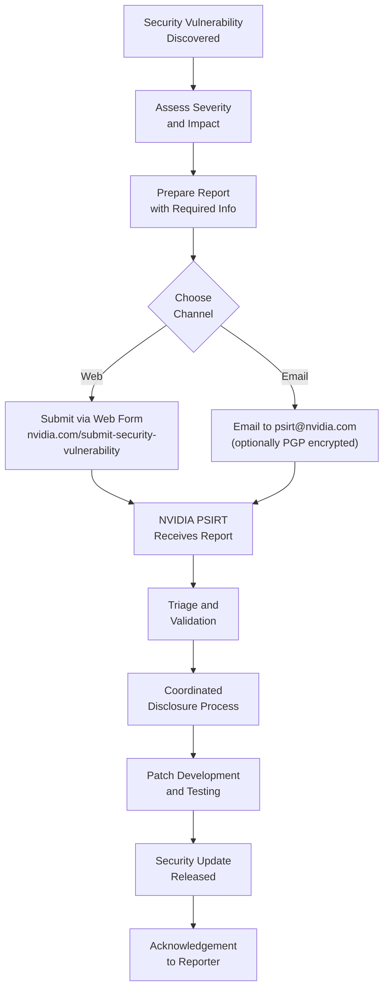
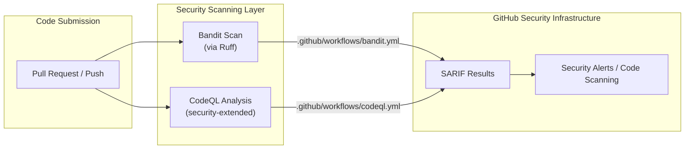
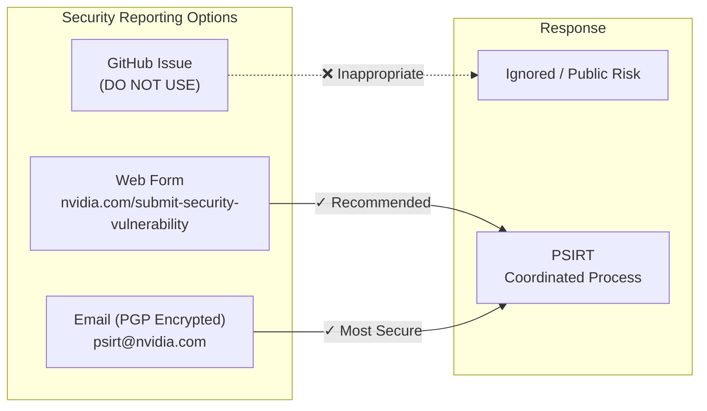

<!-- source: DeepWiki mcp.deepwiki.com · repo NVIDIA/nvmath-python · page 10.2 Security Policies · fetched 2026-10-26 -->

# Security Policies

Relevant source files

The following files were used as context for generating this wiki page:

- [.github/workflows/bandit.yml](.github/workflows/bandit.yml)
- [.github/workflows/codeql.yml](.github/workflows/codeql.yml)
- [SECURITY.md](SECURITY.md)

## Purpose and Scope

This document outlines the security policies and vulnerability reporting procedures for the `nvmath-python` project. It describes how to report potential security issues, the appropriate communication channels, and NVIDIA's coordinated vulnerability disclosure policy. This page also details the automated security analysis integrated into the project's CI/CD pipeline to ensure code integrity.

## Overview

NVIDIA maintains a dedicated Product Security Incident Response Team (PSIRT) to handle security concerns across all NVIDIA software products, including `nvmath-python`. Security vulnerabilities should be reported through official channels rather than through public GitHub issues to enable coordinated disclosure and timely remediation.

## Vulnerability Reporting Process

### Reporting Channels

Security vulnerabilities in `nvmath-python` must be reported through one of the following official channels:

| Channel | Method | Details |
|---------|--------|---------|
| **Web Form** | [Security Vulnerability Submission Form](https://www.nvidia.com/object/submit-security-vulnerability.html) | Primary reporting interface |
| **Email** | psirt@nvidia.com | Supports PGP encryption |
| **PGP Key** | [NVIDIA Public PGP Key](https://www.nvidia.com/en-us/security/pgp-key) | For secure email communication |

**Important**: Do not report security vulnerabilities through GitHub issues or GitHub Discussions. Public disclosure of unpatched vulnerabilities could expose users to risk.

Sources: [SECURITY.md:7-17]()

### Security Reporting Workflow

**Security Vulnerability Reporting Workflow**: This diagram illustrates the end-to-end process from vulnerability discovery to resolution and acknowledgement.

Sources: [SECURITY.md:9-30]()

## Required Reporting Information

When reporting a security vulnerability, include the following information to enable effective triage and remediation:

### Essential Details

| Information Type | Description | Example |
|-----------------|-------------|---------|
| **Product Name** | Specific component affected | `nvmath-python` |
| **Version/Branch** | Version number or Git branch | `v0.2.0`, `main` branch, commit SHA |
| **Vulnerability Type** | Classification of the issue | Code execution, denial of service, buffer overflow |
| **Reproduction Steps** | Detailed instructions to reproduce | Environment setup, input data, command sequence |
| **Proof-of-Concept** | Exploit code or demonstration | Python script or test case |
| **Impact Assessment** | Potential consequences | Data exposure, system compromise |

Sources: [SECURITY.md:18-24]()

## Automated Security Analysis

The `nvmath-python` repository employs automated static analysis tools to identify potential security vulnerabilities during development and before merging code into the `main` branch.

### Static Analysis: Bandit Scan

The project uses `Bandit` (via the `Ruff` linter) to scan Python code for common security issues. This is automated through a GitHub Action that runs on every push to `main` and pull request branches.

*   **Implementation**: The workflow installs `uv`, extracts ignore codes from `ruff.toml`, and performs the analysis.
*   **Output**: Results are exported in SARIF format and uploaded to GitHub's security tab.
*   **Trigger**: Defined in [.github/workflows/bandit.yml:7-11]().

### Static Analysis: CodeQL Scan

Comprehensive semantic analysis is performed using GitHub CodeQL to detect complex security patterns and data flow vulnerabilities.

*   **Configuration**: Uses the `security-extended` query suite [.github/workflows/codeql.yml:38-38]().
*   **Languages**: Specifically targets the Python codebase [.github/workflows/codeql.yml:27-28]().
*   **Workflow**: The `analyze` job initializes CodeQL and uploads the resulting security events [.github/workflows/codeql.yml:17-44]().

### Security CI/CD Data Flow

**Security Analysis Data Flow**: This diagram bridges the "Natural Language Space" of security scanning to the "Code Entity Space" by showing how the GitHub workflows interact with the security infrastructure.

Sources: [.github/workflows/bandit.yml:1-48](), [.github/workflows/codeql.yml:1-44]()

## Coordinated Disclosure Policy

NVIDIA operates a coordinated vulnerability disclosure program that balances timely remediation with responsible disclosure:

1.  **No Bug Bounty Program**: NVIDIA does not currently offer monetary rewards for vulnerability reports [SECURITY.md:26-27]().
2.  **Acknowledgement**: External reporters who follow the coordinated disclosure policy receive public acknowledgement when the issue is addressed [SECURITY.md:26-29]().
3.  **PSIRT Policies**: For complete policy details, refer to the [NVIDIA PSIRT Policies page](https://www.nvidia.com/en-us/security/psirt-policies).

Sources: [SECURITY.md:26-30]()

## Security Contact Summary

**Security Contact Decision Tree**: This diagram shows the appropriate and inappropriate channels for security vulnerability reporting based on the `SECURITY.md` guidelines.

Sources: [SECURITY.md:7-17]()

### Quick Reference

*   **Primary Contact**: psirt@nvidia.com
*   **Web Form**: https://www.nvidia.com/object/submit-security-vulnerability.html
*   **PGP Key**: https://www.nvidia.com/en-us/security/pgp-key
*   **Security Portal**: https://www.nvidia.com/en-us/security

Sources: [SECURITY.md:1-36]()

---

