# Page: Overview

# Overview

<details>
<summary>Relevant source files</summary>

The following files were used as context for generating this wiki page:

- [.github/ISSUE_TEMPLATE/feature_request.yml](.github/ISSUE_TEMPLATE/feature_request.yml)
- [DESCRIPTION.rst](DESCRIPTION.rst)
- [README.md](README.md)
- [docs/sphinx/figures/nvmath-python.png](docs/sphinx/figures/nvmath-python.png)

</details>


nvmath-python is a high-performance Python library that serves as a comprehensive bridge to NVIDIA's suite of mathematical libraries. It provides intuitive, pythonic APIs that offer developers full access to features provided by NVIDIA's libraries across various execution spaces, including Host, Device, and Distributed environments.

## Purpose and Scope

nvmath-python is designed to bring the performance of NVIDIA's C-based math libraries to the Python ecosystem. It works seamlessly with existing Python array/tensor frameworks such as NumPy, CuPy, and PyTorch, focusing on providing advanced functionality and fine-grained control that is often missing from those frameworks.

The library is organized into three primary API tiers:
1.  **Host APIs**: Called from host code to execute math operations on CPU or GPU.
2.  **Device APIs**: Low-level functions for use within custom CUDA kernels (e.g., via Numba).
3.  **Distributed APIs**: Multi-node, multi-GPU operations for large-scale computations.

Sources: [README.md:7-13](), [README.md:17-18]()

## Three-Tier API Architecture

The architecture is structured to support different levels of abstraction and execution models.

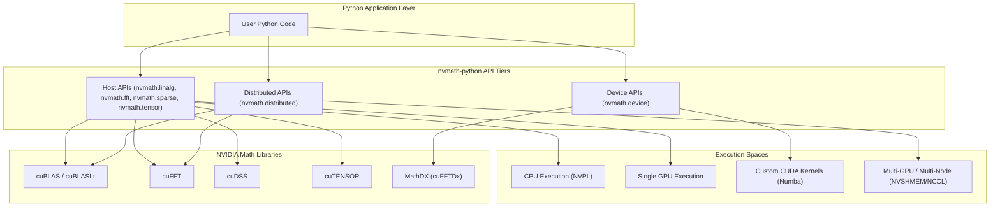

Sources: [README.md:20-204](), [.github/ISSUE_TEMPLATE/feature_request.yml:18-32]()

### 1. Host APIs
Host APIs are the primary entry point for most users. They provide high-level wrappers for operations like Fast Fourier Transforms (FFT), Linear Algebra (linalg), Sparse solvers, and Tensor contractions. A key differentiator is the "stateful" workflow (Create -> Plan -> Execute) which allows for performance tuning and operation fusion.

*   **Linear Algebra**: Uses `nvmath.linalg.advanced.Matmul` to expose cuBLASLt features like mixed-precision and epilog fusion.
*   **FFT**: Uses `nvmath.fft` for batched transforms with support for custom LTO-IR prologs and epilogs.
*   **Sparse**: Uses `nvmath.sparse.advanced.DirectSolver` for high-performance sparse solving via cuDSS.
*   **Tensor**: Uses `nvmath.tensor` for binary and ternary contractions via cuTENSOR.

Sources: [README.md:20-103](), [.github/ISSUE_TEMPLATE/feature_request.yml:25-28]()

### 2. Device APIs
Device APIs (under `nvmath.device`) expose NVIDIA's MathDX (Device Extensions) to Python. These are intended to be called from *within* a CUDA kernel. This enables kernel fusion where, for example, an FFT can be performed on data already residing in registers or shared memory without returning to the host.

*   **Integration**: Works primarily with Numba's `@cuda.jit`.
*   **Key Entities**: `nvmath.device.fft` provides templates for generating device-side FFT functions.

Sources: [README.md:105-196](), [.github/ISSUE_TEMPLATE/feature_request.yml:31-31]()

### 3. Distributed APIs
The `nvmath.distributed` module handles computations that span multiple GPUs or nodes. It integrates with NVSHMEM for Partitioned Global Address Space (PGAS) memory models and NCCL for collective communications.

*   **Data Distribution**: Supports various distribution strategies like `Slab` or `BlockCyclic`.
*   **Operations**: Distributed FFTs and reshapes across process grids.

Sources: [README.md:198-210](), [.github/ISSUE_TEMPLATE/feature_request.yml:29-29]()

## Data Flow and Implementation

The following diagram illustrates how a typical Host API call (like Matrix Multiplication) flows from Python entities down to the native NVIDIA libraries.

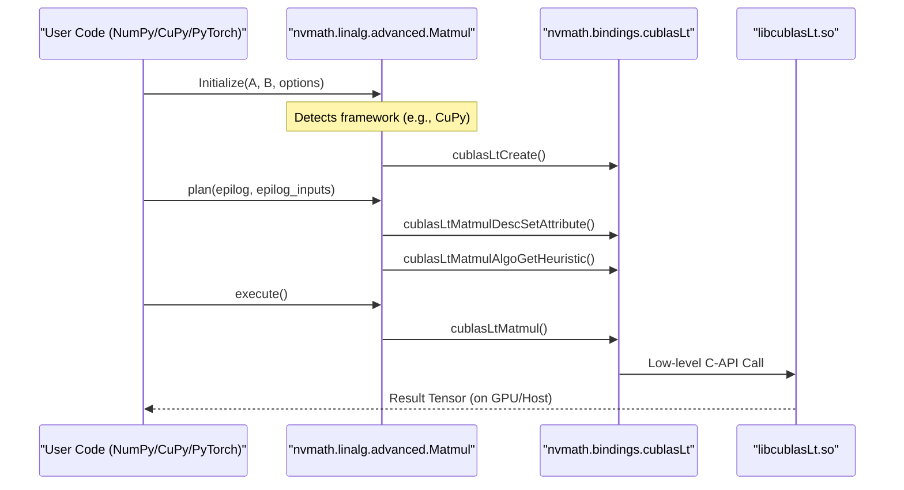

Sources: [README.md:28-69](), [DESCRIPTION.rst:5-13]()

## Key Features and Benefits

| Feature | Description |
| :--- | :--- |
| **Full Parameter Access** | Unlike standard wrappers, `nvmath-python` exposes nearly all parameters of the underlying C-APIs (e.g., `MatmulComputeType`). |
| **Operation Fusion** | Support for custom epilogs/prologs via LTO-IR to fuse operations like scaling or bias addition directly into math kernels. |
| **Framework Interop** | Seamlessly accepts and returns tensors from `numpy`, `cupy`, and `torch`. |
| **Stateful Planning** | Separates the expensive planning phase from execution, enabling high-frequency loops with zero overhead. |

Sources: [README.md:20-69](), [README.md:71-103]()

---

# Page: Installation & Getting Started

# Installation & Getting Started

<details>
<summary>Relevant source files</summary>

The following files were used as context for generating this wiki page:

- [DESCRIPTION.rst](DESCRIPTION.rst)
- [MANIFEST.in](MANIFEST.in)
- [README.md](README.md)

</details>


## Purpose and Scope

This page guides you through installing `nvmath-python`, verifying the installation, and running your first examples with each of the three API categories. For architectural details about how `nvmath-python` is structured internally, see **Architecture Overview**. For in-depth usage of specific API categories, see **Host APIs**, **Device APIs**, and **Distributed APIs**.

## Installation

### Installing via pip

The recommended installation method is via `pip`. `nvmath-python` requires a CUDA installation and ships with different variants depending on your CUDA version:

```bash
# For CUDA 12.x
pip install nvmath-python[cu12]

# For CUDA 11.x
pip install nvmath-python[cu11]
```

The package automatically detects and links against your CUDA installation. The detection logic searches for CUDA in the following order:

1. Pip-installed CUDA packages (`nvidia-*` wheels)
2. Environment variables (`CUDA_HOME`, `CUDA_PATH`, `CUDA_ROOT`)
3. Default system paths (e.g., `/usr/local/cuda`, `/opt/cuda`)

**Sources:** [DESCRIPTION.rst:13-22]()

### System Requirements

`nvmath-python` has the following requirements:

| Component | Requirement |
|-----------|-------------|
| Python | 3.9+ |
| CUDA | 11.x or 12.x |
| GPU | NVIDIA GPU with Compute Capability 7.0+ |
| Operating System | Linux x86_64 |
| Python Frameworks | NumPy, CuPy, or PyTorch |

For distributed operations, additional requirements include:

| Component | Requirement |
|-----------|-------------|
| MPI | MPI implementation (e.g., OpenMPI, MPICH) |
| mpi4py | Python MPI bindings |
| NVSHMEM | Included with nvmath-python |

**Sources:** [README.md:1-14]()

## Installation Flow and CUDA Detection

The following diagram illustrates how `nvmath-python` detects CUDA during installation and runtime:

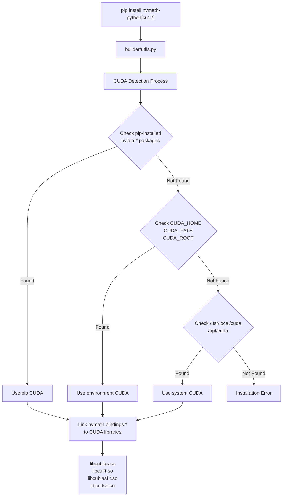

**Installation and CUDA Detection Flow**

**Sources:** [README.md:1-14](), [DESCRIPTION.rst:13-22](), [MANIFEST.in:1-6]()

## Verifying Installation

After installation, verify that `nvmath-python` can access the CUDA libraries:

```python
import nvmath

# Check that bindings are available
print(f"nvmath version: {nvmath.__version__}")

# Verify CUDA library access
import nvmath.bindings.cublas
import nvmath.bindings.cufft

print("nvmath-python installed successfully")
```

**Sources:** [README.md:1-14]()

## API Categories and Entry Points

`nvmath-python` provides three distinct API categories, each with specific entry points:

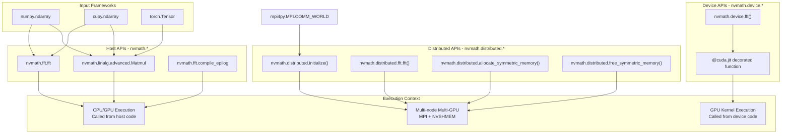

**API Categories and Their Entry Points**

**Sources:** [README.md:15-27](), [README.md:105-110](), [README.md:198-202]()

## Quick Start Examples

### Host API: Matrix Multiplication

The Host API allows you to perform GPU-accelerated operations from Python using familiar array frameworks. The `nvmath.linalg.advanced.Matmul` class provides access to all `cuBLASLt` features:

```python
import cupy as cp
import nvmath

# Prepare input matrices
m, n, k = 123, 456, 789
a = cp.random.rand(m, k).astype(cp.float32)
b = cp.random.rand(k, n).astype(cp.float32)
bias = cp.random.rand(m, 1).astype(cp.float32)

# Create Matmul object with mixed-precision compute
mm = nvmath.linalg.advanced.Matmul(
    a,
    b,
    options={
        "compute_type": nvmath.linalg.advanced.MatmulComputeType.COMPUTE_32F_FAST_16F
    },
)

# Plan with epilog operation (bias addition)
mm.plan(
    epilog=nvmath.linalg.advanced.MatmulEpilog.BIAS,
    epilog_inputs={"bias": bias},
)

# Execute
result = mm.execute()
mm.free()

# Synchronize
cp.cuda.get_current_stream().synchronize()
```

**Key Concepts:**
- `nvmath.linalg.advanced.Matmul` is a stateful object for reusable matrix multiplications [README.md:42-48]().
- `options` parameter controls compute precision and algorithm selection [README.md:45-47]().
- `epilog` parameter enables fused operations (e.g., bias addition) without separate kernels [README.md:53-56]().
- Works with `numpy.ndarray`, `cupy.ndarray`, and `torch.Tensor` [README.md:32-33]().

**Sources:** [README.md:20-69]()

### Host API: FFT with Custom Epilog

The FFT Host API supports custom prologs and epilogs compiled to LTO-IR for kernel fusion:

```python
import cupy as cp
import nvmath
import math

# Create batched 1-D FFT data
B, N = 256, 1024
a = cp.random.rand(B, N, dtype=cp.float64) + 1j * cp.random.rand(B, N, dtype=cp.float64)

# Normalization factor for unitary transform
norm_factor = 1.0 / math.sqrt(N)

# Define epilog function
def rescale(data_out, offset, data, user_info, unused):
    data_out[offset] = data * norm_factor

# Compile to LTO-IR
with cp.cuda.Device():
    epilog = nvmath.fft.compile_epilog(rescale, "complex128", "complex128")

# Execute FFT with fused epilog
r = nvmath.fft.fft(a, axes=[-1], epilog={"ltoir": epilog})
```

**Key Concepts:**
- `nvmath.fft.compile_epilog()` compiles Python functions to GPU code [README.md:92-93]().
- Epilogs execute without additional kernel launches (kernel fusion) [README.md:95-96]().
- `nvmath.fft.fft()` accepts `axes` parameter similar to `numpy.fft` and `cupy.fft` [README.md:96]().

**Sources:** [README.md:71-103]()

### Device API: FFT in Numba Kernels

Device APIs allow calling NVIDIA library functions inside custom CUDA kernels:

```python
import numpy as np
from numba import cuda
from nvmath.device import fft

# Create device FFT functions
size = 128
FFT_fwd = fft(
    fft_type="c2c",
    size=size,
    precision=np.float32,
    direction="forward",
    ffts_per_block=1,
    elements_per_thread=2,
    execution="Block",
)

FFT_inv = fft(
    fft_type="c2c",
    size=size,
    precision=np.float32,
    direction="inverse",
    ffts_per_block=1,
    elements_per_thread=2,
    execution="Block",
)

# Define Numba kernel
@cuda.jit
def convolution_kernel(signal, filter):
    # Allocate thread-local and shared memory
    thread_data = cuda.local.array(
        shape=(FFT_fwd.storage_size,), 
        dtype=FFT_fwd.value_type,
    )
    shared_mem = cuda.shared.array(shape=(0,), dtype=FFT_fwd.value_type)
    
    # Load data
    fft_id = cuda.blockIdx.x
    offset = cuda.threadIdx.x
    for i in range(FFT_fwd.elements_per_thread):
        thread_data[i] = signal[fft_id, offset + i * FFT_fwd.stride]
    
    # Call cuFFTDx from device code
    FFT_fwd(thread_data, shared_mem)
    
    # Apply filter
    for i in range(FFT_fwd.elements_per_thread):
        thread_data[i] *= filter[fft_id, offset + i * FFT_fwd.stride]
    
    # Inverse FFT
    FFT_inv(thread_data, shared_mem)
    
    # Store result
    for i in range(FFT_fwd.elements_per_thread):
        signal[fft_id, offset + i * FFT_fwd.stride] = thread_data[i]

# Prepare data and launch kernel
data = np.random.randn(1, size).astype(np.complex64)
filter = np.random.randn(1, size).astype(np.complex64)
data_d = cuda.to_device(data)
filter_d = cuda.to_device(filter)

convolution_kernel[1, FFT_fwd.block_dim, 0, FFT_fwd.shared_memory_size](data_d, filter_d)
cuda.synchronize()
```

**Key Concepts:**
- `nvmath.device.fft()` returns a callable object representing a `cuFFTDx` operation [README.md:129-146]().
- Device functions are called from within `@cuda.jit` decorated kernels [README.md:149-166]().
- Attributes like `storage_size`, `block_dim`, and `shared_memory_size` configure kernel launch [README.md:153-183]().
- `cuda.local.array()` allocates thread-local storage, `cuda.shared.array()` for shared memory [README.md:152-155]().

**Sources:** [README.md:105-196]()

### Distributed API: Multi-node FFT

Distributed APIs enable multi-node, multi-GPU operations using MPI and NVSHMEM:

```python
import cupy as cp
from mpi4py import MPI
import nvmath.distributed
from nvmath.distributed.distribution import Slab

# Initialize MPI and nvmath.distributed
comm = MPI.COMM_WORLD
rank = comm.Get_rank()
nranks = comm.Get_size()
device_id = rank % cp.cuda.runtime.getDeviceCount()
nvmath.distributed.initialize(device_id, comm, backends=["nvshmem"])

# Global FFT size (512, 256, 512), distributed across processes
shape = 512 // nranks, 256, 512

# Allocate symmetric memory (NVSHMEM PGAS)
a = nvmath.distributed.allocate_symmetric_memory(shape, cp, dtype=cp.complex128)

# Initialize data on each rank
with cp.cuda.Device(device_id):
    a[:] = cp.random.rand(*shape, dtype=cp.float64) + 1j * cp.random.rand(*shape, dtype=cp.float64)

# Forward FFT with Slab.X input distribution
# Result has Slab.Y distribution (reshape=False)
b = nvmath.distributed.fft.fft(a, distribution=Slab.X, options={"reshape": False})

# Inverse FFT with Slab.Y input distribution
# Result has Slab.X distribution (reshape=False)
c = nvmath.distributed.fft.ifft(b, distribution=Slab.Y, options={"reshape": False})

# Synchronize
with cp.cuda.Device(device_id):
    cp.cuda.get_current_stream().synchronize()

# Free symmetric memory (collective operation)
nvmath.distributed.free_symmetric_memory(a)
```

**Key Concepts:**
- `nvmath.distributed.initialize()` must be called before distributed operations [README.md:211-216]().
- `nvmath.distributed.allocate_symmetric_memory()` allocates memory on the NVSHMEM symmetric heap [README.md:218-220]().
- `Slab.X` and `Slab.Y` specify how data is distributed across processes [README.md:209-224]().
- Distributed FFT operations are in-place or can redistribute data [README.md:223-228]().
- `free_symmetric_memory()` is a collective operation required for cleanup [README.md:265-270]().

**Sources:** [README.md:198-271]()

## Memory Management Considerations

| API Category | Memory Model | Allocation Method | Deallocation |
|--------------|--------------|-------------------|--------------|
| Host API | Standard Python | Automatic (framework) | Automatic (GC) |
| Host API (Matmul) | Stateful objects | `Matmul()` constructor | `mm.free()` or context manager |
| Device API | Thread-local/Shared | `cuda.local.array()`, `cuda.shared.array()` | Automatic (scope) |
| Distributed API | NVSHMEM Symmetric Heap | `allocate_symmetric_memory()` | `free_symmetric_memory()` (collective) |

**Important:** Distributed API memory is **not** garbage collected. Always call `free_symmetric_memory()` on all ranks to avoid memory leaks [README.md:265-270]().

**Sources:** [README.md:28-69](), [README.md:152-155](), [README.md:265-270]()

---

# Page: Architecture Overview

# Architecture Overview

<details>
<summary>Relevant source files</summary>

The following files were used as context for generating this wiki page:

- [README.md](README.md)
- [builder/__init__.py](builder/__init__.py)
- [builder/utils.py](builder/utils.py)

</details>


## Purpose and Scope

This document provides a high-level overview of nvmath-python's internal architecture, explaining how the library bridges Python code to NVIDIA's native CUDA math libraries through a carefully designed layered system. It covers the overall design philosophy, the three-tier API architecture, the Python bindings layer, framework integration patterns, and the build system.

For detailed information about specific topics:
- API category usage patterns and selection criteria: see [API Categories](#3.1)
- Python bindings implementation details: see [Python Bindings Layer](#3.2)
- Host API usage: see [Host APIs](#4)
- Device API usage: see [Device APIs](#5)
- Distributed API usage: see [Distributed APIs](#6)

---

## High-Level Layered Architecture

nvmath-python is structured as a multi-layered architecture that separates concerns between Python API presentation, bindings management, and native library access.

### Overall System Layers

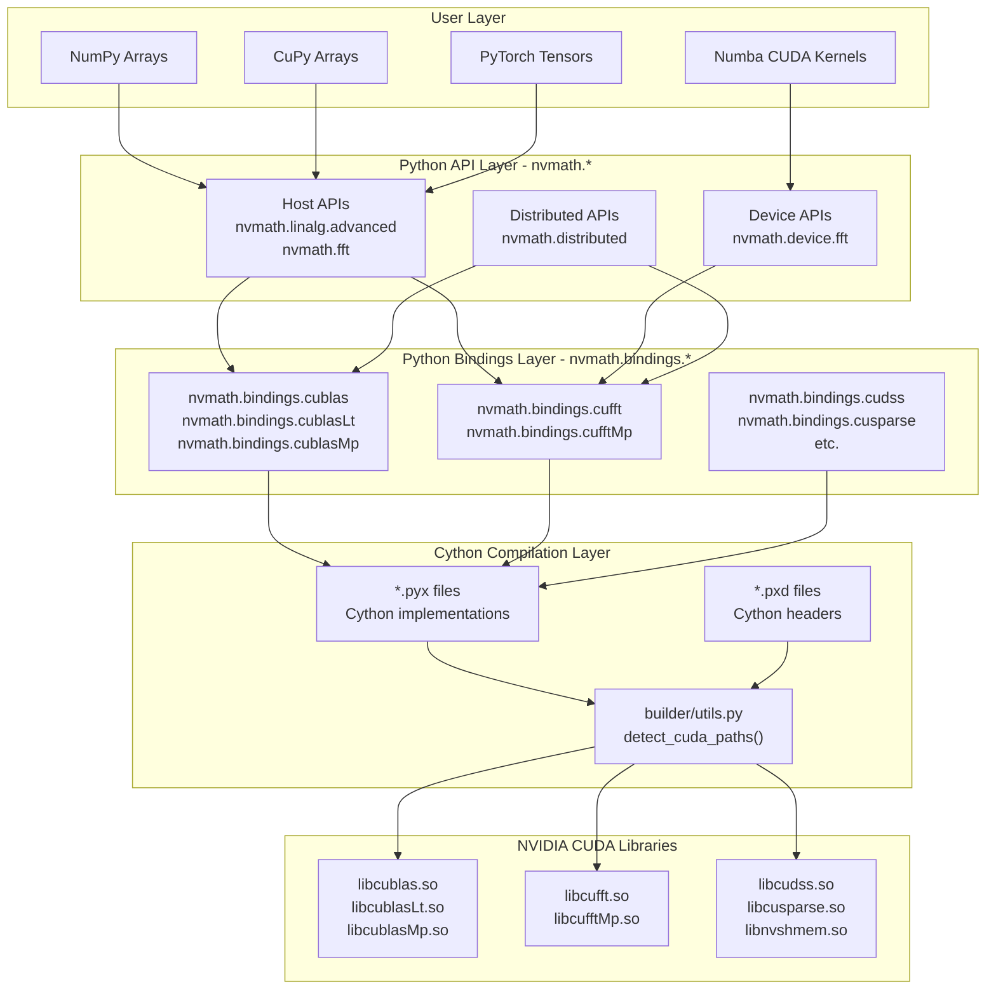

**Sources:** [README.md:1-208](), [builder/utils.py:12-52](), [builder/utils.py:55-75]()

The architecture consists of five distinct layers:

| Layer | Purpose | Key Components |
|-------|---------|----------------|
| **User Layer** | Framework integration | NumPy, CuPy, PyTorch tensors/arrays; Numba kernels |
| **Python API Layer** | High-level Pythonic APIs | `nvmath.linalg.advanced`, `nvmath.fft`, `nvmath.device`, `nvmath.distributed` |
| **Python Bindings Layer** | Low-level library wrapping | `nvmath.bindings.cublas`, `nvmath.bindings.cufft`, etc. |
| **Cython Compilation Layer** | C/Python bridge | `.pyx` implementation files, `.pxd` header files, build utilities |
| **NVIDIA CUDA Libraries** | Native GPU acceleration | `libcublas.so`, `libcufft.so`, `libcudss.so`, etc. |

---

## Three-Tier API Architecture

nvmath-python organizes its functionality into three distinct API categories, each targeting different execution models and use cases.

### API Category Relationships

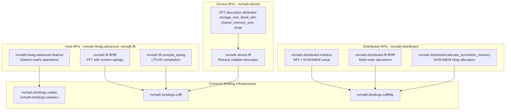

**Sources:** [README.md:20-215]()

### API Category Characteristics

| API Category | Execution Context | Memory Model | Primary Use Case | Example |
|--------------|------------------|--------------|------------------|---------|
| **Host APIs** | Called from Python, executes on CPU/GPU | Standard array/tensor memory | High-level operations with full control | `nvmath.linalg.advanced.Matmul` |
| **Device APIs** | Called from CUDA kernels, executes on GPU | Thread-local and shared memory | Custom kernel integration | `nvmath.device.fft` in `@cuda.jit` |
| **Distributed APIs** | Called from Python, executes across nodes | NVSHMEM symmetric heap | Multi-node, multi-GPU computing | `nvmath.distributed.fft.fft` |

Each API category builds on the same Python bindings layer but exposes different programming models to address specific execution requirements. See [API Categories](#3.1) for detailed usage guidance.

**Sources:** [README.md:20-215]()

---

## Python Bindings Layer Structure

The Python bindings layer uses Cython to wrap NVIDIA's native CUDA libraries, exposing their functionality to Python with minimal overhead.

### Binding Module Organization

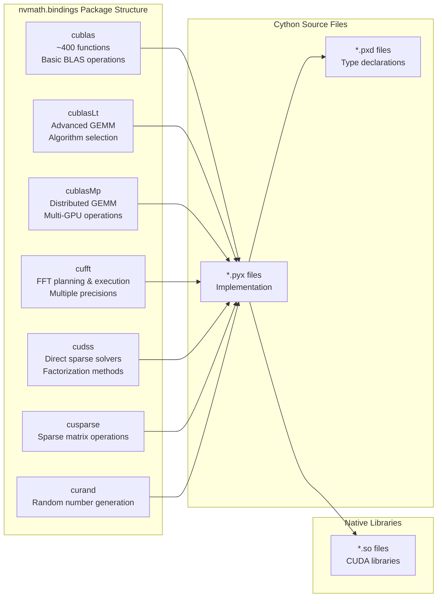

**Sources:** [builder/utils.py:55-75]()

Each binding module follows a consistent pattern:

1. **Cython Implementation (`.pyx`)**: Contains the actual wrapping code that bridges Python and C.
2. **Cython Header (`.pxd`)**: Declares C types, functions, and constants for Cython compilation.
3. **Python Module**: Exposes enumerations, constants, and wrapper functions to Python.

The bindings provide direct function mappings, enumeration classes representing CUDA library enums, and automatic error checking via status code validation.

**Sources:** [builder/utils.py:55-75]()

---

## Build System and CUDA Path Detection

The build system manages the complex task of detecting CUDA installations, configuring compilation flags, and linking against CUDA libraries across different deployment scenarios.

### Build Process Flow

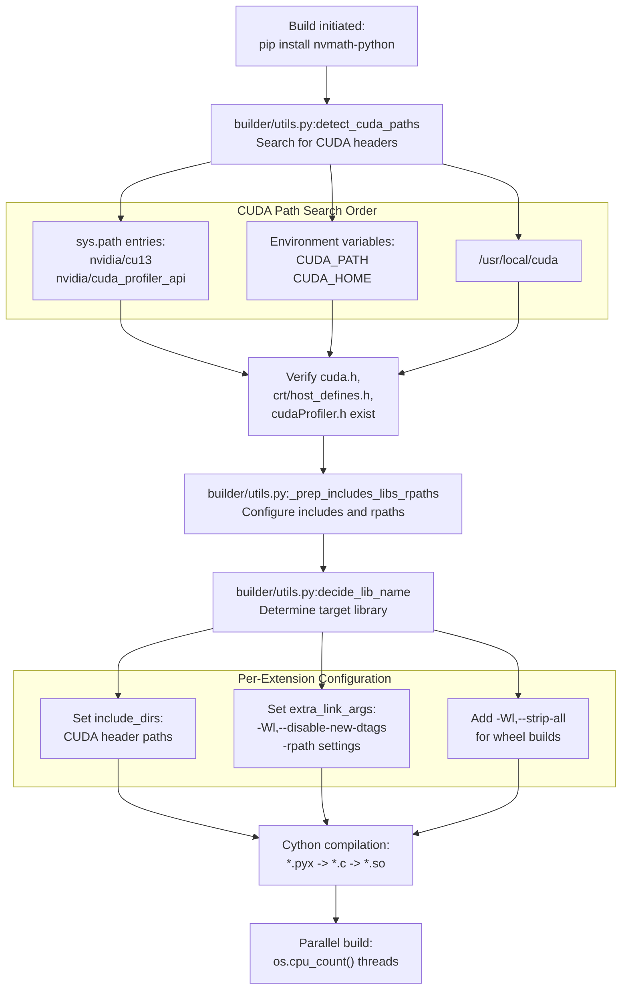

**Sources:** [builder/utils.py:12-52](), [builder/utils.py:55-75](), [builder/utils.py:78-146]()

### CUDA Path Detection Logic

The `detect_cuda_paths()` function [builder/utils.py:12-52]() implements a multi-strategy search:

```python
# Searches in order:
# 1. sys.path entries (for pip wheel installations like nvidia/cu13)
# 2. CUDA_PATH or CUDA_HOME environment variables
# 3. Default /usr/local/cuda location
```

The function verifies headers like `cuda.h`, `crt/host_defines.h`, and `cudaProfiler.h` are accessible to ensure a valid build environment [builder/utils.py:47-51]().

### Library-Specific Configuration

The `decide_lib_name()` function [builder/utils.py:55-75]() maps extension names to library names, including `cublas`, `cufft`, `cudss`, `cusparse`, and others.

The `build_ext` class [builder/utils.py:78-146]() coordinates compilation:
- Parallel compilation using `os.cpu_count()` threads [builder/utils.py:144-145]().
- Automatic binary stripping for wheel size reduction [builder/utils.py:100-102]().
- Proper rpath configuration for runtime library discovery [builder/utils.py:108-128]().

**Sources:** [builder/utils.py:12-146]()

---

## Framework Integration Patterns

nvmath-python integrates with popular Python array frameworks through a unified abstraction layer that detects array types and manages memory across different frameworks.

### Array Framework Support

The framework integration follows these principles:

1. **Type Detection**: Host APIs detect input array types (NumPy, CuPy, PyTorch) automatically [README.md:32-37]().
2. **Zero-Copy Access**: Extract data pointers or interfaces (like `__cuda_array_interface__`) to avoid unnecessary host-device copies.
3. **Stream Management**: Respect framework-specific CUDA streams for asynchronous execution [README.md:64-66]().
4. **Result Consistency**: Return results in the same framework as the inputs [README.md:68-69]().

### Example: Framework-Agnostic Matrix Multiplication

From [README.md:28-69](), the `Matmul` class accepts inputs from any supported framework:

```python
import cupy as cp
import nvmath

# Prepare sample input data (CuPy example)
a = cp.random.rand(m, k).astype(cp.float32)
b = cp.random.rand(k, n).astype(cp.float32)

# nvmath-python handles the underlying library selection (cuBLASLt)
mm = nvmath.linalg.advanced.Matmul(a, b, options={...})
result = mm.execute()
```

**Sources:** [README.md:28-69]()

---

## Summary

nvmath-python's architecture achieves several key design goals:

1. **Layered Abstraction**: Clean separation between high-level Python APIs, binding layer, and native libraries.
2. **Multi-Framework Support**: Seamless integration with NumPy, CuPy, and PyTorch through unified array handling.
3. **Three Execution Models**: Host, Device, and Distributed APIs address different computational paradigms.
4. **Flexible Build System**: Supports pip wheels, custom CUDA paths, and system installations.
5. **Minimal Overhead**: Cython bindings provide near-zero-cost abstractions over native libraries.

For deeper exploration:
- Implementation details of each API category: [API Categories](#3.1)
- Binding layer internals and Cython usage: [Python Bindings Layer](#3.2)
- Practical usage of Host APIs: [Host APIs](#4)
- Device kernel integration: [Device APIs](#5)
- Multi-node computing patterns: [Distributed APIs](#6)

---

# Page: API Categories

# API Categories

<details>
<summary>Relevant source files</summary>

The following files were used as context for generating this wiki page:

- [.github/ISSUE_TEMPLATE/feature_request.yml](.github/ISSUE_TEMPLATE/feature_request.yml)
- [docs/sphinx/bindings/index.rst](docs/sphinx/bindings/index.rst)
- [docs/sphinx/device-apis/index.rst](docs/sphinx/device-apis/index.rst)
- [docs/sphinx/distributed-apis/index.rst](docs/sphinx/distributed-apis/index.rst)

</details>


## Purpose and Scope

This document provides a detailed explanation of nvmath-python's three-tier API architecture: Host APIs, Device APIs, and Distributed APIs. Each tier targets different execution models and use cases, allowing developers to select the appropriate abstraction level for their computational needs. This page focuses on the conceptual differences and selection criteria for each API category. For implementation details of specific operations, see [Host APIs](4), [Device APIs](5), and [Distributed APIs](6).

## Overview of the Three-Tier Architecture

nvmath-python organizes its functionality into three distinct API categories, each designed for different execution contexts and levels of control:

| API Category | Execution Context | Primary Use Case | Typical Caller |
|--------------|-------------------|------------------|----------------|
| **Host APIs** | CPU/GPU from Python | High-level operations on array frameworks | Python scripts, notebooks |
| **Device APIs** | GPU device code | Custom kernel integration | Numba `@cuda.jit` functions |
| **Distributed APIs** | Multi-node multi-GPU | Distributed computing | MPI applications |

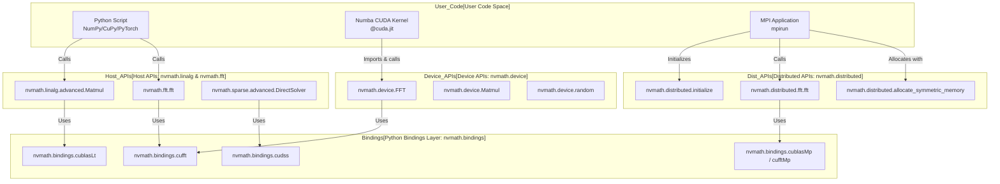

**Three-Tier API Architecture**

Sources: [docs/sphinx/bindings/index.rst:13-53](), [docs/sphinx/device-apis/index.rst:10-16](), [docs/sphinx/distributed-apis/index.rst:5-8]()

## Host APIs

Host APIs are invoked from Python host code and provide high-level operations on array-like objects from NumPy, CuPy, PyTorch, and other compatible frameworks. These APIs execute on either CPU or GPU depending on the input operand locations.

### Execution Model

Host APIs often follow a **plan-then-execute** pattern for advanced interfaces (like `nvmath.linalg.advanced.Matmul` or `nvmath.fft.FFT`), while providing stateless convenience functions (like `nvmath.fft.fft`) for simpler use cases.

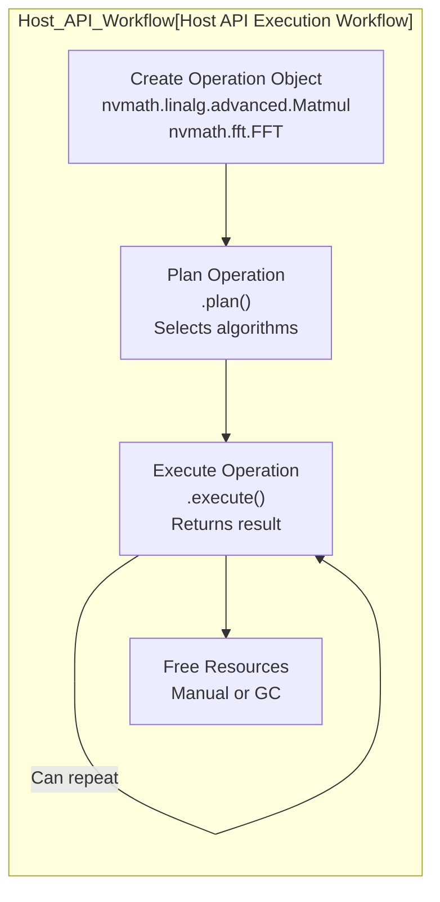

**Host API Execution Pattern**

### Module Organization

Host APIs are organized into several primary modules:

| Module | Purpose | Key Classes/Functions |
|--------|---------|----------------------|
| `nvmath.linalg` | Linear algebra operations | `advanced.Matmul`, `generic.matmul` |
| `nvmath.fft` | Fast Fourier Transforms | `fft()`, `ifft()`, `FFT` class |
| `nvmath.sparse` | Sparse direct solvers | `advanced.DirectSolver` (cuDSS) |
| `nvmath.tensor` | Tensor contractions | `einsum()`, `Contract` class (cuTENSOR) |

### Framework Interoperability

Host APIs accept operands from multiple array frameworks. Pointer addresses are extracted and passed to the underlying C-bindings layer [docs/sphinx/bindings/index.rst:116-143]().

- **NumPy**: Used for host memory [docs/sphinx/bindings/index.rst:101-102]().
- **CuPy**: Used for device memory and lightweight array manipulation [docs/sphinx/bindings/index.rst:112-114]().
- **PyTorch**: Supported for both host and device tensors.

### Use Cases

Host APIs are appropriate when:
- Working with high-level array frameworks (NumPy, CuPy, PyTorch).
- Needing fine-grained control over NVIDIA library parameters (e.g., epilogs, compute types) [docs/sphinx/bindings/index.rst:75-85]().
- Requiring custom epilog/prolog operations fused with FFT or Matmul computations.
- Optimizing performance through algorithm selection and heuristics.

Sources: [docs/sphinx/bindings/index.rst:92-115](), [.github/ISSUE_TEMPLATE/feature_request.yml:25-28]()

## Device APIs

Device APIs enable calling NVIDIA library functions from within custom CUDA kernels. These APIs execute entirely on the GPU device within user-defined kernels and are typically used with Numba or other JIT compilers [docs/sphinx/device-apis/index.rst:10-16]().

### Execution Model

Device APIs follow an **instantiate-then-invoke** pattern. A device function is instantiated with configuration parameters at the Python level (querying traits like shared memory requirements), then invoked from within CUDA device code [docs/sphinx/device-apis/index.rst:20-22]().

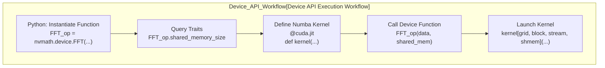

**Device API Execution Pattern**

### Module Organization

Device APIs are organized under `nvmath.device` [docs/sphinx/device-apis/index.rst:6]():

| Module | Purpose | Underlying Library |
|--------|---------|-------------------|
| `nvmath.device.cublas` | Device-side BLAS | cuBLASDx |
| `nvmath.device.cufft` | Device-side FFT | cuFFTDx |
| `nvmath.device.curand` | Device-side RNG | cuRAND (device) |

### Use Cases

Device APIs are appropriate when:
- Implementing custom CUDA kernels with Numba's `@cuda.jit` [docs/sphinx/device-apis/index.rst:20-22]().
- Needing to fuse NVIDIA library operations (like FFT or GEMM) with custom device code to avoid global memory round-trips.
- Optimizing memory transfers by keeping computations entirely in shared or registers.
- Implementing specialized algorithms requiring fine-grained GPU control (e.g., thread-block level operations) [docs/sphinx/device-apis/index.rst:16]().

Sources: [docs/sphinx/device-apis/index.rst:1-42]()

## Distributed APIs

Distributed APIs facilitate multi-node, multi-GPU operations using libraries like cuBLASMp and cuFFTMp. These APIs execute on a multi-node multi-GPU system using an SPMD (Single Program, Multiple Data) model [docs/sphinx/distributed-apis/index.rst:5-25]().

### Execution Model

Distributed APIs require launching one process per GPU, typically via MPI [docs/sphinx/distributed-apis/index.rst:16-19]().

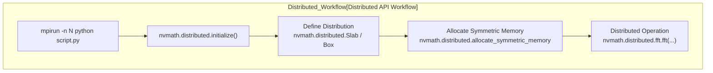

**Distributed API Execution Pattern**

### Key Concepts

1.  **Symmetric Memory**: Some operations like FFT and Reshape require GPU operands to be in symmetric memory (PGAS model via NVSHMEM) [docs/sphinx/distributed-apis/index.rst:27-31]().
2.  **Operand Distribution**: Users specify how global data is partitioned across processes (e.g., Slab, Box) [docs/sphinx/distributed-apis/index.rst:21-25]().
3.  **Local Partition**: Each process operates on its local portion of the global data [docs/sphinx/distributed-apis/index.rst:21-22]().

### Use Cases

Distributed APIs are appropriate when:
- Operating on data too large for a single GPU memory.
- Performing multi-node computations across GPU clusters.
- Leveraging cuBLASMp or cuFFTMp for distributed linear algebra or FFTs [docs/sphinx/distributed-apis/index.rst:5-7]().

Sources: [docs/sphinx/distributed-apis/index.rst:1-50]()

## API Category Selection Guide

| Feature | Host APIs | Device APIs | Distributed APIs |
| :--- | :--- | :--- | :--- |
| **Caller** | Python Interpreter | `@cuda.jit` Kernel | MPI-launched Process |
| **Data Scope** | Local (CPU or single GPU) | Local (GPU registers/shared) | Global (distributed across nodes) |
| **Complexity** | Low (standard Python) | Medium (requires CUDA knowledge) | High (requires MPI/Symmetric memory) |
| **Backend Libs** | cuBLAS, cuFFT, cuDSS, cuTENSOR | cuBLASDx, cuFFTDx, cuRAND | cuBLASMp, cuFFTMp |

Sources: [docs/sphinx/bindings/index.rst:30-51](), [docs/sphinx/device-apis/index.rst:10-15](), [docs/sphinx/distributed-apis/index.rst:5-7]()

---

# Page: Python Bindings Layer

# Python Bindings Layer

<details>
<summary>Relevant source files</summary>

The following files were used as context for generating this wiki page:

- [MANIFEST.in](MANIFEST.in)
- [builder/__init__.py](builder/__init__.py)
- [builder/utils.py](builder/utils.py)

</details>


## Purpose and Scope

The Python Bindings Layer is the foundational component that bridges Python code with NVIDIA's native CUDA mathematics libraries. This layer uses Cython to create performant, type-safe Python interfaces to C APIs exposed by libraries like cuBLAS, cuFFT, cuDSS, and others. This document explains the technical mechanisms behind the bindings: Cython compilation, CUDA path detection, runtime linking strategies, and the build system integration.

For information about the high-level API categories that consume these bindings, see [API Categories](). For detailed reference documentation of individual binding modules, see [Python Bindings Reference]().

---

## Architectural Overview

The bindings layer consists of Cython source files (`.pyx` implementation and `.pxd` header files) that directly wrap the C APIs of NVIDIA's CUDA libraries. The build system compiles these into native Python extension modules (`.so` files on Linux) that can be imported and used from Python code.

### Binding Layer Structure

```mermaid
graph TB
    subgraph "Python Layer"
        PY_HOST["Host APIs<br/>(nvmath.linalg, nvmath.fft)"]
        PY_DEVICE["Device APIs<br/>(nvmath.device)"]
        PY_DIST["Distributed APIs<br/>(nvmath.distributed)"]
    end
    
    subgraph "Python Bindings Layer"
        BINDINGS_PKG["nvmath/bindings/"]
        
        subgraph "Binding Modules"
            CUBLAS_PYX["cublas.pyx"]
            CUBLASLT_PYX["cublasLt.pyx"]
            CUBLASMP_PYX["cublasMp.pyx"]
            CUFFT_PYX["cufft.pyx"]
            CUFFTMP_PYX["cufftMp.pyx"]
            CUDSS_PYX["cudss.pyx"]
            CUSPARSE_PYX["cusparse.pyx"]
            CURAND_PYX["curand.pyx"]
        end
        
        subgraph "Header Declarations"
            CUBLAS_PXD["cublas.pxd"]
            CUBLASLT_PXD["cublasLt.pxd"]
            CUFFT_PXD["cufft.pxd"]
            OTHER_PXD["...other .pxd files"]
        end
    end
    
    subgraph "Build System"
        BUILDER_UTILS["builder/utils.py"]
        BUILD_EXT["build_ext class"]
        DETECT_CUDA["detect_cuda_paths()"]
        PREP_INCLUDES["_prep_includes_libs_rpaths()"]
        DECIDE_LIB["decide_lib_name()"]
    end
    
    subgraph "Native CUDA Libraries"
        LIBCUBLAS["libcublas.so"]
        LIBCUBLASLT["libcublasLt.so"]
        LIBCUBLASMP["libcublasMp.so"]
        LIBCUFFT["libcufft.so"]
        LIBCUFFTMP["libcufftMp.so"]
        LIBCUDSS["libcudss.so"]
    end
    
    PY_HOST --> CUBLAS_PYX
    PY_HOST --> CUBLASLT_PYX
    PY_HOST --> CUFFT_PYX
    PY_DEVICE --> CUFFT_PYX
    PY_DIST --> CUBLASMP_PYX
    PY_DIST --> CUFFTMP_PYX
    
    CUBLAS_PYX --> CUBLAS_PXD
    CUBLASLT_PYX --> CUBLASLT_PXD
    CUFFT_PYX --> CUFFT_PXD
    
    BUILDER_UTILS --> DETECT_CUDA
    BUILDER_UTILS --> BUILD_EXT
    BUILD_EXT --> PREP_INCLUDES
    BUILD_EXT --> DECIDE_LIB
    
    BUILD_EXT -.->|"compiles"| CUBLAS_PYX
    BUILD_EXT -.->|"compiles"| CUBLASLT_PYX
    BUILD_EXT -.->|"compiles"| CUFFT_PYX
    BUILD_EXT -.->|"compiles"| CUDSS_PYX
    
    CUBLAS_PYX -->|"links to"| LIBCUBLAS
    CUBLASLT_PYX -->|"links to"| LIBCUBLASLT
    CUBLASMP_PYX -->|"links to"| LIBCUBLASMP
    CUFFT_PYX -->|"links to"| LIBCUFFT
    CUFFTMP_PYX -->|"links to"| LIBCUFFTMP
    CUDSS_PYX -->|"links to"| LIBCUDSS
```

**Sources:** [builder/utils.py:1-146](), [MANIFEST.in:1-7]()

---

## Cython Source Files

The bindings are implemented using two types of Cython files:

### `.pyx` Files (Implementation)

These files contain the Python-visible function implementations that wrap the C API calls. They handle:
- Argument marshaling between Python and C types
- Error checking and exception raising
- Memory management for opaque handle types
- Enum value exposure

The package manifest explicitly includes these files in source distributions: [MANIFEST.in:3]()

### `.pxd` Files (Header Declarations)

These files declare the C function signatures and types from the native CUDA libraries using Cython's `cdef extern` syntax. They act as interface files, similar to C header files, allowing `.pyx` files to call into C libraries.

The manifest includes all `.pxd` files: [MANIFEST.in:2]()

### Build Artifact Management

Cython generates intermediate `.cpp` files during compilation, but these are explicitly excluded from source distributions since they can be regenerated: [MANIFEST.in:4-6]()

**Sources:** [MANIFEST.in:1-7]()

---

## Build System Integration

### CUDA Path Detection

The build system must locate CUDA headers and libraries across multiple installation scenarios. The `detect_cuda_paths()` function implements a comprehensive search strategy:

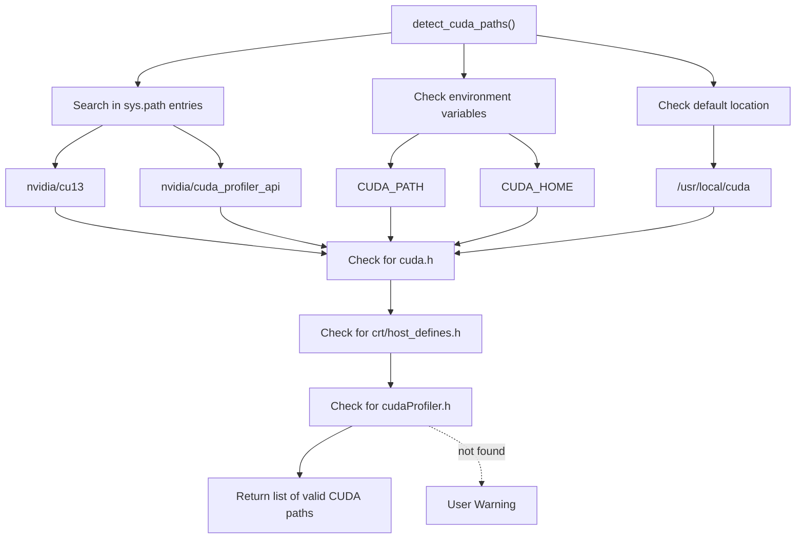

**Implementation Details:**

The search prioritizes paths in this order:
1. **Pip wheel installations**: Searches for `nvidia/cu13` and `nvidia/cuda_profiler_api` in `sys.path` [builder/utils.py:23-27]()
2. **Environment variables**: Checks `CUDA_PATH` then `CUDA_HOME` [builder/utils.py:28]()
3. **System default**: Falls back to `/usr/local/cuda` [builder/utils.py:28]()

The function validates each potential path by checking for required headers:
- `cuda.h` - Core CUDA runtime header [builder/utils.py:47]()
- `crt/host_defines.h` - Host compiler integration [builder/utils.py:48]()
- `cudaProfiler.h` - Profiler API (required by internal bindings) [builder/utils.py:51]()

If a required header is missing from all searched paths, the function issues a `warnings.warn` alerting the user that compilation may fail [builder/utils.py:41-45]().

**Sources:** [builder/utils.py:12-52]()

---

## Library Naming Convention

The `decide_lib_name()` function determines which native CUDA library corresponds to each binding module by analyzing the extension name:

```mermaid
graph LR
    EXT_NAME["Extension name<br/>(e.g., 'nvmath.bindings._internal.cublas')"]
    
    EXT_NAME --> CHECK["Check if name contains library identifier"]
    
    CHECK --> CUBLASMP{{"cublasMp"}}
    CHECK --> CUBLAS{{"cublas"}}
    CHECK --> CUSOLVER{{"cusolver"}}
    CHECK --> CUFFTMP{{"cufftMp"}}
    CHECK --> CUFFT{{"cufft"}}
    CHECK --> CUSPARSE{{"cusparse"}}
    CHECK --> CURAND{{"curand"}}
    CHECK --> NVPL{{"nvpl"}}
    CHECK --> NVSHMEM{{"nvshmem"}}
    CHECK --> NCCL{{"nccl"}}
    CHECK --> MATHDX{{"mathdx"}}
    CHECK --> CUDSS{{"cudss"}}
    CHECK --> CUTENSOR{{"cutensor"}}
    
    CUBLASMP --> RETURN_CUBLASMP["Return 'cublasMp'"]
    CUBLAS --> RETURN_CUBLAS["Return 'cublas'"]
    CUSOLVER --> RETURN_CUSOLVER["Return 'cusolver'"]
    CUFFTMP --> RETURN_CUFFTMP["Return 'cufftMp'"]
    CUFFT --> RETURN_CUFFT["Return 'cufft'"]
    CUDSS --> RETURN_CUDSS["Return 'cudss'"]
    
    CHECK -.->|"no match"| RETURN_NONE["Return None"]
```

The function checks for these library identifiers in order: `cublasMp`, `cublas`, `cusolver`, `cufftMp`, `cufft`, `cusparse`, `curand`, `nvpl`, `nvshmem`, `nccl`, `mathdx`, `cudss`, `cutensor` [builder/utils.py:57-71](). The order matters because `cublas` would match `cublasMp` if checked first.

**Sources:** [builder/utils.py:55-75]()

---

## Custom Build Extension Class

The `build_ext` class extends setuptools' standard extension builder to inject CUDA-specific configuration:

### Initialization

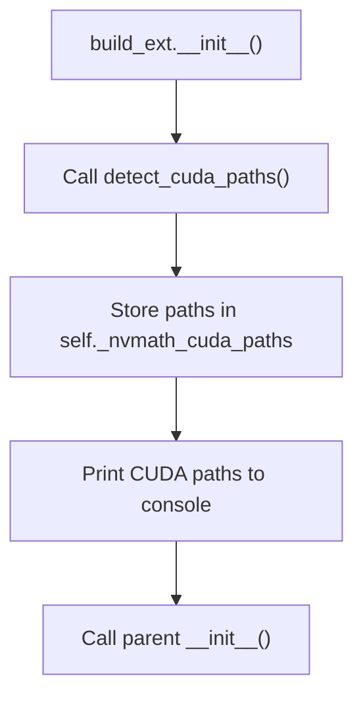

During initialization, the class:
1. Detects all CUDA installation paths [builder/utils.py:80]()
2. Stores them in `self._nvmath_cuda_paths` [builder/utils.py:80]()
3. Prints the detected paths to console for debugging [builder/utils.py:81-84]()
4. Invokes the parent class constructor [builder/utils.py:85]()

**Sources:** [builder/utils.py:78-85]()

---

## Include Paths and Linker Configuration

The `_prep_includes_libs_rpaths()` method configures compiler and linker flags for each extension:

### Include Directories

For all extensions, include directories are constructed from detected CUDA paths:
```python
cuda_incl_dir = [os.path.join(p, "include") for p in self._nvmath_cuda_paths]
```
[builder/utils.py:91]()

### Runtime Library Search Paths (RPATH)

The build system must ensure that compiled extensions can locate CUDA libraries at runtime, whether installed via:
- **Pip wheels**: Libraries in `site-packages/nvidia/{library}/lib/`
- **System installation**: Libraries in `/usr/local/cuda/lib64/`
- **Custom paths**: User-specified locations

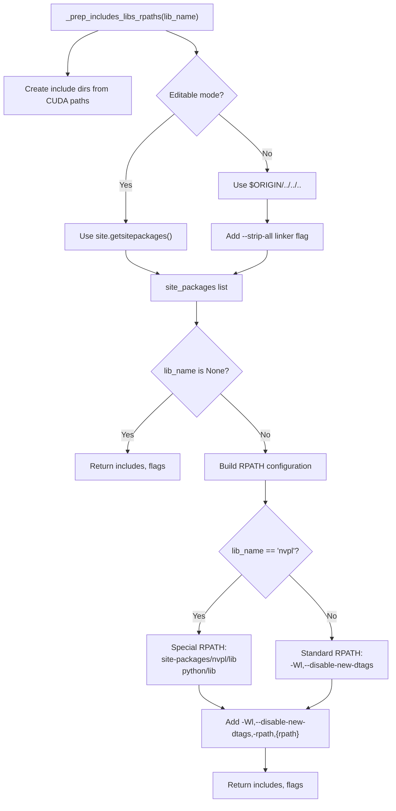

**Key Implementation Details:**

| Scenario | `site_packages` Value | Purpose |
|----------|----------------------|---------|
| **Wheel installation** | `$ORIGIN/../../..` | Relative path from binding `.so` location to `site-packages` [builder/utils.py:94]() |
| **Editable installation** | `site.getsitepackages()` | Absolute paths to Python site-packages directories [builder/utils.py:98]() |

**RPATH Construction:**
- For most libraries: The flag `-Wl,--disable-new-dtags` is added [builder/utils.py:116]().
- For `nvpl`: Special handling with two search paths [builder/utils.py:117-127]():
  1. `{pth}/{lib_name}/lib` - NVPL library location
  2. `{pth}/../../` - Location for MKL dependencies in the Python `lib` directory

**Binary Stripping:**
When building wheels (not editable mode), the `-Wl,--strip-all` linker flag removes debug symbols to reduce wheel size [builder/utils.py:102]().

**Sources:** [builder/utils.py:87-130]()

---

## Extension Compilation Process

### Per-Extension Build

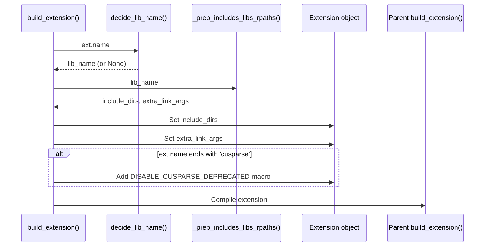

For each extension:
1. **Determine library name**: Call `decide_lib_name()` with the extension name [builder/utils.py:133]()
2. **Configure paths**: Call `_prep_includes_libs_rpaths()` to get include directories and linker flags [builder/utils.py:134]()
3. **Set extension properties**: Update the extension object with configuration [builder/utils.py:134]()
4. **Special case handling**: For `cusparse`, define `DISABLE_CUSPARSE_DEPRECATED` to suppress deprecation warnings [builder/utils.py:135-139]()
5. **Invoke parent**: Call the parent class's `build_extension()` to perform actual compilation [builder/utils.py:141]()

**Sources:** [builder/utils.py:132-141]()

---

## Parallel Compilation

The `build_extensions()` method enables parallel compilation across CPU cores:

```python
def build_extensions(self):
    self.parallel = os.cpu_count()
    super().build_extensions()
```
[builder/utils.py:143-145]()

This sets the number of parallel build jobs to match the available CPU cores, significantly speeding up compilation of multiple binding modules.

**Sources:** [builder/utils.py:143-145]()

---

## Supported CUDA Libraries

The binding layer currently supports the following NVIDIA CUDA mathematics libraries:

| Library | Binding Module | Purpose |
|---------|----------------|---------|
| **cuBLAS** | `nvmath.bindings.cublas` | Basic Linear Algebra Subprograms (~400 functions) |
| **cuBLASLt** | `nvmath.bindings.cublasLt` | Advanced GEMM with algorithm selection |
| **cuBLASMp** | `nvmath.bindings.cublasMp` | Distributed multi-GPU linear algebra |
| **cuFFT** | `nvmath.bindings.cufft` | Fast Fourier Transform |
| **cuFFTMp** | `nvmath.bindings.cufftMp` | Distributed multi-GPU FFT |
| **cuSPARSE** | `nvmath.bindings.cusparse` | Sparse matrix operations |
| **cuSOLVER** | `nvmath.bindings.cusolver` | Dense and sparse linear solvers |
| **cuRAND** | `nvmath.bindings.curand` | Random number generation |
| **cuDSS** | `nvmath.bindings.cudss` | Direct Sparse Solver |
| **cuTENSOR** | `nvmath.bindings.cutensor` | Tensor contractions and operations |
| **NVSHMEM** | Internal bindings | Partitioned Global Address Space (PGAS) |
| **NCCL** | Internal bindings | Collective communications |
| **MathDx** | Internal bindings | Device-side mathematics operations |
| **NVPL** | `nvmath.bindings.nvpl` | NVIDIA Performance Libraries |

The list is maintained in `decide_lib_name()` [builder/utils.py:57-71]() and determines linking behavior for each library.

**Sources:** [builder/utils.py:55-75]()

---

## Runtime Linking Strategy

### Installation Layout

When installed via pip wheel, the nvmath-python package and CUDA library wheels have this structure:

```
site-packages/
├── nvmath/
│   └── bindings/
│       └── _internal/
│           ├── cublas.so          # $ORIGIN
│           ├── cublasLt.so
│           ├── cufft.so
│           └── ... (other bindings)
└── nvidia/
    ├── cublas/
    │   └── lib/
    │       └── libcublas.so.12    # $ORIGIN/../../../nvidia/cublas/lib/
    ├── cufft/
    │   └── lib/
    │       └── libcufft.so.11
    └── ... (other CUDA libraries)
```

### RPATH Resolution

The `$ORIGIN` variable in RPATH is resolved by the dynamic linker at runtime to the directory containing the `.so` file:

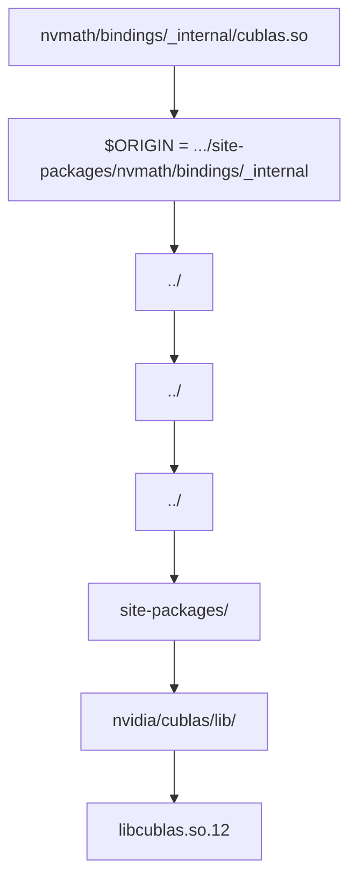

For editable installations, absolute paths are used instead since the binding location may not follow the standard structure [builder/utils.py:95-98]().

**Sources:** [builder/utils.py:87-130]()

---

## Summary

The Python Bindings Layer provides the essential infrastructure connecting Python code to NVIDIA's CUDA libraries:

| Component | Location | Purpose |
|-----------|----------|---------|
| **Cython source** | `*.pyx`, `*.pxd` files | Define Python wrappers for C APIs |
| **Build utilities** | `builder/utils.py` | CUDA detection, compilation configuration |
| **Custom build class** | `builder.utils.build_ext` | Extends setuptools with CUDA-specific logic |
| **Package manifest** | `MANIFEST.in` | Controls source distribution contents |

The architecture supports multiple installation scenarios (pip wheels, system CUDA, custom paths) through comprehensive path detection and flexible RPATH configuration. Parallel compilation and binary stripping optimize build time and wheel size. The result is a robust foundation that enables the high-level Host, Device, and Distributed APIs to leverage NVIDIA's GPU-accelerated mathematics libraries from Python.

For detailed API documentation of specific binding modules, see the Reference sections of the documentation.

---

# Page: Host APIs

# Host APIs

<details>
<summary>Relevant source files</summary>

The following files were used as context for generating this wiki page:

- [docs/sphinx/bindings/index.rst](docs/sphinx/bindings/index.rst)
- [docs/sphinx/host-apis/fft/index.rst](docs/sphinx/host-apis/fft/index.rst)

</details>


## Purpose and Scope

This page documents the Host APIs provided by `nvmath-python`, which are Python functions and classes designed to be called from host (CPU) code but can execute on GPU devices. Host APIs accept standard Python array and tensor objects (NumPy, CuPy, PyTorch) and provide fine-grained control over NVIDIA's math libraries while maintaining a pythonic interface.

Host APIs cover four main domains:
- **Linear Algebra Operations**: Detailed information on matrix multiplication and related operations. See [Linear Algebra Operations](#4.1).
- **FFT Operations**: Comprehensive coverage of Fast Fourier Transforms with custom prologs/epilogs and CPU/GPU execution. See [FFT Operations](#4.2).
- **Sparse Linear Algebra**: High-level interface for sparse direct solvers via cuDSS. See [Sparse Linear Algebra](#4.3).
- **Tensor Contractions**: Advanced binary and ternary tensor contractions using cuTENSOR. See [Tensor Contractions](#4.4).

For device-side APIs that can be called from within custom CUDA kernels, see [Device APIs](#5). For distributed multi-node operations, see [Distributed APIs](#6).

**Sources:** [docs/sphinx/host-apis/fft/index.rst:10-32](), [docs/sphinx/bindings/index.rst:13-53]()

## Architecture Overview

Host APIs form the highest level of abstraction in `nvmath-python`, sitting above the Python bindings layer and providing intuitive interfaces to NVIDIA's CUDA libraries.

### Host API Architecture

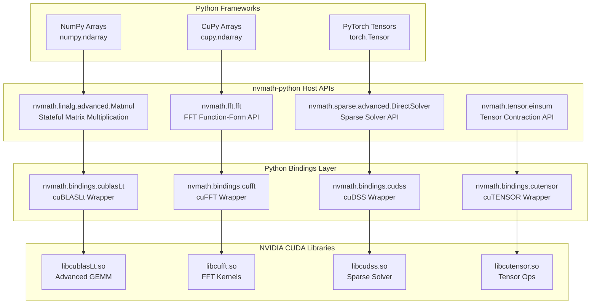

**Sources:** [docs/sphinx/bindings/index.rst:24-51](), [docs/sphinx/host-apis/fft/index.rst:10-22]()

### Data Flow for Host API Operations

```mermaid
sequenceDiagram
    participant User as "User Code"
    participant HostAPI as "Host API<br/>(Matmul/FFT/DirectSolver)"
    participant Binding as "Bindings Layer<br/>(nvmath.bindings.*)"
    participant CUDA as "CUDA Library"
    participant Device as "GPU/CPU Device"
    
    User->>HostAPI: Provide operands (NumPy/CuPy/Torch)
    HostAPI->>HostAPI: Framework detection & validation
    
    alt Stateful API (e.g., FFT class)
        User->>HostAPI: Create plan/key
        HostAPI->>Binding: Allocate descriptors/handles
        Binding->>CUDA: C API calls (e.g. cufftPlanMany)
    end
    
    User->>HostAPI: execute() / function call
    HostAPI->>Binding: Python wrapper call
    Binding->>CUDA: Native C function call
    CUDA->>Device: Kernel Launch
    Device-->>CUDA: Completion
    CUDA-->>Binding: Return Status/Error Code
    Binding-->>HostAPI: Raise Exception if status != SUCCESS
    HostAPI-->>User: Return result framework object
```

**Sources:** [docs/sphinx/bindings/index.rst:59-70](), [docs/sphinx/bindings/index.rst:119-143](), [docs/sphinx/host-apis/fft/index.rst:23-26]()

## Framework Compatibility

Host APIs are designed to work seamlessly with multiple Python array and tensor frameworks. The APIs automatically detect the input framework and return results in the same framework format.

| Framework | Array Type | Memory Space | Notes |
|-----------|------------|----------------|-------|
| **NumPy** | `numpy.ndarray` | Host | Used for CPU execution or host-side data |
| **CuPy** | `cupy.ndarray` | Device | Native GPU execution, zero-copy operations |
| **PyTorch** | `torch.Tensor` | Host/Device | Supports both CPU and CUDA tensors |

**Sources:** [docs/sphinx/bindings/index.rst:100-114](), [docs/sphinx/host-apis/fft/index.rst:103-108]()

## Execution Model

Host APIs support execution on both NVIDIA GPUs and CPUs. By default, the execution space is selected based on the memory space of the operand, but it can be explicitly controlled.

### Execution Characteristics

| Aspect | GPU Execution | CPU Execution |
|--------|-------------------|----------------------------------|
| **Library** | cuBLAS, cuFFT, cuDSS, cuTENSOR | NVPL (ARM), MKL (x86), FFTW3 |
| **Stream/Thread** | CUDA Stream (Asynchronous) | Host Threads (Synchronous) |
| **Dependencies** | CUDA Toolkit, cu12/cu13 extras | `nvmath-python[cpu]` extra |
| **OS Support** | Linux, Windows | Linux (Windows not supported for CPU) |

**Sources:** [docs/sphinx/host-apis/fft/index.rst:103-112](), [docs/sphinx/host-apis/fft/index.rst:116-134]()

## Usage Patterns

### Stateful vs. Function-Form APIs

Host APIs provide two usage patterns depending on the performance requirements:

| Pattern | Use Case | Example API | Lifecycle |
|---------|----------|-------------|-----------|
| **Stateful** | Repeated operations, plan caching | `nvmath.fft.FFT` | Create → [Plan] → Execute → Free |
| **Function-Form** | Single operation, simple code | `nvmath.fft.fft` | Single function call |

**Sources:** [docs/sphinx/host-apis/fft/index.rst:10-22](), [docs/sphinx/host-apis/fft/index.rst:23-26]()

### Callback and Fusion Patterns

The FFT and Linear Algebra modules support kernel fusion via callbacks. This allows user-defined Python functions to be compiled and executed on-device as part of the math operation.

```mermaid
graph LR
    subgraph "Fused Operation"
        PROLOG["Prolog (Python/Numba)"]
        CORE["Core Math Kernel (cuFFT/cuBLAS)"]
        EPILOG["Epilog (Python/Numba)"]
        
        PROLOG --> CORE
        CORE --> EPILOG
    end
    
    COMPILE["compile_prolog / compile_epilog"] --> PROLOG
    COMPILE --> EPILOG
```

**Sources:** [docs/sphinx/host-apis/fft/index.rst:27-32](), [docs/sphinx/host-apis/fft/index.rst:46-60]()

## Memory Management

### Pointer and Data Lifetime
In `nvmath-python`, memory management is handled through Python proxy objects (NumPy/CuPy). To pass data to low-level bindings, pointer addresses are passed as Python `int`.

- **Host Pointers**: Obtained via `buf.ctypes.data` (NumPy).
- **Device Pointers**: Obtained via `buf.data.ptr` or `buf.ptr` (CuPy).
- **Automatic Conversion**: For readonly host arrays, Python sequences (lists) can often be passed directly; the library handles conversion.

**Sources:** [docs/sphinx/bindings/index.rst:98-118](), [docs/sphinx/bindings/index.rst:153-168]()

## Child Pages

For deep technical details on specific domains, refer to the following sub-pages:

*   **[Linear Algebra Operations](#4.1)**: Detailed guide on `nvmath.linalg.advanced.Matmul`, including algorithm selection, compute types, and epilog operations.
*   **[FFT Operations](#4.2)**: Guide on `nvmath.fft`, covering N-dimensional transforms, LTO-IR callbacks, and CPU execution via NVPL/MKL.
*   **[Sparse Linear Algebra](#4.3)**: Documentation for `nvmath.sparse.advanced.DirectSolver` and sparse matrix support.
*   **[Tensor Contractions](#4.4)**: Guide on `nvmath.tensor` for binary/ternary contractions and `einsum` notation.

**Sources:** [docs/sphinx/host-apis/fft/index.rst:1-32](), [docs/sphinx/bindings/index.rst:1-53]()

---

# Page: Linear Algebra Operations

# Linear Algebra Operations

<details>
<summary>Relevant source files</summary>

The following files were used as context for generating this wiki page:

- [docs/sphinx/bindings/cublas.rst](docs/sphinx/bindings/cublas.rst)
- [docs/sphinx/bindings/cublasLt.rst](docs/sphinx/bindings/cublasLt.rst)
- [docs/sphinx/bindings/index.rst](docs/sphinx/bindings/index.rst)

</details>


This page documents the Host API for linear algebra operations in nvmath-python, specifically focusing on the `nvmath.linalg.advanced.Matmul` class and the `nvmath.linalg.generic` interface. This interface provides fine-grained control over matrix multiplication operations with access to advanced features from NVIDIA's cuBLASLt library.

For FFT operations using Host APIs, see [FFT Operations](#4.2). For lower-level Python bindings to cuBLAS and cuBLASLt, see [cuBLAS Bindings](#7.1) and [cuBLASLt Bindings](#7.2).

**Sources:** [docs/sphinx/bindings/index.rst:1-187]()

## Overview

The `nvmath.linalg.advanced` module provides a high-level stateful interface for performing matrix multiplication with advanced capabilities including:

- **Algorithm selection**: Choose from multiple cuBLASLt algorithms optimized for different matrix sizes and hardware configurations.
- **Mixed-precision computation**: Perform computations in lower precision for speed while maintaining acceptable accuracy.
- **Fused epilog operations**: Apply operations like bias addition, activation functions, or scaling directly to the multiplication result without separate kernel launches.
- **Multi-framework support**: Works seamlessly with NumPy, CuPy, and PyTorch tensors through the use of pointer-based memory management.
- **Persistent planning**: Create a `Matmul` object once and reuse it for multiple executions with the same problem dimensions.

The primary interface is the `Matmul` class, which wraps NVIDIA's cuBLASLt library through the `nvmath.bindings.cublasLt` module.

**Sources:** [docs/sphinx/bindings/cublasLt.rst:1-89](), [docs/sphinx/bindings/index.rst:92-181]()

## Architecture

**Diagram: Linear Algebra Host API Architecture**

```mermaid
graph TB
    subgraph "User Code"
        NUMPY["NumPy ndarray"]
        CUPY["CuPy ndarray"]
        TORCH["PyTorch Tensor"]
    end
    
    subgraph "nvmath.linalg.advanced"
        MATMUL["Matmul class<br/>__init__, plan, execute, free"]
        COMPUTE_TYPE["MatmulComputeType enum<br/>COMPUTE_32F, COMPUTE_32F_FAST_16F, etc."]
        EPILOG["MatmulEpilog enum<br/>BIAS, RELU, GELU, etc."]
    end
    
    subgraph "nvmath.bindings.cublasLt"
        CREATE["create() [cublasLt.rst:44]<br/>matmul_desc_create() [cublasLt.rst:72]<br/>matrix_layout_create() [cublasLt.rst:80]"]
        HEURISTIC["matmul_algo_get_heuristic() [cublasLt.rst:69]<br/>matmul_algo_init() [cublasLt.rst:71]"]
        EXECUTE["matmul() [cublasLt.rst:64]"]
        DESTROY["destroy() [cublasLt.rst:45]<br/>matmul_desc_destroy() [cublasLt.rst:73]<br/>matrix_layout_destroy() [cublasLt.rst:81]"]
        ENUMS["Epilogue enum [cublasLt.rst:18]<br/>MatmulDescAttribute [cublasLt.rst:22]<br/>MatrixLayoutAttribute [cublasLt.rst:30]"]
    end
    
    subgraph "NVIDIA cuBLASLt Library"
        CUBLASLT["libcublasLt.so<br/>cublasLtMatmul<br/>cublasLtMatmulAlgoGetHeuristic"]
    end
    
    NUMPY -->|"input via .ctypes.data"| MATMUL
    CUPY -->|"input via .data.ptr"| MATMUL
    TORCH -->|"input via .data_ptr()"| MATMUL
    
    MATMUL -->|"__init__: creates handles"| CREATE
    MATMUL -->|"plan: algorithm selection"| HEURISTIC
    MATMUL -->|"execute: computation"| EXECUTE
    MATMUL -->|"free: cleanup"| DESTROY
    
    COMPUTE_TYPE -.->|"passed as options"| MATMUL
    EPILOG -.->|"passed to plan"| MATMUL
    
    CREATE -->|"calls"| CUBLASLT
    HEURISTIC -->|"calls"| CUBLASLT
    EXECUTE -->|"calls"| CUBLASLT
    DESTROY -->|"calls"| CUBLASLT
    
    ENUMS -.->|"mapped to"| EPILOG
```

The `Matmul` class provides a stateful Python interface that manages the complete lifecycle of a matrix multiplication operation. It internally creates and manages cuBLASLt descriptors, layouts, and algorithm selections through the bindings layer.

**Sources:** [docs/sphinx/bindings/cublasLt.rst:1-89](), [docs/sphinx/bindings/index.rst:92-181]()

## Matmul Workflow

**Diagram: Matmul Object Lifecycle**

```mermaid
stateDiagram-v2
    [*] --> Initialization: nvmath.linalg.advanced.Matmul(a, b, options)
    
    Initialization --> Planning: .plan(epilog, epilog_inputs)
    
    Planning --> Planned: Algorithm selection complete
    
    Planned --> Execution: .execute()
    Execution --> Planned: Reusable with same dimensions
    
    Planned --> Freed: .free()
    Freed --> [*]
    
    note right of Initialization
        Creates cuBLASLt handles via create()
        Sets matrix layouts via matrix_layout_create()
        Specifies compute type
    end note
    
    note right of Planning
        Runs heuristic algorithm selection via matmul_algo_get_heuristic()
        Configures epilog operations via matmul_desc_set_attribute()
        Returns sequence of algorithms
    end note
    
    note right of Execution
        Executes matrix multiplication via matmul()
        Applies fused epilog
        Returns result array
    end note
```

The workflow consists of four distinct phases:

1. **Initialization**: Create the `Matmul` object with input operands and options.
2. **Planning**: Select algorithms and configure epilog operations.
3. **Execution**: Perform the computation (can be called multiple times).
4. **Cleanup**: Free resources when finished.

**Sources:** [docs/sphinx/bindings/cublasLt.rst:44-89]()

## Creating a Matmul Object

The `Matmul` constructor accepts input matrices and configuration options. It relies on passing memory pointers as Python `int` to the underlying bindings.

```python
import cupy as cp
import nvmath

a = cp.random.rand(m, k).astype(cp.float32)
b = cp.random.rand(k, n).astype(cp.float32)

mm = nvmath.linalg.advanced.Matmul(
    a,
    b,
    options={
        "compute_type": nvmath.linalg.advanced.MatmulComputeType.COMPUTE_32F_FAST_16F
    },
)
```

**Constructor Parameters:**
- **a, b**: Input matrices (NumPy ndarray, CuPy ndarray, or PyTorch Tensor).
- **options** (dict): Configuration dictionary with keys including:
  - `compute_type`: Precision mode for the computation.
  - Additional cuBLASLt configuration parameters mapped to `MatmulDescAttribute`.

During initialization, the `Matmul` object:
1. Creates a cuBLASLt handle via `nvmath.bindings.cublasLt.create()` [docs/sphinx/bindings/cublasLt.rst:44]().
2. Creates matrix layout descriptors via `nvmath.bindings.cublasLt.matrix_layout_create()` [docs/sphinx/bindings/cublasLt.rst:80]().
3. Creates a matmul descriptor via `nvmath.bindings.cublasLt.matmul_desc_create()` [docs/sphinx/bindings/cublasLt.rst:72]().
4. Validates operand dimensions and types.

**Sources:** [docs/sphinx/bindings/cublasLt.rst:10-89](), [docs/sphinx/bindings/index.rst:116-143]()

## Compute Types

The `MatmulComputeType` enum specifies the precision used for internal computations. This enables mixed-precision operations where inputs and outputs can be in one precision while computations occur in another.

| Compute Type | Description |
|-------------|-------------|
| `COMPUTE_32F` | Single-precision (FP32) computation |
| `COMPUTE_32F_FAST_16F` | FP32 computation with FP16 tensor core acceleration |
| `COMPUTE_32F_FAST_16BF` | FP32 computation with BF16 tensor core acceleration |
| `COMPUTE_32F_FAST_TF32` | FP32 computation with TensorFloat-32 acceleration |
| `COMPUTE_64F` | Double-precision (FP64) computation |
| `COMPUTE_16F` | Half-precision (FP16) computation |

The compute type maps to the `nvmath.bindings.cublas.ComputeType` enum [docs/sphinx/bindings/cublas.rst:16]() which is passed to cuBLASLt via `matmul_desc_set_attribute()` [docs/sphinx/bindings/cublasLt.rst:75]().

**Sources:** [docs/sphinx/bindings/cublas.rst:16](), [docs/sphinx/bindings/cublasLt.rst:75]()

## Planning and Algorithm Selection

The `plan()` method triggers algorithm selection and configures epilog operations:

```python
mm.plan(
    epilog=nvmath.linalg.advanced.MatmulEpilog.BIAS,
    epilog_inputs={"bias": bias},
)
```

**Planning Process:**

```mermaid
graph LR
    PLAN["Matmul.plan()"] --> PREF["Create preference object<br/>matmul_preference_create() [cublasLt.rst:76]"]
    PREF --> HEURISTIC["Get algorithm heuristics<br/>matmul_algo_get_heuristic() [cublasLt.rst:69]"]
    HEURISTIC --> ALGOS["Sequence of MatmulAlgo objects"]
    ALGOS --> CONFIG["Configure best algorithm<br/>matmul_algo_init() [cublasLt.rst:71]"]
    CONFIG --> EPILOG_CONFIG["Set epilog attributes<br/>matmul_desc_set_attribute() [cublasLt.rst:75]"]
    EPILOG_CONFIG --> READY["Matmul ready for execution"]
```

**Plan Parameters:**
- **epilog** (enum): Type of fused operation to apply, mapping to `nvmath.bindings.cublasLt.Epilogue` [docs/sphinx/bindings/cublasLt.rst:18]().
- **epilog_inputs** (dict): Additional tensors required by the epilog (e.g., bias vector).
- **algorithm** (optional): Manually specify algorithm instead of using heuristic via `MatmulAlgo` [docs/sphinx/bindings/cublasLt.rst:19]().

The planning phase calls `nvmath.bindings.cublasLt.matmul_algo_get_heuristic()` [docs/sphinx/bindings/cublasLt.rst:69]() which returns multiple candidate algorithms ranked by estimated performance.

**Sources:** [docs/sphinx/bindings/cublasLt.rst:18-79]()

## Epilog Operations

Epilog operations are fused computations applied to the matrix multiplication result without launching separate kernels. This fusion reduces memory traffic and improves performance.

**Common Epilog Types (from `nvmath.bindings.cublasLt.Epilogue`):**

| Epilog | Operation | Required Inputs |
|--------|-----------|----------------|
| `BIAS` | `C = alpha * A @ B + bias` | `bias` vector |
| `RELU` | `C = relu(alpha * A @ B + beta * C)` | None |
| `GELU` | `C = gelu(alpha * A @ B + beta * C)` | None |
| `GELU_AUX` | GELU with auxiliary output | None |
| `DGELU` | GELU gradient | Auxiliary input |

The epilog configuration is passed to cuBLASLt through `nvmath.bindings.cublasLt.matmul_desc_set_attribute()` [docs/sphinx/bindings/cublasLt.rst:75]() using the `Epilogue` attribute enum.

**Sources:** [docs/sphinx/bindings/cublasLt.rst:18, 75]()

## Execution

After planning, call `execute()` to perform the matrix multiplication. This internally calls `nvmath.bindings.cublasLt.matmul()` [docs/sphinx/bindings/cublasLt.rst:64]().

**Execution Characteristics:**

**Diagram: Execution Data Flow**

```mermaid
graph LR
    INPUT_A["Input Matrix A<br/>Device Memory"] --> MATMUL_KERNEL["cuBLASLt matmul() [cublasLt.rst:64]<br/>+ Fused Epilog"]
    INPUT_B["Input Matrix B<br/>Device Memory"] --> MATMUL_KERNEL
    EPILOG_INPUTS["Epilog Inputs<br/>(e.g., bias)"] -.-> MATMUL_KERNEL
    MATMUL_KERNEL --> OUTPUT["Result Matrix C<br/>Device Memory"]
    OUTPUT --> RETURN["Python returns<br/>same framework array"]
```

**Execution Details:**
- **Non-blocking**: Execution is asynchronous for GPU operands.
- **Pointer Passing**: Memory addresses are passed as `int` via `buf.data.ptr` (CuPy) or `buf.ctypes.data` (NumPy) [docs/sphinx/bindings/index.rst:116-143]().
- **Stream-ordered**: Operations occur on the CUDA stream associated with the input arrays, which can be managed via `nvmath.bindings.cublas.set_stream()` [docs/sphinx/bindings/cublas.rst:341]().

**Sources:** [docs/sphinx/bindings/cublasLt.rst:64](), [docs/sphinx/bindings/index.rst:116-143](), [docs/sphinx/bindings/cublas.rst:341]()

## Resource Management

The `Matmul` object holds CUDA resources that must be explicitly freed to avoid leaks.

**Cleanup Process:**
The `free()` method calls corresponding destroy functions:
- `nvmath.bindings.cublasLt.destroy()` for the cuBLASLt handle [docs/sphinx/bindings/cublasLt.rst:45]().
- `nvmath.bindings.cublasLt.matrix_layout_destroy()` for layout descriptors [docs/sphinx/bindings/cublasLt.rst:81]().
- `nvmath.bindings.cublasLt.matmul_desc_destroy()` for the matmul descriptor [docs/sphinx/bindings/cublasLt.rst:73]().
- `nvmath.bindings.cublasLt.matmul_preference_destroy()` for the preference object [docs/sphinx/bindings/cublasLt.rst:77]().

**Sources:** [docs/sphinx/bindings/cublasLt.rst:44-89]()

## Relationship to cuBLAS Bindings

While `nvmath.linalg.advanced.Matmul` uses cuBLASLt, the library also provides extensive bindings for the standard cuBLAS API.

**Comparison:**

| Feature | nvmath.linalg.advanced.Matmul | nvmath.bindings.cublas |
|---------|-------------------------------|------------------------|
| API Level | High-level, stateful | Low-level, function-based |
| Functions | `Matmul.execute` | `cublas.sgemm`, `cublas.dgemm`, etc. |
| Algorithm Selection | Automatic heuristic | Manual (via `GemmAlgo`) |
| Epilog Fusion | Supported | Not supported |
| Target Library | cuBLASLt | cuBLAS |

The `nvmath.bindings.cublas` module exposes over 400 functions, including 64-bit indexing variants (e.g., `sgemm_64`) and batched operations (e.g., `sgemm_batched`) [docs/sphinx/bindings/cublas.rst:53-428]().

**Sources:** [docs/sphinx/bindings/cublas.rst:53-428](), [docs/sphinx/bindings/cublasLt.rst:1-89]()

---

# Page: FFT Operations

# FFT Operations

<details>
<summary>Relevant source files</summary>

The following files were used as context for generating this wiki page:

- [docs/sphinx/bindings/cufft.rst](docs/sphinx/bindings/cufft.rst)
- [docs/sphinx/host-apis/fft/index.rst](docs/sphinx/host-apis/fft/index.rst)

</details>


## Purpose and Scope

The `nvmath.fft` module provides a high-level Host API for performing Fast Fourier Transforms (FFT) leveraging NVIDIA's math libraries. It supports N-dimensional transformations, including complex-to-complex (C2C), real-to-complex (R2C), and complex-to-real (C2R) transforms. A key feature of this module is the support for kernel fusion via custom prolog and epilog functions compiled to LTO-IR, allowing for efficient pre- and post-processing directly within the FFT execution.

This module acts as a bridge, accepting operands from NumPy, CuPy, or PyTorch, and can execute on either NVIDIA GPUs (via cuFFT) or CPUs (via NVPL or MKL).

Sources: [docs/sphinx/host-apis/fft/index.rst:7-33](), [docs/sphinx/host-apis/fft/index.rst:103-108]()

---

## Architecture and Data Flow

The FFT module is structured to provide both stateless functional APIs for quick transforms and stateful class-based APIs for performance-critical scenarios where plan caching is beneficial.

**FFT System Entity Map**

```mermaid
graph TB
    subgraph "nvmath.fft (High-Level API)"
        FFT_CLASS["nvmath.fft.FFT"]
        FFT_FUNC["nvmath.fft.fft"]
        IFFT_FUNC["nvmath.fft.ifft"]
        RFFT_FUNC["nvmath.fft.rfft"]
        IRFFT_FUNC["nvmath.fft.irfft"]
        COMPILE_EP["nvmath.fft.compile_epilog"]
        COMPILE_PRO["nvmath.fft.compile_prolog"]
    end

    subgraph "Execution Controllers"
        EXEC_CUDA["nvmath.fft.ExecutionCUDA"]
        EXEC_CPU["nvmath.fft.ExecutionCPU"]
    end

    subgraph "nvmath.bindings.cufft (Low-Level)"
        CUFFT_CREATE["create"]
        CUFFT_PLAN["make_plan_many64"]
        CUFFT_EXEC["exec_c2c / exec_r2c / exec_z2z"]
        CUFFT_XT["xt_set_jit_callback"]
    end

    subgraph "External Backends"
        LIBCUFFT["libcufft.so (GPU)"]
        NVPL["libnvpl_fftw.so (CPU-ARM)"]
        MKL["libmkl_rt.so (CPU-x86)"]
    end

    FFT_FUNC --> FFT_CLASS
    FFT_CLASS --> EXEC_CUDA
    FFT_CLASS --> EXEC_CPU
    
    EXEC_CUDA --> CUFFT_CREATE
    CUFFT_CREATE --> CUFFT_PLAN
    CUFFT_PLAN --> CUFFT_EXEC
    CUFFT_EXEC --> LIBCUFFT
    
    COMPILE_EP --> CUFFT_XT
    CUFFT_XT --> LIBCUFFT

    EXEC_CPU --> NVPL
    EXEC_CPU --> MKL
```
Sources: [docs/sphinx/host-apis/fft/index.rst:10-25](), [docs/sphinx/host-apis/fft/index.rst:55-60](), [docs/sphinx/host-apis/fft/index.rst:116-118](), [docs/sphinx/bindings/cufft.rst:27-90]()

---

## Host API Interface

### Functional vs. Stateful APIs
The module provides four primary functions for N-dimensional transforms, mimicking the behavior of `numpy.fft.fftn` rather than the 1D/2D specific variants to ensure consistency in batch dimension handling.

| Function | Description | Corresponding cuFFT Type |
| :--- | :--- | :--- |
| `nvmath.fft.fft` | N-D forward C2C transform | `Type.CUFFT_C2C` / `Type.CUFFT_Z2Z` |
| `nvmath.fft.ifft` | N-D inverse C2C transform | `Type.CUFFT_C2C` / `Type.CUFFT_Z2Z` |
| `nvmath.fft.rfft` | N-D forward R2C transform | `Type.CUFFT_R2C` / `Type.CUFFT_D2Z` |
| `nvmath.fft.irfft` | N-D inverse C2R transform | `Type.CUFFT_C2R` / `Type.CUFFT_Z2D` |

For repeated operations on the same shapes, the `nvmath.fft.FFT` class should be used to manage plan lifetime and caching via `create_key`.

Sources: [docs/sphinx/host-apis/fft/index.rst:17-25](), [docs/sphinx/host-apis/fft/index.rst:34-41](), [docs/sphinx/bindings/cufft.rst:15-25]()

### Execution Space Control
By default, the execution space is inferred from the operand's memory location. However, users can force execution using `ExecutionCUDA` or `ExecutionCPU`.

*   **GPU Execution**: Powered by `libcufft`.
*   **CPU Execution**: Utilizes `NVPL` (NVIDIA Performance Libraries) on ARM/Grace or `MKL` on x86_64. Custom FFTW3-compatible libraries can be specified via the `NVMATH_FFT_CPU_LIBRARY` environment variable.

Sources: [docs/sphinx/host-apis/fft/index.rst:103-108](), [docs/sphinx/host-apis/fft/index.rst:116-154]()

---

## FFT Callbacks and Kernel Fusion

`nvmath.fft` supports fusing pre-processing (prolog) and post-processing (epilog) operations with the FFT kernel using Link-Time Optimization (LTO). This is implemented via the cuFFT LTO callback system.

### Compilation Workflow
Users define callbacks in Python, which are then compiled to LTO-IR using Numba. These compiled callbacks are passed as `DeviceCallable` objects to the FFT execution.

**Callback Data Flow**

```mermaid
graph LR
    subgraph "Python Space"
        PY_FUNC["Python Function<br/>(def epilog...)"]
        COMP_HELPER["compile_epilog() /<br/>compile_prolog()"]
    end

    subgraph "Compiler Layer (Numba)"
        NUMBA["Numba-CUDA Compiler"]
        LTOIR["LTO-IR Bytecode"]
    end

    subgraph "cuFFT JIT Layer"
        DEV_CALLABLE["nvmath.fft.DeviceCallable"]
        JIT_LINK["nvJitLink"]
        FINAL_KERNEL["Fused FFT Kernel"]
    end

    PY_FUNC --> COMP_HELPER
    COMP_HELPER --> NUMBA
    NUMBA --> LTOIR
    LTOIR --> DEV_CALLABLE
    DEV_CALLABLE --> JIT_LINK
    JIT_LINK --> FINAL_KERNEL
```
Sources: [docs/sphinx/host-apis/fft/index.rst:49-60](), [docs/sphinx/host-apis/fft/index.rst:85-92]()

### Implementation Requirements
*   **Software**: cuFFT 11.3+ (CUDA 12.6 U2+), `nvJitLink` from the same toolkit, and `numba-cuda` 0.18.1+.
*   **Hardware**: Compute Capability 7.0+ (7.5+ for CTK 13).
*   **OS**: Currently not supported on Windows.

Sources: [docs/sphinx/host-apis/fft/index.rst:65-67](), [docs/sphinx/host-apis/fft/index.rst:83-95]()

---

## Performance Optimization

### Plan Management
The `nvmath.fft.FFT` class allows for fine-tuned performance through:
1.  **Plan Caching**: Avoiding the overhead of `cufftMakePlan` for every call.
2.  **Work Area Control**: Managing the temporary memory used by cuFFT via `set_work_area` and `xt_set_work_area_policy`.
3.  **Property Tuning**: Using `set_plan_property_int64` to adjust internal cuFFT heuristics.

### Binding Layer Integration
The Host API is built upon the `nvmath.bindings.cufft` layer, which exposes the full suite of cuFFT functionality, including the Xt (Extended) APIs for multi-GPU support and advanced memory layouts.

| Binding Function | Role in Optimization |
| :--- | :--- |
| `xt_set_gpus` | Configures multi-GPU execution for a single plan. |
| `xt_set_work_area_policy` | Controls how cuFFT allocates temporary buffers. |
| `get_size_many64` | Provides precise memory requirements for large-scale batches. |
| `set_auto_allocation` | Disables internal cuFFT allocations for manual memory management. |

Sources: [docs/sphinx/bindings/cufft.rst:46-68](), [docs/sphinx/bindings/cufft.rst:85-89]()

---

## Error Handling
The module uses `nvmath.bindings.cufft.check_status` to translate cuFFT return codes into Python exceptions. Common errors include `cuFFTError` for library-specific failures and `UnsupportedLayoutError` when the input array strides do not conform to cuFFT requirements.

Sources: [docs/sphinx/bindings/cufft.rst:16](), [docs/sphinx/bindings/cufft.rst:33](), [docs/sphinx/host-apis/fft/index.rst:177]()

---

# Page: Sparse Linear Algebra

# Sparse Linear Algebra

<details>
<summary>Relevant source files</summary>

The following files were used as context for generating this wiki page:

- [docs/sphinx/bindings/cudss.rst](docs/sphinx/bindings/cudss.rst)
- [docs/sphinx/bindings/cusparse.rst](docs/sphinx/bindings/cusparse.rst)

</details>


The `nvmath-python` library provides high-performance sparse linear algebra capabilities primarily through the `nvmath.sparse` module. This module leverages the **cuDSS** library for direct sparse solving and **cuSPARSE** for various sparse matrix operations. The centerpiece of the advanced sparse API is the `DirectSolver`, which provides a stateful interface for solving linear systems of the form $Ax = b$, where $A$ is a sparse matrix.

## Direct Sparse Solving with cuDSS

The `nvmath.sparse.advanced.DirectSolver` class implements a lifecycle-managed approach to sparse direct solving. Unlike iterative solvers, direct solvers factorize the matrix into simpler forms (like LU or LDLt), which allows for efficient solutions, especially when dealing with multiple right-hand sides or multiple systems with the same sparsity pattern.

### Solver Lifecycle

The `DirectSolver` follows a structured lifecycle to optimize performance by reusing intermediate results:

1.  **Setup/Plan**: Configuration of the solver, including matrix type (e.g., symmetric, hermitian) and algorithm selection.
2.  **Analysis**: Reordering of the sparse matrix to minimize fill-in during factorization.
3.  **Factorization**: Numerical decomposition of the matrix (e.g., $A = LU$).
4.  **Solve**: Application of the factors to solve for $x$ given $b$.

#### Direct Solver Data Flow
The following diagram illustrates the interaction between the Python high-level API and the underlying cuDSS bindings.

"DirectSolver Data Flow and Lifecycle"
```mermaid
graph TD
    subgraph "Python API (nvmath.sparse.advanced)"
        DS["DirectSolver"]
        DS_Plan["DirectSolver.plan()"]
        DS_Fact["DirectSolver.factorize()"]
        DS_Solve["DirectSolver.solve()"]
    end

    subgraph "Bindings Layer (nvmath.bindings.cudss)"
        C_Create["create()"]
        C_MatCreate["matrix_create_csr()"]
        C_DataCreate["data_create()"]
        C_Execute["execute()"]
    end

    subgraph "NVIDIA cuDSS Library"
        Lib_Plan["Phase: CUDSS_PHASE_ANALYSIS"]
        Lib_Fact["Phase: CUDSS_PHASE_FACTORIZATION"]
        Lib_Solve["Phase: CUDSS_PHASE_SOLVE"]
    end

    DS --> C_Create
    DS_Plan --> Lib_Plan
    DS_Fact --> Lib_Fact
    DS_Solve --> Lib_Solve
    
    C_Execute -- "Phase Parameter" --> Lib_Plan
    C_Execute -- "Phase Parameter" --> Lib_Fact
    C_Execute -- "Phase Parameter" --> Lib_Solve
```
Sources: [docs/sphinx/bindings/cudss.rst:25-25](), [docs/sphinx/bindings/cudss.rst:40-46]()

### Supported Matrix Types and Layouts

The `DirectSolver` supports various matrix properties and storage formats via the `nvmath.bindings.cudss` enums:

*   **Matrix Formats**: Primarily CSR (Compressed Sparse Row) via `matrix_create_csr` [docs/sphinx/bindings/cudss.rst:53-53]() and `matrix_create_batch_csr` [docs/sphinx/bindings/cudss.rst:51-51]().
*   **Matrix Types**: General, Symmetric, and Hermitian types are supported via `MatrixType` [docs/sphinx/bindings/cudss.rst:22-22]().
*   **Data Layouts**: Support for both standard and batched dense matrices (for right-hand sides) via `matrix_create_dn` [docs/sphinx/bindings/cudss.rst:54-54]() and `matrix_create_batch_dn` [docs/sphinx/bindings/cudss.rst:52-52]().

### Hybrid CPU-GPU Execution

A key feature of the underlying cuDSS library is the ability to handle large sparse systems that may exceed GPU memory. The solver can offload parts of the computation or memory to the host (CPU) while maintaining GPU acceleration for the compute-intensive factorization phases. This is managed through configuration parameters such as `ConfigParam` [docs/sphinx/bindings/cudss.rst:16-16]() and memory handlers set via `set_device_mem_handler` [docs/sphinx/bindings/cudss.rst:66-66]().

## Low-level Sparse Operations (cuSPARSE)

While `DirectSolver` handles complex linear systems, `nvmath.bindings.cusparse` provides granular access to the cuSPARSE library for primitive operations.

### Key cuSPARSE Functionality

| Category | Functions |
| :--- | :--- |
| **Matrix Conversion** | `csr2csc_ex2`, `coo2csr`, `dense_to_sparse_convert` |
| **Sparse-Dense BLAS** | `sp_mv` (Matrix-Vector), `sp_mm` (Matrix-Matrix), `sddmm` (Sampled Dense-Dense Matrix Multiplication) |
| **Triangular Solvers** | `sp_sv_solve` (Sparse Solve), `sp_sm_solve` (Sparse Multiple Solve) |
| **Reordering/Sorting** | `xcsrsort`, `xcoosort_by_row`, `xcscsort` |

Sources: [docs/sphinx/bindings/cusparse.rst:120-132](), [docs/sphinx/bindings/cusparse.rst:191-191](), [docs/sphinx/bindings/cusparse.rst:237-257](), [docs/sphinx/bindings/cusparse.rst:266-276]()

### cuSPARSE Entity Mapping
The diagram below maps the Python binding functions to the cuSPARSE operational logic.

"cuSPARSE Binding Architecture"
```mermaid
graph LR
    subgraph "nvmath.bindings.cusparse"
        Handle["create() / destroy()"]
        Descr["create_mat_descr()"]
        SpMat["create_csr() / create_coo()"]
        DnMat["create_dn_mat()"]
        Compute["sp_mm() / sp_mv()"]
    end

    subgraph "cuSPARSE C API"
        C_Handle["cusparseHandle_t"]
        C_SpDescr["cusparseSpMatDescr_t"]
        C_DnDescr["cusparseDnMatDescr_t"]
    end

    Handle -.-> C_Handle
    Descr -.-> C_SpDescr
    SpMat -.-> C_SpDescr
    DnMat -.-> C_DnDescr
    Compute -- "uses" --> C_Handle
    Compute -- "operates on" --> C_SpDescr
```
Sources: [docs/sphinx/bindings/cusparse.rst:95-112](), [docs/sphinx/bindings/cusparse.rst:133-138](), [docs/sphinx/bindings/cusparse.rst:237-243]()

## Configuration and Management

Both `cuDSS` and `cuSPARSE` bindings allow for fine-grained control over execution environments:

*   **Stream Management**: Users can set the CUDA stream for asynchronous execution using `set_stream` [docs/sphinx/bindings/cudss.rst:67-67]() or [docs/sphinx/bindings/cusparse.rst:199-199]().
*   **Memory Handling**: Integration with external memory pools (like RMM or CuPy) is possible via `set_device_mem_handler` [docs/sphinx/bindings/cudss.rst:66-66]().
*   **Logging and Error Handling**: `check_status` [docs/sphinx/bindings/cudss.rst:35-35]() is used internally to validate return codes against the `Status` [docs/sphinx/bindings/cudss.rst:27-27]() and `cuDSSError` [docs/sphinx/bindings/cudss.rst:17-17]() enums. cuSPARSE provides similar logging controls via `logger_set_level` [docs/sphinx/bindings/cusparse.rst:180-180]().

Sources: [docs/sphinx/bindings/cudss.rst:1-69](), [docs/sphinx/bindings/cusparse.rst:1-305]()

---

# Page: Tensor Contractions

# Tensor Contractions

<details>
<summary>Relevant source files</summary>

The following files were used as context for generating this wiki page:

- [docs/sphinx/bindings/index.rst](docs/sphinx/bindings/index.rst)

</details>


The `nvmath.tensor` module provides high-performance tensor contraction capabilities by leveraging the **cuTENSOR** library. It supports binary (two-input) and ternary (three-input) contractions, offering both a simplified "stateless" API for ease of use and a "stateful" API for performance-critical scenarios where planning overhead should be minimized.

### Overview of Tensor Operations

Tensor contractions in `nvmath-python` are primarily expressed using **einsum** (Einstein summation) notation. The library handles the complex logic of mapping these notations to optimized cuTENSOR calls, managing descriptors, and selecting the best algorithms based on hardware capabilities and user preferences.

Key features include:
*   **Support for Multiple Frameworks**: Seamlessly operates on CuPy, PyTorch, and NumPy arrays.
*   **Algorithm Selection**: Control over the heuristics used to select contraction algorithms.
*   **Stateful Planning**: The ability to create a `Contraction` object once and execute it multiple times with different data to amortize planning costs.
*   **Qualifiers**: Support for conjugate and complex transformations via tensor qualifiers.

---

### Data Flow and Architecture

The contraction process involves transitioning from a high-level symbolic representation (einsum string) to a concrete execution plan.

#### Contraction Execution Flow
The following diagram illustrates the path from a user's einsum call to the execution on the GPU via the cuTENSOR backend.

**Contraction Logic Path**
```mermaid
graph TD
    User["User Code (einsum / Contraction)"] --> Interface["nvmath.tensor Interface"]
    Interface --> Parser["Einsum Parser"]
    Parser --> Plan["Contraction Plan (Descriptor Creation)"]
    Plan --> Pref["Plan Preferences (Heuristics/Algo)"]
    Pref --> cuTENSOR["nvmath.bindings.cutensor"]
    cuTENSOR --> GPU["NVIDIA GPU Execution"]

    subgraph "nvmath-python Internal"
    Parser
    Plan
    Pref
    end
```
Sources: [docs/sphinx/bindings/index.rst:13-16](), [docs/sphinx/bindings/index.rst:59-70]()

---

### Stateless vs. Stateful APIs

`nvmath-python` provides two primary ways to perform contractions:

#### 1. Stateless API (`nvmath.tensor.einsum`)
This is a drop-in replacement for `numpy.einsum` or `cupy.einsum`. It is convenient for one-off calculations where the overhead of creating a plan is negligible compared to the execution time.

*   **Behavior**: Every call performs descriptor creation, workspace allocation, and algorithm selection.
*   **Usage**: Ideal for interactive scripts and high-level modeling.

#### 2. Stateful API (`nvmath.tensor.Contraction`)
For applications where the same contraction (same shapes and data types) is performed repeatedly, the stateful API is preferred.

*   **Behavior**: The user creates a `Contraction` object. This object pre-calculates the execution plan and allocates necessary workspaces. Subsequent `.execute()` calls only trigger the GPU kernel.
*   **Benefits**: Significantly reduces CPU-side overhead in loops.

---

### Key Entities and Mappings

The following diagram bridges the conceptual tensor operations to the specific classes and modules implemented in the codebase.

**Entity Mapping: Concepts to Code**
```mermaid
graph LR
    subgraph "Conceptual Space"
        Notation["Einsum Notation"]
        Strategy["Optimization Strategy"]
        Memory["Device Memory"]
    end

    subgraph "Code Entity Space"
        EinsumFunc["nvmath.tensor.einsum()"]
        ContractClass["nvmath.tensor.Contraction"]
        PrefClass["nvmath.tensor.ContractionPlanPreference"]
        Binding["nvmath.bindings.cutensor"]
    end

    Notation --> EinsumFunc
    Notation --> ContractClass
    Strategy --> PrefClass
    Memory --> Binding
    ContractClass --> Binding
```
Sources: [docs/sphinx/bindings/index.rst:28-47](), [docs/sphinx/bindings/index.rst:75-84]()

---

### Advanced Configuration

#### Plan Preferences and Algorithms
When performing a contraction, users can specify a `ContractionPlanPreference`. This allows fine-grained control over:
*   **Algorithm Selection**: Choosing between different cuTENSOR contraction algorithms (e.g., GETT, JIT-compiled kernels).
*   **Workspace Limits**: Restricting the amount of device memory cuTENSOR can use for intermediate calculations.
*   **Heuristics**: Controlling how much time the library spends searching for the optimal kernel.

#### Tensor Qualifiers
Qualifiers allow users to modify the behavior of input tensors without changing the underlying data. Common qualifiers include:
*   **Conjugate**: Automatically applies a complex conjugate to the tensor during the contraction.
*   **Transformations**: Handling permutations or scaling factors directly within the cuTENSOR operation.

---

### Implementation Details: Bindings Layer

The `nvmath.tensor` module relies on the low-level `nvmath.bindings.cutensor` layer. This layer follows specific conventions to map C APIs to Python:

*   **Prefix Stripping**: The C function `cutensorContraction` is exposed as `cutensor.contraction` [docs/sphinx/bindings/index.rst:62-63]().
*   **Pointer Management**: Memory addresses for CuPy or PyTorch tensors are passed as Python integers (`int`) to the underlying C API [docs/sphinx/bindings/index.rst:68-68]().
*   **Error Handling**: Instead of returning C error codes, the bindings raise Python exceptions if a cuTENSOR operation fails [docs/sphinx/bindings/index.rst:69-69]().

| Feature | C API Component | Python Binding |
| :--- | :--- | :--- |
| Handle | `cutensorHandle_t` | Passed as `int` |
| Descriptor | `cutensorTensorDescriptor_t` | Managed internally by `Contraction` |
| Operation | `cutensorContraction` | `nvmath.bindings.cutensor.contraction` |

Sources: [docs/sphinx/bindings/index.rst:13-16](), [docs/sphinx/bindings/index.rst:59-70](), [docs/sphinx/bindings/index.rst:147-152]()

---

### Memory Management

Since `nvmath-python` does not manage device memory directly, it relies on the user to provide pointers from established libraries like CuPy or PyTorch.

1.  **Host Memory**: Typically managed via NumPy `ndarray`. Pointer is accessed via `buf.ctypes.data` [docs/sphinx/bindings/index.rst:121-125]().
2.  **Device Memory**: Managed via CuPy `ndarray` or PyTorch tensors. Pointer is accessed via `buf.data.ptr` [docs/sphinx/bindings/index.rst:130-135]().
3.  **Contiguity**: Tensors must generally be contiguous in memory unless specific strides are provided to the descriptor [docs/sphinx/bindings/index.rst:144-145]().

Sources: [docs/sphinx/bindings/index.rst:98-102](), [docs/sphinx/bindings/index.rst:116-118](), [docs/sphinx/bindings/index.rst:172-176]()

---

# Page: Device APIs

# Device APIs

<details>
<summary>Relevant source files</summary>

The following files were used as context for generating this wiki page:

- [docs/sphinx/device-apis/cublas.rst](docs/sphinx/device-apis/cublas.rst)
- [docs/sphinx/device-apis/cufft.rst](docs/sphinx/device-apis/cufft.rst)
- [docs/sphinx/device-apis/curand.rst](docs/sphinx/device-apis/curand.rst)
- [docs/sphinx/device-apis/index.rst](docs/sphinx/device-apis/index.rst)

</details>


## Purpose and Scope

The `nvmath.device` module provides integration with NVIDIA's high-performance computing libraries through device APIs for **cuFFTDx**, **cuBLASDx**, and **cuRAND**. These APIs are designed to be called directly from CUDA device or kernel code, executing on the GPU. This enables developers to fuse library operations with custom device code, eliminating intermediate global memory round-trips and reducing kernel launch overhead.

**Sources:** [docs/sphinx/device-apis/index.rst:10-16]()

---

## Overview

Device APIs bridge Python and device code primarily through two approaches:
1.  **Numba Extensions**: Accessing device APIs via Numba utilizing specific extensions to query device traits and call functions.
2.  **Third-party JIT Compilers**: Utilizing low-level interfaces for advanced users working with raw device code.

### Supported Libraries
| Library | Module | Documentation Reference |
| :--- | :--- | :--- |
| **cuBLASDx** | `nvmath.device` | [docs/sphinx/device-apis/cublas.rst:11-13]() |
| **cuFFTDx** | `nvmath.device` | [docs/sphinx/device-apis/cufft.rst:11-13]() |
| **cuRAND** | `nvmath.device.random` | [docs/sphinx/device-apis/curand.rst:11-15]() |

**Sources:** [docs/sphinx/device-apis/index.rst:10-24]()

---

## cuBLASDx APIs

The cuBLASDx integration provides device-side matrix multiplication (GEMM) capabilities. It currently supports cuBLASDx 0.4.1 (MathDx 25.06).

### Key Entities
The `Matmul` class and `matmul` function are the primary entry points for device-side linear algebra.

```mermaid
graph TD
    subgraph "nvmath.device (cuBLASDx)"
        MATMUL_CLASS["Matmul (Class)"]
        MATMUL_FUNC["matmul (Function)"]
        TENSOR["make_tensor"]
        PIPE["DevicePipeline / TilePipeline"]
        MEM["SharedStorageCalc"]
    end

    MATMUL_CLASS -->|"configures"| MATMUL_FUNC
    MATMUL_FUNC -->|"uses"| TENSOR
    MATMUL_FUNC -->|"manages execution"| PIPE
    MATMUL_FUNC -->|"calculates memory"| MEM
```
**Diagram: cuBLASDx Device Entity Relationship**

### Reference Components
- **Operations**: `axpby`, `copy`, `copy_fragment`, `clear`, `copy_wait`.
- **Data Structures**: `OpaqueTensor`, `Layout`, `Accumulator`.
- **Metadata**: `LeadingDimension`, `TransposeMode`.

**Sources:** [docs/sphinx/device-apis/cublas.rst:17-54]()

---

## cuFFTDx APIs

The cuFFTDx integration allows performing Fast Fourier Transforms within a CUDA kernel. It currently supports cuFFTDx 1.5.1. Note that C++ APIs requiring a workspace argument are not currently supported in `nvmath-python`.

### API Reference
- `nvmath.device.fft`: Function to initiate FFT operations.
- `nvmath.device.FFT`: Class for managing FFT state and configuration.

**Sources:** [docs/sphinx/device-apis/cufft.rst:17-35]()

---

## cuRAND Device APIs

The `nvmath.device.random` module provides access to cuRAND device-side random number generation.

### Bit Generators and States
The API supports various generators through state classes:
- `StatesXORWOW`, `StatesPhilox4_32_10`
- `StatesMRG32k3a`
- `StatesSobol32`, `StatesSobol64` (including Scrambled variants)

### Distribution Sampling
Users can sample from multiple distributions directly on the device:
- **Normal**: `normal`, `normal_double`, `normal2`, `normal4`
- **Log-Normal**: `log_normal`, `log_normal2`, etc.
- **Uniform**: `uniform`, `uniform_double`, `uniform4`
- **Poisson**: `poisson`, `poisson4`

### Utility and Helper APIs
- **Skip Ahead**: `skipahead`, `skipahead_sequence`, `skipahead_subsequence`.
- **Host Helpers**: `nvmath.device.random_helpers` provides functions like `get_direction_vectors32/64` and `get_scramble_constants32/64` to prepare generator data on the host before kernel execution.

**Sources:** [docs/sphinx/device-apis/curand.rst:33-101]()

---

## Integration Patterns

### Memory Management and Kernel Fusion
Device APIs are designed to work with Numba's memory model. A typical fusion pattern involves:
1.  **Shared Memory**: Using `SharedStorageCalc` (for cuBLASDx) or `FFT` attributes to determine required shared memory.
2.  **Thread-Local Storage**: Managing fragments or local arrays for high-performance register-level operations.
3.  **Pipeline Management**: Using `DevicePipeline` or `TilePipeline` to orchestrate data movement between global and shared memory while overlapping computation.

```mermaid
graph LR
    subgraph "Numba Kernel"
        LD["Load Global to Shared"]
        subgraph "Fusion Zone"
            DX_OP["Dx Library Op (FFT/Matmul)"]
            USER_OP["Custom User Logic"]
        end
        ST["Store Shared to Global"]
    end

    LD --> DX_OP
    DX_OP --> USER_OP
    USER_OP --> ST
```
**Diagram: Device API Fusion Pattern**

**Sources:** [docs/sphinx/device-apis/cublas.rst:45-48](), [docs/sphinx/device-apis/index.rst:20-22]()

---

## Summary Table

| Feature | cuBLASDx | cuFFTDx | cuRAND |
| :--- | :--- | :--- | :--- |
| **Main Object** | `Matmul` | `FFT` | `States[Type]` |
| **Primary Task** | Matrix Multiplication | Fourier Transform | Random Generation |
| **Execution** | Pipeline-based | Block-level | Thread-level |
| **Version** | 0.4.1 | 1.5.1 | cuRAND Device |

**Sources:** [docs/sphinx/device-apis/cublas.rst:17-19](), [docs/sphinx/device-apis/cufft.rst:17-19](), [docs/sphinx/device-apis/curand.rst:11-15]()

---

# Page: Distributed APIs

# Distributed APIs

<details>
<summary>Relevant source files</summary>

The following files were used as context for generating this wiki page:

- [docs/sphinx/distributed-apis/distribution.rst](docs/sphinx/distributed-apis/distribution.rst)
- [docs/sphinx/distributed-apis/fft/index.rst](docs/sphinx/distributed-apis/fft/index.rst)
- [docs/sphinx/distributed-apis/index.rst](docs/sphinx/distributed-apis/index.rst)
- [docs/sphinx/distributed-apis/linalg/index.rst](docs/sphinx/distributed-apis/linalg/index.rst)
- [docs/sphinx/distributed-apis/runtime.rst](docs/sphinx/distributed-apis/runtime.rst)

</details>


## Purpose and Scope

The `nvmath.distributed` module provides high-level APIs for multi-node, multi-GPU operations by integrating with NVIDIA's distributed math libraries, including **cuBLASMp** for linear algebra and **cuFFTMp** for Fast Fourier Transforms. These APIs enable scaling computations across hundreds of GPUs using a Partitioned Global Address Space (PGAS) model and collective communication backends.

For detailed information on runtime initialization and distribution types, see [Distributed Runtime and Data Distribution](#6.1). For specifics on multi-GPU FFT and data movement, see [Distributed FFT and Reshape](#6.2).

**Sources:** [docs/sphinx/distributed-apis/index.rst:5-35](), [docs/sphinx/distributed-apis/linalg/index.rst:10-15](), [docs/sphinx/distributed-apis/fft/index.rst:10-22]()

---

## Overview

Distributed APIs in `nvmath-python` follow a Single Program, Multiple Data (SPMD) model where each process manages a local partition of global operands.

### Key Characteristics

| Characteristic | Description |
|---------------|-------------|
| **Process Model** | One process per GPU, typically launched via MPI (e.g., `mpirun`) [docs/sphinx/distributed-apis/index.rst:17-19]() |
| **Memory Model** | Operands often require **Symmetric Memory** (NVSHMEM heap) [docs/sphinx/distributed-apis/index.rst:27-32]() |
| **Data Distribution** | Users specify how global arrays are partitioned (Slab, Box, Block-Cyclic) [docs/sphinx/distributed-apis/distribution.rst:5-18]() |
| **Library Backends** | Powered by cuBLASMp, cuFFTMp, NCCL, and NVSHMEM [docs/sphinx/distributed-apis/runtime.rst:27-28]() |

**Sources:** [docs/sphinx/distributed-apis/index.rst:13-35](), [docs/sphinx/distributed-apis/runtime.rst:10-28]()

---

## System Architecture

The following diagrams illustrate the relationship between high-level Python entities and the underlying distributed infrastructure.

**Distributed API Entity Mapping**

```mermaid
graph TB
    subgraph "Python Entity Space"
        INIT["nvmath.distributed.initialize()"]
        ALLOC["nvmath.distributed.allocate_symmetric_memory()"]
        MATMUL["nvmath.distributed.linalg.advanced.matmul()"]
        FFT["nvmath.distributed.fft.fft()"]
        DIST["nvmath.distributed.distribution.Slab"]
    end
    
    subgraph "Native Code Space"
        CUBLASMP["cuBLASMp<br/>(Distributed GEMM)"]
        CUFFTMP["cuFFTMp<br/>(Distributed FFT)"]
        NVSHMEM["NVSHMEM<br/>(Symmetric Heap/PGAS)"]
        NCCL["NCCL<br/>(Collectives)"]
    end
    
    INIT -->|"Configures"| NVSHMEM
    INIT -->|"Configures"| NCCL
    ALLOC -->|"Allocates via"| NVSHMEM
    MATMUL -->|"Executes via"| CUBLASMP
    FFT -->|"Executes via"| CUFFTMP
    DIST -->|"Defines Layout for"| CUBLASMP
    DIST -->|"Defines Layout for"| CUFFTMP
```

**Sources:** [docs/sphinx/distributed-apis/index.rst:5-35](), [docs/sphinx/distributed-apis/runtime.rst:10-28](), [docs/sphinx/distributed-apis/linalg/index.rst:10-15]()

---

## Distributed Runtime and Data Distribution

To use distributed APIs, the runtime must be initialized using `nvmath.distributed.initialize()`. This process involves bootstrapping via MPI and setting up communication backends like NVSHMEM and NCCL.

### Operand Distribution Types
Data partitioning is central to distributed operations. `nvmath-python` supports several distribution abstractions:
*   **Slab**: Partitioning along a single dimension (e.g., `Slab.X`, `Slab.Y`).
*   **Box**: Contiguous N-D rectangular subsections.
*   **Block-Cyclic**: Standard PBLAS distribution for load balancing in dense linear algebra.

For details on initialization and visual diagrams of these distributions, see [Distributed Runtime and Data Distribution](#6.1).

**Sources:** [docs/sphinx/distributed-apis/runtime.rst:10-21](), [docs/sphinx/distributed-apis/distribution.rst:30-146]()

---

## Distributed Linear Algebra

The `nvmath.distributed.linalg.advanced` module provides distributed matrix multiplication (GEMM) using **cuBLASMp**.

### Characteristics
*   **Layout Requirements**: cuBLASMp requires **Fortran-order** (Column-Major) memory layout [docs/sphinx/distributed-apis/linalg/index.rst:42-43]().
*   **Distributions**: Natively supports `BlockCyclic` and `BlockNonCyclic`. `Slab` is compatible if partition sizes are uniform [docs/sphinx/distributed-apis/linalg/index.rst:32-37]().
*   **Qualifiers**: Users must specify if matrices are transposed using `matrix_qualifiers_dtype` [docs/sphinx/distributed-apis/linalg/index.rst:50-65]().
*   **Algorithms**: Supports communication-overlap algorithms like AllGather+GEMM and GEMM+ReduceScatter [docs/sphinx/distributed-apis/linalg/index.rst:75-80]().

**Sources:** [docs/sphinx/distributed-apis/linalg/index.rst:10-105]()

---

## Distributed FFT and Reshape

The `nvmath.distributed.fft` module leverages **cuFFTMp** for large-scale transformations.

### Characteristics
*   **Symmetric Memory**: GPU operands **must** be allocated on the symmetric heap via NVSHMEM for cuFFTMp operations [docs/sphinx/distributed-apis/fft/index.rst:38-41]().
*   **In-Place Operations**: All distributed FFT transforms (C2C, R2C, C2R) are performed in-place [docs/sphinx/distributed-apis/fft/index.rst:43-45]().
*   **Reshape/Redistribution**: The `nvmath.distributed.reshape` API and the `reshape` option in FFT calls allow moving data between different distributions (e.g., Slab.X to Slab.Y) [docs/sphinx/distributed-apis/fft/index.rst:95-104]().

For a full guide on FFT signatures and symmetric memory management, see [Distributed FFT and Reshape](#6.2).

**Sources:** [docs/sphinx/distributed-apis/fft/index.rst:10-53](), [docs/sphinx/distributed-apis/fft/index.rst:114-124]()

---

## Symmetric Memory Management

Distributed operations, particularly FFT and Reshape, rely on the **NVSHMEM Symmetric Heap**. This allows GPUs in different processes to access each other's memory directly.

**Symmetric Heap Allocation Logic**

```mermaid
graph TD
    subgraph "Process 0 (GPU 0)"
        P0_CALL["nvmath.distributed.allocate_symmetric_memory()"]
        P0_MEM["Symmetric Pointer: 0x7f00<br/>Local View"]
    end
    subgraph "Process 1 (GPU 1)"
        P1_CALL["nvmath.distributed.allocate_symmetric_memory()"]
        P1_MEM["Symmetric Pointer: 0x7f00<br/>Local View"]
    end
    
    P0_CALL <-->|"Collective Sync"| P1_CALL
    P0_MEM <-->|"Remote Access (NVSHMEM)"| P1_MEM
```

**Sources:** [docs/sphinx/distributed-apis/runtime.rst:33-39](), [docs/sphinx/distributed-apis/fft/index.rst:38-41](), [docs/sphinx/distributed-apis/index.rst:27-32]()

---

## Child Pages

*   [Distributed Runtime and Data Distribution](#6.1) — Detailed guide on `nvmath.distributed.initialize`, backends (NVSHMEM/NCCL), and distribution types (Slab, Box, BlockCyclic).
*   [Distributed FFT and Reshape](#6.2) — Deep dive into `nvmath.distributed.fft`, in-place transform requirements, and `nvmath.distributed.reshape` for data redistribution.

**Sources:** [docs/sphinx/distributed-apis/index.rst:41-49]()

---

# Page: Distributed Runtime and Data Distribution

# Distributed Runtime and Data Distribution

<details>
<summary>Relevant source files</summary>

The following files were used as context for generating this wiki page:

- [docs/sphinx/distributed-apis/distribution.rst](docs/sphinx/distributed-apis/distribution.rst)
- [docs/sphinx/distributed-apis/figures/1d-block-cyclic-example.png](docs/sphinx/distributed-apis/figures/1d-block-cyclic-example.png)
- [docs/sphinx/distributed-apis/figures/2d-block-cyclic-example.png](docs/sphinx/distributed-apis/figures/2d-block-cyclic-example.png)
- [docs/sphinx/distributed-apis/figures/box-example.png](docs/sphinx/distributed-apis/figures/box-example.png)
- [docs/sphinx/distributed-apis/figures/slab-example.png](docs/sphinx/distributed-apis/figures/slab-example.png)
- [docs/sphinx/distributed-apis/runtime.rst](docs/sphinx/distributed-apis/runtime.rst)

</details>


## Purpose and Scope

The `nvmath.distributed` module provides a high-level interface for multi-GPU and multi-node computations. It serves as a bridge to NVIDIA's distributed math libraries, primarily **cuFFTMp** (distributed FFT) and **cuBLASMp** (distributed BLAS). This page details the initialization of the distributed runtime, the management of symmetric memory via **NVSHMEM**, and the various data distribution types supported by the library.

**Sources:** [docs/sphinx/distributed-apis/runtime.rst:1-13](), [docs/sphinx/distributed-apis/distribution.rst:5-18]()

---

## Distributed Runtime Initialization

To use distributed APIs, every participating process must initialize the runtime. This process involves bootstrapping via MPI and setting up communication backends like **NCCL** and **NVSHMEM**.

### Initialization Workflow

Each process provides a local CUDA device ID, an MPI communicator, and a list of desired backends.

| Component | Role |
| :--- | :--- |
| **MPI** | Used for initial bootstrapping and process coordination [docs/sphinx/distributed-apis/runtime.rst:24-25](). |
| **NVSHMEM** | Required for **symmetric memory** operations and PGAS-based communication [docs/sphinx/distributed-apis/runtime.rst:34-35](). |
| **NCCL** | High-performance collective communication library used by underlying math backends. |

```mermaid
graph TD
    subgraph "Process Rank i"
        USER["User Code"]
        COMM["MPI Communicator"]
        DEV["Device ID"]
    end

    subgraph "nvmath.distributed.initialize()"
        INIT["initialize(device_id, comm, backends)"]
        BOOT["MPI Bootstrapping"]
        NVSH["NVSHMEM Backend Setup"]
        NC["NCCL Backend Setup"]
    end

    USER --> INIT
    COMM --> INIT
    DEV --> INIT
    INIT --> BOOT
    INIT --> NVSH
    INIT --> NC
    
    NVSH --> SYM["Symmetric Heap Ready"]
```
**Sources:** [docs/sphinx/distributed-apis/runtime.rst:10-21](), [docs/sphinx/distributed-apis/runtime.rst:24-35]()

---

## Data Distribution Types

nvmath-python supports several distribution types to describe how a global N-dimensional array is partitioned across a set of processes.

### 1. Slab Distribution
`Slab` partitions an N-D array along a **single dimension**. 
- **Convenience Aliases**: `Slab.X` (axis 0), `Slab.Y` (axis 1), and `Slab.Z` (axis 2).
- **Native Support**: Recommended for best performance in **cuFFTMp**.

**Slab Partitioning Diagram (2D Array, 4 Processes, Axis 0)**
```mermaid
grid
    subgraph "Global Array (MxN)"
        P0["Process 0 (Slab 0)"]
        P1["Process 1 (Slab 1)"]
        P2["Process 2 (Slab 2)"]
        P3["Process 3 (Slab 3)"]
    end
```
**Sources:** [docs/sphinx/distributed-apis/distribution.rst:30-49](), [docs/sphinx/distributed-apis/distribution.rst:62-78]()

### 2. Box Distribution
A `Box` describes a contiguous rectangular subsection of a global array using lower and upper corners. Each process is associated with a specific box.
- **Usage**: Natively supported by **cuFFTMp** and the **Reshape** APIs.

**Sources:** [docs/sphinx/distributed-apis/distribution.rst:85-121]()

### 3. Block-Cyclic Distributions
Used primarily by **cuBLASMp** to balance computational load and optimize memory locality.

| Type | Description |
| :--- | :--- |
| `BlockCyclic` | Global array is split into blocks of shape `(B, B)` and distributed cyclically over a `ProcessGrid`. |
| `BlockNonCyclic` | A special case of `BlockCyclic` where blocks are assigned contiguously (non-cyclically). |

**Entity Mapping: Distribution Code Space**
```mermaid
classDiagram
    class Distribution {
        <<Interface>>
    }
    class Slab {
        +int partition_dim
        +static Slab X
        +static Slab Y
        +static Slab Z
    }
    class Box {
        +tuple lower_corner
        +tuple upper_corner
    }
    class BlockCyclic {
        +ProcessGrid grid
        +tuple block_shape
    }
    class ProcessGrid {
        +tuple shape
        +Layout layout
    }
    
    Distribution <|-- Slab
    Distribution <|-- Box
    Distribution <|-- BlockCyclic
    BlockCyclic *-- ProcessGrid
```
**Sources:** [docs/sphinx/distributed-apis/distribution.rst:128-166](), [docs/sphinx/distributed-apis/distribution.rst:191-192]()

---

## Symmetric Memory Allocation

Certain distributed operations (FFT and Reshape) require GPU operands to be allocated on a **symmetric memory heap**. This memory is managed via NVSHMEM and allows different GPUs to access remote memory directly.

- **Initialization**: Requires `backends=["nvshmem"]` during `initialize()`.
- **API**: Use `nvmath.distributed.allocate_symmetric_memory` (and corresponding `free`).
- **Context**: The `DistributedContext` managed by `get_context()` tracks these allocations.

```mermaid
sequenceDiagram
    participant P as Python Process
    participant R as Distributed Runtime
    participant S as NVSHMEM Heap

    P->>R: initialize(backends=['nvshmem'])
    R->>S: Setup Symmetric Heap
    P->>R: allocate_symmetric_memory(shape, dtype)
    R->>S: Reserve local segment
    S-->>P: Return Symmetric Array View
    Note over P,S: Array is now globally addressable by other ranks
```
**Sources:** [docs/sphinx/distributed-apis/runtime.rst:34-39](), [docs/sphinx/distributed-apis/runtime.rst:51-55]()

---

## Distribution Compatibility

While different libraries have native formats, `nvmath-python` performs implicit conversions where possible.

| Library | Native Distribution | Compatible nvmath-python Types |
| :--- | :--- | :--- |
| **cuFFTMp** | Slab / Box | `Slab`, `Box` [docs/sphinx/distributed-apis/distribution.rst:77-118]() |
| **cuBLASMp** | 2D Block-Cyclic | `BlockCyclic`, `Slab` (if uniform partition) [docs/sphinx/distributed-apis/distribution.rst:12-18]() |

**Sources:** [docs/sphinx/distributed-apis/distribution.rst:10-18](), [docs/sphinx/distributed-apis/distribution.rst:77-78](), [docs/sphinx/distributed-apis/distribution.rst:186-188]()

---

# Page: Distributed FFT and Reshape

# Distributed FFT and Reshape

<details>
<summary>Relevant source files</summary>

The following files were used as context for generating this wiki page:

- [docs/sphinx/distributed-apis/fft/index.rst](docs/sphinx/distributed-apis/fft/index.rst)
- [docs/sphinx/distributed-apis/utils.rst](docs/sphinx/distributed-apis/utils.rst)

</details>


The `nvmath-python` library provides high-performance distributed Fast Fourier Transforms (FFT) and data redistribution (Reshape) capabilities for multi-node, multi-GPU systems. These modules leverage NVIDIA's **cuFFTMp** library to handle complex communication patterns across processes using the NVSHMEM Partitioned Global Address Space (PGAS) model.

## Distributed Fast Fourier Transform

The `nvmath.distributed.fft` module provides APIs for N-dimensional discrete Fourier transformations at scale [docs/sphinx/distributed-apis/fft/index.rst:10-12](). It supports 2-D and 3-D FFTs, including forward/inverse complex-to-complex (C2C), real-to-complex (R2C), and complex-to-real (C2R) transforms [docs/sphinx/distributed-apis/fft/index.rst:13-28]().

### Key Characteristics
*   **In-place Operations**: All distributed FFT operations are in-place, meaning the result buffer is shared with the input [docs/sphinx/distributed-apis/fft/index.rst:43-44]().
*   **Symmetric Memory**: GPU operands must be allocated on the NVSHMEM symmetric heap to allow cross-process access [docs/sphinx/distributed-apis/fft/index.rst:38-41]().
*   **Distribution Models**: Supports `Slab` (optimized) and `Box` (flexible) distributions [docs/sphinx/distributed-apis/fft/index.rst:35-36]().

### Data Flow and Distribution
When performing a distributed FFT, users must define how the global tensor is partitioned across ranks.

| Distribution Type | Description | Optimization Level |
| :--- | :--- | :--- |
| **Slab** | Decomposition along a single axis (e.g., `Slab.X` or `Slab.Y`). [docs/sphinx/distributed-apis/fft/index.rst:71-71]() | Highest [docs/sphinx/distributed-apis/fft/index.rst:68-69]() |
| **Box** | Arbitrary 2D/3D rectangular partitions defined by process-specific coordinates. [docs/sphinx/distributed-apis/fft/index.rst:145-146]() | High (less than Slab) [docs/sphinx/distributed-apis/fft/index.rst:149-150]() |

#### FFT Entity Mapping
The following diagram maps the high-level FFT operations to the underlying code entities.

**FFT Code Entity Mapping**
```mermaid
graph TD
    subgraph "High-Level API (Stateless)"
        FFT_FUNC["fft()"]
        IFFT_FUNC["ifft()"]
        RFFT_FUNC["rfft()"]
        IRFFT_FUNC["irfft()"]
    end

    subgraph "High-Level API (Stateful)"
        FFT_CLASS["class FFT"]
    end

    subgraph "Data Structures"
        SLAB["Slab (X/Y)"]
        BOX["Box"]
    end

    subgraph "Backend"
        CUFFTMP["cuFFTMp Library"]
        NVSHMEM["NVSHMEM PGAS"]
    end

    FFT_FUNC --> FFT_CLASS
    IFFT_FUNC --> FFT_CLASS
    FFT_CLASS --> SLAB
    FFT_CLASS --> BOX
    FFT_CLASS --> CUFFTMP
    CUFFTMP --> NVSHMEM
```
**Sources:** [docs/sphinx/distributed-apis/fft/index.rst:10-22](), [docs/sphinx/distributed-apis/fft/index.rst:32-36](), [docs/sphinx/distributed-apis/fft/index.rst:114-115]()

## Distributed Reshape

The `nvmath.distributed.reshape` module is used to redistribute local operands across multiple processes [docs/sphinx/distributed-apis/utils.rst:93-96](). This is essentially a global "shuffle" operation that changes how data is partitioned (e.g., moving from a column-wise distribution to a row-wise distribution) [docs/sphinx/distributed-apis/utils.rst:102-103]().

### Usage Pattern
Distributed reshape supports arbitrary `Box` distributions. Each process specifies its `input_box` (where its current data resides in the global space) and `output_box` (where it wants the data to reside after the shuffle) [docs/sphinx/distributed-apis/utils.rst:110-111]().

**Reshape Operation Logic**
```mermaid
graph LR
    subgraph "Process 0"
        IN_P0["Input Box (0,0) to (4,2)"]
        RESHAPE_P0["nvmath.distributed.reshape.reshape()"]
        OUT_P0["Output Box (0,0) to (2,4)"]
    end

    subgraph "Process 1"
        IN_P1["Input Box (0,2) to (4,4)"]
        RESHAPE_P1["nvmath.distributed.reshape.reshape()"]
        OUT_P1["Output Box (2,0) to (4,4)"]
    end

    IN_P0 --> RESHAPE_P0
    IN_P1 --> RESHAPE_P1
    RESHAPE_P0 -- "Network Shuffle" --> OUT_P0
    RESHAPE_P1 -- "Network Shuffle" --> OUT_P1
    RESHAPE_P0 -.-> OUT_P1
    RESHAPE_P1 -.-> OUT_P0
```
**Sources:** [docs/sphinx/distributed-apis/utils.rst:135-144]()

## Symmetric Memory Requirements

Both distributed FFT and Reshape utilize the NVSHMEM backend, which requires GPU operands to be allocated on a **Symmetric Heap** [docs/sphinx/distributed-apis/utils.rst:8-11](). This ensures that every process has a memory segment at the same virtual address, enabling efficient RDMA operations.

### Allocation and Management
*   **`allocate_symmetric_memory`**: Helper to allocate CuPy arrays or PyTorch tensors on the symmetric heap [docs/sphinx/distributed-apis/utils.rst:12-28]().
*   **`free_symmetric_memory`**: **Mandatory** explicit deallocation. Because freeing symmetric memory is a collective operation, it cannot be left to the non-deterministic Python garbage collector [docs/sphinx/distributed-apis/utils.rst:35-42]().
*   **Uniformity**: While the heap must be symmetric, `nvmath-python` allows for non-uniform local shapes using the `make_symmetric=True` flag, which pads the allocation to the size of the largest rank's request [docs/sphinx/distributed-apis/utils.rst:51-69]().

### Memory Helper Functions
| Function | Role |
| :--- | :--- |
| `nvmath.distributed.allocate_symmetric_memory` | Allocates a tensor/ndarray on the NVSHMEM symmetric heap. [docs/sphinx/distributed-apis/utils.rst:84-84]() |
| `nvmath.distributed.free_symmetric_memory` | Collectively frees symmetric memory across all ranks. [docs/sphinx/distributed-apis/utils.rst:85-85]() |
| `nvmath.distributed.fft.allocate_operand` | Specialized allocator for FFT that handles R2C/C2R padding requirements. [docs/sphinx/distributed-apis/fft/index.rst:50-53]() |

**Sources:** [docs/sphinx/distributed-apis/utils.rst:5-42](), [docs/sphinx/distributed-apis/utils.rst:81-85](), [docs/sphinx/distributed-apis/fft/index.rst:50-53]()

---

# Page: Python Bindings Reference

# Python Bindings Reference

<details>
<summary>Relevant source files</summary>

The following files were used as context for generating this wiki page:

- [docs/sphinx/bindings/cublas.rst](docs/sphinx/bindings/cublas.rst)
- [docs/sphinx/bindings/cublasLt.rst](docs/sphinx/bindings/cublasLt.rst)
- [docs/sphinx/bindings/cublasMp.rst](docs/sphinx/bindings/cublasMp.rst)
- [docs/sphinx/bindings/cudss.rst](docs/sphinx/bindings/cudss.rst)
- [docs/sphinx/bindings/cufft.rst](docs/sphinx/bindings/cufft.rst)
- [docs/sphinx/bindings/index.rst](docs/sphinx/bindings/index.rst)

</details>


## Purpose and Scope

This document provides comprehensive reference documentation for the low-level Python binding modules in `nvmath-python`. These bindings provide direct Python access to NVIDIA's native CUDA library APIs through Cython-based wrappers. Each binding module under `nvmath.bindings` exposes the C API of its corresponding CUDA library with a Pythonic naming convention while maintaining direct mapping to the underlying functionality [docs/sphinx/bindings/index.rst:13-16]().

The bindings serve as the foundation layer for `nvmath-python`'s higher-level APIs. For information about high-level Host APIs that build on these bindings, see [Host APIs](#4). For device-side usage patterns, see [Device APIs](#5). For distributed computing patterns, see [Distributed APIs](#6).

**Target Audience:** Users who need fine-grained control over CUDA library operations, custom workflow integration, or functionality not exposed through high-level APIs.

## Binding Layer Architecture

The Python bindings form a bridge between Python code and NVIDIA's compiled CUDA libraries. Each binding module wraps a specific CUDA library and exposes its functions, enumerations, and data structures to Python.

```mermaid
graph TB
    subgraph "Python Application Layer"
        USER["User Code<br/>(NumPy/CuPy/PyTorch)"]
        HOST["nvmath.linalg.advanced<br/>nvmath.fft"]
        DEVICE["nvmath.device.fft"]
        DIST["nvmath.distributed"]
    end
    
    subgraph "Python Bindings Layer"
        B_CUBLAS["nvmath.bindings.cublas<br/>~400 functions<br/>BLAS levels 1-3"]
        B_CUBLASLT["nvmath.bindings.cublasLt<br/>Advanced GEMM<br/>Algorithm Selection"]
        B_CUBLASMP["nvmath.bindings.cublasMp<br/>Distributed GEMM<br/>Grid Management"]
        B_CUFFT["nvmath.bindings.cufft<br/>FFT Planning<br/>Multi-GPU Support"]
        B_CUDSS["nvmath.bindings.cudss<br/>Sparse Solvers<br/>Direct Methods"]
        B_OTHER["Additional Bindings<br/>cuRAND, cuSOLVER,<br/>cuSPARSE, NVPL"]
    end
    
    subgraph "NVIDIA CUDA Libraries"
        LIB_CUBLAS["libcublas.so<br/>cuBLAS C API"]
        LIB_CUBLASLT["libcublasLt.so<br/>cuBLASLt C API"]
        LIB_CUBLASMP["libcublasMp.so<br/>cuBLASMp C API"]
        LIB_CUFFT["libcufft.so<br/>cuFFT C API"]
        LIB_CUDSS["libcudss.so<br/>cuDSS C API"]
    end
    
    USER -->|"Uses"| HOST
    USER -->|"Uses"| DEVICE
    USER -->|"Uses"| DIST
    USER -->|"Direct Access"| B_CUBLAS
    
    HOST -->|"Calls"| B_CUBLASLT
    HOST -->|"Calls"| B_CUFFT
    DEVICE -->|"Calls"| B_CUFFT
    DIST -->|"Calls"| B_CUBLASMP
    
    B_CUBLAS -->|"Wraps via Cython"| LIB_CUBLAS
    B_CUBLASLT -->|"Wraps via Cython"| LIB_CUBLASLT
    B_CUBLASMP -->|"Wraps via Cython"| LIB_CUBLASMP
    B_CUFFT -->|"Wraps via Cython"| LIB_CUFFT
    B_CUDSS -->|"Wraps via Cython"| LIB_CUDSS
```

**Sources:** [docs/sphinx/bindings/index.rst:24-52](), [docs/sphinx/bindings/cublas.rst:1-10](), [docs/sphinx/bindings/cublasLt.rst:1-10](), [docs/sphinx/bindings/cublasMp.rst:1-10](), [docs/sphinx/bindings/cufft.rst:1-10](), [docs/sphinx/bindings/cudss.rst:1-10]()

## Binding Modules Overview

The following libraries are currently supported with corresponding Python modules [docs/sphinx/bindings/index.rst:24-52]():

| Module | CUDA Library | Primary Functions |
|--------|--------------|-------------------|
| `nvmath.bindings.cublas` | cuBLAS | Basic Linear Algebra (BLAS levels 1-3) [docs/sphinx/bindings/cublas.rst:3-7]() |
| `nvmath.bindings.cublasLt` | cuBLASLt | Advanced matrix multiplication with algorithm selection [docs/sphinx/bindings/cublasLt.rst:3-7]() |
| `nvmath.bindings.cublasMp` | cuBLASMp | Distributed matrix operations across multiple GPUs/nodes [docs/sphinx/bindings/cublasMp.rst:3-7]() |
| `nvmath.bindings.cufft` | cuFFT | Fast Fourier Transforms (1D/2D/3D, Xt API) [docs/sphinx/bindings/cufft.rst:3-7]() |
| `nvmath.bindings.cudss` | cuDSS | Direct sparse solvers (CSR/dense) [docs/sphinx/bindings/cudss.rst:3-7]() |
| `nvmath.bindings.curand` | cuRAND | Random number generation [docs/sphinx/bindings/index.rst:40-41]() |
| `nvmath.bindings.cusolver` | cuSOLVER | Dense and sparse direct solvers [docs/sphinx/bindings/index.rst:42-45]() |
| `nvmath.bindings.cusparse` | cuSPARSE | Sparse matrix-vector and matrix-matrix operations [docs/sphinx/bindings/index.rst:46-47]() |
| `nvmath.bindings.nvpl.*` | NVPL | ARM-optimized BLAS and FFT [docs/sphinx/bindings/index.rst:48-51]() |

## Naming & Calling Conventions

All public APIs follow `PEP 8` style with specific modifications for library consistency [docs/sphinx/bindings/index.rst:59-60]():

*   **Prefixes Stripped:** Library prefixes (e.g., `cublas`, `curand`) are removed from function and enum names [docs/sphinx/bindings/index.rst:62-65]().
*   **Case Style:** Function names use `snake_case`, while enum types use `PascalCase` [docs/sphinx/bindings/index.rst:63-64]().
*   **Return Values:** Output arguments in C are often returned directly as Python objects (e.g., 2-tuples for multiple outputs) [docs/sphinx/bindings/index.rst:66-67]().
*   **Error Handling:** C error codes are converted into Python exceptions [docs/sphinx/bindings/index.rst:69]().
*   **Pointers:** Passed as plain Python `int` objects [docs/sphinx/bindings/index.rst:68]().

| C Entity | Python Binding Entity |
| :--- | :--- |
| `cublasDgemm` | `cublas.dgemm` [docs/sphinx/bindings/index.rst:75]() |
| `curandSetGeneratorOrdering` | `curand.set_generator_ordering` [docs/sphinx/bindings/index.rst:76]() |
| `cublasLtMatmulTile_t` | `cublasLt.MatmulTile` [docs/sphinx/bindings/index.rst:77]() |
| `CUSOLVER_EIG_MODE_NOVECTOR` | `cusolver.EigMode.NOVECTOR` [docs/sphinx/bindings/index.rst:79]() |

## Memory Management

### Pointer and Data Lifetime
Users are responsible for managing the lifetime of memory buffers. nvmath-python expects `int` pointer addresses [docs/sphinx/bindings/index.rst:116-117](). Recommended libraries for management:
*   **Host Memory:** `numpy.ndarray` (via `buf.ctypes.data`) [docs/sphinx/bindings/index.rst:101-125]().
*   **Device Memory:** `cupy.ndarray` (via `buf.data.ptr`) [docs/sphinx/bindings/index.rst:101-133]().

### C Structs and Handles
C structs, handles, and descriptors are not exposed as Python classes; they are treated as plain Python `int` [docs/sphinx/bindings/index.rst:147-151](). For read-only host sequences, nvmath-python may automatically convert Python lists to the required C type [docs/sphinx/bindings/index.rst:153-165]().

## Common Patterns Across Bindings

### Handle Management
Most libraries follow a standard lifecycle pattern for resource management [docs/sphinx/bindings/index.rst:147-151]():

| Pattern | cuBLAS | cuBLASLt | cuBLASMp | cuFFT | cuDSS |
|---------|--------|----------|----------|-------|-------|
| **Create** | `create()` [docs/sphinx/bindings/cublas.rst:113]() | `create()` [docs/sphinx/bindings/cublasLt.rst:44]() | `create()` [docs/sphinx/bindings/cublasMp.rst:30]() | `create()` [docs/sphinx/bindings/cufft.rst:34]() | `create()` [docs/sphinx/bindings/cudss.rst:40]() |
| **Destroy** | `destroy()` [docs/sphinx/bindings/cublas.rst:173]() | `destroy()` [docs/sphinx/bindings/cublasLt.rst:45]() | `destroy()` [docs/sphinx/bindings/cublasMp.rst:31]() | `destroy()` [docs/sphinx/bindings/cufft.rst:35]() | `destroy()` [docs/sphinx/bindings/cudss.rst:45]() |
| **Stream** | `set_stream()` [docs/sphinx/bindings/cublas.rst:341]() | N/A | `stream_set()` [docs/sphinx/bindings/cublasMp.rst:32]() | `set_stream()` [docs/sphinx/bindings/cufft.rst:67]() | `set_stream()` [docs/sphinx/bindings/cudss.rst:67]() |

### Descriptor and Attribute Management
Advanced libraries use descriptors for complex configurations. The pattern involves creating a descriptor and then setting attributes [docs/sphinx/bindings/cublasLt.rst:72-88]().

```mermaid
graph LR
    subgraph "Descriptor Lifecycle"
        D_CREATE["create descriptor<br/>(e.g. matmul_desc_create)"]
        D_ATTR["set/get attribute<br/>(e.g. matmul_desc_set_attribute)"]
        D_EXEC["execute operation<br/>(e.g. matmul)"]
        D_DEST["destroy descriptor<br/>(e.g. matmul_desc_destroy)"]
    end
    D_CREATE --> D_ATTR
    D_ATTR --> D_EXEC
    D_EXEC --> D_DEST
```

**Sources:** [docs/sphinx/bindings/cublasLt.rst:72-88](), [docs/sphinx/bindings/cublasMp.rst:39-47](), [docs/sphinx/bindings/cudss.rst:36-55]()

## Child Page Reference

For detailed function signatures, enums, and usage examples, refer to the following child pages:

- [cuBLAS Bindings](#7.1) — Covers ~400 functions including Level 1, 2, 3 BLAS and 64-bit variants [docs/sphinx/bindings/cublas.rst:34-431]().
- [cuBLASLt Bindings](#7.2) — Focuses on `matmul` heuristics, epilogues, and algorithm selection [docs/sphinx/bindings/cublasLt.rst:18-35]().
- [cuBLASMp Bindings](#7.3) — Covers distributed grid management and multi-GPU GEMM [docs/sphinx/bindings/cublasMp.rst:37-53]().
- [cuFFT Bindings](#7.4) — Reference for FFT planning, Xt advanced features, and multi-GPU support [docs/sphinx/bindings/cufft.rst:55-90]().
- [cuDSS Bindings](#7.5) — Reference for sparse direct solvers and matrix descriptors [docs/sphinx/bindings/cudss.rst:51-64]().
- [Additional Bindings](#7.6) — Reference for cuRAND, cuSPARSE, cuSOLVER, and NVPL bindings [docs/sphinx/bindings/index.rst:40-51]().

**Sources:** [docs/sphinx/bindings/cublas.rst:1-431](), [docs/sphinx/bindings/cublasLt.rst:1-89](), [docs/sphinx/bindings/cublasMp.rst:1-64](), [docs/sphinx/bindings/cufft.rst:1-90](), [docs/sphinx/bindings/cudss.rst:1-69](), [docs/sphinx/bindings/index.rst:1-87]()

---

# Page: cuBLAS Bindings

# cuBLAS Bindings

<details>
<summary>Relevant source files</summary>

The following files were used as context for generating this wiki page:

- [docs/sphinx/bindings/cublas.rst](docs/sphinx/bindings/cublas.rst)

</details>


## Purpose and Scope

The `nvmath.bindings.cublas` module provides comprehensive Python bindings to NVIDIA's cuBLAS library, exposing approximately 400 functions for basic linear algebra operations on NVIDIA GPUs. This module offers direct, low-level access to cuBLAS functionality, preserving the C API semantics while providing Pythonic interfaces.

These bindings are primarily intended for:
- Users who need fine-grained control over cuBLAS operations
- Performance-critical applications requiring explicit resource management
- Integration with existing CUDA-accelerated workflows
- Building higher-level abstractions on top of cuBLAS

For high-level linear algebra operations with automatic algorithm selection, see [Linear Algebra Operations](#4.1). For advanced GEMM operations with algorithmic heuristics, see [cuBLASLt Bindings](#7.2). For distributed matrix operations, see [cuBLASMp Bindings](#7.3).

**Sources:** [docs/sphinx/bindings/cublas.rst:1-10]()

## Binding Architecture

The cuBLAS bindings layer wraps the native cuBLAS C API using Cython, providing type-safe Python interfaces while maintaining near-native performance. The module handles memory management, type conversions, and error checking transparently.

### Layering Structure

Title: "cuBLAS Binding Architecture"
```mermaid
graph TB
    subgraph "Python Application Layer"
        APP["User Python Code"]
    end
    
    subgraph "nvmath.bindings.cublas Module"
        HANDLE["Handle Management<br/>create(), destroy()"]
        CONFIG["Configuration Functions<br/>set_stream(), set_pointer_mode()"]
        BLAS1["BLAS Level 1<br/>Vector Operations<br/>axpy, dot, scal, etc."]
        BLAS2["BLAS Level 2<br/>Matrix-Vector Ops<br/>gemv, symv, trsv, etc."]
        BLAS3["BLAS Level 3<br/>Matrix-Matrix Ops<br/>gemm, symm, trsm, etc."]
        HELPER["Helper Functions<br/>get_version(), check_status()"]
        ENUMS["Enums & Constants<br/>Status, Operation, etc."]
    end
    
    subgraph "Cython Binding Layer"
        PYX["*.pyx Cython Implementation"]
        PXD["*.pxd Cython Headers"]
    end
    
    subgraph "Native cuBLAS Library"
        LIBCUBLAS["libcublas.so<br/>CUDA C API"]
    end
    
    APP --> HANDLE
    APP --> CONFIG
    APP --> BLAS1
    APP --> BLAS2
    APP --> BLAS3
    APP --> HELPER
    APP --> ENUMS
    
    HANDLE --> PYX
    CONFIG --> PYX
    BLAS1 --> PYX
    BLAS2 --> PYX
    BLAS3 --> PYX
    HELPER --> PYX
    
    PYX --> PXD
    PXD --> LIBCUBLAS
```

**Sources:** [docs/sphinx/bindings/cublas.rst:1-430]()

### Function Categories by BLAS Level

Title: "BLAS Operation Levels in nvmath.bindings.cublas"
```mermaid
graph LR
    subgraph "BLAS Level 1 Functions"
        L1_AXPY["axpy: y = αx + y"]
        L1_DOT["dot: α = xᵀy"]
        L1_SCAL["scal: x = αx"]
        L1_ASUM["asum: Σ|xᵢ|"]
        L1_NRM2["nrm2: ||x||₂"]
        L1_IAMAX["iamax: argmax|xᵢ|"]
        L1_ROT["rot: Plane rotation"]
        L1_SWAP["swap: x ↔ y"]
        L1_COPY["copy: y = x"]
    end
    
    subgraph "BLAS Level 2 Functions"
        L2_GEMV["gemv: y = αAx + βy"]
        L2_GBMV["gbmv: Banded matrix-vector"]
        L2_SYMV["symv: Symmetric matrix-vector"]
        L2_HEMV["hemv: Hermitian matrix-vector"]
        L2_TRMV["trmv: Triangular matrix-vector"]
        L2_TRSV["trsv: Triangular solve"]
        L2_GER["ger: A = αxyᵀ + A"]
        L2_SYR["syr: Symmetric rank-1 update"]
    end
    
    subgraph "BLAS Level 3 Functions"
        L3_GEMM["gemm: C = αAB + βC"]
        L3_SYMM["symm: C = αAB + βC (A symmetric)"]
        L3_HEMM["hemm: C = αAB + βC (A Hermitian)"]
        L3_TRMM["trmm: B = αAB (A triangular)"]
        L3_TRSM["trsm: AX = B solve"]
        L3_SYRK["syrk: C = αAAᵀ + βC"]
        L3_HERK["herk: C = αAA* + βC"]
        L3_SYR2K["syr2k: Symmetric rank-2k update"]
    end
```

**Sources:** [docs/sphinx/bindings/cublas.rst:31-430]()

## Function Naming Conventions

cuBLAS function names follow a systematic naming pattern that encodes the data type, operation, and optional features:

### Standard Naming Pattern

```
[prefix][operation][suffix]
```

### Type Prefixes

| Prefix | Data Type | Description |
|--------|-----------|-------------|
| `s` | `float` | Single-precision real (32-bit) |
| `d` | `double` | Double-precision real (64-bit) |
| `c` | `complex<float>` | Single-precision complex |
| `z` | `complex<double>` | Double-precision complex |
| `cs` | Mixed | Complex input, real scaling |
| `zd` | Mixed | Double complex input, double real scaling |

### Common Suffixes

| Suffix | Meaning |
|--------|---------|
| `_64` | 64-bit integer indexing (supports arrays > 2³¹ elements) |
| `_batched` | Batched operation with array of pointers |
| `_strided_batched` | Batched operation with regular stride between matrices |
| `_grouped_batched` | Batched with varying problem sizes |
| `_ex` | Extended precision or type-generic version |
| `3m` | Optimized algorithm for complex arithmetic (uses 3 real multiplications) |

### Example Function Names

```
sgemm           → Single-precision general matrix multiply
dgemm_64        → Double-precision GEMM with 64-bit indexing
cgemm_batched   → Complex single-precision batched GEMM
zgemm_strided_batched_64 → Double complex strided batched GEMM with 64-bit indexing
gemm_ex         → Type-generic extended GEMM
```

**Sources:** [docs/sphinx/bindings/cublas.rst:34-430]()

## Data Type Support

The cuBLAS bindings support a comprehensive range of numeric types for different precision and performance requirements:

### Supported Precision Types

| Python Type | CUDA Type | Bytes | Use Case |
|-------------|-----------|-------|----------|
| `numpy.float32` | `float` | 4 | Fast single-precision computation |
| `numpy.float64` | `double` | 8 | High-precision scientific computing |
| `numpy.complex64` | `cuComplex` | 8 | Complex single-precision |
| `numpy.complex128` | `cuDoubleComplex` | 16 | Complex double-precision |
| `numpy.float16` | `__half` | 2 | Low-precision training (via `_ex` functions) |
| `numpy.int8` | `int8_t` | 1 | Integer arithmetic (via specialized functions) |

### Type-Generic Functions

Extended functions (suffix `_ex`) support mixed-precision operations and flexible compute types:

```
gemm_ex         → Supports input type A, input type B, output type C, compute type
axpy_ex         → Type-generic vector addition
dot_ex          → Type-generic dot product
scal_ex         → Type-generic scaling
```

**Sources:** [docs/sphinx/bindings/cublas.rst:34-269, 321, 356]()

## Handle and Context Management

### Handle Lifecycle

Title: "cuBLAS Handle Lifecycle"
```mermaid
graph LR
    CREATE["create()<br/>Returns handle"]
    CONFIGURE["Configuration<br/>set_stream()<br/>set_pointer_mode()<br/>set_math_mode()"]
    OPERATIONS["BLAS Operations<br/>gemm(), gemv(), etc."]
    DESTROY["destroy(handle)<br/>Release resources"]
    
    CREATE --> CONFIGURE
    CONFIGURE --> OPERATIONS
    OPERATIONS --> DESTROY
```

### Key Handle Management Functions

| Function | Purpose |
|----------|---------|
| `create()` | Initialize cuBLAS handle [docs/sphinx/bindings/cublas.rst:113]() |
| `destroy(handle)` | Release cuBLAS resources [docs/sphinx/bindings/cublas.rst:173]() |
| `set_stream(handle, stream)` | Associate handle with CUDA stream [docs/sphinx/bindings/cublas.rst:341]() |
| `set_pointer_mode(handle, mode)` | Set pointer mode (host/device) [docs/sphinx/bindings/cublas.rst:339]() |
| `set_math_mode(handle, mode)` | Configure math acceleration (Tensor Cores, etc.) [docs/sphinx/bindings/cublas.rst:334]() |
| `set_workspace(handle, workspace, size)` | Provide workspace for algorithms [docs/sphinx/bindings/cublas.rst:346]() |
| `set_atomics_mode(handle, mode)` | Configure atomic operation usage [docs/sphinx/bindings/cublas.rst:333]() |

### Configuration State Functions

| Function | Purpose |
|----------|---------|
| `get_stream(handle)` | Query current stream [docs/sphinx/bindings/cublas.rst:282]() |
| `get_pointer_mode(handle)` | Query pointer mode [docs/sphinx/bindings/cublas.rst:277]() |
| `get_math_mode(handle)` | Query math mode [docs/sphinx/bindings/cublas.rst:272]() |
| `get_atomics_mode(handle)` | Query atomics configuration [docs/sphinx/bindings/cublas.rst:270]() |
| `get_version()` | Get cuBLAS library version [docs/sphinx/bindings/cublas.rst:287]() |
| `get_cudart_version()` | Get CUDA runtime version [docs/sphinx/bindings/cublas.rst:271]() |

**Sources:** [docs/sphinx/bindings/cublas.rst:113, 173, 270-287, 333-346]()

## Error Handling

The cuBLAS bindings provide comprehensive error checking and reporting:

### Status Checking

Title: "cuBLAS Error Handling Flow"
```mermaid
graph TB
    CALL["cuBLAS Function Call"]
    STATUS["Returns Status Code"]
    CHECK["check_status(status)"]
    SUCCESS["Status.SUCCESS"]
    ERROR["cuBLASError Exception"]
    CONTINUE["Continue Execution"]
    
    CALL --> STATUS
    STATUS --> CHECK
    CHECK --> SUCCESS
    CHECK --> ERROR
    SUCCESS --> CONTINUE
    ERROR --> HANDLE["Error Handling"]
```

### Error Reporting Functions

| Function | Purpose |
|----------|---------|
| `check_status(status)` | Raises `cuBLASError` exception if status indicates failure [docs/sphinx/bindings/cublas.rst:85]() |
| `get_status_name(status)` | Returns string name of status code [docs/sphinx/bindings/cublas.rst:280]() |
| `get_status_string(status)` | Returns descriptive error message [docs/sphinx/bindings/cublas.rst:281]() |

### Status Enum Values

The `Status` enum includes:
- `SUCCESS`: Operation completed successfully
- `NOT_INITIALIZED`: cuBLAS library not initialized
- `ALLOC_FAILED`: Memory allocation failed
- `INVALID_VALUE`: Invalid parameter value
- `ARCH_MISMATCH`: GPU architecture not supported
- `MAPPING_ERROR`: Memory access error
- `EXECUTION_FAILED`: Kernel launch failed
- `INTERNAL_ERROR`: Internal cuBLAS error
- `NOT_SUPPORTED`: Functionality not supported
- `LICENSE_ERROR`: License check failed

**Sources:** [docs/sphinx/bindings/cublas.rst:17, 25, 85, 280-281]()

## BLAS Level 1 Operations

BLAS Level 1 functions perform vector-vector operations with O(n) complexity.

### Core Vector Operations

| Operation Category | Functions | Description |
|-------------------|-----------|-------------|
| **Vector Addition** | `saxpy`, `daxpy`, `caxpy`, `zaxpy`, `axpy_ex` | y = αx + y |
| **Dot Product** | `sdot`, `ddot`, `cdotc`, `zdotc`, `dot_ex` | α = xᵀy or α = x*y |
| **Scaling** | `sscal`, `dscal`, `cscal`, `zscal`, `scal_ex` | x = αx |
| **Copy** | `scopy`, `dcopy`, `ccopy`, `zcopy`, `copy_ex` | y = x |
| **Swap** | `sswap`, `dswap`, `cswap`, `zswap`, `swap_ex` | x ↔ y |

### Reduction Operations

| Operation | Functions | Description |
|-----------|-----------|-------------|
| **Sum of Absolute Values** | `sasum`, `dasum`, `scasum`, `dzasum`, `asum_ex` | Σ\|xᵢ\| |
| **2-Norm** | `snrm2`, `dnrm2`, `scnrm2`, `dznrm2`, `nrm2_ex` | ‖x‖₂ = √(Σxᵢ²) |
| **Index of Max Absolute** | `isamax`, `idamax`, `icamax`, `izamax`, `iamax_ex` | argmax\|xᵢ\| |
| **Index of Min Absolute** | `isamin`, `idamin`, `icamin`, `izamin`, `iamin_ex` | argmin\|xᵢ\| |

### 64-bit Indexing Variants

All Level 1 functions have `_64` variants for handling arrays larger than 2³¹ elements:
- `saxpy_64`, `daxpy_64`, `caxpy_64`, `zaxpy_64` [docs/sphinx/bindings/cublas.rst:39, 166, 320, 433]()
- `sdot_64`, `ddot_64`, `cdotc_64`, `zdotc_64` [docs/sphinx/bindings/cublas.rst:45, 172, 332]()

**Sources:** [docs/sphinx/bindings/cublas.rst:34-430]()

## BLAS Level 2 Operations

BLAS Level 2 functions perform matrix-vector operations with O(n²) complexity.

### General Matrix-Vector Multiplication

| Functions | Operation | Matrix Type |
|-----------|-----------|-------------|
| `sgemv`, `dgemv`, `cgemv`, `zgemv` | y = αAx + βy | General matrix |
| `sgbmv`, `dgbmv`, `cgbmv`, `zgbmv` | y = αAx + βy | Banded matrix |
| `ssymv`, `dsymv`, `csymv`, `zsymv` | y = αAx + βy | Symmetric matrix |
| `chemv`, `zhemv` | y = αAx + βy | Hermitian matrix |

### Batched Matrix-Vector Operations

The bindings provide batched versions of `gemv` for processing multiple matrix-vector products:

| Functions | Description |
|-----------|-------------|
| `sgemv_batched`, `dgemv_batched`, `cgemv_batched`, `zgemv_batched` | Batch of matrix-vector products with array of pointers [docs/sphinx/bindings/cublas.rst:71, 189, 364]() |
| `sgemv_strided_batched`, `dgemv_strided_batched`, `cgemv_strided_batched`, `zgemv_strided_batched` | Batch with regular stride between matrices [docs/sphinx/bindings/cublas.rst:73, 191, 366]() |

**Sources:** [docs/sphinx/bindings/cublas.rst:48-245, 347-416]()

## BLAS Level 3 Operations

BLAS Level 3 functions perform matrix-matrix operations with O(n³) complexity, providing the highest computational intensity and GPU utilization.

### General Matrix Multiplication (GEMM)

Title: "GEMM Variants in cuBLAS Bindings"
```mermaid
graph LR
    subgraph "GEMM Variants"
        BASIC["Basic GEMM<br/>sgemm, dgemm<br/>cgemm, zgemm"]
        BATCHED["Batched GEMM<br/>gemm_batched<br/>gemm_strided_batched"]
        GROUPED["Grouped Batched<br/>gemm_grouped_batched<br/>(varying sizes)"]
        EXTENDED["Extended GEMM<br/>gemm_ex<br/>(mixed precision)"]
        COMPLEX3M["Complex 3M<br/>cgemm3m, zgemm3m<br/>(optimized complex)"]
    end
    
    BASIC --> PERF["Performance<br/>Considerations"]
    BATCHED --> PERF
    GROUPED --> PERF
    EXTENDED --> PERF
    COMPLEX3M --> PERF
```

### GEMM Operation Types

| Function Pattern | Operation | Features |
|------------------|-----------|----------|
| `{s,d,c,z}gemm` | C = αAB + βC | Standard precision GEMM [docs/sphinx/bindings/cublas.rst:53, 179, 352]() |
| `{s,d,c,z}gemm_batched` | Multiple GEMMs with array of pointers | Independent problems [docs/sphinx/bindings/cublas.rst:55, 181, 354]() |
| `{s,d,c,z}gemm_strided_batched` | Multiple GEMMs with regular stride | Uniform spacing [docs/sphinx/bindings/cublas.rst:59, 185, 360]() |
| `gemm_ex` | Mixed precision, flexible types | Performance tuning [docs/sphinx/bindings/cublas.rst:264]() |
| `{c,z}gemm3m` | Optimized complex multiplication | 3 real multiplications [docs/sphinx/bindings/cublas.rst:61]() |

**Sources:** [docs/sphinx/bindings/cublas.rst:52-268, 352-361]()

## Batched Operations

Batched operations enable efficient execution of multiple independent problems in a single kernel launch.

### Batching Modes

Title: "Data Organization for Batched Operations"
```mermaid
graph TB
    subgraph "Input Organization"
        REGULAR["Regular Batched<br/>Array of pointers<br/>Non-contiguous memory"]
        STRIDED["Strided Batched<br/>Single base pointer<br/>Uniform stride<br/>Contiguous memory"]
        GROUPED["Grouped Batched<br/>Varying problem sizes<br/>Array of pointers"]
    end
    
    subgraph "Supported Operations"
        GEMM_B["gemm_batched"]
        GEMM_SB["gemm_strided_batched"]
        GEMM_GB["gemm_grouped_batched"]
        GEMV_B["gemv_batched"]
        GEMV_SB["gemv_strided_batched"]
        TRSM_B["trsm_batched"]
        GETRF_B["getrf_batched"]
        GETRS_B["getrs_batched"]
        GETRI_B["getri_batched"]
    end
    
    REGULAR --> GEMM_B
    REGULAR --> GEMV_B
    REGULAR --> TRSM_B
    REGULAR --> GETRF_B
    
    STRIDED --> GEMM_SB
    STRIDED --> GEMV_SB
    
    GROUPED --> GEMM_GB
```

### Batched Linear System Solvers

| Function | Operation | Description |
|----------|-----------|-------------|
| `{s,d,c,z}getrf_batched` | PA = LU | Batched LU factorization [docs/sphinx/bindings/cublas.rst:80, 196, 371]() |
| `{s,d,c,z}getrs_batched` | Ax = b | Batched solve using LU factors [docs/sphinx/bindings/cublas.rst:82, 198, 373]() |
| `{s,d,c,z}getri_batched` | A⁻¹ | Batched matrix inversion [docs/sphinx/bindings/cublas.rst:81, 197, 372]() |
| `{s,d,c,z}geqrf_batched` | A = QR | Batched QR factorization [docs/sphinx/bindings/cublas.rst:75, 193, 368]() |
| `{s,d,c,z}gels_batched` | min‖Ax - b‖ | Batched least squares [docs/sphinx/bindings/cublas.rst:52, 178, 351]() |

**Sources:** [docs/sphinx/bindings/cublas.rst:52-198, 262-268, 353-374, 422-428]()

## Utility and Helper Functions

### Matrix and Vector Data Transfer

| Function Category | Functions | Purpose |
|------------------|-----------|---------|
| **Matrix Copy** | `set_matrix`, `get_matrix` | Copy matrix between host and device [docs/sphinx/bindings/cublas.rst:273, 335]() |
| **Async Matrix Copy** | `set_matrix_async`, `get_matrix_async` | Asynchronous matrix transfer [docs/sphinx/bindings/cublas.rst:275, 337]() |
| **Vector Copy** | `set_vector`, `get_vector` | Copy vector between host and device [docs/sphinx/bindings/cublas.rst:283, 342]() |
| **Async Vector Copy** | `set_vector_async`, `get_vector_async` | Asynchronous vector transfer [docs/sphinx/bindings/cublas.rst:285, 344]() |

**Sources:** [docs/sphinx/bindings/cublas.rst:273-286, 335-345]()

## Enums and Constants

The cuBLAS bindings expose comprehensive enumerations for configuring operations:

### Core Configuration Enums

| Enum | Purpose | Common Values |
|------|---------|---------------|
| `Status` | Operation result codes [docs/sphinx/bindings/cublas.rst:25]() | `SUCCESS`, `NOT_INITIALIZED`, `INVALID_VALUE` |
| `Operation` | Matrix transpose operations [docs/sphinx/bindings/cublas.rst:22]() | `N` (none), `T` (transpose), `C` (conjugate transpose) |
| `FillMode` | Matrix storage specification [docs/sphinx/bindings/cublas.rst:19]() | `LOWER`, `UPPER` |
| `DiagType` | Diagonal element specification [docs/sphinx/bindings/cublas.rst:18]() | `NON_UNIT`, `UNIT` |
| `PointerMode` | Scalar location [docs/sphinx/bindings/cublas.rst:23]() | `HOST`, `DEVICE` |
| `ComputeType` | Compute precision mode [docs/sphinx/bindings/cublas.rst:16]() | `COMPUTE_32F`, `COMPUTE_64F` |

**Sources:** [docs/sphinx/bindings/cublas.rst:9-26]()

---

**Related Documentation:**
- For advanced GEMM operations and algorithm selection, see [cuBLASLt Bindings](#7.2)
- For distributed matrix operations across multiple GPUs, see [cuBLASMp Bindings](#7.3)
- For high-level matrix multiplication API, see [Linear Algebra Operations](#4.1)
- Official NVIDIA cuBLAS documentation: https://docs.nvidia.com/cuda/cublas/

**Sources:** [docs/sphinx/bindings/cublas.rst:1-430]()

---

# Page: cuBLASLt Bindings

# cuBLASLt Bindings

<details>
<summary>Relevant source files</summary>

The following files were used as context for generating this wiki page:

- [docs/sphinx/bindings/cublasLt.rst](docs/sphinx/bindings/cublasLt.rst)

</details>


## Purpose and Scope

The `nvmath.bindings.cublasLt` module provides Python bindings to NVIDIA's cuBLASLt library, which offers advanced General Matrix Multiply (GEMM) operations with fine-grained control over algorithm selection and performance tuning. Unlike basic cuBLAS operations (see [cuBLAS Bindings](#7.1)), cuBLASLt exposes a descriptor-based API that enables:

- **Algorithm selection** through heuristics and explicit configuration [docs/sphinx/bindings/cublasLt.rst:69-71]()
- **Performance optimization** via algorithm capability queries and preferences [docs/sphinx/bindings/cublasLt.rst:65-79]()
- **Fused operations** through epilog configurations (e.g., GEMM + bias + activation) [docs/sphinx/bindings/cublasLt.rst:18-18]()
- **Matrix transformations** with scaling and transposition [docs/sphinx/bindings/cublasLt.rst:84-88]()
- **Cluster and tile shapes** for specialized hardware features [docs/sphinx/bindings/cublasLt.rst:16-29]()

The bindings provide direct, low-level access to cuBLASLt's C API. For simplified, high-level matrix operations, see [Linear Algebra Operations](#4.1) which uses these bindings internally via `nvmath.linalg.advanced.Matmul`.

**Sources:** [docs/sphinx/bindings/cublasLt.rst:1-89]()

---

## Core Concepts

### Descriptor-Based API Model

cuBLASLt uses an object-oriented descriptor pattern where operations are configured through multiple descriptor types before execution. This differs from the function-based cuBLAS API by separating configuration from execution.

**Entity Association Diagram: Descriptor Lifecycle**

```mermaid
graph TB
    Handle["cublasLtHandle<br/>(create / destroy)"]
    
    subgraph "Matrix Descriptors"
        LayoutA["matrix_layout_create<br/>(Matrix A)"]
        LayoutB["matrix_layout_create<br/>(Matrix B)"]
        LayoutC["matrix_layout_create<br/>(Matrix C)"]
        LayoutD["matrix_layout_create<br/>(Matrix D)"]
    end
    
    subgraph "Operation Descriptors"
        MatmulDesc["matmul_desc_create<br/>(GEMM Configuration)"]
        MatmulPref["matmul_preference_create<br/>(Performance Hints)"]
        TransformDesc["matrix_transform_desc_create<br/>(Transform Operations)"]
    end
    
    subgraph "Algorithm Objects"
        AlgoIds["matmul_algo_get_ids<br/>(Available Algorithms)"]
        AlgoConfig["matmul_algo_config_set_attribute<br/>(Tile/Cluster Shape)"]
        AlgoCap["matmul_algo_cap_get_attribute<br/>(Supported Features)"]
    end
    
    subgraph "Execution"
        Matmul["matmul()<br/>(Execute GEMM)"]
        Transform["matrix_transform()<br/>(Execute Transform)"]
    end
    
    Handle -->|"Required by"| LayoutA
    Handle -->|"Required by"| LayoutB
    Handle -->|"Required by"| LayoutC
    Handle -->|"Required by"| LayoutD
    Handle -->|"Required by"| MatmulDesc
    Handle -->|"Required by"| MatmulPref
    Handle -->|"Required by"| TransformDesc
    
    LayoutA -->|"Input to"| MatmulDesc
    LayoutB -->|"Input to"| MatmulDesc
    LayoutC -->|"Input to"| MatmulDesc
    LayoutD -->|"Output from"| MatmulDesc
    
    MatmulDesc -->|"Used by"| Matmul
    MatmulPref -->|"Guides"| AlgoIds
    AlgoIds -->|"Selected for"| Matmul
    AlgoConfig -->|"Configures"| AlgoIds
    
    LayoutC -->|"Input to"| Transform
    LayoutD -->|"Output from"| Transform
    TransformDesc -->|"Configures"| Transform
```

**Sources:** [docs/sphinx/bindings/cublasLt.rst:44-88]()

### GEMM Operation Model

cuBLASLt performs GEMM operations with optional epilog fusion:

**D = α·op(A)·op(B) + β·C + epilog**

where:
- `op()` can be transpose or conjugate-transpose.
- `epilog` can include bias addition, activation functions (ReLU, GELU), auxiliary outputs, etc. [docs/sphinx/bindings/cublasLt.rst:18-18]()
- `α` and `β` are scalar multipliers.

**Sources:** [docs/sphinx/bindings/cublasLt.rst:1-89]()

---

## API Organization

The cuBLASLt bindings expose **89 symbols** organized into functional categories:

| Category | Count | Examples |
|----------|-------|----------|
| **Enums & Constants** | 35 | `Epilogue`, `MatmulTile`, `ClusterShape`, `PointerMode` |
| **Handle Management** | 2 | `create()`, `destroy()` |
| **Descriptor Functions** | 24 | `matmul_desc_create()`, `matrix_layout_set_attribute()` |
| **Algorithm Functions** | 9 | `matmul_algo_get_heuristic()`, `matmul_algo_check()` |
| **Execution Functions** | 2 | `matmul()`, `matrix_transform()` |
| **Utility Functions** | 17 | `get_version()`, `logger_set_level()`, `heuristics_cache_set_capacity()` |

**Sources:** [docs/sphinx/bindings/cublasLt.rst:9-89]()

### Function Flow Diagram

```mermaid
graph LR
    subgraph "Lifecycle"
        create["create()"]
        destroy["destroy()"]
    end
    
    subgraph "Matrix Layout"
        ml_create["matrix_layout_create()"]
        ml_destroy["matrix_layout_destroy()"]
        ml_get["matrix_layout_get_attribute()"]
        ml_set["matrix_layout_set_attribute()"]
    end
    
    subgraph "Matmul Descriptor"
        md_create["matmul_desc_create()"]
        md_destroy["matmul_desc_destroy()"]
        md_get["matmul_desc_get_attribute()"]
        md_set["matmul_desc_set_attribute()"]
    end
    
    subgraph "Matmul Preference"
        mp_create["matmul_preference_create()"]
        mp_destroy["matmul_preference_destroy()"]
        mp_get["matmul_preference_get_attribute()"]
        mp_set["matmul_preference_set_attribute()"]
    end
    
    subgraph "Algorithm Selection"
        algo_get_ids["matmul_algo_get_ids()"]
        algo_init["matmul_algo_init()"]
        algo_heuristic["matmul_algo_get_heuristic()"]
        algo_check["matmul_algo_check()"]
        algo_cap_get["matmul_algo_cap_get_attribute()"]
        algo_config_get["matmul_algo_config_get_attribute()"]
        algo_config_set["matmul_algo_config_set_attribute()"]
    end
    
    subgraph "Execution"
        exec_matmul["matmul()"]
        exec_transform["matrix_transform()"]
    end
    
    create -->|"Creates"| ml_create
    ml_create -->|"Used in"| md_create
    md_create -->|"Used with"| mp_create
    
    md_create -->|"Query for"| algo_heuristic
    algo_heuristic -->|"Returns"| algo_init
    algo_init -->|"Used in"| exec_matmul
```

**Sources:** [docs/sphinx/bindings/cublasLt.rst:38-89]()

---

## Descriptor Types and Configuration

### Matrix Layout Descriptors

Matrix layout descriptors specify memory layout properties for input/output matrices.

**Key Attributes (MatrixLayoutAttribute enum):** [docs/sphinx/bindings/cublasLt.rst:30-30]()

| Attribute | Purpose |
|-----------|---------|
| `TYPE` | Data type (FP32, FP16, INT8, etc.) |
| `ORDER` | Row-major or column-major (`Order` enum) |
| `ROWS` | Number of rows |
| `COLS` | Number of columns |
| `LD` | Leading dimension (stride) |
| `BATCH_COUNT` | Number of batched operations |

**Functions:** [docs/sphinx/bindings/cublasLt.rst:80-83]()
- `matrix_layout_create(handle, type, rows, cols, ld, order)`
- `matrix_layout_set_attribute(descriptor, attr, value, size)`
- `matrix_layout_get_attribute(descriptor, attr, value, size)`
- `matrix_layout_destroy(descriptor)`

### Matmul Operation Descriptors

Matmul descriptors configure the GEMM operation itself, including compute type, scale type, and epilog operations.

**Key Attributes (MatmulDescAttribute enum):** [docs/sphinx/bindings/cublasLt.rst:22-22]()

| Attribute | Purpose | Examples |
|-----------|---------|----------|
| `COMPUTE_TYPE` | Precision for accumulation | FP32, TF32, FP64 |
| `SCALE_TYPE` | Type of α and β scalars | Same as compute or separate |
| `POINTER_MODE` | Host or device pointers | `PointerMode.HOST/DEVICE` |
| `EPILOGUE` | Fused post-GEMM operation | `Epilogue.RELU`, `GELU`, `BIAS` |

**Functions:** [docs/sphinx/bindings/cublasLt.rst:72-75]()
- `matmul_desc_create(handle, compute_type, scale_type)`
- `matmul_desc_set_attribute(descriptor, attr, value, size)`
- `matmul_desc_get_attribute(descriptor, attr, value, size)`
- `matmul_desc_destroy(descriptor)`

### Matmul Preference Descriptors

Preference descriptors guide algorithm selection by specifying performance constraints and workspace allocation.

**Key Attributes (MatmulPreferenceAttribute enum):** [docs/sphinx/bindings/cublasLt.rst:26-26]()

| Attribute | Purpose |
|-----------|---------|
| `SEARCH_MODE` | Algorithm search strategy (`MatmulSearch` enum) |
| `MAX_WORKSPACE_BYTES` | Maximum workspace memory allowed |
| `REDUCTION_SCHEME` | Atomic vs split-K reduction (`ReductionScheme` enum) |

**Functions:** [docs/sphinx/bindings/cublasLt.rst:76-79]()
- `matmul_preference_create(handle)`
- `matmul_preference_set_attribute(descriptor, attr, value, size)`
- `matmul_preference_get_attribute(descriptor, attr, value, size)`
- `matmul_preference_destroy(descriptor)`

---

## Algorithm Selection Workflow

Algorithm selection in cuBLASLt involves querying available algorithms, filtering by capabilities, and selecting optimal algorithms based on heuristics.

**Entity Association Diagram: Algorithm Selection**

```mermaid
graph TD
    Start["matmul_desc_create<br/>Configure GEMM"]
    
    Heuristics["matmul_algo_get_heuristic<br/>Get MatmulHeuristicResult"]
    
    InitAlgo["matmul_algo_init<br/>Initialize MatmulAlgo"]
    
    CheckAlgo["matmul_algo_check<br/>Verify compatibility"]
    
    ConfigAlgo["matmul_algo_config_set_attribute<br/>Set MatmulTile / ClusterShape"]
    
    Execute["matmul<br/>Execute with Algo"]
    
    Start --> Heuristics
    Heuristics --> InitAlgo
    InitAlgo --> CheckAlgo
    CheckAlgo --> ConfigAlgo
    ConfigAlgo --> Execute
```

**Sources:** [docs/sphinx/bindings/cublasLt.rst:64-71]()

### Key Algorithm Functions

- `matmul_algo_get_ids(...)`: Returns available algorithm IDs [docs/sphinx/bindings/cublasLt.rst:70-70]()
- `matmul_algo_get_heuristic(...)`: Returns `MatmulHeuristicResult` array with recommended algorithms [docs/sphinx/bindings/cublasLt.rst:69-69]()
- `matmul_algo_init(...)`: Initializes algorithm object [docs/sphinx/bindings/cublasLt.rst:71-71]()
- `matmul_algo_check(...)`: Verifies algorithm compatibility [docs/sphinx/bindings/cublasLt.rst:66-66]()
- `matmul_algo_cap_get_attribute(...)`: Retrieves algorithm capabilities [docs/sphinx/bindings/cublasLt.rst:65-65]()
- `matmul_algo_config_set_attribute(...)`: Sets algorithm configuration (tile, stages) [docs/sphinx/bindings/cublasLt.rst:68-68]()

**Sources:** [docs/sphinx/bindings/cublasLt.rst:64-71]()

---

## Execution Functions

### GEMM Execution

The primary execution function performs the configured matrix multiplication:

`matmul(handle, matmul_desc, alpha, A, layout_A, B, layout_B, beta, C, layout_C, D, layout_D, algo, workspace, workspace_size, stream)` [docs/sphinx/bindings/cublasLt.rst:64-64]()

**Operation:** Computes `D = α·op(A)·op(B) + β·C + epilog`

### Matrix Transformation

Standalone matrix transformation for scaling, transposition, or type conversion:

`matrix_transform(handle, transform_desc, alpha, A, layout_A, beta, B, layout_B, C, layout_C, stream)` [docs/sphinx/bindings/cublasLt.rst:84-84]()

**Operation:** Computes `C = α·op(A) + β·op(B)`

---

## Enumerations and Constants

### Key Enumerations

- **Epilogue**: Fused post-GEMM operations like `RELU`, `GELU`, `BIAS`, `BGRADA` [docs/sphinx/bindings/cublasLt.rst:18-18]()
- **MatmulTile**: Thread block tile dimensions for performance tuning [docs/sphinx/bindings/cublasLt.rst:29-29]()
- **ClusterShape**: CTA cluster dimensions for Hopper architecture [docs/sphinx/bindings/cublasLt.rst:16-16]()
- **PointerMode**: Specifies if α/β are on `HOST` or `DEVICE` [docs/sphinx/bindings/cublasLt.rst:33-33]()
- **ReductionScheme**: Atomic vs split-K reduction strategies [docs/sphinx/bindings/cublasLt.rst:35-35]()

**Sources:** [docs/sphinx/bindings/cublasLt.rst:15-35]()

---

## Utilities and Logging

### Logging Configuration

- `logger_set_level(level)`: Configure verbosity [docs/sphinx/bindings/cublasLt.rst:62-62]()
- `logger_set_mask(mask)`: Filter log categories [docs/sphinx/bindings/cublasLt.rst:63-63]()
- `logger_open_file(filename)`: Redirect logs to file [docs/sphinx/bindings/cublasLt.rst:61-61]()
- `logger_force_disable()`: Disable all logging [docs/sphinx/bindings/cublasLt.rst:60-60]()

### Heuristics Cache

- `heuristics_cache_get_capacity()`: Query current cache size [docs/sphinx/bindings/cublasLt.rst:58-58]()
- `heuristics_cache_set_capacity(capacity)`: Configure cache size [docs/sphinx/bindings/cublasLt.rst:59-59]()

### Attribute Type Queries

Helper functions to determine the correct Python/NumPy dtype for attribute values:
- `get_matmul_desc_attribute_dtype(attr)` [docs/sphinx/bindings/cublasLt.rst:50-50]()
- `get_matrix_layout_attribute_dtype(attr)` [docs/sphinx/bindings/cublasLt.rst:52-52]()
- `get_matmul_preference_attribute_dtype(attr)` [docs/sphinx/bindings/cublasLt.rst:51-51]()

**Sources:** [docs/sphinx/bindings/cublasLt.rst:46-63]()

---

## Reference Documentation

For comprehensive details on the C API that these bindings wrap, refer to the [NVIDIA cuBLASLt Documentation](https://docs.nvidia.com/cuda/cublas/#using-the-cublaslt-api). [docs/sphinx/bindings/cublasLt.rst:6-7]()

---

# Page: cuBLASMp Bindings

# cuBLASMp Bindings

<details>
<summary>Relevant source files</summary>

The following files were used as context for generating this wiki page:

- [docs/sphinx/bindings/cublasMp.rst](docs/sphinx/bindings/cublasMp.rst)

</details>


## Purpose and Scope

The `nvmath.bindings.cublasMp` module provides Python bindings to NVIDIA's cuBLASMp library, which enables distributed matrix multiplication across multiple GPUs. This page documents the low-level Python API that wraps the native cuBLASMp C API, including handle management, grid configuration, matrix descriptor creation, and distributed GEMM execution.

For high-level distributed linear algebra operations, see [Distributed APIs](#6). For single-GPU linear algebra operations, see [cuBLAS Bindings](#7.1) and [cuBLASLt Bindings](#7.2).

**Sources:** [docs/sphinx/bindings/cublasMp.rst:1-46]()

## Overview

cuBLASMp extends BLAS functionality to distributed memory systems, allowing matrix operations to be performed across multiple GPUs within a single node or across multiple nodes. The library uses a 2D process grid topology where matrices are distributed using a block-cyclic distribution scheme.

The binding module exposes the complete cuBLASMp C API through Cython, maintaining the same function signatures and semantics while providing Python-native error handling and type annotations.

**Sources:** [docs/sphinx/bindings/cublasMp.rst:1-8]()

## Key Concepts

```mermaid
graph TB
    Handle["cuBLASMp Handle<br/>(context object)"]
    Grid["Process Grid<br/>(2D topology)"]
    MatDesc["Matrix Descriptors<br/>(A, B, C matrices)"]
    MatmulDesc["Matmul Descriptor<br/>(operation config)"]
    Buffer["Workspace Buffer<br/>(temporary storage)"]
    Matmul["matmul() function<br/>(execution)"]
    
    Handle -->|"grid_create()"| Grid
    Grid -->|"matrix_descriptor_create()"| MatDesc
    MatDesc -->|"matmul_descriptor_create()"| MatmulDesc
    MatmulDesc -->|"matmul_buffer_size()"| Buffer
    MatmulDesc -->|used by| Matmul
    Buffer -->|used by| Matmul
    Handle -->|context for| Matmul
```

**Distributed Matrix Multiplication Workflow**

The cuBLASMp API follows an object-oriented design pattern where descriptors encapsulate configuration state and handles manage library context.

**Sources:** [docs/sphinx/bindings/cublasMp.rst:25-64]()

## Module Organization

The `nvmath.bindings.cublasMp` module is organized into lifecycle management, configuration, and execution functions.

```mermaid
graph LR
    subgraph "nvmath.bindings.cublasMp"
        subgraph "Lifecycle Management"
            create["create()"]
            destroy["destroy()"]
            grid_create["grid_create()"]
            grid_destroy["grid_destroy()"]
            mat_create["matrix_descriptor_create()"]
            mat_destroy["matrix_descriptor_destroy()"]
            matmul_create["matmul_descriptor_create()"]
            matmul_destroy["matmul_descriptor_destroy()"]
        end
        
        subgraph "Configuration"
            stream_set["stream_set()"]
            attr_set["matmul_descriptor_attribute_set()"]
            attr_get["matmul_descriptor_attribute_get()"]
            get_version["get_version()"]
            numroc["numroc()"]
            emu_set["set_emulation_strategy()"]
        end
        
        subgraph "Execution"
            buffer_size["matmul_buffer_size()"]
            matmul["matmul()"]
            gemm["gemm()"]
            trsm["trsm()"]
        end
    end
    
    NativeCuBLASMp["libcublasMp.so<br/>(Native C API)"]
    
    create -.->|wraps| NativeCuBLASMp
    grid_create -.->|wraps| NativeCuBLASMp
    mat_create -.->|wraps| NativeCuBLASMp
    matmul_create -.->|wraps| NativeCuBLASMp
    matmul -.->|wraps| NativeCuBLASMp
    gemm -.->|wraps| NativeCuBLASMp
```

**API Organization by Responsibility**

**Sources:** [docs/sphinx/bindings/cublasMp.rst:25-64]()

## API Components

### Handle Management

| Function | Purpose | Returns |
|----------|---------|---------|
| `create()` | Creates cuBLASMp library handle | Handle object |
| `destroy(handle)` | Destroys cuBLASMp library handle | None |
| `stream_set(handle, stream)` | Associates CUDA stream with handle | None |
| `stream_get(handle)` | Gets current CUDA stream | Stream object |
| `get_version(handle)` | Queries library version | Version number |

The handle serves as the primary context object for all cuBLASMp operations. It encapsulates device resources and configuration state.

**Sources:** [docs/sphinx/bindings/cublasMp.rst:30-34]()

### Grid Management

```mermaid
graph TB
    ProcessGrid["2D Process Grid"]
    GridLayout["GridLayout enum<br/>(ROW_MAJOR/COL_MAJOR)"]
    NumProcs["Number of processes<br/>(num_rows × num_cols)"]
    
    grid_create["grid_create(handle, grid_layout,<br/>num_rows, num_cols)"]
    grid_destroy["grid_destroy(handle, grid)"]
    
    GridLayout -->|parameter| grid_create
    NumProcs -->|parameters| grid_create
    grid_create -->|creates| ProcessGrid
    ProcessGrid -->|destroyed by| grid_destroy
```

**Grid Configuration Flow**

| Function | Purpose | Parameters |
|----------|---------|------------|
| `grid_create(handle, grid_layout, num_rows, num_cols)` | Creates 2D process grid | Handle, layout enum, grid dimensions |
| `grid_destroy(handle, grid)` | Destroys process grid | Handle, grid object |

The process grid defines how matrix data is distributed across GPUs. A `GridLayout` of `ROW_MAJOR` means processes are numbered row-wise, while `COL_MAJOR` numbers them column-wise.

**Sources:** [docs/sphinx/bindings/cublasMp.rst:16, 37-38]()

### Matrix Descriptors

Matrix descriptors define the properties and distribution of matrices in distributed operations.

| Function | Purpose | Key Parameters |
|----------|---------|----------------|
| `matrix_descriptor_create(handle, grid, rows, cols, ...)` | Creates matrix descriptor | Handle, grid, dimensions, block sizes, data type |
| `matrix_descriptor_init(...)` | Initializes an existing descriptor | Handle, descriptor, parameters |
| `matrix_descriptor_destroy(handle, desc)` | Destroys matrix descriptor | Handle, descriptor |

Matrix descriptors encapsulate:
- **Global dimensions** (M×N)
- **Block-cyclic distribution parameters** (MB, NB)
- **Leading dimension** (LLD)
- **Data type**
- **Process grid position**

**Sources:** [docs/sphinx/bindings/cublasMp.rst:39-41]()

### Matmul Descriptors

Matmul descriptors configure the distributed GEMM operation, including operation types (transpose), compute types, and epilog operations.

| Function | Purpose |
|----------|---------|
| `matmul_descriptor_create(handle, ...)` | Creates matmul descriptor |
| `matmul_descriptor_init(...)` | Initializes matmul descriptor |
| `matmul_descriptor_destroy(handle, desc)` | Destroys matmul descriptor |
| `matmul_descriptor_attribute_set(handle, desc, attribute, value)` | Sets descriptor attribute |
| `matmul_descriptor_attribute_get(handle, desc, attribute)` | Gets descriptor attribute |

Configurable attributes via `MatmulDescriptorAttribute` enum:
- Algorithm type (`MatmulAlgoType`)
- Epilog operations (`MatmulEpilogue`)
- Matrix scaling factors (`MatmulMatrixScale`)

**Sources:** [docs/sphinx/bindings/cublasMp.rst:17-20, 43-47]()

### Execution Functions

The library provides several BLAS-like distributed operations. Each execution function typically has a corresponding `buffer_size` function to query workspace requirements.

| Operation | Execution Function | Workspace Query |
|-----------|--------------------|-----------------|
| Matrix Multiplication (Advanced) | `matmul()` | `matmul_buffer_size()` |
| General Matrix Multiplication | `gemm()` | `gemm_buffer_size()` |
| Triangular Solve | `trsm()` | `trsm_buffer_size()` |
| Symmetric Rank-k Update | `syrk()` | `syrk_buffer_size()` |
| General Matrix Addition | `geadd()` | `geadd_buffer_size()` |
| Matrix Redistribution | `gemr2d()` | `gemr2d_buffer_size()` |

**Sources:** [docs/sphinx/bindings/cublasMp.rst:48-63]()

### Utility and Strategy Functions

| Function | Purpose |
|----------|---------|
| `numroc(n, nb, iproc, isrcproc, nprocs)` | Computes local dimension of distributed matrix |
| `set_emulation_strategy(handle, strategy)` | Sets emulation strategy for multi-GPU behavior |
| `get_emulation_strategy(handle)` | Gets current emulation strategy |

The `numroc()` function (Number of Rows or Columns) calculates the local dimension of a block-cyclically distributed matrix, essential for local buffer allocation.

**Sources:** [docs/sphinx/bindings/cublasMp.rst:15, 35-36, 42]()

## Enums and Constants

The module exposes several enumeration types from the native cuBLASMp library:

| Enum Type | Purpose |
|-----------|---------|
| `EmulationStrategy` | Configures library emulation modes |
| `GridLayout` | Defines process grid ordering (`ROW_MAJOR`, `COL_MAJOR`) |
| `MatmulAlgoType` | Selects GEMM algorithm variant |
| `MatmulDescriptorAttribute` | Descriptor configuration keys |
| `MatmulEpilogue` | Configures post-GEMM operations (Bias, ReLU, etc.) |
| `MatmulMatrixScale` | Defines scaling behavior for A, B, C matrices |
| `Status` | Function return status codes |
| `cuBLASMpError` | Python exception types raised on failure |

**Sources:** [docs/sphinx/bindings/cublasMp.rst:15-22]()

## Typical Usage Pattern

```mermaid
sequenceDiagram
    participant User
    participant Handle as "cuBLASMp Handle"
    participant Grid as "Process Grid"
    participant MatDesc as "Matrix Descriptors"
    participant MatmulDesc as "Matmul Descriptor"
    participant Exec as "matmul() execution"
    
    User->>Handle: create()
    User->>Handle: stream_set(stream)
    User->>Grid: grid_create(layout, rows, cols)
    User->>MatDesc: matrix_descriptor_create(A)
    User->>MatDesc: matrix_descriptor_create(B)
    User->>MatDesc: matrix_descriptor_create(C)
    User->>MatmulDesc: matmul_descriptor_create(ops, descs)
    User->>Exec: matmul_buffer_size()
    Note over User: Allocate workspace
    User->>Exec: matmul(alpha, A, B, beta, C, workspace)
    Note over Exec: Distributed GEMM executed
    User->>MatmulDesc: matmul_descriptor_destroy()
    User->>MatDesc: matrix_descriptor_destroy(A, B, C)
    User->>Grid: grid_destroy()
    User->>Handle: destroy()
```

**Typical cuBLASMp Workflow Sequence**

The workflow demonstrates the lifecycle of a distributed operation:
1. **Initialization**: Create handle and configure stream.
2. **Grid Setup**: Define 2D process topology.
3. **Matrix Configuration**: Create descriptors for input/output matrices.
4. **Operation Configuration**: Create and configure the specific operation descriptor (e.g., matmul).
5. **Workspace Allocation**: Query required buffer size.
6. **Execution**: Perform distributed operation across all GPUs in the grid.
7. **Cleanup**: Destroy descriptors, grid, and handle.

**Sources:** [docs/sphinx/bindings/cublasMp.rst:30-49]()

## Multi-GPU Configuration

cuBLASMp requires coordination with a communication backend (like MPI or NVSHMEM). Each process in the distributed application:
- Manages one or more GPUs.
- Holds a local portion of the distributed matrices.
- Participates in the collective distributed operation.

### Process Grid Topology

The 2D process grid determines data distribution. A `GridLayout` of `ROW_MAJOR` means processes are numbered left-to-right, top-to-bottom, while `COL_MAJOR` numbers them top-to-bottom, left-to-right.

### Block-Cyclic Distribution

Matrices are distributed using a block-cyclic pattern. The `numroc()` function is used to calculate how many rows or columns a specific process owns based on the global dimensions and block sizes.

**Sources:** [docs/sphinx/bindings/cublasMp.rst:16, 42]()

## Error Handling

All functions return a `Status` enum value. Non-success statuses raise `cuBLASMpError` exceptions in Python. The binding layer automatically checks return codes and converts them to Python exceptions with descriptive error messages.

**Sources:** [docs/sphinx/bindings/cublasMp.rst:21-22]()

## Reference Documentation

For comprehensive details on each function's parameters, return values, and behavior, refer to the [cuBLASMp C API documentation](https://docs.nvidia.com/cuda/cublasmp).

**Sources:** [docs/sphinx/bindings/cublasMp.rst:6-7]()

---

# Page: cuFFT Bindings

# cuFFT Bindings

<details>
<summary>Relevant source files</summary>

The following files were used as context for generating this wiki page:

- [docs/sphinx/bindings/cufft.rst](docs/sphinx/bindings/cufft.rst)

</details>


## Purpose and Scope

This page documents `nvmath.bindings.cufft`, the Python binding module that provides direct access to NVIDIA's cuFFT (CUDA Fast Fourier Transform) library. These bindings expose the low-level C API of cuFFT to Python, enabling precise control over FFT planning, execution, and advanced features including multi-GPU operations.

The bindings provide thin wrappers around the native cuFFT library functions, preserving the original API semantics while adding Python-friendly interfaces and error handling. For higher-level FFT interfaces that integrate with NumPy/CuPy arrays, see [FFT Operations](#4.2). For device-side FFT usage within custom CUDA kernels, see [Device APIs](#5).

**Sources:** [docs/sphinx/bindings/cufft.rst:1-90]()

## Module Architecture

The `nvmath.bindings.cufft` module organizes cuFFT functionality into several functional areas, each corresponding to different aspects of FFT operations:

```mermaid
graph TB
    subgraph "nvmath.bindings.cufft Module"
        ENUMS["Enums & Constants<br/>Type, Result, Property<br/>XtCallbackType, XtSubFormat"]
        LIFECYCLE["Plan Lifecycle<br/>create(), destroy()"]
        PLANNING["Plan Creation<br/>plan1d/2d/3d()<br/>make_plan_many()"]
        SIZING["Size Estimation<br/>estimate1d/2d/3d()<br/>get_size_many()"]
        EXEC["Standard Execution<br/>exec_c2c(), exec_r2c()<br/>exec_z2z(), exec_d2z()"]
        XT["Xt Advanced API<br/>xt_make_plan_many()<br/>xt_exec_descriptor()"]
        MGPU["Multi-GPU Support<br/>xt_set_gpus()<br/>xt_malloc()"]
        CONFIG["Configuration<br/>set_stream(), set_work_area()<br/>set_auto_allocation()"]
        PROPS["Property Management<br/>get_property()<br/>set_plan_property_int64()"]
        CALLBACK["Callback Support<br/>xt_set_jit_callback()<br/>xt_clear_callback()"]
    end
    
    subgraph "Native cuFFT Library"
        LIBCUFFT["libcufft.so<br/>C API Functions"]
    end
    
    subgraph "Used By"
        HOST_FFT["nvmath.fft<br/>Host FFT API"]
        DEVICE_FFT["nvmath.device.fft<br/>Device FFT API"]
        DIST_FFT["nvmath.distributed.fft<br/>Distributed FFT"]
    end
    
    LIFECYCLE --> LIBCUFFT
    PLANNING --> LIBCUFFT
    SIZING --> LIBCUFFT
    EXEC --> LIBCUFFT
    XT --> LIBCUFFT
    MGPU --> LIBCUFFT
    CONFIG --> LIBCUFFT
    PROPS --> LIBCUFFT
    CALLBACK --> LIBCUFFT
    
    HOST_FFT --> PLANNING
    HOST_FFT --> EXEC
    HOST_FFT --> CALLBACK
    
    DEVICE_FFT --> EXEC
    
    DIST_FFT --> MGPU
    DIST_FFT --> XT
```

**Diagram: cuFFT Bindings Module Organization**

The module provides 89 functions across nine functional areas, each mapping directly to cuFFT C API functions with Python-friendly signatures and automatic error checking via `check_status()`.

**Sources:** [docs/sphinx/bindings/cufft.rst:10-90]()

## Enums and Constants

The module exposes several enumerations and constants that control FFT behavior, data types, and advanced features:

| Enum Type | Purpose | Key Values |
|-----------|---------|------------|
| `Type` | Specifies FFT transform type and precision | Complex-to-complex (C2C, Z2Z), real-to-complex (R2C, D2Z), complex-to-real (C2R, Z2D) |
| `Result` | Return codes for error handling | SUCCESS, INVALID_PLAN, ALLOC_FAILED, INVALID_TYPE, EXEC_FAILED |
| `Property` | Library properties for querying | MAJOR_VERSION, MINOR_VERSION, PATCH_LEVEL |
| `Compatibility` | ABI compatibility modes | NATIVE, FFTW_PADDING, FFTW_ASYMMETRIC, FFTW_ALL |
| `XtCallbackType` | Callback insertion points | LOAD_CALLBACK, STORE_CALLBACK, LOAD_STORE_CALLBACK |
| `XtCopyType` | Memory copy directions for Xt API | HOST_TO_DEVICE, DEVICE_TO_HOST, DEVICE_TO_DEVICE |
| `XtSubFormat` | Data layout for multi-GPU | UNDEFINED, DEFAULT, INPLACE, INPLACE_SHUFFLED |
| `XtWorkAreaPolicy` | Work area management strategy | PERFORMANCE, MINIMAL, USER |
| `XtQueryType` | Query types for plan information | UNDEFINED, EXECUTE_FORWARD, EXECUTE_INVERSE |
| `LibFormat` | Library format for callbacks | NATIVE, LTOIR |

These enums correspond directly to cuFFT's native constants (e.g., `CUFFT_C2C`, `CUFFT_SUCCESS`) and are used throughout the planning and execution API.

**Sources:** [docs/sphinx/bindings/cufft.rst:9-25]()

## Plan Lifecycle Management

FFT operations in cuFFT follow a handle-based lifecycle pattern. Plans must be created, configured, and destroyed explicitly:

```mermaid
graph LR
    CREATE["create()<br/>Returns plan handle"]
    CONFIGURE["Configuration Phase<br/>make_plan*(), set_stream()<br/>set_work_area()"]
    EXECUTE["Execution Phase<br/>exec_*() functions"]
    DESTROY["destroy()<br/>Release resources"]
    
    CREATE --> CONFIGURE
    CONFIGURE --> EXECUTE
    EXECUTE --> EXECUTE
    EXECUTE --> DESTROY
```

**Diagram: FFT Plan Lifecycle**

The `create()` function allocates a plan handle, which is then passed to all subsequent configuration and execution functions. Plans persist across multiple executions, enabling efficient reuse. The `destroy()` function releases all associated resources including GPU memory allocated for work areas.

**Sources:** [docs/sphinx/bindings/cufft.rst:34-35]()

## Planning Functions

Planning functions create and configure FFT plans. The module provides three planning paradigms:

### Basic Planning Functions

These functions combine plan creation and configuration in a single call:

| Function | Dimensions | Description |
|----------|------------|-------------|
| `plan1d(plan, nx, type, batch)` | 1D | Single-dimensional FFT with batch support |
| `plan2d(plan, nx, ny, type)` | 2D | Two-dimensional FFT |
| `plan3d(plan, nx, ny, nz, type)` | 3D | Three-dimensional FFT |
| `plan_many(plan, rank, n, ...)` | N-D | Arbitrary-dimensional batched FFT with advanced striding |

### Make Plan Functions

These functions configure an existing plan handle created by `create()`:

| Function | Dimensions | Indexing |
|----------|------------|----------|
| `make_plan1d(plan, nx, type, batch, workSize)` | 1D | 32-bit |
| `make_plan2d(plan, nx, ny, type, workSize)` | 2D | 32-bit |
| `make_plan3d(plan, nx, ny, nz, type, workSize)` | 3D | 32-bit |
| `make_plan_many(plan, rank, n, ...)` | N-D | 32-bit |
| `make_plan_many64(plan, rank, n, ...)` | N-D | 64-bit |

The 64-bit variants (`make_plan_many64`) support arrays with more than 2³¹ elements, essential for large-scale computations.

### Xt Advanced Planning

The Xt API provides enhanced planning for multi-GPU and distributed scenarios:

```mermaid
graph TB
    XT_MAKE["xt_make_plan_many()<br/>Create Xt-based plan"]
    XT_GPUS["xt_set_gpus()<br/>Configure GPU devices"]
    XT_WORK["xt_set_work_area()<br/>or xt_set_work_area_policy()"]
    XT_SUBFORMAT["xt_set_subformat_default()<br/>Configure data layout"]
    XT_EXEC["xt_exec_descriptor()<br/>Execute with descriptors"]
    
    XT_MAKE --> XT_GPUS
    XT_GPUS --> XT_WORK
    XT_WORK --> XT_SUBFORMAT
    XT_SUBFORMAT --> XT_EXEC
```

**Diagram: Xt Planning Workflow**

The Xt API supports multi-GPU configurations via `xt_set_gpus()`, custom memory management through `xt_malloc()` and `xt_memcpy()`, and flexible work area policies.

**Sources:** [docs/sphinx/bindings/cufft.rst:55-63, 79-89]()

## Size Estimation Functions

Before creating a plan, size estimation functions determine memory requirements:

| Function | Purpose | Use Case |
|----------|---------|----------|
| `estimate1d(nx, type, batch, workSize)` | Estimate 1D FFT memory | Quick estimation without plan creation |
| `estimate2d(nx, ny, type, workSize)` | Estimate 2D FFT memory | Quick estimation without plan creation |
| `estimate3d(nx, ny, nz, type, workSize)` | Estimate 3D FFT memory | Quick estimation without plan creation |
| `estimate_many(rank, n, ..., workSize)` | Estimate arbitrary-dimensional | Quick estimation with striding |
| `get_size(plan, workSize)` | Query existing plan memory | After plan creation |
| `get_size_many(plan, rank, n, ..., workSize)` | Query multi-dimensional plan | After plan creation with striding |
| `get_size_many64(plan, rank, n, ..., workSize)` | Query with 64-bit indexing | Large-scale arrays |
| `xt_get_size_many(plan, ..., workSize)` | Query Xt plan memory | Multi-GPU scenarios |

These functions write the required work area size (in bytes) to the `workSize` output parameter, enabling pre-allocation of GPU memory via `set_work_area()` or automatic management via `set_auto_allocation()`.

**Sources:** [docs/sphinx/bindings/cufft.rst:36-39, 46-53, 79]()

## Execution Functions

Execution functions perform the actual FFT computation. Functions are named according to their transform type and precision:

### Standard Execution API

| Function | Transform Type | Precision | Description |
|----------|----------------|-----------|-------------|
| `exec_c2c(plan, idata, odata, direction)` | Complex-to-Complex | Single | Forward/inverse FFT with complex32 data |
| `exec_z2z(plan, idata, odata, direction)` | Complex-to-Complex | Double | Forward/inverse FFT with complex64 data |
| `exec_r2c(plan, idata, odata)` | Real-to-Complex | Single | Forward FFT from real32 to complex32 |
| `exec_d2z(plan, idata, odata)` | Real-to-Complex | Double | Forward FFT from real64 to complex64 |
| `exec_c2r(plan, idata, odata)` | Complex-to-Real | Single | Inverse FFT from complex32 to real32 |
| `exec_z2d(plan, idata, odata)` | Complex-to-Real | Double | Inverse FFT from complex64 to real64 |

All execution functions accept device pointers (`idata` for input, `odata` for output). For C2C and Z2Z transforms, the `direction` parameter controls forward (`CUFFT_FORWARD`) or inverse (`CUFFT_INVERSE`) operation.

### Xt Execution API

The Xt API provides descriptor-based execution for advanced scenarios:

```mermaid
graph TB
    subgraph "Xt Execution Functions"
        XT_EXEC["xt_exec(plan, idata, odata, direction)<br/>Generic Xt execution"]
        XT_DESC["xt_exec_descriptor(plan, idata, odata, direction)<br/>Descriptor-based execution"]
        XT_C2C["xt_exec_descriptor_c2c(plan, idata, odata, direction)"]
        XT_R2C["xt_exec_descriptor_r2c(plan, idata, odata)"]
        XT_C2R["xt_exec_descriptor_c2r(plan, idata, odata)"]
        XT_Z2Z["xt_exec_descriptor_z2z(plan, idata, odata, direction)"]
        XT_D2Z["xt_exec_descriptor_d2z(plan, idata, odata)"]
        XT_Z2D["xt_exec_descriptor_z2d(plan, idata, odata)"]
    end
    
    subgraph "Features"
        MGPU_FEAT["Multi-GPU Distribution"]
        DESC_FEAT["Descriptor Management<br/>xt_malloc(), xt_free()"]
        COPY_FEAT["Data Movement<br/>xt_memcpy()"]
    end
    
    XT_DESC --> DESC_FEAT
    XT_C2C --> MGPU_FEAT
    XT_Z2Z --> MGPU_FEAT
    XT_R2C --> MGPU_FEAT
    XT_D2Z --> MGPU_FEAT
    XT_C2R --> COPY_FEAT
    XT_Z2D --> COPY_FEAT
```

**Diagram: Xt Execution Functions and Features**

The Xt execution API enables multi-GPU FFT by distributing data across devices configured via `xt_set_gpus()`. Descriptors created with `xt_malloc()` manage distributed memory layouts.

**Sources:** [docs/sphinx/bindings/cufft.rst:40-45, 70-77]()

## Multi-GPU Support

The cuFFT bindings provide comprehensive multi-GPU support through the Xt API:

```mermaid
graph LR
    SETUP["Multi-GPU Setup"]
    GPUS["xt_set_gpus(plan, nGPUs, whichGPUs)<br/>Configure GPU array"]
    MALLOC["xt_malloc(plan, descriptor, format)<br/>Allocate distributed memory"]
    PLAN["xt_make_plan_many()<br/>Create distributed plan"]
    EXEC["xt_exec_descriptor*()<br/>Execute across GPUs"]
    FREE["xt_free(descriptor)<br/>Release distributed memory"]
    
    SETUP --> GPUS
    GPUS --> MALLOC
    MALLOC --> PLAN
    PLAN --> EXEC
    EXEC --> FREE
```

**Diagram: Multi-GPU FFT Workflow**

### Multi-GPU Functions

| Function | Purpose |
|----------|---------|
| `xt_set_gpus(plan, nGPUs, whichGPUs)` | Configure which GPUs will participate in the FFT |
| `xt_malloc(plan, descriptor, format)` | Allocate distributed memory across selected GPUs |
| `xt_free(descriptor)` | Release distributed memory descriptor |
| `xt_memcpy(plan, dstPointer, srcPointer, type)` | Copy data between host/device/distributed layouts |
| `xt_set_subformat_default(plan, subformat_forward, subformat_inverse)` | Configure data distribution format |
| `xt_set_work_area_policy(plan, workArea, workAreaPolicy)` | Control work area allocation across GPUs |

The `whichGPUs` parameter to `xt_set_gpus()` specifies an array of device IDs. Memory allocated via `xt_malloc()` is automatically distributed according to the specified `format` (e.g., `XtSubFormat.DEFAULT` for standard distribution).

**Sources:** [docs/sphinx/bindings/cufft.rst:78, 81-82, 85-89]()

## Callback Support

The cuFFT bindings support custom load/store callbacks for kernel fusion:

```mermaid
graph TB
    subgraph "Callback Configuration"
        SET_CALLBACK["xt_set_jit_callback(plan, ltoIRCallbacks, ltoIRCallbackTypes, callbackRoutineNames)<br/>Register JIT callbacks"]
        SET_SHARED["xt_set_callback_shared_size(plan, sharedSizes)<br/>Configure shared memory"]
        CLEAR["xt_clear_callback(plan, cbType)<br/>Remove callbacks"]
    end
    
    subgraph "Callback Types"
        LOAD["LOAD_CALLBACK<br/>Pre-processing"]
        STORE["STORE_CALLBACK<br/>Post-processing"]
        BOTH["LOAD_STORE_CALLBACK<br/>Both operations"]
    end
    
    subgraph "Callback Format"
        LTOIR["LibFormat.LTOIR<br/>LTO-IR compiled callbacks"]
    end
    
    SET_CALLBACK --> LOAD
    SET_CALLBACK --> STORE
    SET_CALLBACK --> BOTH
    SET_SHARED --> SET_CALLBACK
    LTOIR --> SET_CALLBACK
```

**Diagram: Callback Configuration Flow**

Callbacks enable custom operations before FFT input (load callbacks) or after FFT output (store callbacks), fusing operations into the FFT kernel for improved performance. The `xt_set_jit_callback()` function accepts LTO-IR (Link-Time Optimization Intermediate Representation) compiled callbacks, matching the format used by the higher-level `nvmath.fft` API.

**Sources:** [docs/sphinx/bindings/cufft.rst:69, 84, 86]()

## Property and Configuration Management

The bindings provide functions for querying library properties and configuring plan behavior:

### Property Management

| Function | Purpose |
|----------|---------|
| `get_property(type, value)` | Query library properties (version, patch level) |
| `get_version(version)` | Get cuFFT library version |
| `get_plan_property_int64(plan, property, value)` | Query 64-bit plan properties |
| `set_plan_property_int64(plan, property, inputValuePtr)` | Configure 64-bit plan properties |
| `reset_plan_property(plan, property)` | Reset property to default value |

### Stream and Memory Configuration

| Function | Purpose |
|----------|---------|
| `set_stream(plan, stream)` | Associate plan with CUDA stream for asynchronous execution |
| `set_work_area(plan, workArea)` | Provide pre-allocated work area memory |
| `set_auto_allocation(plan, autoAllocate)` | Enable/disable automatic work area allocation |
| `xt_query_plan(plan, queryStruct, queryType)` | Query Xt plan information |

The `set_stream()` function enables integration with CUDA stream-based workflows, allowing FFT operations to overlap with other GPU kernels. The `set_auto_allocation()` function controls whether cuFFT automatically allocates work memory (default: enabled) or expects user-provided memory via `set_work_area()`.

**Sources:** [docs/sphinx/bindings/cufft.rst:46-47, 54, 64-68, 83, 88]()

## Error Handling

All cuFFT binding functions that can fail return a `Result` enum value. The module provides the `check_status(status)` utility function for automatic error checking:

```python
# Manual error checking
status = cufft.create(plan)
if status != cufft.Result.SUCCESS:
    raise RuntimeError(f"cuFFT error: {status}")

# Automatic error checking
cufft.check_status(cufft.create(plan))
```

Common error codes include:
- `Result.SUCCESS`: Operation completed successfully
- `Result.INVALID_PLAN`: Invalid plan handle
- `Result.ALLOC_FAILED`: Memory allocation failure
- `Result.INVALID_TYPE`: Invalid transform type specified
- `Result.EXEC_FAILED`: Execution failure
- `Result.INVALID_VALUE`: Invalid parameter value

The `check_status()` function automatically raises appropriate Python exceptions with descriptive messages when errors occur, matching the exception hierarchy used throughout nvmath-python.

**Sources:** [docs/sphinx/bindings/cufft.rst:33]()

## Integration with Higher-Level APIs

The cuFFT bindings serve as the foundation for higher-level FFT functionality in nvmath-python:

```mermaid
graph TB
    subgraph "Application Code"
        USER["User Application"]
    end
    
    subgraph "High-Level APIs"
        HOST["nvmath.fft.fft()<br/>Host FFT with epilogs"]
        DEVICE["nvmath.device.fft()<br/>Device kernel FFT"]
        DIST["nvmath.distributed.fft()<br/>Multi-node FFT"]
    end
    
    subgraph "nvmath.bindings.cufft"
        PLAN["Planning: plan1d/2d/3d()<br/>make_plan_many()"]
        EXEC["Execution: exec_c2c()<br/>exec_r2c()"]
        XT["Xt API: xt_make_plan_many()<br/>xt_exec_descriptor()"]
        CALLBACK["Callbacks: xt_set_jit_callback()"]
    end
    
    subgraph "Native Library"
        LIBCUFFT["libcufft.so"]
    end
    
    USER --> HOST
    USER --> DEVICE
    USER --> DIST
    
    HOST --> PLAN
    HOST --> EXEC
    HOST --> CALLBACK
    
    DEVICE --> EXEC
    
    DIST --> XT
    
    PLAN --> LIBCUFFT
    EXEC --> LIBCUFFT
    XT --> LIBCUFFT
    CALLBACK --> LIBCUFFT
```

**Diagram: cuFFT Bindings Integration with nvmath-python APIs**

While users typically interact with the higher-level APIs documented in [FFT Operations](#4.2), [Device APIs](#5), and [Distributed APIs](#6), the cuFFT bindings provide direct access to all underlying functionality for advanced use cases requiring fine-grained control over planning, memory management, and execution.

**Sources:** [docs/sphinx/bindings/cufft.rst:1-90]()

---

# Page: cuDSS Bindings

# cuDSS Bindings

<details>
<summary>Relevant source files</summary>

The following files were used as context for generating this wiki page:

- [docs/sphinx/bindings/cudss.rst](docs/sphinx/bindings/cudss.rst)

</details>


## Purpose and Scope

This document provides a complete reference for the `nvmath.bindings.cudss` module, which exposes Python bindings to NVIDIA's cuDSS (CUDA Direct Sparse Solver) library. The cuDSS library provides high-performance direct solvers for sparse linear systems, supporting various matrix formats, factorization algorithms, and configuration options.

This page covers the low-level Python bindings to the cuDSS C API. For higher-level abstractions or usage in distributed contexts, see [Distributed APIs](#6). For integration with other NVIDIA linear algebra libraries, see [cuBLAS Bindings](#7.1) and [cuBLASLt Bindings](#7.2).

**Sources:** [docs/sphinx/bindings/cudss.rst:1-69]()

---

## Overview

The `nvmath.bindings.cudss` module provides comprehensive access to cuDSS functionality for solving sparse linear systems of the form `Ax = b` or `AX = B` using direct methods. The library supports multiple factorization algorithms (LU, Cholesky, QR) and sparse matrix storage formats (CSR, dense, batched variants).

The binding layer follows cuDSS's object-oriented design with four primary handle types:

- **cuDSS Handle**: Main library context managing resources and configuration.
- **Matrix Descriptors**: Describe sparse or dense matrix properties and data layout.
- **Config Objects**: Store solver configuration parameters (algorithm, pivoting, etc.).
- **Data Objects**: Store solver-specific data and results (permutations, residuals, etc.).

**Key Features:**
- Direct sparse solver algorithms (LU, Cholesky, LDL^T, QR).
- CSR (Compressed Sparse Row) and dense matrix formats.
- Batched operations for solving multiple independent systems.
- 32-bit and 64-bit integer indexing support.
- Custom memory allocation handlers.
- Multi-threaded and multi-GPU support via threading/communication layers.

**Sources:** [docs/sphinx/bindings/cudss.rst:1-69]()

---

## Architecture and Integration

### cuDSS Binding Layer Architecture

```mermaid
graph TB
    subgraph "Python API Layer"
        PY_USER["User Code<br/>(NumPy, CuPy, PyTorch)"]
    end
    
    subgraph "nvmath.bindings.cudss"
        HANDLE_FUNCS["Handle Management<br/>create()<br/>destroy()<br/>set_stream()"]
        MATRIX_FUNCS["Matrix Functions<br/>matrix_create_csr()<br/>matrix_create_dn()<br/>matrix_set_values()"]
        CONFIG_FUNCS["Config Functions<br/>config_create()<br/>config_set()<br/>config_get()"]
        DATA_FUNCS["Data Functions<br/>data_create()<br/>data_set()<br/>data_get()"]
        EXECUTE_FUNC["Solver Execution<br/>execute()"]
        STATUS_CHECK["Error Handling<br/>check_status()"]
        ENUMS["Enums & Constants<br/>Status<br/>MatrixFormat<br/>Phase<br/>AlgType"]
    end
    
    subgraph "Cython Binding Infrastructure"
        CYTHON_LAYER["*.pyx/*.pxd<br/>C API Wrapper"]
    end
    
    subgraph "NVIDIA cuDSS Library"
        NATIVE_LIB["libcudss.so<br/>C API Functions"]
        CUDA_KERNELS["CUDA Kernels<br/>Sparse Solvers"]
    end
    
    PY_USER -->|"Calls"| HANDLE_FUNCS
    PY_USER -->|"Calls"| MATRIX_FUNCS
    PY_USER -->|"Calls"| CONFIG_FUNCS
    PY_USER -->|"Calls"| DATA_FUNCS
    PY_USER -->|"Calls"| EXECUTE_FUNC
    
    HANDLE_FUNCS -->|"Uses"| STATUS_CHECK
    MATRIX_FUNCS -->|"Uses"| STATUS_CHECK
    CONFIG_FUNCS -->|"Uses"| STATUS_CHECK
    DATA_FUNCS -->|"Uses"| STATUS_CHECK
    EXECUTE_FUNC -->|"Uses"| STATUS_CHECK
    
    HANDLE_FUNCS -->|"References"| ENUMS
    MATRIX_FUNCS -->|"References"| ENUMS
    CONFIG_FUNCS -->|"References"| ENUMS
    DATA_FUNCS -->|"References"| ENUMS
    EXECUTE_FUNC -->|"References"| ENUMS
    
    HANDLE_FUNCS -->|"Compiled via"| CYTHON_LAYER
    MATRIX_FUNCS -->|"Compiled via"| CYTHON_LAYER
    CONFIG_FUNCS -->|"Compiled via"| CYTHON_LAYER
    DATA_FUNCS -->|"Compiled via"| CYTHON_LAYER
    EXECUTE_FUNC -->|"Compiled via"| CYTHON_LAYER
    
    CYTHON_LAYER -->|"Links to"| NATIVE_LIB
    NATIVE_LIB -->|"Executes"| CUDA_KERNELS
```

The cuDSS bindings provide direct, low-overhead access to cuDSS C API functions while maintaining Python's ease of use through automatic status checking and enum exposure.

**Sources:** [docs/sphinx/bindings/cudss.rst:1-69]()

---

## Core Object Model

The cuDSS API follows an object-based workflow where users create and manage four types of opaque handles.

### Object Lifecycle and Relationships

```mermaid
graph TD
    subgraph "Object Creation"
        CREATE_HANDLE["create()<br/>Returns: handle"]
        CREATE_CONFIG["config_create()<br/>Input: handle<br/>Returns: config"]
        CREATE_DATA["data_create()<br/>Input: handle<br/>Returns: data"]
        CREATE_MATRIX["matrix_create_csr()<br/>matrix_create_dn()<br/>matrix_create_batch_*()<br/>Input: handle<br/>Returns: matrix"]
    end
    
    subgraph "Object Configuration"
        CONFIG_SET["config_set()<br/>Set ConfigParam values"]
        DATA_SET["data_set()<br/>Set DataParam values"]
        MATRIX_SET_CSR["matrix_set_csr_pointers()<br/>matrix_set_values()"]
        MATRIX_SET_BATCH["matrix_set_batch_csr_pointers()<br/>matrix_set_batch_values()"]
        SET_STREAM["set_stream()<br/>Associate CUDA stream"]
        SET_MEM["set_device_mem_handler()<br/>Custom allocator"]
    end
    
    subgraph "Solver Execution"
        EXECUTE_PHASE["execute()<br/>Input: handle, phase,<br/>config, data, matrices"]
    end
    
    subgraph "Query Results"
        CONFIG_GET["config_get()<br/>Query ConfigParam"]
        DATA_GET["data_get()<br/>Query DataParam"]
        MATRIX_GET["matrix_get_csr()<br/>matrix_get_dn()<br/>matrix_get_batch_*()"]
    end
    
    subgraph "Object Destruction"
        DESTROY_MATRIX["matrix_destroy()"]
        DESTROY_DATA["data_destroy()"]
        DESTROY_CONFIG["config_destroy()"]
        DESTROY_HANDLE["destroy()"]
    end
    
    CREATE_HANDLE -->|"Required for"| CREATE_CONFIG
    CREATE_HANDLE -->|"Required for"| CREATE_DATA
    CREATE_HANDLE -->|"Required for"| CREATE_MATRIX
    
    CREATE_CONFIG -->|"Configure"| CONFIG_SET
    CREATE_DATA -->|"Configure"| DATA_SET
    CREATE_MATRIX -->|"Configure"| MATRIX_SET_CSR
    CREATE_MATRIX -->|"Configure"| MATRIX_SET_BATCH
    CREATE_HANDLE -->|"Configure"| SET_STREAM
    CREATE_HANDLE -->|"Configure"| SET_MEM
    
    CONFIG_SET -->|"Used in"| EXECUTE_PHASE
    DATA_SET -->|"Used in"| EXECUTE_PHASE
    MATRIX_SET_CSR -->|"Used in"| EXECUTE_PHASE
    MATRIX_SET_BATCH -->|"Used in"| EXECUTE_PHASE
    
    EXECUTE_PHASE -->|"Results in"| CONFIG_GET
    EXECUTE_PHASE -->|"Results in"| DATA_GET
    EXECUTE_PHASE -->|"Results in"| MATRIX_GET
    
    CONFIG_GET -->|"Before"| DESTROY_CONFIG
    DATA_GET -->|"Before"| DESTROY_DATA
    MATRIX_GET -->|"Before"| DESTROY_MATRIX
    
    DESTROY_MATRIX -->|"Before"| DESTROY_DATA
    DESTROY_DATA -->|"Before"| DESTROY_CONFIG
    DESTROY_CONFIG -->|"Before"| DESTROY_HANDLE
```

**Object Relationships:**

| Object Type | Creation Function | Destruction Function | Purpose |
|-------------|------------------|---------------------|---------|
| cuDSS Handle | `create()` | `destroy()` | Main library context, manages resources |
| Config | `config_create()` | `config_destroy()` | Solver configuration (algorithm, pivoting, etc.) |
| Data | `data_create()` | `data_destroy()` | Solver data (permutations, residuals, iterative refinement) |
| Matrix | `matrix_create_*()` | `matrix_destroy()` | Matrix descriptors (A, B, X) |

**Sources:** [docs/sphinx/bindings/cudss.rst:32-68]()

---

## Enums and Constants

The cuDSS bindings expose numerous enumeration types that control solver behavior and describe matrix properties. All enums follow the naming convention from the cuDSS C API.

### Primary Enumerations

| Enum Type | Purpose | Key Values |
|-----------|---------|------------|
| `Status` | API return status codes | Success, error conditions |
| `Phase` | Solver execution phase | Analysis, factorization, solve, refactorization |
| `AlgType` | Factorization algorithm | LU, Cholesky, LDL^T, QR |
| `MatrixFormat` | Storage format | CSR, dense |
| `MatrixType` | Matrix properties | General, symmetric, Hermitian, SPD |
| `MatrixViewType` | Upper/lower view | Full, upper, lower |
| `Layout` | Memory layout | Row-major, column-major |
| `IndexBase` | Index numbering | Zero-based, one-based |
| `PivotType` | Pivoting strategy | None, static, dynamic |
| `OpType` | Matrix operation | Non-transpose, transpose, conjugate-transpose |

### Configuration and Data Parameters

```mermaid
graph LR
    subgraph "Config Parameters"
        CP_ALG["ConfigParam:<br/>ALG_TYPE"]
        CP_PIVOT["ConfigParam:<br/>PIVOT_TYPE"]
        CP_TOL["ConfigParam:<br/>PIVOT_THRESHOLD<br/>MATCHING_TYPE<br/>REORDERING_ALG"]
        CP_REFINE["ConfigParam:<br/>IR_N_STEPS<br/>IR_RTOL"]
    end
    
    subgraph "Data Parameters"
        DP_PERM["DataParam:<br/>USER_PERM<br/>PERM_REORDER<br/>PERM_ROW<br/>PERM_COL"]
        DP_DIAG["DataParam:<br/>DIAG"]
        DP_PIVOT_IDX["DataParam:<br/>PIVOT_IDX"]
        DP_RESID["DataParam:<br/>RESIDUAL_NRMINF"]
        DP_INFO["DataParam:<br/>INFO<br/>LU_NNZ"]
    end
    
    subgraph "Helper Functions"
        GET_CONFIG_DTYPE["get_config_param_dtype()<br/>Returns NumPy dtype<br/>for ConfigParam"]
        GET_DATA_DTYPE["get_data_param_dtype()<br/>Returns NumPy dtype<br/>for DataParam"]
    end
    
    CP_ALG -->|"Query type"| GET_CONFIG_DTYPE
    CP_PIVOT -->|"Query type"| GET_CONFIG_DTYPE
    CP_TOL -->|"Query type"| GET_CONFIG_DTYPE
    CP_REFINE -->|"Query type"| GET_CONFIG_DTYPE
    
    DP_PERM -->|"Query type"| GET_DATA_DTYPE
    DP_DIAG -->|"Query type"| GET_DATA_DTYPE
    DP_PIVOT_IDX -->|"Query type"| GET_DATA_DTYPE
    DP_RESID -->|"Query type"| GET_DATA_DTYPE
    DP_INFO -->|"Query type"| GET_DATA_DTYPE
```

The `ConfigParam` enum controls solver behavior, while `DataParam` identifies data objects returned by the solver.

**Sources:** [docs/sphinx/bindings/cudss.rst:9-28](), [docs/sphinx/bindings/cudss.rst:47-48]()

---

## Function Reference by Category

### Handle Management Functions

Functions for creating and configuring the main cuDSS library context:

| Function | Purpose |
|----------|---------|
| `create()` | Create cuDSS handle |
| `destroy()` | Destroy cuDSS handle |
| `get_property()` | Query library properties (version, capabilities) |
| `set_stream()` | Associate CUDA stream with handle |
| `set_device_mem_handler()` | Set custom memory allocation handler |
| `get_device_mem_handler()` | Get current memory handler |
| `set_comm_layer()` | Configure communication layer for multi-GPU |
| `set_threading_layer()` | Configure threading layer |

**Sources:** [docs/sphinx/bindings/cudss.rst:40-68]()

### Configuration Object Functions

Functions for managing solver configuration:

| Function | Purpose |
|----------|---------|
| `config_create()` | Create configuration object |
| `config_destroy()` | Destroy configuration object |
| `config_set()` | Set configuration parameter (requires `ConfigParam` enum) |
| `config_get()` | Get configuration parameter value |
| `get_config_param_dtype()` | Query NumPy dtype for a `ConfigParam` |

**Sources:** [docs/sphinx/bindings/cudss.rst:36-47]()

### Data Object Functions

Functions for managing solver data and results:

| Function | Purpose |
|----------|---------|
| `data_create()` | Create data object |
| `data_destroy()` | Destroy data object |
| `data_set()` | Set data parameter (input to solver) |
| `data_get()` | Get data parameter (output from solver) |
| `get_data_param_dtype()` | Query NumPy dtype for a `DataParam` |

**Sources:** [docs/sphinx/bindings/cudss.rst:41-48]()

### Matrix Descriptor Functions

Functions for creating and managing matrix descriptors:

#### Single Matrix Operations

| Function | Purpose |
|----------|---------|
| `matrix_create_csr()` | Create CSR sparse matrix descriptor |
| `matrix_create_dn()` | Create dense matrix descriptor |
| `matrix_destroy()` | Destroy matrix descriptor |
| `matrix_get_csr()` | Get CSR matrix properties |
| `matrix_get_dn()` | Get dense matrix properties |
| `matrix_get_format()` | Query matrix storage format |
| `matrix_set_csr_pointers()` | Set CSR row/column pointers and indices |
| `matrix_set_values()` | Set matrix values array |

**Sources:** [docs/sphinx/bindings/cudss.rst:53-64]()

#### Batched Matrix Operations

| Function | Purpose |
|----------|---------|
| `matrix_create_batch_csr()` | Create batched CSR matrix descriptor |
| `matrix_create_batch_dn()` | Create batched dense matrix descriptor |
| `matrix_get_batch_csr()` | Get batched CSR properties |
| `matrix_get_batch_dn()` | Get batched dense properties |
| `matrix_set_batch_csr_pointers()` | Set CSR pointers for batched operations |
| `matrix_set_batch_values()` | Set values for batched operations |

**Sources:** [docs/sphinx/bindings/cudss.rst:51-62]()

### Solver Execution and Error Handling

| Function | Purpose |
|----------|---------|
| `execute()` | Execute solver phase (analysis, factorization, solve) |
| `check_status()` | Verify cuDSS status code, raise exception on error |

**Sources:** [docs/sphinx/bindings/cudss.rst:35-46]()

---

## Typical Usage Workflows

### Workflow 1: Single System Solve (CSR Format)

```mermaid
sequenceDiagram
    participant User
    participant Handle as "cuDSS Handle"
    participant Config as "Config Object"
    participant Data as "Data Object"
    participant MatA as "Matrix A (CSR)"
    participant MatB as "Matrix B (Dense)"
    participant MatX as "Matrix X (Dense)"
    
    User->>Handle: create()
    User->>Handle: set_stream(cuda_stream)
    
    User->>Config: config_create(handle)
    User->>Config: config_set(ALG_TYPE, LU)
    
    User->>Data: data_create(handle)
    
    User->>MatA: matrix_create_csr(handle, nrows, ncols, nnz)
    User->>MatA: matrix_set_csr_pointers(row_ptr, col_ind)
    User->>MatA: matrix_set_values(values)
    
    User->>MatB: matrix_create_dn(handle, nrows, nrhs)
    User->>MatB: matrix_set_values(rhs_values)
    
    User->>MatX: matrix_create_dn(handle, nrows, nrhs)
    
    User->>Handle: execute(ANALYSIS, config, data, A, B, X)
    User->>Handle: execute(FACTORIZATION, config, data, A, B, X)
    User->>Handle: execute(SOLVE, config, data, A, B, X)
    
    User->>Data: data_get(RESIDUAL_NRMINF)
    
    User->>MatA: matrix_destroy()
    User->>MatB: matrix_destroy()
    User->>MatX: matrix_destroy()
    User->>Data: data_destroy()
    User->>Config: config_destroy()
    User->>Handle: destroy()
```

**Key Steps:**
1. Create handle and configure stream via `create()` and `set_stream()`.
2. Create config and set algorithm parameters via `config_create()` and `config_set()`.
3. Create data object via `data_create()`.
4. Create matrix descriptors for A (sparse), B (dense), and X (dense).
5. Execute three-phase solve: analysis → factorization → solve using `execute()`.
6. Query residual via `data_get()`.
7. Destroy objects in reverse dependency order.

**Sources:** [docs/sphinx/bindings/cudss.rst:32-68]()

---

## Memory and Communication Management

### Custom Memory Handlers

The cuDSS bindings support custom memory allocation handlers for fine-grained control over GPU memory usage.

```mermaid
graph TB
    DEFAULT["Default Memory Handler<br/>Uses cudaMalloc/cudaFree"]
    
    CUSTOM_HANDLER["Custom Memory Handler<br/>User-defined allocator"]
    
    SET_HANDLER["set_device_mem_handler()<br/>Input: handle, allocator_ctx,<br/>malloc_fn, free_fn"]
    
    GET_HANDLER["get_device_mem_handler()<br/>Query current handler"]
    
    CUDSS_INTERNAL["cuDSS Internal Allocations<br/>Workspace, factorization"]
    
    DEFAULT -.->|"Default behavior"| CUDSS_INTERNAL
    CUSTOM_HANDLER -->|"Register via"| SET_HANDLER
    SET_HANDLER -->|"Used by"| CUDSS_INTERNAL
    GET_HANDLER -->|"Returns"| CUSTOM_HANDLER
```

### Multi-GPU Hooks

- `set_comm_layer()`: Configure communication layer (e.g., MPI-based) for multi-GPU execution.
- `set_threading_layer()`: Configure CPU threading (e.g., OpenMP) to optimize host-side performance.

**Sources:** [docs/sphinx/bindings/cudss.rst:49-68]()

---

## Summary

The `nvmath.bindings.cudss` module provides comprehensive Python access to NVIDIA's cuDSS sparse direct solver library. Key features include:

- **Direct sparse solvers** with LU, Cholesky, LDL^T, and QR factorizations.
- **CSR and dense matrix formats** with batched variants.
- **Configurable algorithms** via `Config` objects.
- **Multi-phase execution** (analysis, factorization, solve, refactorization).
- **Custom memory handlers** and stream management.
- **Automatic error checking** via `check_status()`.

**Sources:** [docs/sphinx/bindings/cudss.rst:1-69]()

---

# Page: Additional Bindings

# Additional Bindings

<details>
<summary>Relevant source files</summary>

The following files were used as context for generating this wiki page:

- [docs/sphinx/bindings/curand.rst](docs/sphinx/bindings/curand.rst)
- [docs/sphinx/bindings/cusolver.rst](docs/sphinx/bindings/cusolver.rst)
- [docs/sphinx/bindings/cusolverDn.rst](docs/sphinx/bindings/cusolverDn.rst)
- [docs/sphinx/bindings/cusparse.rst](docs/sphinx/bindings/cusparse.rst)
- [docs/sphinx/bindings/nvpl.blas.rst](docs/sphinx/bindings/nvpl.blas.rst)
- [docs/sphinx/bindings/nvpl.fft.rst](docs/sphinx/bindings/nvpl.fft.rst)

</details>


This page provides a reference for the remaining library bindings within `nvmath-python`. While core operations like `cublas` and `cufft` are central to the ecosystem, `nvmath.bindings` also provides comprehensive Python interfaces for random number generation, sparse and dense solvers, tensor operations, and multi-GPU communication primitives. Additionally, it includes support for NVIDIA Performance Libraries (NVPL) targeting ARM platforms.

## Overview of Additional Libraries

The `nvmath.bindings` subpackage aims to provide a near 1-to-1 mapping of C-level APIs to Python, while handling details like error checking and memory pointer management.

### Random Number Generation (cuRAND)
The `nvmath.bindings.curand` module provides bindings for the cuRAND library, enabling high-performance pseudo- and quasi-random number generation on the GPU.

*   **Implementation**: It supports both host-side generator management and direct generation into GPU memory.
*   **Key Functions**: 
    *   `create_generator` and `create_generator_host` for initializing RNG states [docs/sphinx/bindings/curand.rst:29-30]().
    *   `generate_uniform`, `generate_normal`, and `generate_log_normal` for standard distributions [docs/sphinx/bindings/curand.rst:37-46]().
    *   `set_pseudo_random_generator_seed` for reproducibility [docs/sphinx/bindings/curand.rst:55-55]().

### Dense and Sparse Solvers (cuSOLVER & cuSPARSE)
These modules provide low-level access to LAPACK-like functions and sparse matrix operations.

*   **cuSOLVER**: Divided into several sub-modules, with `nvmath.bindings.cusolverDn` focusing on dense LAPACK functions such as LU, QR, Cholesky, and SVD decompositions [docs/sphinx/bindings/cusolverDn.rst:1-7]().
*   **cuSPARSE**: Provides routines for sparse matrix-vector multiplication (`SpMV`), sparse matrix-matrix multiplication (`SpMM`), and format conversions (e.g., `csr2csc`) [docs/sphinx/bindings/cusparse.rst:1-7]().

### ARM Platform Support (NVPL)
For ARM-based systems (such as NVIDIA Grace), `nvmath-python` provides bindings for the NVIDIA Performance Libraries (NVPL). These libraries provide CPU-optimized BLAS and FFT implementations.

*   **NVPL BLAS**: Includes standard Level 1, 2, and 3 BLAS routines like `sgemm` and `dgemm`, along with batched variants [docs/sphinx/bindings/nvpl.blas.rst:28-69]().
*   **NVPL FFT**: Provides an interface compatible with FFTW for high-performance CPU Fourier transforms [docs/sphinx/bindings/nvpl.fft.rst:3-7]().

---

## Data Flow and Naming Conventions

The bindings follow a consistent pattern where C-style status codes are automatically converted into Python exceptions via `check_status` functions.

### Binding Naming Pattern
| Library | Module | Function Prefix |
| :--- | :--- | :--- |
| cuRAND | `nvmath.bindings.curand` | `curand` (stripped in Python) |
| cuSOLVER Dn | `nvmath.bindings.cusolverDn` | `cusolverDn` (stripped in Python) |
| cuSPARSE | `nvmath.bindings.cusparse` | `cusparse` (stripped in Python) |
| NVPL BLAS | `nvmath.bindings.nvpl.blas` | `nvpl_blas` (standard BLAS names) |

### System Architecture Diagram
The following diagram illustrates how these additional bindings bridge the gap between Python user code and the underlying C/C++ libraries.

**Title: Binding Layer Data Flow**
```mermaid
graph TD
    subgraph "Python User Space"
        UserCode["User Application"]
        NDArray["Data (NumPy/CuPy/PyTorch)"]
    end

    subgraph "nvmath.bindings"
        CURAND["nvmath.bindings.curand"]
        CUSOLVER["nvmath.bindings.cusolverDn"]
        CUSPARSE["nvmath.bindings.cusparse"]
        NVPL["nvmath.bindings.nvpl"]
    end

    subgraph "Native NVIDIA Libraries"
        libcurand["libcurand.so"]
        libcusolver["libcusolver.so"]
        libcusparse["libcusparse.so"]
        libnvpl["libnvpl_blas.so / libnvpl_fft.so"]
    end

    UserCode --> CURAND
    UserCode --> CUSOLVER
    UserCode --> CUSPARSE
    UserCode --> NVPL

    CURAND -.->|Cython/C-API| libcurand
    CUSOLVER -.->|Cython/C-API| libcusolver
    CUSPARSE -.->|Cython/C-API| libcusparse
    NVPL -.->|Cython/C-API| libnvpl

    NDArray -.->|Data Pointers| libcurand
    NDArray -.->|Data Pointers| libcusolver
```
Sources: [docs/sphinx/bindings/curand.rst:1-58](), [docs/sphinx/bindings/cusolverDn.rst:1-10](), [docs/sphinx/bindings/cusparse.rst:1-10](), [docs/sphinx/bindings/nvpl.blas.rst:1-10]()

---

## Library Reference

### cuSOLVER Dense (Dn)
The `cusolverDn` module is one of the most extensive in the package, providing high-level linear algebra solvers.

| Category | Key Function Examples |
| :--- | :--- |
| **Linear Solvers** | `sgetrf`, `sgetrs`, `spotrf`, `spotrs` [docs/sphinx/bindings/cusolverDn.rst:227-253]() |
| **SVD** | `sgesvd`, `sgesvdj`, `sgesvda_strided_batched` [docs/sphinx/bindings/cusolverDn.rst:219-226]() |
| **Eigenvalue** | `ssyevd`, `ssyevdx`, `ssyevj` [docs/sphinx/bindings/cusolverDn.rst:258-265]() |
| **Management** | `create`, `destroy`, `set_stream` [docs/sphinx/bindings/cusolverDn.rst:77-107]() |

### cuSPARSE
`cuSPARSE` handles operations on sparse matrices where most elements are zero, using specialized storage formats like CSR, CSC, and COO.

**Title: cuSPARSE Entity Mapping**
```mermaid
graph LR
    subgraph "Descriptor Management"
        create_descr["create_mat_descr"]
        destroy_descr["destroy_mat_descr"]
    end

    subgraph "Sparse Formats"
        CSR["create_csr / csr_get"]
        CSC["create_csc / csc_get"]
        COO["create_coo / coo_get"]
    end

    subgraph "Operations"
        SpMV["sp_mv (Sparse Matrix-Vector)"]
        SpMM["sp_mm (Sparse Matrix-Matrix)"]
        SDDMM["sddmm (Sampled Dense-Dense MM)"]
    end

    create_descr --> CSR
    CSR --> SpMV
    CSR --> SpMM
```
Sources: [docs/sphinx/bindings/cusparse.rst:95-118](), [docs/sphinx/bindings/cusparse.rst:191-244]()

### NVPL (NVIDIA Performance Libraries)
NVPL bindings allow `nvmath-python` to be used on CPU-only or hybrid ARM environments.

*   **NVPL BLAS**: Implements the standard BLAS interface. For example, `sgemm` performs $C = \alpha AB + \beta C$ on single-precision floats [docs/sphinx/bindings/nvpl.blas.rst:51-51]().
*   **NVPL FFT**: Follows the FFTW execution model.
    1.  **Plan**: Create a plan using `plan_many_c2c_float` [docs/sphinx/bindings/nvpl.fft.rst:49-49]().
    2.  **Execute**: Run the transform with `execute_c2c_float` [docs/sphinx/bindings/nvpl.fft.rst:38-38]().
    3.  **Destroy**: Free resources with `destroy` [docs/sphinx/bindings/nvpl.fft.rst:33-33]().

### cuRAND Enums
The `curand` module defines several enums to configure the generator's behavior:
*   `RngType`: Selects the algorithm (e.g., XORWOW, Philox, Sobol) [docs/sphinx/bindings/curand.rst:19-19]().
*   `Ordering`: Determines how the random numbers are ordered in memory [docs/sphinx/bindings/curand.rst:18-18]().
*   `DirectionVectorSet`: Used for quasi-random generators [docs/sphinx/bindings/curand.rst:16-16]().

Sources: [docs/sphinx/bindings/curand.rst:9-21](), [docs/sphinx/bindings/nvpl.fft.rst:12-21](), [docs/sphinx/bindings/nvpl.blas.rst:12-19]()

---

# Page: Advanced Usage Patterns

# Advanced Usage Patterns

<details>
<summary>Relevant source files</summary>

The following files were used as context for generating this wiki page:

- [docs/sphinx/device-apis/index.rst](docs/sphinx/device-apis/index.rst)
- [docs/sphinx/distributed-apis/index.rst](docs/sphinx/distributed-apis/index.rst)
- [docs/sphinx/host-apis/fft/index.rst](docs/sphinx/host-apis/fft/index.rst)

</details>


This page serves as a collection of advanced techniques and patterns for power users of `nvmath-python`. It covers high-level strategies for kernel fusion, integration with JIT compilers like Numba, and scaling to multi-GPU environments.

## Overview

The `nvmath-python` library is designed with a three-tier API architecture (Host, Device, and Distributed) to support various levels of control and performance requirements. Advanced usage typically involves moving beyond stateless host calls to leverage:
*   **Kernel Fusion**: Combining mathematical operations with custom logic via epilogs and prologs to minimize memory bandwidth bottlenecks.
*   **Device Integration**: Embedding high-performance library calls directly into custom CUDA kernels.
*   **Distributed Scaling**: Partitioning data and computation across multiple GPUs and nodes using the SPMD (Single Program, Multiple Data) model.

## Custom Epilogs and Prologs

For host-side operations like FFT and Matrix Multiplication, `nvmath-python` supports fusing user-defined logic with the core library kernels. This is achieved through Link-Time Optimization (LTO) and custom callbacks.

*   **FFT Callbacks**: User-defined functions can be compiled to LTO-IR format and provided as a `prolog` or `epilog` to an FFT operation [docs/sphinx/host-apis/fft/index.rst:44-54]().
*   **Compilation**: The library provides helper functions `nvmath.fft.compile_prolog` and `nvmath.fft.compile_epilog` which use Numba to compile Python code into the required LTO-IR format [docs/sphinx/host-apis/fft/index.rst:55-60]().
*   **Benefits**: Fusing operations like scaling or DFT-based convolutions directly into the FFT kernel reduces the need for intermediate memory passes.

For details, see [Custom Epilogs and Prologs](#8.1).

### FFT Callback Workflow

The diagram below illustrates how a Python function is transformed into a fused GPU kernel.

```mermaid
graph TD
    subgraph "Python Space"
        UserFunc["Python Function (def func...)"]
    end

    subgraph "Compilation Layer"
        Compiler["nvmath.fft.compile_epilog"]
        Numba["Numba CUDA Backend"]
        LTOIR["LTO-IR (DeviceCallable)"]
    end

    subgraph "CUDA Library Space"
        cuFFT["NVIDIA cuFFT (LTO-enabled)"]
        FusedKernel["Fused FFT + Custom Logic"]
    end

    UserFunc --> Compiler
    Compiler --> Numba
    Numba --> LTOIR
    LTOIR --> cuFFT
    cuFFT --> FusedKernel
```
Sources: [docs/sphinx/host-apis/fft/index.rst:44-63]()

## Numba Integration

The `nvmath.device` module allows users to call high-performance math primitives directly from within CUDA kernels. This is primarily supported through Numba extensions.

*   **Supported Libraries**: Device-side APIs are available for `cuFFTDx`, `cuBLASDx`, and `cuRAND` [docs/sphinx/device-apis/index.rst:10-15]().
*   **Usage Patterns**: Users can define functions, query device traits (such as required shared memory), and execute math operations within a `numba.cuda.jit` decorated kernel [docs/sphinx/device-apis/index.rst:20-22]().
*   **Low-level Access**: For users not using Numba, low-level interfaces are available for other third-party JIT compilers [docs/sphinx/device-apis/index.rst:23-24]().

For details, see [Numba Integration](#8.2).

### Device API Code Entity Mapping

This diagram bridges the high-level Python modules to the underlying device-side code entities.

```mermaid
graph LR
    subgraph "nvmath.device Module"
        FFT_Class["class FFT"]
        Matmul_Class["class Matmul"]
        RAND_Funcs["cuRAND device functions"]
    end

    subgraph "Underlying NVIDIA Libraries"
        cuFFTDx["cuFFTDx 1.5.1"]
        cuBLASDx["cuBLASDx 0.4.1"]
        cuRAND_D["cuRAND Device APIs"]
    end

    subgraph "Numba Integration"
        Ext["Numba Extensions"]
        Kernel["@numba.cuda.jit Kernel"]
    end

    FFT_Class --> cuFFTDx
    Matmul_Class --> cuBLASDx
    RAND_Funcs --> cuRAND_D
    
    FFT_Class -.-> Ext
    Matmul_Class -.-> Ext
    Ext --> Kernel
```
Sources: [docs/sphinx/device-apis/index.rst:10-32]()

## Multi-GPU and Distributed Computing

The `nvmath.distributed` module provides a way to scale computations across multi-node, multi-GPU systems using an SPMD approach.

*   **Execution Model**: Applications are launched with multiple processes (one per GPU), typically via MPI (e.g., `mpirun`) [docs/sphinx/distributed-apis/index.rst:16-19]().
*   **Data Distribution**: Users specify how global operands are partitioned into local partitions (e.g., Slab or Box distributions) [docs/sphinx/distributed-apis/index.rst:21-25]().
*   **Symmetric Memory**: Certain operations, such as Distributed FFT and Reshape, require operands to be allocated in **symmetric memory** via NVSHMEM [docs/sphinx/distributed-apis/index.rst:27-31]().
*   **Runtime Initialization**: Users must explicitly initialize the distributed runtime before calling distributed APIs [docs/sphinx/distributed-apis/index.rst:33-36]().

For details, see [Multi-GPU and Distributed Computing](#8.3).

Sources: [docs/sphinx/distributed-apis/index.rst:5-36]()

---

# Page: Custom Epilogs and Prologs

# Custom Epilogs and Prologs

<details>
<summary>Relevant source files</summary>

The following files were used as context for generating this wiki page:

- [docs/sphinx/bindings/cublasLt.rst](docs/sphinx/bindings/cublasLt.rst)
- [docs/sphinx/bindings/cufft.rst](docs/sphinx/bindings/cufft.rst)

</details>


## Purpose and Scope

This page provides a deep dive into defining, compiling, and using custom epilog and prolog functions in `nvmath-python`. These mechanisms enable **kernel fusion**, allowing post-computation operations (epilogs) or pre-computation operations (prologs) to execute within the same GPU kernel as the main FFT or matrix multiplication. This reduces global memory traffic and kernel launch overhead.

Key technologies covered include:
*   **cuBLASLt Epilogs**: Built-in and custom operations for matrix multiplication.
*   **cuFFT LTO-IR Callbacks**: Custom Python functions compiled to Link Time Optimization Intermediate Representation (LTO-IR) for FFT operations.

## Understanding Epilogs and Prologs

### Epilogs
Epilogs are operations applied to the output of a computation immediately after the main algorithm finishes, while the data is still in GPU registers or shared memory. In `nvmath-python`, these are primarily managed via `nvmath.linalg.advanced.Matmul` and `nvmath.fft`.

### Prologs
Prologs are operations applied to input data as it is loaded from global memory into the computation engine. This is supported in FFT operations via LTO-IR callbacks, allowing transformations like windowing without a separate kernel.

### Diagram: Kernel Fusion with Prologs and Epilogs

```mermaid
flowchart TB
    subgraph Unfused["Unfused Operations (3 Kernel Launches)"]
        I1["Input Data<br/>(Global Memory)"] --> P1["Prolog Kernel"] --> P1M["Intermediate<br/>(Global Memory)"]
        P1M --> C1["Main Computation"] --> C1M["Intermediate<br/>(Global Memory)"]
        C1M --> E1["Epilog Kernel"] --> O1["Final Result<br/>(Global Memory)"]
    end
    
    subgraph Fused["Fused Operations (1 Kernel Launch)"]
        I2["Input Data<br/>(Global Memory)"] --> F["Fused Kernel:<br/>Prolog + Computation + Epilog"] --> O2["Final Result<br/>(Global Memory)"]
    end
```

**Diagram: Kernel Fusion Comparison**

The fused approach eliminates intermediate global memory round-trips, significantly reducing memory bandwidth pressure.

## Matrix Multiplication Epilogs

Matrix multiplication epilogs are implemented through the `nvmath.bindings.cublasLt` module and the high-level `Matmul` API.

### Available Epilog Types
The `Epilogue` enum in `nvmath.bindings.cublasLt` defines the available operations that can be fused with the GEMM kernel [docs/sphinx/bindings/cublasLt.rst:18-18]().

| Epilog Type | Operation | Use Case |
| :--- | :--- | :--- |
| `RELU` | `max(0, x)` | Neural network activation |
| `BIAS` | `x + bias` | Adding bias vector to output rows |
| `GELU` | Gaussian Error Linear Unit | Transformer activations |
| `DRELU` | Gradient of ReLU | Backpropagation |
| `DRELU_BGRAD` | Gradient of ReLU + Bias Gradient | Combined backprop operations |

### Epilog Specification and Execution

The application interacts with `cuBLASLt` through descriptors. Attributes like `EPILOGUE` are set using `matmul_desc_set_attribute` [docs/sphinx/bindings/cublasLt.rst:75-75]().

```mermaid
sequenceDiagram
    participant App as "Application"
    participant Bindings as "nvmath.bindings.cublasLt"
    participant cuBLASLt as "NVIDIA cuBLASLt"
    
    App->>Bindings: "matmul_desc_create()"
    Bindings-->>App: "matmul_desc_handle"
    
    App->>Bindings: "matmul_desc_set_attribute(handle, MatmulDescAttribute.EPILOGUE, Epilogue.RELU)"
    Note over Bindings, cuBLASLt: Sets fusion mode in descriptor
    
    App->>Bindings: "matmul(handle, ...)"
    Bindings->>cuBLASLt: "cublasLtMatmul()"
    Note over cuBLASLt: Single kernel: GEMM + ReLU
    cuBLASLt-->>App: "Result"
```

**Diagram: cuBLASLt Epilog Configuration**

Sources: [docs/sphinx/bindings/cublasLt.rst:18-19](), [docs/sphinx/bindings/cublasLt.rst:64-64](), [docs/sphinx/bindings/cublasLt.rst:75-75]()

## FFT Prologs and Epilogs (LTO-IR)

`nvmath-python` leverages `cuFFT`'s Just-In-Time (JIT) callback mechanism. This allows users to write Python functions that are compiled to LTO-IR and linked directly into the `cuFFT` kernel.

### LTO-IR Compilation Process

The process uses Numba to compile Python to PTX, which is then wrapped into LTO-IR. This IR is passed to `cuFFT` via `xt_set_jit_callback` [docs/sphinx/bindings/cufft.rst:86-86]().

```mermaid
flowchart TB
    PY_FUNC["Python Callback<br/>(Numba JIT)"] --> LTO_GEN["nvmath.fft.compile_epilog()"]
    LTO_GEN --> LTO_BYTES["LTO-IR Binary (bytes)"]
    
    LTO_BYTES --> CUFFT_CALL["xt_set_jit_callback()"]
    CUFFT_CALL --> CUFFT_PLAN["cuFFT Plan Handle"]
    
    CUFFT_PLAN --> EXEC["xt_exec_descriptor_c2c()"]
    Note over EXEC: Executes fused FFT + Callback
```

**Diagram: FFT LTO-IR Callback Pipeline**

Sources: [docs/sphinx/bindings/cufft.rst:21-21](), [docs/sphinx/bindings/cufft.rst:86-86](), [docs/sphinx/bindings/cufft.rst:72-77]()

### FFT Execution with Callbacks

The `nvmath.bindings.cufft` module provides low-level access to these features:
*   **`XtCallbackType`**: Enum to specify if the callback is for Load (Prolog) or Store (Epilog) [docs/sphinx/bindings/cufft.rst:21-21]().
*   **`xt_set_jit_callback`**: Function to attach the compiled LTO-IR to a plan [docs/sphinx/bindings/cufft.rst:86-86]().
*   **`xt_set_callback_shared_size`**: Configures shared memory if the callback requires it [docs/sphinx/bindings/cufft.rst:84-84]().

### Callback Types and Signatures

| Callback Type | cuFFT Enum | Purpose |
| :--- | :--- | :--- |
| **Load (Prolog)** | `CUFFT_CB_LD_*` | Transform data before FFT (e.g., windowing) |
| **Store (Epilog)** | `CUFFT_CB_ST_*` | Transform data after FFT (e.g., scaling, filtering) |

## Performance Benefits of Fusion

1.  **Memory Bandwidth**: By performing operations in registers before writing to global memory, fusion avoids the `Read -> Compute -> Write -> Read -> Compute -> Write` cycle.
2.  **Instruction Latency**: Fusing small element-wise operations (like ReLU or scaling) into a compute-bound kernel (like GEMM or FFT) often results in the additional operations being "hidden" by the main computation's latency.
3.  **Kernel Launch Overhead**: Reducing the number of kernels launched to the GPU stream minimizes CPU-side overhead, which is critical for small-to-medium batch sizes.

## Implementation Details

### Matrix Layout and Descriptors
When using epilogs in matrix multiplication, the output matrix layout must be carefully managed. The `matrix_layout_set_attribute` function is used to configure data types and strides that the epilog might require [docs/sphinx/bindings/cublasLt.rst:83-83]().

### FFT Plan Management
Callbacks must be associated with a plan after `create` [docs/sphinx/bindings/cufft.rst:34-34]() and before `exec` [docs/sphinx/bindings/cufft.rst:40-45](). Using the `Xt` (Extended) API variants like `xt_make_plan_many` [docs/sphinx/bindings/cufft.rst:80-80]() is required for LTO-IR callback support.

Sources: [docs/sphinx/bindings/cublasLt.rst:1-88](), [docs/sphinx/bindings/cufft.rst:1-90]()

---

# Page: Numba Integration

# Numba Integration

<details>
<summary>Relevant source files</summary>

The following files were used as context for generating this wiki page:

- [docs/sphinx/device-apis/cublas.rst](docs/sphinx/device-apis/cublas.rst)
- [docs/sphinx/device-apis/cufft.rst](docs/sphinx/device-apis/cufft.rst)
- [docs/sphinx/device-apis/utils.rst](docs/sphinx/device-apis/utils.rst)

</details>


## Purpose and Scope

This document explains how to use `nvmath-python` with Numba to create optimized CUDA kernels that leverage NVIDIA's high-performance math libraries. The integration allows developers to call NVIDIA library functions directly from inside custom CUDA kernels, enabling advanced GPU-accelerated algorithms while remaining within the Python ecosystem. This page details the use of `nvmath.device` APIs, memory configuration (shared/thread-local), and common integration patterns.

## Overview of Integration

`nvmath-python` exposes NVIDIA's device-side (Dx) APIs through the `nvmath.device` module. These APIs, specifically designed for integration with custom kernels, support cuBLASDx and cuFFTDx. When used with Numba, these functions are linked into the kernel during the JIT compilation process.

### Numba Integration Architecture

The following diagram bridges the natural language concepts of kernel definition to the specific code entities provided by `nvmath.device`.

```mermaid
graph TD
    subgraph "Python Setup Space"
        UserScript["User Script"]
        FFT_Obj["nvmath.device.FFT"]
        Matmul_Obj["nvmath.device.Matmul"]
    end

    subgraph "Numba JIT Space"
        CudaJit["@numba.cuda.jit(link=...)"]
        Linker["Numba Linker"]
        LTO_IR["LTO-IR / Lib Files"]
    end

    subgraph "CUDA Device Space"
        Kernel["CUDA Kernel"]
        SharedMem["Shared Memory (SharedStorageCalc)"]
        LocalMem["Thread-Local Storage (OpaqueTensor)"]
        MathDx["NVIDIA MathDx (cuBLASDx/cuFFTDx)"]
    end

    UserScript -->|"Instantiate"| FFT_Obj
    UserScript -->|"Instantiate"| Matmul_Obj
    FFT_Obj -->|"Provide .files"| CudaJit
    Matmul_Obj -->|"Provide .files"| CudaJit
    CudaJit -->|"Link LTO-IR"| Linker
    Linker -->|"Generate"| Kernel
    Kernel -->|"Execute"| MathDx
    Kernel -->|"Manage"| SharedMem
    Kernel -->|"Manage"| LocalMem
```
Sources: [docs/sphinx/device-apis/cublas.rst:17-19](), [docs/sphinx/device-apis/cufft.rst:17-21]()

## Supported Device APIs

`nvmath-python` currently supports two primary math libraries for device-side integration via `nvmath.device`.

| Library | nvmath.device Entity | Description |
| :--- | :--- | :--- |
| **cuBLASDx** | `Matmul`, `matmul`, `axpby`, `copy` | Device-side BLAS operations including GEMM, vector scaling, and fragment copying. [docs/sphinx/device-apis/cublas.rst:31-38]() |
| **cuFFTDx** | `FFT`, `fft` | Device-side Fast Fourier Transforms (C2C, R2C, etc.). [docs/sphinx/device-apis/cufft.rst:33-34]() |

### Data Types and Utilities
The integration provides specialized types to match CUDA's device-side requirements:
*   **Complex Types**: `Complex`, `complex32`, `complex64`, `complex128` [docs/sphinx/device-apis/utils.rst:23-27]()
*   **Vector Types**: `half2`, `half4`, `float32x2`, `float64x2` [docs/sphinx/device-apis/utils.rst:30-35]()
*   **Precision Helpers**: `np_float16x2`, `np_float16x4` for NumPy compatibility [docs/sphinx/device-apis/utils.rst:28-29]()

## Memory Configuration and Data Flow

Using `nvmath.device` functions within a Numba kernel requires precise memory management. Unlike host-side APIs that handle allocations, device APIs require the user to provide both thread-local storage (registers) and shared memory.

### Shared and Local Memory Patterns

```mermaid
flowchart TD
    subgraph "Memory Management Entities"
        SSC["SharedStorageCalc"]
        OT["OpaqueTensor"]
        Layout["Layout"]
        Acc["Accumulator"]
    end

    subgraph "Data Flow in Kernel"
        Global["Global Memory (GPU)"]
        Shared["Shared Memory (Smem)"]
        Registers["Thread Registers (Local)"]
        
        Global --"copy / copy_fragment"--> Shared
        Shared --"make_tensor"--> OT
        OT --"matmul / fft"--> Acc
        Acc --"copy"--> Global
    end

    SSC -.->|"Determines size for"| Shared
    OT -.->|"Wraps"| Registers
    Layout -.->|"Defines indexing for"| OT
```
Sources: [docs/sphinx/device-apis/cublas.rst:40-48]()

### 1. Shared Memory Allocation
For cuBLASDx and cuFFTDx, the amount of shared memory required depends on the operation size and execution mode.
*   **cuBLASDx**: Use `SharedStorageCalc` to determine the required bytes for a given `Matmul` configuration [docs/sphinx/device-apis/cublas.rst:48]().
*   **cuFFTDx**: The `FFT` object provides a `shared_memory_size` attribute (in bytes) to be passed to the Numba kernel launch.

### 2. Thread-Local Storage (Opaque Tensors)
Data processed by individual threads or fragments is managed via `OpaqueTensor` [docs/sphinx/device-apis/cublas.rst:40]().
*   Use `make_tensor` to create a view over local or shared memory [docs/sphinx/device-apis/cublas.rst:33]().
*   `copy_fragment` and `copy_wait` are used to asynchronously move data into these tensors for processing [docs/sphinx/device-apis/cublas.rst:36-38]().

## Integration Patterns with Numba

### Linking LTO-IR
The most critical step in Numba integration is providing the path to the library files (LTO-IR) to the `@cuda.jit` decorator. This allows Numba to resolve the external device function calls during its compilation phase.

```python
# Conceptual Numba Integration
from numba import cuda
from nvmath.device import FFT

# 1. Create the device API object
fft_op = FFT(...)

# 2. Pass fft_op.files to the link parameter
@cuda.jit(link=fft_op.files)
def my_custom_kernel(data):
    # Internal kernel logic calling fft_op
    ...
```

### Execution Pipelines
For advanced performance tuning, `nvmath.device` exposes pipeline abstractions:
*   **DevicePipeline**: Manages execution flow at the device level [docs/sphinx/device-apis/cublas.rst:45]().
*   **TilePipeline**: Specifically for tiled matrix operations in cuBLASDx [docs/sphinx/device-apis/cublas.rst:46]().

## Common Utilities

The `nvmath.device` module includes utilities to ensure the compiled kernel matches the hardware:
*   **Compute Capability**: `ComputeCapability` and `ISAVersion` are used to ensure the generated LTO-IR is compatible with the target GPU [docs/sphinx/device-apis/utils.rst:43-46]().
*   **Dim3**: Used for defining block and grid dimensions compatible with CUDA's `dim3` struct [docs/sphinx/device-apis/utils.rst:47]().
*   **Current LTO**: `current_device_lto` provides information about the LTO-IR being used for the current device context [docs/sphinx/device-apis/utils.rst:22]().

Sources: [docs/sphinx/device-apis/cublas.rst:1-54](), [docs/sphinx/device-apis/cufft.rst:1-35](), [docs/sphinx/device-apis/utils.rst:1-48]()

---

# Page: Multi-GPU and Distributed Computing

# Multi-GPU and Distributed Computing

<details>
<summary>Relevant source files</summary>

The following files were used as context for generating this wiki page:

- [docs/sphinx/distributed-apis/distribution.rst](docs/sphinx/distributed-apis/distribution.rst)
- [docs/sphinx/distributed-apis/index.rst](docs/sphinx/distributed-apis/index.rst)
- [docs/sphinx/distributed-apis/runtime.rst](docs/sphinx/distributed-apis/runtime.rst)

</details>


## Purpose and Scope

This page covers advanced patterns for multi-GPU and multi-node computing in `nvmath-python`, focusing on the `nvmath.distributed` API. These APIs enable distributed computation across multiple GPUs and compute nodes using NVIDIA's `cuFFTMp` and `cuBLASMp` libraries, which implement the **NVSHMEM** Partitioned Global Address Space (PGAS) model for efficient inter-GPU communication.

Distributed APIs are called from host code but execute on a multi-node multi-GPU system, typically following a Single Program, Multiple Data (SPMD) model where each process manages a local partition of the global data.

**Sources:** [docs/sphinx/distributed-apis/index.rst:1-32](), [docs/sphinx/distributed-apis/runtime.rst:1-13]()

---

## Architecture Overview

```mermaid
graph TB
    subgraph "User Application (SPMD)"
        MPI_COMM["mpi4py.MPI.COMM_WORLD"]
        USER_LOGIC["User Logic"]
    end
    
    subgraph "nvmath.distributed"
        INIT["nvmath.distributed.initialize()"]
        DIST_TYPES["Distribution Types<br/>Slab, Box, BlockCyclic"]
        UTILS["Distributed Utils<br/>allocate_symmetric_memory()"]
        DIST_FFT["nvmath.distributed.fft"]
    end
    
    subgraph "Binding Layer"
        CUBLASMP_BIND["nvmath.bindings.cublasMp"]
        CUFFTMP_BIND["nvmath.bindings.cufftMp"]
        NVSHMEM_BIND["nvmath.bindings.nvshmem"]
    end
    
    subgraph "NVIDIA Math Libraries"
        CUBLASMP_LIB["libcublasMp.so"]
        CUFFTMP_LIB["libcufftMp.so"]
        NVSHMEM_LIB["libnvshmem.so"]
    end

    USER_LOGIC --> INIT
    USER_LOGIC --> UTILS
    INIT --> NVSHMEM_BIND
    UTILS --> NVSHMEM_BIND
    DIST_FFT --> CUFFTMP_BIND
    
    CUBLASMP_BIND --> CUBLASMP_LIB
    CUFFTMP_BIND --> CUFFTMP_LIB
    NVSHMEM_BIND --> NVSHMEM_LIB
```

**Distributed Computing Architecture**

The distributed computing system in `nvmath-python` integrates Python-based communication (MPI) with low-level GPU communication backends (NVSHMEM, NCCL).

- **MPI Layer**: Used for bootstrapping the distributed environment [docs/sphinx/distributed-apis/runtime.rst:24-25]().
- **nvmath.distributed API**: Provides high-level abstractions for runtime initialization, symmetric memory management, and operand distribution.
- **NVSHMEM**: The primary backend for symmetric memory operations, enabling a PGAS model where GPUs can directly access remote memory [docs/sphinx/distributed-apis/runtime.rst:34-35]().
- **cuFFTMp/cuBLASMp**: Native libraries that perform the actual distributed math operations.

**Sources:** [docs/sphinx/distributed-apis/index.rst:5-35](), [docs/sphinx/distributed-apis/runtime.rst:1-40]()

---

## Distributed Runtime and Initialization

To use distributed APIs, the application must be launched with multiple processes (e.g., via `mpirun`), typically with one process per GPU [docs/sphinx/distributed-apis/index.rst:16-19]().

### Initialization Sequence

The `nvmath.distributed.initialize()` function must be called by every process before any distributed math operations are performed.

| Argument | Description |
|----------|-------------|
| `device_id` | The local CUDA device ID assigned to the process. |
| `comm` | An MPI communicator (e.g., `mpi4py.MPI.COMM_WORLD`). |
| `backends` | List of communication backends to initialize (e.g., `["nvshmem", "nccl"]`). |

```python
# Initialization Pattern
import nvmath.distributed
from mpi4py import MPI

comm = MPI.COMM_WORLD
# Logic to determine device_id per rank...
nvmath.distributed.initialize(device_id, comm, backends=["nvshmem", "nccl"])
```

**Sources:** [docs/sphinx/distributed-apis/runtime.rst:10-21](), [docs/sphinx/distributed-apis/index.rst:33-35]()

---

## Operand Distribution Strategies

`nvmath-python` supports several distribution types to describe how global arrays are partitioned across processes.

### Slab Distribution
Slab partitions an N-D array along a single dimension. It is natively supported by `cuFFTMp` [docs/sphinx/distributed-apis/distribution.rst:33-79]().
- **Slab.X**: Partitioned on axis 0.
- **Slab.Y**: Partitioned on axis 1.
- **Slab.Z**: Partitioned on axis 2.

### Box Distribution
A Box describes a contiguous rectangular subsection of the global array by specifying lower and upper corners. This is used for custom data decompositions in `cuFFTMp` and Reshape APIs [docs/sphinx/distributed-apis/distribution.rst:85-121]().

### Block Distributions
Mainly used for dense linear algebra (`cuBLASMp`), these distribute data into blocks assigned to a process grid [docs/sphinx/distributed-apis/distribution.rst:125-188]().
- **BlockCyclic**: Blocks are distributed in a cyclic pattern to balance load.
- **BlockNonCyclic**: A special case of BlockCyclic where each process owns a single contiguous block.

```mermaid
graph LR
    subgraph "Global Array (2D)"
        GA["8x8 Matrix"]
    end
    
    subgraph "Slab.X (Partition Dim 0)"
        S0["Rank 0: [0:4, :]"]
        S1["Rank 1: [4:8, :]"]
    end
    
    subgraph "BlockCyclic (2x2 Grid)"
        BC0["Rank 0: Blocks (0,0), (0,2)..."]
        BC1["Rank 1: Blocks (0,1), (0,3)..."]
    end

    GA --> S0 & S1
    GA --> BC0 & BC1
```

**Sources:** [docs/sphinx/distributed-apis/distribution.rst:5-188]()

---

## Symmetric Memory and In-Place Operations

Certain distributed operations (FFT, Reshape) require GPU operands to be allocated in **symmetric memory** [docs/sphinx/distributed-apis/index.rst:27-31]().

### The Symmetric Heap
Symmetric memory is allocated on a special heap managed by NVSHMEM. It ensures that an allocation on one rank has a corresponding allocation at the same virtual address on all other ranks.

- **Helpers**: `nvmath-python` provides utilities to allocate `CuPy` ndarrays or `PyTorch` tensors in symmetric memory [docs/sphinx/distributed-apis/index.rst:29-31]().
- **In-Place Nature**: Distributed FFTs are often performed in-place. When `reshape=False`, the output array shares the same underlying symmetric buffer as the input, even if the logical distribution (e.g., from `Slab.X` to `Slab.Y`) changes the local shape [docs/sphinx/distributed-apis/index.rst:27-29]().

**Sources:** [docs/sphinx/distributed-apis/index.rst:27-31](), [docs/sphinx/distributed-apis/runtime.rst:33-40]()

---

## Distributed FFT and Reshape

Distributed FFTs involve multi-step transformations that often result in a change of data distribution.

1. **Input**: Data is typically distributed as `Slab.X`.
2. **Execution**: The `nvmath.distributed.fft` API performs the transform.
3. **Redistribution**: Depending on the `reshape` option, the output may be returned in a different distribution (e.g., `Slab.Y`) to avoid expensive global transposes if the next operation can handle it [docs/sphinx/distributed-apis/distribution.rst:76-79]().

The **Reshape API** (`nvmath.distributed.reshape`) allows for explicit redistribution of tensors across processes, provided the operands are in symmetric memory [docs/sphinx/distributed-apis/distribution.rst:117-118]().

**Sources:** [docs/sphinx/distributed-apis/distribution.rst:76-121](), [docs/sphinx/distributed-apis/index.rst:27-29]()

---

## Distributed Linear Algebra (cuBLASMp)

Distributed matrix multiplication via `cuBLASMp` typically uses the **PBLAS 2D block-cyclic distribution** [docs/sphinx/distributed-apis/distribution.rst:12-14]().

### Compatibility and Conversion
While `cuBLASMp` requires block-cyclic layouts, `nvmath-python` can perform implicit conversions. For instance, a `Slab` distribution is compatible with a 2D block distribution if partition sizes are uniform [docs/sphinx/distributed-apis/distribution.rst:14-18]().

### Grid Management
Users must define a `ProcessGrid` (e.g., `2x2` or `1x4`) to specify how the MPI ranks are mapped to the logical matrix dimensions [docs/sphinx/distributed-apis/distribution.rst:161-166]().

**Sources:** [docs/sphinx/distributed-apis/distribution.rst:10-18](), [docs/sphinx/distributed-apis/distribution.rst:132-188]()

---

# Page: Development Guide

# Development Guide

<details>
<summary>Relevant source files</summary>

The following files were used as context for generating this wiki page:

- [.github/workflows/build-wheel.yml](.github/workflows/build-wheel.yml)
- [.github/workflows/ci.yml](.github/workflows/ci.yml)
- [CONTRIBUTING.md](CONTRIBUTING.md)

</details>


This page provides comprehensive guidance for developers who want to build nvmath-python from source, contribute to the project, or understand the development infrastructure. For information about using the library in your applications, see [Installation & Getting Started](#2).

nvmath-python uses a sophisticated development infrastructure that includes:
- Custom build system with CUDA path detection and `cibuildwheel` integration.
- CI/CD pipelines for automated testing across Linux and Windows.
- Pre-commit hooks for code quality and security.
- Sphinx-based versioned documentation system.
- Contribution guidelines and community standards.

## Overview of Development Infrastructure

The development infrastructure consists of several integrated components:

```mermaid
graph TB
    subgraph "Source Code Management"
        GIT[".gitignore<br/>Version Control"]
        PRECOMMIT[".pre-commit-config.yaml<br/>Quality Gates"]
    end
    
    subgraph "Build & CI/CD"
        CIBW["cibuildwheel<br/>Wheel Generation"]
        GHA[".github/workflows/ci.yml<br/>CI Pipeline"]
        ENVVARS["ci/tools/env-vars<br/>Environment Config"]
    end
    
    subgraph "Quality Assurance"
        RUFF["Ruff<br/>Code Linting & Formatting"]
        MYPY["Mypy<br/>Static Type Checking"]
        SECURITY["Gitleaks<br/>Secret Detection"]
        CHANGES["detect-changes<br/>PR Path Filtering"]
    end
    
    subgraph "Documentation"
        SPHINX["Sphinx<br/>API Documentation"]
        DOC_CI["docs-build.yml<br/>Documentation CI"]
    end
    
    subgraph "Community"
        CONTRIB["CONTRIBUTING.md<br/>Contribution Policy"]
        COC["CODE_OF_CONDUCT.md<br/>Community Standards"]
    end
    
    PRECOMMIT --> RUFF
    PRECOMMIT --> MYPY
    PRECOMMIT --> SECURITY
    
    GHA --> CIBW
    GHA --> CHANGES
    
    style CIBW fill:#f9f9f9
    style GHA fill:#f9f9f9
    style PRECOMMIT fill:#f9f9f9
```

Sources: [.github/workflows/ci.yml](), [.github/workflows/build-wheel.yml](), [CONTRIBUTING.md]()

This page provides an overview of the development infrastructure. For detailed information on specific topics, see:
- [Building from Source](#9.1) — Detailed build process and CUDA dependency management.
- [CI/CD Pipeline](#9.2) — GitHub Actions workflows and the test matrix.
- [Code Quality and Pre-commit Hooks](#9.3) — Linting, type checking, and security scanning.
- [Documentation System](#9.4) — Sphinx configuration and versioned documentation.
- [Contributing Guidelines](#9.5) — Contribution workflow and community engagement.

## CI/CD and Build Infrastructure

The project uses GitHub Actions to automate the build and test process across various platforms and CUDA versions.

### Build System and Wheel Generation
Wheels are built using `pypa/cibuildwheel` [.github/workflows/build-wheel.yml:130-131](). The build process supports:
- **Platforms**: `linux-64`, `linux-aarch64`, and `win-64` [.github/workflows/build-wheel.yml:18-20]().
- **Caching**: Uses `sccache` to speed up C++/Cython compilation [.github/workflows/build-wheel.yml:52-59]().
- **Python Versions**: Supports Python 3.10 through 3.13 [.github/workflows/build-wheel.yml:35-39]().

### CI Pipeline Logic
The main CI entry point is [.github/workflows/ci.yml](). It includes sophisticated logic to optimize resource usage:
- **`should-skip`**: Detects `[no-ci]` or `[doc-only]` tags in PR titles to skip unnecessary compute [.github/workflows/ci.yml:57-81]().
- **`detect-changes`**: Maps modified files to specific submodules (e.g., `fft`, `linalg`, `distributed`) to run only relevant tests [.github/workflows/ci.yml:99-117]().

### Test Matrix
The CI exercises a complex matrix of configurations, including different CUDA versions (cu12, cu13), backends (CuPy, PyTorch, NVPL/MKL), and GPU architectures (Volta through Blackwell) [.github/workflows/ci.yml:31-48]().

Sources: [.github/workflows/ci.yml](), [.github/workflows/build-wheel.yml]()

## Code Quality Assurance

nvmath-python maintains high standards through automated checks.

### Pre-commit Hooks
The project uses `pre-commit` to run various linters and security scanners. Key tools include:
- **Ruff**: For linting and formatting.
- **Mypy**: For static type checking.
- **Gitleaks**: For secret detection.
- **Codespell**: For catching typos.

### Change Detection Mapping
The CI pipeline uses a dependency graph to determine the impact of changes:
- Changes to `nvmath/bindings/` force a retest of all submodules [.github/workflows/ci.yml:89-90]().
- Changes to shared infrastructure (e.g., `nvmath/internal/`, `pyproject.toml`) trigger full retests [.github/workflows/ci.yml:93-95]().

Sources: [.github/workflows/ci.yml:83-117]()

## Contributing to nvmath-python

The project has specific guidelines for community involvement as outlined in [CONTRIBUTING.md]().

### Contribution Categories

| Category | Action |
| :--- | :--- |
| **Bugs & Features** | File an [issue](https://github.com/NVIDIA/nvmath-python/issues) [.CONTRIBUTING.md:6-8](). |
| **Code Contributions** | Currently **not accepted**; planned for the future [.CONTRIBUTING.md:12-14](). |
| **Sharing Work** | Use [GitHub Discussions](https://github.com/NVIDIA/nvmath-python/discussions) [.CONTRIBUTING.md:17-21](). |

### Development Flow for Contributors

```mermaid
sequenceDiagram
    participant Dev as Developer
    participant Git as GitHub (PR)
    participant CI as CI Pipeline
    
    Dev->>Dev: Run pre-commit hooks
    Dev->>Git: Submit Pull Request
    Git->>CI: Trigger ci.yml
    CI->>CI: detect-changes (fft, linalg, etc.)
    CI->>CI: build-wheel (cibuildwheel)
    CI->>CI: Run tests (pytest)
    CI-->>Dev: Feedback/Approval
```

Sources: [CONTRIBUTING.md](), [.github/workflows/ci.yml]()

## Documentation System

The documentation is built using Sphinx and is integrated into the CI/CD pipeline via `docs-build.yml`. It supports versioned documentation, allowing users to view docs for specific releases or the latest development branch.

For details, see [Documentation System](#9.4).

Sources: [.github/workflows/ci.yml:61]() (reference to doc-only skipping)

## Beta Status Notice

nvmath-python is currently in **Beta** status. This means APIs may change, and the development infrastructure is continuously evolving to support broader contribution models and more extensive hardware testing.

Sources: [CONTRIBUTING.md:12-16]() (Note on future code contribution plans)

---

# Page: Building from Source

# Building from Source

<details>
<summary>Relevant source files</summary>

The following files were used as context for generating this wiki page:

- [.github/actions/fetch_ctk/action.yml](.github/actions/fetch_ctk/action.yml)
- [.github/workflows/build-wheel.yml](.github/workflows/build-wheel.yml)
- [builder/__init__.py](builder/__init__.py)
- [builder/utils.py](builder/utils.py)

</details>


This page provides a comprehensive guide for building nvmath-python from source code. It covers CUDA dependency detection, build configuration, compilation processes, and troubleshooting common build issues.

**Scope**: This page focuses exclusively on the build system mechanics and compilation workflow. For information about code quality tools and pre-commit hooks, see [Code Quality and Pre-commit Hooks](#9.3). For CI/CD details, see [CI/CD Pipeline](#9.2).

## Overview

Building nvmath-python from source involves compiling Cython extensions that wrap NVIDIA's native CUDA libraries. The build system, located in the `builder/` directory, automates CUDA path detection, include directory configuration, and library linking across multiple deployment scenarios (pip wheels, custom CUDA installations, default Linux paths).

Sources: [builder/utils.py:1-146]()

## Prerequisites

Before building from source, ensure the following requirements are met:

| Requirement | Description |
|------------|-------------|
| **CUDA Toolkit** | CUDA 11.x or 12.x installed, or CUDA runtime/nvcc pip wheels |
| **Python** | Python 3.10+ (as targeted in CI [ .github/workflows/build-wheel.yml:35-39 ]()) |
| **C++ Compiler** | GCC 7+ or MSVC (for Windows) [ .github/workflows/build-wheel.yml:87-90 ]() |
| **Cython** | For compiling `.pyx` files to C++ extensions |
| **setuptools** | Modern setuptools with PEP 517/518 support |
| **CUDA Headers** | `cuda.h`, `crt/host_defines.h`, `cudaProfiler.h` |

Sources: [builder/utils.py:12-52](), [.github/workflows/build-wheel.yml:35-45]()

## Build System Architecture

The build system leverages a custom `build_ext` command to inject CUDA-specific logic into the standard Python packaging workflow.

```mermaid
graph TB
    subgraph "Source Files"
        PYX["*.pyx files<br/>(Cython implementation)"]
        PXD["*.pxd files<br/>(Cython headers)"]
        BUILDER_PKG["builder/__init__.py<br/>builder/utils.py"]
    end
    
    subgraph "Build Configuration"
        PYPROJECT["pyproject.toml<br/>Build dependencies"]
    end
    
    subgraph "builder.utils Module"
        DETECT["detect_cuda_paths()<br/>CUDA path discovery"]
        BUILD_EXT["build_ext class<br/>Extension compilation"]
        DECIDE_LIB["decide_lib_name()<br/>Library identification"]
        PREP_INCL["_prep_includes_libs_rpaths()<br/>Include/linker setup"]
    end
    
    subgraph "Build Process"
        SETUP["pip install / cibuildwheel"]
        CYTHON_COMPILE["Cython compilation<br/>.pyx → .cpp"]
        CC_COMPILE["C++ compilation<br/>.cpp → .so/.pyd"]
    end
    
    subgraph "Build Artifacts"
        SO_FILES["Shared libraries<br/>(Python extensions)"]
        WHEEL["nvmath_python*.whl"]
    end
    
    SETUP -->|"Imports"| BUILD_EXT
    BUILD_EXT -->|"Calls"| DETECT
    BUILD_EXT -->|"Calls"| DECIDE_LIB
    BUILD_EXT -->|"Calls"| PREP_INCL
    
    DETECT -->|"Locates"| CUDA_PATHS["CUDA include paths"]
    PREP_INCL -->|"Configures"| RPATH["RPATH for runtime linking"]
    
    PYX -->|"Input to"| CYTHON_COMPILE
    PXD -->|"Input to"| CYTHON_COMPILE
    CYTHON_COMPILE -->|"Generates"| CC_COMPILE
    CC_COMPILE -->|"Produces"| SO_FILES
    SO_FILES -->|"Packaged into"| WHEEL
```

**Build System Architecture Diagram**: Shows the relationship between source files, build configuration, and the `builder.utils` module.

Sources: [builder/utils.py:78-146](), [.github/workflows/build-wheel.yml:129-161]()

## CUDA Path Detection

The `detect_cuda_paths()` function implements a search strategy to locate CUDA headers across different installation scenarios, including pip wheels which are often used in isolated build environments.

```mermaid
graph TD
    START["detect_cuda_paths()"]
    
    subgraph "Search Locations Priority"
        PIP_CU13["sys.path/nvidia/cu13"]
        PIP_PROFILER["sys.path/nvidia/cuda_profiler_api"]
        ENV_CUDA_PATH["CUDA_PATH env variable"]
        ENV_CUDA_HOME["CUDA_HOME env variable"]
        DEFAULT_LINUX["/usr/local/cuda"]
    end
    
    subgraph "Required Headers"
        CHECK_CUDA_H["Check: include/cuda.h"]
        CHECK_HOST_DEFINES["Check: include/crt/host_defines.h"]
        CHECK_PROFILER["Check: include/cudaProfiler.h"]
    end
    
    START -->|"Builds potential_build_prefixes list"| PIP_CU13
    PIP_CU13 --> PIP_PROFILER
    PIP_PROFILER --> ENV_CUDA_PATH
    ENV_CUDA_PATH --> ENV_CUDA_HOME
    ENV_CUDA_HOME --> DEFAULT_LINUX
    
    DEFAULT_LINUX -->|"Iterates through prefixes"| CHECK_CUDA_H
    CHECK_CUDA_H -->|"Found"| COLLECT["Add to cuda_paths list"]
    CHECK_CUDA_H -->|"Not found"| WARN["Warning: header not found"]
    
    COLLECT --> CHECK_HOST_DEFINES
    CHECK_HOST_DEFINES --> COLLECT
    
    COLLECT --> CHECK_PROFILER
    CHECK_PROFILER --> COLLECT
    
    COLLECT --> RETURN["Return cuda_paths list"]
```

**CUDA Path Detection Flow**: Illustrates the search logic in `detect_cuda_paths()` and required header validation.

The function searches for CUDA installations in the following order:
1. **Pip wheel locations** in `sys.path`: `nvidia/cu13` and `nvidia/cuda_profiler_api` [builder/utils.py:23-27]().
2. **Environment variables**: `CUDA_PATH` or `CUDA_HOME` [builder/utils.py:28]().
3. **Default Linux path**: `/usr/local/cuda` [builder/utils.py:28]().

Three headers are validated for each potential path:
- `include/cuda.h`
- `include/crt/host_defines.h`
- `include/cudaProfiler.h` (required by internal bindings) [builder/utils.py:47-51]().

Sources: [builder/utils.py:12-52]()

## Build Extension Compilation

The `build_ext` class extends setuptools' standard build extension command to handle CUDA-specific configuration.

### Key Methods

**`build_ext.__init__()`** [builder/utils.py:79-85]()
- Calls `detect_cuda_paths()` to locate CUDA installations.
- Stores results in `self._nvmath_cuda_paths`.
- Prints discovered CUDA paths to stdout for debugging.

**`decide_lib_name(ext_name)`** [builder/utils.py:55-75]()
- Extracts library name from extension module name to determine appropriate linker flags.
- Supports: `cublasMp`, `cublas`, `cusolver`, `cufftMp`, `cufft`, `cusparse`, `curand`, `nvpl`, `nvshmem`, `nccl`, `mathdx`, `cudss`, `cutensor`.

**`build_ext._prep_includes_libs_rpaths(lib_name)`** [builder/utils.py:87-130]()
- Configures include directories from `self._nvmath_cuda_paths`.
- Sets RPATH based on build mode:
  - **Wheel mode**: Uses `$ORIGIN/../../..` relative path to reach other `nvidia-*` wheels in `site-packages` [builder/utils.py:94-112]().
  - **Editable mode**: Uses absolute paths from `site.getsitepackages()` [builder/utils.py:95-98]().
- Adds `-Wl,--strip-all` linker flag in wheel mode to reduce binary size [builder/utils.py:102]().
- Special handling for `nvpl` bindings to account for its unique directory structure and MKL dependencies [builder/utils.py:117-127]().

**`build_ext.build_extension(ext)`** [builder/utils.py:132-141]()
- Determines library name and configures include/link arguments.
- Sets `DISABLE_CUSPARSE_DEPRECATED` macro for `cusparse` extensions to reduce build noise [builder/utils.py:135-140]().

**`build_ext.build_extensions()`** [builder/utils.py:143-145]()
- Enables parallel compilation using `os.cpu_count()` to speed up the build [builder/utils.py:144]().

Sources: [builder/utils.py:55-146]()

## CI Build Environment

The repository uses GitHub Actions and `cibuildwheel` for official builds.

```mermaid
graph LR
    subgraph "CI Pipeline"
        CHECKOUT["Checkout Code"]
        SCCACHE["Setup sccache"]
        CTK["Fetch mini CTK"]
        CIBW["cibuildwheel"]
    end

    subgraph "cibuildwheel Environment"
        CIBW_ENV["Set NVMATH_PYTHON_PARALLEL_LEVEL"]
        CIBW_CC["CC='sccache cc'"]
        CIBW_BUILD["Run build_ext"]
    end

    CHECKOUT --> SCCACHE
    SCCACHE --> CTK
    CTK --> CIBW
    CIBW --> CIBW_ENV
    CIBW_ENV --> CIBW_CC
    CIBW_CC --> CIBW_BUILD
```

**CI Build Integration**: Relationship between GitHub Actions and the build system.

- **Mini CUDA Toolkit**: The CI uses a composite action `fetch_ctk` to download specific CUDA components (headers and libraries) from NVIDIA's redistributable server [ .github/actions/fetch_ctk/action.yml:80-116 ]().
- **Caching**: `sccache` is utilized to speed up C++ compilation across CI runs [ .github/workflows/build-wheel.yml:52-59 ]().
- **Parallelism**: `NVMATH_PYTHON_PARALLEL_LEVEL` is passed to the build environment to control the number of compiler processes [ .github/workflows/build-wheel.yml:138 ]().

Sources: [.github/workflows/build-wheel.yml:129-161](), [.github/actions/fetch_ctk/action.yml:1-172]()

## Troubleshooting

### CUDA Headers Not Found
If the build fails with "include/cuda.h not found", ensure `CUDA_PATH` is set or that the `nvidia-cuda-runtime-cu12` (or similar) pip wheels are installed in your environment [builder/utils.py:41-45]().

### Parallel Build Issues
The build system defaults to using all CPU cores [builder/utils.py:144](). If you encounter OOM (Out of Memory) errors during compilation, set the `NVMATH_PYTHON_PARALLEL_LEVEL` environment variable to a lower value before building [ .github/workflows/build-wheel.yml:138 ]().

### Windows Build Requirements
On Windows, the build requires `yq` for environment processing in CI [ .github/workflows/build-wheel.yml:91-113 ]() and a valid MSVC installation [ .github/workflows/build-wheel.yml:87-90 ](). Note that `libcufile` is explicitly excluded on Windows platforms [ .github/actions/fetch_ctk/action.yml:42-45 ]().

Sources: [builder/utils.py:12-52](), [.github/workflows/build-wheel.yml:138](), [.github/actions/fetch_ctk/action.yml:42-45]()

---

# Page: CI/CD Pipeline

# CI/CD Pipeline

<details>
<summary>Relevant source files</summary>

The following files were used as context for generating this wiki page:

- [.github/workflows/bandit.yml](.github/workflows/bandit.yml)
- [.github/workflows/build-wheel.yml](.github/workflows/build-wheel.yml)
- [.github/workflows/ci.yml](.github/workflows/ci.yml)
- [.github/workflows/codeql.yml](.github/workflows/codeql.yml)
- [.github/workflows/coverage.yml](.github/workflows/coverage.yml)
- [.github/workflows/release-upload.yml](.github/workflows/release-upload.yml)
- [.github/workflows/release.yml](.github/workflows/release.yml)
- [.github/workflows/test-sdist-linux.yml](.github/workflows/test-sdist-linux.yml)
- [.github/workflows/test-wheel-linux.yml](.github/workflows/test-wheel-linux.yml)
- [.github/workflows/test-wheel-windows.yml](.github/workflows/test-wheel-windows.yml)
- [ci/ci-pipeline.svg](ci/ci-pipeline.svg)
- [ci/test-matrix.yml](ci/test-matrix.yml)
- [ci/versions.yml](ci/versions.yml)

</details>


The `nvmath-python` CI/CD infrastructure is designed to automate the lifecycle of the library, from static analysis and multi-platform wheel builds to comprehensive testing across a diverse matrix of NVIDIA GPUs and CUDA Toolkit (CTK) versions. The pipeline is primarily implemented using GitHub Actions, leveraging self-hosted runners for GPU-intensive tasks and `sccache` for optimized compilation.

## Pipeline Architecture

The pipeline follows a tiered execution model triggered by repository events such as PRs, merges to `main`, or release tags [ .github/workflows/ci.yml:13-21]().

### Workflow Data Flow

The following diagram illustrates the relationship between trigger events, build stages, and artifact management.

**CI/CD System Flow**
```mermaid
graph TD
    subgraph "Triggers"
        A["Push/PR"] --> B["ci.yml"]
        C["Release Tag (v*)"] --> B
        D["Manual Dispatch"] --> B
    end

    subgraph "Analysis Stage"
        B --> E["Static Analysis: Bandit"]
        B --> F["Static Analysis: CodeQL"]
    end

    subgraph "Build Stage (build-wheel.yml)"
        B --> G["linux-64 (Self-hosted)"]
        B --> H["linux-aarch64 (Self-hosted)"]
        B --> I["win-64 (GitHub-hosted)"]
        
        G & H & I --> J["cibuildwheel"]
        J --> K["Upload .whl Artifacts"]
    end

    subgraph "Test Stage"
        K --> L["test-wheel-linux.yml"]
        K --> M["test-wheel-windows.yml"]
        L & M --> N["Pytest Matrix"]
    end

    subgraph "Release Stage"
        N --> O["release-upload.yml"]
        O --> P["GitHub Release Archive"]
    end
    
    style J stroke-dasharray: 5 5
```
Sources: [ .github/workflows/ci.yml:56-120](), [ .github/workflows/build-wheel.yml:31-46](), [ .github/workflows/release-upload.yml:33-41]()

## Build Configuration and Strategy

The build process is managed by `build-wheel.yml`, which utilizes `pypa/cibuildwheel` to produce PEP 600 compliant wheels [ .github/workflows/build-wheel.yml:130-135]().

### Build Matrix
The build stage targets multiple Python versions and architectures:
*   **Python Versions**: 3.10, 3.11, 3.12, 3.13 [ .github/workflows/build-wheel.yml:35-39]().
*   **Platforms**: 
    *   `linux-64` (AMD64)
    *   `linux-aarch64` (ARM64)
    *   `win-64` (Windows AMD64) [ .github/workflows/build-wheel.yml:18-20]().

### Compilation Optimization
To reduce build times for Cython extensions, the pipeline implements `sccache`:
*   On Linux, it fetches a custom `rapidsai/sccache` binary [ .github/workflows/build-wheel.yml:52-56]().
*   It configures GitHub Actions cache service environment variables to allow `sccache` to persist across runs [ .github/workflows/build-wheel.yml:61-70]().
*   Inside the `cibuildwheel` container, `CC` and `CXX` are redirected through the host's `sccache` binary [ .github/workflows/build-wheel.yml:139-140]().

Sources: [ .github/workflows/build-wheel.yml:32-45](), [ .github/workflows/build-wheel.yml:130-150]()

## Testing Infrastructure

Testing is partitioned by submodule to allow for granular gating and parallel execution.

### Change Detection
The `detect-changes` job in `ci.yml` analyzes the PR diff to determine which test buckets must run [ .github/workflows/ci.yml:99-117]().
*   **Shared Infra**: Changes to `nvmath/internal/` or `pyproject.toml` trigger a full test suite [ .github/workflows/ci.yml:88-95]().
*   **Submodule Specific**: Changes to `nvmath/fft/` only trigger `test_fft` [ .github/workflows/ci.yml:91-117]().

### Test Matrix Configuration
The actual execution environment is defined in `ci/test-matrix.yml`. This file specifies the combination of:
*   **GPU Hardware**: v100, l4, a100, h100, rtxpro6000 [ ci/test-matrix.yml:21-62]().
*   **Driver Mode**: WDDM, TCC, or MCDM (for Windows) [ ci/test-matrix.yml:70-78]().
*   **Local CTK**: Whether to use a local CUDA Toolkit installation (`LOCAL_CTK: '1'`) or wheel-based dependencies [ ci/test-matrix.yml:21-30]().

**Code-to-Matrix Association**
```mermaid
graph LR
    subgraph "ci/test-matrix.yml"
        M_AMD["amd64 entries"]
        M_ARM["arm64 entries"]
        M_WIN["windows entries"]
    end

    subgraph "Code Entities"
        T_L["test-wheel-linux.yml"]
        T_W["test-wheel-windows.yml"]
        ENV["ci/tools/env-vars"]
    end

    M_AMD --> T_L
    M_ARM --> T_L
    M_WIN --> T_W
    T_L --> ENV
    T_W --> ENV
```
Sources: [ ci/test-matrix.yml:18-80](), [ .github/workflows/test-wheel-linux.yml:40-51](), [ .github/workflows/test-wheel-windows.yml:19-30]()

## Security and Quality Assurance

The pipeline integrates several static analysis tools to ensure code quality and security.

| Tool | Purpose | Workflow |
| :--- | :--- | :--- |
| **CodeQL** | Semantic code analysis for security vulnerabilities and logic errors. | `codeql.yml` |
| **Bandit** | Scans Python code for common security issues (implemented via `ruff`). | `bandit.yml` |
| **Ruff** | Linting and formatting checks (integrated in `bandit.yml` and pre-commit). | `bandit.yml` |

### Bandit Scan Implementation
The Bandit scan is performed using `ruff` with the `S` (Security) rule selection [ .github/workflows/bandit.yml:40-43](). It dynamically extracts ignore codes from the project's `ruff.toml` to ensure consistency between local development and CI [ .github/workflows/bandit.yml:30-39]().

Sources: [ .github/workflows/codeql.yml:33-44](), [ .github/workflows/bandit.yml:30-43]()

## Release Automation

The release process is partially automated via `release.yml` and `release-upload.yml`.

1.  **Source Archiving**: `release-upload.yml` uses `git archive` to create a `.tar.gz` of the source code for a specific tag [ .github/workflows/release-upload.yml:51-57]().
2.  **Checksum Generation**: A SHA256 checksum is computed for the archive [ .github/workflows/release-upload.yml:59-63]().
3.  **GitHub Release**: The artifacts are uploaded to the GitHub release page using the `gh release upload` CLI [ .github/workflows/release-upload.yml:65-72]().

*Note: The full automation for TestPyPI and PyPI publishing is currently identified as a follow-up implementation item* [ .github/workflows/release.yml:5-24]().

Sources: [ .github/workflows/release-upload.yml:36-73](), [ .github/workflows/release.yml:43-51]()

---

# Page: Code Quality and Pre-commit Hooks

# Code Quality and Pre-commit Hooks

<details>
<summary>Relevant source files</summary>

The following files were used as context for generating this wiki page:

- [.github/actionlint.yaml](.github/actionlint.yaml)
- [.markdownlint.yaml](.markdownlint.yaml)
- [.pre-commit-config.yaml](.pre-commit-config.yaml)

</details>


## Purpose and Scope

This page documents the automated code quality and validation system used in `nvmath-python`. The pre-commit hook framework enforces consistency, security, and quality standards before code is committed to the repository. This includes Python linting, type checking, security scanning, documentation validation, and shell script quality checks.

For information about building the project from source, see [Building from Source](). For documentation generation, see [Documentation System](). For contribution guidelines that reference these quality standards, see [Contributing Guidelines]().

## Pre-commit Framework Overview

The `nvmath-python` project uses the `pre-commit` framework to automatically run quality checks before each Git commit. This ensures that code quality issues are caught early in the development process. All checks are configured in [.pre-commit-config.yaml:5-115]().

### Pre-commit Workflow: Quality Gate Before Commit

```mermaid
graph TB
    DEV["Developer attempts<br/>git commit"]
    PRECOMMIT["pre-commit framework<br/>executes hooks"]
    
    PY_CHECKS["Python Quality Checks<br/>(ruff, mypy)"]
    FILE_CHECKS["File Format Validation<br/>(check-yaml, check-toml)"]
    SECURITY_CHECKS["Security Scanning<br/>(gitleaks, codespell)"]
    SHELL_CHECKS["Shell Script Quality<br/>(shellcheck, bashate)"]
    DOC_CHECKS["Documentation Quality<br/>(markdownlint, sphinx-lint)"]
    
    SUCCESS["Commit succeeds"]
    FAILURE["Commit blocked<br/>Issues reported"]
    FIX["Developer fixes issues"]
    
    DEV --> PRECOMMIT
    PRECOMMIT --> PY_CHECKS
    PRECOMMIT --> FILE_CHECKS
    PRECOMMIT --> SECURITY_CHECKS
    PRECOMMIT --> SHELL_CHECKS
    PRECOMMIT --> DOC_CHECKS
    
    PY_CHECKS --> SUCCESS
    FILE_CHECKS --> SUCCESS
    SECURITY_CHECKS --> SUCCESS
    SHELL_CHECKS --> SUCCESS
    DOC_CHECKS --> SUCCESS
    
    PY_CHECKS --> FAILURE
    FILE_CHECKS --> FAILURE
    SECURITY_CHECKS --> FAILURE
    SHELL_CHECKS --> FAILURE
    DOC_CHECKS --> FAILURE
    
    FAILURE --> FIX
    FIX --> DEV
```

Sources: [.pre-commit-config.yaml:5-115]()

## Installation and Setup

To enable pre-commit hooks in your development environment:

```bash
# Install pre-commit
pip install pre-commit

# Install the git hooks
pre-commit install
```

After installation, the hooks will run automatically on every `git commit`. To run all hooks manually on all files:

```bash
pre-commit run --all-files
```

Sources: [.pre-commit-config.yaml:1-115]()

## Quality Check Categories

The pre-commit system organizes checks into five major categories, each addressing different aspects of code quality:

| Category | Tools | Purpose | Auto-fix |
|----------|-------|---------|----------|
| Python Quality | `ruff`, `mypy` | Linting, formatting, type checking | Yes (ruff) |
| File Format | `pre-commit-hooks` | JSON, YAML, TOML validation | Partial |
| Security | `gitleaks`, `codespell` | Secret detection, typos | No |
| Shell Scripts | `bashate`, `shellcheck` | Bash script quality | No |
| Documentation | `markdownlint`, `sphinx-lint` | Markdown and RST validation | Yes (markdown) |

Sources: [.pre-commit-config.yaml:5-115]()

## Python Code Quality

### Ruff: Linting and Formatting

Ruff is a fast Python linter and formatter that replaces multiple tools. The project uses both `ruff` (linter) and `ruff-format` (formatter) hooks [.pre-commit-config.yaml:33-38]().

**Configuration:**

```yaml
  - repo: https://github.com/astral-sh/ruff-pre-commit
    rev: v0.13.0
    hooks:
      - id: ruff
        args: [--fix]
      - id: ruff-format
```

**Key features:**
- **Automatic fixing:** The `--fix` argument enables automatic correction of many issues [.pre-commit-config.yaml:37]().
- **Formatting:** `ruff-format` enforces consistent code style [.pre-commit-config.yaml:38]().

Sources: [.pre-commit-config.yaml:33-38]()

### Mypy: Static Type Checking

Mypy performs static type checking to catch type-related errors before runtime. The configuration includes extensive additional dependencies to support type checking for third-party libraries used in `nvmath-python`.

### Mypy Dependencies: Type Stubs for External Libraries

```mermaid
graph TB
    MYPY["mypy hook<br/>v1.18.1"]
    
    CONFIG["pyproject.toml<br/>type checking config"]
    
    DEPS["Additional Dependencies"]
    CUDA["cuda-core<br/>cuda-bindings"]
    ARRAY["cupy-cuda12x<br/>numpy<br/>torch"]
    PARALLEL["mpi4py<br/>numba<br/>numba-cuda"]
    BUILD["cython<br/>invoke<br/>tomli"]
    TEST["pytest<br/>scipy"]
    TYPES["types-cffi"]
    
    MYPY --> CONFIG
    MYPY --> DEPS
    
    DEPS --> CUDA
    DEPS --> ARRAY
    DEPS --> PARALLEL
    DEPS --> BUILD
    DEPS --> TEST
    DEPS --> TYPES
```

**Key dependencies specified in hook configuration:**
- **CUDA Stack:** `cuda-core`, `cuda-bindings>=12.9.2,<13` [.pre-commit-config.yaml:48-49]().
- **Frameworks:** `cupy-cuda12x`, `numpy`, `torch`, `scipy` [.pre-commit-config.yaml:50-57]().
- **Compiler/Parallelism:** `cython`, `numba`, `numba-cuda`, `mpi4py` [.pre-commit-config.yaml:51-53,60]().

The `--config-file pyproject.toml` argument ensures a single source of truth for type checking rules [.pre-commit-config.yaml:46]().

Sources: [.pre-commit-config.yaml:40-62]()

## File Format Validation

The project uses `pre-commit-hooks` to validate and normalize various file formats:

### File Validation and Normalization Hooks

```mermaid
graph LR
    subgraph "Structural Checks"
        AST["check-ast<br/>Python syntax"]
        JSON["check-json<br/>JSON validity"]
        YAML["check-yaml<br/>YAML validity"]
        TOML["check-toml<br/>TOML validity"]
    end
    
    subgraph "Repository Safety"
        LARGE["check-added-large-files<br/>Size limits"]
        MERGE["check-merge-conflict<br/>Conflict markers"]
        SYMLINKS["check-symlinks<br/>Broken links"]
    end
    
    subgraph "Formatting"
        EOF["end-of-file-fixer<br/>Newline normalization"]
        TRAILING["trailing-whitespace<br/>Remove trailing spaces"]
        LINE_END["mixed-line-ending<br/>LF normalization"]
        PRETTY_JSON["pretty-format-json<br/>JSON formatting"]
        REQ_TXT["requirements-txt-fixer<br/>Alphabetize dependencies"]
    end
```

**Key validations:**
- **Structural:** `check-ast` [.pre-commit-config.yaml:10](), `check-json` [.pre-commit-config.yaml:11](), `check-yaml` [.pre-commit-config.yaml:15](), and `check-toml` [.pre-commit-config.yaml:14]().
- **Formatting:** `end-of-file-fixer` [.pre-commit-config.yaml:18](), `trailing-whitespace` [.pre-commit-config.yaml:20](), and `mixed-line-ending` with `--fix=lf` [.pre-commit-config.yaml:21-22]().
- **JSON:** `pretty-format-json` with `--no-sort-keys` [.pre-commit-config.yaml:23-25]().

### PyProject Validation

The `validate-pyproject` hook ensures that `pyproject.toml` conforms to standards and includes schema validation via `validate-pyproject-schema-store[all]` [.pre-commit-config.yaml:27-31]().

Sources: [.pre-commit-config.yaml:6-31]()

## Security Scanning

### Gitleaks: Secret Detection

Gitleaks scans for accidentally committed secrets like API keys, passwords, and tokens [.pre-commit-config.yaml:79-82]().

```yaml
  - repo: https://github.com/gitleaks/gitleaks
    rev: v8.28.0
    hooks:
      - id: gitleaks
```

### Codespell: Typo Detection

Codespell identifies common spelling mistakes in source code and documentation, using `tomli` as a dependency for configuration parsing [.pre-commit-config.yaml:64-69]().

Sources: [.pre-commit-config.yaml:64-82]()

## Shell Script Quality

Two complementary tools validate shell scripts:

### Bashate: Style Checking

Bashate enforces bash scripting style guidelines, ignoring specific rules like line length (E006) and specific formatting (E010, E020) [.pre-commit-config.yaml:85-89]().

### Shellcheck: Static Analysis

Shellcheck performs deeper static analysis on shell scripts to detect bugs and anti-patterns [.pre-commit-config.yaml:91-95]().

Sources: [.pre-commit-config.yaml:85-95]()

## Documentation Quality

### Markdownlint: Markdown Validation

Markdownlint enforces consistent Markdown formatting. It uses custom configuration in [.markdownlint.yaml:1-15]().

**Pre-commit Hook Configuration:**
- Uses `node` version `22.14.0` [.pre-commit-config.yaml:105]().
- Ignores internal README files [.pre-commit-config.yaml:107]().

**Markdown Rules:**
- Line length limited to 92 characters (88 for code blocks) [.markdownlint.yaml:5-8]().
- Allows specific HTML elements like `` and `<h1>` [.markdownlint.yaml:11-15]().

### Sphinx-lint: RST Documentation

Sphinx-lint validates reStructuredText documentation files [.pre-commit-config.yaml:109-115]().
- **Line length:** 92 characters [.pre-commit-config.yaml:113]().
- **Exclusions:** Ignores auto-generated documentation in `generated/` directories [.pre-commit-config.yaml:114]().

Sources: [.pre-commit-config.yaml:97-115](), [.markdownlint.yaml:1-15]()

## CI/CD and Workflow Automation

The project uses GitHub Actions with `actionlint` to validate workflow files. The configuration includes labels for `self-hosted-runner` such as `linux-amd64-cpu8` to prevent validation errors for custom runners [.github/actionlint.yaml:1-10]().

### Configuration File Hierarchy

```mermaid
graph TB
    PRECOMMIT[".pre-commit-config.yaml<br/>Hook definitions"]
    
    PYPROJECT["pyproject.toml<br/>Tool configurations"]
    MDLINT[".markdownlint.yaml<br/>Markdown rules"]
    ALINT[".github/actionlint.yaml<br/>CI workflow rules"]
    
    RUFF["ruff settings"]
    MYPY["mypy settings"]
    CODESPELL["codespell settings"]
    
    PRECOMMIT --> PYPROJECT
    PRECOMMIT --> MDLINT
    
    PYPROJECT --> RUFF
    PYPROJECT --> MYPY
    PYPROJECT --> CODESPELL
```

Sources: [.pre-commit-config.yaml:1-115](), [.markdownlint.yaml:1-15](), [.github/actionlint.yaml:1-10]()

---

# Page: Documentation System

# Documentation System

<details>
<summary>Relevant source files</summary>

The following files were used as context for generating this wiki page:

- [.github/actions/doc_preview/action.yml](.github/actions/doc_preview/action.yml)
- [.github/workflows/build-docs.yml](.github/workflows/build-docs.yml)
- [docs/Makefile](docs/Makefile)
- [docs/README.md](docs/README.md)
- [docs/sphinx/_static/switcher.json](docs/sphinx/_static/switcher.json)
- [docs/sphinx/_templates/autosummary/class.rst](docs/sphinx/_templates/autosummary/class.rst)
- [docs/sphinx/_templates/autosummary/dataclass.rst](docs/sphinx/_templates/autosummary/dataclass.rst)
- [docs/sphinx/_templates/autosummary/namedtuple.rst](docs/sphinx/_templates/autosummary/namedtuple.rst)
- [docs/sphinx/_templates/main.html](docs/sphinx/_templates/main.html)
- [docs/sphinx/conf.py](docs/sphinx/conf.py)

</details>


## Purpose and Scope

This document describes the Sphinx-based documentation generation system for `nvmath-python`, covering the build process, version management, template customization, and CI/CD deployment workflow. It explains how API documentation is automatically extracted from Python docstrings, how multiple versions are maintained simultaneously, and how developers can build and preview documentation locally.

---

## Documentation Architecture

The documentation system uses **Sphinx** with the **autosummary** extension to automatically generate API reference documentation from Python source code. The system supports versioned documentation with a version switcher interface.

### Documentation Data Flow

```mermaid
graph TB
    subgraph "Source Files"
        RST["sphinx/*.rst<br/>Manual Documentation"]
        TEMPLATES["sphinx/_templates/<br/>autosummary/*.rst"]
        PYTHON["nvmath/**/*.py<br/>Docstrings"]
        STATIC["sphinx/_static/<br/>switcher.json, CSS"]
    end
    
    subgraph "Build Configuration"
        MAKEFILE["docs/Makefile<br/>Build Orchestration"]
        CONFPY["sphinx/conf.py<br/>Sphinx Configuration"]
        PYPROJECT["../pyproject.toml<br/>Version Source"]
    end
    
    subgraph "Build Process"
        EXTRACT["sphinx-build<br/>Extract Docstrings"]
        GENERATE["autosummary<br/>Generate API Docs"]
        RENDER["Sphinx Renderer<br/>HTML Generation"]
    end
    
    subgraph "Output Structure"
        VERSIONED["_build/html/VERSION/<br/>Version-specific docs"]
        LATEST["_build/html/latest/<br/>Symlink copy"]
        INDEX["_build/html/index.html<br/>Version selector"]
    end
    
    PYPROJECT -->|"Extract version"| MAKEFILE
    RST -->|"Input"| EXTRACT
    PYTHON -->|"Extract docstrings"| EXTRACT
    TEMPLATES -->|"Format API docs"| GENERATE
    STATIC -->|"Copy assets"| RENDER
    CONFPY -->|"Configure"| EXTRACT
    
    MAKEFILE -->|"Orchestrate"| EXTRACT
    EXTRACT -->|"Discovered modules"| GENERATE
    GENERATE -->|"Generated RST"| RENDER
    RENDER -->|"Build HTML"| VERSIONED
    VERSIONED -->|"Copy to"| LATEST
    VERSIONED -->|"Reference from"| INDEX
```

**Sources:** [docs/Makefile:1-37](), [docs/README.md:1-10](), [docs/sphinx/conf.py:75-95]()

---

## Build System Components

### Makefile Targets

The build system provides several targets for documentation tasks:

| Target | Purpose | Key Behavior |
|--------|---------|--------------|
| `html` | Generate HTML documentation | Extracts version, builds to `_build/html/VERSION/`, creates `latest/` copy [docs/Makefile:22-29]() |
| `clean` | Remove build artifacts | Deletes `_build/`, `_xml/`, and all `generated/` directories [docs/Makefile:14-20]() |
| `linkcheck` | Validate external links | Checks all hyperlinks in documentation for validity [docs/Makefile:31-34]() |
| `help` | Display available targets | Shows Sphinx builder options [docs/Makefile:11-12]() |

### Version Extraction

The version number is dynamically extracted from `pyproject.toml` using a Bash regex pattern within the Makefile:

```bash
SPHINX_NVMATH_PYTHON_VER ?= $(shell [[ $$(< ../pyproject.toml) =~ [^a-zA-Z_]version\ =\ [^0-9.]*([0-9.]*) ]] && echo $${BASH_REMATCH[1]})
```

This variable determines the sub-directory name for the build output [docs/Makefile:5-9]().

### Sphinx Configuration (`conf.py`)

The configuration file handles extension loading and theme setup. Notable features include:
*   **Version Detection**: Reads version directly from `pyproject.toml` using `tomllib` [docs/sphinx/conf.py:61-69]().
*   **Extensions**: Uses `sphinx.ext.autodoc`, `autosummary`, `napoleon` (for Google/NumPy style docstrings), `nbsphinx` (for Jupyter notebooks), and `enum_tools.autoenum` [docs/sphinx/conf.py:75-95]().
*   **Theme**: Uses `nvidia_sphinx_theme` with a custom version switcher [docs/sphinx/conf.py:156-168]().
*   **Conditional Exclusion**: Can exclude `distributed-apis` if the `exclude-nvmath-distributed` tag is set [docs/sphinx/conf.py:137-139]().

**Sources:** [docs/Makefile:1-37](), [docs/sphinx/conf.py:1-170]()

---

## Version Management

### Version Switcher Configuration

The version switcher is controlled by `docs/sphinx/_static/switcher.json`. It maps version labels to their hosted URLs on `docs.nvidia.com` [docs/README.md:1-5]().

```json
[
  {
    "version": "latest",
    "url": "https://docs.nvidia.com/cuda/nvmath-python/latest"
  },
  {
    "version": "0.8.0",
    "url": "https://docs.nvidia.com/cuda/nvmath-python/0.8.0"
  }
]
```

**Sources:** [docs/sphinx/_static/switcher.json:1-43](), [docs/README.md:1-10]()

### Build Directory Layout

The `html` target organizes the build output to support both specific versions and a "latest" pointer:

1.  **Versioned Build**: Generates HTML in `_build/html/${SPHINX_NVMATH_PYTHON_VER}` [docs/Makefile:25]().
2.  **Latest Pointer**: Copies the versioned build content into `_build/html/latest/` [docs/Makefile:27]().
3.  **Root Redirect**: Copies `_templates/main.html` to `_build/html/index.html`. This file contains a meta-refresh redirecting users to `latest/index.html` [docs/Makefile:26](), [docs/sphinx/_templates/main.html:1-13]().

---

## Template System

The system uses custom Jinja2 templates in `docs/sphinx/_templates/autosummary/` to override default `autosummary` behavior for specific Python types.

### Template Mapping

| Template | Applied To | Logic |
|----------|------------|-------|
| `class.rst` | Standard Classes | Iterates through `methods` and `attributes` blocks, using `automethod` and `autoattribute` [docs/sphinx/_templates/autosummary/class.rst:1-27]() |
| `dataclass.rst` | Dataclasses | Specifically documents the `__init__` method [docs/sphinx/_templates/autosummary/dataclass.rst:1-10]() |
| `namedtuple.rst` | Named Tuples | Uses `:members: __new__` and excludes standard tuple boilerplate like `count` or `index` [docs/sphinx/_templates/autosummary/namedtuple.rst:1-10]() |

---

## CI/CD and Deployment

Documentation is built and deployed automatically via GitHub Actions.

### Build Pipeline (`build-docs.yml`)

The workflow performs the following steps:
1.  **System Dependencies**: Installs `pandoc` (for notebooks) and `libopenmpi-dev` [/.github/workflows/build-docs.yml:39-42]().
2.  **Installation**: Installs `nvmath-python` with `[cu13]` and `docs` dependency groups [/.github/workflows/build-docs.yml:54-57]().
3.  **Smoke Test**: Verifies that modules can be imported before building, ensuring `autodoc` won't fail silently [/.github/workflows/build-docs.yml:62-66]().
4.  **Execution**: Runs `make -C docs html` [/.github/workflows/build-docs.yml:74-77]().
5.  **Release Handling**: On release tags, it strips the `latest/` pointer and root index to avoid overwriting the moving "latest" documentation on the server with a static version [/.github/workflows/build-docs.yml:82-86]().

### PR Previews (`doc_preview` action)

For Pull Requests, the system deploys a preview to GitHub Pages:
*   **Deployment**: PR docs are pushed to `docs/pr-preview/pr-<number>/` [/.github/actions/doc_preview/action.yml:23-31]().
*   **Communication**: A sticky comment is added to the PR with a direct link to the preview [/.github/actions/doc_preview/action.yml:33-45]().
*   **Cleanup**: When a PR is merged or closed, the preview files are removed from the branch [/.github/actions/doc_preview/action.yml:47-55]().

### Documentation Deployment Logic

```mermaid
graph TD
    TRIGGER["GitHub Action Trigger"]
    BUILD["Build: make html"]
    
    subgraph "Deployment Decision"
        IS_PR{"Is Pull Request?"}
        IS_MAIN{"Is Main/Release?"}
        IS_TAG{"Is Release Tag?"}
    end
    
    TRIGGER --> BUILD
    BUILD --> IS_PR
    
    IS_PR -->|"Yes"| PREVIEW["Deploy to docs/pr-preview/pr-N/"]
    IS_PR -->|"No"| IS_MAIN
    
    IS_MAIN -->|"Yes"| G_PAGES["Deploy to GitHub Pages docs/"]
    IS_MAIN -->|"No"| IS_TAG
    
    IS_TAG -->|"Yes"| STRIP["Strip 'latest/' and index.html"]
    STRIP --> G_PAGES
```

**Sources:** [/.github/workflows/build-docs.yml:1-109](), [/.github/actions/doc_preview/action.yml:1-69]()

---

## Local Development Workflow

### Building Locally
To build the documentation locally, ensure you have the `docs` dependencies installed:

```bash
pip install ".[docs]"
cd docs
make html
```

### Cleaning Artifacts
If the `autosummary` output becomes stale or contains errors from previous versions, use:
```bash
make clean
```
This specifically targets generated directories like `sphinx/bindings/generated/` and `sphinx/host-apis/**/generated` [docs/Makefile:14-20]().

**Sources:** [docs/Makefile:1-37](), [docs/README.md:1-10]()

---

# Page: Contributing Guidelines

# Contributing Guidelines

<details>
<summary>Relevant source files</summary>

The following files were used as context for generating this wiki page:

- [.github/ISSUE_TEMPLATE/bug_report.yml](.github/ISSUE_TEMPLATE/bug_report.yml)
- [.github/ISSUE_TEMPLATE/config.yml](.github/ISSUE_TEMPLATE/config.yml)
- [.github/ISSUE_TEMPLATE/doc_request.yml](.github/ISSUE_TEMPLATE/doc_request.yml)
- [.github/ISSUE_TEMPLATE/feature_request.yml](.github/ISSUE_TEMPLATE/feature_request.yml)
- [.github/PULL_REQUEST_TEMPLATE.md](.github/PULL_REQUEST_TEMPLATE.md)
- [CONTRIBUTING.md](CONTRIBUTING.md)

</details>


## Purpose and Scope

This page provides detailed guidelines for contributing to the `nvmath-python` project. It covers the contribution workflow, structured issue reporting via GitHub templates, the current status of code contributions, and community engagement channels. This guide ensures that technical feedback and improvements are handled efficiently by the NVIDIA team.

**Sources:** [CONTRIBUTING.md:1-22](), [.github/ISSUE_TEMPLATE/config.yml:1-10]()

---

## Overview of Contribution Categories

Contributions to `nvmath-python` are categorized into three distinct workflows based on the nature of the request:

| Category | Type | Current Status | Primary Channel |
|----------|------|----------------|-----------------|
| **1. Reporting** | Bug reports, feature requests, documentation issues | **Accepted** | [GitHub Issues](https://github.com/NVIDIA/nvmath-python/issues) |
| **2. Implementation** | Code contributions (bug fixes, features) | **Not accepted** (Planned) | N/A (Contact team via issues) |
| **3. Community** | Showcasing work, technical questions | **Encouraged** | [GitHub Discussions](https://github.com/NVIDIA/nvmath-python/discussions) |

**Sources:** [CONTRIBUTING.md:4-21]()

---

## Issue Submission and Lifecycle

### Issue Reporting Workflow

The project uses structured GitHub Issue Templates to ensure all necessary technical context (CUDA versions, hardware info, reproduction scripts) is captured.

```mermaid
graph TD
    subgraph "User Space"
        Identify["Identify Bug/Feature/Doc Need"]
        Select["Select Template:<br/>bug_report.yml<br/>feature_request.yml<br/>doc_request.yml"]
    end

    subgraph "GitHub Interface"
        Form["Fill Structured Form<br/>(System Info, nvidia-smi, Code Snippets)"]
        Submit["Submit Issue"]
    end

    subgraph "NVIDIA Maintenance"
        Triage["Team Review & Labeling<br/>(bug, doc, feature request)"]
        Schedule["Release Scheduling"]
        Priority["Priority Escalation<br/>(via user comments)"]
    end

    Identify --> Select
    Select --> Form
    Form --> Submit
    Submit --> Triage
    Triage --> Schedule
    Triage -.-> Priority
    Priority -.-> Triage
```

**Sources:** [CONTRIBUTING.md:6-11](), [.github/ISSUE_TEMPLATE/bug_report.yml:5-53]()

### Specialized Issue Templates

#### Bug Reports (`bug_report.yml`)
Used for runtime errors, silent failures, or performance regressions.
- **Component Tagging**: Users must specify the affected module (e.g., `fft`, `linalg`, `sparse`, `tensor`, `distributed`, `bindings`, or `device`).
- **System Information**: Includes mandatory fields for Operating System and `nvidia-smi` output to verify driver/CUDA versions.
- **Reproduction**: Requires a clear code snippet (e.g., using `cupy.asarray`) to reproduce the failure.

**Sources:** [.github/ISSUE_TEMPLATE/bug_report.yml:19-119]()

#### Feature Requests (`feature_request.yml`)
Used for suggesting API improvements or new mathematical operations.
- **Problem Statement**: Describe the limitation (e.g., "I would like to use `nvmath.linalg.advanced.Matmul` with a new epilog type").
- **Proposed Solution**: Technical description of the desired implementation.
- **Alternatives**: Discussion of manual workarounds using raw `nvmath.bindings`.

**Sources:** [.github/ISSUE_TEMPLATE/feature_request.yml:18-76]()

#### Documentation Requests (`doc_request.yml`)
Used for correcting existing docs or requesting new guides.
- **Correction Link**: Must provide a link to the existing documentation at `docs.nvidia.com/cuda/nvmath-python/latest/`.

**Sources:** [.github/ISSUE_TEMPLATE/doc_request.yml:20-44]()

---

## Code Contribution Process

### Current Policy and Pull Requests
Currently, **external code contributions are not accepted**. The project is in a transition phase, and the timeline for accepting external Pull Requests (PRs) is TBD.

**Sources:** [CONTRIBUTING.md:12-16]()

### Pull Request Requirements (Internal/Future)
When code contributions are enabled, all PRs must follow the `PULL_REQUEST_TEMPLATE.md`:
- **Issue Linking**: Must use the `closes #ISSUE_NUMBER` syntax.
- **Changelog**: The PR title is automatically included in the project `CHANGELOG`.
- **Checklist**:
    - New or existing tests must cover the changes.
    - Documentation must be updated in sync with code changes.

**Sources:** [.github/PULL_REQUEST_TEMPLATE.md:1-17]()

---

## Community Engagement via Discussions

For non-bug related interactions, the project utilizes **GitHub Discussions** as the central hub.

```mermaid
graph LR
    User["User"] -- "Technical Question" --> Q_A["Discussions: Q&A"]
    User -- "Showcase Work" --> Showcase["Discussions: Show & Tell"]
    User -- "Feedback" --> Feedback["Discussions: General"]
    
    Q_A -- "Official Answer" --> NVIDIA["NVIDIA Team"]
    Showcase -- "Visibility" --> Community["Community Users"]
    Feedback -- "Product Planning" --> NVIDIA
```

**Sources:** [CONTRIBUTING.md:17-21](), [.github/ISSUE_TEMPLATE/config.yml:6-10]()

---

## Technical Mapping: User Requests to Code Entities

When reporting issues or requesting features, refer to these internal code structures to help the maintainers triage efficiently:

| User Request Area | Relevant Code Entity / Path | Primary Purpose |
|-------------------|-----------------------------|-----------------|
| **FFT Logic** | `nvmath.fft` | High-level FFT API and descriptors |
| **Linear Algebra** | `nvmath.linalg.advanced.Matmul` | Advanced GEMM and epilog handling |
| **Sparse Solvers** | `nvmath.sparse.advanced.DirectSolver` | Interface for `cuDSS` |
| **Direct Bindings** | `nvmath.bindings` | Cython wrappers for `cuBLAS`, `cuFFT`, etc. |
| **Device Kernels** | `nvmath.device` | LTO-IR and Numba integration logic |
| **Distributed** | `nvmath.distributed` | `NVSHMEM` and `NCCL` multi-node orchestration |

**Sources:** [.github/ISSUE_TEMPLATE/bug_report.yml:34-53](), [.github/ISSUE_TEMPLATE/feature_request.yml:18-36]()

---

## Summary of Communication Channels

| Intent | Channel | Action |
|--------|---------|--------|
| **Bug/Crash** | GitHub Issues | Use `bug_report.yml` template |
| **New Feature** | GitHub Issues | Use `feature_request.yml` template |
| **"How-to" Questions** | GitHub Discussions | Post in "Questions" category |
| **Showcase Projects** | GitHub Discussions | Post in "Show and Tell" |
| **Urgent Attention** | GitHub Issues | Comment on the issue to notify the team |

**Sources:** [CONTRIBUTING.md:1-22](), [.github/ISSUE_TEMPLATE/config.yml:5-10]()

---

# Page: Community and Governance

# Community and Governance

<details>
<summary>Relevant source files</summary>

The following files were used as context for generating this wiki page:

- [CODE_OF_CONDUCT.md](CODE_OF_CONDUCT.md)
- [LICENSE](LICENSE)
- [SECURITY.md](SECURITY.md)

</details>


This document describes the governance model, community standards, security policies, and legal framework that govern the `nvmath-python` project. It provides an overview of how the project maintains community health, handles security issues, and defines usage rights through open-source licensing.

For detailed contribution procedures and development workflows, see [Development Guide](#9). For specific technical setup and code quality requirements, see [Code Quality and Pre-commit Hooks](#9.3) and [Contributing Guidelines](#9.5).

## Purpose and Scope

This page provides a high-level overview of the three primary governance areas for `nvmath-python`:

1.  **Community Standards** - behavioral expectations and enforcement mechanisms.
2.  **Security Policy** - vulnerability reporting and coordinated disclosure procedures.
3.  **Legal Framework** - licensing terms, copyright, and redistribution conditions.

Each area is defined by a specific policy document in the repository root and is detailed in its corresponding child page: [Code of Conduct](#10.1), [Security Policies](#10.2), and [License and Legal](#10.3).

## Governance Structure

The `nvmath-python` project is maintained by NVIDIA and follows a maintainer-led governance model. The project team has responsibility for:

*   Reviewing and investigating community reports.
*   Enforcing behavioral standards defined in [CODE_OF_CONDUCT.md:1-81]().
*   Managing security vulnerability disclosures through NVIDIA's PSIRT team.
*   Clarifying scope and applicability of the Apache 2.0 license.

The following diagram illustrates how the governance framework is organized:

### Governance Framework Overview
```mermaid
graph TB
    subgraph "Repository_Root"
        COC["CODE_OF_CONDUCT.md<br/>Community Standards"]
        SEC["SECURITY.md<br/>Vulnerability Reporting"]
        LIC["LICENSE<br/>Apache 2.0"]
        README["README.md<br/>Project Overview"]
    end
    
    subgraph "Community_Engagement"
        ISSUES["GitHub Issues<br/>Bug Reports"]
        DISC["GitHub Discussions<br/>Questions & Ideas"]
    end
    
    subgraph "Project_Team_Responsibilities"
        MAINT["Project Maintainers<br/>coc-nvmathpy@nvidia.com"]
        PSIRT["NVIDIA PSIRT<br/>psirt@nvidia.com"]
        LEGAL["NVIDIA Legal<br/>License Enforcement"]
    end
    
    subgraph "External_Resources"
        CC["Contributor Covenant v1.4"]
        NVPSIRT["NVIDIA Security Portal"]
        APACHE["Apache Software Foundation"]
    end
    
    COC -->|"Defines standards for"| ISSUES
    COC -->|"Defines standards for"| DISC
    COC -->|"Violations reported to"| MAINT
    COC -->|"Adapted from"| CC
    
    SEC -->|"Directs reports to"| PSIRT
    SEC -->|"References"| NVPSIRT
    
    LIC -->|"Based on"| APACHE
    LIC -->|"Interpreted by"| LEGAL
    
    MAINT -->|"Enforces"| COC
    MAINT -->|"Manages"| ISSUES
    MAINT -->|"Manages"| DISC
    
    PSIRT -->|"Handles disclosures per"| SEC
```

**Sources:** [CODE_OF_CONDUCT.md:1-81](), [SECURITY.md:1-36](), [LICENSE:1-178]()

## Policy Document Structure

Each governance area is documented in a dedicated file at the repository root. The table below summarizes their locations and key contact points:

| Policy Area | File | Primary Contact | Purpose |
| :--- | :--- | :--- | :--- |
| Community Standards | `CODE_OF_CONDUCT.md` | `coc-nvmathpy@nvidia.com` | Defines acceptable behavior and enforcement procedures |
| Security Reporting | `SECURITY.md` | `psirt@nvidia.com` | Describes vulnerability disclosure process |
| Licensing | `LICENSE` | N/A (legal text) | Grants usage rights under Apache 2.0 terms |

**Sources:** [CODE_OF_CONDUCT.md:62](), [SECURITY.md:15](), [LICENSE:1-178]()

## Community Standards Overview

The project adopts the [Contributor Covenant](https://www.contributor-covenant.org) version 1.4 as its code of conduct. This establishes behavioral expectations for all participants in project spaces including repository interactions and official communication channels.

### Pledge and Standards
*   **Pledge**: Commitment to harassment-free participation regardless of personal characteristics ([CODE_OF_CONDUCT.md:7-14]()).
*   **Positive Standards**: Welcoming language, respect for differing viewpoints, and graceful acceptance of criticism ([CODE_OF_CONDUCT.md:18-25]()).
*   **Unacceptable Behavior**: Sexualized content, trolling, harassment, and privacy violations ([CODE_OF_CONDUCT.md:27-36]()).

### Enforcement Mechanism
Violations are handled through a defined escalation process:

### Conduct Violation Escalation
```mermaid
graph LR
    REPORT["Incident Occurs"]
    CONTACT["Reporter Contacts<br/>coc-nvmathpy@nvidia.com"]
    REVIEW["Project Team<br/>Reviews & Investigates"]
    RESPONSE["Response Determined<br/>Based on Circumstances"]
    ACTION["Corrective Action<br/>Removal/Edit/Ban"]
    
    REPORT --> CONTACT
    CONTACT --> REVIEW
    REVIEW --> RESPONSE
    RESPONSE --> ACTION
    
    REVIEW -.->|"Confidentiality<br/>Maintained"| CONTACT
```

Project maintainers have authority to remove or reject contributions not aligned with the code of conduct and may ban contributors for inappropriate behavior ([CODE_OF_CONDUCT.md:44-49]()).

**Sources:** [CODE_OF_CONDUCT.md:38-70]()

## Security Policy Overview

The project follows NVIDIA's coordinated vulnerability disclosure policy. Security issues must be reported through designated channels rather than public issue trackers ([SECURITY.md:7-8]()).

### Reporting Channels
*   **Web Form**: [Security Vulnerability Submission Form](https://www.nvidia.com/object/submit-security-vulnerability.html) ([SECURITY.md:13-14]()).
*   **Email**: `psirt@nvidia.com` (supports PGP encryption) ([SECURITY.md:15-17]()).

### Required Information
Security reports should include product name/version, vulnerability type (e.g., code execution, DoS), reproduction instructions, and a proof-of-concept ([SECURITY.md:18-24]()).

### PSIRT Process
The NVIDIA Product Security Incident Response Team (PSIRT) coordinates vulnerability disclosure timelines and provides acknowledgement when issues are addressed ([SECURITY.md:26-30]()).

**Sources:** [SECURITY.md:1-36]()

## License Overview

`nvmath-python` is licensed under the Apache License 2.0, a permissive open-source license ([LICENSE:2-5]()).

### Key License Terms
*   **Copyright License**: Perpetual, worldwide, non-exclusive grant to reproduce and distribute ([LICENSE:67-72]()).
*   **Patent License**: Perpetual grant to make, use, and sell the Work, which terminates if patent litigation is initiated against any entity ([LICENSE:74-88]()).
*   **Warranty Disclaimer**: Software is provided "AS IS" without warranties of any kind ([LICENSE:144-152]()).

### Redistribution Conditions
Redistribution requires providing a copy of the license, carrying prominent notices on modified files, and retaining all copyright/patent notices ([LICENSE:90-106]()).

**Sources:** [LICENSE:1-178]()

## Communication and Channel Mapping

The following diagram maps specific user needs to the correct communication channels:

### Communication Channel Map
```mermaid
graph TB
    subgraph "User_Actions"
        USE["Use Software"]
        QUESTION["Ask Question"]
        BUG["Report Bug"]
        FEATURE["Request Feature"]
        CONDUCT["Report Conduct Violation"]
        SECURITY["Report Security Issue"]
    end
    
    subgraph "Communication_Channels"
        GH_ISSUES["GitHub Issues"]
        GH_DISC["GitHub Discussions"]
        COC_EMAIL["coc-nvmathpy@nvidia.com"]
        PSIRT_EMAIL["psirt@nvidia.com"]
        PSIRT_WEB["nvidia.com/security"]
    end
    
    subgraph "Policy_References"
        COC_DOC["CODE_OF_CONDUCT.md:62"]
        SEC_DOC["SECURITY.md:15"]
        LIC_DOC["LICENSE:1-178"]
    end
    
    USE -.->|"Governed by"| LIC_DOC
    QUESTION -->|"Post to"| GH_DISC
    BUG -->|"File in"| GH_ISSUES
    FEATURE -->|"Discuss in"| GH_DISC
    CONDUCT -->|"Email to"| COC_EMAIL
    SECURITY -->|"Report via"| PSIRT_EMAIL
    SECURITY -->|"Or submit to"| PSIRT_WEB
    
    COC_EMAIL -.->|"Defined in"| COC_DOC
    PSIRT_EMAIL -.->|"Defined in"| SEC_DOC
    PSIRT_WEB -.->|"Defined in"| SEC_DOC
```

**Sources:** [CODE_OF_CONDUCT.md:62](), [SECURITY.md:13-15](), [LICENSE:1-178]()

## Summary

`nvmath-python` governance is anchored by:
1.  **[Code of Conduct](#10.1)**: Behavioral standards via `CODE_OF_CONDUCT.md`.
2.  **[Security Policies](#10.2)**: Disclosure procedures via `SECURITY.md`.
3.  **[License and Legal](#10.3)**: Usage rights via the `LICENSE` (Apache 2.0).

For technical development and contribution workflows, refer to the [Development Guide](#9).

---

# Page: Code of Conduct

# Code of Conduct

<details>
<summary>Relevant source files</summary>

The following files were used as context for generating this wiki page:

- [CODE_OF_CONDUCT.md](CODE_OF_CONDUCT.md)
- [docs/sphinx/CODE_OF_CONDUCT.md](docs/sphinx/CODE_OF_CONDUCT.md)

</details>


## Purpose and Scope

This document defines the behavioral standards, enforcement policies, and reporting procedures that govern participation in the nvmath-python project. The Code of Conduct applies to all project spaces including GitHub repositories, issue trackers, pull requests, discussions, and any public representation of the project. For information about contributing code and technical guidelines, see [Contributing Guidelines](#9.5). For security-related concerns, see [Security Policies](#10.2).

The nvmath-python project has adopted the Contributor Covenant version 1.4 as its Code of Conduct framework, with specific enforcement procedures tailored to the project's governance structure.

**Sources:** [CODE_OF_CONDUCT.md:1-81](), [docs/sphinx/CODE_OF_CONDUCT.md:1-81]()

## Core Principles and Pledge

The nvmath-python project pledges to maintain a harassment-free environment for all participants, regardless of personal characteristics including age, body size, disability, ethnicity, sex characteristics, gender identity and expression, level of experience, education, socioeconomic status, nationality, personal appearance, race, religion, or sexual identity and orientation.

This commitment extends to all contributors, maintainers, users, and community members interacting within project spaces or representing the project externally.

```mermaid
graph TB
    subgraph "Protected_Characteristics"
        PC1["Age, Body Size, Disability"]
        PC2["Ethnicity, Gender Identity"]
        PC3["Experience Level, Education"]
        PC4["Nationality, Race, Religion"]
        PC5["Sexual Identity & Orientation"]
    end
    
    subgraph "Project_Commitment"
        PLEDGE["Harassment-Free Environment<br/>Open & Welcoming Community"]
    end
    
    subgraph "Applies_To"
        CONTRIB["Contributors"]
        MAINT["Maintainers"]
        USERS["Users"]
        COMM["Community Members"]
    end
    
    PC1 --> PLEDGE
    PC2 --> PLEDGE
    PC3 --> PLEDGE
    PC4 --> PLEDGE
    PC5 --> PLEDGE
    
    PLEDGE --> CONTRIB
    PLEDGE --> MAINT
    PLEDGE --> USERS
    PLEDGE --> COMM
```

**Diagram:** Core pledge structure protecting all participants regardless of personal characteristics.

**Sources:** [CODE_OF_CONDUCT.md:7-14]()

## Behavioral Standards

The Code of Conduct defines two categories of behavior: actions that contribute to a positive community environment and actions that are considered unacceptable.

### Acceptable Behavior

| Behavior | Description |
|----------|-------------|
| **Welcoming Language** | Using inclusive terminology that makes all participants feel valued |
| **Respectful Discourse** | Acknowledging differing viewpoints and experiences without hostility |
| **Constructive Criticism** | Accepting feedback gracefully and providing thoughtful, actionable suggestions |
| **Community Focus** | Prioritizing collective benefit over individual preferences |
| **Empathy** | Demonstrating understanding and consideration for other community members |

**Sources:** [CODE_OF_CONDUCT.md:16-25]()

### Unacceptable Behavior

| Behavior | Description |
|----------|-------------|
| **Sexualized Content** | Use of sexualized language, imagery, or unwelcome sexual attention/advances |
| **Trolling** | Deliberately inflammatory or disruptive comments intended to provoke |
| **Derogatory Comments** | Insulting remarks, personal attacks, or political attacks |
| **Harassment** | Public or private harassment of any form |
| **Privacy Violations** | Publishing private information (physical/electronic addresses) without permission |
| **Professional Misconduct** | Other conduct reasonably considered inappropriate in a professional setting |

**Sources:** [CODE_OF_CONDUCT.md:27-36]()

```mermaid
graph LR
    subgraph "Community_Interaction"
        CONTRIB_ACTION["Contributor Action"]
    end
    
    subgraph "Evaluation"
        CHECK{"Aligns with<br/>Standards?"}
    end
    
    subgraph "Acceptable"
        WELCOME["Welcoming & Inclusive"]
        RESPECT["Respectful"]
        CONSTRUCT["Constructive"]
        EMPATHY["Empathetic"]
    end
    
    subgraph "Unacceptable"
        SEXUALIZED["Sexualized Content"]
        TROLLING["Trolling/Insults"]
        HARASSMENT["Harassment"]
        PRIVACY["Privacy Violation"]
    end
    
    CONTRIB_ACTION --> CHECK
    CHECK -->|"Yes"| WELCOME
    CHECK -->|"Yes"| RESPECT
    CHECK -->|"Yes"| CONSTRUCT
    CHECK -->|"Yes"| EMPATHY
    CHECK -->|"No"| SEXUALIZED
    CHECK -->|"No"| TROLLING
    CHECK -->|"No"| HARASSMENT
    CHECK -->|"No"| PRIVACY
```

**Diagram:** Behavioral evaluation framework for community interactions.

**Sources:** [CODE_OF_CONDUCT.md:18-36]()

## Maintainer Responsibilities

Project maintainers have specific responsibilities for maintaining community standards and enforcing the Code of Conduct.

### Enforcement Authority

Maintainers are authorized to:

- **Clarify Standards**: Define and communicate acceptable behavior expectations.
- **Remove Content**: Delete or edit comments, commits, code, wiki edits, issues, and contributions that violate the Code of Conduct.
- **Temporary Bans**: Temporarily restrict access for contributors exhibiting inappropriate behavior.
- **Permanent Bans**: Permanently remove contributors for severe or repeated violations.
- **Corrective Action**: Take appropriate and fair measures in response to unacceptable behavior.

```mermaid
graph TD
    subgraph "Violation_Detection"
        REPORT["Violation Report<br/>coc-nvmathpy@nvidia.com"]
        OBSERVE["Direct Observation"]
    end
    
    subgraph "Maintainer_Actions"
        CLARIFY["Clarify Standards"]
        EDIT["Remove/Edit Content"]
        WARN["Issue Warning"]
        TEMP_BAN["Temporary Ban"]
        PERM_BAN["Permanent Ban"]
    end
    
    subgraph "Affected_Content"
        COMMENTS["Comments"]
        COMMITS["Commits"]
        CODE["Code Contributions"]
        WIKI["Wiki Edits"]
        ISSUES["Issues"]
    end
    
    REPORT --> CLARIFY
    OBSERVE --> CLARIFY
    
    CLARIFY --> EDIT
    CLARIFY --> WARN
    CLARIFY --> TEMP_BAN
    CLARIFY --> PERM_BAN
    
    EDIT --> COMMENTS
    EDIT --> COMMITS
    EDIT --> CODE
    EDIT --> WIKI
    EDIT --> ISSUES
```

**Diagram:** Maintainer enforcement workflow showing detection, action, and affected content types.

**Sources:** [CODE_OF_CONDUCT.md:38-48]()

### Maintainer Accountability

Maintainers who fail to enforce the Code of Conduct in good faith may face repercussions determined by the project's leadership. This accountability mechanism ensures consistent and fair application of community standards.

**Sources:** [CODE_OF_CONDUCT.md:68-70]()

## Scope of Application

The Code of Conduct applies across multiple project spaces and contexts:

### Project Spaces

| Space | Examples |
|-------|----------|
| **Repository Interactions** | GitHub issues, pull requests, code reviews, commit comments |
| **Communication Channels** | GitHub Discussions, project mailing lists, official social media |
| **Documentation** | Wiki contributions, documentation edits, API reference updates |
| **Events** | Online meetups, conference presentations, community calls |

### Public Representation

The Code of Conduct also applies when individuals represent the nvmath-python project or its community in public spaces, including:

- Using official project email addresses (`@nvidia.com` in official capacity).
- Posting via official social media accounts.
- Acting as an appointed representative at events (online or offline).

Project maintainers may further define and clarify what constitutes project representation.

```mermaid
graph TB
    subgraph "nvmath-python_Code_of_Conduct"
        COC["CODE_OF_CONDUCT.md"]
    end
    
    subgraph "Project_Spaces"
        GITHUB["GitHub Repository<br/>Issues, PRs, Discussions"]
        DOCS["Documentation<br/>Sphinx, Wiki, README"]
        COMMS["Communications<br/>Email, Social Media"]
    end
    
    subgraph "Public_Representation"
        EMAIL["Official Email<br/>@nvidia.com"]
        SOCIAL["Social Media Posts"]
        EVENTS["Events & Conferences"]
    end
    
    subgraph "Governance"
        MAINTAINERS["Project Maintainers<br/>Define Scope"]
    end
    
    COC --> GITHUB
    COC --> DOCS
    COC --> COMMS
    COC --> EMAIL
    COC --> SOCIAL
    COC --> EVENTS
    
    MAINTAINERS -.->|"Clarify"| EMAIL
    MAINTAINERS -.->|"Clarify"| SOCIAL
    MAINTAINERS -.->|"Clarify"| EVENTS
```

**Diagram:** Scope of Code of Conduct application across project spaces and public representation.

**Sources:** [CODE_OF_CONDUCT.md:50-57]()

## Enforcement Process

### Reporting Violations

Instances of abusive, harassing, or otherwise unacceptable behavior should be reported to the project team via email:

**Contact:** `coc-nvmathpy@nvidia.com`

All complaints are reviewed and investigated by the project team. The enforcement process follows these principles:

| Principle | Implementation |
|-----------|----------------|
| **Confidentiality** | Reporter identity is kept confidential throughout the investigation |
| **Timeliness** | All reports receive prompt review and response |
| **Appropriateness** | Responses are proportionate to the circumstances |
| **Investigation** | Thorough examination of reported incidents before action |
| **Response Obligation** | Team must provide a response deemed necessary and appropriate |

```mermaid
sequenceDiagram
    participant Reporter as "Reporter"
    participant Email as "coc-nvmathpy@nvidia.com"
    participant Team as "Project Team"
    participant Violator as "Reported Individual"
    participant Community as "Community"
    
    Reporter->>Email: Report Violation
    Email->>Team: Forward to Project Team
    
    Note over Team: Maintain Confidentiality<br/>Protect Reporter Identity
    
    Team->>Team: Review & Investigate
    
    alt Minor Violation
        Team->>Violator: Warning & Clarification
    else Moderate Violation
        Team->>Community: Remove Content
        Team->>Violator: Temporary Ban
    else Severe Violation
        Team->>Community: Remove Content
        Team->>Violator: Permanent Ban
    end
    
    Team->>Reporter: Response (Confidential)
    
    Note over Team,Reporter: Reporter Identity<br/>Remains Confidential
```

**Diagram:** Enforcement workflow from violation report through investigation to resolution.

**Sources:** [CODE_OF_CONDUCT.md:59-66]()

### Enforcement Policies

Specific enforcement policies may be posted separately to provide detailed guidance on how different types of violations are handled. The project team maintains discretion to determine appropriate corrective measures based on:

- Severity of the violation
- Context and intent
- History of the individual
- Impact on the community
- Good faith adherence to the Code of Conduct

**Sources:** [CODE_OF_CONDUCT.md:66-67]()

## File Structure and Integration

The Code of Conduct is maintained in two locations within the repository:

| File Location | Purpose |
|---------------|---------|
| [CODE_OF_CONDUCT.md:1-81]() | Primary Code of Conduct at repository root for GitHub integration |
| [docs/sphinx/CODE_OF_CONDUCT.md:1-81]() | Duplicate in documentation system for Sphinx build and web visibility |

Both files contain identical content to ensure consistency across repository and documentation interfaces.

```mermaid
graph LR
    subgraph "Repository_Structure"
        ROOT["Repository Root<br/>CODE_OF_CONDUCT.md"]
        DOCS["docs/sphinx/<br/>CODE_OF_CONDUCT.md"]
    end
    
    subgraph "GitHub_Integration"
        GH_UI["GitHub Community Tab"]
        GH_INSIGHTS["Repository Insights"]
    end
    
    subgraph "Documentation_System"
        SPHINX["Sphinx Build<br/>docs/_build/"]
        WEB["docs.nvidia.com"]
    end
    
    ROOT --> GH_UI
    ROOT --> GH_INSIGHTS
    
    DOCS --> SPHINX
    SPHINX --> WEB
    
    ROOT -.->|"Identical Content"| DOCS
```

**Diagram:** Code of Conduct file structure and integration points.

**Sources:** [CODE_OF_CONDUCT.md:1-81](), [docs/sphinx/CODE_OF_CONDUCT.md:1-81]()

## Attribution and Licensing

The nvmath-python Code of Conduct is adapted from the [Contributor Covenant](https://www.contributor-covenant.org), version 1.4, available at https://www.contributor-covenant.org/version/1/4/code-of-conduct.html

### Frequently Asked Questions

For answers to common questions about this Code of Conduct, see the Contributor Covenant FAQ at https://www.contributor-covenant.org/faq

### Relationship to Project License

The Code of Conduct governs community behavior and interactions, while the project's technical content is licensed under Apache 2.0. For license details, see [License and Legal](#10.3).

**Sources:** [CODE_OF_CONDUCT.md:72-80]()

## Summary

The nvmath-python Code of Conduct establishes clear behavioral expectations for all project participants. Key components include:

- **Universal pledge** to maintain a harassment-free environment.
- **Clear standards** defining acceptable and unacceptable behavior.
- **Maintainer authority** to enforce standards through content removal and bans.
- **Broad scope** covering all project spaces and public representation.
- **Confidential reporting** via `coc-nvmathpy@nvidia.com`.
- **Fair enforcement** with investigation and proportionate responses.

All community members are expected to familiarize themselves with these standards and contribute to maintaining a welcoming, professional environment.

**Sources:** [CODE_OF_CONDUCT.md:1-81]()

---

# Page: Security Policies

# Security Policies

<details>
<summary>Relevant source files</summary>

The following files were used as context for generating this wiki page:

- [.github/workflows/bandit.yml](.github/workflows/bandit.yml)
- [.github/workflows/codeql.yml](.github/workflows/codeql.yml)
- [SECURITY.md](SECURITY.md)

</details>


## Purpose and Scope

This document outlines the security policies and vulnerability reporting procedures for the `nvmath-python` project. It describes how to report potential security issues, the appropriate communication channels, and NVIDIA's coordinated vulnerability disclosure policy. This page also details the automated security analysis integrated into the project's CI/CD pipeline to ensure code integrity.

## Overview

NVIDIA maintains a dedicated Product Security Incident Response Team (PSIRT) to handle security concerns across all NVIDIA software products, including `nvmath-python`. Security vulnerabilities should be reported through official channels rather than through public GitHub issues to enable coordinated disclosure and timely remediation.

## Vulnerability Reporting Process

### Reporting Channels

Security vulnerabilities in `nvmath-python` must be reported through one of the following official channels:

| Channel | Method | Details |
|---------|--------|---------|
| **Web Form** | [Security Vulnerability Submission Form](https://www.nvidia.com/object/submit-security-vulnerability.html) | Primary reporting interface |
| **Email** | psirt@nvidia.com | Supports PGP encryption |
| **PGP Key** | [NVIDIA Public PGP Key](https://www.nvidia.com/en-us/security/pgp-key) | For secure email communication |

**Important**: Do not report security vulnerabilities through GitHub issues or GitHub Discussions. Public disclosure of unpatched vulnerabilities could expose users to risk.

Sources: [SECURITY.md:7-17]()

### Security Reporting Workflow

```mermaid
flowchart TD
    DISCOVER["Security Vulnerability<br/>Discovered"]
    ASSESS["Assess Severity<br/>and Impact"]
    PREPARE["Prepare Report<br/>with Required Info"]
    
    CHOOSE{"Choose<br/>Channel"}
    WEB["Submit via Web Form<br/>nvidia.com/submit-security-vulnerability"]
    EMAIL["Email to psirt@nvidia.com<br/>(optionally PGP encrypted)"]
    
    PSIRT["NVIDIA PSIRT<br/>Receives Report"]
    TRIAGE["Triage and<br/>Validation"]
    COORD["Coordinated<br/>Disclosure Process"]
    PATCH["Patch Development<br/>and Testing"]
    RELEASE["Security Update<br/>Released"]
    ACK["Acknowledgement<br/>to Reporter"]
    
    DISCOVER --> ASSESS
    ASSESS --> PREPARE
    PREPARE --> CHOOSE
    CHOOSE -->|"Web"| WEB
    CHOOSE -->|"Email"| EMAIL
    WEB --> PSIRT
    EMAIL --> PSIRT
    PSIRT --> TRIAGE
    TRIAGE --> COORD
    COORD --> PATCH
    PATCH --> RELEASE
    RELEASE --> ACK
```

**Security Vulnerability Reporting Workflow**: This diagram illustrates the end-to-end process from vulnerability discovery to resolution and acknowledgement.

Sources: [SECURITY.md:9-30]()

## Required Reporting Information

When reporting a security vulnerability, include the following information to enable effective triage and remediation:

### Essential Details

| Information Type | Description | Example |
|-----------------|-------------|---------|
| **Product Name** | Specific component affected | `nvmath-python` |
| **Version/Branch** | Version number or Git branch | `v0.2.0`, `main` branch, commit SHA |
| **Vulnerability Type** | Classification of the issue | Code execution, denial of service, buffer overflow |
| **Reproduction Steps** | Detailed instructions to reproduce | Environment setup, input data, command sequence |
| **Proof-of-Concept** | Exploit code or demonstration | Python script or test case |
| **Impact Assessment** | Potential consequences | Data exposure, system compromise |

Sources: [SECURITY.md:18-24]()

## Automated Security Analysis

The `nvmath-python` repository employs automated static analysis tools to identify potential security vulnerabilities during development and before merging code into the `main` branch.

### Static Analysis: Bandit Scan

The project uses `Bandit` (via the `Ruff` linter) to scan Python code for common security issues. This is automated through a GitHub Action that runs on every push to `main` and pull request branches.

*   **Implementation**: The workflow installs `uv`, extracts ignore codes from `ruff.toml`, and performs the analysis.
*   **Output**: Results are exported in SARIF format and uploaded to GitHub's security tab.
*   **Trigger**: Defined in [.github/workflows/bandit.yml:7-11]().

### Static Analysis: CodeQL Scan

Comprehensive semantic analysis is performed using GitHub CodeQL to detect complex security patterns and data flow vulnerabilities.

*   **Configuration**: Uses the `security-extended` query suite [.github/workflows/codeql.yml:38-38]().
*   **Languages**: Specifically targets the Python codebase [.github/workflows/codeql.yml:27-28]().
*   **Workflow**: The `analyze` job initializes CodeQL and uploads the resulting security events [.github/workflows/codeql.yml:17-44]().

### Security CI/CD Data Flow

```mermaid
graph LR
    subgraph "Code Submission"
        PR["Pull Request / Push"]
    end

    subgraph "Security Scanning Layer"
        BANDIT["Bandit Scan<br/>(via Ruff)"]
        CODEQL["CodeQL Analysis<br/>(security-extended)"]
    end

    subgraph "GitHub Security Infrastructure"
        SARIF["SARIF Results"]
        ALERTS["Security Alerts / Code Scanning"]
    end

    PR --> BANDIT
    PR --> CODEQL
    BANDIT -->|.github/workflows/bandit.yml| SARIF
    CODEQL -->|.github/workflows/codeql.yml| SARIF
    SARIF --> ALERTS
```

**Security Analysis Data Flow**: This diagram bridges the "Natural Language Space" of security scanning to the "Code Entity Space" by showing how the GitHub workflows interact with the security infrastructure.

Sources: [.github/workflows/bandit.yml:1-48](), [.github/workflows/codeql.yml:1-44]()

## Coordinated Disclosure Policy

NVIDIA operates a coordinated vulnerability disclosure program that balances timely remediation with responsible disclosure:

1.  **No Bug Bounty Program**: NVIDIA does not currently offer monetary rewards for vulnerability reports [SECURITY.md:26-27]().
2.  **Acknowledgement**: External reporters who follow the coordinated disclosure policy receive public acknowledgement when the issue is addressed [SECURITY.md:26-29]().
3.  **PSIRT Policies**: For complete policy details, refer to the [NVIDIA PSIRT Policies page](https://www.nvidia.com/en-us/security/psirt-policies).

Sources: [SECURITY.md:26-30]()

## Security Contact Summary

```mermaid
graph LR
    subgraph "Security Reporting Options"
        ISSUE["GitHub Issue<br/>(DO NOT USE)"]
        WEB_FORM["Web Form<br/>nvidia.com/submit-security-vulnerability"]
        EMAIL_PGP["Email (PGP Encrypted)<br/>psirt@nvidia.com"]
    end
    
    subgraph "Response"
        IGNORE["Ignored / Public Risk"]
        PSIRT_PROCESS["PSIRT<br/>Coordinated Process"]
    end
    
    ISSUE -.->|"❌ Inappropriate"| IGNORE
    WEB_FORM -->|"✓ Recommended"| PSIRT_PROCESS
    EMAIL_PGP -->|"✓ Most Secure"| PSIRT_PROCESS
```

**Security Contact Decision Tree**: This diagram shows the appropriate and inappropriate channels for security vulnerability reporting based on the `SECURITY.md` guidelines.

Sources: [SECURITY.md:7-17]()

### Quick Reference

*   **Primary Contact**: psirt@nvidia.com
*   **Web Form**: https://www.nvidia.com/object/submit-security-vulnerability.html
*   **PGP Key**: https://www.nvidia.com/en-us/security/pgp-key
*   **Security Portal**: https://www.nvidia.com/en-us/security

Sources: [SECURITY.md:1-36]()

---

# Page: License and Legal

# License and Legal

<details>
<summary>Relevant source files</summary>

The following files were used as context for generating this wiki page:

- [LICENSE](LICENSE)

</details>


This document provides detailed information about the licensing and legal aspects of the `nvmath-python` repository. It covers the license under which the software is distributed, the rights it grants to users, and various legal considerations when using, modifying, or distributing the software.

## License Overview

`nvmath-python` is licensed under the Apache License, Version 2.0 (January 2004), a permissive open source license that allows for broad usage, modification, and distribution rights while providing patent grants and requiring preservation of copyright notices.

```mermaid
graph TD
    subgraph "nvmath-python License Structure"
        License["Apache License 2.0"] --> CodeBase["nvmath-python Repository"]
        License --> UserRights["User Rights"]
        License --> Obligations["User Obligations"]
        
        UserRights --> UseRight["Right to Use"]
        UserRights --> ModifyRight["Right to Modify"]
        UserRights --> DistributeRight["Right to Distribute"]
        UserRights --> PatentRight["Patent Rights"]
        
        Obligations --> AttributionObl["Attribution Requirements"]
        Obligations --> NoticeObl["Maintain Notices"]
        Obligations --> ModificationObl["Identify Modifications"]
    end
```

Sources: [LICENSE:1-177]()

## Key License Terms

The Apache License 2.0 grants several important rights and establishes certain obligations:

### Rights Granted

| Right | Description |
|-------|-------------|
| Use | You can freely use the software for any purpose, commercial or non-commercial [LICENSE:67-72]() |
| Modification | You can modify the software and create derivative works [LICENSE:70-72]() |
| Distribution | You can distribute the original or modified versions of the software [LICENSE:90-93]() |
| Patent License | Contributors grant patent rights for their contributions [LICENSE:74-82]() |
| Sublicensing | You can sublicense to others as long as you comply with the license [LICENSE:71-71]() |

### Obligations

| Obligation | Description |
|------------|-------------|
| License Copy | You must provide a copy of the license with any distribution [LICENSE:95-97]() |
| Attribution | You must retain copyright, patent, and attribution notices [LICENSE:101-105]() |
| Modification Notices | Modified files must carry notices stating you changed the files [LICENSE:98-99]() |
| NOTICE File | If present, the contents must be preserved in distributions [LICENSE:107-111]() |

Sources: [LICENSE:67-129]()

## License Implementation

The following diagram illustrates how the Apache License 2.0 is implemented within the `nvmath-python` project structure and how it relates to user projects.

```mermaid
flowchart TD
    subgraph "Code Entity Space: Repository Structure"
        LicenseFile["LICENSE"] --> ProjectRoot["nvmath-python/"]
        ProjectRoot --> SourceCode["nvmath/"]
        ProjectRoot --> Bindings["nvmath/bindings/"]
        ProjectRoot --> Examples["examples/"]
        
        LicenseFile --> DefinesTerms["Defines legal terms for:"]
        DefinesTerms --> SC["Source Code Usage"]
        DefinesTerms --> Contrib["Contributions"]
        DefinesTerms --> Dist["Distribution"]
    end
    
    subgraph "Natural Language Space: Compliance Flow"
        UserProject["User Project"] -- "import nvmath" --> Imports["Library Integration"]
        Imports --> LicenseObligations["License obligations apply"]
        LicenseObligations --> RetainNotices["Retain copyright notices"]
        LicenseObligations --> ProvideAttribution["Provide attribution"]
        LicenseObligations --> IdentifyChanges["Identify any changes"]
    end
```

Sources: [LICENSE:90-129]()

## Contributions and Licensing

When you contribute to `nvmath-python`, your contributions are automatically licensed under the same Apache License 2.0 terms, unless you explicitly state otherwise.

```mermaid
sequenceDiagram
    participant Contributor
    participant Project as "nvmath-python Project"
    participant License as "Apache License 2.0"
    
    Contributor->>Project: Submit Contribution [LICENSE:49-61]
    Note over Contributor,Project: Contribution falls under Apache 2.0 [LICENSE:131-137]
    Project->>License: Contribution becomes part of Work [LICENSE:36-39]
    License->>Contributor: Grants contributor rights to original and all contributions
    Note over Contributor,License: No additional terms unless explicitly stated
```

Sources: [LICENSE:49-61](), [LICENSE:131-137]()

## Trademark Provisions

The Apache License 2.0 does not grant permission to use NVIDIA's trade names, trademarks, service marks, or product names beyond what is required for reasonable and customary use in describing the origin of the work and reproducing the `NOTICE` file content.

NVIDIA trademarks, including "NVIDIA" and related product names, should be used in accordance with NVIDIA's trademark guidelines and policies.

Sources: [LICENSE:139-142]()

## Warranty Disclaimer and Liability Limitations

### Disclaimer of Warranty

`nvmath-python` is provided on an "AS IS" basis without warranties or conditions of any kind, either express or implied. This includes, but is not limited to, warranties of:

- Title
- Non-infringement
- Merchantability
- Fitness for a particular purpose

Users are solely responsible for determining the appropriateness of using or redistributing the software and assume all associated risks.

### Limitation of Liability

Contributors to `nvmath-python` are not liable for any damages resulting from the use or inability to use the software, including:

- Direct damages
- Indirect damages
- Special damages
- Incidental damages
- Consequential damages

This limitation applies regardless of the legal theory (tort, contract, etc.) unless required by applicable law or agreed to in writing.

```mermaid
graph TD
    subgraph "Code Entity Space: Disclaimer Implementation"
        Disclaimer["Section 7: Disclaimer of Warranty"]
        Liability["Section 8: Limitation of Liability"]
    end

    subgraph "Natural Language Space: Legal Protections"
        AS_IS["Software Provided 'AS IS'"] --> NoWarranty["No Warranty"]
        AS_IS --> UserResponsibility["User Bears Risk"]
        
        NoWarranty --> Disclaimer
        NoTitle["No Title"] --> Disclaimer
        NoNonInfringement["No Non-infringement"] --> Disclaimer
        NoMerchantability["No Merchantability"] --> Disclaimer
        
        LiabilityLimit["Liability Limitations"] --> Liability
        NoDirect["No Direct Damages"] --> Liability
        NoIndirect["No Indirect Damages"] --> Liability
        NoConsequential["No Consequential"] --> Liability
    end
```

Sources: [LICENSE:144-164]()

## Using nvmath-python in Your Projects

When incorporating `nvmath-python` into your own projects, you must comply with the terms of the Apache License 2.0. The following diagram outlines the compliance requirements:

```mermaid
flowchart LR
    subgraph "Compliance Requirements"
        UserProject["Your Project"] --> UsesLibrary["Uses nvmath-python"]
        
        UsesLibrary --> Requirements["License Requirements"]
        
        Requirements --> IncludeLicense["Include License Copy"]
        Requirements --> RetainNotices["Retain Copyright & Patent Notices"]
        Requirements --> MarkChanges["Mark Any Changes"]
        Requirements --> IncludeNotice["Include NOTICE file contents"]
        
        UsesLibrary --> Benefits["License Benefits"]
        Benefits --> UseFreely["Use Freely"]
        Benefits --> ModifyFreely["Modify Freely"]
        Benefits --> DistributeFreely["Distribute Freely"]
        Benefits --> PatentProtection["Patent Protection"]
    end
```

Sources: [LICENSE:90-129]()

## Additional Legal Considerations

### Patent Litigation Termination

The patent license granted under the Apache License 2.0 will terminate if you initiate patent litigation against any entity alleging that `nvmath-python` or a contribution constitutes patent infringement. This termination clause is an important consideration for commercial users.

### Optional Support and Warranties

While the software is provided "AS IS" without warranties, users may choose to offer and charge for warranties, support, or indemnity when redistributing `nvmath-python`. However, this must be done on their own behalf and responsibility, not on behalf of other contributors.

Sources: [LICENSE:74-88](), [LICENSE:166-175]()

## Summary

`nvmath-python` is licensed under the Apache License 2.0, a permissive open source license that:
- Allows free use, modification, and distribution
- Requires preservation of copyright notices
- Includes patent license grants
- Disclaims warranties
- Limits liability of contributors

Users should review the complete license text in the `LICENSE` file at the root of the repository for comprehensive understanding of their rights and obligations.

Sources: [LICENSE:1-177]()

---

# Page: Glossary

# Glossary

<details>
<summary>Relevant source files</summary>

The following files were used as context for generating this wiki page:

- [.github/ISSUE_TEMPLATE/feature_request.yml](.github/ISSUE_TEMPLATE/feature_request.yml)
- [README.md](README.md)
- [docs/sphinx/bindings/cublas.rst](docs/sphinx/bindings/cublas.rst)
- [docs/sphinx/bindings/cudss.rst](docs/sphinx/bindings/cudss.rst)
- [docs/sphinx/bindings/cufft.rst](docs/sphinx/bindings/cufft.rst)
- [docs/sphinx/bindings/index.rst](docs/sphinx/bindings/index.rst)
- [docs/sphinx/device-apis/index.rst](docs/sphinx/device-apis/index.rst)
- [docs/sphinx/distributed-apis/distribution.rst](docs/sphinx/distributed-apis/distribution.rst)
- [docs/sphinx/distributed-apis/index.rst](docs/sphinx/distributed-apis/index.rst)
- [docs/sphinx/distributed-apis/runtime.rst](docs/sphinx/distributed-apis/runtime.rst)

</details>


This glossary defines codebase-specific terms, domain concepts, and technical jargon used within `nvmath-python`. It serves as a reference for the relationship between high-level Python abstractions and the underlying NVIDIA C-API libraries.

## Core Concepts & API Tiers

`nvmath-python` organizes its functionality into three distinct execution spaces, each targeting different developer needs and performance characteristics [README.md:17-18]().

| Term | Definition | Code Namespace |
| :--- | :--- | :--- |
| **Host API** | APIs called from CPU host code that can execute on either CPU or GPU. Provides high-level Pythonic wrappers for operations like FFT and Matmul [README.md:20-23](). | `nvmath.linalg`, `nvmath.fft`, `nvmath.sparse`, `nvmath.tensor` |
| **Device API** | APIs (Dx) designed to be called from *within* custom CUDA kernels (e.g., via Numba). Executes entirely on the GPU [README.md:105-107](). | `nvmath.device` |
| **Distributed API** | APIs for multi-node, multi-GPU systems using an SPMD (Single Program, Multiple Data) model [README.md:198-202](). | `nvmath.distributed` |

**Sources:** [README.md:17-23](), [README.md:105-107](), [README.md:198-202]()

---

## NVIDIA Library Bindings

The `nvmath.bindings` layer provides direct, low-level Cython-based access to NVIDIA's C-libraries. These bindings follow a consistent naming convention where library prefixes (e.g., `cublas`) are stripped and functions follow PEP 8 style [docs/sphinx/bindings/index.rst:56-65]().

### Linear Algebra Libraries
*   **cuBLAS**: Basic Linear Algebra Subprograms (BLAS) on GPU [docs/sphinx/bindings/cublas.rst:3-7]().
*   **cuBLASLt**: A lightweight version of cuBLAS for advanced GEMM (General Matrix Multiply) with heuristics and epilog fusion [docs/sphinx/bindings/index.rst:32-33]().
*   **cuBLASMp**: Multi-process/Distributed BLAS for multi-GPU linear algebra [docs/sphinx/bindings/index.rst:34-35]().
*   **cuDSS**: CUDA Direct Sparse Solver for solving large sparse linear systems [docs/sphinx/bindings/cudss.rst:3-7]().
*   **cuSPARSE**: Primitives for sparse matrix operations [docs/sphinx/bindings/index.rst:46-47]().

### Transform & Math Libraries
*   **cuFFT**: Fast Fourier Transforms on GPU [docs/sphinx/bindings/cufft.rst:3-7]().
*   **cuFFTMp**: Distributed FFT for multi-GPU environments [docs/sphinx/distributed-apis/index.rst:5-6]().
*   **cuRAND**: Pseudo- and quasi-random number generation [docs/sphinx/bindings/index.rst:40-41]().
*   **cuTENSOR**: Tensor linear algebra library [docs/sphinx/bindings/index.rst:28-30]().
*   **MathDx**: A collection containing device-side versions of math libraries (cuFFTDx, cuBLASDx) [docs/sphinx/device-apis/index.rst:10-15]().

**Sources:** [docs/sphinx/bindings/index.rst:13-53](), [docs/sphinx/bindings/cublas.rst:1-7](), [docs/sphinx/bindings/cufft.rst:1-7](), [docs/sphinx/bindings/cudss.rst:1-7]()

---

## Data Distribution & Memory Models

In the Distributed API, global arrays are partitioned across processes. The distribution type defines how the "Global" view maps to the "Local" data held by each rank [docs/sphinx/distributed-apis/distribution.rst:5-9]().

### Distribution Types
*   **Slab**: Partitioning an N-D array along a single dimension. Common aliases include `Slab.X` (axis 0), `Slab.Y` (axis 1), and `Slab.Z` (axis 2) [docs/sphinx/distributed-apis/distribution.rst:30-74]().
*   **Box**: Describing a subsection of a global array via lower and upper corner coordinates. Each process owns a contiguous rectangular subsection [docs/sphinx/distributed-apis/distribution.rst:85-91]().
*   **BlockCyclic**: Splitting an array into blocks and distributing them to a grid of processes in a cyclic pattern to balance load [docs/sphinx/distributed-apis/distribution.rst:128-143]().
*   **BlockNonCyclic**: A special case of BlockCyclic where blocks are distributed contiguously (the block size covers the full partition per process) [docs/sphinx/distributed-apis/distribution.rst:191-195]().

### Memory Concepts
*   **Symmetric Memory**: Memory allocated on a special heap where each process has a corresponding segment at the same virtual address. Required for `nvmath.distributed.fft` and `reshape` [docs/sphinx/distributed-apis/index.rst:27-31]().
*   **LTO-IR**: Link-Time Optimization Intermediate Representation. Used to compile custom Python prolog/epilog functions into a format that can be fused into library kernels (e.g., FFT or Matmul) [README.md:71-73]().

### System Architecture: Distribution to Code Entity
This diagram maps the natural language concept of "Distribution" to the specific classes and initialization routines in the codebase.

```mermaid
graph TD
    subgraph "Natural Language Concepts"
        D[Data Distribution]
        R[Runtime State]
    end

    subgraph "Code Entity Space (nvmath.distributed)"
        init["initialize()"]
        ctx["DistributedContext"]
        
        subgraph "distribution.py"
            S["Slab (X, Y, Z)"]
            B["Box"]
            BC["BlockCyclic"]
            BNC["BlockNonCyclic"]
            PG["ProcessGrid"]
        end
    end

    D --> S
    D --> B
    D --> BC
    D --> BNC
    BC --> PG
    R --> ctx
    init --> ctx
```

**Sources:** [docs/sphinx/distributed-apis/distribution.rst:1-195](), [docs/sphinx/distributed-apis/runtime.rst:10-20](), [docs/sphinx/distributed-apis/runtime.rst:44-56]()

---

## Technical Jargon & Abbreviations

| Term | Meaning | Code Context |
| :--- | :--- | :--- |
| **Epilog** | An operation (like Bias addition or ReLU) applied to the result of a math operation before writing to memory [README.md:50-56](). | `nvmath.linalg.advanced.MatmulEpilog` |
| **Prolog** | An operation applied to input data before it is processed by the main math kernel [README.md:71-73](). | `nvmath.fft.compile_prolog` |
| **SPMD** | Single Program, Multiple Data. The execution model for `nvmath.distributed` where the same script runs on all ranks [docs/sphinx/distributed-apis/index.rst:21-25](). | `nvmath.distributed` |
| **Descriptor** | A C-struct handle (passed as `int` in Python) that stores metadata about a matrix or operation [docs/sphinx/bindings/index.rst:147-152](). | `nvmath.bindings.cublasLt` |
| **Handle** | An opaque pointer to a library context (e.g., cuBLAS handle) [docs/sphinx/bindings/index.rst:147-152](). | `nvmath.bindings.cublas.create()` |

### API Interaction: Host API to Library Bindings
This diagram illustrates how high-level Host API calls traverse into the low-level experimental bindings.

```mermaid
graph LR
    subgraph "User Space"
        User["Python Script"]
    end

    subgraph "nvmath.linalg (Host API)"
        MM["advanced.Matmul"]
        MMP["Matmul.plan()"]
        MME["Matmul.execute()"]
    end

    subgraph "nvmath.bindings (Low-Level)"
        BLT["cublasLt"]
        MM_C["matmul()"]
        DESC["matrix_layout_create()"]
    end

    User --> MM
    MM --> MMP
    MMP --> DESC
    MME --> MM_C
```

**Sources:** [README.md:20-63](), [docs/sphinx/bindings/index.rst:8-16](), [docs/sphinx/bindings/index.rst:75-84]()