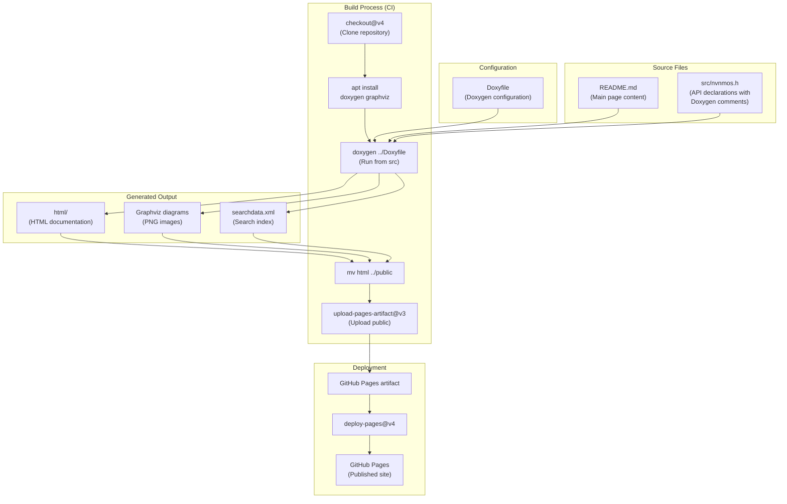
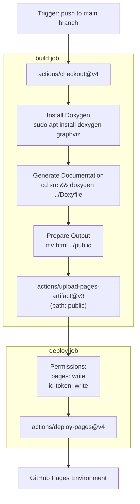

<!-- source: DeepWiki mcp.deepwiki.com · repo NVIDIA/nvnmos · page 8.2 Documentation Generation · fetched 2026-10-26 -->

# Documentation Generation

<details>
<summary>Relevant source files</summary>

The following files were used as context for generating this wiki page:

- [.github/workflows/pages.yml](.github/workflows/pages.yml)
- [Doxyfile](Doxyfile)

</details>


This page describes the automated documentation generation system for the nvnmos library. The system uses Doxygen to extract API documentation from source code comments and deploys it automatically to GitHub Pages via continuous integration. For information about the broader CI/CD pipeline including build and testing workflows, see [CI/CD Pipeline](#8.1).

## Overview

The nvnmos library uses a two-stage documentation pipeline: Doxygen generates HTML documentation from annotated source code, and GitHub Actions automatically publishes it to GitHub Pages on every push to the main branch. This ensures the published documentation always reflects the latest API state.

**Documentation Sources:**
- Public C API header: [src/nvnmos.h]()
- Project README: [README.md]()

**Outputs:**
- HTML documentation with search functionality
- Graphviz-generated class and dependency diagrams
- Hosted at: `https://nvidia.github.io/nvnmos/`

Sources: [.github/workflows/pages.yml:1-41](), [Doxyfile:870](), [Doxyfile:1067]()

## Documentation Generation Pipeline



Sources: [.github/workflows/pages.yml:15-28](), [.github/workflows/pages.yml:38-40]()

## Doxygen Configuration

The [Doxyfile]() configuration controls how Doxygen processes source files and generates documentation. Key configuration sections are detailed below.

### Project Settings

| Setting | Value | Purpose |
|---------|-------|---------|
| `PROJECT_NAME` | "NvNmos" | Documentation title |
| `PROJECT_NUMBER` | (empty) | No version displayed |
| `PROJECT_BRIEF` | (empty) | No subtitle |
| `OUTPUT_DIRECTORY` | (empty) | Generate in current directory |

Sources: [Doxyfile:38](), [Doxyfile:44](), [Doxyfile:50](), [Doxyfile:64]()

### Input Configuration

The configuration specifies exactly which files Doxygen should process:

```
INPUT = ../README.md nvnmos.h
```

This minimal input set ensures documentation focuses on the public C API in `nvnmos.h` while using `README.md` as the main landing page.

**Key Input Options:**

| Setting | Value | Effect |
|---------|-------|--------|
| `INPUT` | `../README.md nvnmos.h` | Only document these files |
| `RECURSIVE` | `NO` | Don't search subdirectories |
| `FILE_PATTERNS` | `*.c, *.h, *.md, ...` | Accept C/C++ and Markdown |
| `USE_MDFILE_AS_MAINPAGE` | `../README.md` | Use README as index page |

Sources: [Doxyfile:870](), [Doxyfile:949](), [Doxyfile:899-943](), [Doxyfile:1067]()

### Extraction Settings

The extraction configuration determines what code elements appear in the documentation:

| Setting | Value | Effect |
|---------|-------|--------|
| `EXTRACT_ALL` | `NO` | Only document annotated elements |
| `EXTRACT_PRIVATE` | `NO` | Hide private members |
| `EXTRACT_STATIC` | `NO` | Hide static members |
| `HIDE_UNDOC_MEMBERS` | `NO` | Show undocumented public members |

This configuration ensures the documentation shows the complete public API surface while excluding internal implementation details.

Sources: [Doxyfile:491](), [Doxyfile:497](), [Doxyfile:515](), [Doxyfile:555]()

### Output Formats

```mermaid
flowchart LR
    DOXYGEN["Doxygen Parser"]
    
    subgraph "Enabled Outputs"
        HTML["HTML Output<br/>GENERATE_HTML: YES"]
        SEARCH["Search Engine<br/>SEARCHENGINE: YES"]
        DIAGRAMS["Graphviz Diagrams<br/>HAVE_DOT: YES"]
    end
    
    subgraph "Disabled Outputs"
        LATEX["LaTeX<br/>GENERATE_LATEX: NO"]
        RTF["RTF<br/>GENERATE_RTF: NO"]
        MAN["Man Pages<br/>GENERATE_MAN: NO"]
        XML["XML<br/>GENERATE_XML: NO"]
    end
    
    DOXYGEN --> HTML
    DOXYGEN --> SEARCH
    DOXYGEN --> DIAGRAMS
    DOXYGEN -.x.-> LATEX
    DOXYGEN -.x.-> RTF
    DOXYGEN -.x.-> MAN
    DOXYGEN -.x.-> XML
```

The configuration enables only HTML output with search and diagram generation, optimizing for web-based documentation delivery.

Sources: [Doxyfile:1219](), [Doxyfile:1720](), [Doxyfile:2360](), [Doxyfile:1796](), [Doxyfile:1991](), [Doxyfile:2056](), [Doxyfile:2100]()

### Diagram Generation

Doxygen integrates with Graphviz (the `dot` tool) to generate visual diagrams:

**Enabled Diagram Types:**

| Diagram Type | Setting | Purpose |
|--------------|---------|---------|
| Class Diagrams | `CLASS_DIAGRAMS: YES` | Basic class inheritance |
| Class Graphs | `CLASS_GRAPH: YES` | Detailed inheritance with Graphviz |
| Collaboration Graphs | `COLLABORATION_GRAPH: YES` | Class relationships and dependencies |
| Include Graphs | `INCLUDE_GRAPH: YES` | File inclusion dependencies |
| Included-By Graphs | `INCLUDED_BY_GRAPH: YES` | Reverse inclusion dependencies |
| Graphical Hierarchy | `GRAPHICAL_HIERARCHY: YES` | Visual class hierarchy tree |
| Directory Graphs | `DIRECTORY_GRAPH: YES` | Directory dependencies |

**Disabled Diagram Types:**
- Call/Caller Graphs (`CALL_GRAPH: NO`, `CALLER_GRAPH: NO`) - Would significantly increase generation time

Sources: [Doxyfile:2338](), [Doxyfile:2402](), [Doxyfile:2411](), [Doxyfile:2478](), [Doxyfile:2487](), [Doxyfile:2518](), [Doxyfile:2527](), [Doxyfile:2499](), [Doxyfile:2511]()

## GitHub Actions Workflow

The [.github/workflows/pages.yml]() workflow automates documentation generation and deployment. It consists of two jobs that run sequentially.

### Workflow Structure



Sources: [.github/workflows/pages.yml:6-9](), [.github/workflows/pages.yml:12-28](), [.github/workflows/pages.yml:30-40]()

### Build Job Steps

The build job executes the following steps on an Ubuntu runner:

**Step 1: Checkout Repository**
```yaml
- name: Checkout repository
  uses: actions/checkout@v4
```

Sources: [.github/workflows/pages.yml:16-17]()

**Step 2: Install Dependencies**
```yaml
- name: Install Doxygen
  run: sudo apt update && sudo apt install -y doxygen graphviz
```

Installs:
- `doxygen`: Documentation generator
- `graphviz`: Required for diagram generation (provides the `dot` tool)

Sources: [.github/workflows/pages.yml:19-20]()

**Step 3: Generate Documentation**
```yaml
- name: Generate Documentation
  run: cd src && doxygen ../Doxyfile && mv html ../public
```

This command:
1. Changes to `src/` directory (Doxygen is run from here to resolve relative paths in Doxyfile)
2. Executes `doxygen ../Doxyfile` (generates HTML in `html/` subdirectory)
3. Moves `html/` directory to `../public` (staging directory for deployment)

Sources: [.github/workflows/pages.yml:22-23]()

**Step 4: Upload Artifact**
```yaml
- name: Upload Documentation Artifact
  uses: actions/upload-pages-artifact@v3
  with:
    path: public
```

Uploads the `public/` directory as a GitHub Pages deployment artifact.

Sources: [.github/workflows/pages.yml:25-28]()

### Deploy Job

The deploy job runs after the build job completes successfully:

```yaml
deploy:
  needs: build
  runs-on: ubuntu-latest

  permissions:
    pages: write
    id-token: write

  steps:
  - name: Deploy to GitHub Pages
    uses: actions/deploy-pages@v4
```

**Required Permissions:**
- `pages: write` - Permission to deploy to GitHub Pages
- `id-token: write` - Permission to generate deployment tokens

The `deploy-pages@v4` action takes the uploaded artifact and publishes it to the GitHub Pages environment.

Sources: [.github/workflows/pages.yml:30-40]()

## Generated Documentation Structure

When Doxygen completes, it generates a comprehensive HTML documentation site with the following structure:

### Directory Layout

```
html/
├── index.html              # Main page (from README.md)
├── annotated.html          # List of all documented structures
├── files.html              # List of source files
├── globals.html            # Global functions and types
├── search/                 # Search functionality
│   ├── searchdata.js
│   └── search.js
├── *.html                  # Individual entity documentation pages
└── *.png                   # Generated Graphviz diagrams
```

### Key Documentation Pages

| Page | Content | Generated From |
|------|---------|----------------|
| `index.html` | Project overview and getting started | [README.md]() via `USE_MDFILE_AS_MAINPAGE` |
| `nvnmos_8h.html` | API reference for nvnmos.h | [src/nvnmos.h]() declarations |
| `structNvNmosNodeConfig.html` | Node configuration structure | `NvNmosNodeConfig` in [src/nvnmos.h]() |
| `structNvNmosSenderConfig.html` | Sender configuration structure | `NvNmosSenderConfig` in [src/nvnmos.h]() |
| `structNvNmosReceiverConfig.html` | Receiver configuration structure | `NvNmosReceiverConfig` in [src/nvnmos.h]() |
| `globals_func.html` | All API functions | Function declarations in [src/nvnmos.h]() |

Sources: [Doxyfile:1067](), [Doxyfile:870]()

## Documentation Maintenance

### Updating Documentation

Documentation updates occur automatically when:
1. Code is pushed to the `main` branch
2. Doxygen comments in [src/nvnmos.h]() are modified
3. [README.md]() content changes

No manual intervention is required for deployment.

### Local Documentation Generation

To generate documentation locally for preview:

```bash
# Install dependencies (Ubuntu/Debian)
sudo apt update && sudo apt install -y doxygen graphviz

# Generate documentation from repository root
cd src
doxygen ../Doxyfile

# View generated documentation
cd html
python3 -m http.server 8000
# Open browser to http://localhost:8000
```

Sources: [.github/workflows/pages.yml:19-23]()

### Adding New API Documentation

To document new API functions or structures in [src/nvnmos.h]():

**For Functions:**
```c
/**
 * @brief Brief description of function
 * 
 * Detailed description of what the function does.
 * 
 * @param param_name Description of parameter
 * @return Description of return value
 */
bool function_name(Type param_name);
```

**For Structures:**
```c
/**
 * @brief Brief description of structure
 * 
 * Detailed description of structure purpose.
 */
typedef struct {
    /** Description of member */
    Type member_name;
} StructName;
```

Doxygen automatically extracts these comments when the workflow runs.

Sources: [Doxyfile:491](), [Doxyfile:555]()

## Configuration Reference

### Critical Doxyfile Settings

```mermaid
flowchart TB
    subgraph "Project Configuration"
        P1["PROJECT_NAME = NvNmos"]
        P2["INPUT = ../README.md nvnmos.h"]
        P3["USE_MDFILE_AS_MAINPAGE = ../README.md"]
    end
    
    subgraph "Extraction Settings"
        E1["EXTRACT_ALL = NO"]
        E2["EXTRACT_PRIVATE = NO"]
        E3["HIDE_UNDOC_MEMBERS = NO"]
    end
    
    subgraph "Output Settings"
        O1["GENERATE_HTML = YES"]
        O2["HTML_OUTPUT = html"]
        O3["GENERATE_LATEX = NO"]
        O4["SEARCHENGINE = YES"]
    end
    
    subgraph "Diagram Settings"
        D1["HAVE_DOT = YES"]
        D2["CLASS_GRAPH = YES"]
        D3["COLLABORATION_GRAPH = YES"]
        D4["CALL_GRAPH = NO"]
    end
    
    P1 --> CONFIG["Doxyfile Configuration"]
    P2 --> CONFIG
    P3 --> CONFIG
    E1 --> CONFIG
    E2 --> CONFIG
    E3 --> CONFIG
    O1 --> CONFIG
    O2 --> CONFIG
    O3 --> CONFIG
    O4 --> CONFIG
    D1 --> CONFIG
    D2 --> CONFIG
    D3 --> CONFIG
    D4 --> CONFIG
```



Sources: [Doxyfile:38](), [Doxyfile:870](), [Doxyfile:1067](), [Doxyfile:491](), [Doxyfile:497](), [Doxyfile:555](), [Doxyfile:1219](), [Doxyfile:1227](), [Doxyfile:1796](), [Doxyfile:1720](), [Doxyfile:2360](), [Doxyfile:2402](), [Doxyfile:2411](), [Doxyfile:2499]()

### Warning and Error Handling

The Doxyfile configures documentation quality controls:

| Setting | Value | Effect |
|---------|-------|---------|
| `WARNINGS` | `YES` | Enable all warnings |
| `WARN_IF_UNDOCUMENTED` | `YES` | Warn about undocumented public API |
| `WARN_IF_DOC_ERROR` | `YES` | Warn about documentation errors |
| `WARN_NO_PARAMDOC` | `NO` | Allow missing parameter documentation |
| `WARN_AS_ERROR` | `NO` | Continue generation despite warnings |

This configuration helps maintain documentation quality while not blocking deployment on minor issues.

Sources: [Doxyfile:809](), [Doxyfile:816](), [Doxyfile:824](), [Doxyfile:833](), [Doxyfile:842]()

---

